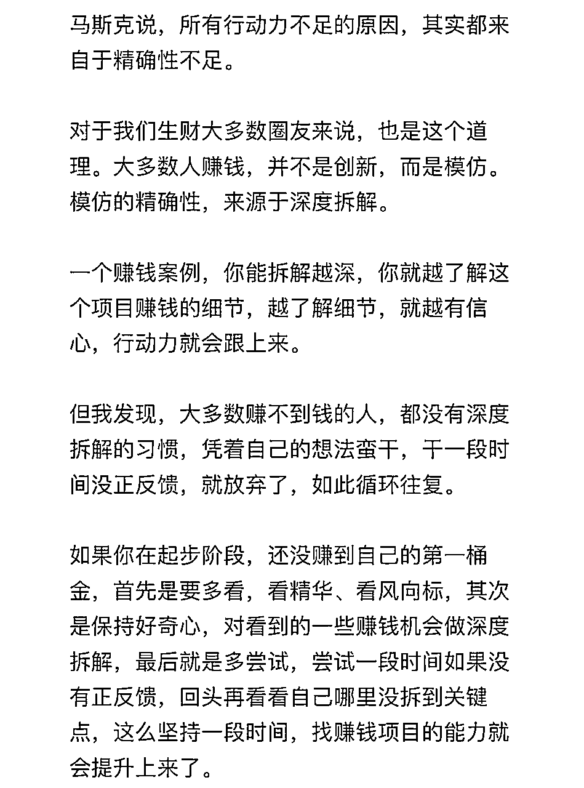

# 我眼中的行动力：从龙哥的一则帖子说起

## 先说下我是谁

我叫周威，如今在杭州三墩扎根。

过去的身份是高三式的刷题员和35岁的大厂螺丝钉，始终觉得不够踏实。于是三年前我选择裸辞在家，给自己留出创业试错的时间。

这几年一直在摸索方向，2023年碰了下微信👸号做流量主，今年则把注意力转到了📕本地生活这个赛道。

五一前后，龙哥发了一篇关于行动力的文章，让我触动很深。

说实话，我一直是个行动力薄弱的人，这个困扰已经跟了我很多年。借着龙哥这篇帖子，我把自己这些年的体感重新梳理了一遍，也想借此把行动力的认知理得更清楚一些，之后好真正把它提升上来。

我秉持批判性思维，欢迎大家来反驳。我如果能帮到哪怕一个人，也算值了。

## 一、对行动力的理解

### 1、共鸣，但不全盘接受

读完龙哥帖子开头，我第一反应是「好像就是这么回事」，但再细想又觉得表述太模糊了。

于是脑子里冒出一连串疑问：马斯克那句话到底是不是他说的？什么语境下说的？龙哥的解读真的适用于我吗？

坦白讲，我觉得马斯克那段论述和龙哥的延展，都存在不精确的问题。

大胆一点说，我认为马斯克的原话是错的，至少对我无效。

用逻辑拆开看，马斯克的意思是：行动力不足，根源是认知不够精确。换句话说，认知越精确，行动力就越强。

问题出在前提上。没有人能对一件事情做到绝对精确。

如果非要给「精确」下定义，就得不断引入「复杂」，这会变成无限递归。最终「精确」只是一个永远趋近却达不到的理想状态。

这种状态对解决问题没什么帮助，我们真正需要的是恰到好处的简化。而什么是「恰到好处」，因人而异。

所以马斯克的说法，对一部分人可能成立，对我而言却是不够、甚至是错的。

### 2、我自己的行动力拆解

回到行动力本身。

市面上对行动力的拆解很多，福格行为模型 B=M+A+P 就是一种，马斯克的精确性论也是另一种。

我更倾向于把行动力拆成三块：行动启动、行动路径、行动阈值。

*   福格模型主要解决的是怎么把行为启动起来。
*   马斯克的精确性主要对应的是行动路径，确保做事有章法不乱飞。
*   行动阈值，则是解决要做到什么程度才见效的问题。因为只有行为的强度和效率累计到一定临界点，结果才会显现。

本质上，马斯克谈的精确也涵盖了阈值，但阈值太关键了，值得单独拎出来强调。

厘清这三点后，我接下来要做的事就很清晰了：

1.  用福格行为模型去设计自己的启动开关，让行为更容易发生。
2.  不断收集项目信息，反复复盘验证，把认知的广度和深度持续拉高。
3.  探索并验证行为的强度和效率，找到能跨越阈值的量级。强度和效率是可以量化的，也能用工具和流程去优化。产品化、矩阵化、外包化，这三板斧就是提升效率的极致玩法。

## 二、我在实践中总结的行动力提升办法

### 1、源头是目标，目标要落到时间投入上

做一个项目，第一步必然是定目标。但目标必须被拆解成可执行的动作，并配上具体的时间表。

就是在什么时段，做哪件具体的事，做多久。

为什么要这么细？因为结果不可控，投入的时间和行为才是可控的。只有把概率拉高了，结果才更靠谱。

### 2、行动力的地基是勤奋

勤奋不是指朝九晚五的8小时，而是8小时之外的那份额外付出。

勤奋包含四个层面：加时加码投入、时间管理做得好、目标排序有优先级、保持持续的执行力。

落到实操上，勤奋=时间管理+执行效率。

### 3、效率提升的两个抓手

效率=行为数量/用时。想在同样时间内把效率拉高，就要做到行为不间断，单次行动耗时尽可能短。

1.  先排掉情绪，保持行为连贯
我的很多中断都源于情绪：焦虑、迷茫、怀疑、绝望。停滞时，其实是在和情绪纠缠。

要学会识别情绪，然后立刻把它落回具体问题。绝望了就去找解法，迷茫了就把思路理清楚，不要把时间耗在情绪里。

「听话照做」的核心不是盲从，而是别让情绪干扰执行。

2.  打磨工具，提速增效
王川说过：没有金刚钻别揽瓷器活。人生的大部分时间都应该花在打磨钻头上。如果你在某些环节的工具效能提升十倍，你能解的问题层级就完全变了。

我自己就深有体会。👸号选题一度卡我很久，后来用了批量抓取文章的工具后，选题焦虑基本消失。

3.  给效率定标准
效率好不好，取决于是否达到了产生结果的临界值。

比如想出爆款，单账号的命中率是30%，那同时间维护3个账号，出爆款的概率就基本被锁定了。

新手没有体感怎么办？看地图，或者看同行做出来的人的实际效率，把他们的效率作为你的基准线。

### 4、让行动力自运行的机制

1.  立flag：给自己立一些能兑现的公开承诺，制造点社交压力。
2.  找人PK：挑一个你认可的领域高手作为对手，瞄准他。
3.  成为他人的「人质」：把自己的任务嵌进别人的工作流里，让别人依赖你的产出。
这本质上是一种承诺。当别人信任你，并且他有一定控制力时，你就会被这份信任推着走。信任带来承诺，承诺带来压力，压力才转化为行动力。
4.  量化打卡：没人监督时最容易松懈。但如果不达标就完全没效果，把动作定量化、强迫自己坚持，积累一段时间后结果会超出预期。

### 5、降低难度：先把一件事做透

做项目时，经常有人被方法论淹没。看到一个方法就用，用到瓶颈就去找下一个方法，最后看了一堆干货反而更迷茫。

我做📕选题时就中招过。学了GNSLP五步走、选题库公式一堆体系，结果实操起来太重，不如我继续扒对标账号学得快。

在没把一个方法吃透之前，别横向扩张。把一种打法用到极致，用时间和精力去砸一个点，回报最大。

## 三、影响行动力的几个隐形坑

### 1、别总说“我就是练练手”

这是李笑来提到的点，我感同身受。只要你心里是练手心态，这件事就做不好，下一件也做不好。

必须真的当回事，投入专注去做。不要回避商业，该收钱就收钱，免费和公益会让反馈失真。

现在脑力对结果的贡献远大于体力，而大脑是可塑的。你积累的经验会重塑大脑。所以从一开始就玩真的，让大脑在真实环境中进化，比任何模拟都重要。

大多数人都在骗自己：我就是练练手。只有少数人从第一天就追求做到最好。

### 2、别在自怨和后悔上浪费时间

总结完教训和经验后，立刻向前看就好。不要反复回溯。

王兴说过，他回忆过去不会超过五分钟。真正走得快的人都是未来主义者，不沉溺于自怜。

### 3、必须给时间和亏损划底线

创业充满不确定性，不设时间线和亏损线，你会一直焦虑。

先把止损线定好，按计划去干。到了时间或亏损额度，再决定是继续还是撤退，心就稳了。

## 写在最后：先干再说，才有味

这篇是我加入赚钱一年来的复盘，也是三年多跌跌撞撞的经验沉淀，后续我会持续更新。

看再多文章都不如自己上场干一场。有句话我见过：「如果你没能力花几个小时、几天甚至几个月去思考战略，最终你会浪费好几年。」

但这句话对很多人不成立，因为大部分人不会思考，也没养料。

真正的思考需要多维信息、清晰的逻辑框架、反复验证和持续优化，还需要实践中真实的交互和情绪体验。

把实践纳入思考，才能低成本地完成战略思考。对重要事情，几个月到几年的实践式思考，是绕不开的成本。

文章和鸡汤读起来爽，但想喝到味里，就必须自己下功夫。

真传一句话，简单无趣，下了功夫才有趣。假传万卷书，话越绕越有理，其实核心不真，需要包装才好看。

## 灵感碎片：

1，健身的精髓是力竭，行动力的精髓是每一次都做到足够好。

2，为什么没赚到钱？因为行动没到位。为什么没到位？情绪、认知、行动本身、正反馈不足，因素很杂。

但归根结底是行动力问题。因为认知在实干中会变好，正反馈是在做对事后才来，情绪也在做事中被消耗掉。

所以做不做、怎么做都不重要，重要的是先做起来。