# 别整虚的，互联网变现就靠这两件事

> 来源：[https://icbny036uy.feishu.cn/docx/RO6TdFEv5o9PaNxVkwqcRQrfnee](https://icbny036uy.feishu.cn/docx/RO6TdFEv5o9PaNxVkwqcRQrfnee)

# 一、用最小成本验证闭环

说在前面，这篇内容绝不是标题党。大道至简，线上赚钱的套路看似千变万化，实则抓住下面两点就够了：

1. 毫不拖延的执行力；
2. 往上看一层的思维力。

下面是我前不久用支付宝红包码实操的一个微型闭环，从零跑通到当日到手近3000元现金回款，还带了长尾收益的拆解。授人以鱼不如授人以渔，希望你能照着这套思路，尽快跑通自己的第一单。

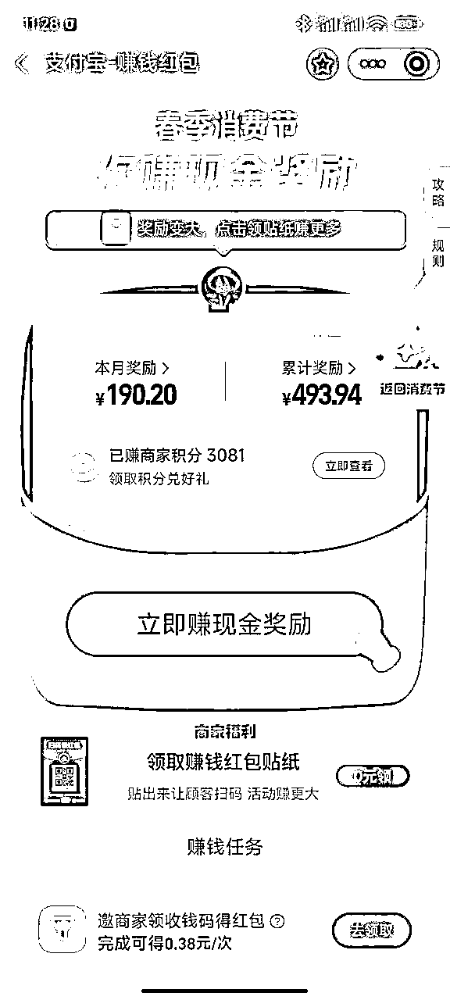

# 二、支付宝红包码实操全记录

4月25号一早起床刷朋友圈，发现身边一波人都在晒支付宝红包码，当时我就意识到窗口来了。

想在网上赚钱，先得把信息源盘活。多加几个圈子里的大佬好友，平时多逛朋友圈，他们在干嘛就是你的风向标。

## 1. 先抄作业再做差异化

第一步是去找可复制的样板。我翻到一个朋友发的动态，是他的红包码配一张别人扫出十几块的到账截图。

这个呈现方式很抓人，十几块正好能买杯早餐，对用户来说零门槛。

我立刻拿来用，但做了升级。码是用我自己收到的商家实拍图，不是网上扒的图。文案也换了说法，用了“发红包啦”“压箱底”“不小心放出来”“免费早餐”这类更带情绪的词。

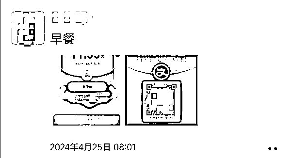

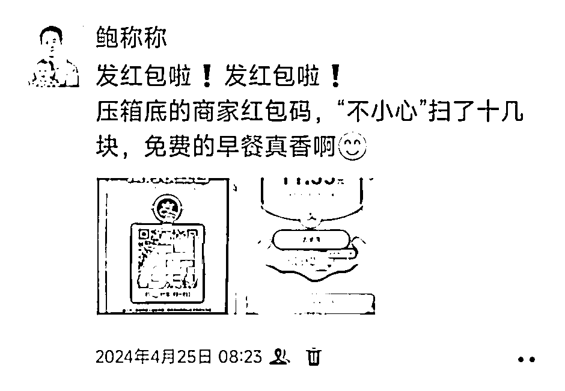

实拍图比纯截图更有信任感，再配合钩子文案，反响明显不错。

半小时后我又补了一条：又来一个14块的红包。就是在暗示这个码的出码率高，错过就亏。

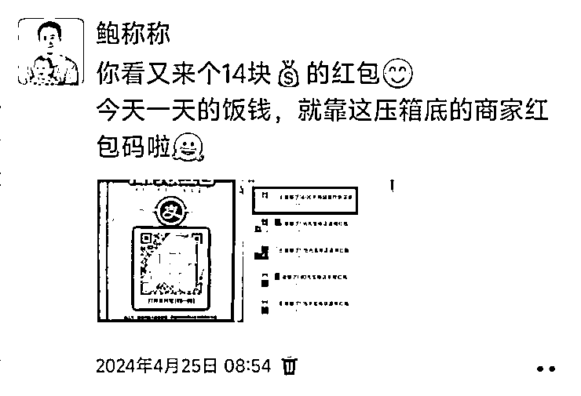

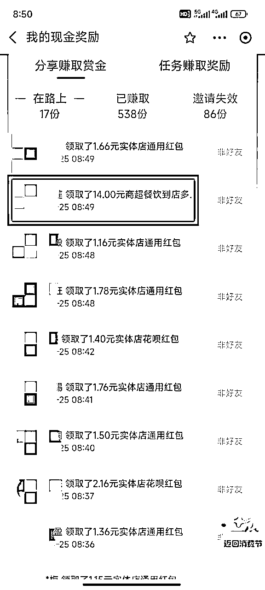

## 2. 工作号朋友圈+标签群发

人天生吃便宜。遇到观望的客户，不会一直等你软磨，最直接的是给个优惠理由。

做活动要有个由头，不能天天打折。可以捆绑特殊节点，也可以搞第100位、第200位的名额优惠。我们交付群之前就常用这招，转化很稳。

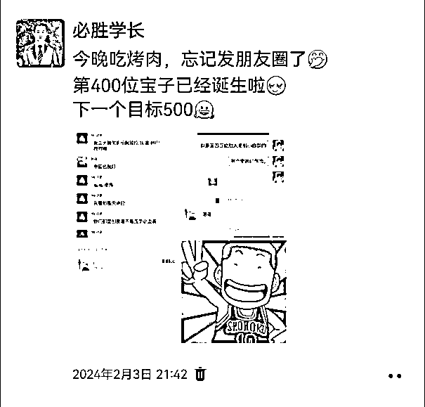

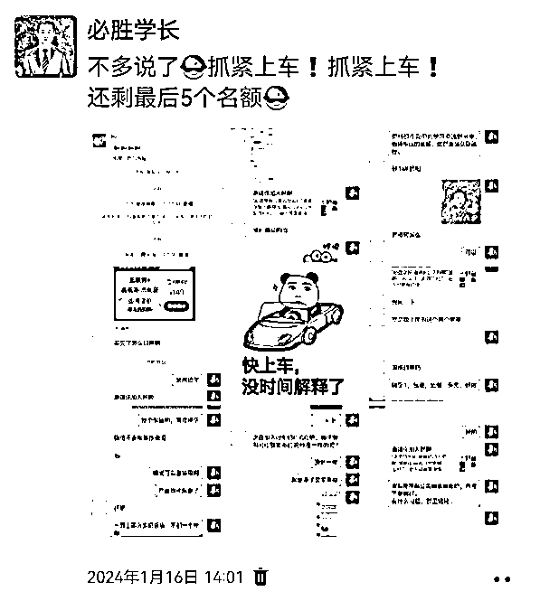

这次我就以红包码为引子，先发一波朋友圈，再按标签定向群发。直接捞出一批之前犹豫的潜在客户，甚至有直接升级高客单的。

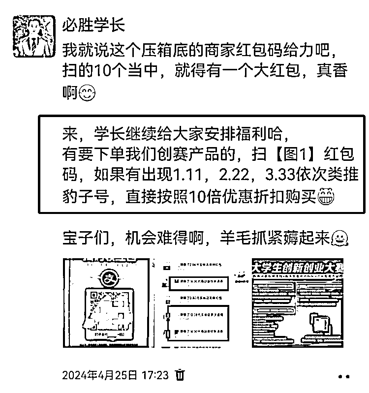

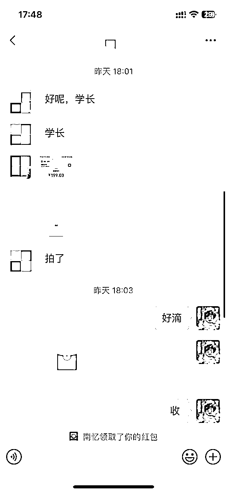

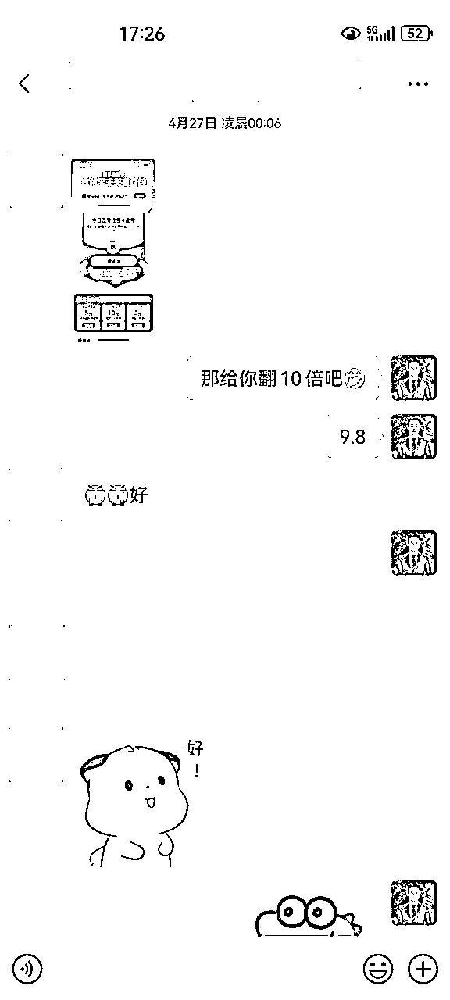

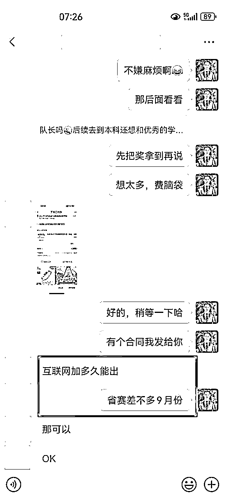

后面就是持续在朋友圈做热度维护，晒付款截图。万一当天没成交，也会用P图或者小号互动来保持活跃度，这里就不展开了。

## 3. 持续迭代玩法

之前见过有人用王思聪微博做红包码做传播，PS内容后丢到各大平台引流，效果也很可观。

我当时灵感是雷军。小米SU7刚热，借势雷军微博做了一版同款内容。

我只发在了自己的微信朋友圈，没上自媒体。如果搬到公众平台，声量应该会更大。

到这里，个人端的红包码玩法算是收束了。当然玩法还能再延展，也欢迎大家补充。

接下来是进阶打法。

## 4. 把玩法打包卖

单做红包码天花板明显，私域有限，而且同质化严重，不可持续。

我当时在做个人IP，想到的是：很多人卡在互联网赚第一笔钱。我不如把这次跑通红包码的完整路径打包成内容，教别人先赚到第一笔钱。

想到的事立刻开干。动作永远是第一步，出来混饭吃，第一步就是先站出来。

我当晚就开始朋友圈发售，同时我在做小红书项目，想建个交流群，设置9.9元门槛，没多久就有人付费进群。

这说明一个道理，只要你敢分享、敢卖，总有人买单。

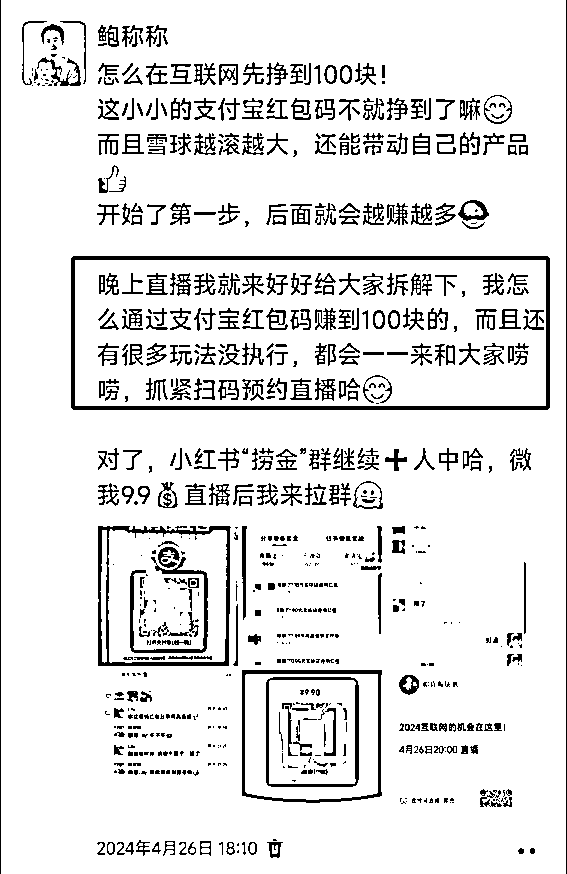

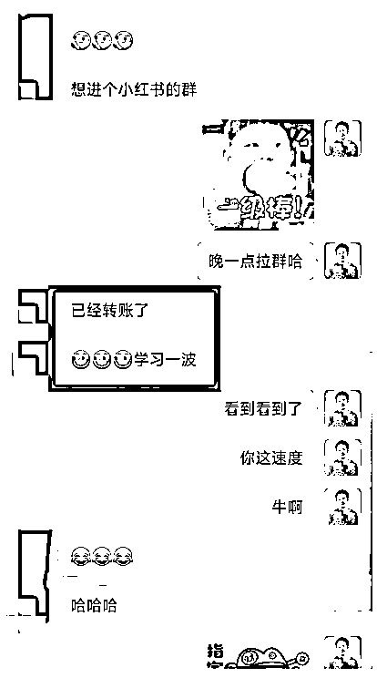

当晚8点我还在视频号开了场直播，聊了差不多一小时。虽然小，算是个人IP的第一块敲门砖。

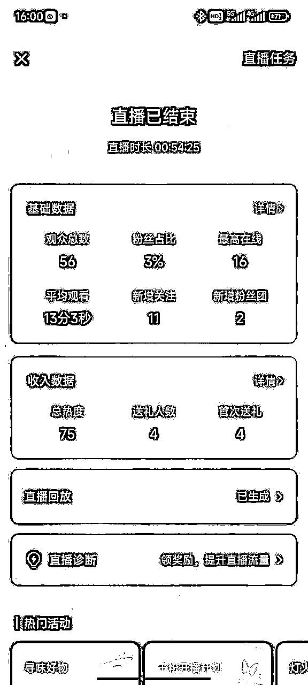

## 5. 收尾放大

做到这个阶段，已经有初步结果。这时候就要把内容沉淀下来，同步到公众号和各付费社群，用来持续做个人曝光，为IP加码。

还可以把这份文档改成图文或短视频，分发到各平台，一套内容多处复用。后续我会慢慢推进。

# 三、复盘与反思

## 3.1 做得还不错的地方

### 3.1.1 执行力

执行力！执行力！还是执行力！

出来赚钱第一件事，先出来。

4月25号发现趋势后，我当天就跟进上线。很多人卡在第一步永远只能看别人赚钱。

### 3.1.2 迭代力

对标后不是照抄，而是持续优化文案和呈现，让朋友圈更有辨识度和吸引力。

同时不局限于私域，还主动想办法触达公域。

### 3.1.3 高一层的格局

不只盯着红包码本身的收益，而是用红包码做钩子，带出营销优惠，撬动额外成交；

做到一半就开始考虑把方法论产品化，用来打造IP，并通过直播拉近用户距离。

这种从终局倒推的思路，能少走很多弯路。

## 3.2 还能做得更好的地方

### 3.2.1 公域流量没吃透

发现玩法时因为精力分散，没第一时间去更大的公域平台拿流量。其实群里早在4月25号前就有提醒红包会加赏金，我平时没怎么看社群，错过了准备时间。现在我养成习惯，经常刷社群看风向。

### 3.2.2 缺少裂变机制

个人精力有限，可触达的人群也有限，没设计裂变玩法，后续可以加码裂变扩大覆盖。

### 3.2.3 直播平台太单一

这次只在视频号做了小范围直播，没去更大平台曝光。下一步可以多平台开播。

# 四、最后说两句

我是称称，89年的老互联网人，二胎全职奶爸，河狸创赛教练，仍在创业路上持续学习。

现在主攻小红书大学生创赛赛道，自己带了个小工作室，手上积累了1w+大学生私域用户。

一个人走得快，一群人走得远。

在我的地盘，咱们称兄道弟，一起称心如意。