# 90天，把K12获客做到百万营收：我的完整复盘

各位圈友，我是河南的逸尘。去年离开一阵子，今天回来聊聊一段真实经历。

最近公司业务有些下滑，和身边的同行朋友交流，大家也都在承压，整个行业卷得不轻。我开始回看自己过去是怎么破局的，于是把去年5月跑通的一个项目完整复盘了一遍。既是为了给自己打气，也希望能给正在找方向的朋友一点参考。

去年开年我先做ChatGPT。那时候刚离开实体行业，从地市迁到郑州，和几个伙伴组了个小团队，一起测试新玩法。那阵子我和河南的几位圈友合办了一个ChatGPT交流社群，项目测试由我负责对接资源，其他伙伴负责落地，我还在站内发过一条观察动态。

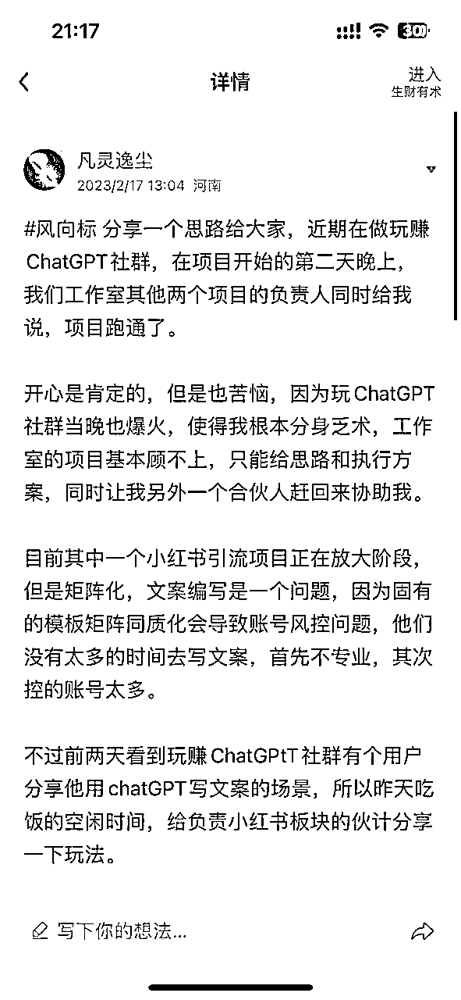
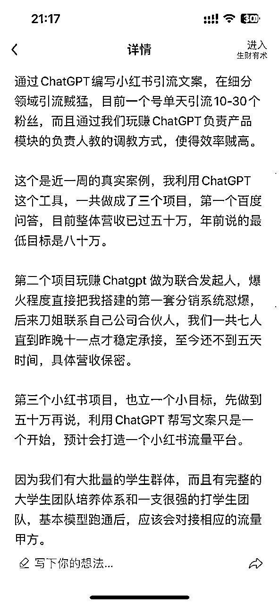

## 一、背景复盘

### 1、为什么优先做获客

当时选这个方向，理由很直白：启动成本低，正反馈来得快，天花板也高，而且几乎每个行业都缺客户。以前跑过不少项目，最深的体会是：客户才是生意的根本，所以搞客户的能力必须掌握在自己手里。

之前我的主业是教育，副业是数码。21年底，副业亏掉200多万，还背了50多万欠款；读书时买的那套房子，月供5000元，再算上房租和生活开销，每个月固定支出超过8000元。这样的压力逼着我选项目时必须非常谨慎。

那几年的习惯是：先观察其他人怎么变现，再把别人的长处学过来，在一次次试错中找到适合自己的路。

我从20年开始进赚钱，基本每个月都跑一趟郑州，认识了很多圈友，看他们怎么做事。21年，我在郑州结识了更多同路人，也慢慢看清哪些行业值得切入。更重要的是，我认识了一位做获客的老大哥，他做得非常厉害，我时常登门请教，这才对线上获客有了基础认知。

22年他在国学方向做获客时拉过我，但当时我正管着一个考研寄宿制校区，从搭建、招生到管理都压在我身上，只能顺手做了些测试，可惜那时我对线上的理解太浅，没能拿到正反馈。校区事务缠身，最后只能不了了之，坐看他把生意一步步做大。

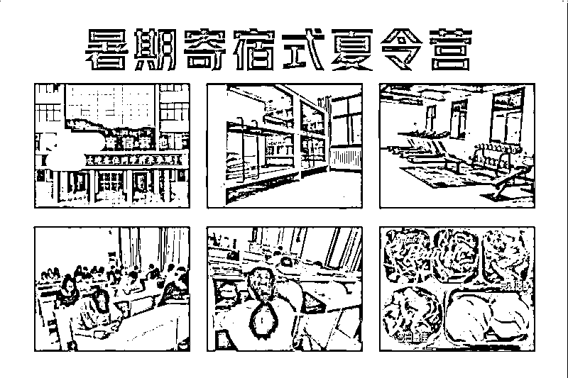

### 2、条件越难，越要主动求变

寄宿校区后来出了状况，我对那类项目彻底失望，下定决心换一条路。最难的时候我甚至想先去找份工作：一是手里的钱非常紧，教育的工资加业绩还欠我十万没给，股份也不算；二是自己也清楚，这些年创业都是野路子，想进一家公司偷师学艺。

我去找那位老大哥聊，他劝我不要去。他说去那些公司待上一年两年，也未必能学到真东西，关键要先想明白自己到底要业务还是要管理，这两样他都可以教我。

后来有一天深夜，现在的搭档瑞哥给我做了很彻底的分析，劝我重新选赛道、从零开始。他说得很直白：一旦走上创业这条路，就没法折返，早晚都要出来，早点出来总比晚点好。项目会过时，人不会。有一群三观一致的人同行很重要，在需要的时候可以互相托底。

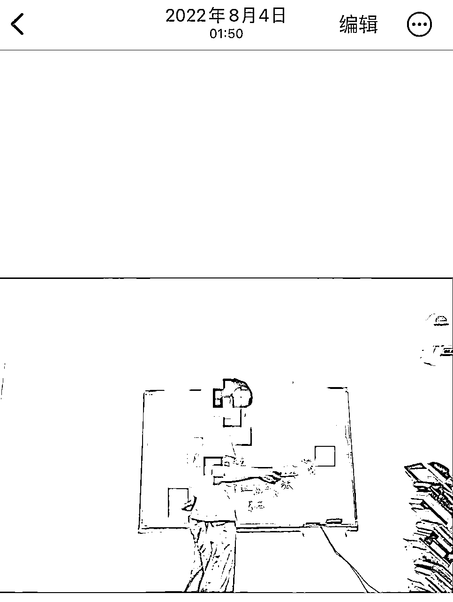
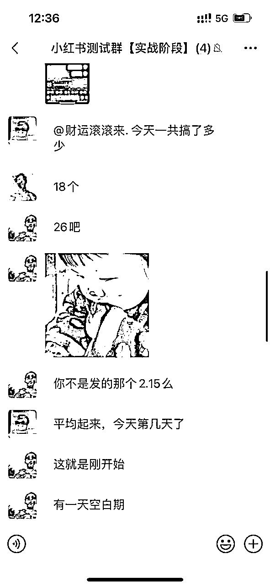

于是我开始全力扑到线上业务上，前前后后试了多种玩法，收获都很好。这些经历也一遍遍强化了一个判断：获客能力才是做生意的底盘。

23年我离开地市，搬进郑州，就是想离那位老大哥近一点，方便随时去取经。团队也拆成两条线：一条做视频号上的国学直播获客，另一条在种草平台用图文笔记获客，两边都很快跑出了成绩。只是那阵子的重心全在ChatGPT上，更多是被事情推着走。

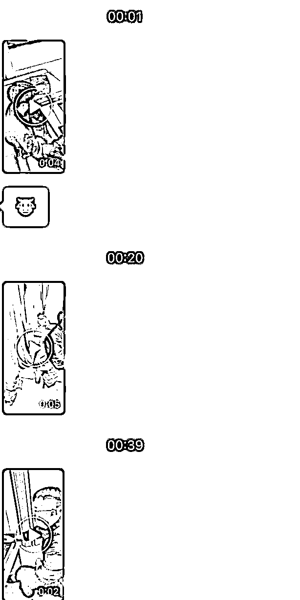
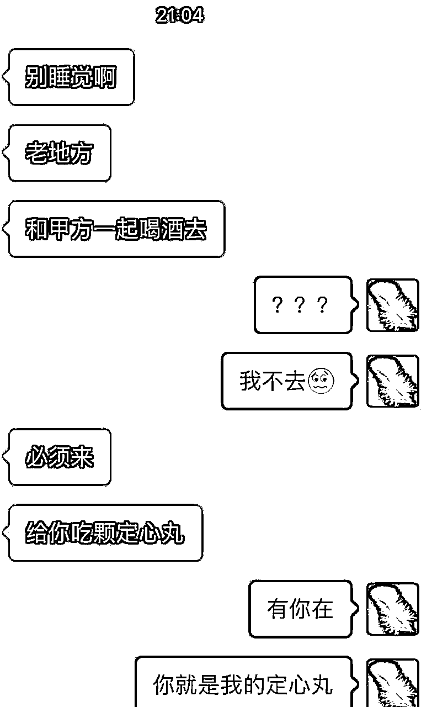

种草平台那个图文项目，做的是绘本阅读和角色扮演游戏，后端走的是私域项目加盟路线。这层关系是春节前一个河南圈友牵的线，说他朋友刚好需要这类客源。年后我们调了两个人做小范围测试，4个号两天就做到了日均20个；之后让搭档招了些临时人手来增量，30天内跑到了3000条线索。

原本还想继续铺开，但这个方向能做的量很有限，承接方那边的成单节奏又太慢，大量线索被白白浪费，最后一周对账时还遭遇扣量，只能先把项目搁一搁。

但我还是想继续经营获客这件事，于是开始找能收线索的通道，中间测过旅游、品牌加盟之类的方向，都没太跑起来。不过一路摸下来，我对获客行业有了更深入的理解，虽然仍算个新手，至少不再两眼一抹黑。

后来我赴杭州参加了一场圈友聚会，和几位认识了两三年的老朋友交换了近况。我聊了手头的业务，也说了卡点；他们有需要时也会来找我，能帮的我都尽量帮。没想到这些互动，给后来的合作埋了一块重要基石。

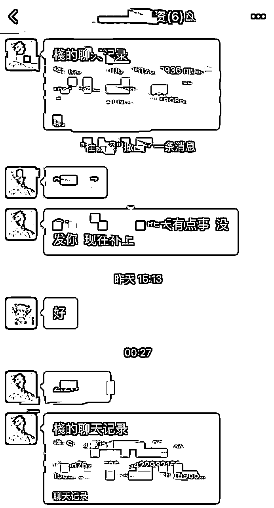

### 3、所有积累，都在等一个机会

当时聚会上认识的那位圈友说要跑一趟郑州来看我，还带来一位本地老板，想聊ChatGPT这条线怎么做。我没有藏私，问什么答什么，聊得越深，彼此的了解也越透。

5月，对方说手里有100万预算，需要K12的客户线索，问我能不能接。这个赛道我没碰过，不敢打包票，决定先小范围试一下。过了两天，合同敲定，预付款也同步到账，团队分成两路同时开测。过程里自然有一些细节要磨，但因为彼此认可，合同更多的只是走个流程，给双方一份最基础的约束。

信任能让协作顺畅很多。我不担心他不结算，也不担心他把线索用在歪处；他不用担心我造假，也不用担心我把线索二次倒卖干扰他的转化。线上聊一千遍，不如线下见一面，只有真的面对面过，合作才会发生。

测试期共跑了1000条线索，我方和大学生团队各承担了一路，两边差不多同时跑出结果。大学生团队也能稳定跑通，说明最小可行方案已经成立，接下来可以直接铺量。我原以为后面会一路顺风，哪知道真正的困难才刚刚开始。

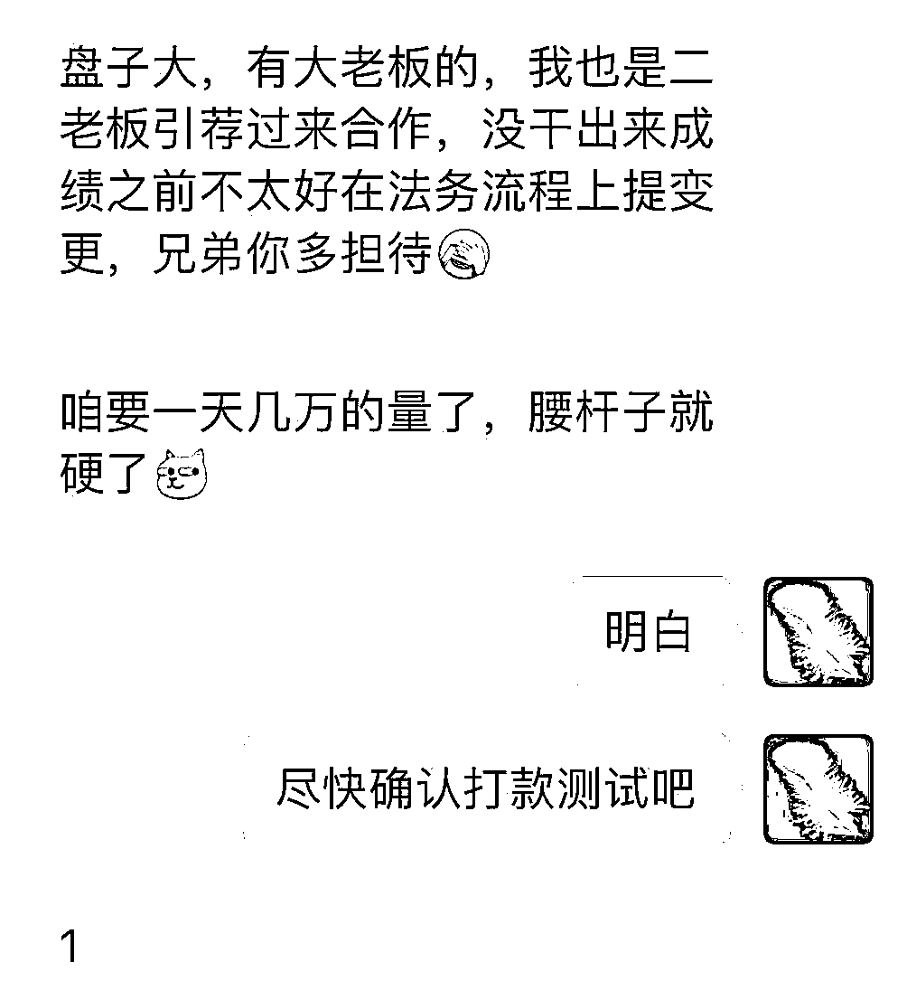
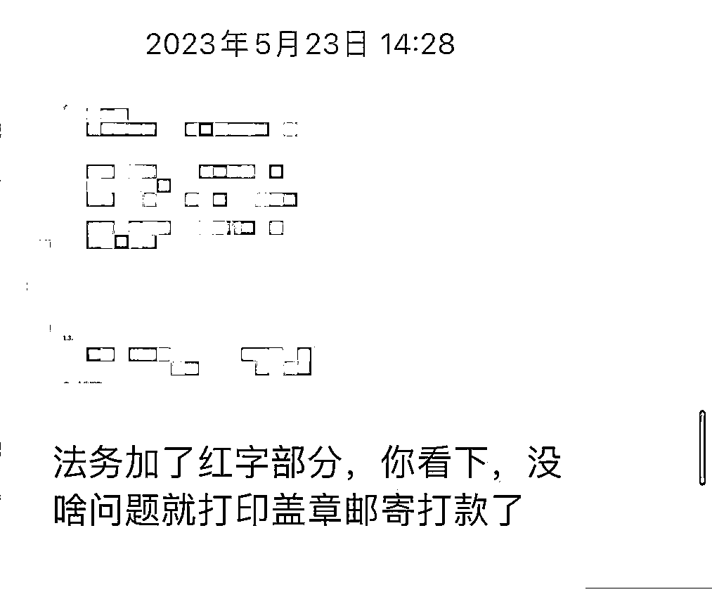

## 二、项目背后的逻辑

### 1、线索买卖是怎么运转的

先说我对这个行业的理解：网络平台快速兴起后，很多公司把原本在线下获客的动作搬到了社媒上，比如抖音、快手、种草平台，靠视频或图文笔记把人引到微信，再由销售完成转化。这种把目标用户吸引过来的过程，业内叫引流。

平台大多不欢迎站外导流，带着营销味道的账号很容易被压制。那些想靠内容获客的公司，手机、人员、场地样样都不能少，成本太高。于是很多人选择把获客交给外面的专业团队，既能转嫁风险，又能在最短时间内补上供给。费用按人头算，拿到一个潜在客户的联系方式就结算，单价通常在1到200元之间，具体看线索好不好拿、准不准。把引来的客资卖给有需求的公司，就是这条产业链的变现方式。

### 2、常见的几种合作模式

在我看来，只负责搞线索的一方相当于乙方；另一边接线索、做转化的公司有自己的销售和产品，扮演甲方角色。不过双方地位不固定，会随阶段和体量互换：线索多、质量高、转化好，乙方自然硬气；反过来甲方会更强势。但既然坐下来合作，总体仍然算对等。

常见的结算方式有CPA、CPS、CPA+CPS、ROI这几种，目标都一样：大家都要赚到钱。

CPA按有效行为付费，比如一个有效入群、注册、激活或交易算一次，费用等于有效数量乘以单价，公式是消耗除以转化。通常先谈一个固定价，后面有变化再协商调整。

CPS按成交付费，用户在承接方那边完成购买后，按成交总额乘以约定比例计算费用，比例随转化情况浮动。

CPA+CPS是两者叠加：先按每个有效线索X元结算，后续转化完成、双方确认后，乙方再从自己带来的成交额中按约定点数抽成。

ROI就是投产比，把成交总额除以花费就能算出来。举个例子：一个客户单价100，ROI必须大于1.2，超过某个区间会对应不同阶梯价——ROI不超过1.2时按GMV除以1.2结算，1.2到1.4之间按120结算，1.6以上按160结算。

每种方式都有各自的优劣，具体用哪种要看情况，靠双方谈、靠数据算，最后落在一个双方都觉得合理的区间里。定价会受到很多因素影响。

### 3、引流的标准动作

操作上不复杂：先在社媒发用户想看的内容，再用钩子诱导对方留下联系方式，最后把名单交给甲方。

我们接活时会先出内容引来用户问询，再用私信话术引导对方留下联系方式，收集整理后批量发给甲方，甲方按照有效的联系方式给我们结算。

最简单的方式是直接收联系方式和登记工具，对方主动添加好友后，用计数工具来统计。再复杂一些，可以使用扫码图、短链或第三方的小工具。只要甲乙双方在统计口径上没有异议，这套流程就算成立，核心是为了结算公平、防止数据掺水。

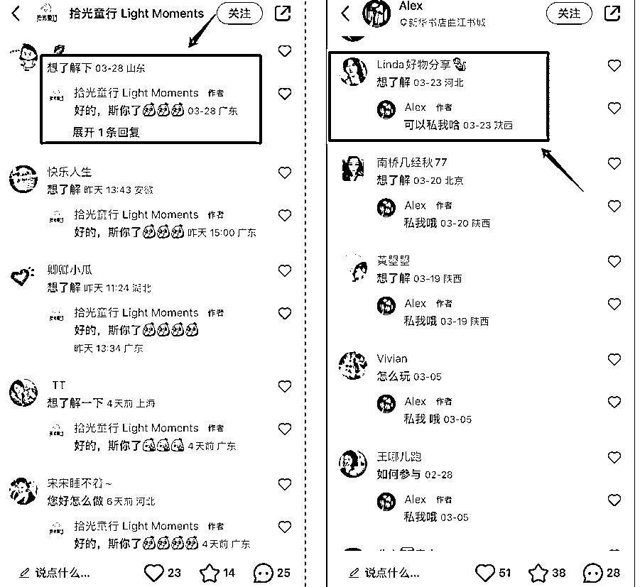
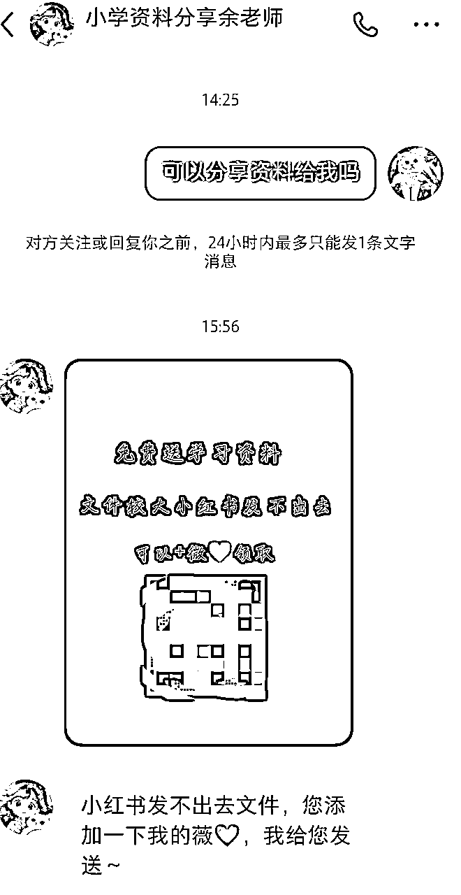
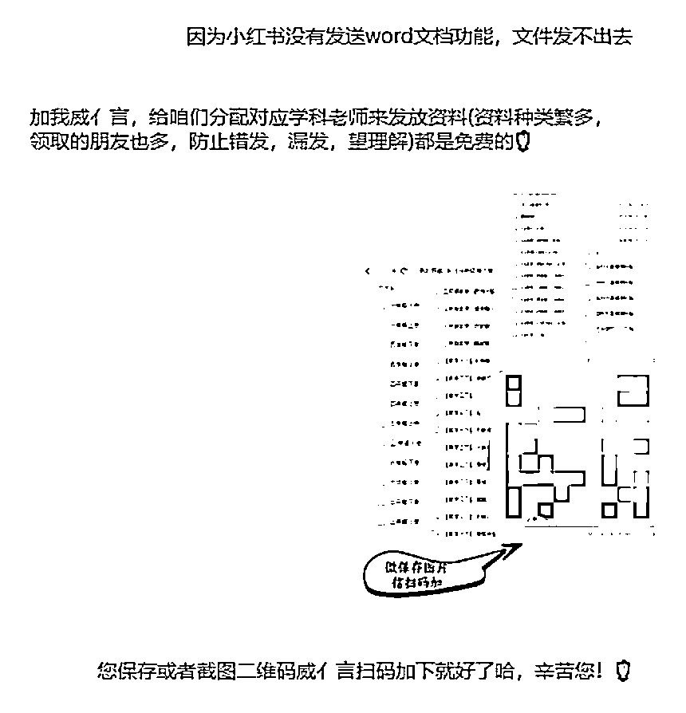

## 三、项目执行拆解

把这件事切成四步：产出内容吸引用户—设计钩子获取信息—安全导流减少损耗—核对数据完成结算。

### 第一步：做出让人想看的内容

产出笔记这件事门槛最低，但做好的难度也最大。早期直接模仿同行，就能接到不少咨询；后来平台规则越收越紧，对内容质量的要求也不断提高。

团队从自己摸索，到请深耕种草社区的朋友上门辅导，再到跟那些头部供给方交换打法，最后复制给来学习的伙伴。我和搭档没有亲自上一线，而是遇到问题再一起调资源解决。正因为不在一线，更需要靠大量信息掌握前线的真实情况，帮他们解决问题，再把这些经验整理成统一打法，省去很多沟通成本。

我们后来还做了一套SOP，本意是减少重复沟通。有人看到觉得有用，想跟着一起做，我们就带着跑。看到数据稳定了，我调出1名全职加2名远程帮手，靠这套SOP加上群里的日常分享把盘子铺开，前后带了将近200人一起做。

### 第二步：用诱饵换到联系方式

吸引K12用户最有效的诱饵，通常就是学习资料。覆盖一年级到高三全部学科的资料，我们手里都备齐了。起初资料由甲方给，随着供给方越接越多、平台审核越来越严，我们得持续挖掘新的热门资料。

我开始自己扩充资源库。22年，一个朋友想在种草平台做获客，再在私域卖学习资料，来找我要过内容。我帮他解决了，也认识了一批做学习资料的朋友。我们先把手里有的东西拢到一起，又找各路朋友补齐缺口，后来索性把那些卖资料的人也变成我们的供给方。他们要的客群和我们要的一致，商业模式又不打架，在不干扰甲方成单的前提下，我们对他们的私域用户重新触达一遍，相当于额外多收一笔钱。

之后不少合作方就是顺着这条线来的：都是之前微信上卖学习资料的人。照着这个思路，我们有个负责渠道的伙伴把种草平台上做学习资料的博主挨个私信了一遍，和其中很多人建立了合作。

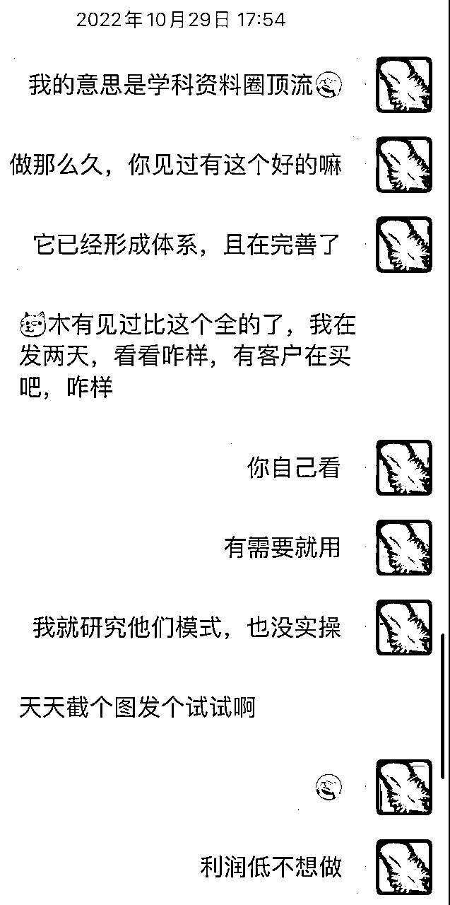
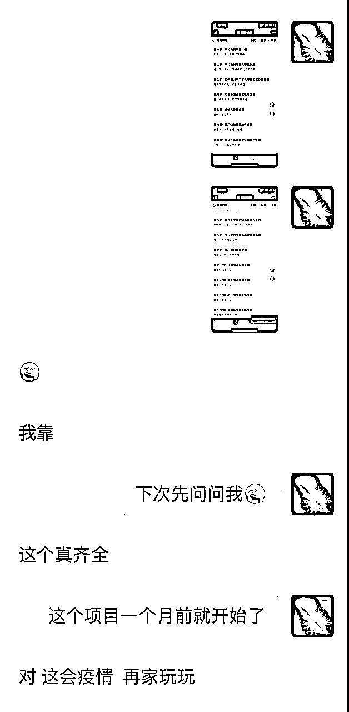
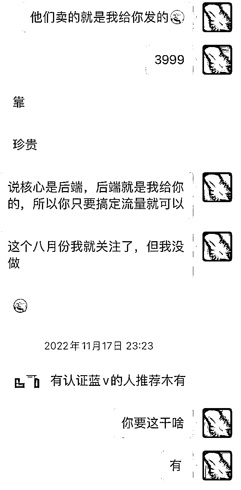

### 第三步：把用户安全带出来

做导流难免和封号打交道，只能反复实验，试出一套相对稳妥的走法。路径设计得太复杂，损耗又会变大。

最早我们只留联系方式，后来改成图片，再后来用活码，目的都是为了避开风控；也陆续试过账号矩阵、留言区挖潜、群内引导等办法，后期甚至开了付费投放。

日常优化靠盯数：把每个供给方每天的数据拉到一起，分析他们聊天的措辞、发的笔记和转化链路，再对症下药。早期我们没有统计能力，对这些问题完全没有感知；等供给方变多、上下两端都开始出问题，才慢慢用工具来解决。

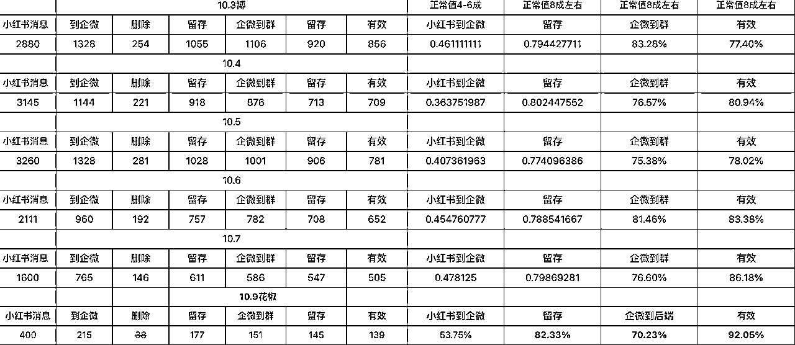

拿数据一比对，问题落在哪个节点一目了然。帮供给方把短板补齐，信任自然更足，甲方的线索质量也有保障。除了看单条线的数据，我们还会盯总盘数据，借此判断甲方那边是否正常，有问题就及时提醒对方处理。

### 第四步：核对数据再结算

大大小小的供给方加起来超过50个，来源五花八门：从社交平台私信挖来的博主，短视频和直播间的主播，校园里做线上兼职的学生，以内部小团队形式运作的伙伴，公司里一位叫一尘的学长做个人IP时攒下的线上人脉，还有熟人引荐的团队。

供给方少、线索量小的时候，清点起来很轻松；一旦供给方多起来，每天进量也大，问题就开始堆积。我们的做法是，工具加台账一起上，每条线都安排专人负责，大家在飞书里共用一个在线表格，随时同步。

核对数据的方式其实很多，比如用表格对一下用户的唯一标识，或者走第三方跳转地址来验数，都比单纯计数更精确。眼下这套方案是反复调出来的。最初也动过念头，想请那位老大哥配一套结算系统，后来一对比发现体量没那么大，也就放弃了。

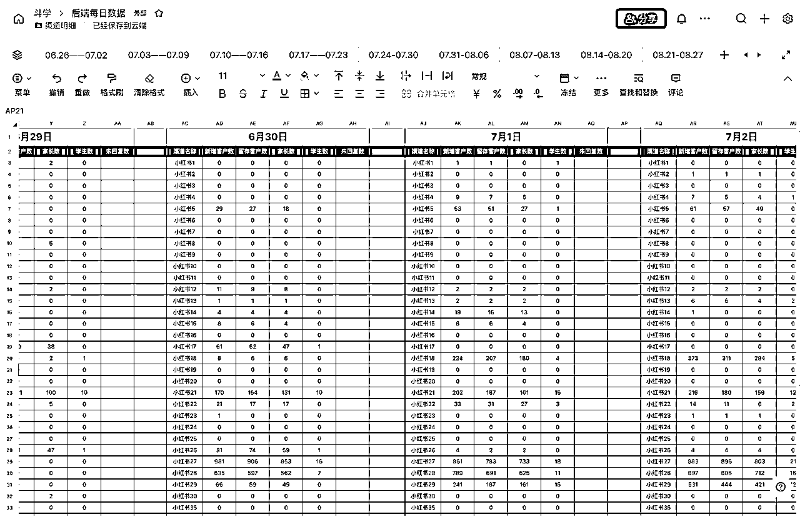
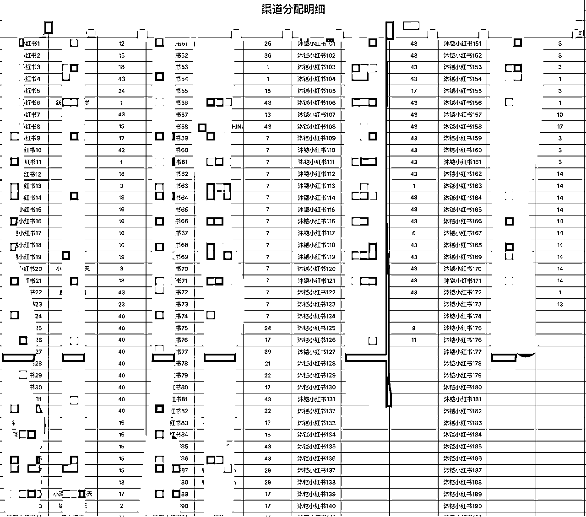

## 四、把飞轮转起来

### 统一作业方式

（1）学习资料统一管理

资料少的时候，用户来领一份很顺畅；供给方多了以后，大家在前端发的内容各不相同，用户上门发现货不对板，问题就来了，后端转化也会被拖累。另外，给用户发什么资料，管理起来也显得混乱。

有位做云端资料库生意的朋友，手里正好有现成的网盘工具，我打电话请他帮了个忙。各供给方要是换了新的引流内容，把新资料同步过来即可；系统里给每路供给方单独开一个目录，资料放进去就行，碰到个别用户来领，随时能查到。哪家目录缺资料，一查就能溯源，不用等甲方来反馈，也不会耽误用户转化——用户越急着要某份资料，说明他的意向越强。

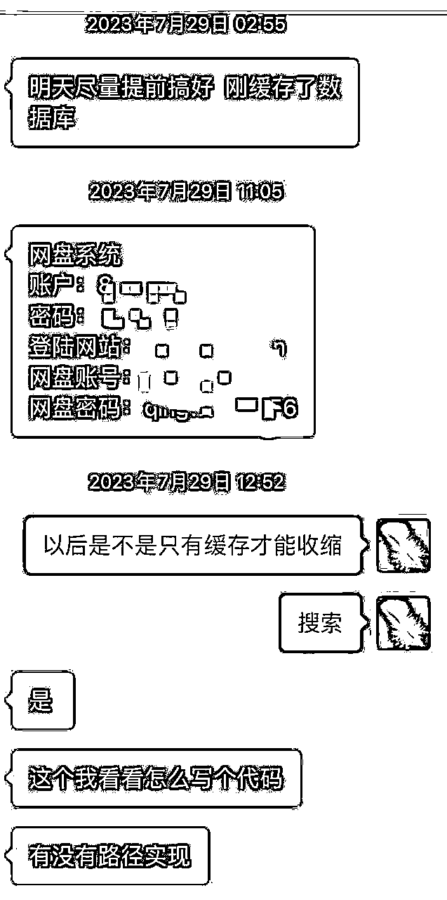
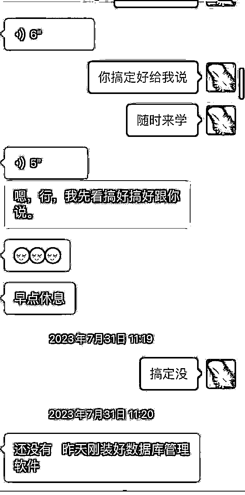
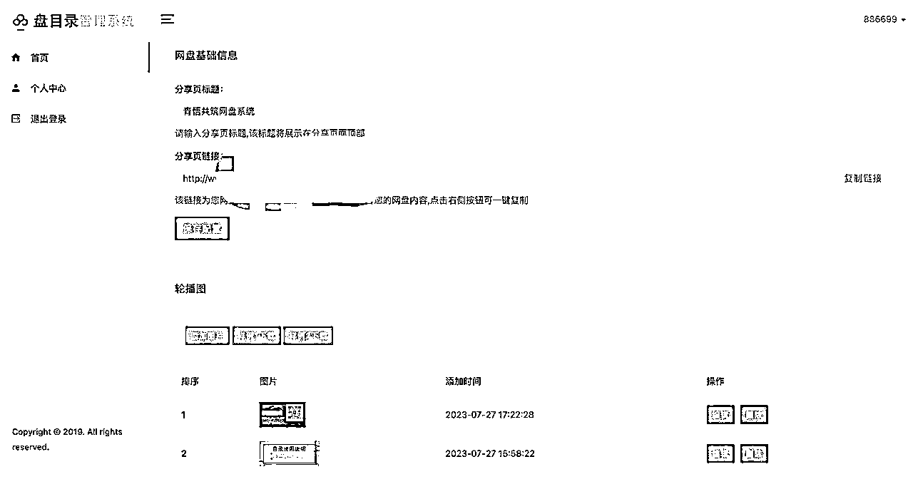

以上就是整段经历的复盘。希望能给同样在获客方向上摸索的朋友一点启发。

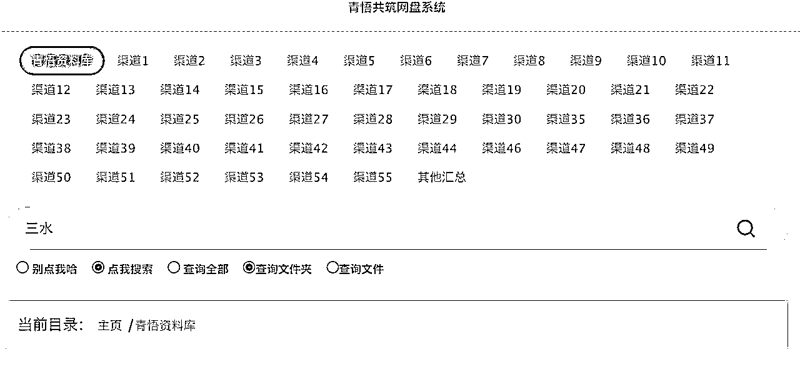

#### （2）把重复性事务标准化

在流量拓展初期，我们的主要目标是让各个渠道带来更多流量，所以会把一些打法逐一同步给对方。但后来发现同步太慢，于是开始拉群沟通。再后来渠道数量越来越多，很多工作总要重复做，我们决定把这类高重复度的工作整理成标准化流程，并且尽量写得细致，这样能省下大量时间。（这些经验跟前两年在赚钱当线上志愿者时接触到的SOP有关。）当时我们做了一部分文档，后来又觉得手动维护太费时，便招了线上小助手，专门负责信息传达。像社群管理、培训安排、玩法迭代这类事务，就交给一个正式小伙伴带着两个兼职来跟进。下面这些是当时能公开的手册，后来因为平台规则一直在变，我们也得跟着更新，等流程稳定下来，加上有了兼职分担，很多事就交给他们处理了。我们当时群不少，有任何通知就直接让他们转发，时间久了他们也学会在原有内容上做补充。这里面有个小助手还是七小帮忙介绍的，因为他在培训助手这块比我们专业，那会儿我们时间紧，就直接找他要了现成的人，好兄弟开口他肯定得帮。

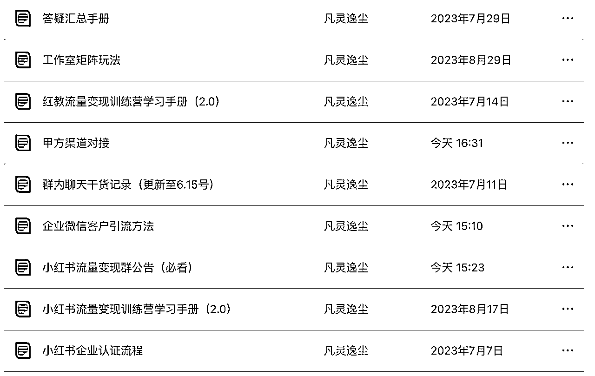

#### （3）渠道对接的统一规范

最初对接流量渠道并不复杂，我跟合伙人各管一摊就行。但等业务铺开以后，有些公域网创IP主动找过来，不过他们想搞收费培训。公域里的人群心态相对浮躁，加上甲方渠道也在增加，为了方便协同，我们慢慢梳理出一套对接标准，根据不同情况设计对应流程，让每个渠道的负责人都能顺畅衔接。

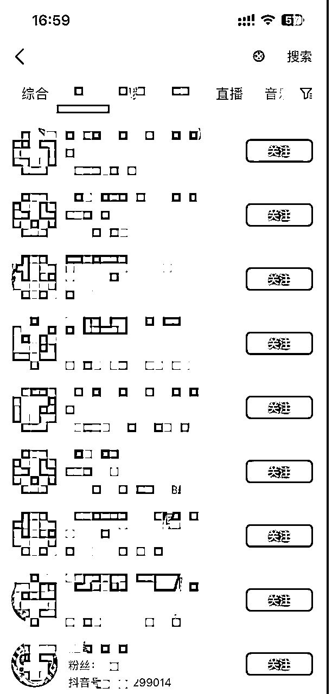

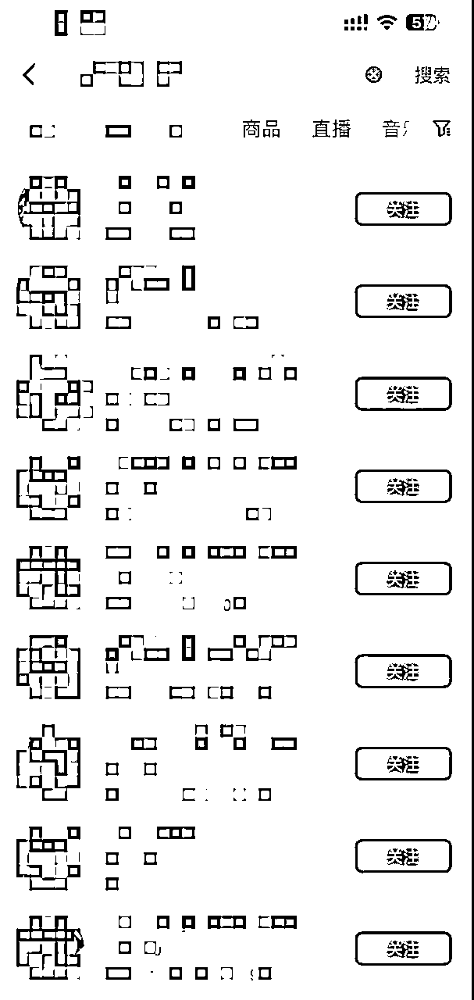

#### （4）给引流流程做迭代

这块我们前后优化了四轮。最早是用户通过流量渠道的小红书账号找过来，私信加微信，最后在微信上筛选后交给甲方。后来接连遇到渠道造假、微信号风控、回复不及时等各种问题。一开始我还会针对这些状况写流程分析，直到最后直接上工具。（忽略我这小学生的字体。）

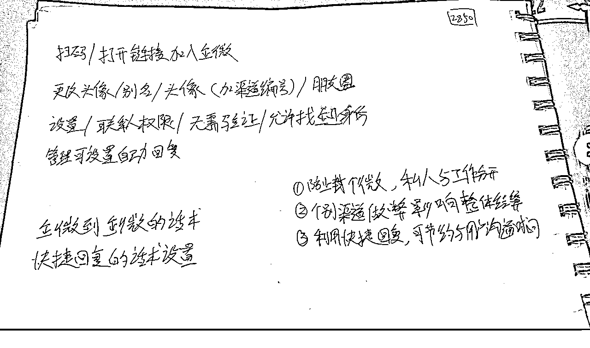

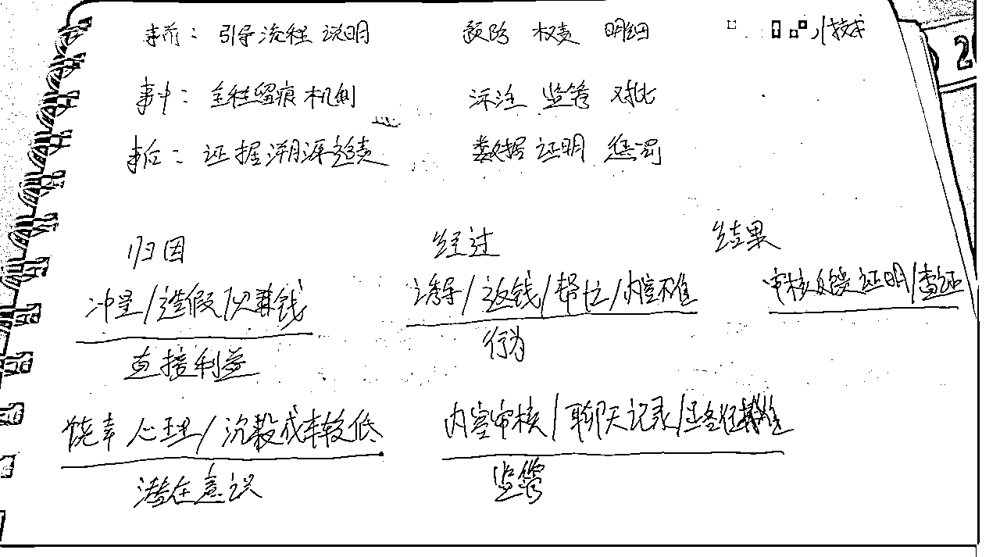

于是开始第二轮优化。很多没有私域积累的小伙伴，微信号根本扛不住大量流量涌入，所以不再让渠道把用户从小红书导到他们的个人微信，而是让他们加我们企业微信的主体，再用自己的企微账号去和用户沟通。这样能配合快捷回复，流程也清晰了。

磨合中我们发现损耗还是高，部分渠道也不守规矩，于是做了第三轮优化：直接让渠道从小红书把用户引到我们的企业微信，再安排两个客服专职回复。客服时间从早上8点一直排到晚上12点，中间吃饭都有人顶上，就是怕过来的流量浪费掉。我们心里很清楚，回复哪怕慢一秒，用户流失的概率就会大一分。

但这样太耗人，于是又去找身边的朋友打听有没有工具，开始第四轮优化。做流量这条路上，有位好大哥一直在指导我，我遇到问题就跑去问他。每次去之前都会把问题列满一整张A4纸，请他帮我拆解。这位大哥也是当年带我做国学的人。

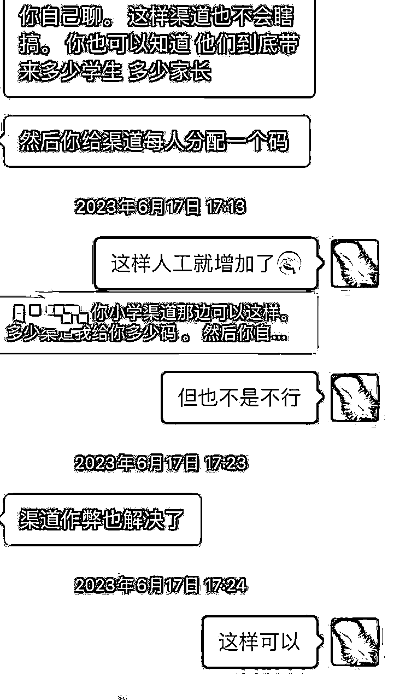

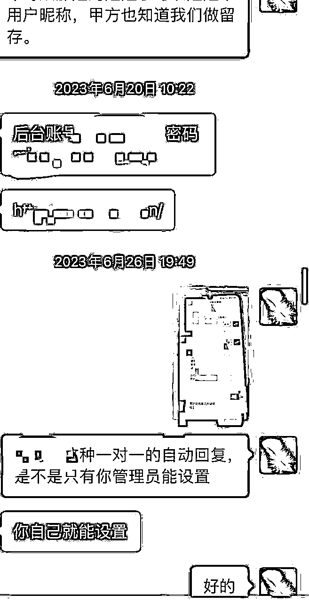

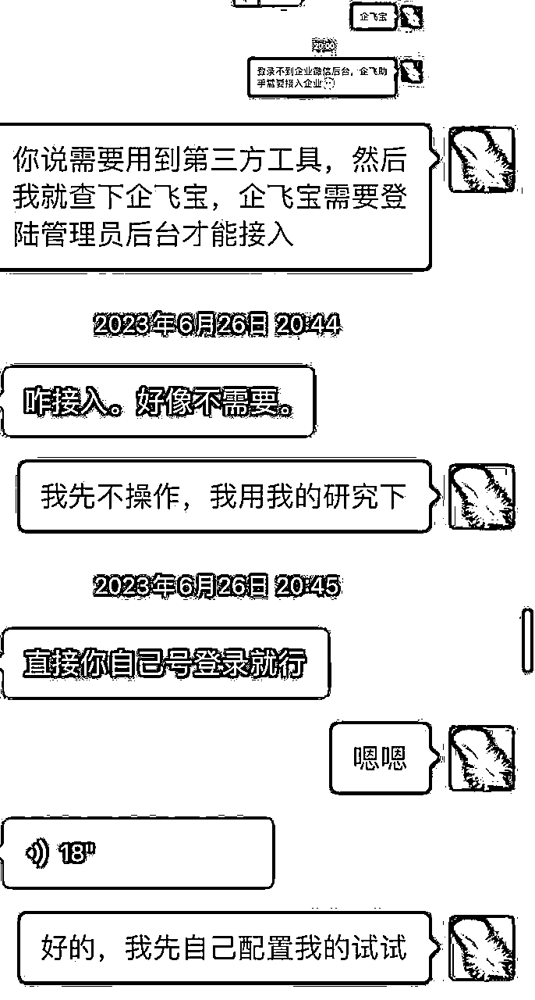

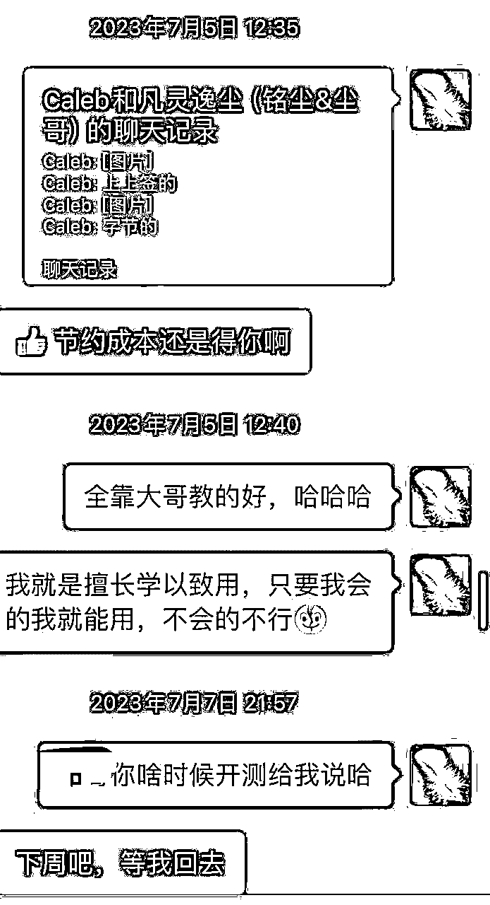

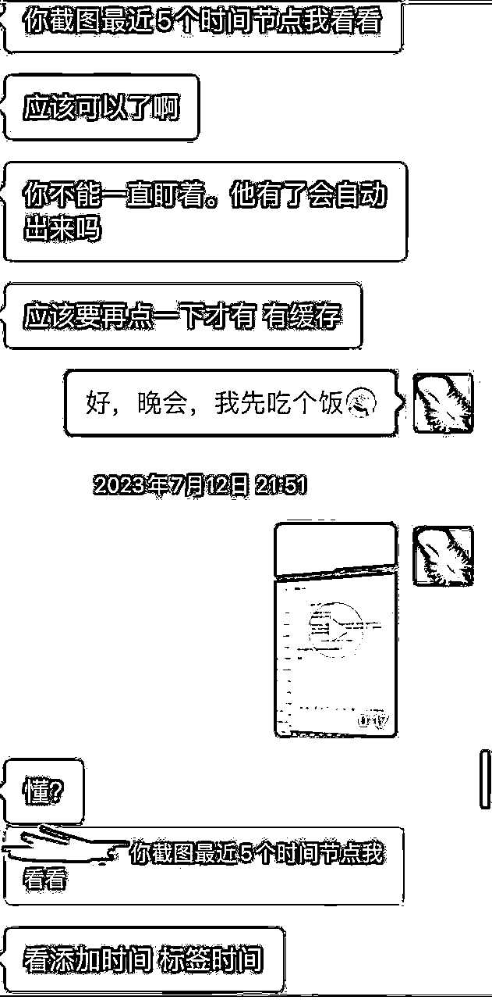

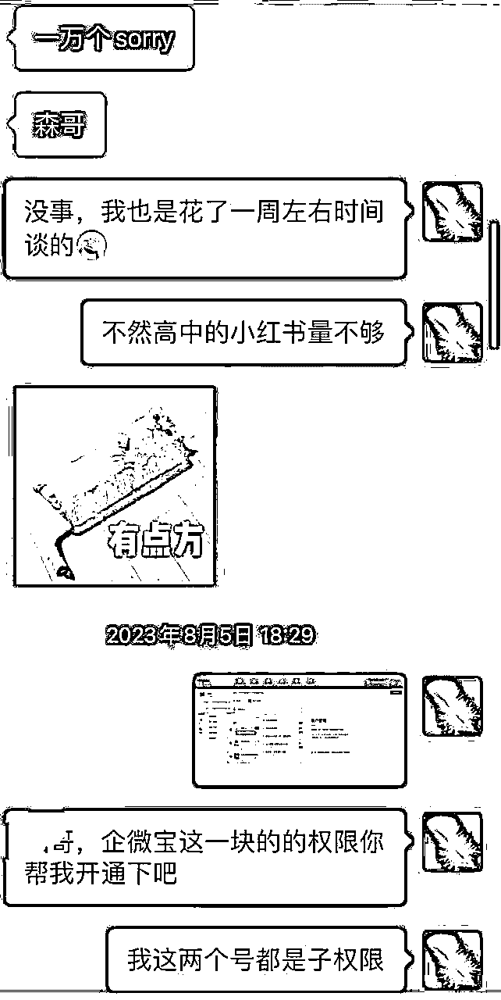

碰上问题的时候，我常常直接开车去他公司，把需求讲清楚。之前做国学时知道他有套现成的系统，他就直接免费给我们用了。后来一个朋友也想要这套系统，我帮忙问了价格，答案是30W一年。朋友一听，觉得还是自己找人开发的系统凑合用吧。（真心感谢大哥，帮我们省了一笔。）

#### （5）靠工具提效

到这一步，客服基本解放了，自动回复全部跑通，用户会自动打标签，管理上更精细。同时还能防止渠道刷量，哪个渠道有问题一目了然，能及时知道怎么解决，整个链路完整了。

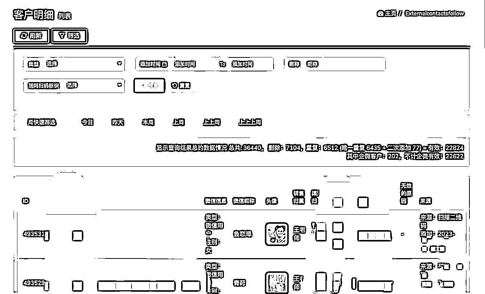

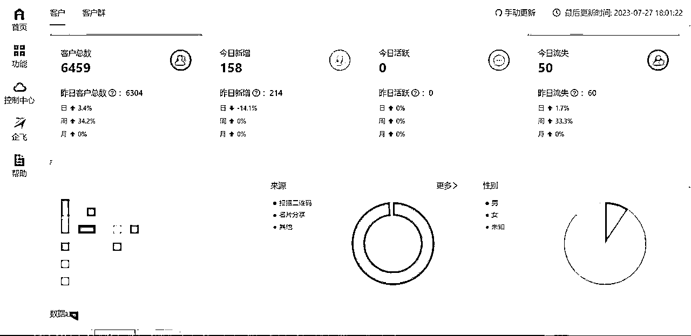

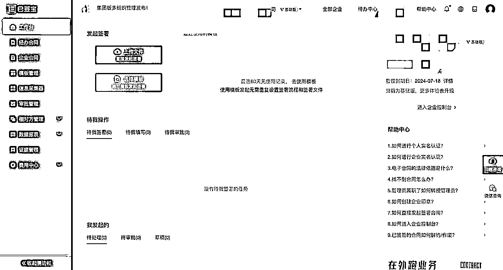

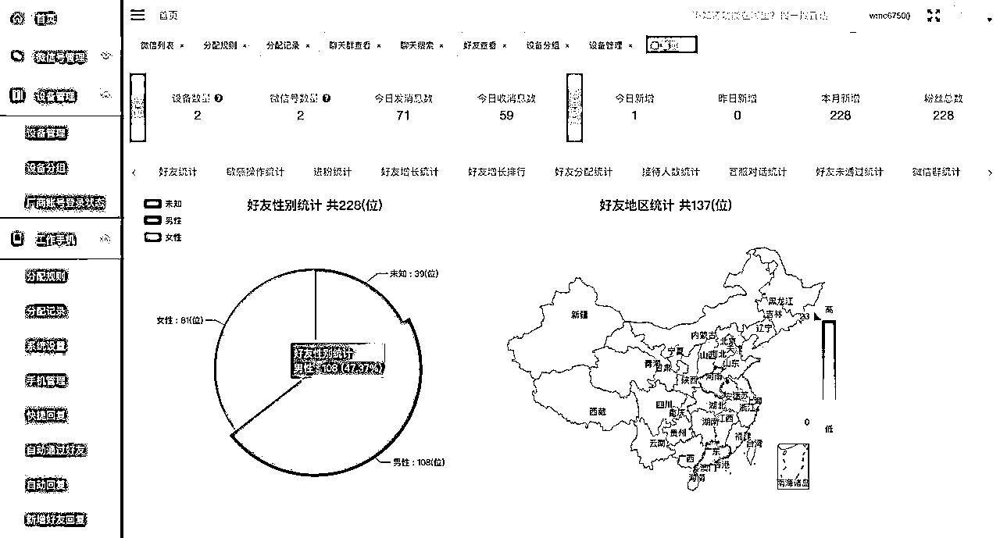

中间我们撞上过两次渠道造假，对方直接让身边朋友扫码加微信薅羊毛，刚开始很难查出来。后来上了工具一眼就能看出问题，马上决定必须防，所以我们才会折腾那么多工具和方法。

有些渠道合作久了会摇摆不定，甚至搞小动作，我们开始和大多数流量渠道签合同，提前规避风险，也是对甲方负责。（合同是最基础的保障，靠着它我们少踩了不少坑，这里不方便公开。）之后又上了电子签，省去了等快递的时间。为什么知道这玩意儿？是因为前两年负债时，我想给朋友打个欠条，朋友告诉我的。感觉特别方便，就找了个大哥买了一年套餐，可惜没怎么用。当时为了监控客服聊天内容，怕有些问题不能及时解决，又找喵哥上了一套私域管理软件，叫“堆雪球”，这是我们做“玩赚ChatGPT”时用的方案。

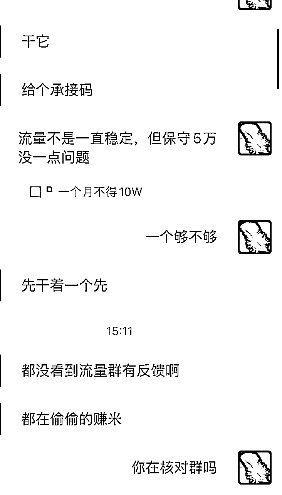

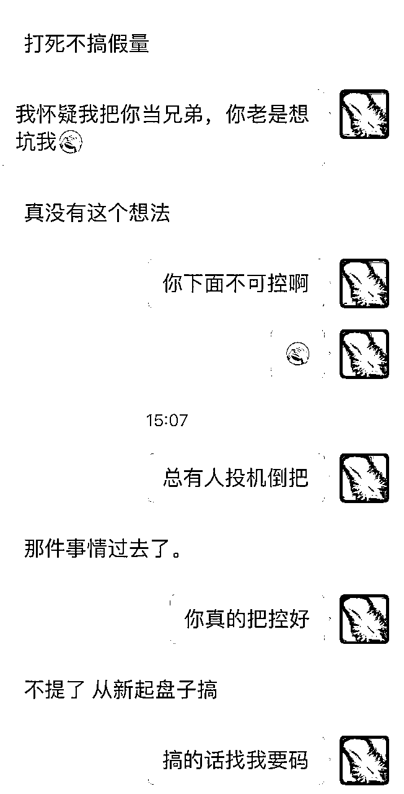

### 2、怎么把量做起来

流量增长这块，我们一直是边踩坑边往前走。有些坑能提前想到，有些则完全意料之外，但事情推着你不得不继续，只要还有一口气就得扛着，直到真正干不动为止。说到底，我们做流量靠三个来源：一是几个小伙伴自己做账号，走阿米巴路线；二是跟流量渠道合作；三是通过培训收量。原因很简单——要在最短时间内把盘子做大。

#### （1）阿米巴

我合伙人手下有几个从大学就跟着他的兄弟，他们自己运营账号，还会把方法教给身边朋友，带着朋友一起玩。有的做线下地推，有的在平台截流，还有的去跟做学科资料知识付费的人谈合作，帮对方做二次变现。

#### （2）渠道合作

渠道合作主要靠圈子里认识的流量团队。当时还没有流量社群这回事，我们本来想自己搞一个，但精力不够就搁置了。另外就是让朋友牵线，以及在各种社群里发资源链接。我平时习惯观察别人有什么需求，顺便挖掘合作机会。

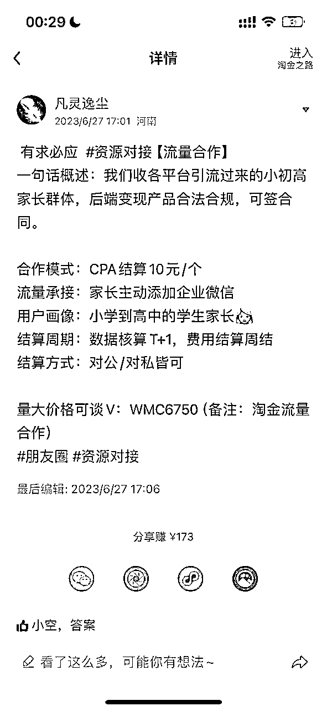

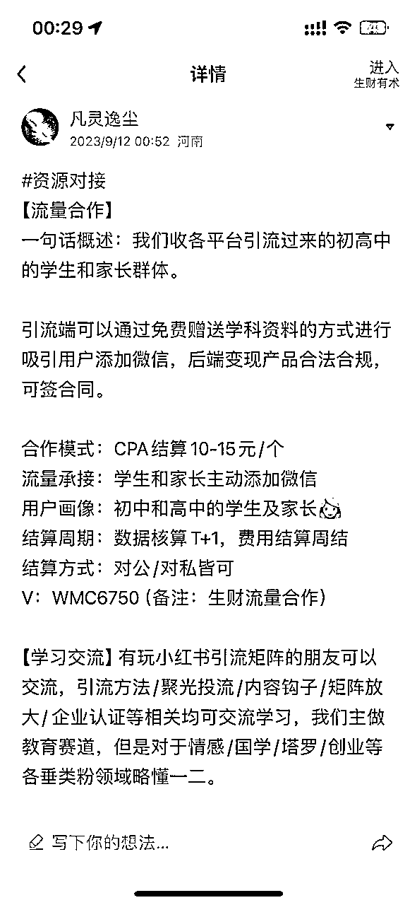

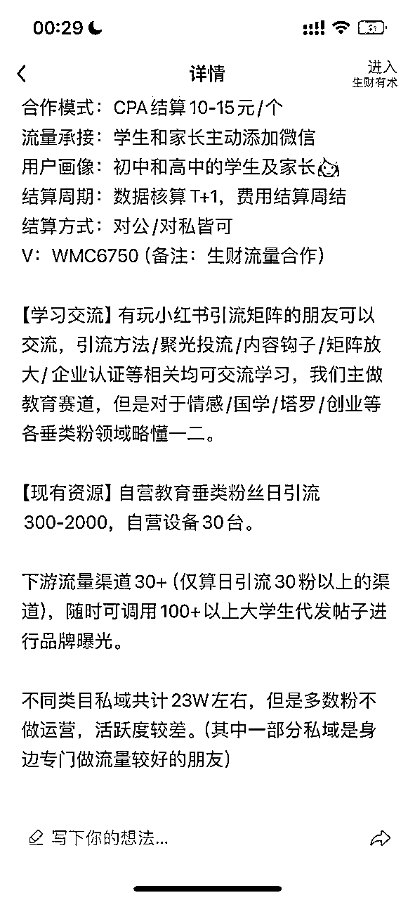

#### （3）培训收量

之前我们做过一个AI+百度问答的项目，收了差不多三千个学员，很多人确实赚到钱了，但当时项目本身赚钱，我们没有后端收益。后来有人看到我合伙人发的学员反馈，他收的线上合伙人大多是做项目和做IP的，执行力强，基础也好，再加上他每天亲自指导，反馈自然不错，慢慢就有其他人想跟着我们干。不过我们不像专业流量团队那么会教，还是得用心带。想着反正各方面已经稳定，不如多产出一点，人多了大家一起多赚点，就安排一个负责人加两个助手，收了二百多人做培训，带着他们挣点零花钱。再后来公域网创IP也来合作，他们收费三千多，但这批人执行力明显高不少。跟我们自己培训的学员一比，才意识到人还是得筛选，不然培养周期太长，与其花那么多时间，不如找个好渠道。

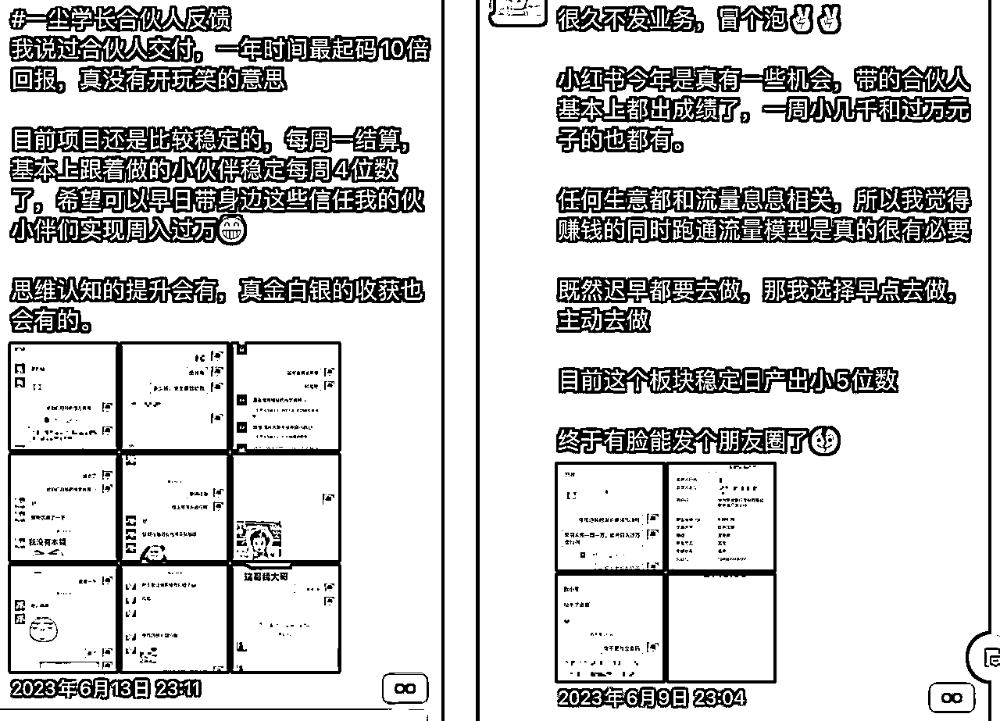

我们跟渠道、学员之间，其实更多是一种互相成就的关系。比起冷冰冰的合作，我们更愿意处成朋友，因为过程中要解决的事情太多了。只要对方需要，我们也会尽力帮忙，比如截流软件的测试、认证资质的问题，能共享就共享，能解决就解决。但该严格的时候我们绝不放松，尤其是做培训。我们俩的道德底线都比较高，可做项目这件事，很多人就是拿不到结果。所以每次开项目前，我们会先劝退几次，这本身就是一种反向筛选。真到了后面还有极个别的人找各种理由和意见，我们一致选择先承认是我们的问题，再从这个角度去想办法。

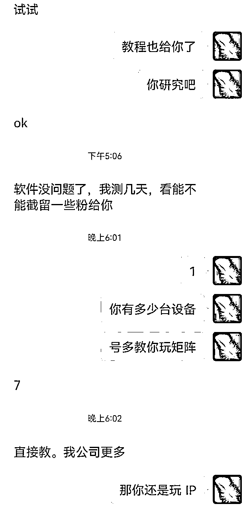

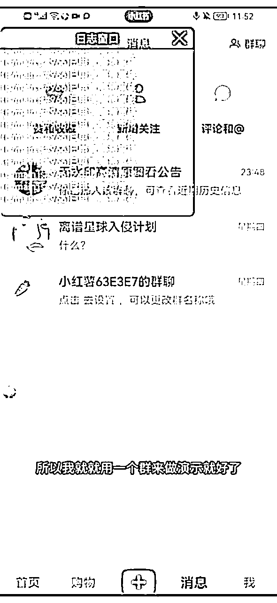

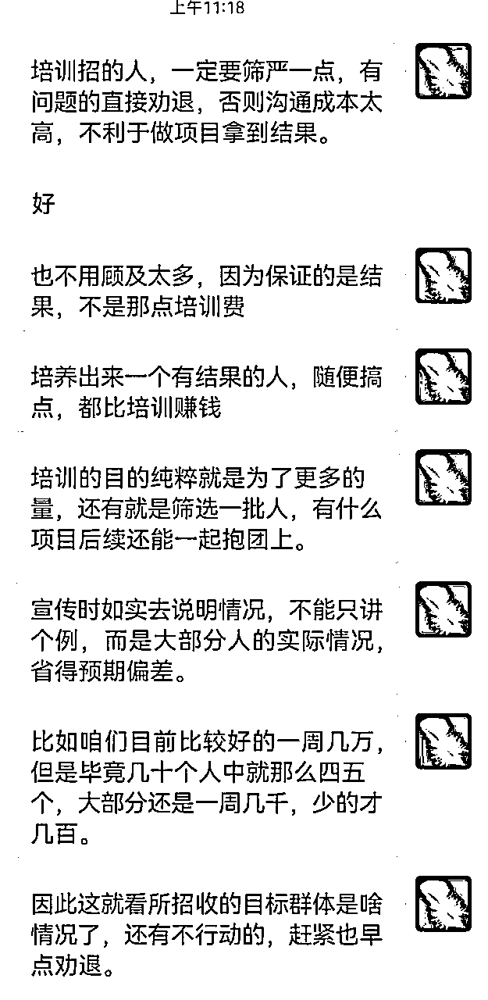

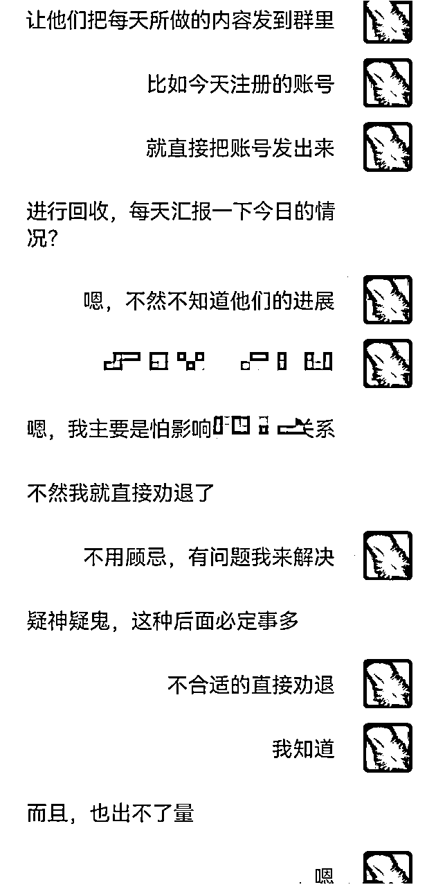

当时想法很简单：自营是为了解决基础问题、保证稳定进量；渠道合作是为了拓宽流量来源、实现玩法互补；培训则是放大器，用来筛选和培养更多做流量的人，同时对抗流量的不稳定性。

## 五、资源对接

### 1、甲方从哪来

“怎么找甲方”有一阵子特别困扰我。做流量的人都会遇到一个局面：当甲方不再缺流量，或者把你的打法复制给其他渠道，又或者转化环节出了状况，他们就会不断压低你的利润空间。这是绕不开的规律，谁都改变不了。所以你必须握有足够多的甲方资源。那这些甲方去哪找呢？我试过不少路子。最早是听一位大哥提到“BD邦”这个关键词，于是我问朋友、在各大社群里搜关键词，还在公域平台刷视频和直播。我记得有天晚上刷到一个小姐姐的直播，越听越精神，兴奋得睡不着。不知情的人以为我在看美女，其实我是在听她讲行业信息，从里面挖关键资源。后来我付费打赏，跟她交个朋友，也因此拿到了不少行业渠道，再顺着这些群继续扩列，认识了更多甲方。再后来，这个小姐姐甚至主动来郑州，和我们一起组了个公司，拓展了其他业务。很多问题，只要你有心，总能找到解决办法；哪怕一时找不到，找的过程本身也是收获——你至少更了解自己了，知道自己还不知道什么。

### 2、和技术团队一起攻坚

去年八月份左右，平台又一次风控升级，要求认证“玩聚光”，我们一下被卡住了：不付费起号引流就会被封，付费投流光是开口成本就高得吓人。这种情况下必须换打法，否则流量渠道会全线出问题，投产比只会越来越低。前面说过，我和合伙人早就不在一线了，整个项目从头到尾我们没亲手做过一个账号、没发过一篇文章。这就导致遇到关键问题时，我们没办法第一时间给出解决方案，下面小伙伴的能力又撑不起来。于是我俩分头想办法。我去找关系好的同行，靠资源互换寻求支持；他则去联系手下的渠道，看有没有别的路子。因为我们都不是技术出身，只能到处找外援来攻关。最后我们凑了几波人一起测试，把各自拿到的信息汇总起来，再找人来验证，通过多方面的玩法对比，选出最可行的方案。不过问题也恰恰出在这里：阿米巴模式终究不如直营，很多问题只能解决到表面，没法深挖。所以后来我们也明白，从零到一这种事，还得自己重新走一遍。

### 3、账号和资质怎么解决

平台要求资质认证，需要营业执照和出版物许可证。这东西办下来要等很久，还要花钱。而且一个执照在平台规则改版后只能认证两个账号，虽然也可以去办个体工商户来认证咨询类资质，但信息挂在名下同样麻烦。这个门道也是渠道方告诉我们的——淘宝真是万能，上面有大量代办，你可以去聊聊需求。（点到为止。）账号问题算是做互联网的宿命。设备风控大不了换设备，但账号受政策限制，对很多人来说真不好解。特别是河南，每个营业厅一个月只能实名一张手机卡，所以只能想别的办法。除了常见但有一定风险的JM，也可以去淘宝找合适的卡。以前我以为做矩阵很简单，直到真的开始做，才发现第一步——账号——就够让人头疼的，接着是设备，再接着是技术。用基数对抗概率也需要方法，而这全靠大量测试积累经验。

### 4、测试流量渠道

做流量这么长时间，整个项目唯一亏过钱的地方，就是测试。当时合作的甲方后端产品在调整，对客户群的要求也变了，我们只能去找新的甲方。但新合作需要测试匹配，得拉流量渠道来试，试的过程也是磨合的过程。有些渠道有一定数据，却转化不了；有些起量很慢，而且看的都是ROI，转化同样需要周期。我们测试期间试了很多流量，有一部分完全零产出，最后整体亏了几千块，还搭进去不少时间。但这条路又绕不开。

## 六、整体复盘

### 1、项目上的短板

#### （1）私域运营没跟上

做流量的时候，我们其实完全没碰私域运营。当时有个朋友手里握着30万K12粉丝，但因为两年没维护，我们用话术去导流，整体回复率只有千分之三。一开始以为是话术不行，换了几种，效果几乎一样。这个数据我记得太深了。更夸张的是，那次触达下来，用户删除率接近三分之二。也就是因为这件事，我们才开始重视运营：让小伙伴们先把朋友圈发起来，时不时给用户输送点价值。不过我们确实没经验。之前大哥提醒过我，做流量的人不能在同一个时间点，拿和甲方同样的产品去变现手里那批用户。所以我们硬是忍住了，没有在甲方转化周期内去复用流量。后来等转化结束、过了一段时间再尝试导流，发现删除率也差不多有五分之一。其实这块当时是应该攻克的，但我那会儿思维上偷懒，满脑子只想着眼前引流，身边又没有懂私域的朋友，就没往里深挖。现在想想也有点遗憾，好在那次积累下来的认知，后面还能用。今年私域这块已经有些变化，我也在陆续认识相关朋友，等有合适机会得好好请教一下。

#### （2）阿米巴转直营的犹豫

项目跑得最快那阵，我特别想起一个直营团队。这样不仅进量更快，也能逼着我们去解决更多新问题，提前测试各种玩法，效率会高很多。但我的风格比较激进，合伙人偏向稳妥，所以直营这事一直没落地。说白了，好的流量玩法得在别人摸索的基础上再测试，可我们俩又不在一线实操，让阿米巴模式下的人去做测试，他们既不太愿意，能力也确实跟不上，很多进展因此被拖慢了。后来平台规则一变动，我们也没能在第一时间做出反应。

### 2、自身的问题

#### （1）没有再往深处走

现在回头看，当时我们其实能再往前探一步。因为在遇到瓶颈那会儿，有甲方主动找过来，聊完之后我们也了解到了更好的链路和模式——本质就是提升流量质量，这样整体利润和产值都能上一个台阶。但那时候我刚还完全部债务，加上这件事刚好卡住，合伙人又觉得之前的业务还能继续，没把精力投过来，所以我也就没坚持，转而忙其他事了。后来下半年，我一边放松一边找新机会，合伙人也在调整状态，买了辆保时捷算是完成了之前定的小目标。一起达成了阶段性的目标，躺平一阵也挺好，有时候休息是为了更好地出发。但说实话，这事背后其实是两个人沟通出了问题。虽然躺平的时候也在积极调整，可很多情绪只能自己消化。好在今年上半年这个问题终于解决了。现在越来越觉得，遇到问题就主动沟通、正面应对，才是最优解。做项目也一样，要持续往深里扎，主动解决问题，提供真正的价值。

#### （2）选项目的复盘

当时没有继续做下去，另外一个深层原因是：我想去做私域，想自己打通流量、转化、产品的完整闭环。那会儿平台规则变得太快，流量利润在缩水，获客成本又高，再加上总觉得手上没积累，心里不踏实。所以结合项目现状和自身问题，我们决定再观望一下。其实现在想，应该先把眼前的事做好，别老盯着那么长远、那么宏大的规划。后来和朋友交流，我反思并总结了一套评估项目的要素，分四个维度看。可能比较片面，仅供大家参考，要是有大佬愿意指点，我不胜感激：个人层面，看能否结合自身能力优势、能否提升能力层次、和短期或未来规划是否相关；团队层面，看有没有合适的负责人、有没有精力和匹配的人；资源层面，看资金投入和回报周期、有多少朋友能提供帮助；项目层面，看整体闭环和变现方式、天花板和同行水平、能不能规模化和复制、可拓展空间和行业周期、所需的人脉资源和渠道、壁垒难点和踩坑风险、财务利润和薪资结构、组织架构和工作任务。现在回头想，能做到一定程度，根源还是内心有想法，愿意围绕事情去解决问题。之所以做成这点小成绩，说白了靠的是过往的积累。有时候问题本身就是资源，换个说法去定义它，会带来完全不同的力量。而我不过是把过去在项目里积累的那些点，搬到这里连成了一条线。这就是时间和经历攒下来的东西，期待下一次的积累和收获。创业的狗都不容易，会遇到各种破事，但最终能依靠的只有自己。调整好心态，继续干就完了。写这篇复盘的过程，其实也是在充电。我现在状态你看下图，别管暂时灰头土脸，还能再打十个！

