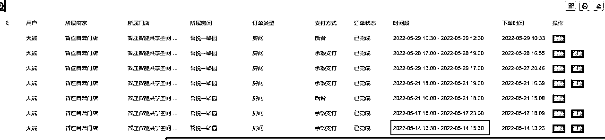
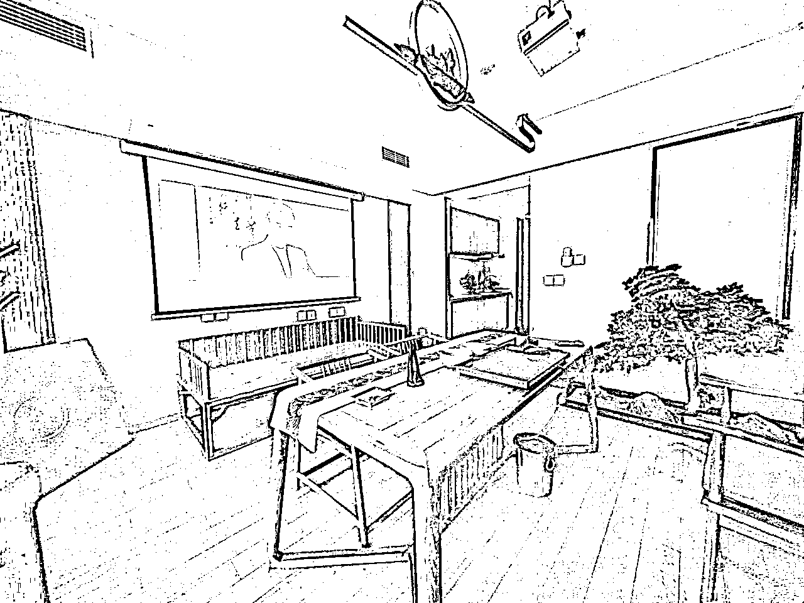
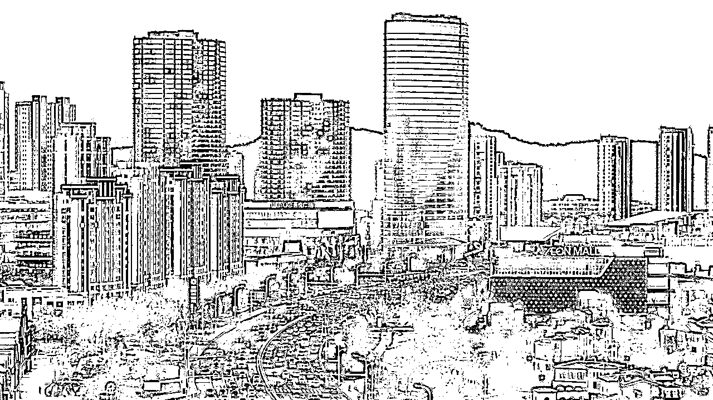
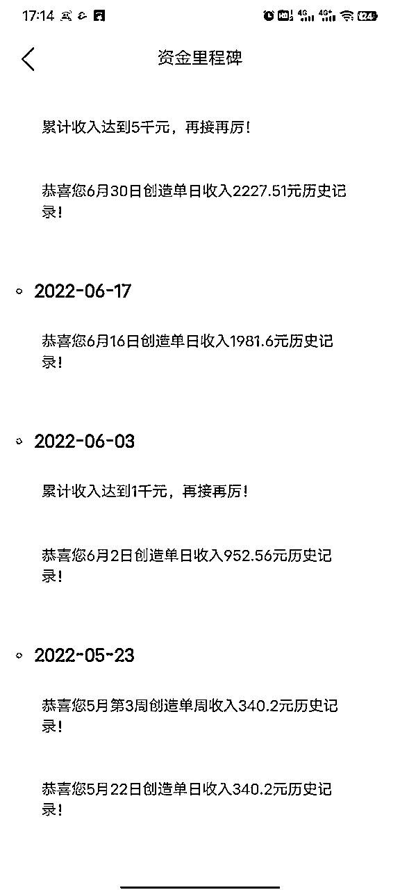
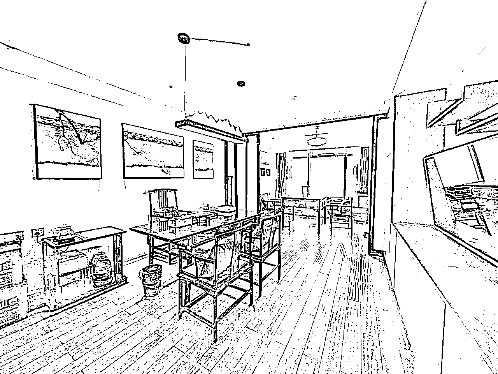
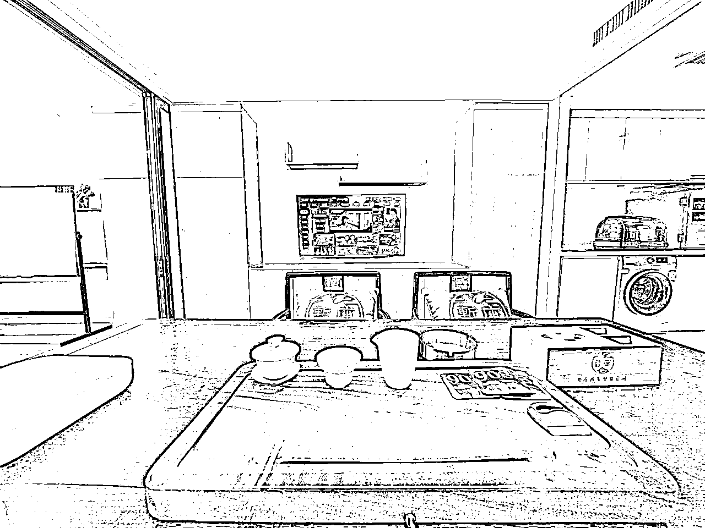
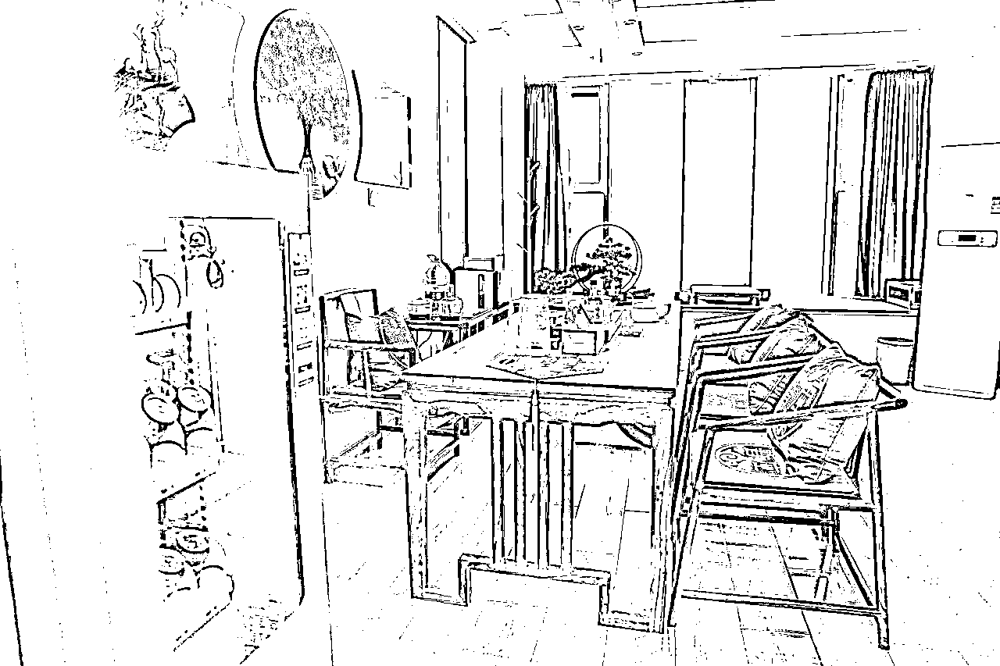
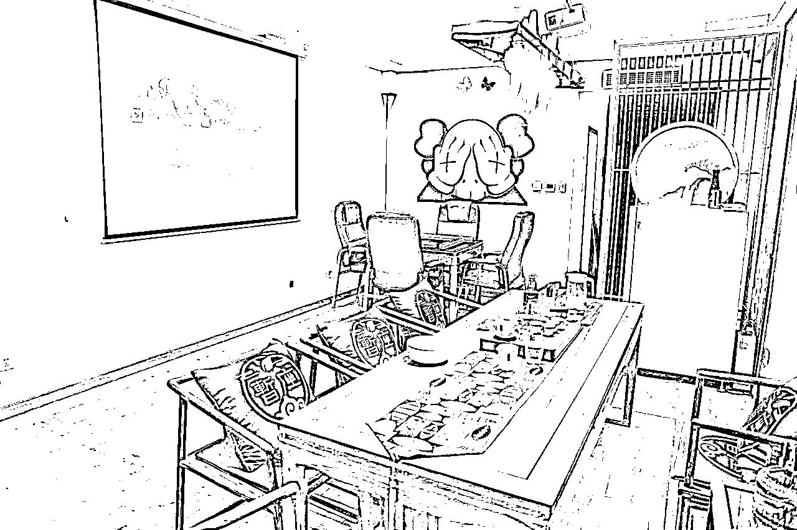
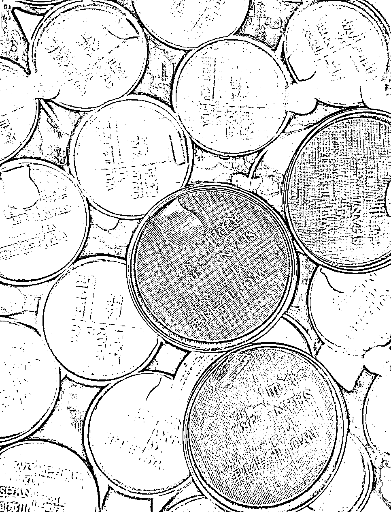
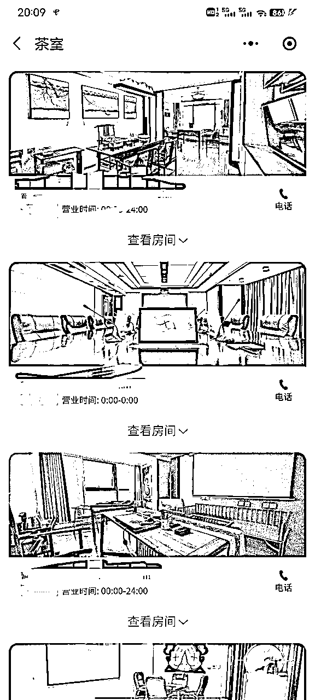

# 三年蛰伏，一路从零起步，开到七家，整体扭亏为盈

当初为何要做共享空间

2021年疫情冲击，自己手里自持的一栋写字楼陷入僵局。租不出，卖不掉，每个季度要倒贴两千多的物业费，纯支出无收入的状态实在难熬。那段时间刚好去了一趟厦门，逛到一家叫6茶的共享茶室，觉得模式有意思。初步聊了加盟，费用不到八万。后来琢磨下来，觉得不如自己先操盘几家，把流程和数据跑顺了，稳定后再像同行一样开放加盟。即便不追求暴利，能把房租、水电、物业这些硬成本挣出来，就已经是胜利。

当时手上正好有个做技术开发的团队，就拉上云南一家擅长硬件的团队配合。软件我们做，硬件对方做，半年时间里软硬件同步开发、测试完毕。时间线就推进到了22年四五月左右。

第一家店挂在美团上试水。

第一笔生意

头一单来的是个00后女生，一个人来待着发呆。她后来反馈，主要是离家近，环境还算能看，可以看电影，还能对着街面发呆。ps：说实话这个装修我看了无数次都想砸了重来，当时总投入很克制：年租1.5w、45平、民水民电、整屋贴壁纸400、麻将机3500、桌椅3000、贵妃榻850、坐垫抱枕1200、装饰品2000、吊灯800、投影仪加幕布1500。

开张后客流就慢慢稳定下来。猜测是麻将机起了作用，年轻人来打牌的占多数，还有网红来开会、直播，以及一些商务散客。感谢这些早期用户，首月营收就破了5k。定价策略是比传统茶室低，但比棋牌室高，98元/2小时。续时费一开始19.9元/小时，后调到29.9元/小时。

放一张单店的营收走势。

到了7月，又连开了两家分店。

前期流量还算平稳，我们也一直在做尝试。最开始铺的是和海底捞同款的小零食，以及定制的小罐装茶。

踩过的几个大坑

1. 食品安全
散装茶虽然便宜，但口感和品质都不稳定。用小罐装茶，单罐成本控制在3元以内，客户体验更好，罐身有标签也更放心。散装零食容易受潮变味，容易招来差评，所以全部换成独立包装的小零食，比如海底捞同款或刺猬阿甘这类品牌。
饮用水统一用4.5L农夫山泉，价格不到8元一桶。起初执行一客一换，后来发现很多客人根本不喝，或者三拨客人才能喝完一桶。改成一次性送四箱，让客人自取，目前还没出现丢桶或往水里丢东西的情况，可能年轻人整体素质还是在线。

2. 房租与装修
能省则省，尽量挑少改动的房源。贴个壁纸、改一下电控门控、搬进家具设备、打扫一下就能开业。别把钱砸在装修上。这种小成本、轻人工的项目，民水民电的公寓最合适。可以跟房东谈免租期，争取半个月到一个月，押一付三，直接找中介带看，半个月房租就能挑到合适的房源，锁定后再和房东直接对接。注：这是青岛的情况，一线城市可能不一样。

3. 棋牌与法律风险
咨询过律师，核心点是不能抽水、不能组局，就不构成法律风险。店内必须张贴提示，禁止黄赌毒，主要是起到警示和提醒作用。因为是无人值守的共享空间，客户若需要筹码，就放两盒纯色无数值卡片即可，不用定制，避免给自己添麻烦。

4. 平台依赖
平台的作用是拉新和建立信任。第一次获客靠美团，复购则尽量引导到小程序或🛰️转账，减少被平台抽成的压力。重点是引导客户加🛰️客服号，客服号内发开门小程序的链接。

5. 安全问题
主要是水电安全和室内财产安全。水电方面，建议装一个米家水位报警器，屋里配个小爱同学就能语音控制电器，减少客人忘关水龙头带来的损失。电控方面，我们自研了硬件，市场上也有智能断电设备，只是大部分仍需人工干预。财产安全上，室内别放高价值物品，易损件要标准化、多备几套，比如茶具、玻璃杯、烧水壶，多备两套可快速替换。

附一张小程序界面截图。

