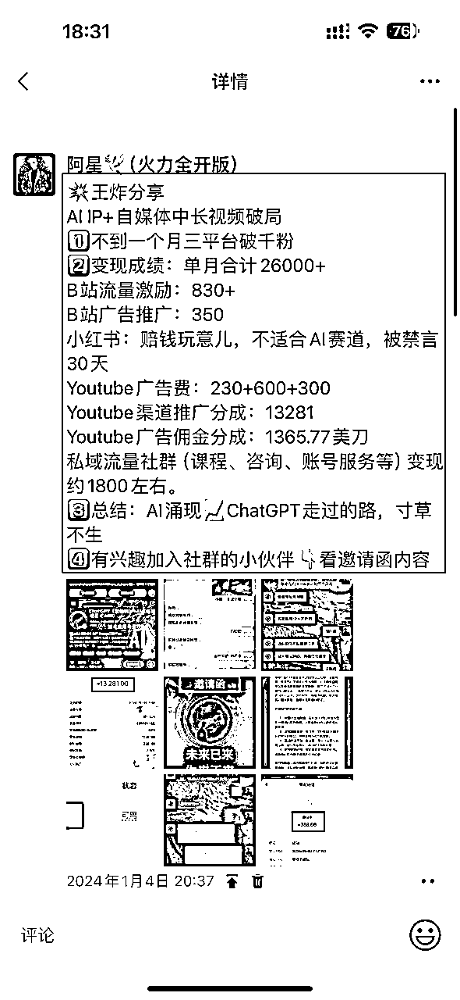

# 【胎教级教程】AI提示词底层逻辑一文通


# 纸上得来终觉浅，绝知此事要躬行

# - 观星

大家好，我是观星，24年4月辞职All in AI。我的身份标签是：

*   🎖️ 退役特种兵
*   ⌨️ AI代写变现项目·聚光矩阵投流
*   🎥 AI副业IP
*   ⌨️ 提示词实战应用/定制
*   💰 AI赛道变现超6位数
*   往期复盘帖：
*   【胎教级教程】提示词0-1入门到入土，无痛编写提示词，一条价值1.2W的提示词商单拆解
*   《关于如何蛊惑（我妈）50岁阿姨通过【AI代写】月入5000+的》

我和AI的缘分始于2022年底。当时还在互联网公司上班，在老板的朋友圈刷到GPT3.0，抱着试试的心态去体验了一把，感觉也就那样，像个会说话的智障。没多久疫情来袭我被裁，职业路口正迷茫。

转折点在2023.3.14，GPT4.0上线。这次我真正感受到信息差带来的破局感，开始做AI自媒体，两个月就实现了单月变现2.6W。



# 00丨Prompt的基本原理

在动手写工程化Prompt之前，先把Prompt的本质搞清楚。就像理发师接单前会先摸清顾客发质、脸型一样，基础信息没弄清，后面再怎么剪都跑偏。

## 001丨Prompt的定义与作用

Prompt直译就是“提示”。在NLP里，它就是喂给大模型的指令性文本，用来把控模型要干什么、怎么干。和理发师通过聊天摸清顾客想要什么发型一样，我们通过精心打磨的Prompt，让模型读懂意图，进而给出我们想要的输出。

可以把大模型想象成一位手艺很好却有点被动的大师傅。他创意无限，但必须有清晰指引才能发挥。Prompt就是我们和他沟通的桥梁。设计得好，就能精准传达需求，激发潜能，得到理想结果。

举个例子：我们要让模型写一封邀请客户参加新品发布会的邮件，可以这样给它一个Prompt：

```
你是某公司的市场部员工，请给客户写一封100字左右的邮件，邀请他们参加公司的新产品发布会。以下是邮件的要点：

- 新产品是一款革命性的无线耳机
- 发布会将于下周五下午2点在公司总部举行
- 现场将提供茶点，并有机会赢取新产品
- 请收件人提前回复是否参加

邮件：
```

这个Prompt把背景、目的、关键信息都点出来了，就像顾客告诉理发师想要什么风格、什么场合、留多长一样。信息到位，模型就能生成结构完整、切合主题的邀请函。要是只丢一句“写一封邀请函”，效果肯定打折。

所以Prompt的核心作用，就是搭建人机沟通的通道，让模型的能力真正被我们用起来，产出有价值的内容。

## 002丨设计Prompt的三大原则

弄明白概念后，回到怎么设计。依然借理发师的思路：要懂需求、考虑条件、给出专业建议。Prompt工程也有三条通用原则。

第一是任务要清晰。这就像理发师先问你要什么造型一样。我们要先定义模型要完成的任务类型：是分类、抽取，还是开放生成。类型定了，Prompt的骨架才成立。

比如做影评情感分类，可以这么写：

```
以下是一段电影影评，请判断其情感倾向是正面还是负面：

- 影评：这部电影的剧情非常吸引人，我从头到尾都在猜测结局。演员的表演也很精彩，特别是男主角，把这个复杂的角色演绎得入木三分。
- 不过，影片节奏有点慢，前半段略显沉闷。总的来说，这是一部值得一看的电影，但可能不会成为经典。

情感倾向：
```

任务目标一目了然：输入是影评，输出是正面或负面。方向明确了，模型判断才准。

第二是信息要充足。理发师在动手前会问场合、发质、日常打理习惯。设计Prompt时，也要把任务相关的背景、标准、约束尽量喂足。

延续影评分类，多给一点判断依据：

```
以下是一段电影影评，请根据以下标准判断其情感倾向是正面还是负面：

- 如果影评主要谈及电影的优点，认为值得一看，整体印象积极，则倾向为正面
- 如果影评主要批评电影的缺点，认为不太推荐，整体印象消极，则倾向为负面  
- 如果影评中包含褒贬，可根据侧重点和总结来判断，若无明显倾向则选择中性

影评：这部电影的剧情非常吸引人，我从头到尾都在猜测结局。演员的表演也很精彩，特别是男主角，把这个复杂的角色演绎得入木三分。
不过，影片节奏有点慢，前半段略显沉闷。总的来说，这是一部值得一看的电影，但可能不会成为经典。

情感倾向：
```

多了一层判断标准，模型的理解更到位，就像理发师了解了脸型和穿搭后，剪出来的发型更贴脸。

第三是交互意图要体现。这就像理发师在剪发过程中会通过交流引导顾客做选择。Prompt里也要体现我们希望的交互方式，引导输出风格。

例如让模型扮演心理咨询师：

```
假设你是一位专业的心理咨询师，你的来访者是一位大学生，他最近感到压力很大，对学业和未来感到迷茫。请用以下要点与他展开一段对话：

- 表达理解和同情，让来访者感受到被倾听
- 询问来访者目前面临的主要困难和担忧
- 提供一些缓解压力的建议，如深呼吸、运动等
- 鼓励来访者多与家人朋友沟通，寻求支持
- 建议来访者制定短期学业目标，循序渐进

对话：
咨询师：
```

我们明确了角色和交互要点：关怀、专业、引导式提问。模型就按这个人设来回应，而不是干巴巴地回答。

归纳一下，优质Prompt的三要素：目标明确、信息充分、交互意图清晰。像理发师为顾客做造型，既要听需求，也要问细节，最后给出专业建议，才能剪出让客户满意的发型。

以上就是Prompt底层原理部分，用理发师和顾客的类比讲清了Prompt是什么、有什么用、怎么设计。

# 01丨常见任务的Prompt设计

搞懂原则后，要落地到不同任务。理发师面对染、烫、剪、造型各有手法，Prompt设计也要因任务而变。下面拆三类核心任务。

## 011丨文本分类

文本分类是NLP的高频场景，本质是按特征把文本分到预设类别。就像理发师给发型归类一样：垃圾邮件判别、评论情感判断、新闻主题归类等。

设计分类Prompt的第一步，是把目标和标准说清楚：分什么类型、类别怎么定义、怎么判。就像理发师先确认场合和风格。

比如要把用户评价分为满意、一般、不满意：

```
作为一家餐厅的服务质量分析师，你的任务是根据顾客的评价，判断他们对餐厅的满意度。请按照以下标准进行分类：

- 满意：评价中主要谈及餐厅的优点，如食物美味、服务周到、环境舒适等，整体给人积极正面的印象。
- 一般：评价中提及餐厅的优缺点都有，但无明显倾向，或者只是平淡地描述就餐经历，没有表现出特别的喜好或不满。
- 不满意：评价中主要谈及餐厅的缺点，如食物难吃、服务态度差、卫生条件差等，整体给人消极负面的印象。

请根据以上标准，判断下面这条顾客评价的满意度：

- 评价：这家餐厅的环境不错，装修得很有格调。但是上菜速度实在太慢了，我们等了半个小时才上主菜。而且味道也一般，没有想象中那么好。

满意度：
```

目标、类别含义、判断依据全写清楚了，模型才能稳准地分。

其次是例子怎么给。就像师傅带学徒要拿样板发型手把手教，Prompt里要配样例标注，让模型看懂规则。这就是Few-Shot学习的精髓。

在上面基础上再补几条带标签的样本：

```
作为一家餐厅的服务质量分析师，你的任务是根据顾客的评价，判断他们对餐厅的满意度。请按照以下标准进行分类：

- 满意：评价中主要谈及餐厅的优点，如食物美味、服务周到、环境舒适等，整体给人积极正面的印象。
- 一般：评价中提及餐厅的优缺点都有，但无明显倾向，或者只是平淡地描述就餐经历，没有表现出特别的喜好或不满。
- 不满意：评价中主要谈及餐厅的缺点，如食物难吃、服务态度差、卫生条件差等，整体给人消极负面的印象。

以下是一些已标注满意度的评价示例，供你参考：

评价1：这是我吃过最难吃的法国菜!牛排又老又柴，鹅肝酱也很腥，简直浪费了食材。而且服务员态度也不好，感觉很不耐烦。再也不会来这家餐厅了!
满意度1：不满意

评价2：昨天和朋友来这家餐厅吃晚餐，感觉还不错。披萨的馅料很丰富，口感香脆，就是量有点小。意面也比较正宗，酱汁味道不错。服务方面一般，上菜速度有点慢。
满意度2：一般

评价3：这家餐厅真是太棒了!无论是食物还是服务，都堪称完美。那道香煎三文鱼让我回味无穷，配菜也很精致。餐后甜点更是惊艳，芝士蛋糕松软绵密，入口即化。服务员也非常专业友好，给我们提供了很多很棒的菜品推荐。下次一定还会来!
满意度3：满意

请根据以上标准，判断下面这条顾客评价的满意度：

评价：这家餐厅的环境不错，装修得很有格调。但是上菜速度实在太慢了，我们等了半个小时才上主菜。而且味道也一般，没有想象中那么好。

满意度：
```

样本多了，模型对边界的理解更清晰。选例时要覆盖各种情况，别只给一种发型，不然模型会过拟合。数量上3-5个最佳，太多会臃肿拖慢理解。

分类Prompt的核心：把目标标准讲透，用典型样例教规则。就像理发师带徒弟，先讲清标准，再拿典型案例示范，才能培养出会分的“好手”。

## 012丨文本生成

文本生成是让模型基于上下文创作开放式文本。像理发师根据气质喜好设计新发型，没有唯一正确答案，要求更高。

场景很多：写作辅助、对话、故事创作等。Prompt既要约束主题、风格、长度等，也要留创作空间。

比如让模型为健身APP写100字左右的推广文案，突出便捷、有效、有趣：

```
作为一名资深的健身APP宣传文案撰稿人，请为我们新推出的APP"FitGo"撰写一段100字左右的推广文案。文案需要突出以下几个卖点：

- FitGo可以根据用户的身体数据和目标，智能推荐个性化的健身计划，非常便捷。
- FitGo的健身计划科学有效，融合了有氧、力量、柔韧等多种训练方法，帮助用户全面塑形。
- FitGo的训练界面设计时尚有趣，结合游戏化元素，让用户在运动中获得乐趣，坚持下去。

- 文案要突出产品优势，语言要生动有感染力，让人一看就心动想要下载APP开始锻炼。

推广文案：
```

主题、受众、卖点、字数、语气全交代，模型才能抓住要点。

因为是开放任务，我们可以加一些创意引导。就像理发师从艺术、生活里找灵感，Prompt里也可以用角色扮演。

让模型以FitGo忠实用户第一人称来写：

```
你是一位热爱健身的年轻人，刚刚使用了新推出的健身APP"FitGo"，对它的便捷性和有效性感到非常惊喜。现在，你要在社交媒体上分享你的使用体验，推荐给你的朋友们。请以第一人称的视角，写一段100字左右的推文，表达你对FitGo的喜爱之情，并鼓励大家也来试试这款APP。推文要突出以下几点：

- FitGo如何通过智能推荐，为你定制了一套非常适合你的健身计划
- 在FitGo的帮助下，你的身材和体能都得到了明显改善
- 你很享受在FitGo有趣的游戏化界面中运动的过程

推文要真诚自然，读起来像是在跟朋友聊天，不要太露骨地"广告"。

推文：
```

从用户视角发声，更有代入感和说服力，像朋友推荐而不是硬广。个性比直接套模板更打动人。

还可以加隐喻、语言巧思，让文本更有艺术感。比如要求用“交响乐”比喻健身体验：

```
FitGo就像一场精彩的交响乐，将有氧、力量、柔韧等多种训练方式巧妙地融合在一起，带给你全面均衡的健身体验。智能推荐就像一位出色的指挥，为你量身定制最适合的乐谱。游戏化的界面设计则像是华丽的舞台布景，让你在运动中仿佛置身于一场视听盛宴。在FitGo的帮助下，你的身体就是那架美妙的乐器，每一次训练都在演奏着动人的旋律。让我们一起加入FitGo！

推广文案：
```

隐喻把枯燥的健身过程变得优雅，算法是指挥、界面是舞台、身体是乐器。文案更有感染力，就像发型里加编发、染色、饰品，更出彩。

生成类Prompt要做到：约束清晰，空间开放。用角色、隐喻等技巧，能让输出更有个性。

## 013丨文本转换

文本转换是把一种形式的文本改写成另一种形式，像理发师把长发剪短、直发烫卷。

常见类型：

*   语言翻译：中英互译
*   文体转换：新闻改故事、论文改科普
*   文本简化：法律条文转通俗解释
*   信息抽取：从长文里提炼关键要素

核心是保留原意，换个表达。Prompt要让模型读懂原文，并明确转换目标和示例。

举个语言翻译的例子。假设我们要将一篇英文的科技新闻稿翻译成中文，且翻译要准确通顺，符合中文的表达习惯。我们可以设计这样一个Prompt：

你有没有发现，跟AI沟通，有点像找理发师剪头发？光说一句“剪短一点”，结果往往不是你想要的效果。你得把长度、层次、风格都说清楚，最好再翻几张参考图。写Prompt也是同一个道理——尤其是涉及翻译、改写这类任务时，一份清晰的“需求说明”至关重要。

以翻译任务为例。如果我们只丢给模型一句“翻译一下”，它很难把握分寸。我们需要明确告诉它：信息要准确，译文要流畅，专业术语要规范，专有名词要处理好。最好再给一个对照的翻译样例，让模型直观地理解什么叫“好翻译”。这样一来，模型就有了明确的“发型样板”。于是，我们可以构造这样的Prompt：```
请将以下英文科技新闻稿翻译成中文：
Apple Unveils Revolutionary New iPhone 14 and iPhone 14 Plus
Featuring two sizes — 6.1-inch and 6.7-inch — and an impressive list of new capabilities Powered by A15 Bionic， with a 5-core GPU， which offers incredible performance and efficiency Introduces groundbreaking safety capabilities， including Emergency SOS via satellite and Crash Detection Featuring a durable and sophisticated aerospace-grade aluminum design in five beautiful colors iPhone 14 and iPhone 14 Plus will be available in midnight， blue， starlight， purple， and (PRODUCT)RED1 finishes. Available in 128GB， 256GB， and 512GB storage capacities.

翻译要求：
- 信息要准确，不要遗漏或误译原文的任何重要信息
- 译文要通顺自然，符合中文的语法和表达习惯
- 专业术语要翻译准确，必要时可在译文后加括号注明原英文词汇
- 人名、地名等专有名词可以音译，公司名称可以直接使用英文

请参考以下翻译示例：
- 原文：The new Apple Watch SE delivers the core Apple Watch experience， including Activity tracking， high and low heart rate notifications， and Emergency SOS， as well as the new Crash Detection feature and a completely redesigned back case that perfectly matches the three classic case finishes. 
- 译文：新款Apple Watch SE带来了Apple Watch的核心体验，包括健身追踪、心率过高和过低通知，以及紧急SOS功能，还有全新的跌倒检测功能和全新设计的后盖，与三种经典表壳完美搭配。
请开始你的翻译吧!

中文译文：
```

有了这些指引，模型在处理翻译时，心里就更有谱了。

同样的逻辑，还可以延伸到把专业内容“翻译”成大众版本。比如，想把一份复杂的手机说明书，改写成老年人也能轻松读懂的版本。这时候，我们可以在Prompt里把用词、语法、解释方式都写清楚，并专门示范一下“截屏功能”该怎么表达。这就像理发师给老年顾客设计发型，会把“好打理”放在第一位，沟通也更接地气。下面就是一个典型的简化Prompt设计：```
请将以下手机使用说明书的内容，转换成适合老年人阅读的简化版本：

如何设置锁屏密码：
- 打开设置应用，点击"生物识别和密码"
- 在"设备解锁选项"中选择"密码"，然后点击"添加密码"
- 输入你想设置的数字密码，需要6位数。然后再次输入进行确认
- 如果你希望在锁屏界面显示通知的详细信息，请开启"锁定时显示"选项，并选择"显示所有通知内容"
- 点击右上角的"完成"按钮，即可完成锁屏密码的设置

简化要求：
- 使用简单、易懂的词汇，避免使用专业术语
- 缩短句子，一句话表达一个意思
- 增加必要的解释说明，帮助老年人理解手机的基本概念和操作逻辑
- 可以适当省略一些非关键的步骤或细节

请参考以下示例：
- 原文： 如何截屏：
同时按下手机右侧的电源键和音量上键，屏幕会闪一下，表示截屏成功
你可以在相册中的"截屏"相册找到你截取的图片
你也可以直接在图片上进行编辑标注，或分享给好友
- 简化版： 如何给手机屏幕拍照(截屏)：
用一只手握住手机，另一只手同时按下手机右边的开关键和音量向上键
屏幕会亮一下，表示拍照成功了。拍下的照片会自动保存
你可以去相册 App 里找到这些照片，然后编辑或者发给别人

简化版：
```

有了这样的示范，模型就能学会如何把冷冰冰的术语，转换成有人情味的大白话。

其实，无论是文本分类、文本生成，还是文本转换，Prompt设计的底层逻辑是相通的：把任务目标和约束条件讲透，给出几个具体的示例，给模型留一点创作的空间，同时也别忘补充必要的背景信息。如果想让输出更有感染力，还可以用上角色扮演、隐喻等小技巧。这就像理发师设计发型，也得先了解顾客需求，再拿出参考样式，然后结合脸型、气质发挥创意。当然，每类任务各有侧重：分类任务的关键是界定清晰的标准；生成任务的关键是激发创意；转换任务的关键是牢牢把握形式转换的质量。但归根结底，这些都是为了让人类和AI之间的沟通更高效。

会写Prompt的人，还懂得持续优化。就像好理发师不会剪完一次就收工，而是会反复端详，直到顾客满意为止。迭代优化第一步，是认真评估模型的输出。如果分类结果不准，可能是分类标准没有说清，或者缺少争议样本。这时候，我们就要补充规则，增加例子。比如“餐厅评论分类”这个任务，如果模型总是把“又夸又批”的评论分错，我们就可以把判断标准再细化，再给几个混合情绪的评论示范。优化后的Prompt可能长这样：```
在之前的Prompt基础上，我们再补充两条说明：

- 如果一条评论中既有正面评价，也有负面评价，要根据其中的侧重点来判断。如果褒大于贬，且总体评价是推荐这家餐厅的，则倾向于"满意"；如果贬大于褒，且总体评价是不推荐这家餐厅的，则倾向于"不满意"。
- 如果褒贬各半，正负面评价都不多，且没有明确的推荐或不推荐，则归为"一般"。

以下是一些兼有褒贬评价的示例，供你参考：

评价1：这家店的牛排还不错，肉质鲜嫩，但配菜就很一般，感觉不够新鲜。烤箱的温度可能也不够，牛排表面没有我想要的那种焦脆。整体来说还行，但不会成为我的最爱。
满意度1：一般

评价2：店里的环境不错，装修挺有格调，桌椅也舒适。但菜品口味一般，可能不太符合我的口味。最难以接受的是服务态度，服务员给人一种爱答不理的感觉。不建议来这家店。
满意度2：不满意

请再次评价以下评论，并注意之前的错误：

评价：这家餐厅给人的感觉有些矛盾。食物的味道不错，尤其是那道番茄浓汤，口感丰富，酸甜适中。但食材的新鲜度似乎有待提高，沙拉里的蔬菜有些蔫了。另外，餐具和桌布看起来不够干净整洁。服务方面，员工们还算热情，但效率不高，上菜速度有点慢。总的来说，性价比一般，不算特别推荐。

满意度：
```

除了改文字，调参数也是一门学问。temperature控制随机性，top_p控制候选词的范围，max_tokens限制输出长度，stop则用来设置停止的触发词。默认情况下，temperature和top_p都是1，max_tokens是16。如果你要做分类这类追求准确的活儿，最好把temperature和top_p调低；如果你要写创意文案，则可以调高它们，让模型更“放飞”。比如，给健身APP写推广语，想多来点脑洞，就可以如此设定：```
在之前的Prompt基础上，我们可以加上以下参数设置：

temperature： 1.2
top_p： 0.9
max_tokens： 200
stop： ["\n"]

这样，模型在生成时会考虑更多的可能性，输出会更有想象力和多样性。同时，我们也控制了输出的最大长度和终止条件，避免生成过长或不相关的内容。

请用以上参数设置，再次生成一段FitGo的推广文案吧!

推广文案：
```

当然，放飞也要有边界，max_tokens和stop就像理发师的剪刀，防止一不小心“剪过头”。至于文本转换任务，则要兼顾准确与流畅，可以把温度设低一点，同时把长度设大一些，让模型既守得住原意，又发挥得开。参数怎么定，没有定式，多试几组，对比一下，总能找到手感。

还有一种很有效的优化手段，叫数据增强。简单说，就是别让模型只吃一种“菜”。同义词替换、反义词替换、语序调整、加入噪声、甚至是“翻译成外文再翻回来”的回译，都能让一条文本生出多种变体。比如对餐厅评论做数据增强，原本一句话可以变成好几种说法，模型见过更多花样，自然更容易学会举一反三。具体做法可以参考这样：```
在之前的Prompt基础上，我们可以加入以下数据增强的步骤：

对于每一条原始评论，我们生成三条增强的评论：

1\. 同义词替换：将情感词替换成同义词。比如，将"难吃"替换成"味道不好"，将"优雅"替换成"高档"等。

2\. 反义词替换：将一些形容词替换成反义词。比如，将"友好"替换成"不友好"，将"干净"替换成"脏乱"等。

3\. 添加噪声：在评论中随机插入一些标点符号或表情符号。比如，在句子中间加个感叹号"!"，在句尾加个笑脸"😊"等。

请用以上方法，对下面这条评论生成三条增强的评论，并判断它们的满意度：

原始评论：这家餐厅的环境不错，装修得很有格调。但是上菜速度实在太慢了，我们等了半个小时才上主菜。而且味道也一般，没有想象中那么好。

满意度：一般

增强评论1：
满意度1：

增强评论2：
满意度2：

增强评论3：
满意度3：
```

当然，数据增强要适可而止，如果把一句话改得面目全非，或者造出大量无意义的噪音，反而会适得其反。对于代码生成、古诗词填空这类“差之毫厘谬以千里”的任务，更要小心翼翼。还有一个经验是：数据量越小，增强的效果越明显；语料已经很丰富时，就没必要大动了。

Prompt优化不是一蹴而就的事，需要反复实践、不断总结。每个任务、每个数据集都有自己的脾气，照搬套路行不通。一个优秀的Prompt工程师，要有敏锐的眼光去拆解问题，用严谨的逻辑去设计方案，更要敢想敢试，开辟新路径。

最后，Prompt工程的疆域还远不止这些。它可以与外部知识库、检索技术联动。大模型虽然博学，但知识都藏在参数里，不能像查字典一样直接调用。如果我们在Prompt中引入结构化的知识——比如实体、关系、属性——就好比给理发师配了一本发型百科全书，生成的答案会更准确、更丰满。举个例子，让模型根据一部电影写影评，传统的Prompt也许只是简单提一句：```
根据以下电影信息，请写一段100字左右的影评：

电影名称：肖申克的救赎
导演：弗兰克·德拉邦特
主演：蒂姆·罗宾斯，摩根·弗里曼
类型：剧情，犯罪
上映时间：1994年

影评：
```

这样的输出往往比较空泛。如果我们把导演、主演、剧情、获奖信息等知识也一并放进Prompt，模型便有了更多“素材”，写出来的影评自然更有根基。这种“知识增强型Prompt”，正是Prompt工程应用拓展的一个重要方向。

说到底，写Prompt就是学会和AI“把话说清楚”。这门手艺，值得我们反复琢磨。

```
根据以下电影信息和相关知识，请写一段100字左右的影评：

电影名称：肖申克的救赎
导演：弗兰克·德拉邦特
主演：蒂姆·罗宾斯，摩根·弗里曼
类型：剧情，犯罪
上映时间：1994年

知识：
- 电影改编自斯蒂芬·金的短篇小说《丽塔·海华丝与肖申克的救赎》
- 电影刻画了监狱中人性的善恶、自由的渴望以及希望的重要性
- 电影的结局被认为是电影史上最振奋人心的结局之一
- 电影获得了第67届奥斯卡最佳影片、最佳男主角等7项提名
- 电影在IMDb的评分为9.3分，是IMDb电影Top250榜单的第一名

影评：
```

知识增强型自然语言处理正是当前研究的前沿阵地。虽然这条路仍布满难点，但它带来的想象空间非常可观。让模型能够直接调用结构化知识库，就可以在事实准确度、逻辑自洽度以及语境相关性上实现质的飞跃。Prompt工程也因此迈向了新阶段。

## 032丨跨模态Prompt组合

到现在为止，关于Prompt工程的讨论多集中在文本这一单一通道上，也就是用文字指令去驱动文字输出。可人类的认知从来不是单通道的。

我们靠眼睛、耳朵、皮肤等多种感官去感知世界并与之互动。那么，为什么Prompt的设计不能也变得多模态起来，从而催生更聪明的交互方式呢？

答案当然是能，这就是跨模态Prompt的核心逻辑。通过把文本指令与图像、视频、音频等非文本信号一起输入，我们就能让模型完成跨模态的理解与生成。

这有点像一个优秀的理发师，他不会只听客户口头描述，还会看照片、摸发质，才能全面把握需求。

比如我们想让模型为一张图写出生动的说明。只用纯文本提示时，会是这样：

```
请详细描述以下图像：

[图像] 

描述：
```

如果把文本提示和图像本身一起喂给模型，提示就可以升级为：

```
[图像]

请仔细观察上面的图像，并详细描述它。要关注图像中的物体、人物、动作和场景。试着捕捉微妙的细节和情感。以一个吸引人的开场白开始，用生动的感官语言让图像栩栩如生。

描述：
```

直接让图像进入模型，并在文字上明确描述重点和风格，得到的结果会更加丰富、细腻、有画面感。就像理发师不仅要听客户说“要个酷点的发型”，还会观察客户的脸型、穿搭，甚至客户带来的偶像照片，从而定制出真正匹配气质的发型方案。

同理，跨模态Prompt可以覆盖大量场景：

*   图像描述：把图里主要信息提炼成文字说明。
*   视觉问答：结合问题文本与图像内容给出答案。
*   语音转录：在音频信号基础上辅以说话人身份信息做转写。
*   文本到图像生成：依据文字描述生成匹配的视觉作品。
*   视频摘要：融合视频的视觉、音频和文本线索，产出文字摘要或精华片段。

能否设计出好用的跨模态Prompt，关键在于如何表示和对齐不同模态的信息。我们需要合适的编码手段，比如用CNN处理图像、用MFCC处理音频，再通过注意力机制、跨模态嵌入等方式把它们与文本提示融合，让模型在多模态上下文中做联合推理。

跨模态Prompt为交互体验打开了新维度。借助人类感知的完整光谱，我们能打造出更自然、直观、智能的界面。

正如顶尖理发师能通过看、听、摸综合判断需求并转化为完美剪裁；一个设计精良的跨模态Prompt也能让模型真正读懂我们的意图，按预期服务。

当然，这仍是新兴方向，挑战不少：

*   数据稀缺：高质量、配对好的多模态语料采集成本高难度大。
*   模态鸿沟：各模态特征差异显著，信息密度不同，融合不易。
*   评估难度：跨模态生成质量需要同时考量相关性、一致性、流畅性等多维度。
*   偏见与公平：模型可能继承甚至放大数据中的偏见，输出不公平或冒犯内容。
*   用户体验：设计流畅自然的跨模态交互界面是UI/UX的难题。

随着多模态深度学习加速发展，数据规模持续扩大，跨模态Prompt工程必将成为更重要、更丰产的领域。作为Prompt工程师，我们该走出文本的舒适区，去挖掘多模态智能的全貌。

## 033丨基于Prompt的少样本学习

最后谈谈Prompt工程的一个强力应用——少样本学习。传统机器学习需要海量标注数据才能上线，而现实中很多新任务只能拿到寥寥几个样本，传统监督范式就失灵了。

少样本学习的思路是复用模型过往学到的通用知识，迅速迁移到新任务上。而Prompt工程正好提供了指定任务、激活知识的自然接口。

举个例子：情感分类。假设有一个在大规模语料上预训练的语言模型，但未做情感分析微调。

现在我们想让它判断电影评论的情感，且只有少数几个标注例子，如：

```
评论：我简直太爱这部电影了!演技精湛，情节始终吸引着我。强烈推荐!
情感：正面

评论：这部电影完全是在浪费时间。人物单薄，故事毫无意义。别费事去看了。
情感：负面
```

用基于Prompt的少样本方法，我们可以构造一个包含任务说明和演示例子的Prompt，如下：

```
请对以下电影评论的情感进行分类，类别为"正面"或"负面"：

示例1：
评论：我简直太爱这部电影了!演技精湛，情节始终吸引着我。强烈推荐!
情感：正面

示例2：  
评论：这部电影完全是在浪费时间。人物单薄，故事毫无意义。别费事去看了。
情感：负面

评论：这部电影还不错。演员表演得很自然，剧情也比较吸引人。但节奏有点慢，可能不适合所有人。
情感：
```

在Prompt里给出几个标注示范并明确分类要求，就能借助模型已有的语言能力，在极少量样本上完成新任务。

这就如同资深理发师在服务新客户时，只需看几张客户喜欢的发型图、听一句简述，就能迅速抓到审美偏好并给出方案。

少样本学习的本质是通过Prompt引导模型做模仿式学习。用精心的任务描述和示例，触发模型把预训练的语言知识迁移到具体小任务上。

整个过程无需重训，只靠Prompt设计就能实现快速灵活适配。

要让效果最大化，需要注意：

*   示例要具代表性，覆盖任务的核心变体和边界情况。像理发师选的参考照，要能体现风格要点。
*   格式和组织要清晰统一，减少歧义和噪音。沟通要条理分明，避免含糊。
*   示例数量要适中，既能让模型读懂任务，又不挤占Prompt长度。几张精准照片胜过一堆杂乱图。
*   任务描述要明确具体，直指要点。客户要把整体需求讲清楚，而不是让理发师猜。

基于Prompt的少样本学习打开了低成本落地AI的大门。用巧妙的提示设计，我们能用极少标注实现多种任务的快速适配。

就像经验丰富的理发师凭几张照片和简单交流，就能为不同发质脸型的人量身定制发型。掌握少样本学习的要点，Prompt工程师就能在各种真实场景中以小成本撬动大价值。

从知识增强、跨模态到少样本，我们看到Prompt工程在不同层面的扩展。

Prompt工程的本质，是用更优雅的人机交互方式释放模型潜能，让AI以更自然高效的方式服务人类。

这就好比理发师通过有效沟通，把多年积累的技术和审美转化为客户满意的服务。

# 04丨总结

以后碰到问题，先问AI，多写Prompt，想办法用AI提效。

处处留意AI能用的场景，看似鸡毛蒜皮的小事，可能就是AI的用武之地。Prompt模板积累得越多，解决问题的速度越快。

但想成为高手，光看文章没用，得多练。

遇到新问题就试着写Prompt，多尝试多迭代。

写得多，套路自然出来了，这也是在锻炼思维。

久而久之，思路会更清晰，问题会更条理。

一个“智慧”的问题，应该经过深思熟虑，目标明确、边界清晰，最好还能检验执行效果。

只有这样的问题才配得上AI的认真作答。平时多观察、多思考，学会多角度切入，抓本质。

这不只是为写Prompt，更是在打磨思维，升级大脑CPU。

与AI对话的妙处，就在于你提问、它作答，你再思考、再追问。

在这种往复中，思维能力不知不觉就提升了。

Prompt写得越多，问题问得越“智慧”，你和AI的默契就越高。

所以，想玩转AI，就得练就一身Prompt绝活。

工作学习中处处留心，能用AI优化的地方立刻动手写Prompt。

拥有一套好的Prompt模板，效率直线飙升。写代码、写文案、写报告，全都搞定。

不需要编程基础，也能把AI据为己用。谁用谁知道，这招儿真的太好用了!

### 觉得本文对你有帮助的小伙伴不妨点个赞~感谢大伙的观看

## 最后，如果想要交流更多关于AI变现以及Prompt的编写欢迎链接