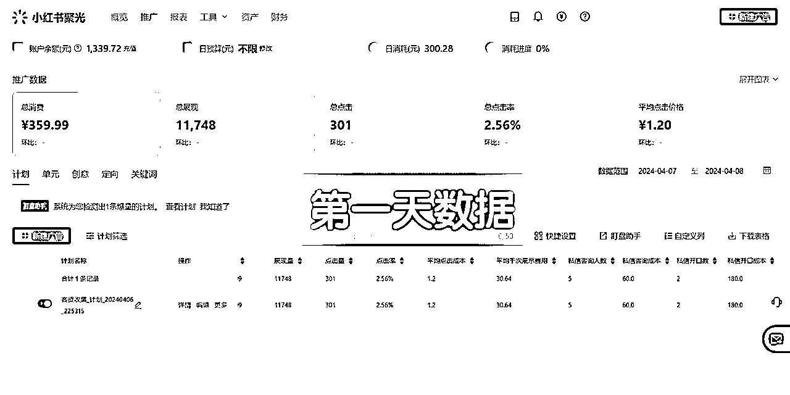
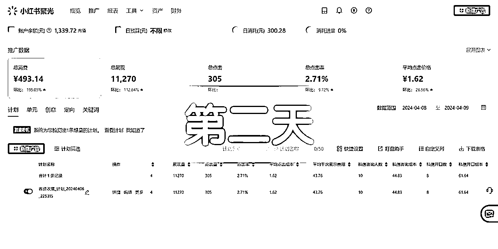
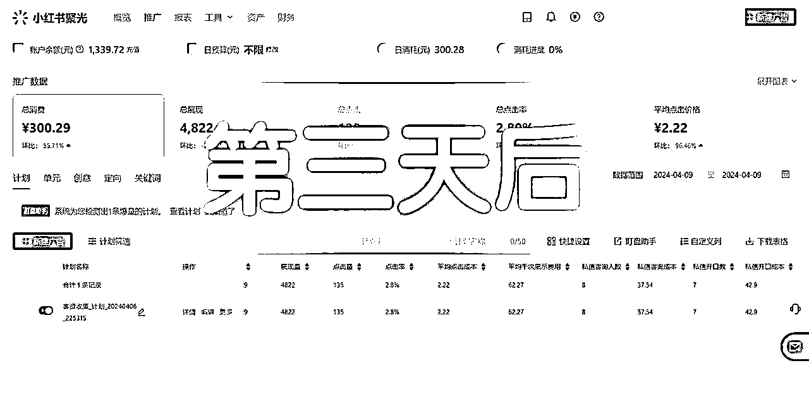

# 聚光获客实战拆解：教育培训考公赛道3天把开口成本从180压到40，一周多招满学员
作者：龙哥

大家好，我是龙哥。身为一名赚钱圈的新人操盘手，我在中高客单赛道累计GMV接近千万，聚光线索投放ROI长期稳定在10以上，主打去人设化的冷启动获客。今天就聊聊📕聚光在中高客单品类里的落地方法。

聊案例前，我先从项目层面拆解一下，这波聚光机会普通人该怎么抓住。

## 本文框架如下：

*   聚光获客当下的现状、人员搭配、启动周期、已取得的成果？
*   普通人现在入局是否还来得及？利润大概如何？门槛有哪些？
*   项目能盈利，关键环节有哪些？分别如何切入
*   最新项目案例复盘
*   避坑清单

### 聚光获客现在是什么情况？配什么人？多久能起？做到了什么？

我从去年开始深耕📕聚光，覆盖留学及周边、冬夏令营、高端游、教培等。自己自负盈亏，所以一直坚持精打细算的投放转化打法，追求极致ROI。以海外租房为例，淡季月投三千左右，可拿到100-300条精准线索，因为我们是企微承接，加微率大概在60%上下浮动；若是个人🛰️承接，加微率能做到80%-90%。

团队配置：前端拉流1人，可根据量级配助理或客服 + 后端销售 + 交付。只做前端拉流的话，销售和交付可以外包合作，1周到1个月就能跑出精准流量。

去年中旬前，📕还能走自然导流，官方基本睁一只眼闭一只眼，所以6月前我们一直靠📕做低粉高客单变现+素人种草，收益还算不错。转折点在去年6-9月，官方开始收紧，6月起新起的矩阵号频频被处理，撑到9月矩阵被重创后，团队士气受挫，不得不转投聚光付费流。

圈内关于聚光的帖子不少，后台细节就不展开了，这篇主要从项目视角讲普通人该如何切入。

### 普通人现在还能进场吗？利润空间如何？门槛高不高？

起初我也是被抖音电商项目搞垮，一夜回解放前。期间试过抖音IP、📕项目、视频号电商、视频号高客单引流转化，才逐渐摸到📕和视频号的门道，也在走投无路时撞见聚光机会。对普通人而言，核心是执行力，没有落地，再好的红利也抓不住。

入局门槛大家最常问：要营业执照申请企业号，要申请聚光账户，要有投放资金。

一开始我也卡在这里，但办法总比困难多。现在缺流量的商家很多，给两种解决思路：

1.  先去公司入职投放，公司账号和聚光账户都是现成的，你只要专心打法。担心不会投？面试过关就行，提前在网上了解后台操作、投放逻辑，别表现得完全小白，后续靠实操积累。
2.  直接找商家合作，话术是“由我负责获客，企业号和聚光账户您这边提供”。更激进点可以说投流费我先垫1000-2000，目的是让对方看到诚意。恋爱也是如此，光说没用，得拿出行动。有人担心后面一直要自己垫钱，跑路就好。合作是双向选择，不是单方面让步，初心不能偏离。

这些门槛其实不难破，只要执行力够，都能解决。身边没资源怎么办？公域流量庞大，商家遍地都是，多聊总能聊到。

我刚上手聚光时踩遍坑：

1.  代投砸钱没效果；
2.  挖千川投手成本高，养熟就跑；
3.  被迫自己上阵，本人电商出身有鲁班、千川经验，花钱自学+向一线聚光投手请教不断迭代。当时能交流的实战投手极少，现在圈子多了好不少。

心得：前期先实战或花钱跟一线老手学，红包请吃饭都可以。能独立驾驭后再系统学习课程，补充不同思路。先搭好自己的体系，再去丰富它。

### 项目能赚钱，关键环节能拆成哪些？

一个项目=选品/定赛道——流量端——销售端——交付端。电商或线索型都绕不开这四环。

想切入的人，建议先定好赛道，再从流量端入手。能力强的可把流量+销售+交付完整闭环。

1.  赛道选择
我一直主张项目先行，赛道大于一切。留学/考公培训/财税/海外租房/高端游，一单利润就是四位数起，能扛住投放费用。以高端游举例：投2000-3000，进来近百条精准线索，按80%加微=80人，20%转化=约16单，一单利润1000，只要成交2-3单就回本，成交16单就是白捡。反观生活美容一单利润100，每天得聊3个、成1单才不亏。所以我更看好中高客单。
2.  流量/销售/交付
想一个人跑通闭环，可以选教培资料赛道，交付标准化，只需把控流量和销售。
3.  团队搭建
前期1-2人足够，后续按业务扩张再补人。

### 最新落地案例：4月考公项目

用的预算约2000，第三天开口成本从180压到40左右，日均开口咨询10-20个，不到两周学员招满。数据变化如图：

#### 一、信息确认与准备

1.  先确认后端销售链路通顺、资质合规、行业可投放。这是重中之重。聚光规则变化快，认证周期拉长，行业规范趋严，部分品类从可投变不可投，资质要求也更高。投前资质不对，再厉害也过不了审。当时这个商家就卡在推广资质，后来更换资质才通过。
2.  确认可推进后，向商家同步赛道最新动态和节奏。
3.  确认企业号和聚光账户开通。
4.  1v1梳理产品与业务，投放要具体问题具体分析，不能一股脑全上。

#### 二、📕投流内容模块

常见误区：先做笔记跑自然再筛数据投放、投放前养号、付费压制自然。需要纠正平台认知，同时建立对自然流和付费流的底层理解。

##### 3-5篇投流笔记素材包、付费与自然流认知、投流笔记制作与参考

1.  时间紧可直接给经过验证的90%成功率笔记框架，让对方快速制作。但更建议预留1-2个月，避免拿来主义，遇到变量卡审时无法自解。
2.  现成模板顺风顺水，变量一变就卡审，会改不会改，需要自己踩坑体会。

#### 三、聚光认知+操作实操

为考公业务搭建专属词包，手把手建一条计划，边操作边讲解后台按钮逻辑和浪费点，1000-2000就能测出投产，保守测试3000一批次。该商家第三天开口成本压到40左右，日均10-20个开口咨询。数据变化如图：

全程只跑一条计划，计划数量不等于效果。围绕“精准、成本”展开，烧千八百没转化的链路问题应在线上消耗100-1000、1000-2000区间就暴露并解决。

首条计划跑顺后，再开第二条形成互补，就能解决大部分商家的投放问题，实现低成本放量。

#### 四、最终结果

*   3天开口成本180→40，考公商家每天被咨询刷屏，一周多后直接不回我了，朋友圈显示线下学员招满。PS：产品单价五位数。

#### 完整投放步骤：

1. 前期确认赛道可做聚光，并准备好企业号+聚光账户
2. 基于对平台和聚光的理解，制作精准笔记并配合账号操作
3. 计划精而准，普通商家适合控成本投放，投两三千撬动五六位数收益。红线是ROI持平，亏钱就停，优化后再测
4. 抓住核心数据指标持续优化，最终落到收益。不同策略适配不同业务

### 避坑指南

三个致命坑，都是血亏来的。

1.  投流砸进去没效果
很多商家不会投，找代投或官方推荐，一个月花一万没动静。根源是投放策略错误，对平台逻辑和业务理解不足。
投放前必须熟悉业务，销售链路通畅。可花1000-2000先测业务的获客+转化现状，不要问题不清就盲投。要学会分析，不要听信“素材跑不出去”“不适合”之类甩锅话术，自己心里要有判断。
大盘误区：大盘考公开口100-200，不代表你就要做到大盘。 大盘是小a商家、小b投手、官方代投小c、水下玩家小d的平均值，就像你赚10万，我赚2块，平均5万零1。别被大盘绑架，我经手的案例普遍远低于大盘。懂业务懂投放才是关键。
2.  招其他平台投手，养熟跑路
老板有体会，员工能多赚钱就会走。聚光投手稀缺，别的平台投手来需要烧钱涨经验，看悟性。还不如跟有经验的人取经。老板最好也懂一点，心里有数。
3.  缺少交流信息闭环
去年实战投手几乎找不到，烧钱摸索，想请教都难。现在圈子多了，要多交流，多进投放群，多认识一线投手。别封闭自己。

以上就是我这段时间的复盘，希望能帮大家抓住这波红利，一起龙哥盟。