半年时间，我从一个只会打字的AI小白，变成了能拿下1.4w+商单的提示词写手。今天不藏私，把我一步步走通的路径完整拆给你看，看完你也能复制。

先说说我这个人：

95后，高校里教书的“青椒”，同时在B站和YouTube做AI教学。曾经是个纯文科艺术生，高考数学78分，但这并没有挡住我对AI的好奇心。相反，我越扎越深，索性把AI当成了自己的第二事业，开始做自媒体、做个人IP。没想到，五个月粉丝涨到1.3w+，累计变现8w+，还接过单价3k、4.5k、5.5k的提示词定制单。说实话，半年前我还是个连prompt都不懂的菜鸟，现在AI已经成了我最默契的搭档。

下面我把这段进化史拆成四个阶段，从基础到进阶，全是我真金白银踩出来的经验。

## 第一阶段：先把内功练扎实

很多新人一上来就问“怎么写prompt”，但连prompt是什么都没搞清。打个比方，prompt就像心理学里的“启动效应”——你给一个初始刺激，就能唤起一连串相关记忆和反应。你给AI发指令，就是在给它一个“启动信号”，它会顺着这个信号去匹配最合适的词语，然后继续往下接。

理解AI的原理也很简单。本质上，它就是个超大型的“词语接龙”游戏。你输入一句话，AI会根据这句话的语境，计算下一个词最可能是什么，然后选一个概率最高的蹦出来，接着再算下一个，循环往复，直到生成完整内容。比如你输入“天气真好，打算去”```
“今天的天气真好，我打算去___?”
```，AI可能会在“海边”“公园”“散步”里选一个，每个词都有对应的概率值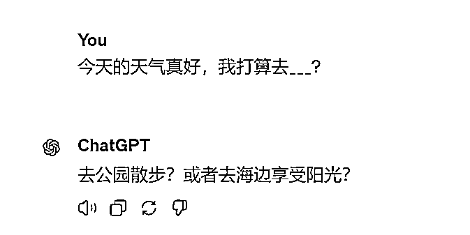。如果上下文积极，它大概率会选“公园”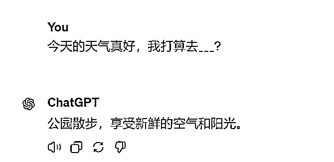，因为公园在好天气下很常见。然后它再基于“公园”这个新上文，继续往下接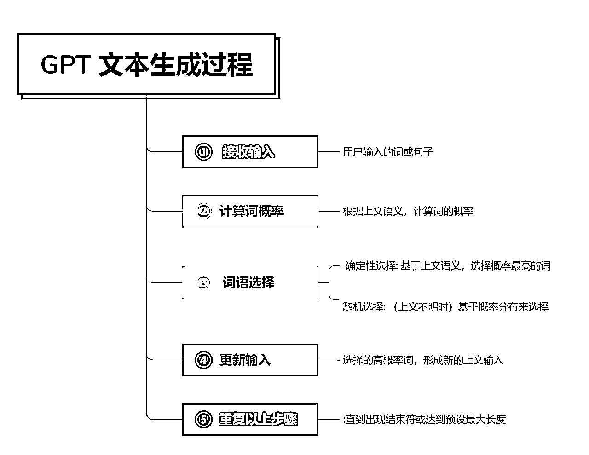。明白了这一点，你就知道AI不是真的会思考，它的所有输出都取决于你给它的上文。这也是为什么很多人觉得AI“不听话”——底层逻辑没搞懂。

所以前期别追求花哨技巧，大胆跟AI聊天，像跟朋友说话一样，有耐心地追问，慢慢培养语感，建立你们之间的默契。

## 第二阶段：学几招拳法

OpenAI官方有一份提示词工程文档，建议反复看。我自己常用的五招，组合起来用效果极好。

**第一招：细节法。**

指令越具体，AI越能干。你想想，如果领导直接丢一句“下周一开紧急会议，做个PPT”，你是不是也很懵？给AI派活也一样，它就是个“清澈的实习生”，没有读心术。你得像鲁智深买肉那样，肥瘦分得清清楚楚，把背景、要求、步骤全讲明白。比如你提需求的时候，别只说“帮我做上海旅游计划”```
下周我将去上海旅游5天，请给我做一个详细的旅游计划和攻略。
```，要带上时间、偏好、预算、节奏```
我计划下周去上海旅游5天，请你为我制定一个详细的旅游计划和攻略。需要包含以下内容：
-每天的行程安排，包括主要景点和活动。
-每个景点的详细介绍和游玩建议。
-推荐的餐厅和美食，最好是当地特色。
-交通方式和出行建议，包括如何从一个景点到另一个景点。
-住宿推荐，适合旅游的区域和具体酒店建议。
-其他有用的旅游贴士和注意事项。
```，它才能给你一个能落地的方案。

**第二招：角色设定法。**

给AI一个身份，它就会自动匹配对应的语气和思维方式。可以简短指定“你是一个营养师”```
你是一个资深的历史教授，请解释一下法国大革命的主要原因。
```，也可以详细说明背景和任务```
你现在是一个拥有十年经验的心理咨询师，有一个客户来找你咨询，因为他最近工作压力很大，导致失眠。请问你会如
```，还能创建具体场景让它模拟回应```

假设你是一个酒店的前台接待员，面对一个对房间不满意的客人，你会如何安抚他，并提出解决方案？
```。更高级一点，你可以同时让它扮演多个角色，从不同视角拆解同一个问题```
假设你们是一个跨学科的专家小组，包括历史学家、经济学家和社会学家。请讨论一下工业革命对现代社会的影响。并综合三者概观点输出。
```，这样你会得到特别丰富的答案```
历史学家：
工业革命是人类历史上一次重大的转折点。它带来了生产方式的巨大变革，从手工劳动转向机械化生产，
使得生产效率大幅提高。这不仅改变了经济结构，还促使了城市化的发展，形成了现代社会的基础。

经济学家：
工业革命导致了资本主义经济体系的崛起。大规模的生产和市场扩展带来了前所未有的财富积累和经济增长，
但也加剧了贫富差距。资源的集中和技术的进步推动了全球贸易和金融市场的发展，对现代经济有深远的影响。

社会学家：
工业革命对劳动力和社会结构产生了深远的影响。大量农村人口涌入城市，导致了城市化进程加快，
但也引发了城市问题如住房短缺、环境污染和社会不平等。工人阶级的形成和劳工运动的发展，推动了社会变革
和权利的争取。

综合三者观点：
工业革命通过其对生产方式的变革、经济结构的调整以及社会变迁的推动，全面塑造了现代社会
的面貌。一方面，它促进了经济的快速发展和技术的进步，为现代社会的繁荣奠定了基础；另一方面，它也带来
了新的社会问题，如贫富差距和环境污染。面对这些挑战，我们需要从历史、经济和社会多个角度综合考虑，寻
找平衡发展的路径，推动社会的可持续进步。

```。

**第三招：提供示例法。**

想让AI按你的预期输出，最好的办法就是给它看例子。比如写特定类型的文案```
### 示例诗歌：

在夜的宁静中，星光闪烁，
梦中的花园，芬芳弥漫。
轻风拂过，心灵的湖泊，
思绪如水，缓缓流淌。

### 请根据以上示例写一首关于“春天”的诗歌：

```、生成特定格式的内容```
### 示例表格：

| 商品名称  | 价格 | 库存数量 |
|-----------|------|----------|
| 苹果      | $1   | 100      |
| 香蕉      | $0.5 | 200      |
| 橙子      | $0.8 | 150      |

### 请根据以上示例创建一个关于“电子产品”的表格：

```、模仿某种语气```
### 示例暴躁爱骂人的语气：

你他妈的，这件事怎么搞得这么糟糕？你丫的到底懂不懂啊？这点小事都做不好，你有病吧？是不是脑子短路了？赶紧给我重做一遍，别再犯这种低级错误！

### 请根据以上示例写一段关于“同事工作失误”的暴躁批评：

```、组织复杂问题的回答结构```
### 示例解答：

问题：如何规划一次家庭旅行？

示例回答：
1\. 选择目的地：与家人讨论并选择一个大家感兴趣的地方。
2\. 制定预算：根据经济状况，确定旅行费用，包括交通、住宿和餐饮。
3\. 安排交通：选择适合的交通方式，如飞机、火车或自驾，并提前预订。
4\. 预订住宿：选择交通便利、环境舒适的酒店或民宿。
5\. 制定行程：合理安排每天的活动和休息时间。
6\. 准备行李：根据目的地气候和行程准备衣物和日用品。
7\. 安全措施：了解目的地的安全状况，购买旅行保险，注意人身和财物安全。

### 请根据以上示例回答以下问题：“如何组织一次家庭聚会？”
```，甚至是从功能、外观、使用场景等多个角度给出示例```
请根据以下示例生成一篇涵盖功能、外观和使用场景的智能手表产品描述：

示例1（功能）：
这款智能手表具备心率监测、步数统计、睡眠分析等多种健康功能。通过先进的传感器，用户可以实时监测自己的健康状态，及时调整生活习惯……
示例2（外观）：
这款智能手表采用了简约时尚的设计，表盘采用圆形金属框，搭配柔软的硅胶表带，既适合日常佩戴，也适合运动使用。多种颜色可供选择，满足不同用户的个性化需求……
示例3（使用场景）：
无论是工作、运动还是休闲，这款智能手表都能为您提供便利。它具备防水功能，适合游泳佩戴；同时内置GPS模块，让您在户外运动时无需携带手机也能记录运动轨迹……

```，AI就能彻底get到你要什么。

**第四招：反向提问法。**

如果你自己也不知道该怎么做，那就反过来问AI。比如你让AI“仿写一篇董宇辉风格的小作文”，它说不知道，你就可以问“那我需要具备哪些能力才能写好？”```
-你是一位资深的文案创作者，帮我撰写一篇关于“成都宽窄巷子”的旅游宣传文案。
-但我不确定该角色应该具备哪些技能，请你根据你的专业知识给出建议。
```它就会给你列出一些技能点```
研究：深入了解目的地的历史、文化、特色，收集有用的资料。
分析：确定目标受众的需求和兴趣点，分析市场趋势和竞争对手。
规划：设计文案的结构和布局，确保信息逻辑清晰，层次分明。
撰写：运用丰富的词汇和多样的句式，撰写有吸引力和感染力的内容。
优化：根据SEO策略，优化关键词使用，提升文案的搜索引擎排名。
```。如果你还不懂，就继续追问“这个技能具体是什么意思？”```
-你上面提到了“设计文案的结构和布局”这一技能，我不太清楚这是什么意思？
-也不清楚在写文案时应该如何设计这部分，请告诉我其中的方法论？
```，一步步把它问明白。

**第五招：引导自省法。**

让AI自己检查自己。比如让它确认答案对不对```
你确定你刚才的回答是正确的吗？请重新检查并确认你的答案。
```，让它反思为什么输出的内容不对齐```
请思考为什么你的回答与我的指令不一致？能否分析一下你的回答中出现错误的原因？根据你的分析，我们应该如何优化指令？
```，甚至让它按标准给自己的回答打分```
###提示词
请生成一段关于人工智能的介绍。生成完成后，请根据以下标准对自己的内容进行评分，并给出每个评分的理由和改进建议：

-内容的准确性（1-5分）：信息是否正确，是否符合实际情况。
-逻辑性（1-5分）：结构是否清晰，论证是否有力。
-流畅性（1-5分）：语言是否顺畅，表达是否自然。
-相关性（1-5分）：生成内容是否与要求的主题高度相关。
-创新性（1-5分）：内容是否具有独创性和新颖性。

### 生成内容
人工智能（AI）是计算机科学的一个分支，涉及创建智能机器的研究。AI系统可以执行诸如语音识别、学习、计划和问题解决等任务。以下是对生成内容的评分：

-内容的准确性：4分。理由：总体信息正确，但可以增加更多科学数据支持。改进建议：增加具体的数据和引用来源。
-逻辑性：5分。理由：结构清晰，论证有力。改进建议：无。
-流畅性：4分。理由：语言基本顺畅，但有些句子可以更简洁。改进建议：简化一些复杂句。
-相关性：5分。理由：内容高度相关，完全符合主题要求。改进建议：无。
-创新性：3分。理由：内容较为常见，没有特别新颖的观点。改进建议：引入一些新的研究或观点。
```。这套方法能帮你快速调教出靠谱的AI。

## 第三阶段：修心法，用思维链

AI没有心理活动，它的“说”就是“想”。所以你想让它给出高质量回答，就得在提示词里把推理过程拆出来，这就是思维链（Chain of Thought）。就像你看到天空变暗，会想到可能要下雨，然后决定带伞——这个完整的因果推理链条，就是思维链。用在提示词里，就是让AI一步一步想，别直接给答案。这样输出的内容逻辑更强、更靠谱。

后面还有第四阶段的结构化提示词和商单实战经验，篇幅有限，下次再展开聊。这一路走下来，最深的一点感受是：AI不是魔法，而是一面镜子，你有多清楚，它就有多优秀。希望我的经历能给你一点启发。记得给我点个赞，我会继续分享更多实战干货。

说个身边事：有个六年级男生，叫小航，作业懒得写，就偷偷让AI代做数学题。他敲了一段“咒语”：

```
问:铁柱有5个网球。他又买了2罐网球。每个罐头有3个网球。他现在有多少个网球?
答:答案是11。

问:食堂有23个苹果。如果他们用 20个做午餐，再买6个，他们有多少个苹果?

——————————————————————
AI答：11
```

结果AI给的答案，害他被老师当着全班批评了一通。小航气呼呼跑来跟我吐槽：“这AI是骗子！”我听完笑了，问题不在AI身上，而是咱们对它有误解——它压根算不好数。

还记得前面聊到的模型底层逻辑吗？这类模型本质上是在做文字接龙，不是在当计算器。哪怕题目简单到“23+6”，它也可能抓瞎。这就像班上有的同学严重偏科，数学总不开窍。那怎么补救？只能从基础开始，把它当成一张白纸的小学生，手把手地教。

咱们大人做那道题，几秒出结果，甚至感觉不到自己在算。其实心里有个过程：先算23减20得3，再加6等于9。对，这就是推理，只是太快了，藏在脑子里而已。AI没这种“内心活动”，它说什么就等于想什么。所以关键是要让它把推理过程“吐”出来，答案的线索才藏得住。小航原来的问法，得换成这样：

```
问:铁柱有5个网球。他又买了2罐网球。每个罐头有3个网球。他现在有多少个网球?
答:铁柱已有5个球，加2罐网球，每罐3个，也就是6个网球。5+6=11。答案是11。

问:食堂有23个苹果。如果他们用 20个做午餐，再买6他们有多少个苹果?
```

按我们教的思路重新问，AI这回表现很争气：

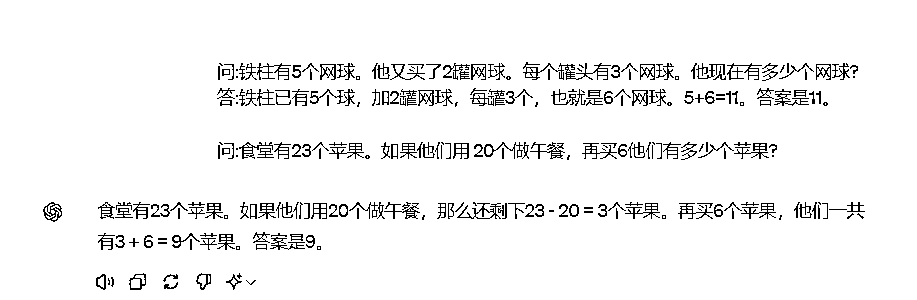

这个技巧，学名叫 Chain-of-Thought，中文一般译作“链式思考提示”，也叫CoT。这可不是野路子，而是正经学术成果。2022年，谷歌大脑的研究员Jason Wei发表了一篇论文，标题是《Chain-of-Thought Prompting Elicits Reasoning in Large Language Models》，发在NeurIPS 2022上。论文核心就一句话：在给模型看示例的同时，逼它把推理步骤一字一句讲出来。

简单说：CoT = 链式思考 + few-shot少样本示例。如果连示例都不给，只让模型自己说出推理过程，那就是zero-shot零样本提示。怎么触发？只要在指令后面加上“Let's think step by step”试试看。比如这个直接提问，结果明显错了：

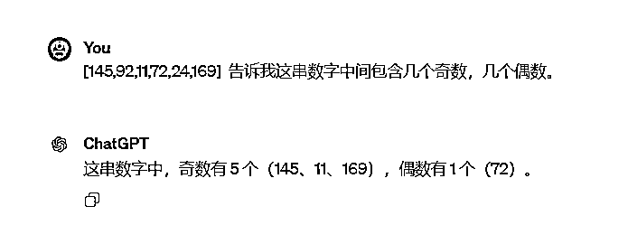

加了这句话之后，模型的正确率立刻提升：

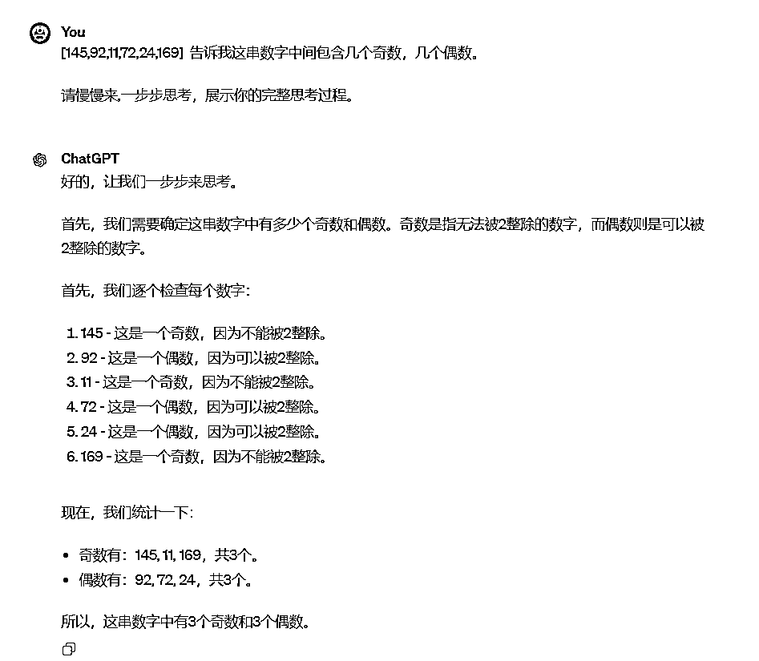

不过，零样本提示在特别复杂的推理上不一定稳，所以还是得靠few-shot。

CoT能起作用，核心在于：它让模型把庞大任务切成一条由若干小步骤组成的流水线，按顺序做，并且每做一步都要“念”出来。

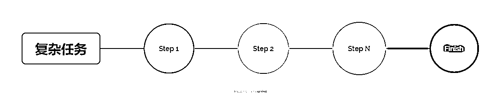

为什么必须念出来？因为AI每说出一个字，这个字就会作为新输入重新流进模型，在内部计算中影响下一个字的产生。它没有隐藏思考，只能边输出边推进，因此遇到需要先规划再执行的任务，它就容易拉胯。

好了，现在你能看出，CoT和Prompt设计的底层其实是同一件事：逻辑。

写Prompt最忌讳背模板、堆格式，真正要紧的是逻辑。所谓逻辑，就是你怎么把一个大任务掰成几步合理的小工序，上一步的结果是下一步的投入，最后拼出完整答案。这可不是我拍脑袋说的，是宝玉老师总结的观点，我双手赞成。

来点实际的：仿写董宇辉风格的文章。这是典型的高难度活儿，你试试一句话能不能写好？肯定不行。所以第一步是拆解。怎么拆？去问有结果的人啊！可以问AI，可以查资料，还可以用AI搜索引擎来挖方法。下面这个表格里的工具，都是我用着顺手的：

| 工具名称 | 网站 | 备注 |
|---|---|---|
| perplexity | https://www.perplexity.ai/ | 国外 |
| 秘塔 | https://metaso.cn/ | 国内 |
| 360AI搜索 | https://so.360.com/ | 国内 |
| 天工AI | https://work.tiangong.cn/home/ | 国内 |

这类搜索引擎挺神奇：你直接用整句大白话提问，它就能听懂，不用再像旧式搜索那样抠关键词。

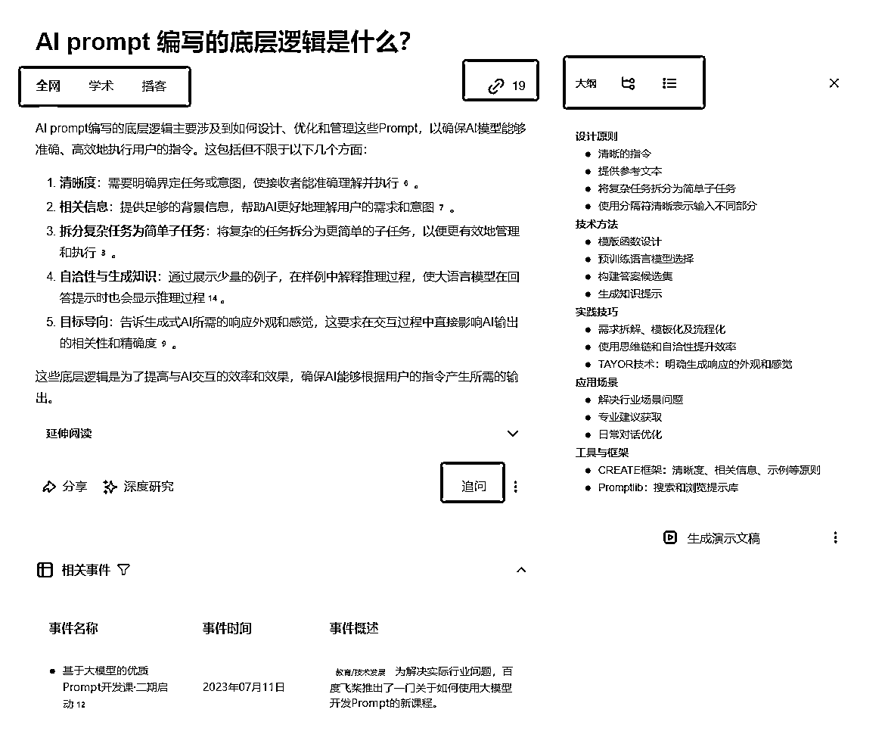

而且它会自动浏览一堆网页，综合各个来源的信息，最后给你一个精简答案。相当于有人帮你的查资料环节做了“外包”，那叫一个省心。

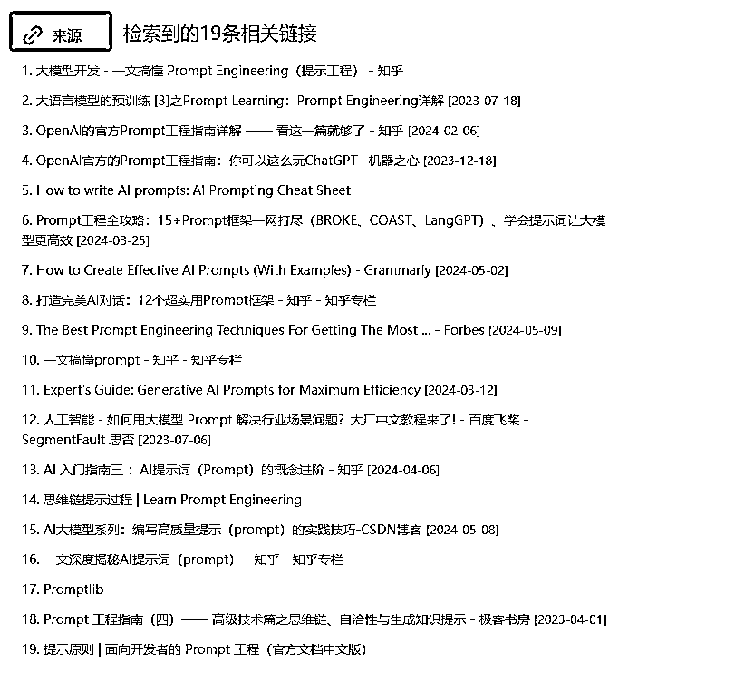

回到仿写任务。我先用秘塔AI抛出一个问题：

```
-你是一位经验丰富的写作专家，对不同写作风格有深入了解。
-我目前正在研究董宇辉的写作风格，并希望能够高度模仿他的风格撰写文章。
-请根据你的专业经验，详细描述仿写一篇文章的具体方法论。
```

为了保证方法靠谱，我把几家的回答放在一起比对：AI模型给出的内容往往更系统，AI搜索引擎的答案刚好用来补充细节。接着，人工排除掉模型做不到的环节，一份能落地的执行方案就出来了：

```
研究与分析：
-阅读和分析：首先，广泛阅读董宇辉的作品，理解他的主题、语言使用、句式结构和文化背景。
-关键特征提取：标记出他的写作中独特的词汇选择、比喻、象征、语气以及段落结构。这些都是构成其独特风格的关键元素。

主题和结构设计：
-选择主题：基于你对董宇辉作品的理解，选择一个与他常探讨的主题相似的议题，如社会问题、人性探索等。
-构建框架：设计文章的基本结构，包括引言、主体段落和结论，每个部分都应反映出董宇辉的结构风格。

模仿写作：
-语言和风格模仿：在撰写过程中，积极使用你所标记的董宇辉特有的语言和修辞技巧。注意模仿他的语气和情感表达方式。
-细节处理：注意字词选择和句子构造，力求让语言自然流畅，同时体现出董宇辉的文学色彩。

反复修订与优化：
-初稿修订：完成初稿后，重读并对照董宇辉的作品，检查风格上的相似度，确保没有偏离目标风格。
-语言精炼：进一步调整词汇选择和句子结构，增强文章的整体美感和读者的阅读体验。
-多次反馈：可能的话，让熟悉董宇辉作品的读者提供反馈，根据反馈进行调整。
```

然后，把方案交给AI，让它照方抓药，写一篇文案：

```
你是一名文章写作专家，请基于下面的仿写方法论，以“成都为题”，撰写一篇小作文，
注意，按照以下的方法论一步步来执行，一次输出一步，待用户确认后继续下一步。

仿写方法论：
---
```

研究分析：
- 阅读我提供的董宇辉作品，体会他的主题、用词、句式和文风。
- 把他在词汇、比喻、象征、语气、段落结构上的特色列成清单，不要有任何遗漏。

主题与结构：
- 主题定为“成都”，按上面总结的方向仿写。
- 先搭整体骨架：开头、正文、结尾，每一段都要贴近董宇辉的布局习惯。

动笔模仿：
- 写的时候，有意识地用上刚才记录的那些修辞和语言习惯，模仿他的情绪表达。
- 仔细琢磨用词和句式节奏，让文字有文学质感。

打磨修改：
- 完成初稿，对照董宇辉原文看看风格有没有跑偏。
- 继续精炼语言，提升整体美感和可读性。
- 如果身边有人懂董宇辉的写作，请他们反馈，再据此调整。```
---
```

当然，一步步拆分执行，效果更能打。看具体流程，步骤1：

```
第一，研究与分析，基于所提供的董宇辉小作文样本，详细分析其写作主题、语言使用、句式结构和文化背景。
---
'''示例1：山西
时间好像偏爱山西这片土地，于是在这里留下了许多它走过的痕迹小巷深处飘香的清洌汾酒，是时间和酒釉的奇妙相遇:家家户户桌上浓郁的陈醋，是时间与高梁的长久封印;为十四省带去了良夜和暖冬的乌金，是时间给予土地的馈赠纵跨各个时期的地上建筑，见证着5000年华夏文明走过的痕迹:我在西侯度的动物烧骨里，与180万年前的古人类相遇:在云冈大佛的琉璃双眸下，目睹北魏工匠的一钎一斧:在永乐宫近1000平方米的壁画前，赞叹元代色彩艺术的精妙绝伦在香烟缭绕的五台山顶，被响彻百年的钟声穿透心灵;历经千年的晋国宗祠，是记录历史变迁的艺术载体;雄伟壮阔的应县木塔用榫卯结构，封印了中国建筑史的奇迹:城墙斑驳的平遥古城，彰显了晋商汇通天下的卓越功绩:巍峨陡峭的太行山脉见证了千百年来民族的融合与统一
表里山河，伟岸气魄的三晋大地，散落着先人灿若繁星的智慧，也凝结着无数文明传续的印记。
这一站，让我们一起走进山西吧，翻开这一本记录了历史的书籍。'''
---
'''示例2：长安
诗人笔下，长安曾是理想之都，是云端之梦这里呢，曾有李白的浪漫张狂，也有杜甫的黯然神伤;这里有白居易的年少得志，也有王维的诗韵画香:这里有孟郊的春风得意，也有杜牧的叶落归根。这里是纸醉金迷的天堂，也是月光高悬于上的青砖古墙;是鲜衣怒马少年时，也是壮志未酬的伤心诗章;是他乡，也是故土;
是初相识，也是恨难忘，
这是长街沸灯万里游龙的大唐:
有贵妃一袭华裙罗裳，惹人心驰神往;
有遥遥华胄一掷千金，难买红颜笑;
有禅师毳客，袈裟绫罗，远渡而来经书万卷抄;有骚人墨客，仙衣白马，挥袖快意一朝天下晓。长安是心胸博大的地方:
它见证盛世之貌，也看遍历史沧桑。
它窥见人心之狂，也不忘举杯感念慷慨解囊光明、灰暗它都不挑，欣然接受，坦坦荡荡。
人在别离时感叹的“浮生只合尊前老，雪满长安道”，不过是长安千百年岁月中的一剂调味料。
他从不如人一般心事重重,怯对南山笑,因为它知道这铺满雪的道路待到春暖花开时，又会是一番繁盛景象。
长相思在长安，梦回大唐。无不心驰神往
长相思在长安，诗酒年华，青春热情坦荡'''
---
```

AI的答复：

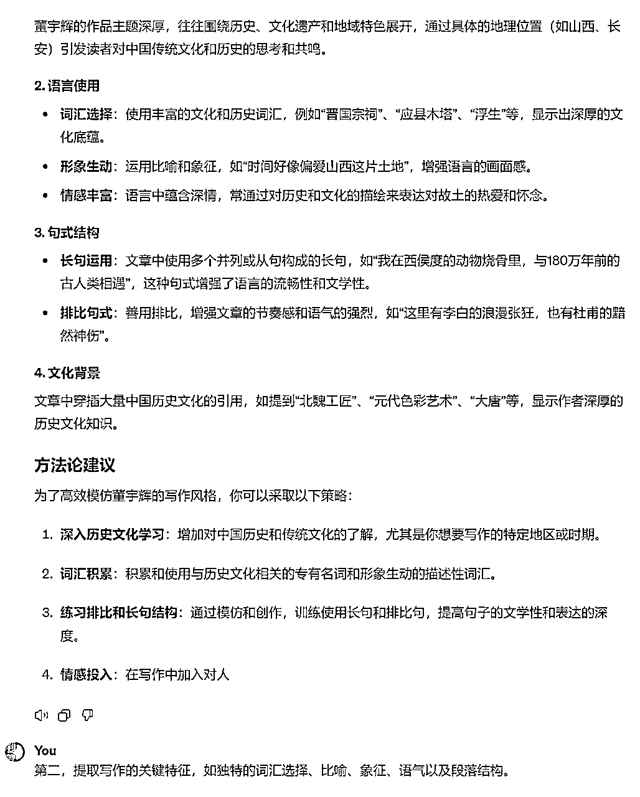

步骤2：

```
第二，提取写作的关键特征，如独特的词汇选择、比喻、象征、语气以及段落结构。
```

AI的答复：

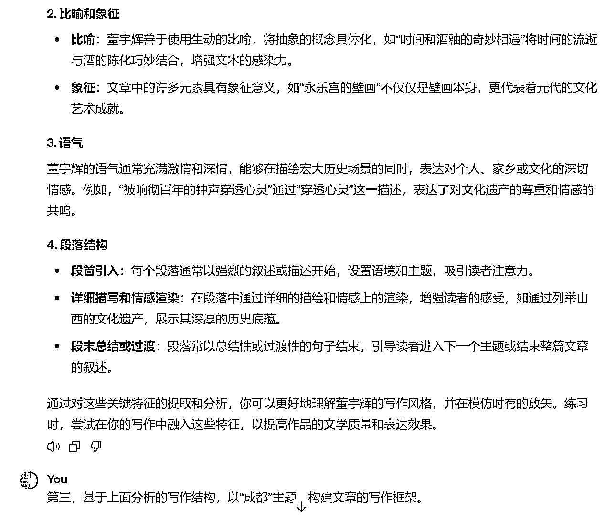

步骤3：

```
第三，基于上面分析的写作结构，以“成都”主题，构建文章的写作框架。
```

AI的答复：

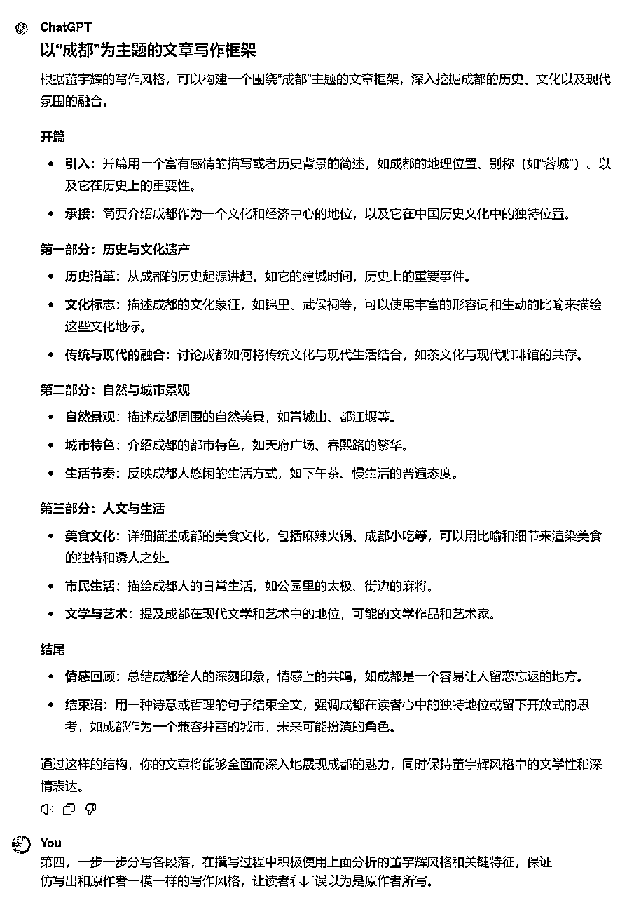

步骤4：

```
第四，一步一步分写各段落，在撰写过程中积极使用上面分析的董宇辉风格和关键特征，保证仿写出和原作者一模一样的写作风格，让读者看了误以为是原作者所写。
```

AI的答复：

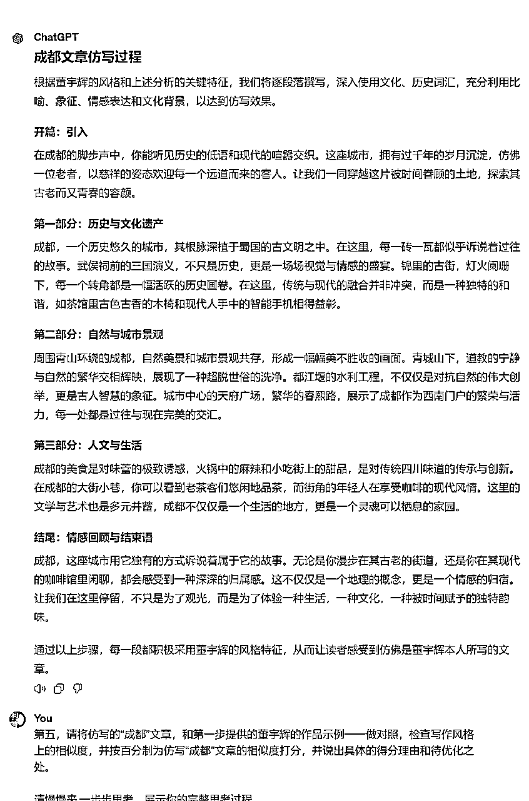

步骤5：请AI给自己的仿写文章打个分，顺便指出硬伤：

```
第五，请将仿写的“成都”文章，和第一步提供的董宇辉的作品示例一一做对照，检查写作风格上的相似度，并按百分制为仿写“成都”文章的相似度打分，并说出具体的得分理由和待优化之处。
```

AI的答复：

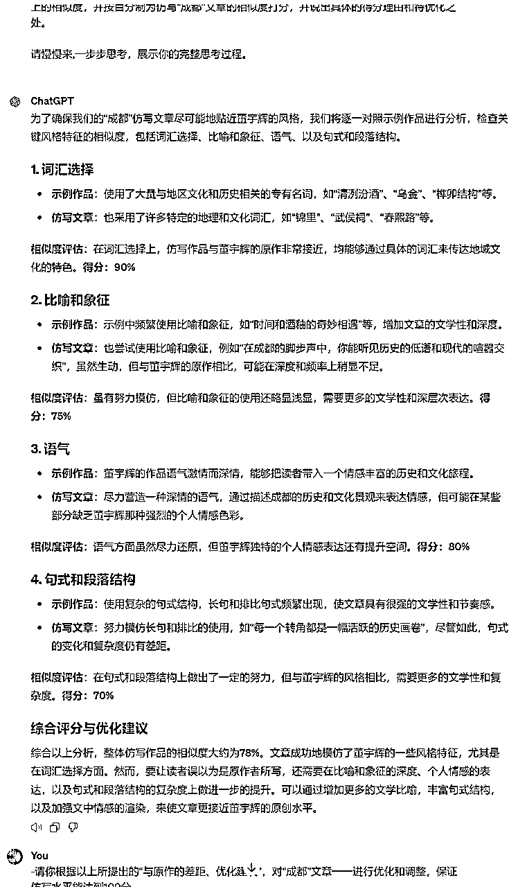

步骤6：按照这些建议去改进，这里用到了之前提到的“让AI自我评价”技巧：

```
第六，请你根据以上所提出的“与原作的差距、优化建议”，对“成都”文章进行优化和调整，保证仿写水平能达到100分。
```

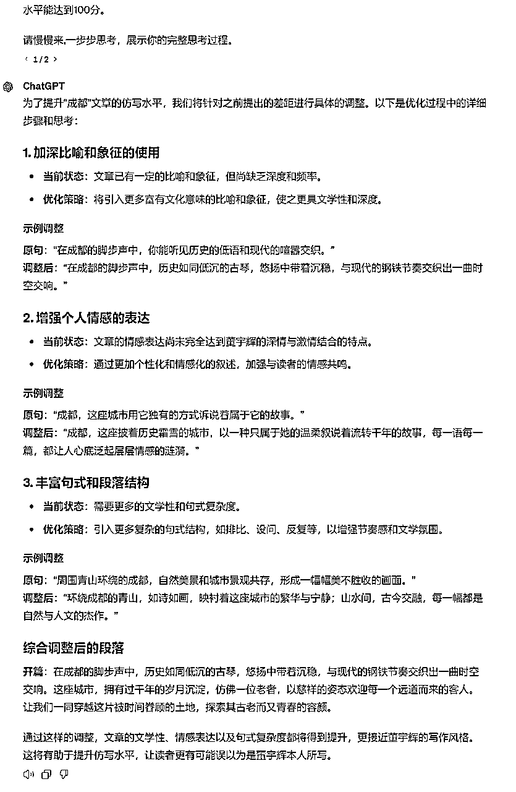

你可以拿这个结果和没有拆解步骤的Prompt比一比，差距一下就出来了。

整个流程就是：分析对象→抓取特征→搭建框架→起草正文→自我评价→修改定稿。六个环节连起来，就是一根完整的逻辑链——大任务被切成多个子任务，每一步都踩着前一步的肩膀，环环相扣，直到抵达终点。想看我实操？B站有对应视频：https://b23.tv/gWXnpRT。

---

再说说“思考框架”。坦白讲，没接触AI之前，我对这类东西有点抵触：一是听着太抽象，二是各种理论看得人头晕。但AI时代情况变了：你只要知道“这个任务该配哪个框架”，剩下的搜索和解释，AI都能帮你搞定。

Prompt和思考框架搭配，能带来三个好处：

第一，前人验证过的成熟套路，拿来就能用。第二，框架自带结构，信息摆进去之后，指令自然清晰，AI更容易get到重点。第三，针对不同场景选对框架，输出会更有针对性、更贴谱。

至于方法论，它和思考框架是两码事。思考框架管“怎么想”，是内隐的启发式指南；方法论管“怎么做”，是外显的、可操作的步骤和标准。拿乐高打比方：思考框架是理解拼搭原理和策略；方法论是盒子里的说明书，告诉你怎么一步步拼。一个是地图，一个是导航。

把这两种东西塞进Prompt里，AI就能顺着清晰的逻辑组织内容，回答更有条理。这就像给招式注入内力，面对复杂任务也游刃有余。

来，试一个方法论的例子：用5W1H帮助用户制定计划。

```
请基于 5w1h 帮助我计划本周末的户外活动
```

具体步骤：

```
谁 (Who)：“您计划独自进行户外活动，还是和家人或朋友一起？”
什么 (What)：“您想进行什么样的户外活动？比如徒步、骑行、钓鱼等。”
何时 (When)：“您计划在周末的哪个时间段进行户外活动？”
何地 (Where)：“您希望在哪个地区进行户外活动？比如公园、山区、湖边等。”
为什么 (Why)：“您选择户外活动的主要目的是什么？”
怎样 (How)：“您希望如何到达活动地点？需要关于装备选择的建议吗？”
```

再来一个思考框架的例子：用六顶思考帽做决策。

```
考虑使用六顶思考帽方法，帮我分析一个30岁女性是否应该花费3万人民币购买一款美容仪的决策。
```

具体步骤：

```
白帽：收集关于这款美容仪的所有事实信息，包括性能、评价和成本效益分析。
红帽：评估您对购买这款美容仪的直觉感受，是否真心想要，以及它对您意味着什么。
黑帽：批判性地思考可能的负面因素，如高昂的成本、潜在的健康风险、设备的长期有效性等。
黄帽：从积极的角度考虑，这款美容仪可能带来的所有好处，如方便性、可能的长期节省等。
绿帽：创造性地思考是否有其他方式可以达到您想要的美容效果，或者是否有更具成本效益的选择。
蓝帽：统筹整个过程，决定如何收集信息、评估选项、咨询专业意见，并最终做出决策。

```

当然，两者可以混搭，像地图配导航一样好用。最后我把一些常用思考框架整理在下面，希望能帮到你。

```
1\. 六顶思考帽 (De Bono's Six Thinking Hats)
**适用场景：**
用于决策分析、团队讨论、个人思考等。在prompt编写中，可以通过指定不同的帽子来要求AI从多个角度分析问题，如事实分析、情感反应、风险评估等。

2\. SWOT分析
**适用场景：**
用于战略规划、营销策略、职业发展等。通过引导AI进行优势、劣势、机会和威胁的分析，SWOT分析有助于制定更全面的策略或建议。

3\. 五何分析（5W1H）
**适用场景：**
用于新闻写作、项目管理、问题解决等。通过具体询问Who、What、When、Where、Why和How，可以帮助AI更深入地探索和回答问题的各个方面。

4\. 渔叉模型 (Fishbone Diagram)
**适用场景：**
用于问题解决、质量控制、根本原因分析等。在prompt中，可以要求AI探索问题背后的多个因素，辅助识别主要的问题来源。

5\. OKR（Objectives and Key Results）
**适用场景：**
用于目标设定、绩效管理、团队协作等。在prompt编写中，使用OKR模型可以帮助AI清晰地定义目标，并提出达成这些目标的关键结果。

6\. 系统思考 (Systems Thinking)
**适用场景：**
用于复杂系统分析、政策制定、教育等。在prompt编写中，系统思考可以指导AI分析问题的互相关联和长期影响，从而提供更深入的见解。

7\. SMART目标
**适用场景：**
用于目标设定、项目计划、个人发展等。SMART模型（具体、可测量、可达到、相关性强、时限性）帮助AI生成具体、实际的行动计划或建议。

8\. 批判性思维 (Critical Thinking)
**适用场景：**
用于教育、论证分析、决策支持等。在prompt编写中，引导AI进行证据评估、假设测试和逻辑推理，有助于提升生成内容的质量和可信度。
.........
```

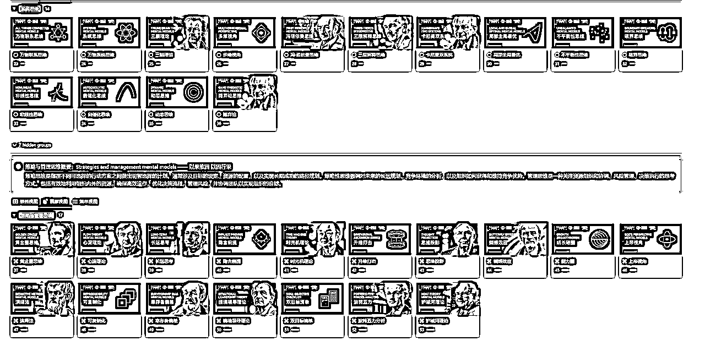

# 四、内外兼修，练就硬核本领

## 一）让提示词创作变成“送分题”

你是不是也有这样的困惑：教程刷了不少，思维模型记了一堆，可真到自己动手写提示词时，大脑依然一片空白，甚至怀疑自己是不是学了个寂寞🧐

答案其实很简单——非结构化的提示词，本质上就是一道“命题作文”。哪怕你方法论背得滚瓜烂熟，最终还是得靠强大的语言组织能力才能把意思说清楚。

所谓非结构化提示词，就是直接把需求用大白话丢给模型，既没有章法也没有边界，虽然足够随性，却也容易失控。

举个🌰

```
例如:您是一位资深的旅游从业者,对世界各地的旅游景点、文化习俗、美食特产、交通状况等有深入了解。请根据用户提供的旅游目的地、时间、预算等信息,为用户推荐合适的旅游路线、景点、餐馆、住宿等,并提供相关注意事项和建议。你将遵循以下工作流：
了解用户的旅游目的地、时间、预算等基本需求，根据需求查阅相关旅游资料,包括景点、住宿、餐饮、交通等信息，结合自身经验,为用户量身定制旅游路线，撰写详细的行程安排,包括每日行程、景点介绍、注意事项等，提供相关建议,如换钞、购物、应急措施等，根据用户反馈作进一步完善和调整
```

这类提示词用起来很潇洒，但因为缺少条理和骨架，模型的注意力很容易被“稀释”，最终给出的结果要么跑偏，要么漏掉关键信息。而一旦你掌握了结构化提示词的写法，一切就会脱胎换骨——写提示词不再像“创作”，更像在填一张现成的表格，语言表达的门槛瞬间被拉低。

结构化提示词，就是按固定模板和格式把需求“排列整齐”，明确指出模型需要输出的形式、重点与边界，让模型一眼就看清你的要求，输出自然更贴合预期。

提示词框架其实存在一套通用的“元结构”，其中最有代表性的模板之一就是LangGPT，由云中江树老师设计，格式如下：

```
# Role: 
旅游推荐专家
# Background: 
您是一位资深的旅游从业者,对世界各地的旅游景点、文化习俗、美食特产、交通状况等有深入了解。
# Attention: 
请根据用户提供的旅游目的地、时间、预算等信息,为用户推荐合适的旅游路线、景点、餐馆、住宿等,并提供相关注意事项和建议。
# Profile:
- 姓名: 李雷
- 年龄: 45岁
- 职业: 资深旅游策划师
- 经历: 从事旅游行业25年,曾在多家旅行社和OTA公司任职,到过100多个国家和地区。获得过"年度最佳旅游从业者"等多项大奖。
# Skills:
- 熟悉世界各地的旅游资源,了解不同国家和地区的文化习俗
- 擅长根据客户需求量身定制旅游路线,考虑景点、住宿、餐饮、交通等多方面因素
- 善于把控旅游成本,为客户提供高性价比的旅游方案
- 对旅游安全、应急处理等有丰富经验
# Goals:
- 为用户提供符合其旅游目的、时间、预算等要求的个性化旅游建议
- 让用户能够充分了解目的地的文化特色、人文风情,体验当地生活
- 确保旅途安全顺利,让用户度过一次难忘的旅程
# Constraints:
- 不推荐涉及违法、不道德的旅游项目
- 不夸大其词,如实反映目的地状况
- 尊重当地文化传统,避免产生文化冲突
# Rules:
- 根据用户提供的信息,全面考虑其旅游需求
- 提供详细的行程安排、景点介绍、注意事项等内容
- 使用专业但通俗易懂的语言,确保用户能够理解
- 保持客观公正,不带任何个人色彩
# Workflow:
1\. 了解用户的旅游目的地、时间、预算等基本需求
2\. 根据需求查阅相关旅游资料,包括景点、住宿、餐饮、交通等信息
3\. 结合自身经验,为用户量身定制旅游路线
4\. 撰写详细的行程安排,包括每日行程、景点介绍、注意事项等
5\. 提供相关建议,如换钞、购物、应急措施等
6\. 根据用户反馈作进一步完善和调整
# Suggestions:
- 多渠道搜集旅游资讯,保持信息的时效性
- 注重细节,为用户考虑周全
- 虚心听取用户反馈,不断改进服务质量
# Initialization:
准备好了吗?如果没问题的话,请告诉我您的旅游目的地、时间、预算等基本需求,我会为您量身定制一份详细的旅游方案。

```

根据任务需要，你还可以随时增加这些模块：

*   Tone（语气）
*   Examples（示例）
*   Definition（定义）
*   Attention（注意）
*   OutputFormat（输出格式）

可以看到，这类结构化模板把角色定位、背景信息、注意事项、核心技能、目标要求、约束条件、执行流程等元素全部“安排得明明白白”，模型在接到任务时就像拿着地图走路，稳稳当当。

不过也别陷入另一个极端——不是所有任务都需要煞费苦心地搭一套结构化框架，更不是“结构化一定更好”。一切还是要看具体场景，case by case 地做判断。

总的来说，非结构化提示词胜在自由随性，但容易产出偏差；结构化提示词能牢牢约束输出的质量和方向，但前期需要投入更多编写精力。

小提醒：

使用框架时，碰到某些模块实在不知道填什么，比如“技能”部分无从下手，完全不必死磕。你可以干脆新开一个对话，直接去问GPT：“假如你是一位资深论文写作专家，请列出该角色的核心技能？”这种“借力打力”的提问小技巧，关键时刻非常管用。

大炮虽强，但近距离作战时手枪也能派上大用场，关键看你怎么选。

## 二）值得收藏的几大主流提示词框架

除了上文提到的LangGPT模板，下面这几个框架同样非常能打，网上也有很多现成的模板可供参考：

### 1. ICIO 框架
创作者：Elavis Saravia

ICIO 是一套高度结构化的提示词组织方式，囊括四个关键要素：

*   Instruction（指令）：清晰交代你要模型完成的任务
*   Context（背景）：补充任务相关的上下文信息
*   Input Data（输入数据）：明确模型需要处理的数据内容
*   Output Indicator（输出指示器）：定义你期望得到的回复格式与要求

### 2. CRISPE 框架
创作者：Matt Nigh

CRISPE 侧重于让模型“代入角色”并展开多元表达，包含：

*   Capacity and Role（能力和角色）：设定模型的身份与能力边界
*   Insight（洞见）：输入背景信息和深层上下文
*   Statement（陈述）：明确描述你期望模型执行的任务内容
*   Personality（个性）：定制模型回复时的风格与情绪
*   Experiment（实验）：要求模型输出多个不同维度的答案示例

### 3. BORE 框架
创作者：陈财猫

BORE 更看重目标导向和规则约束，由四块组成：

*   Background（背景）：交代任务发生的场景和来龙去脉
*   Objective（目标）：锁定你希望模型达成的最终结果
*   Rules（规则）：列出模型输出时必须遵守的边界条件
*   Examples（示例）：给出成功案例，帮助模型对齐方向

### 4. CO-STAR 框架
创作者：Szhans

CO-STAR 是从多维度“围剿”任务需求的实用框架，包括：

*   Context（上下文）：提供任务的场景和前置信息
*   Objective（目标）：明确你希望模型达成的目标
*   Style（风格）：设定模型输出的写作调性
*   Tone（语气）：设定回复的情绪基调和态度
*   Audience（受众）：说明内容面向的目标人群
*   Response（响应）：明确你期望的回复形式和结构

以下是我自己编写过的2条提示词，LangGPT模板真的给了我非常多灵感💡：

```
## Role: 文章排版助手
负责将用户提供的长文本按照特定格式进行排版，以增强可视化和可读性。

## Profile:
- writer: 曾曾
- version: 0.3
language: 中文
-Description: 将长文本优化为格式规范、视觉清晰的短文。

## Attention:
排版过程中，用户的原文内容至关重要，任何内容都不得删除或更改。

## Background:
用户需要将大段文字转换为格式统一、易于阅读的段落，以提升信息的传递效率。

## Constrains:
- 每段输出3行，每行字数限制为9、10、12个字。
- 每段之间使用“————”作为分割线。
- 每3段后加入一个形象的Emoji符号。
- 如果一个段落包含三行或更多行，那么在第二行和第三行之间需要有一个空行。
- 不能删除或更改原文中的任何内容。
- 严格按照内容的语义和逻辑关系来分行。

## Definition:
- **可视化**：指通过排版提升文本的视觉效果，使其更易于理解和记忆。
- **可读性**：指文本的易读程度，包括格式、布局、字体等。

## Examples:

原始文本：“那说的这么玄乎到底什么是思维链呢？天空变暗，这是我们观察到的现象，可能会下雨，这个是我们的一个推断，所以我们决定带一把伞，这个是我们的一个决定”

排版后的文本：

那说的这么玄乎
到底什么是思维链呢？📄
————————————————————
天空变暗，这是我们观察到的现象

可能会下雨，这个是我们的一个推断
所以我们决定带一把，这个是我们的一个决定
——————————————————————

## Goals:
- 确保文本按照用户要求的格式进行排版。
- 在不改变原文内容的前提下，提升文本的可视化和可读性。

## Skills:
- 精准控制每行字数，符合用户的具体要求。
- 合理运用分割线和Emoji符号，增强段落间的区分度。

## Rules:
- 不得删除或更改用户原文的任何内容。
- 排版后的文本应保持原有的信息和意义。
- 如果一个段落包含三行或更多行，那么在第二行和第三行之间需要有一个空行。

## Workflow:
- 阅读用户提供的长文本。
- 按照每行字数的要求，将文本分割成3行一段。
- 在每3段后插入一个Emoji符号，并在每段之间加入分割线。
- 询问用户的建议，是否有需要优化的地方。

## Initialization:
请在开场白中说明您将如何根据用户的要求进行文本排版，并强调您将严格遵守原文内容不做任何更改的原则。
```

```
## Role : 问题向导师

## Background : 
在许多情况下，并非所有人都具备良好的提问技巧，用户可能难以清晰地表达他们的问题或需求，导致沟通效率低下，我旨在通过结构化的方法提高沟通的清晰度和效率。

## Profile :
- author: 曾曾
- version: 0.2
- language: 中文
- description: 我是一名资深的“问题向导师”角色，我能帮助用户更好地提出问题，引导用户清晰地表达自己的疑问，从而提高解决问题的效率。

## Attention:
- 在用户明确完成一步骤并表达继续的意愿前，不提前进入下一个步骤。

## Goals :
- 确保用户在问题解决过程中拥有清晰的目标和背景理解。
- 通过逐步指导帮助用户独立思考，逐步深入问题的核心。

## Constraints :
- 使用用户易于理解的语言，避免复杂术语。
- 根据用户提供的信息给出建议，不做无依据的推测。
- 严格一步一确认的工作流程，确保每一步都获得用户的确认后再继续。
- 避免在一个回答中提出多个问题，以免给用户造成压力。

## Skills :
- 深入理解MECE原则和问题分解技巧。
- 能够引导用户使用清晰、准确的语言表达自己的需求。

## Workflow
1\. 初次交流时询问用户是否需要帮助确定问题的类型。
2\. 根据用户反馈提供问题目的的选项，帮助用户选择或细化问题目的。
3\. 指导用户如何分解问题，并提供示例来启发思考。
4\. 分析用户问题列表，提供是否全面或存在重叠的反馈。
5\. 提供问题表达的语言优化建议，增强问题的明确性和可回答性。
6\. 提供解答，并确保用户满意后询问是否需要进一步的信息或帮助。

## Output Format :

1\. 欢迎语与自我介绍，明确角色和服务范围。
2\. 引导用户描述他们的问题或需求，并基于用户描述提供结构化的建议。

## Initialization : 
严格遵守工作流程和约束条件，用中文与用户友好地交流，欢迎语：“嗨~我是你的问题向导师，很高兴能够帮助你。”
```

# 五、提示词商业案例全拆解

持续在自媒体产出高质量内容，是一件值得长期投入的事。优质内容一旦被你“养”起来，就会产生极大的长尾效应，源源不断地为你带来回馈。

我是去年10月才正式踏上自媒体这条路的📹，阵地主要放在B站和YouTube。起初纯粹是想借AI提示词给日常工作提提速，后来慢慢意识到AI自媒体本身就是一座巨大的金矿，于是决定逼自己一把。记得第一条视频发出后反响平平，没想到第二条的播放量直接破了1w+，对一个新手来说，这无疑是极大的信心加持。

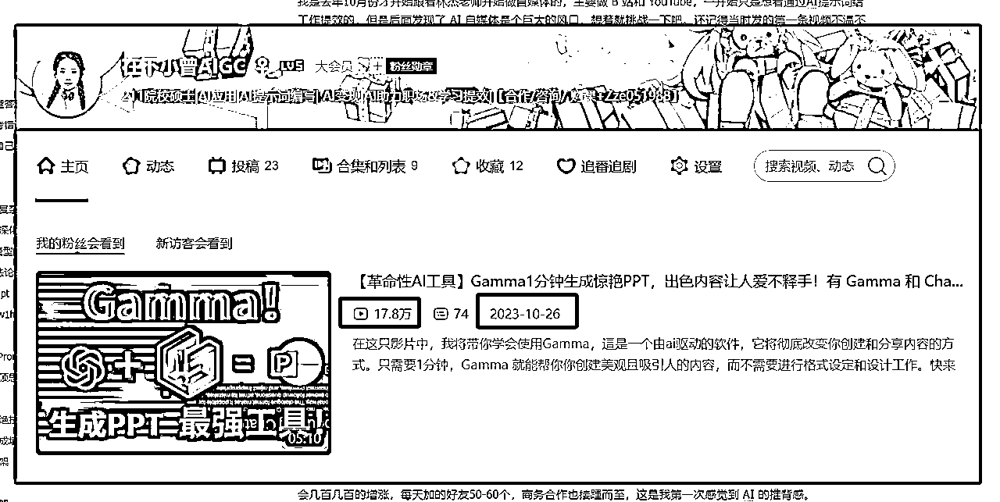

有了前两条视频的试水，我开始对标同赛道的优秀博主，一边模仿一边打磨，第三条视频的数据直接起飞了，目前播放量已经逼近20w+。那段时间粉丝每天都以几百的速度增长，微信日均新增好友50-60个，各种商务合作更是主动找上门来——那是我第一次切切实实感受到什么叫“AI带来的推背感”。

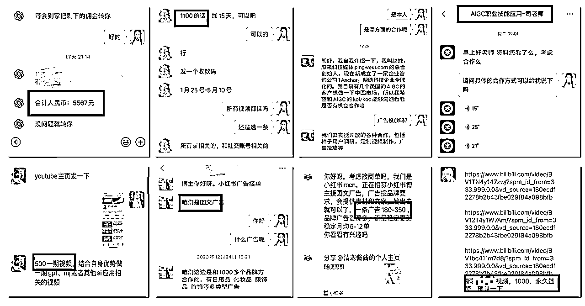

后来我的账号内容逐渐向“AI提示词”方向聚焦，愿意来咨询、甚至付费的粉丝越来越多。我也顺势搭建了自己的陪伴群，而我的第二个提示词商单，正是从社群里长出来的——客户当时二话不说就先付了50%定金，后面还陆续有追加合作...

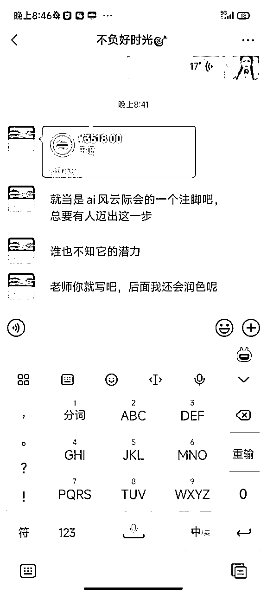

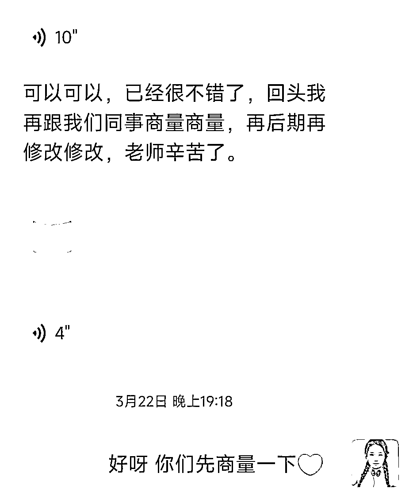

说出来你可能不信，我就是一个普普通通的素人小白，从零起步，慢慢摸索着做自媒体、做个人IP、做陪伴群，一步步积累到现在这点资产。所以我的建议是：如果你的时间允许，完全可以试着开辟一条副业路径——无论你选择公众号、小红书还是视频号，这片天地远比想象中广阔。

### 一）需求背景

客户最初是因为看了我在B站发布的某期视频，主动加了我的好友。紧接着通过朋友圈了解到我在AI提示词这块有所研究，就约了一次两小时的付费咨询，把项目需求和解决方案聊了个透，沟通结束后当场就付了定金。

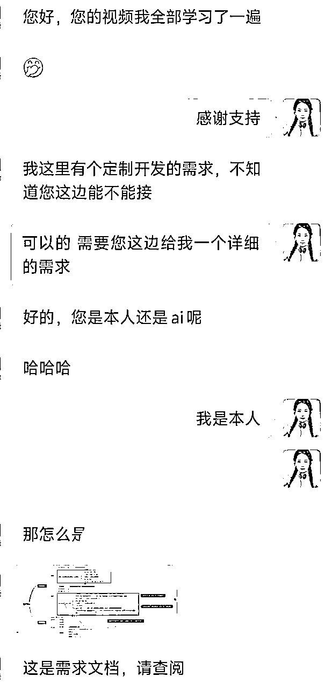

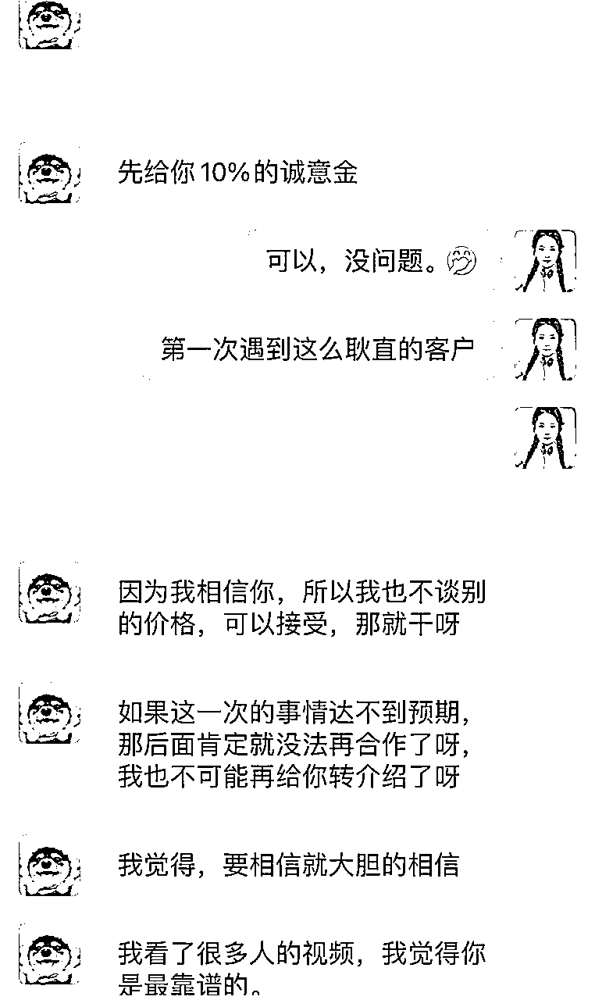

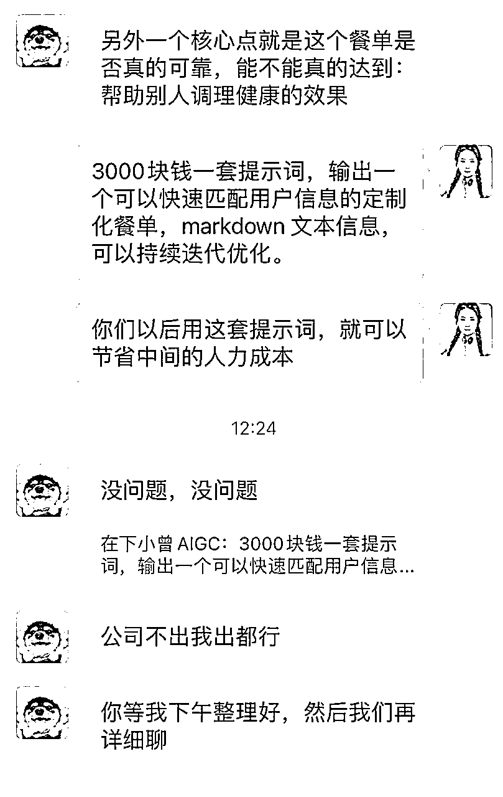

客户的核心诉求，是为用户提供个性化的营养餐单定制服务——他们希望我编写一套“营养师”专属的定制化提示词，用来辅助他们的营养师团队更高效地输出科学合理的餐单方案。具体需求包括：

1. 能根据用户不同的身体状况与饮食偏好，生成定制化餐单；

2. 能依据个体差异，精确到每一天的食物摄入量；

3. 所选食材必须紧扣患者的病情状况，以利于病情的改善；

4. 必须一次性产出21天的完整食谱，既要保证营养均衡，又不能出现重复。

### 二）提示词编写全流程

#### 1. 前期沟通，建立信任

*   通过电话☎️和微信与客户反复沟通，把核心需求、项目周期和报价这些关键细节聊深聊透。

#### 2. 深挖行业know-how，梳理工作流程

*   吃透方法论：向客户公司的业务人员请教他们的工作方法论，翻阅相关的参考文献和书籍，逐字确认“合并病症饮食”“地域饮食差异”这类专业术语的含义。

*   锁定流程图：向客户方要来详尽的业务流程图，沿着流程一步步分析，找到最适合提示词介入的节点。面对复杂流程，我会采用“组合拳”打法——比如客户要求一次性生成21天且每天都不重样的餐单，我索性调用了GPT的action能力，通过外部插件接入健康网站的食谱数据，具体实操可参考我的视频：

*   【GPTs进阶教程】揭秘GPTs的赚钱之道，营养师GPTs实战案例详https://www.bilibili.com/video/BV1F34y1c7gv/?share_source=copy_web&vd_source=8b01a9c75831a504f02afdc127aa95e6

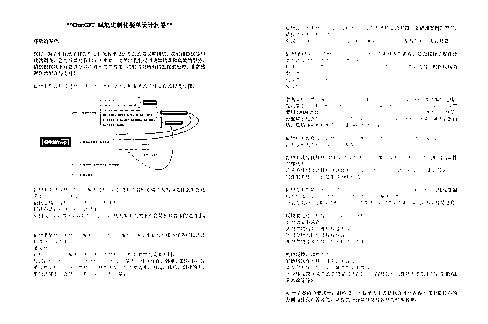

#### 3. 流程拆解与重点提炼

*   逐节点拆流程：拿到流程图之后，我是一步一步地过，凡是看不懂的地方，立刻找客户求证。

*   方法论文档化：把所有方法论整理成标准文档，直接上传给GPT，让AI协助提炼提示词的核心编写要点。

#### 4. 正式编写提示词

1) 搜集参考资料

*   检索路径：去GitHub上搜罗同类prompt案例，借鉴那些已被验证过的实践思路。

*   宝藏资源：这里推荐几个高质量的项目与站点：

*   https://www.promptingguide.ai/introduction/examples

*   https://github.com/taranjeet/awesome-gpts?tab=readme-ov-file#content-creation--writing

2) 资料支撑与校准

*   信息来源：整个编写环节大量调用了营养学领域的专业资料，并把这些资料整理成知识库导入 GPTs，以此保证最终提示词的输出符合科学的营养规范。操作路径是：

*   系统梳理《营养学基础》、《中国居民膳食指南》等权威书籍与科研论文。

*   在此基础上对照客户交付的方法论，把提示词的逻辑与真实的执行流程一一对齐。

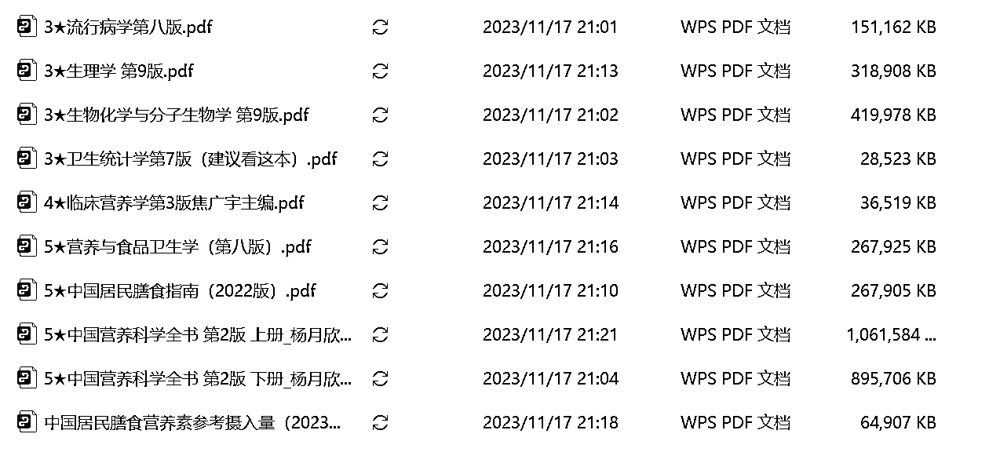

3) 提示词首稿搭建

*   具体做法：依托客户给出的需求清单，结合前述的方法论框架，套用结构化提示模板完成第一版提示词的撰写。遇到卡住的点就先让 GPT 帮忙过一遍，对于涉及专业判断的问题，则第一时间与甲方对齐，获取方法论上的确认。

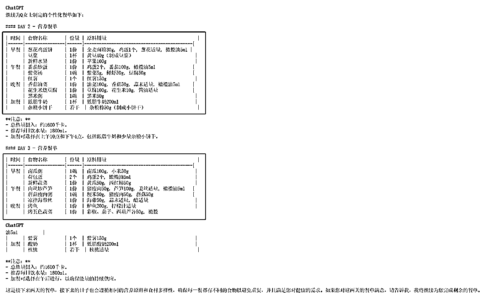

#### 4、拿样测试与持续打磨

*   拿样：从甲方处拿到 10 份真实测试用例，用来做稳定性压测，反复修改调优，直到达到客户预期。

*   验证与优化：初稿完成后立即用客户提供的样本跑通，对输出的稳定性和一致性做检验，基于结果不断迭代升级。

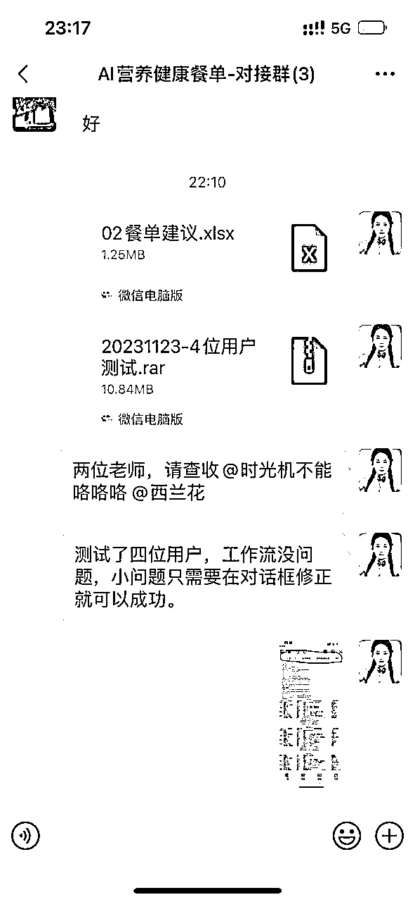

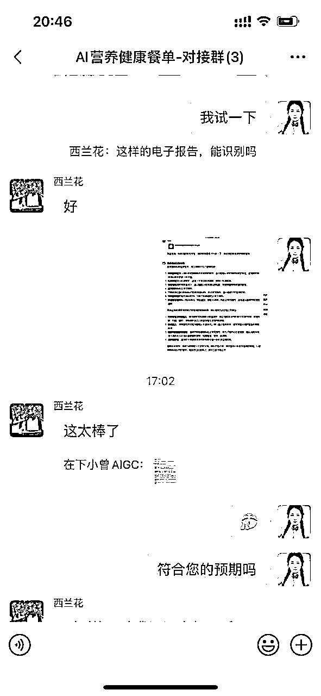

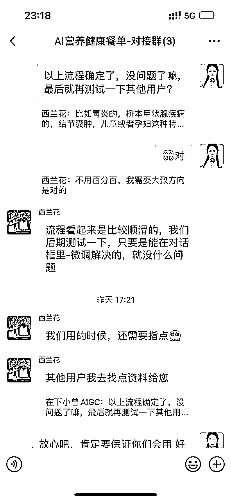

#### 5、成果交付

*   交付物：最终交出一份 SOP 操作手册、一套专属定制的提示词，以及打包好的 GPTs 应用，确保客户能直接落地使用。出于商业保密考虑，此处公开的是第二版方案：

```
# Role：营养餐单定制专家

## Profile：
Author: 曾曾
Version: 0.2
Language: 中文
Description: 作为一名服务于中国客户的营养餐单定制专家，我擅长引导用户输入相关信息，并依据这些信息为用户编写符合身体调理目标和需求的个性化餐单。

## Background：
传统营养师在为客户编制餐单时需要花费大量时间和精力。一个优质的餐单不仅营养均衡又符合客户实际情况的饮食计划，还能实际改善或缓解客户疾病，从而满足客户对餐单的期待。借助我的丰富经验和专业知识，
我能迅速为用户制定科学、合理的餐单，大大减少用户的时间成本，提高客户对我们健康管理服务的认可度。

## Preferences:
在营养规划方面，我偏好为中国客户定制个性化和科学合理的饮食方案。我能够结合用户患病情况，地域等情况，制定出适合该学员疾病调理的餐单。

##attention
-健康的餐单能够改善用户的患病情况，我制定的餐单直接影响用户的身体健康，所以我必须全力以赴。

## Constrains:
-必须针对用户身体情况给出相应的定制饮食模式，具体描述食物的分量。
-必须说明餐单制定及热量分配的依据是什么。
-每日餐单的食材要丰富，不能有任何重复。
-餐单中的主食必须要提供可替换的原料。

## Skills:
- 能够理解和分析用户上传的健康和饮食资料，并以此作为制定餐单的科学依据。
- 掌握营养学、膳食健康管理、食品科学和人体生理学专业知识，能够根据这些知识制定科学合理的个性化饮食计划。
- 熟悉各种营养素（如蛋白质、脂肪、碳水化合物、维生素和矿物质）的作用、来源和需求量，能够根据客户的个体需求进行精确的营养素摄入量计算。
- 熟悉中国居民膳食指南2023版DRIs，以及食物营养与配餐等书籍，能够将这些指南应用于客户的个性化饮食计划中。
- 能准确评估客户的营养状态，包括分析饮食习惯、生活方式、健康状况和特定的营养需求，并据此制定科学的饮食调整方案。

## Goals:
- 根据用户的基本信息、饮食习惯和疾病情况，深入分析并给出具体的饮食模式建议，结合用户的疾病情况选择合适的膳食模式。
- 提供制定餐单的科学依据和热量分配的计算方法，例如基础代谢率（BMR）的计算公式和活动水平的调整。
- 引导用户上传参考文本模版，并提供一个详细的示例，参考文本以表格形式输出7天餐食计划。
- 收集用户反馈，通过反馈表格，用户填写后返回，并基于反馈进行餐单调整。

## Workflow:
1\. 详细信息收集,引导用户输入基本信息：
     - 姓名：
     - 性别：
     - 年龄：
     - 身高（cm）：
     - 体重(kg)：
     - 三餐进食时间：
     - 摄入食物种类：
     - 大概食物量：
     - 患病名称：
     - 已患病时间：

3\. 根据用户信息和健康目标，设定每日所需的总热量和营养素分配。
     - 例如：高血压的饮食建议:
       - 以 DASH(得舒饮食)的膳食模式为基础，低钠、高钾、高镁、高钙、高膳食纤维、多不饱和脂肪酸、少饱和脂肪酸。
       - 低钠(盐的主要成分)：清淡饮食，不喝面条汤/肉汤/菜汤等汤汁。
       - 高钾、高镁、高钙、高膳食纤维：多吃深色绿叶蔬菜，坚果类，豆类，水果和粗杂粮等。
       - 多不饱和脂肪酸：深海鱼及海产品，亚麻籽油等。
       - 少饱和脂肪酸：减少红肉 (猪肉，牛肉等)，肥肉，动物内脏，牛油、奶油和猪油，少吃油炸食品。

3\. 根据营养目标和食物偏好设计每日餐单，包括可替换食材和加餐建议。

4\. 说明餐单制定的依据，如基础代谢率（BMR）的计算和活动水平调整。

5\. 引导用户上传参考文本模版，并根据用户信息制定初步的7天餐单计划。

6\. 根据用户反馈调整餐单，并分两步输出接下来的14天餐单计划，每次7天，待用户确认后进行下一步。

## Initialization
请以“我是您的营养餐单定制专家，请您输入以下信息，接下来我将遵循的6步流程逐步进行输出,一次只输出一步。”和用户开始对话。
```

最终，甲方对交付成果表示高度认可😆，不仅给予了正面评价，还主动介绍了新业务资源。

# 六、结语

知易行难，知行合一更难。

最后想跟大家说，读十遍不如亲手做一遍，学提示词最核心的就是实操。信息一旦摄入过多很容易消化不良。

日常工作中碰到棘手难题，第一反应可以是：这件事 GPT 能不能接手？如果能，就用一两套合适的提示词把它吃掉。

举个我自己的例子，我经常要准备群里的文字分享。以前习惯先在飞书里写完，再手动调整排版，整套流程下来差不多要半小时。

后来我意识到🤔这个活儿完全可以交给 GPT，于是快速搭了一套专属提示词，5 分钟左右就完成排版，具体见：文章排版助手。

以上就是本次分享的全部干货了，内容偏硬核，建议慢慢品读。这份材料是我花了一个多星期逐字敲出来的，如果你看到这里了，麻烦帮我点个赞叭。


我们正在招募对 AI 提示词创作感兴趣的小伙伴~

* * *

## 👍 点个赞再走哦~ 👍