# 📕单月30wGMV复盘：从选品到打法的全套实战经验

各位赚钱圈友，大家好！我是龙哥，98年生人，在杭州打拼。混迹赚钱有两年了，平时属于“潜水”状态，经常看各位大佬的分享默默学习。最近自己实操有了一些体会，赶紧来交作业。

去年10月份，我从公司辞职，正式成为自由职业者。那时在赚钱看到📕带货挺火，加上自己之前正好有短视频带货的经验，于是决定冲一把。我把航海手册认真看了好几遍，系统摸了下📕带货的逻辑，也经常找航海教练请教。运气还不错，双十一那波累计做到了17万GMV。

今年断断续续做下来，最近一个月终于冲到了30万GMV。现在主要玩法还是混剪去重，加上少量实拍。下面想把自己的实操方法和一些心里话分享出来——当然，这一路也踩过不少坑，不是一帆风顺的。

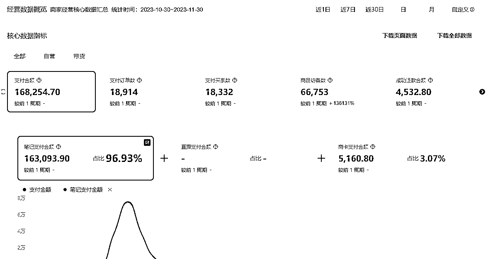
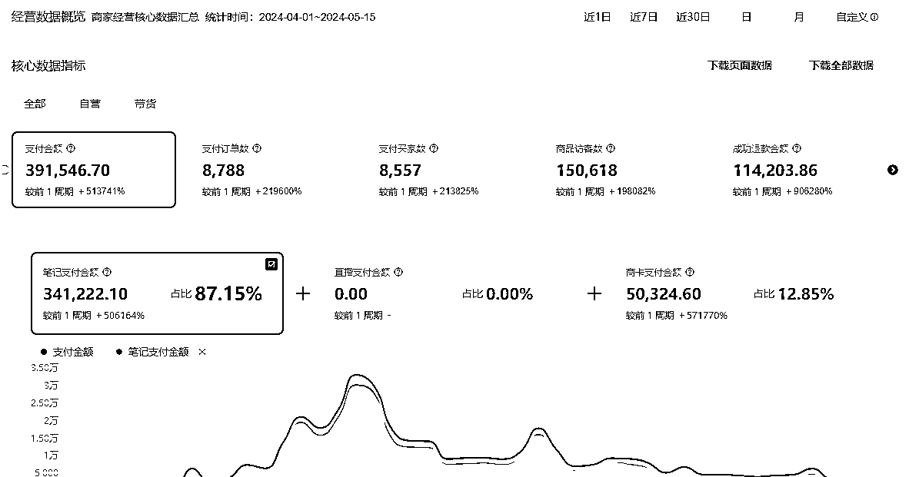

## 目录总览

一、项目背景  
二、实操方法  
三、心得感悟  

---

## 一、项目背景

2023年3月，📕正式上线“笔记带货”功能。当时我在赚钱里看到越来越多人靠这个项目拿到结果，自己也跟着开始留意。

从去年10月实操到现在，个人感受是📕电商其实还处在比较早期的阶段，多数账号出单的核心就是笔记。不少0粉丝账号、混剪号，一两篇笔记爆了，就能卖出几千甚至几万单；而且投入成本很低，最主要是花时间。所以我也主做笔记带货，对新手来说确实比较友好。

一句话总结：想做📕带货，核心就是搞定两件事——选品和笔记。

---

## 二、实操方法

📕的用户主要是18-34岁的女性，她们年轻、有活力，对新鲜东西很感兴趣，也愿意分享和互动。31-40岁这个群体占比也在上涨，更看重生活品质，喜欢晒购物心得、分享生活日常。

基于这些理解，再加上我自己跑出来的结果，我总结了一套选品逻辑。

### 2.1 选品五原则：需求、用户量、颜值、性价比、新奇特

- **需求**：需求要真实且强烈，痛点越深越容易成交；
- **用户量**：潜在用户盘子得够大，才有爆量潜力；但这种品竞争也会更狠，要评估自己能不能超过同行；
- **颜值**：📕是“看脸”的平台，颜值即正义；
- **性价比**：要让用户觉得占到了便宜，同时自己也得算清楚利润空间；
- **新奇特**：新鲜、特别、少见的东西，天然容易吸引点击。

比如有两个运动器械品，就同时踩中了“需求痛、用户量大、颜值高、产品周期长”这几个点。

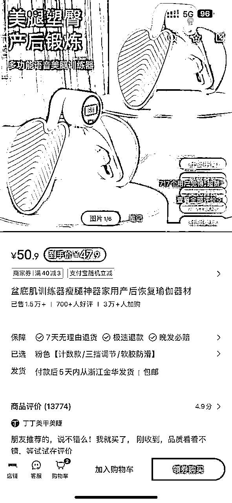
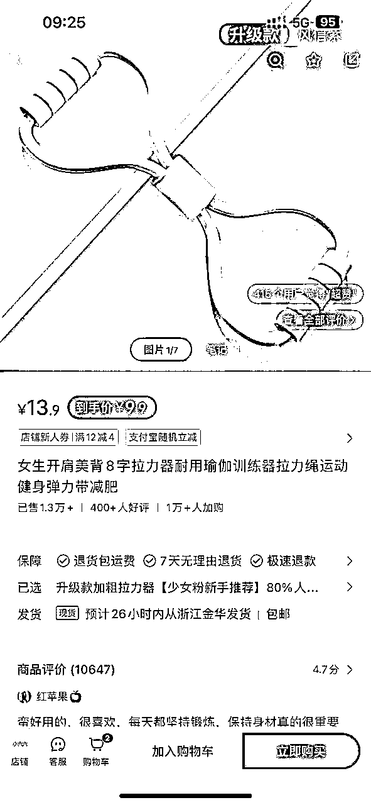

还有那个陶瓷碗，光看外观就很精致，特别契合📕的精致生活调性；而多功能水果刀则属于典型的新奇特产品。

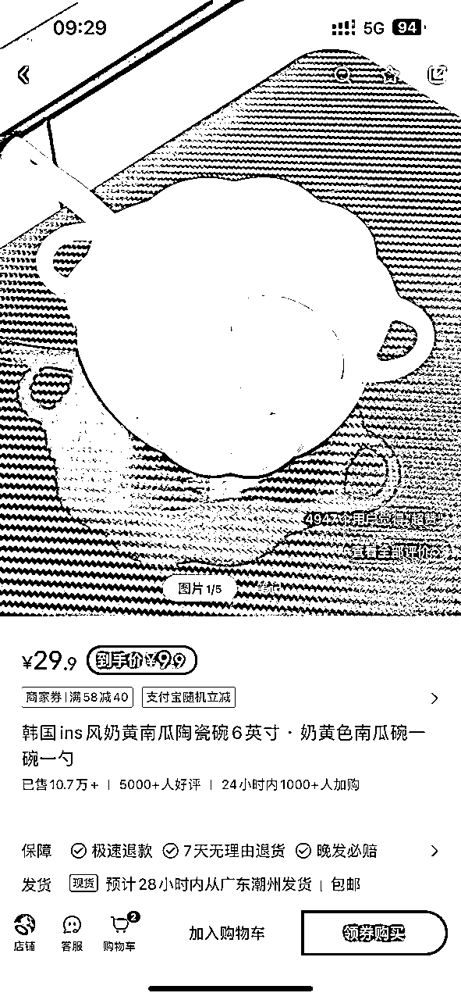
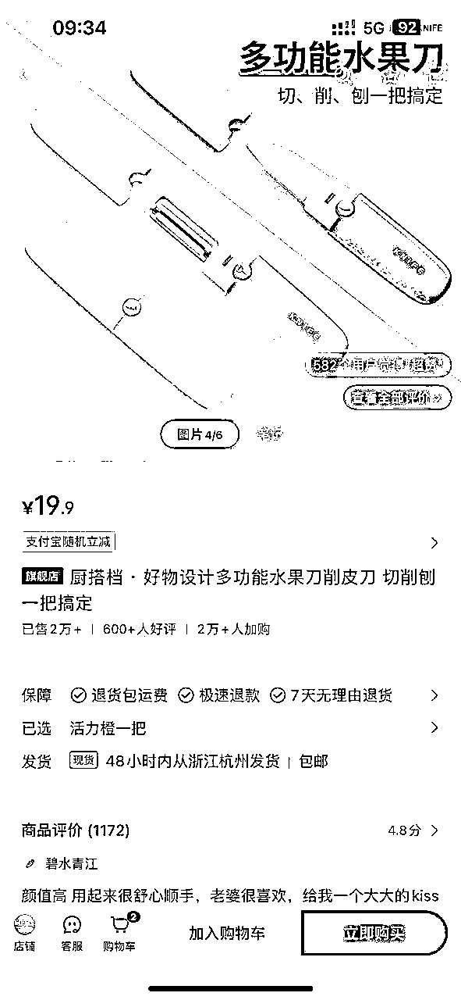

如果一个品能命中好几条原则，那就该重点关注，很可能成为爆品。

### 2.2 选品方法：根据数据选品，找近期爆款

#### 方法一：考古加平台选品

选品路径是：找视频 → 电商标签不设限制 → 看近7天/近30天的电商视频。先按销量排序刷一遍，再按销售额排序刷一遍，对近期热卖品有个整体概念。然后专门去看低粉爆款，如果有低粉账号近期起量的品，就筛出来重点跟踪。

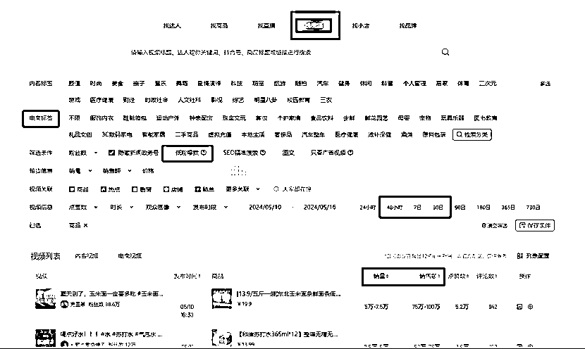

筛选出来后，再做四步判断：

1. 看用户画像跟📕主流人群是否吻合；
2. 看销量趋势是往上还是往下；
3. 看视频素材量多不多，尤其对混剪玩法来说，素材越丰富越好剪；
4. 算利润率，至少要有30%以上。我目前主要在1688拿货，会先看成本。

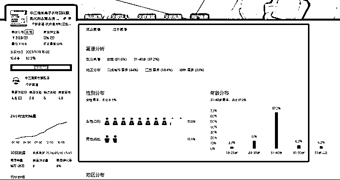
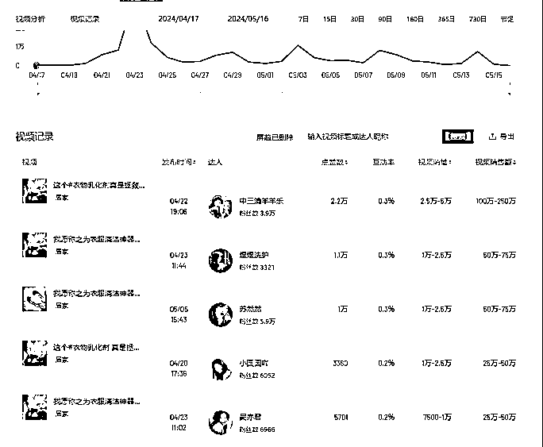

#### 方法二：灰豚数据选品

路径是：商品分析 → 商品搜索 → 选自己的品类 → 看近7天、15天或30天 → 按销量/销售额排序。重点找那些主要通过笔记带货的品，再点进去看账号，如果符合“低粉爆款”的特征，抖音上也能找到对应素材，就可以跟进。

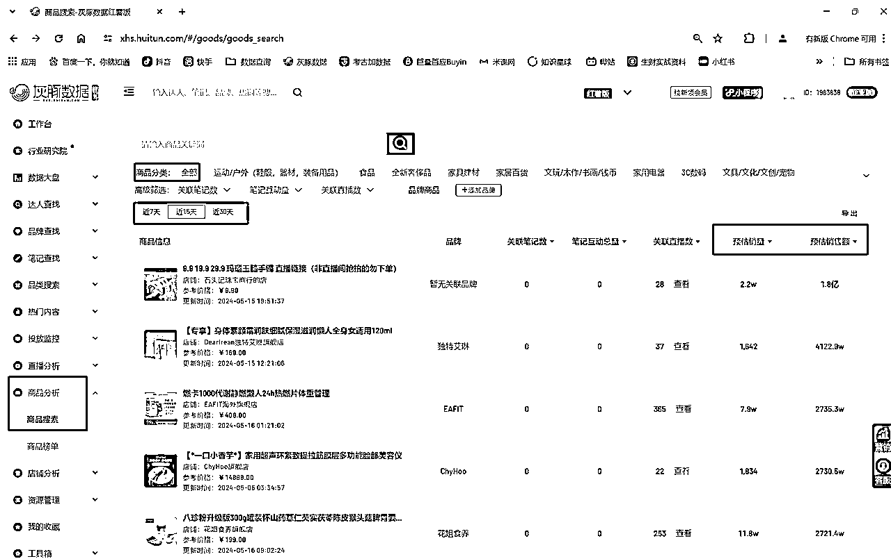
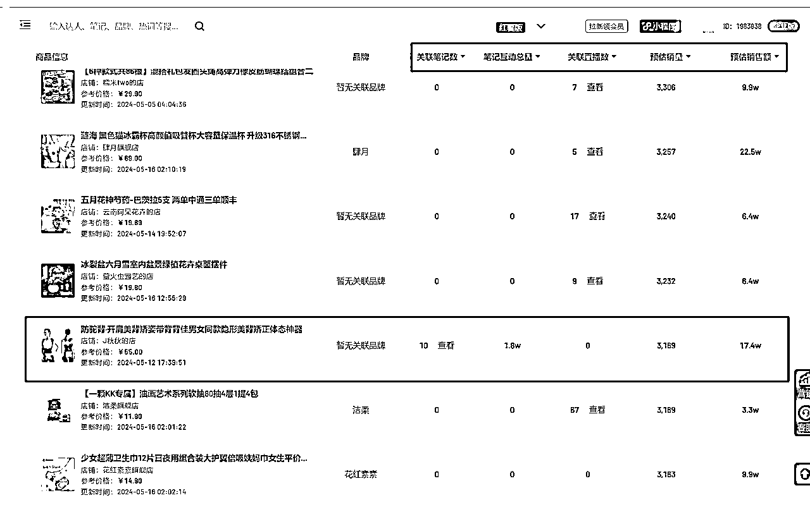
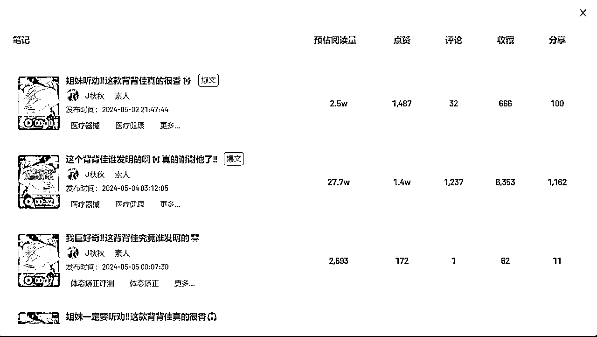
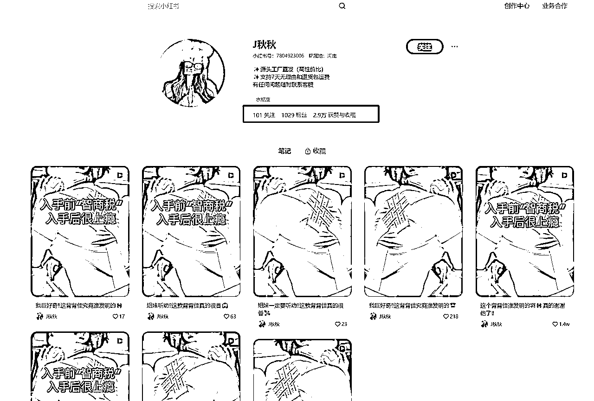

#### 方法三：巨量百应选品

路径是：创作 → 创意获取 → 爆款视频 → 选自己做的类目 → 作者等级越低越好（意味着粉丝少）→ 时间筛近24小时或近1小时。

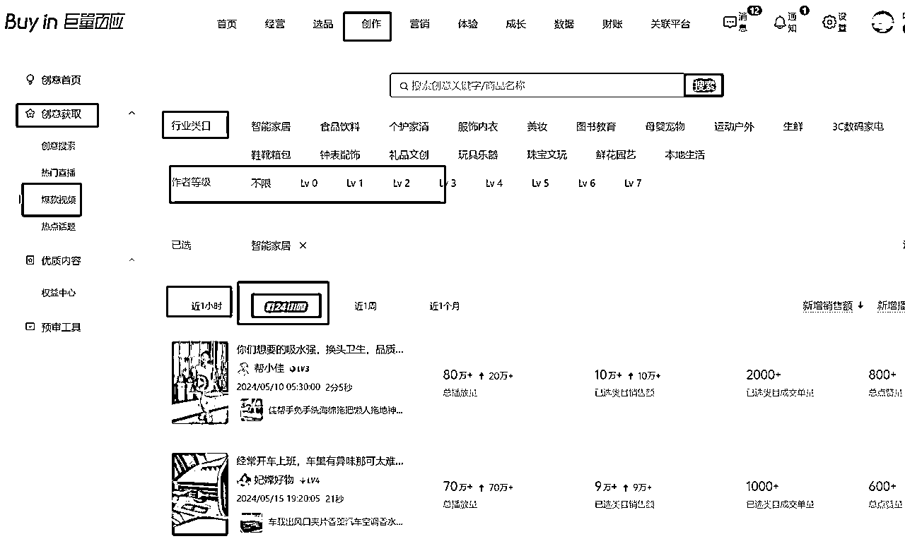

这个也是我经常用的。坦白说这些方法不少大佬分享过，核心就一个字：勤。每天或者每三天固定刷一遍，养成习惯。一旦发现新品符合上面的选品逻辑，就及时上，很有可能吃到流量。

数据平台看多了，会对整个大盘有感觉，更容易当第一批吃螃蟹的人；看得多了，也能慢慢理解每个品的生命周期，知道什么时间该布局。

### 2.3 打品策略

我自己的打品逻辑是：想清楚平台要什么，用户要什么，你就能得到你想要的。

- **站在平台角度**：它现在正处在电商早期，需要好看的业绩数据，也缺带货内容，所以对带货笔记的容忍度相对高；
- **站在用户角度**：你的产品和服务能解决什么痛点，能提供什么价值——情绪价值也算价值，有时比功能价值还关键；
- **站在自己角度**：收获可能是钱，可能是成长，也可能两者都有。

具体落地就四步：先吃透平台规则，再把内容打磨好，然后把量做足，最后做细节优化。

#### 2.3.1 内容方面

首屏有那么多展示位，本身就在互相抢注意力，所以封面、标题、笔记内容一个都不能拖后腿。

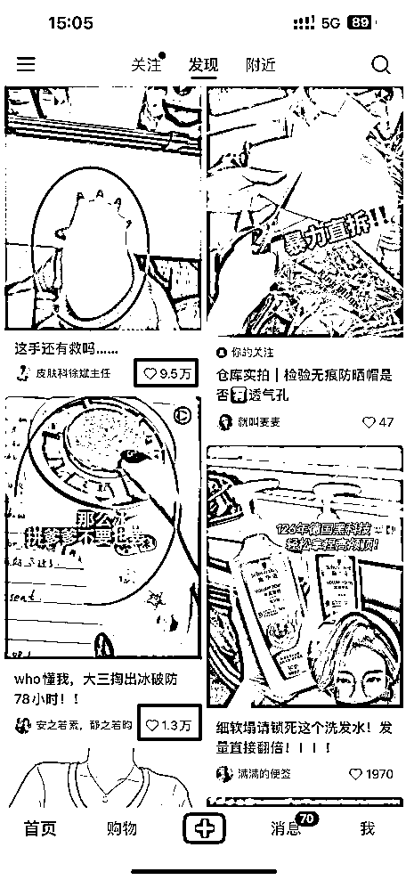

一句话：封面和标题决定笔记生死，高流量封面是可以靠模仿搞定的。

实战中我会重点去测封面、标题和笔记内容——因为我的内容以视频为主，所以重点测脚本。方法是去📕搜产品关键词，然后看“最热”，把最近的爆款封面、标题、脚本都扒下来，稍微改一改直接用，视频则按爆款脚本做混剪。

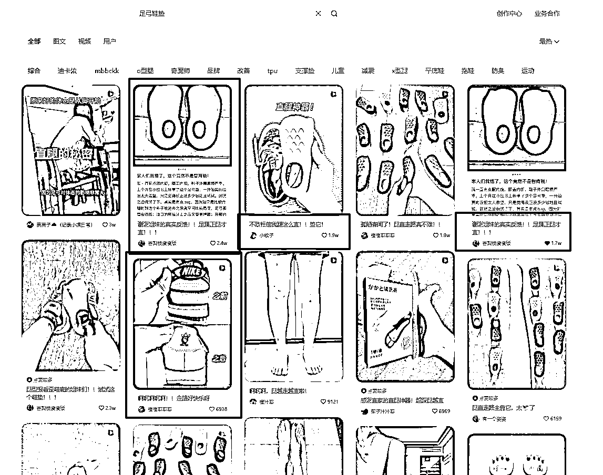

#### 2.3.2 平台规则角度

再结合平台规则：

- **推荐逻辑**：要尽量引导观众点关注、评论、转发，这些互动信号会放大流量；
- **搜索逻辑**：在封面、标题、笔记正文和评论区都做好关键词布局，把产品词、功效词、人群词、流行语都埋进去，增加搜索权重。

#### 2.3.3 测品步骤

目前我的测品方式是单号单品。把封面、标题、笔记内容分成不同组来测；每个号每天发3-5条，每条间隔1小时以上；连续测3-5天，根据出单和加购数据决定要不要继续投入。

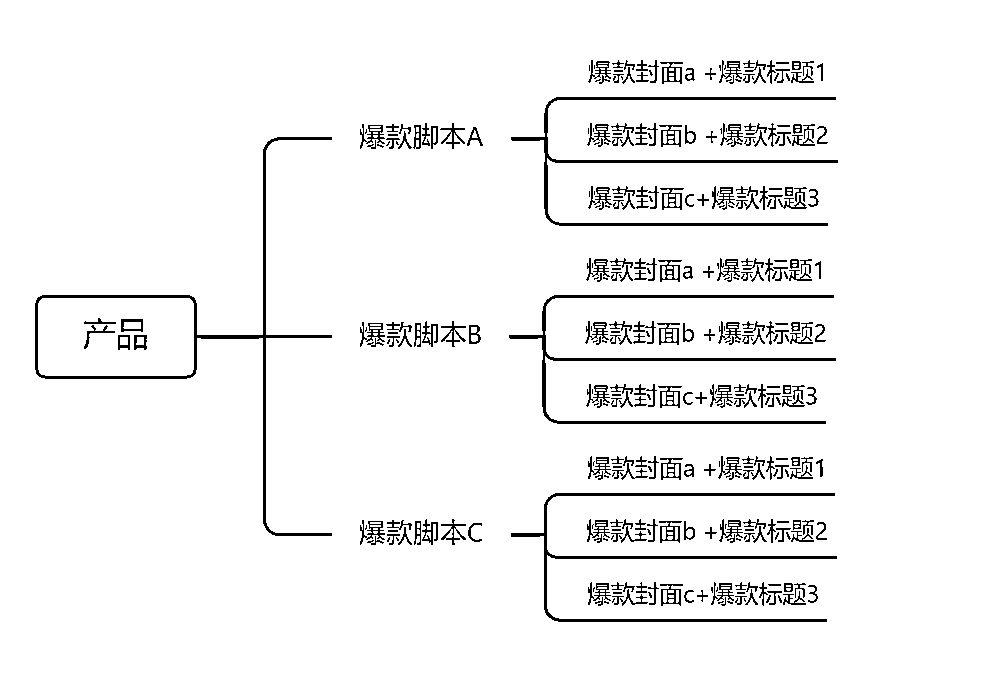

需要说明的是，这是比较理想的情况。如果某些爆款笔记的封面或标题本身一般，也可以把那部分去掉，只测值得测的元素。

#### 2.3.4 优化动作

**评论区优化**

基础动作是真人完整观看 + 点赞 + 收藏 + 评论。但有一个前提：笔记要么已经自然出单，要么小眼睛超过500，否则先别做。

具体套数可以按小眼睛量来：500就做2套，1000做3套，2000做5套，10000做15套。注意一次不要上超过10个，慢慢加。前期可以找亲戚朋友帮忙，后期可以找大学生兼职。

**评论区维护**

第一种是引导用户在评论区打“惊喜盒子”。这本来是平台给用户的优惠活动，但引导做起来能增加视频权重。

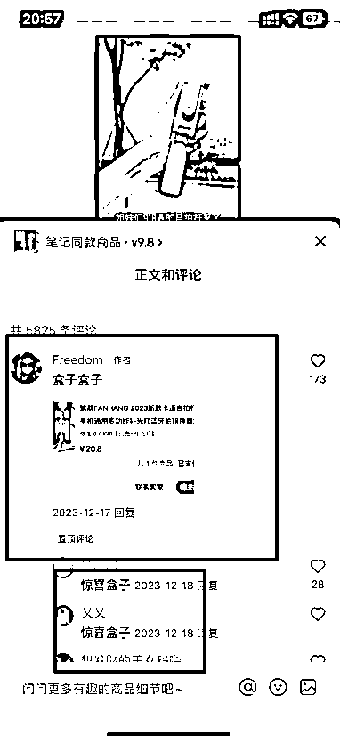

第二种是“下圈套”式引导下单。比如用一个号说“我买了，过几天来反馈，大家蹲我”，再用另一个号去蹲，过几天来回评，形成后续。

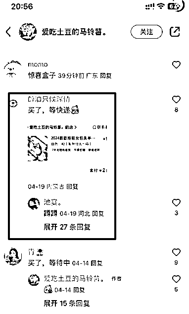

第三种是反馈类评论，比如晒单、使用感受、效果反馈等。

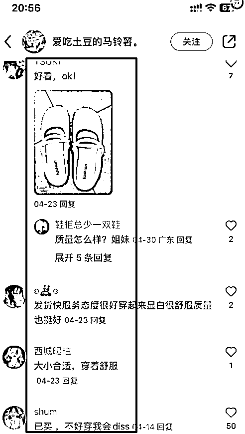

**店铺端**

店铺端也别闲着。我会用小号做十单八单的基础销量，再找朋友留几个晒单好评，把转化率的基础打好。

**数据复盘**

数据复盘主要看两块。一个是商品维度：看访客数、加购件数、订单数，判断这个品还要不要继续做，也顺便判断最近笔记内容的效果。

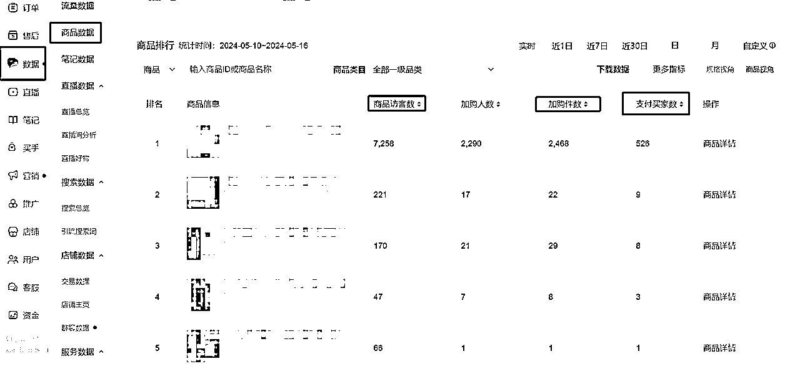

另一个是笔记维度：看哪条笔记跑得好，就顺着那条的思路继续做。

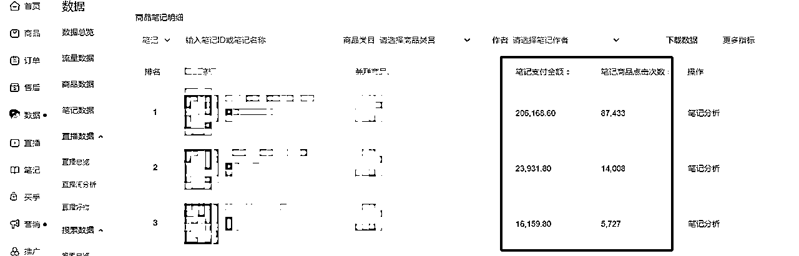

把这几件事串起来，逻辑很清晰：评论区优化有两大作用，一是评论条数上去后笔记权重会增加，平台可能给更多流量；二是从用户角度看，羊群效应和从众心理会推高转化率。店铺端做基础销量和好评，同样是为了提升转化。数据复盘则是为了定位问题：到底是品不行，还是封面、标题、内容有问题。数据好的就复制，数据差的尽快调整。

#### 2.3.5 筛选供应商

供应商这块，我主渠道是1688，目前还没收到过无货源相关的违规提醒。也有同行从拼多多下单，但我没采用，主要是拼多多会有短信和面单问题；如果要去掉面单，还得走中转仓，运输时间又要增加一两天，用户体验不好。

我筛1688商家时会看几点：

1. 拿货成本和利润率够不够；
2. 商品销量、综合服务、响应速度、物流时效、退换货体验、回头率这些，优先选有牛标和超级工厂的；
3. 直接问客服有没有📕面单。如果有，就能绑定店管家由商家直发；如果没有，就问他能不能无痕发货，大部分都可以。另外最好加上供应商🛰️，沟通能及时很多。

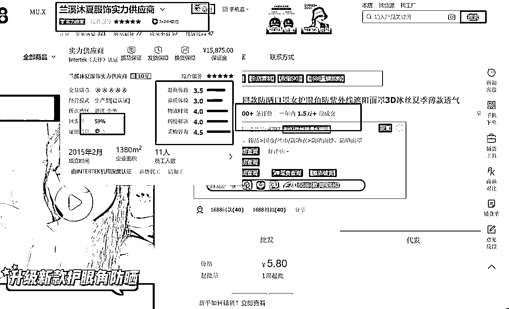
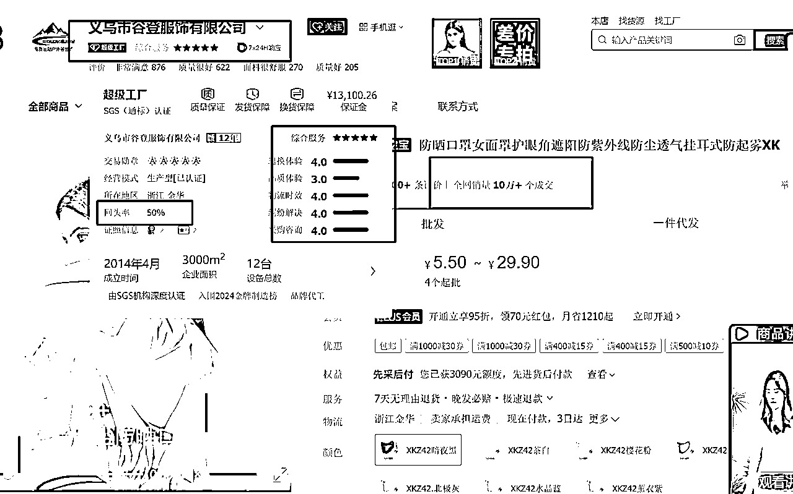

---

## 三、心得感悟

先放一个路径总结：正确信息 → 找对方法 → 快速学习 → 认真执行、大量实践 → 复盘反思 → 改进 → 循环。

23年9月，我在赚钱看到📕带货正处红利期，加上自己有两年的短视频工作经历，判断这事大概率能成，就开始学航海手册、参加训练营，也请教了做出成绩的前辈。

一开始我以为很快就能出单，结果还是眼高手低，测品没做到位，连着测了五六个品，出单效果都很差，心态一度有点崩。

后来我索性清零，重新翻航海手册，认真执行。偶然一天刷到一个正好在起量的新品，看到一个同行第一天200单，第二天直接1000单，第三天冲到2000多单，我就照着它的脚本形式去跟进，但只是有出单，没爆量。当时想：这个品有需求，又在起量，干脆多换几种方式去测。于是去抖音找了四五个数据不错的脚本，测了十几条，终于有一条视频跑起来了。正好那个周末流量特别好，销量从200直接翻倍，我算是体验了一把日入两三万的感觉。

可好景不长，数据起来太快，被同行举报，平台又严查，账号最后被封了。跟同行交流时，有人选择停更避风头，我也顺势休息了两天；后来看到无人直播出单不错，又跑去试了试，结果白折腾了一趟。

这里我反思到：找到适合自己的路后，坚持下去很重要，但在信息爆炸的环境里，做到这点真的不容易。

后来我又决定回到📕笔记带货，重新找最近拿到结果的前辈请教，研究当下的玩法，重振旗鼓。这次是真的空杯心态，认真执行，才迎来第二次大爆。心态稳了很多，就是把我能想到的每个细节都做好，剩下交给时间——大多数时候结果不会差。

### 项目复盘

这次复盘让我更确定：📕带货的核心竞争力就是“选品 → 封面 → 标题 → 内容 → 执行力”这条链。

只有把过程控制做到像素级，结果才可能被复制。

创业其实也是不断认识自己的过程。写这篇文章时，我能看到那个傲慢的自己、懒散的自己，也能看到努力学习和拼搏的自己，以及正在反思进步的自己。

知识付费本质是花钱买信息、买别人的经验方法，确实是捷径；但也得保留自己的判断力，学会甄别。它的坏处是容易让人思维懒惰，产生路径依赖。所以我提醒自己：要慢慢锻炼独立思考和分析调研的能力。

创业时还要保持专注、减少能量损耗。生活中干扰太多，最好从源头掐断，才能保持好状态。

另外，懂得感恩，定期反馈；做产品要站在用户角度，真心为用户考虑——当你提供价值时，自己也会有精神层面的收获。

最后就是认真做好当下，不要急，尊重客观规律。

### 接下来要做的事

接下来我给自己安排了几件事：

1. 基本功不能丢：做选品表、对标账号表、拆解爆款视频；
2. 不满足于靠运气爆单，想从运气驱动变成方法论驱动，总结规律，提高爆单概率；
3. 开始做那些有长期复利的事；
4. 从一个人干慢慢往团队化走，加上人力杠杆。

### 愿景

还有一个愿景，我想向胖东来学习。希望自己的团队也能像胖东来一样，一起努力拼搏，对客户好，对员工好，舍得分钱，这样做生意才心安，也才走得长久。可能有点理想主义，但我会朝这个方向一直努力。

### 致谢

最后，感谢赚钱团队，让我看到了一线搞钱信息，学到很多干货，也认识了不少优秀的大佬，认知、能力、心态都有了明显提升。也感谢@晓文哥、@超鹏哥带我入门短视频带货，@书豪哥带我做📕，谢谢@V小刀刀姐在实操中的耐心辅导，以及@梵姐、@叨姐在我创业路上的答疑解惑。