# 普通人视频号电商入门指南

这两年，我在视频号电商这条路上摸爬滚打，从最初啥也不懂就敢冲进来，到逐步搭起一个稳定的小团队，把直播间做到每天20W+场观。中间经历过搬运混剪、无人直播、自然流带货、短视频引流、微信豆投流，基本把视频号能玩的路子都趟了一遍。今年又有不少知识付费的头部大V在号召大家入局视频号，这赛道的热度肉眼可见地涨起来了。想把自己的真实体感写下来，给想在视频号带货变现的朋友做个参考。

## 视频号到底能不能做？先看这7个红利

**1. 竞争没那么残酷**
视频号最大的机会，其实还是“不够卷”。虽然也有竞争，但相比抖音那种白热化程度，视频号简直是温和太多。这里的用户对画面精致度和高级感不敏感，更吃接地气、有烟火气的内容。所以草根团队反而更容易冒头，哪怕你觉得自己只是“60分团队”，只要把某一项优势放大，照样能杀出来。

**2. 信息不透明**
没有第三方数据平台，也没有官方逼着你内卷的机制（抖音那些热点宝、猜你喜欢，本质就是让大家往死里卷）。视频号上每个玩家都像一座孤岛，流量的红利期自然更长，闷声发大财的机会也更多。

**3. 用户画像和你想的不一样**
以前我们以为视频号的核心用户是“只会用微信、不会去拼多多抖音比价的三四线老年人”。做了两年发现，很多老年人其实也有抖音，但他们就是喜欢刷视频号——方便，不用切换APP，想关就关，想开就开。

**4. 蓝海赛道多的是**
别看很多人吐槽视频号都是老年人在玩，就一股脑去选老年用品。这两年视频号靠着微信传播的便利，用户盘子涨得飞快。很多在抖音已经卷成红海的类目，比如美妆、护肤、情感，在视频号上依然有大把机会。今年年初我有几个朋友做美妆短视频带货，月GMV轻松做到300W+，放在抖音根本不敢想。

**5. 利润空间感人**
视频号的用户质量是真的高，两个特点：价格不敏感、退货率低。同样的商品，视频号能比抖音溢价20%左右，退货率还能低40%左右。一进一出，利润空间就出来了。很多赛道在抖音只能微利走量，在视频号却能玩出花。

**6. 私域太丝滑**
视频号是目前公域和私域结合得最好的平台，导流私域极其顺手。如果你核心业务需要公域私域来回切换，那视频号就是你的主场。

**7. 矩阵还能做**
虽然单个实名人能开的视频号从5个降到了2个，但一个实名仍然能认证5个橱窗。比起越来越严的抖音，视频号的矩阵玩法依然友好。

## 入局前，先把这些基础认知搞明白

**号比视频更重要**
视频号圈子里有句话：“视频号的真正意义不在于‘视频’，而在于‘号’。” 腾讯的规则迭代很快，审核也很严格，可能昨天还能一场卖几十万，今天同样的内容就被封了。所以不管你是正规军还是野路子，至少准备3个号，越多越好。

**实名问题必须掰扯清楚**
很多人搞不懂视频号的实名逻辑。其实这里有三个独立的实名：微信实名、视频号实名、橱窗实名。

微信实名就是你微信钱包绑定的银行卡持有人，在“我-服务-钱包-身份信息”里能查到。一个身份证能实名5个微信号。

视频号实名一般指的是视频号的所有者，开直播时如果弹窗要人脸审核，就是用这个实名人来验证。一个身份证只能实名2个视频号，这也是三个实名里最卡脖子的一个。想突破可以用企业身份，一个企业能认证50个视频号。

橱窗实名是出来带货必须认证的实名人，佣金也会打给这个身份对应的账户。一个身份证能实名5个橱窗。

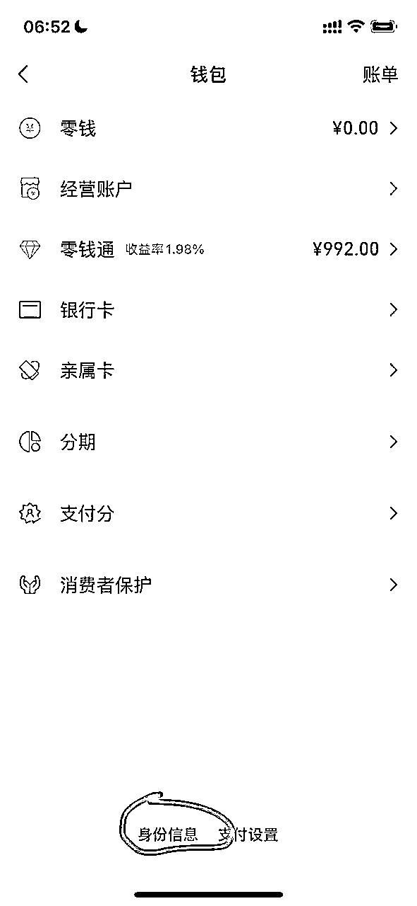
微信实名

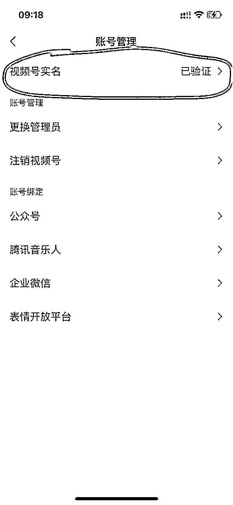
视频号实名

视频号实名

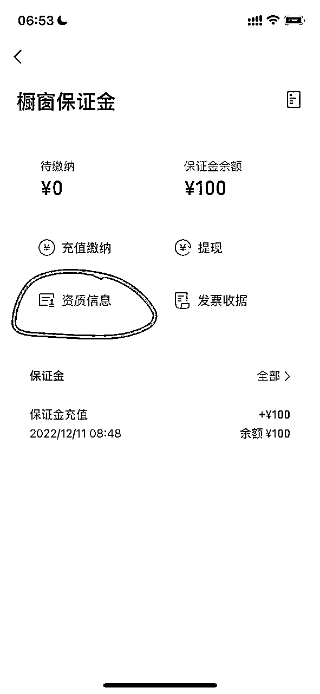
橱窗实名

这三个实名相互独立，别搞混了。

**心态先摆正**
视频号的政策不透明、客服回复慢，误杀误判也常常申诉无果。但你要明白“盈亏同源”——你不爽，你的同行也不爽。恰恰是这种不正规、不透明、不靠谱，把那些正规的大团队挡在了门外。换个角度看，这反而是普通人的机会。

**玩法没有谁更好**
简单暴力的玩法通常不持久，细水长流的玩法起步慢但壁垒高。别看到别人发帖说某个玩法赚了多少就头脑发热，要根据自己团队的能力来选。赚钱本来就是天时地利人和，别人赚了不代表你也能赚。小团队的第一性原理是活下来，先赚到正反馈再想长久。

**赚快钱的逻辑**
平台在发展期，总会有各种漏洞可以钻。视频号这两年的快钱机会太多了：搬运混剪、无人直播、废店玩法、连怼（卡特效、卡模板、卡封面）…… 我知道这些不长久，但为什么还是有人乐此不疲？因为暴力、门槛低。换个角度想，长期有短期玩法出现，本身也是一种长期机会。

我身边有几个朋友，不搞“正规军”，专门做短平快，年年轻轻松松。他们的共同点就是执行力强：机会稍纵即逝，红利期必须最快放大。别人做5个号，他们做50个号；别人996，他们轮流值班日不落；花几千上万买“最新黑科技”眼睛都不眨。所以同样的信息差，你赚5000，人家赚50万，差距就在这。

**引流私域有讲究**
视频号跟微信天然绑定，引流私域得天独厚。简介可以留微信，直播偶尔展示一下微信号也不算违规，只要别长时间明着来就行。标准做法是直播里的留资服务，或者ADQ的留资组件，但都有门槛。达不到要求的话，可以自己开个视频号小店，用企业微信绑定小店客服，引导用户点头像点“客服”，照样能完成私域转化。

**社交属性是核心算法权重**
视频号和抖音的本质区别是：抖音是个独立APP，视频号长在中国第一社交软件微信上。所以视频号的分发逻辑里，社交属性的权重非常高。具体体现在三方面：

一是转发数据。视频号的内容是天然适合在微信传播的，大家也愿意转发，所以你会看到很多视频的转发量比点赞评论还高，这在抖音很少见。做内容的时候，记得刻意埋“转发钩子”。

二是朋友喜欢。推荐列表里有“朋友喜欢”的栏目，就是在鼓励点赞和社交传播。直播广场里，如果很多好友都看过某个直播间，它就会排在最上面。

三是熟人推荐。好友看过的内容会优先推给你。这也有副作用——如果你微信里同行很多，就别用这个微信号进自己直播间，更不要停留、关注、做数据，换小号操作。

## 做电商之前，先好好选品

**大方向决定成功率**
任何类目都能选出爆品，但每个赛道的人群不一样。你对人群的理解，直接决定了选品成功率。建议先选大类目，比如日用、地方美食、三农、零食、养生，这些赛道爆品多。选1~2个赛道深耕，慢慢培养对人群和爆品的感觉。

**跟爆品是最快路径**
最简单的方法就是跟视频号本身的爆品，看选品中心每日更新的榜单。但要注意几个要点：

- 别去看过去7天的爆品，那已经无数人跟了。每天盯着榜单，看到新上榜的商品马上研究，才是正确的打开方式。
- 点进详情，用“销量/浏览量”算出转化率。转化率越高，机会越大，但这个指标只有在同品类里横向比较才有意义。
- 每天练习：研究新上榜爆品是为什么爆的，找到对标视频或直播间去拆解。坚持一个月，你就是选品达人。

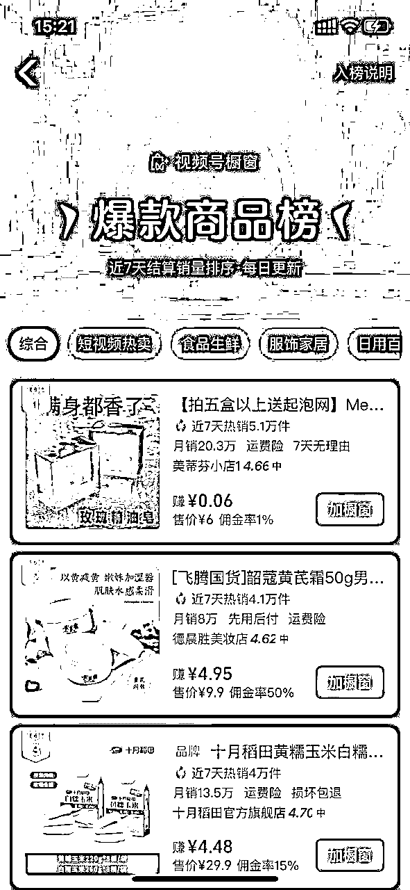
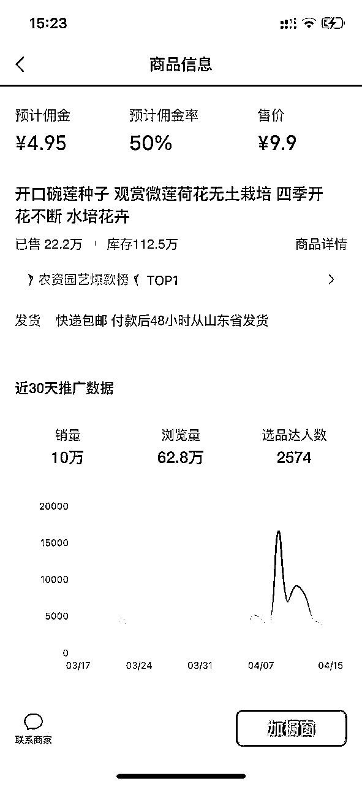
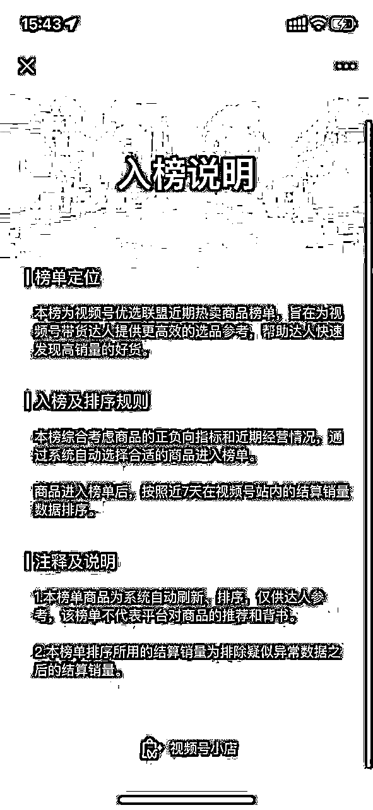

目前视频号除了官方爆品榜，没有靠谱的三方数据平台，仅有的几个又贵又难用。以前我觉得苦恼，现在想想这反而是好事——信息壁垒就是门槛。

另一个办法是跟抖音的爆品，很多在抖音验证过的爆款，拿到视频号照样能爆，稍微筛选一下就行。具体方法在我之前的选品文章里写过，这里不再展开。

**爆品也要看时效性**
现在大多数人都会跟爆品，所以真正的红利只有第一波。有时候你看到某个爆品觉得机会来了，其实它已经走到生命周期末尾。我们最近打的一个品就是例子：直播间做到这个品类头部，第一个月每天卖2W+，现在跌到每天七八千，我们已经准备换品了，却发现冲进来的同行越来越多。

时效性没有绝对标准，我个人的几个参考原则：

- 短视频爆品，如果最近3天内发的带货作品，没有一个点赞破3000，不跟。
- 短视频爆品，能找到的最早视频是三周前发的，不跟。
- 直播爆品，找4个同行直播间，去掉卖得最好的那个，如果另外三个平均GMV不足2W，不跟。如果同行直播间不足3个且单场GMV都高于2W，可以跟。
- 付费单品直播间，有3个以上同行直播间且流量都不低，不跟。
- 付费单品直播间，找到最好的对标直播间单场GMV不足3W，不跟。
- 日销2000单但真实评价还很少的商品，大概率可以跟。

**衍生品是创新的稳妥解**
跟随永远是稳妥的，但想要利润最大化还得创新。创新的稳妥做法，是从爆品里挖需求，再找相似衍生品。比如酸枣仁茶爆了，背后痛点是失眠。如果这个品跟的人太多，那就去带同样功效的沉香。同理，从取暖炉看到取暖需求，可以挖掘电热毯；从管道疏通剂看到管道堵塞需求，可以找防堵地漏。

**视频爆品和直播爆品是两回事**
最深的选品理解来自对内容的思考。举个例子：小炒酱和松茸白灼汁都是调味品赛道爆品，哪个是短视频爆款，哪个是直播爆款？答案是：小炒酱90%的销量靠短视频爆了之后开直播卖出去，因为它的卖点是“万能”，用短视频能快速展示炒多个菜的效果，种草力极强。而松茸白灼汁是靠做菜教学直播间里大家爱学“白灼青菜”火起来的。所以，一个品能不能爆，不只看品本身，还取决于内容形式。你能把这里面的玄机琢磨透，就真正理解了选品和内容的关系。

**测品：数据有自己的纪律**
品不是选出来的，是测出来的。理论再漂亮也得拿到市场里去验证。选出来的品要有明确的测试标准：短视频自然流，用3种模板/文案跑30条视频，跑不出来就pass；付费投流测品，消耗1W块测5个模板，心里基本有数，记得卡好赔付控制成本。测品没什么技术，要的是纪律。就像炒股，设好止损线，跌破就果断抛，不要对股票有感情。数据是客观的，用期望思维去算总账。长期来看，坚决按数据执行的结果，一定好过你执着于天才灵感。

## 短视频带货怎么才能做起来？

**抄超钞三字诀**
做短视频最好用的万能法则就是“抄超钞”。

抄：抄选品、抄选题、抄黄金三秒、抄脚本框架、抄金句。每个视频的爆点不一样，找到对标视频的爆点是基本功。

超：在保留爆款要素的前提下，其他方面都可以试着超越。画面更精致、金句更出彩、表现形式更好，都可以。但爆款要素千万别改——哪怕你觉得原视频拍得很烂，能爆就有理的。另外，超越的时候也要做AB测试，别主观判断人群喜好，自作聪明地改，很容易越超越倒退。

钞：账号前期权重低，推送人群不准。如果对内容有信心，可以适当花钱投流，买精准播放量，提高起号概率。

**口播带货还能不能玩**
最近口播IP特别火。这个玩法长期吗？从名字就知道，本质是“靠嘴带货”，平台不可能禁止，永远有市场，长期能玩。

优点很直接：门槛低、上手快、容易出正反馈，适合新手。但正因为门槛低，竞争也特别惨烈。这个玩法爆了半年，选品跟品、口播拍摄、剪辑、发布、直播转化这些技能已经人人都会。不会的也有代拍、代剪、代播，没号还能租，理论上你全程外包只做调度都没问题。

卷到这个阶段，除了5%真正有口播天赋的大佬，剩下95%的人已经没有本质差距。新手和老手之间没有不可逾越的鸿沟。所以现在的情况是：总有人爆，但没有人总爆，做这个赛道的人越来越焦虑。

想破局，核心竞争力有两个：一是口播能力，像很多人都知道的木头，就是硬实力，把文案理解、发音练习、用户心理揣摩都做到极致。但对普通人来说，这个可复制性不强。二是文案编写能力和组织架构搭建能力。

文案编写能力决定了单个作品的爆率。爆品就那些，以前拿来别人的视频混剪，或者用爆款文案实拍就行。现在卷得太快，好文案一出来就扩散完毕，爆款文案的生命周期越来越短。容易爆的往往是新文案。所以能写出一手“新文案”，是很关键的破局点。

组织架构搭建能力决定了结果的下限和上限。既然“总有人爆，没有人总爆”，那解题思路就是用数量对抗概率。但这个数量已经不再是10个号20个号了。假如你要以50个号为基本单位来搏确定性，哪来那么多号？哪来那么多剪辑人力？

一个人绝对搞不定，你需要组织更多人，把自己从“技术宅”变成“资本家”。到这一步，问题就不只是项目技术了，而是怎么搭建高效组织架构的管理问题。常见的模式有：

*   全职：中量中质生产者，底薪+低提成
*   兼职：海量低质生产者，无底薪+高提成
*   工作室/门徒：少量高质，无底薪+高提成

不同模式如何设定目标和激励？上下限在哪？不同性格的发起人适合哪种？在高度内卷的今天，这些才是真正要思考的。展开聊太大，先抛个砖，大家自己琢磨。

**文案是普通人最该研究的事**
对普通人来说，最值得研究但又最容易被忽略的就是文案。一个好文案或一个好黄金三秒，可以反复套用到很多品上。比如我之前带茶卡盐的文案，把“食品安全”当爆点，不光茶卡盐爆火时条条大爆，后来换到酱油、醋、味精，照样能爆。这就是文案的魔力。

选品难、找爆品难，有两个更确定的解法：一个是从文案倒推选品，把不爆的品打爆；另一个是用新文案打已经确定的爆品，让它再爆一次。

文案的本质也是对人群的理解。黄金三秒，多数人以为只为提高完播率，其实它还有一个作用：筛选人群。一个品的文案爆了，我们觉得热度过了，其实是这个文案圈定的人群被洗完了。换个新文案还能爆，往往是因为新文案又给这个品圈了一批新人群。

**为什么挂了车就没流量**
新手常问：短视频带货，为什么一挂车就没流量？

不挂车的时候，平台考核的是内容吸引力，核心看的是完播率和平均停留时间，视频本身好看就行。一旦挂车，视频就被定义为营销视频，除了停留和完播，还要考核购物车的点击率和转化率。如果用户只看内容不点商品，视频照样推不动。这就是为什么同样的内容，不挂车跑得很好，一挂车播放量不到100。

所以现在主流的做法是：先发不挂车的短视频，等视频爆了立刻开直播转化。这样爆的概率高很多。而且如果短视频带进来的流量在直播间转化得不错，直播间又会反过来放大短视频的播放量，形成“双频共振”。

唯一的痛点是视频爆了没及时看到，白白浪费流量。为了这个，我们专门做了个工具“小微智能管家”，监测短视频播放量，爆了自动提醒，有需要可以搜公众号。

**视频质量别太较真**
视频号的受众对粗糙内容接受度很高，字幕错一两个字、前后不一致，基本不影响数据。带货视频更不用做人设和精致感，核心是抓住文案和黄金三秒。大多数时候，提高产量多出视频，比死磕细节做精致内容性价比更高。

**号和人群的玄学**
短视频有时候很玄学：同样的内容，有的号一发就爆，有的号怎么发都不爆。到底是号的问题，还是人群匹配的问题？我到现在也没法给出标准答案。但我知道，多测试、多复盘，总会慢慢找到感觉。

视频号电商这条路，有红利也有坑，能走多远，最后还是看你的耐心和执行力。希望这篇文章能帮你在视频号的路上少走几步弯路。

很多人在做账号的时候，总觉得自己“天生不行”，或者遇到数据不好就觉得是玄学。但回到最底层去看，平台系统本质上就是一堆代码按固定规则跑，它不会对谁偏心，也绝对不可能同一套逻辑搞出两套结果。也就是说，我们所以为的“天生差距”，背后一定有原因，系统不会平白无故给谁烂流量，也不会没来由地给谁好数据——只不过这个原因对咱们来说是个黑盒，根本看不到内部到底怎么运作。

新号开播或发视频，平台的常规做法是：先推一小波流量出去，看反馈数据，再决定第二波给多少、给什么样的人。第一波，比如先给你推100个人，这100个是随机组合的，男女老少都有，没有任何筛选。这时候关键来了，因为这100人完全随机，所以他们的反应就是最重要的判断依据。假如我们卖的是老年护肤品，这100人里恰好有40个目标用户，那反馈就好看了，平台也大概知道接下来要不要继续给、给谁了。但要是这100个人里面有一半以上是男的，真正对护肤有兴趣的只有五六个，而且大多数人连看都懒得看，那完了，反馈差不说，平台压根没从这群人身上抓到有用的信息，它不知道下一波该往哪儿找人，于是第二波还是瞎推，结果播放量卡在300就彻底停掉。

所以能理解了——为什么有些特别小众的带货内容天生不好爆？因为受众太窄，起号阶段就是看运气。更稳妥的做法是：起号先别扎进特别狭窄的蓝海里，先从一个大点的人群切入，把定位做准之后，再慢慢缩小。很多时候视频不爆，不是产品没受众，而是受众太散，系统找不到他们。

说回违规。在视频号上，违规几乎是家常便饭，心态必须放平，先接受再解决。记住一句话：视频号的本质是“号”，不是“视频”。遇到违规消息别六神无主，第一步先分清楚：这是罚视频还是罚账号？如果只是视频被处理，那不管它或者藏掉就行，但后边要格外小心，再犯可就要升格处理了。如果是账号层面出了事，申诉是唯一还能自救的路子，具体流程不展开，记住几个原则就好：

被冤枉的话，必须拿得出硬证据，比如原创拍摄的原始画面、剪辑的工程文件截图这类东西都行；

申诉文案用三段式来写：

第一段，替自己辩解，讲清楚自己为什么没违规、到底委屈在哪；

第二段，打感情牌，要么卖惨要么耍横——你可以说自己全靠这个号吃饭，封了就没活路了；也可以情绪激动地说要冲着公司大楼去，怎么夸张怎么来；

第三段，表态度，不管以前咋样，今后一定老老实实遵守规则，恳请给个机会。

但别对申诉抱太大希望，说白了就是死马当活马医，该振作就振作，赶紧去做下一个号。

还有种情况是没收到违规提醒，但视频压根没播放量，这大概率是隐形限流，通常是因为好几个视频都没过原创审核导致的。这种情况申诉是没用的，把零播放的那些作品隐藏掉，然后坚持发至少10条自己真人出镜的原口号作品，看看能不能恢复。

直播带货这一块。

很多新手主播一开始不会播，就去找同行的对标账号抄了一篇话术，开播照着念，结果念得又干又尬，数据惨不忍睹，半小时后直播间就没什么人进了。想死撑在线时长，盯着一看在线人数才几个，根本没动力继续。

这是每个新人都会经历的过程，别太给自己压力。几个建议给到新人：

第一，话术别直接抄来用。前期写不出大段话术，拿别人的来改也行，但绝对不能拿别人的稿子直接读。因为每个人的表达习惯不一样，同一句话，只有换成自己的说法，念出来才顺口。而且作为主播，跟观众共情是最基本的功夫，写痛点话术和塑品话术的时候，得站在观众的位置去写，真正开播的时候才能把情绪拿捏到位。

第二，把词念熟是最起码的要求。很多新人着急，词还不熟就开播，这种直播根本没用。判断词熟不熟有两个特征：同一句话反复说两遍、断句磕磕绊绊。如果你回听自己的直播发现这几个问题都有，别急着开播，开口前自己做大量刻意练习。词不用背，但要做到读得极其流畅才行，让脑子对下一句有记忆，就不会在直播间里卡壳了。

第三，词熟了之后，修一修轻重音和节奏。让直播间里有快慢、轻重、停顿的变化，就不会让人觉得枯燥，留人的效果明显增强。再往上走一层，是加情感进去。每句话里的情绪是什么？着急的还是放松的、随口的还是郑重的？好的主播能把每句话都讲到观众心坎里，主要就是情感给得刚刚好。

但话说回来，不管理论多漂亮，技术多完美，不实践全是纸上谈兵。就像投篮姿势再标准，你不投上几万次照样不准。直播也一样，50小时算练习，200小时才刚入门，到500小时，你才能跟自己说一句：我算个专门主播了。

场景选择上，如果你本身在农村，自带纯天然户外场地，那就是得天独厚的优势。一个好的背景能最简单也最有效地立起人设、建立信任，提升进入率和停留时长。

注意：视频号不允许用动态绿幕！只有旗舰店的直营直播间才有这个权限。这点跟抖音完全是两码事，也是很多人被坑的地方，规则卡得非常死，普通人千万不要挑战，说违规就违规了。

不露脸、手播可以吗？看赛道。有的赛道完全没问题，场景直接拿实物搭就行。新手直播其实也建议先从手播场景下手，毕竟不用露脸，前期心里压力和操作难度都小不少。但手播场景也分好坏，随便搭一下、单调无趣的实物场景，人家进来就想划走。但要是肯花心思，效果很不一样。比如搞个转盘让场景动起来，放面镜子增加层次感，或者利用产品本身的特点让直播间有辨识度。

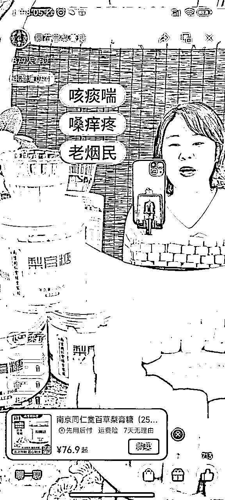

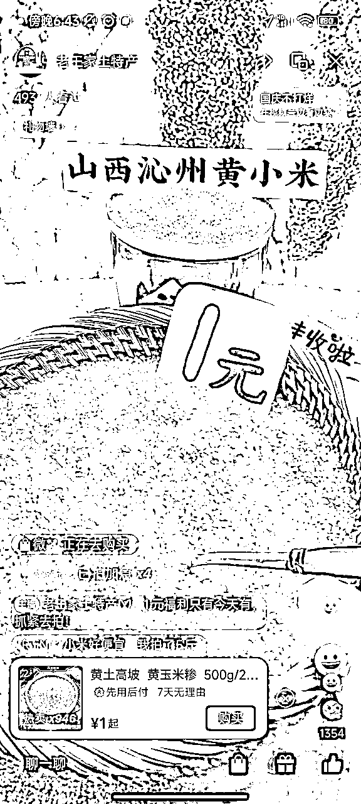

关于直播时段的选择，如果能挑，最好的两个时间段是晚上11点到凌晨1点半，以及早晨4点半到8点。这里的逻辑是错位竞争。职业主播大多白天开播，白天看播的人少，竞争已经够惨烈了，流量不好抢。晚上8点到10点看播人数最多，但这时候各大IP和小主播们都在拼命卷，流量同样不好拿。晚上11点之后，平台上有95%的主播都收工了，但睡前刷视频的人依然大把；早晨也是同理。尤其是老年人，觉本来就少，这两个时间段相当适合起号。

数据赛马的逻辑不用多讲，做短视频的人都明白。不管是短视频还是直播，平台就是在拿你的数据跟同行比，比得过就给量。

最近视频号直播大屏改版了，能看到几个关键数据了。核心的四个数据，我按自己的理解拆解一下：

曝光进入率，这个数据常常被忽略，它衡量的是直播间的第一吸引力。优化场景能明显提升这个指标。有个特殊情况是：当推流不精准的时候，曝光进入率反而可能很高，因为它推荐来了一批什么都看的人，但慢慢地这个数字会掉下来。正常来说，10%算及格，15%左右是达标线。

停留时长，最好理解也是对推流影响很大的数据之一。直播间赛马赛的就是谁能留住人。50秒及格，1分钟达标。

GPM，也就是千次看播成交额。说白了就是每一千个人进了直播间，你成交了多少钱。GPM受商品价格影响非常大，它不是越高越好。卖9.9的纸巾和卖2999的玉器，GPM能差到天上去，所以这个指标只有同类目比才有意义。同时GPM会反过来影响推流模型——你成交的用户价值越高，平台就越倾向于给你推更高价值的用户，反之亦然。

成交密度，本质上是考核成交率的。这也是目前视频号重点考核的指标之一，在我看来是当前最重要的数据。你看到很多低价直播间流量巨大，原因无非是把成交密度做上去了。如果后端条件允许，起号阶段可以用成交密度来布局：最低价SKU没利润当钩子，其余高价SKU有利润，这是最好起号的手段之一。等账号起来了，把低价SKU库存清空就行。

点击成交转化率，这个在复盘时也很重要。它反映的是：观众点了商品详情之后，有多少人最终下单。这个数据能直接暴露出一个核心问题：主播的能力。用户既然点了商品，说明心里已经心动了，这些人都是精准用户。而对精准用户的转化能力，是最能客观评价一个主播水平的。

点转同样受价格影响，越贵的东西点转天然越低。但正常情况下，99元以内的商品，点转至少要有20%。低于这个数，说明主播功力还不够扎实；反过来，如果一个纯带货直播间的点转能过30%，主播能力就相当能打了。

再说起号。视频号如果是一个纯新号，靠纯直播起号难度不小，过程也相当熬人。为什么这么说？因为新号除了开播时能拿到一波大约不到50场观的急速流，之后就不怎么推人了。播几个小时场观只有几十、几百的情况到处都是，心态脆弱的人直接崩溃在第一关。

起号的办法两个配合着来：拉时长+微付费。

拉时长的逻辑和抖音正好相反。抖音鼓励高质量短直播，开播两小时后推流会下降，所以很多主播一场直播一两个小时，一天来好几场。视频号则反着来：老老实实天天开播，一播就是三四个小时，流量反而会慢慢起来。做自然流的经验里，经常第一波大推流要等到开播3小时之后才来。所以视频号的策略是：只要有推流就尽量拉时长，每场至少4小时以上。

但拉时长有个前提：得一直有人进来才值得拉。至少一分钟有5到10个人进，拉下去才有意义。一个人都不进来了，再播也只是当练习而已。

这种情况怎么办？上微付费。人货场没问题、但初期不推人的新号，在极速流走完就没人了，那就花钱买流量，投流拉一些会成交的人进来。新号平台不信任你，只能自力更生，买流量进来证明成交能力，先成交个50单。有了数据，有了成交人群画像，平台就信任你了，也知道该给你推什么人了——账号就起来了。

不过微付费不是万能药，它只解决初期没人这个问题。前提依然是人货场没问题，进来的人你接得住、能成交。具体实操参考：低客单价、受众广的产品，比如19.9的零食百货，手动出价100，投放目标选互动，时长4到6小时，不限人群。高客单价如29.9以上的，投放目标选成交，手动出价到成本的80%到100%，确保能消耗掉，同样不限人群；商品标签比较小众的话，头几笔可以试着选相似达人投放。

正常投2到3场，单场场观2000以上，直播间累计成交50单左右，账号的成交标签基本就建立了。之后开播就有稳定推流和更精准的人群了，按正常节奏把自然流量的人群成交掉，起号就成功了。

直播间数据不好、停留短、GPM低、点转低，除了人货场的问题，还有一种可能是新号推流不够精准。判断方法很简单——在直播大屏上对比看播人群画像和成交人群画像：如果两边差不多，说明人群已经精准了；如果差距很大，那推流还需要时间修正。

关于平播和憋单。90%的情况下，如果不投流也没有短视频流量，纯靠一张嘴做自然流直播，那么不能平播，得靠憋单话术来播。很多刚做直播的老板想不明白憋单的道理：用户都说“快上架我要买”，你还不上架，这不是白白把生意往外推吗？

憋单之所以反常识却有奇效，是因为它天生契合直播算法的运作逻辑：

第一，憋单能筛人。想买的人会留下来等，不想买的人划出去了，这两拨人的停留数据一拉大，标签就打出来了。

第二，憋单能显著提升停留时长和成交密度，而这两个数据正是带动自然流量的核心指标。

第三，高客单价的东西本来就难成交，不把种草的功夫做足，用户根本下不了单。一上来就放单，结果就是大家点开看看就跑了。用憋单话术留住人，让用户完整听完塑品内容，转化率能明显上去。

那什么时候可以平播？两种情况：一种是流量主要从短视频进来——短视频已经帮你把用户筛选过一遍了，进来的人就是精准的，直播间做好答疑和逼单，一直放单就行，憋单反而帮倒忙。另一种是产品本身性价比极高，比如卖9.9没有成交压力，甚至还有1.9的钩子品，那不需要憋单也能做出足够的成交密度，干脆一直放单，最大化成交密度。

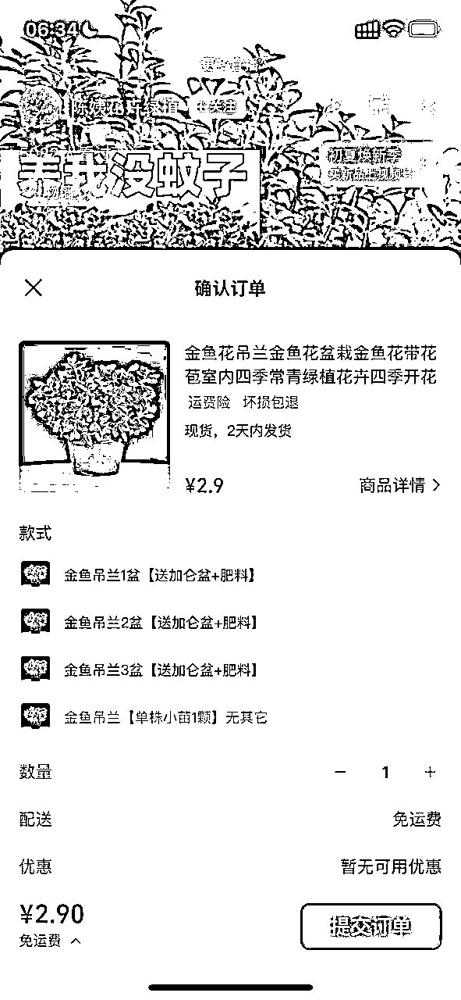

关于直播预约。这个功能不是视频号独有，但依托微信的社交生态，它在视频号上的威力是其他平台比不了的，必须要学会用。

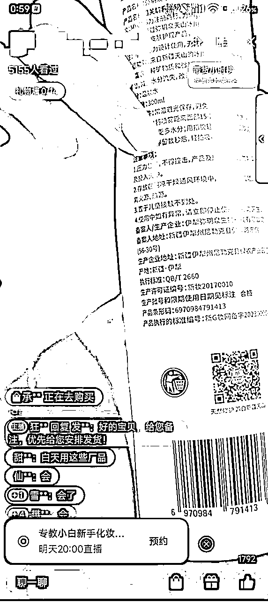——如果你手里有私域，这是最锋利的武器。建好预约之后，通过私域裂变一轮做启动流量，效果事半功倍。

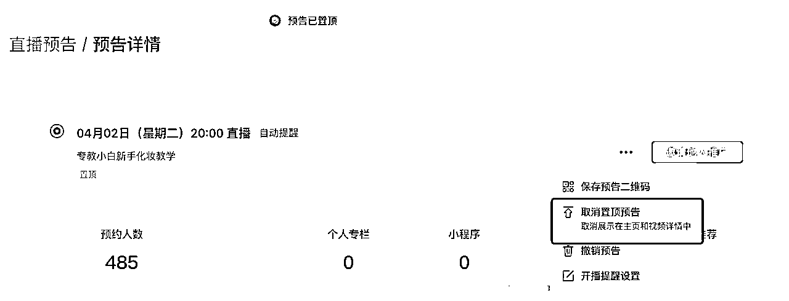——如果短视频突然爆了但你没法立刻开播，马上去建一个直播预约，多少能接住一些流量，尽量少损失一些。第三个用法是下播前留意一下：开播流量拉起来之后，准备收尾时把下一场的预约弹出来，话术上提醒观众“要下播了，记得预约”，把新进来还没成交的人留到下一场，这样下一场开播第一波的数据会更好。

中控这方面，如果不露脸直播或者靠短视频导流，一个人也能干，但条件允许的话还是建议配个中控，他要干的事情大概是：

第一，开播前的准备和设置；

第二，把礼物和粉丝团关掉；

第三，观众昵称设成不可见；

第四，如果手机直播，把手机调成勿扰模式；

第五，商品上下架、及时弹窗讲解；

第六，提前准备至少4个小号在评论区刷评论当水军，并且把重点评论高亮显示；

第七，在公屏上回复问题、辅助转化；

第八，主播在直播过程中出错了，要及时提醒纠正。

福袋这事儿也得说两句。很多新手开播就爱发福袋，它的作用大家清楚：拉高停留和互动。福袋确实有用，效果立竿见影。但有一条重要的注意事项：起号阶段别发，等推流精准了再发。

为什么？起号的时候，来的人很杂，大量都不是你的目标客户。这时发福袋只能把专门来薅羊毛的人留下来，反而容易把直播间的标签带歪。等你成交了50到100单之后，推流逐渐精准，这时候发福袋，拉起来的停留和互动都是精准用户贡献的，才是真正的正向加持。

以上，算是对视频号带货的一些粗浅总结。篇幅有限，这篇主要没展开付费投流的深度玩法和IP短视频、直播路线的内容。如果有同样在做视频号电商的朋友，也欢迎加我，一起切磋。祝各位在视频号里乘风破浪，天天爆单！