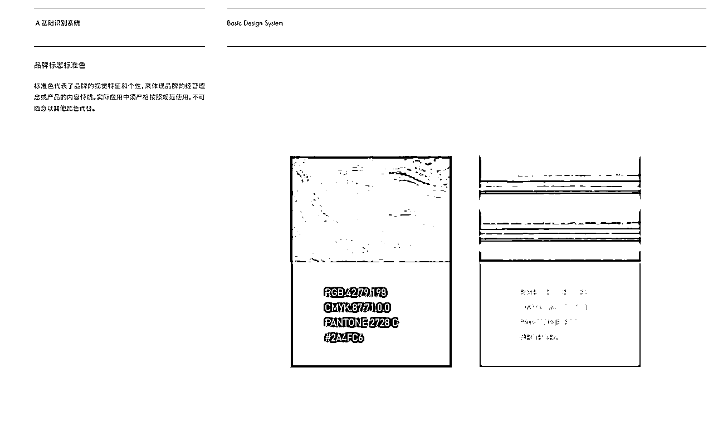
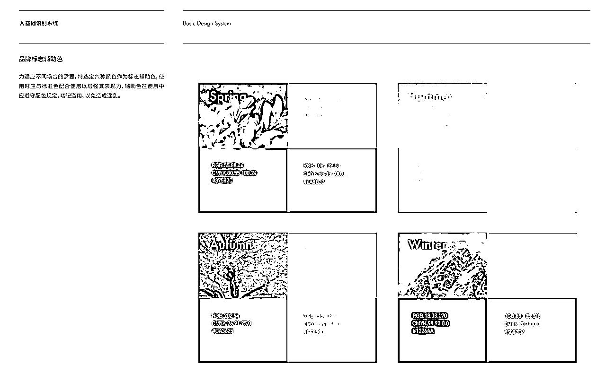
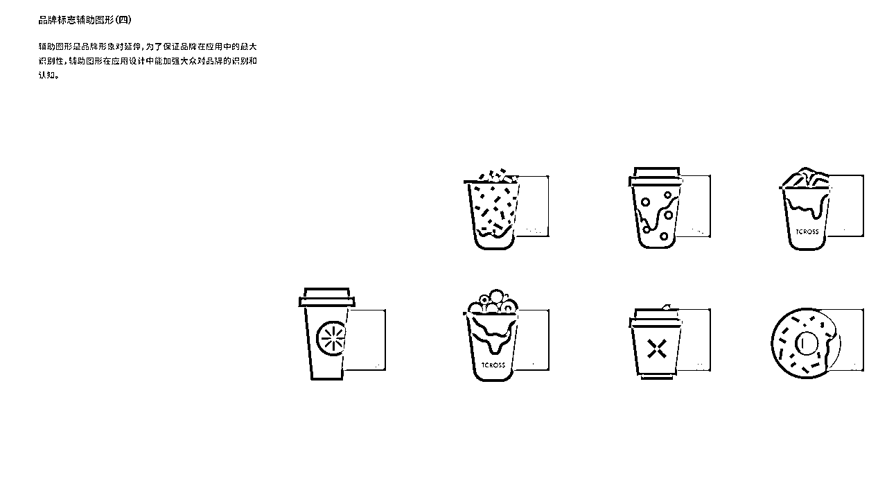
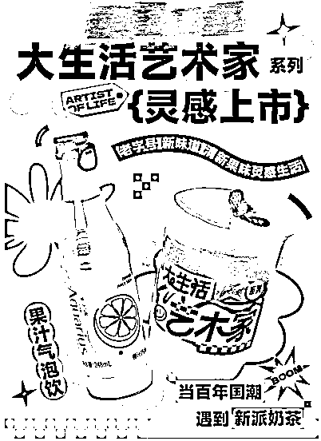
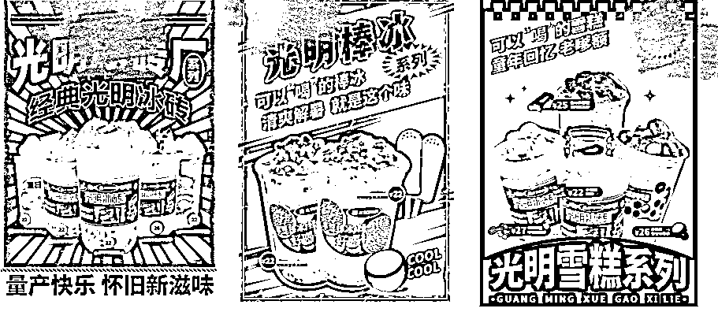
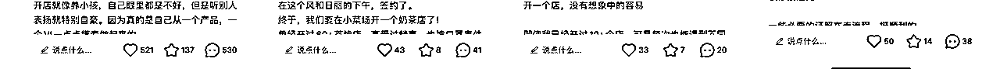
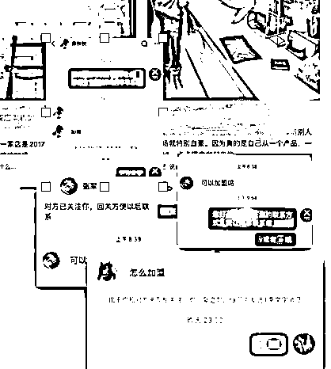

# 从10家濒死到一年新增80家：一家茶饮品牌的逆盘操作全记录

先自我介绍一下，我是龙哥，经营一家做餐饮品牌内容和流量落地的策划公司，过去服务过的餐饮客户超过一百家。今天分享一个这两年我团队深度陪跑的饮品加盟品牌案例，讲清楚我们到底是怎么把它从死亡线上拉回来，并在不利环境下实现爆发式增长的。

先抛结果：接手时门店只剩10家左右，正好撞上疫情尾声的寒冬。我们进场后完成了体系重建，去年逆势签约新增80家，含已签约待开的。

下面把成败经验拆开说。

# 我们执行的六大抓手

一、视觉体系重塑，重建品牌第一印象
二、产品线梳理，锁定爆款增强记忆
三、市场部门重构与日常运营升级
四、流量渠道系统化打通
五、📕运营+创始人个人IP孵化
六、复盘与收获

# 链路拆解

## 视觉体系重塑，重建品牌第一印象

我一直把品牌看成一个人格化的明星。明星之所以能被记住，靠的是统一的形象感和强记忆点。品牌同理，视觉是消费者最先感知到的钩子，也是所有传播能否成立的基础。

和客户聊过后发现，他们过去对视觉的投入非常不足，也是导致门店萎缩的核心原因之一。于是我们决定归零重来，当成全新项目启动，先做一次完整的调性升级。

好在疫情期间门店客流低，我们用一个多月的时间快速完成了VI焕新。因为涉及品牌信息保密，这里只能展示部分延展。

可以看到配色上我们有意植入“故事感”，符号和延展图形也做了系统化设计。

视觉落地时我们重点把握了几个维度：

* 颜色要形成强关联的记忆锚点
* 名称要清晰，面向下沉市场时中文名不可少，英文可视定位搭配
* 符号或IP要前置规划，为后续周边、联名、玩法预留空间
* VI执行时必须由市场部主导把故事讲圆，为什么用这个符号、为什么选这组色调，立意要高，在关键节点会起作用

另外我们对物料执行做到极致管控，从杯贴、杯套到一张门店海报都要统一标准。客户之前的海报我已不复得，但印象极差。很多直男老板觉得平面无所谓，打印店就能搞定。但如今餐饮已是全方位的视觉战争，视觉是破圈利器，绝不能省。

茶饮店坪效有限，动线和打卡点极其宝贵。要想让顾客停留并产生分享，就必须在每一个细节里下功夫。收银台的台卡、海报质感、电视机播放内容、是否能拍，都决定留存。

消费者是最终裁判。你做得土，就要土得彻底；你走精致路线，就要把调性拉满。网红不等于潮，而是把赛道内的风格做到极致，精准吸引目标人群。

一个小观察：品牌调性往往带着创始人的DNA。洋气的人做出来的店会更有潮感，怀旧气质强的老板反而能做出很高级的老牌质感。核心是把自己的特质放大，而不是盲目追潮。

## 产品线梳理，锁定爆款增强记忆

产品是第二战场，也是最容易被忽视的环节。

我们发现很多餐饮老板习惯让研发主厨自由发挥。虽无大错，但产品往往缺流量感、缺市场对话能力。

我们的协作模式是：研发先给出月度系列与食材方向，市场端同步提出想传递的用户心智和沟通点，双方共同打磨配方与卖点，最后由市场命名、讲故事。这样产出会好很多。

核心爆款必须抓出来并持续打透。饮品赛道更新极快，月月有新品。小更新靠应季食材，大更新则需要提前很久的筹备，因为要结合投放与事件营销。

两个实用思路提供给同行：

破圈跨界。比如用甜品元素做奶茶，蒙布朗奶茶、栗子蛋糕奶茶等，把情绪挂钩，比如“emo解药”。这类命名和联想更容易击中用户神经。

借势联名。我们当时抓准时机与一个高势能品牌做联名快闪，推动老板加大投入，做联名产品+媒体投放放大。最终形成一次真正的网红事件，长尾效应持续至今，依然有加盟咨询源源不断。

## 市场部门重构与日常运营升级

视觉和产品打底后，就要让机器运转起来。

我们让客户把内容维护精力聚焦在几个核心阵地：大众点评、👸号、📕官方号、抖音号以及店长私域群。

想低成本放大加盟势能的一个做法是：门店矩阵化运营抖音和📕。内容总部统一生产，门店负责分发，或鼓励门店自产并设置奖金激励。这样既能积累私域粉丝，又不被单一达人流量绑架。

## 流量系统化打通

做好内容还不够，需要主题化的话题助推。就像明星需要话题维持热度，不能只靠穿得好看。

常规打法是：重磅新品+活动落地+达人矩阵投放。👸号现阶段我们基本不投，性价比太低。但用于加盟的品牌背书时，1-2条标志性投放仍有必要。

重点渠道集中在点评、📕、抖音，足够打透。不必追头部大博主，面更广更重要。我们通常用KOC+腰部达人组合，一个主题一条线，集中作用于1-2个爆品，避免分散。

另外一个大忌：投放刚见效、加盟电话来了就立刻停投。这种短视操作等于自己掐断势能。势能需要持续加温，乘热打铁才是最省钱的推广。

我们是一季一度集中投入，一年设1个事件级爆款节点集中预算。火力集中，才容易击中要害。

## 📕的威力与创始人IP

流量成本越来越高，达人资源被稀释，消费者也更挑剔。但品牌仍需自建流量。

📕对轻餐、饮品、甜品类尤其有效。开通蓝V后认真运营+适度投放，能带来后台精准询单和加盟咨询，还会沉淀一批死忠粉。每次更新都有人抢留言。

同时我们鼓励多城市门店开设官方号，内容分发量越大，曝光越稳。

最超预期的，是创始人个人IP。与蓝V联动几乎是核弹组合。该老板形象年轻、表达在线，账号第五条笔记就爆了。

个人IP具备低粉变现能力，对会玩的老板来说，这是撬动大流量和加盟转化的好路径。

人设做起来后粉丝粘性惊人，筹备新店时甚至有粉丝自发去现场“监工”、后台催开业。很遗憾的是客户后期没有坚持运营，最终流失了复利机会。想持续拿到大结果，眼界、坚持和时间复利缺一不可。

## 收获

一套系统化、带“心机”的布局下来，品牌从濒临倒闭到重启加盟，7-8月起持续增长，去年新增80家。

希望这个案例能给你全局思维上的启发。如果你也在餐饮赛道，或想深度探讨合作，欢迎交流。