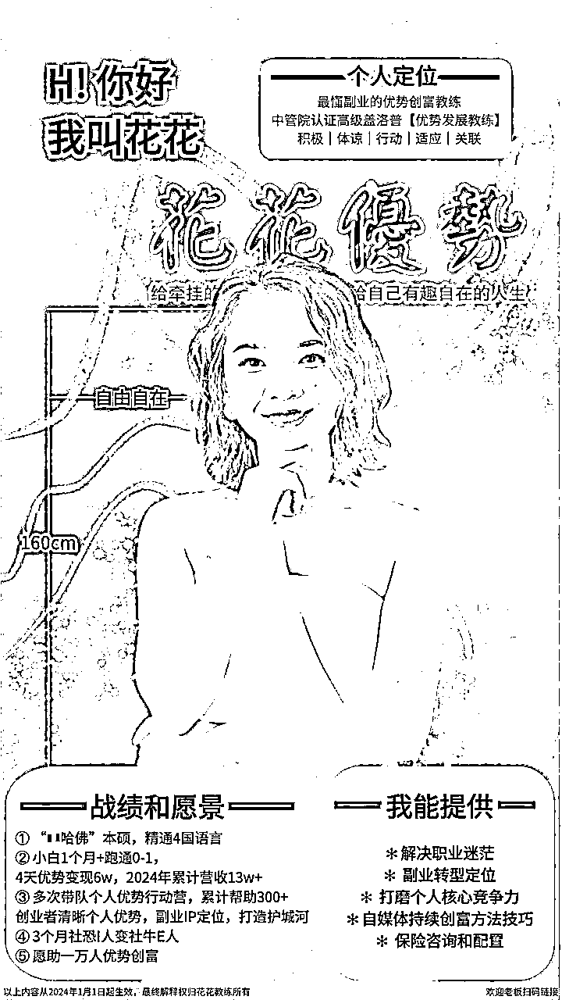
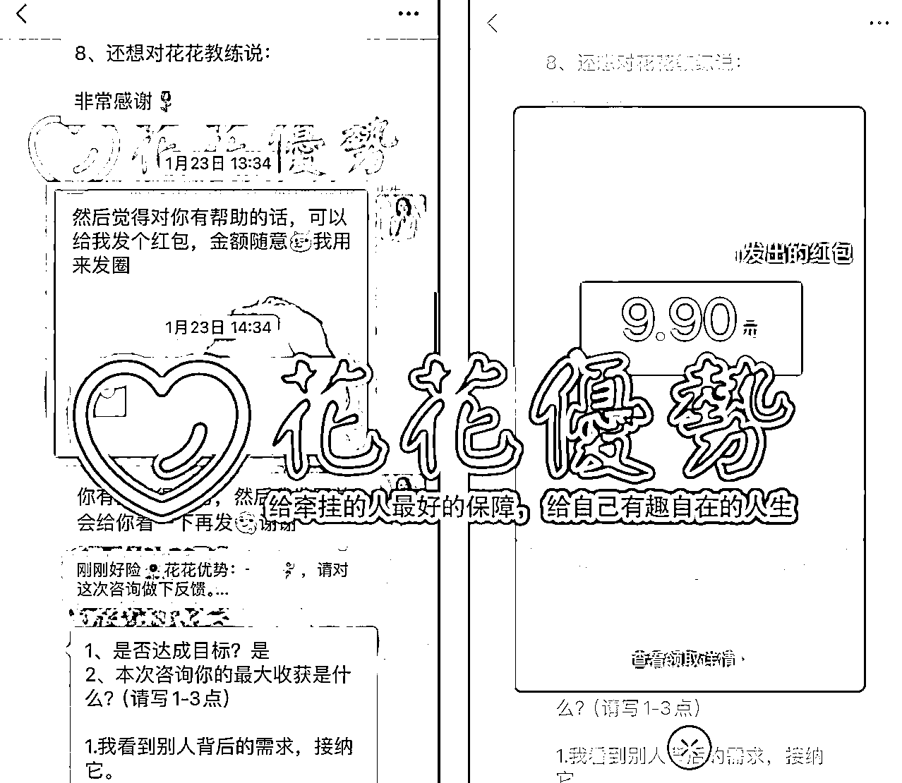
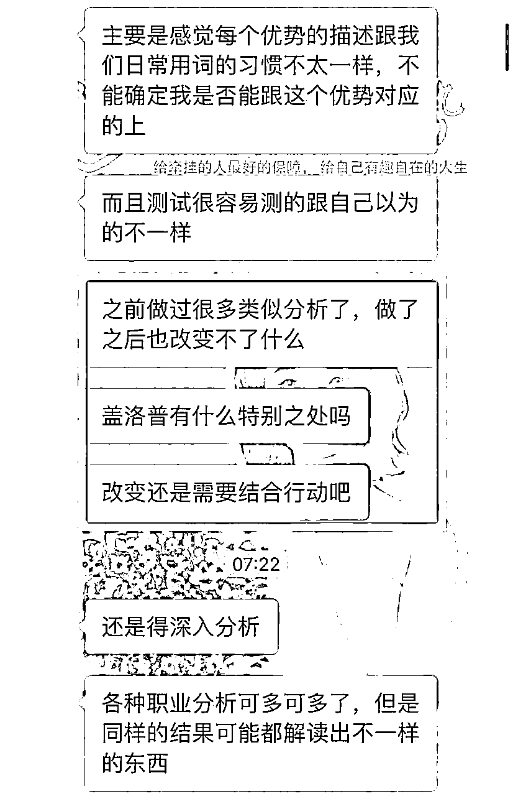
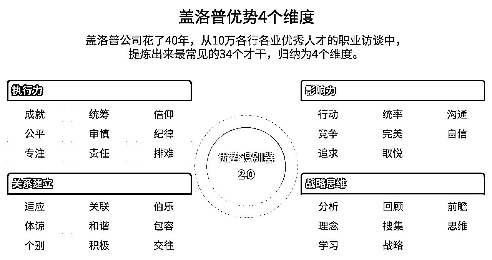
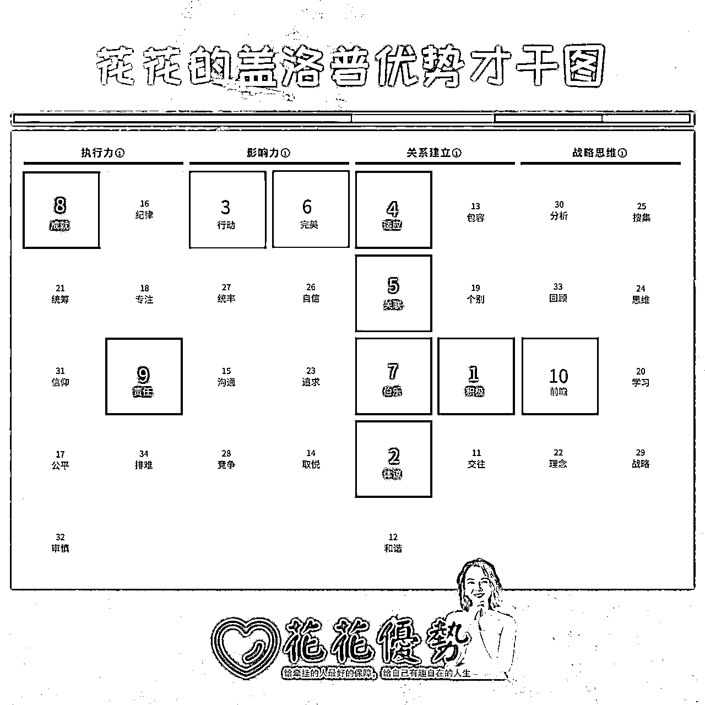
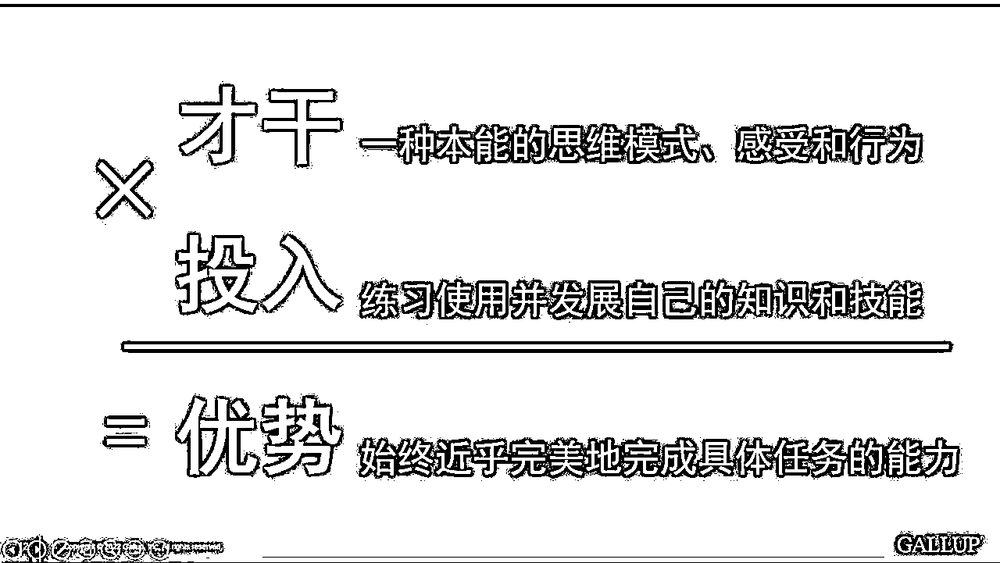
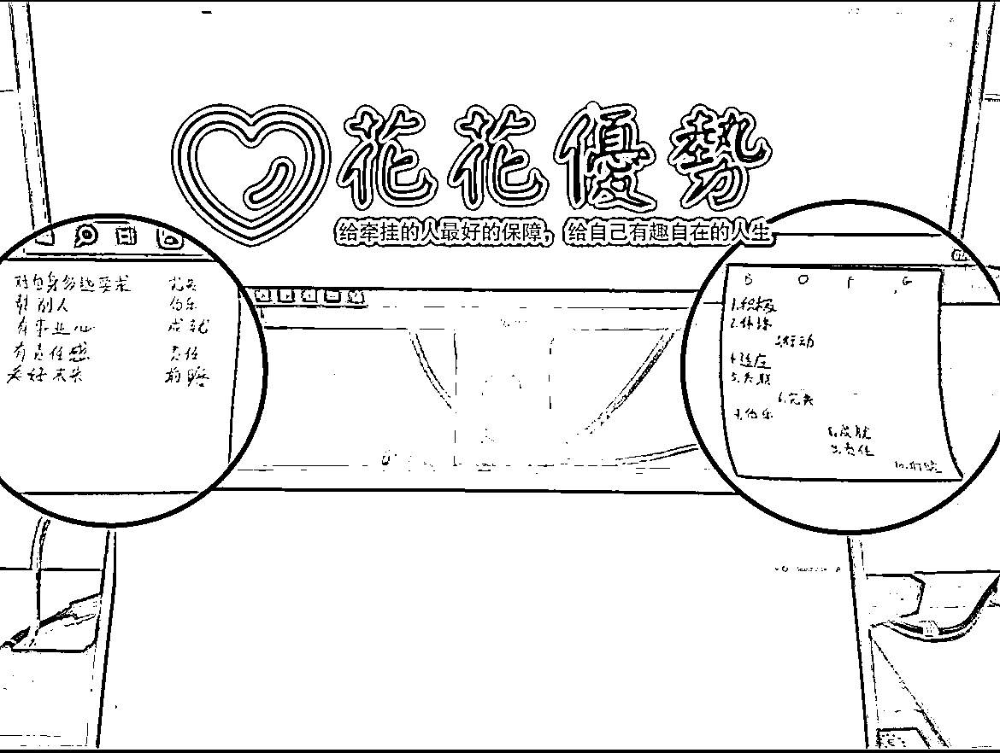
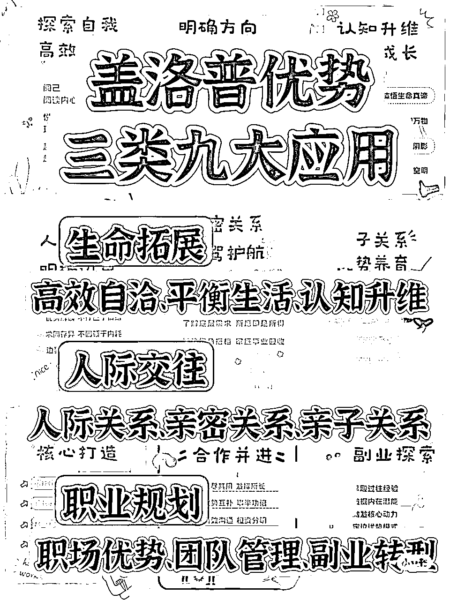
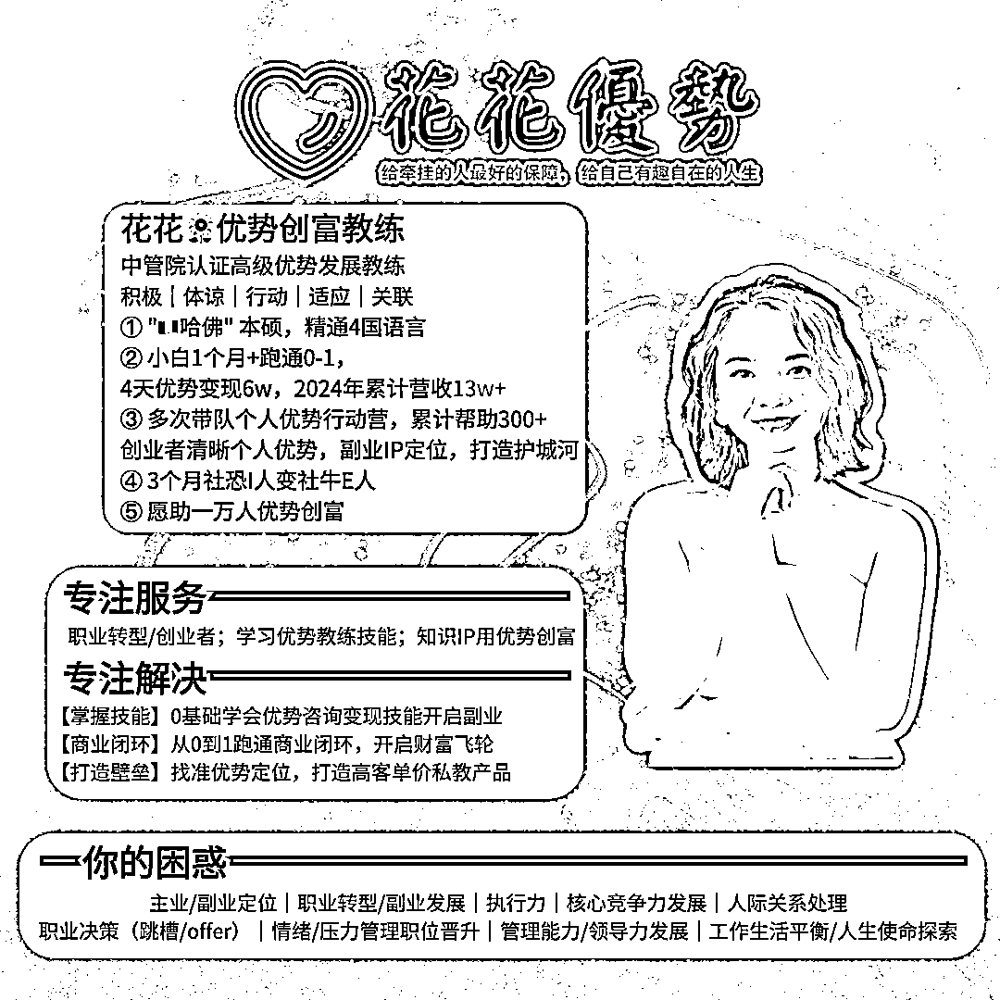

# 《从迷茫到自洽：南方山里的姑娘如何快速跑通0-1商业闭环，用盖洛普优势拯救自己？》

4天赚到6万，1个多月打通0-1闭环，3个月赚回两万学费，2024年头四个月累计进账15w——放在2023年以前，这些数字我连想都不敢想。

我是龙哥，一个在德国和温州之间两头跑的90后外企打工人。

跟朋友介绍自己的时候，我常用三个标签：

① 中管院认证的盖洛普优势创富教练。陪伴普通人和创业者发现并放大自己的优势潜力，对付创富路上的定位、执行力、个人核心竞争力等各种难题。

② 2023年12月正式开启优势创富之路，心里揣着一个不小的愿望：带万名伙伴优势创富，过上自洽且富足的人生。多次带队优势行动营，累计帮300多名创业者看清个人优势、理清副业IP定位、筑起护城河。

③ 盖洛普前五才干是【积极｜体谅｜行动｜适应｜关联】，“意大利哈佛”本硕，掌握四门语言。零基础自媒体起步，一个多月跑通0-1，4天优势变现6w，2024年前四个月累计营收15w。

说实话，在接触盖洛普以前，我从不相信自己真的可以从迷茫和虚无里走出来，更没想过有一天能给自己贴上这么多闪闪发光的标签。

这一切，都因为盖洛普让我学会了怎么在自己天生擅长的方向上持续使力。在自己擅长的地方不断积累，真的是一个越走越香、越走越正反馈的过程。

这次干货长文近1万字，把我轻创业的完整经历和深层思考全部摊开给你看，毫无保留，真诚分享，希望对正在或即将开启创业/副业的你有用。

# 目录在这里

一、遇到盖洛普之前的我

二、盖洛普的核心观点

三、用优势聚焦，三步跑通0-1

四、选行业赛道的三条心法

五、副业定位的两个五部曲

六、为什么优势咨询是蓝海赛道？

先快速看一眼我的成长轨迹：

*   2023年9月21日开始接触自媒体
*   12月中旬正式开启优势创富教练轻创业之路
*   下面这张图是我2024年1月收到的第一笔公益咨询红包

到目前为止，我已经帮300多个人通过盖洛普认识了自己，也为他们的主业/副业插上了翅膀。

平心而论，我对现在的结果是有满足感的。要知道，当初的我在自媒体面前完全是一张白纸。

我决定做自媒体的时候，身边几乎全是反对声。

有人说我被PUA了，有人一声不响删掉我的🛰️，有人觉得我在搞传销。还有一个朋友在拉黑我之前特意留言：“我知道劝你没用，但还是希望你能回头是岸。”爸妈也坚信我是遇到了杀猪盘，等着被割韭菜。

但我心里有个声音一直很坚定：必须创业。只靠打工，我永远看不到出头的那天。

# 一、遇到盖洛普之前的我

我是从南方大山里走出来的姑娘。童年记忆里，自己总像个野孩子一样往山里跑，跟着哥哥姐姐摘野果、拔野菜喂兔子，顺便挖几根新鲜的笋。

爸妈在工厂打工，我跟着他们住在宿舍里，生活条件不算好，但我很早就学会了独立。看到别的孩子有爸妈时时陪着，说一点都不羡慕是假的，可我从来没有抱怨过。身边的人让我很早就体会到生活的不容易，尤其是那些条件更差的人。后来想想，这大概就是我的体谅和积极才干为什么那么靠前的原因吧。

那么，遇见盖洛普以前的我是什么样子呢？

先说第一点：没有方向，又拧巴。想赚钱，想证明自己，可就是找不到任何支点。最后只能动用适应才干，让自己（被迫）躺平，再给自己找各种借口。

2022到2023年，那是我人生里又一段灰暗的低谷期。工作不是我喜欢的，感情也连着两次没了下文，始终遇不到对的人。作为一个关系建立靠前的人，那种情感上的挫败真的伤我很深，我一度觉得自己是不是不值得被爱。三十岁的门槛又近在眼前，无形的压力压得我喘不过气，又找不到出口。

我想多赚一点钱，让家人和自己都过得好一点，把欠爸妈的钱还上，也想给自己一个自由自在的人生。可那些念头在那个阶段就像一个笑话，我甚至觉得，也许我一辈子就只能浑浑噩噩地过去了。

一个没有目标的人，活着和消失也没什么区别。

第二点：我的主业和我的优势几乎是反着来的。我那么喜欢旅行，那么爱跟不同背景的人打交道，可我没有足够的赚钱能力，只能乖乖地朝九晚五，拿死工资，连辞职都不敢开口。

我的工作内容特别简单——天天写报告。

这事儿对关系建立靠前的人来说，真的是一种折磨。下班以后也没什么能真正滋养我的爱好，只能靠电视剧麻醉自己。

每天重复着这种超级耗能的日子，可我已经不敢再任性辞职了。家里的经济压在我一个人身上，老的老，小的小，病的病，我是全家唯一的劳动力。

第三点：作为一个小白，我两个多月换了三个定位，毫无结果，整个人被焦虑和内耗吞没。

像我们这种关系建立靠前的人，如果没有教练那种宏观的视角，对自己又不了解，特别容易在商业路上迷路。然后就会乱付费、越学越乱、越学越没结果。

我就是活生生的例子。

完美才干过剩，让我在知识付费这条路上刹不住车。我买了很多高客单产品，确实挤进了一些高能量的圈子，但以我那时候的底子和需求来说，这些根本不是理智的选择。我没有专业技能，智商也就中等水平，买回来的好东西根本啃不动。

那时候的我也没现在这么情绪稳定，总被自己的内心戏感动，整天陷在自我消耗里。

去年9月开始，短短两个月，我换了三个方向：先是留学IP，再是📕自媒体IP运营，然后又跳到儿童英语启蒙。每一次都信心满满地开始，没多久就泄了气。

我知道坚持有多重要，但我就是坚持不下去。

身边有不少贵人愿意指点我怎么赚钱，可他们不了解我的内心。讽刺的是，连我自己也不知道自己真正想要什么。

后来我才明白，那是因为我的自我认知和商业认知同时缺位，哪怕我经常自省，哪怕我读了商科的本硕，也一样没用。

2023年我确实也赚到过钱，但那些运气和别人的光环加持，换不来一点儿安全感。我每天都活在焦虑里，因为我不知道下一步该做什么、该怎么做。

我特别渴望有个人能手把手带我，给我保姆级支持，不然我就会丢了自己，困在内耗里。

我想早一点实现自我价值，想为自己和家人撑起一片天。但那时候，我连入口在哪里都不知道。

直到我遇见我的优势导师，认认真真啃完盖洛普公开课以后，我终于看到了照亮前方的那束光。

其实我很早就听说过盖洛普，一开始还相当排斥。我觉得它跟MBTI差不多，测了又能怎样？而且我自己觉得自己挺清醒的，干嘛还要做一个测评？

很多人也会有这种僵化想法，认为盖洛普这类优势测评很虚，心里嘀咕：“做了也改变不了什么。认识自己然后呢？我更想要解决办法。”“我不想被一个测评框住。”

后来我切身体会到：自我认知越清澈，行动才会越笃定。

现在我能毫不夸张地说：是盖洛普拯救了我。

当然，这背后也少不了贵人的托举。

# 二、盖洛普的核心理论

你也许有过这种感觉：对现状不满，想改变却不知道从哪儿下手。看着别人混得风生水起，再看看自己，明明条件也不差，为什么就是使不上力？

这太正常了。到了30到50岁这个阶段，社会对我们的要求更高，试错成本也更贵。很多人连自己擅长什么、想要什么都不清楚，又怎么能找到合适的工作和生活方式呢？

心理学家卡尔·罗杰斯说过：“人的一切问题，都在于不了解怎样看待自己。”荣格也说：“潜意识正在操控你的人生，你却称之为命运。”

性格决定命运。

性格影响选择，选择推动行动，行动铸就结果，结果沉淀成命运。

所以，想夺回命运的主动权，先得从读懂自己开始。

盖洛普优势测评就是这样一个切入点。它出自美国盖洛普公司，扎根于积极心理学，经过多年研究和对数百万人的调查，2001年问世，所以也有人叫它“科学算命”。现在全球有超过3000万人做过这个测评，两个人前五才干完全一样的概率是3300万分之一。就凭这种颗粒度和信效度，其他测评真的很难比得上。

成功的道路千千万，但成功者有个共性，那就是扬长避短。不了解自己，等于怀里抱着金饭碗，却在做乞丐的活计。

测评报告会呈现出你独有的四个才干领域和34项才干的排序（见图示）。

所谓才干，就是我们不知不觉就会使用的思维、感受和行为模式。它是我们身上最本真的那个部分。我们每天做出的很多选择，以及那些下意识的反应，大部分都是才干在背后掌舵。

举几个例子：

执行力强的人，我叫他们“紫衣侠”，擅长把想法落地，在处理事务和执行方面潜力很大。

影响力强的人，我叫他们“橙贵人”，数量不多，但天然就有存在感，喜欢站C位，很难让人无视。

关系建立强的人，我叫他们“蓝精灵”，擅长织起人与人之间的纽带，把团队牢牢凝在一起。

战略思维强的人，我叫他们“绿巨人”，擅长收集和分析信息，能挖出事物背后的规律，做出更聪明的决策，甚至预判趋势。

性格和本性的底层，就是才干。比如有的人从小就喜欢独来独往、想事情，那多半是战略思维靠前。当你的前十才干被满足了，你会像充了电一样兴奋；被压抑的时候，你就会又累又丧。

所谓“成也才干，败也才干”。

才干用对了，就长成优势，也就是那种“持续保持近乎完美表现的能力”，成了你的核心竞争力。用错了，它就变成你的短板，成了成功路上的拌脚石。

这张是我的盖洛普才干图（测评报告第21页），你能很清楚地看到，我的关系建立和影响力两个领域相对突出。

不少学员问我：“花花，我的前15才干里没有取悦、沟通、个别这销冠三件套，是不是就注定卖不好东西？”

答案是：真不一定。

哪怕你集齐了这三项，如果你不知道怎么把它们发挥到极致，你一样成不了销冠。

当我们还不了解自己的时候，看到别人做出不符合自己期待的行为，第一反应常常是指责。可别人只是跟你的想法和能力不一样而已。去理解对方心里真正需要什么，沟通会顺畅得多，目标也更容易达成。双方的需要都被接住了，很多冲突也就悄悄化解了。

知己知彼，百战不殆。

# 三、用优势聚焦，三步跑通0-1

测评报告上写的是才干，不代表它们已经是你的优势。因为优势=才干×投入。优势是那份能让你一直保持近乎完美的能力，也就是大家嘴里常说的核心竞争力。

拿优势教练这个赛道来说，我的学员普遍能在2到6个月内跑通商业闭环。那为什么我能用1个多月就搞定呢？说白了，我把成就、完美、行动、积极这几项才干磨到了极致。

第一步，用两到三周集中突击，学会一门能立刻变现的专业技能。

那段时间，我真的把所有碎片时间都压榨干净了。上下班路上在听，午休在听，睡前在听，周末也全泡在学习里。我不刷社交APP，每天雷打不动发三条朋友圈，哪怕没人看也一样发。

日程表被塞得满满的，身子会累，但精神上特别爽，完全没空焦虑。每磕下一个学习目标，那种成就感就很上头。越学越觉得，每个人身上那些独特的才干，真的太迷人了。

第二步，不会做咨询？那就用录音“喂”自己。

我疯狂刷前辈们的咨询督导录音，再拿着导师给的SOP和话术一点点抠，慢慢长出了自己的咨询风格。

先是找了三个志愿者陪我练手，后来又在朋友圈招募公益个案。终于，1月23号那一天，我迎来了第一个付费咨询，9.9元。现在我的一小时收费已经涨到499元。截至目前，我已经服务了近50位来访者，在这件事上投入了100多个小时。

只要抓到一个能申请录音拆解的机会，我就主动去跟导师争取，就是想尽一切办法往前赶。现在，只要是站在我的专业领域里，我整个人都是自信且挺拔的。

第三步，用每个月的商业行动营，给自己搭一个不会让人泄气的环境。

我每天跟着营里的优势教练们一起实践，把专业和商业知识揉碎了反复练，商业闭环的四个环节——产品、流量、成交、交付——的SOP，就是这么一点一点“长”进身体里的。正反馈也跟着多了起来。

遇到1v1的成交拆解名额，我也会第一时间抢。我要让拿过结果的人帮我找出思维里的bug，回头再自己复盘，再一遍遍重练。

就这么着，我在1个多月内跑通了闭环，又在大约3个多月的时候，实打实地把两万学费赚了回来。

所以投入，真的无比重要。

才干是你的潜力存折，前十才干就是你随身携带的十把剑。可如果不投入，不练习，不复盘，再锋利的剑也会变成破铜烂铁。

盖洛普能帮你找到病灶，但找到病灶不等于已经治好病。

真正要做的，是借测评认识自己，接纳自己，也接纳别人，管理好自己的情绪，然后真的去投入、去改变、去一点点长出自己的核心优势。

如果你没有决心改写命运，也没兴趣成为一个更高版本的自己，那下面的话可以不用看了。

坦然承认自己想要的，然后为它花时间，花精力，这才是靠谱的人生解法。

就像我的贵人梁靠谱说的：“有条件作恶但从不作恶，有条件放纵也极少放纵，斯人若彩虹，遇上方知有。”还有一句：“一个人的幡然醒悟，1%靠别人的劝说，99%靠千刀万剐。”

而借由盖洛普，你可以让自己少挨几刀。

盖洛普官网测评码是445元，找教练买则是410元。越早做完测评，越早开始自我认知和接纳他人，就越早能锻造核心竞争力，更早打开财富之门。

这张便利贴一直贴在我的工作电脑上。

右边是我的前十才干，左边写着我准备怎么用第6到第10才干去对冲前五才干过度发挥的阴影面。它天天提醒我：优势=才干×投入。

# 四、选行业赛道的三条心法

如果你是小白，尽量往蓝海赛道里钻。

但选了赛道，不代表你已经拿到了定位。想成事的话，最好先挑一个你本身就热爱的行业；如果实在没有，那就选一个你真心喜欢的，不要只跟钱走。

下面这三点也很关键：

1.  看行业趋势，也看你的优势。找个适合你的行业，再结合你天生的长处。
2.  看行业的长期性、道德感、社会认可度和门槛。要确保你可以在里面慢慢熬，不会三天两头想放弃。
3.  选一个需要跟真人打交道、很难被AI替代的方向。像咨询、护理、养老、保险这些领域，靠的是人的温度和管理能力，是机器很难模仿的。

对绝大多数普通人来说，AI更适合拿来当提效的工具，而不是你的副业基本盘。

# 五、副业定位的两个五部曲

做副业，不能只知道优势定位，商业认知一样都不能少。

不管是副业还是创业，个人定位都绕不过去。因为它能帮你找出自己独特的优势和价值的锚点，让你在市场里找到属于自己的一席之地。

人生就像一场戏，上半场是打工攒钱，下半场是用自己的方式实现自我价值。做副业或创业，就是让你做自己擅长、热爱、又能利他的事情，并从中获得回报。这样一来，你的优势才不会被浪费。

个人IP不是演戏，更不是贴标签，它是你的优势和天赋的自然流露。做个人IP，其实就是做自己。

当你的IP立住了，别人买的就不再是产品，而是“你这个人”。

定位就像一棵树的根，也是你自信的来源。没有定位，人就会散焦。长期找不到方向，人会顺着人潮飘走，最后出大问题。

所以，个人定位不是可有可无的装饰，而是一个必须认真做好的基本功。

## 你卡在定位里的真正原因

90%的人为定位头疼，但真相是：你缺的并不是定位本身，而是一套基于自身优势的商业模式。

人们拼命找定位，到底在找什么？在怕什么？

他们找的是“一条保证能成功的方向”，怕的是“付出全部，却颗粒无收”。

而真正的高手，既能接受世界的不确定性，又能对自己的价值有深深的笃定感。

在我系统学习盖洛普教练技术之前，我对自己的价值感约等于零。原因很简单——我没有一项拿得出手的技能。

定位要同时从两个角度切入：商业角度和优势角度。

## 商业化的个人定位，这样做

很简单，回答五个问题。

Who？你为谁服务？客户画像是垂直的、付得起费的吗？

What？你提供什么产品/服务？

我的导师苏姐有句话我很认同：“少则精，多则惑，创业=取舍。”

你手里必须有一款主打产品，不能什么都做、什么都卖。那样只会让人觉得你不专业。开店也得有一道招牌菜，让人一想起来就是你。可乐卖了一百多年，老干妈成了国民女神，iPhone靠着新品年年排队，茅台的瓶子永远是硬通货——长销品才能穿越周期。

What？你解决了什么问题？对应的是客户的什么需求或痛点？

兴趣和刚需要分清。只有刚需，才撑得起高客单价。

Why？客户凭什么选你？

你的IP形象、个人印象、背书（职业/学历/认证/成就事件）、成功案例、差异化定位、客户痛点和方案的匹配程度，都是别人选择你的理由。

How？你怎么赚钱？怎么离钱更近一点？

离钱最近的环节，永远是销售。

## 优势化的个人定位，这样做

无论你擅长什么，先把真实的自己活出来，影响力自然会跟着来。

影响力会替你吸引来贵人和财富。

记住：表里如一，生活即创业，做个人IP就是做自己。

同一个职业身份下，可以有完全不同的优势定位，每个人也可以同时拥有多个优势标签：

1.  战略思维靠前的，走“专业能力者”路线：靠逻辑、专业和认知深度说话。
2.  关系建立靠前的，走“人际联结者”路线：敏感、温暖、会提供情绪价值。
3.  执行力靠前的，走“高效执行者”路线：计划、执行、推动，样样靠谱。
4.  影响力靠前的，走“辐射影响者”路线：带团队，做风向标，去改变去影响。

定位，就是把你最亮的优势放到最大。

短板怎么办？两条路：找优势互补的伙伴合作，或者花钱请专业的人来处理。

很多小伙伴问我：“花花，我是什么什么才干，我适合做什么工作/赛道呢？”

说实话，优势测评不可能百分之百回答这个问题，我们得看一个人的整体。

但盖洛普绝对能帮你避坑。

才干和才干类型，明明白白地告诉你：这件事你不适合做，因为你做起来心里难受、又不擅长，所以很容易坚持不到底，半路放弃，最后还可能怪自己“天生就是不行”。

比如完美和积极靠前的，就不适合做心理咨询。因为你本能地不想去补那些窟窿，也没办法长期浸泡在低能量的人堆里。

比如分析靠后的，就别硬着头皮做数据相关的工作。

比如战略思维靠前的人，如果让她天天去做一对一的用户维护，她会很快耗光自己的电量。

所以，违背才干去干活，结果通常只有一种：折腾了很久、羡慕别人很久，最后什么也没留下。

想持续稳定地创富，其实只需要具备这五样：

1.  一门基于个人优势、可变现的好技能
2.  产品

变现这件事，本质上是一个闭环能不能跑通的问题。今天我们就把这个闭环拆开来看，流量、成交、交付，三件套缺一不可，而且都得先有底层支撑。

首先说支撑。很多人一上来就问我怎么引流怎么卖课，其实最该问的是：你凭什么让人信任你？

答案就是一项基于个人天赋、可被市场买单的核心技能。咨询也好、教练也好、销售也好，甚至是三者的组合，都可以成为你的起跳板。

尤其是对于责任感强的人来说，手里握着一件自己真正拿得出手的专业能力，交流起来才有底气。你自己都清楚自己能做到什么水平，客户自然能感受到笃定。

没有核心技能就像做菜没食材，IP也立不起来，成绩也难有突破。但当你既能给出专业价值，又能给到情绪上的陪伴和支持，成功基本就有了保障。

再说产品。卖货，说白了就是在解决痛点。你卖的是别人的还是自己的不重要，重要的是客户买完能不能好受点。

产品可以大致分三档：引流款、走量款、高客单款。无论哪一类，别把自己定位成一个推销员，你会很快被推到下风口。要做问题解决者，你推的产品只是解决方案的一环。

如果你是新手，千万别一口气同时做两种以上完全不同的产品线，除非你已经是百万级的操盘手。

流量这块，更是很多人的误区。你真的清楚稳定的流量从哪里来吗？是公域还是私域？你又怎么让别人先信你这个人？

普通人0-1阶段，我并不建议一上来就猛攻公域。太多人还没想明白要卖什么，就把所有精力all in在做流量，最后流量来了接不住，变现环节断掉，白忙活一场。

成交是第二环。很多人以为没客户是最大的问题，实际上更大的原因是承接能力不够。

转化能力不进阶，商业结果就很难上来。核心卡点通常就两个：①没有一个足够匹配人群的高客单产品；②没有把销售转化做起来的能力。

交付是收尾，也是复购口碑的来源。你的服务具体包含什么？哪个价位对应轻交付，哪个价位需要重交付？你有没有一套清晰的路径，能稳定帮客户拿到结果？

流量、成交、交付，任何一环掉链子，整个商业闭环都转不动，钱自然也赚不到。

你可以试着用一句话把自己的定位缝合起来。这句话我也是借鉴苏姐的定位咒语：

“用适合你的节奏与方式，在你擅长的人际氛围里，做你擅长且对他人有价值的事，通过销售实体或虚拟的产品、专业知识、技能或服务，来满足客户或团队的特定需求。”

举个例子：

花花是优势创富教练，关系建立和影响力是她的强项，她最舒服的是1对1深度交流，需要一个氛围感好的平台来承载，不太能独立扛长线复杂的商业搭建、产品迭代和内容赋能，这部分需要外脑。2C端，她把优势创富方案卖给想做副业、想职业转型的个人客户；2B端，她把优势团队用人方案卖给企业客户。

* * *

# 为什么优势咨询正处在蓝海？

我选择做优势创富教练，正是因为它贴合我的天赋和兴趣。只有顺着自己的才干走，才能走得长久。否则硬撑，会一直自我怀疑、得不到正反馈，很煎熬。

优势咨询为何是蓝海？

1. 优势教练的落地场景
2. 从市场前景和领域规模看
3. 优势教练如何创造价值
4. 什么样的人适合入场

## 优势教练的应用场景

应用场景极其多元，前景自然很宽。

盖洛普优势在全球有三类九大应用方向。

当下环境不确定性很高。很多做互联网、做产品的来访者私下交流都在谈职业焦虑、转型焦虑。30-35岁职场下半场，危机感普遍存在，大家都在找副业或转型的可能性。

很多人直到被裁员、降薪才发现自己毫无准备，最后被生活打脸毫无招架之力。所以要趁天晴修屋顶。

主业现在看着还行，但经济、行业、企业都有周期。唯一能打败周期的，是把人变成超级个体。

## 从应用前景+领域来看

**测评渗透率**

盖洛普测评全球已有超过3000万人使用，世界500强约一半都在用它来做高管领导力培训。

十年前进入中国，目前参与人数才约50万，只占全球的2%左右，增长空间巨大。随着个性化发展需求提升，尤其是年轻人对自我特质的追求，测评会越来越火。

**教练成为职业**

2000年职业规划师在国内兴起，相关从业者现在在几万到十几万规模，真正吃这碗饭的估计也就几万人。心理咨询师证书有几百万人，但全职做的人不多。国内优势教练数量最多几千人，早期入场者有先发红利。

**用盖洛普搭乐高**

优势教练是一项可叠加的能力，能反哺主业、拓展副业。盖洛普可以和职业规划、人生教练、领导力、亲子关系、家庭关系、亲密关系、销售能力等任意赛道结合。

## 优势教练如何提供价值

一共三层：

1. 理解才干
2. 基于理解，给出个性化策略和方法，帮助达成目标
3. 帮助团队/群体理解彼此才干如何协作

**理解才干**：帮对方清晰看见自己的才干组合，以及这些才干如何在工作生活中体现。无论是带来成就还是阻碍，比如迷茫、纠结、没动力、找不到方向、人际困惑，找到病根，问题就解决一半。

**找到策略和方法**：不是给标准答案，而是向内求，挖掘独特性，给出个性化辅导，让他实现目标。

**团队应用**：500强里一半企业都在用盖洛普测评，谷歌、Facebook都用在内训和领导力发展。工作方式包括1v1咨询、线上线下、团辅、培训工作坊。优势教练本质上是低成本的知识型创业。

## 什么样的人更适合学优势教练

1. 想赚钱，但不止于赚钱。你真心认同盖洛普的价值，想用优势视角帮人解惑。
2. 你是终身学习者。你认可它的价值后愿意持续成长。对你来说学习是快乐的事，不是折磨。
3. 你享受帮助他人成长和自我探索。不需要特殊才干，关键是兴趣和信念。你擅长发现别人闪光点，从中获得满足。想做一件能独立带来收入的副业，你认为帮助孩子和他人找到价值使命是无价的。
4. 主业或副业需要和人打交道。学了这项技能，管理者能更好地辅导团队提升绩效，能获得独特的视角和竞争力，在公司建立人脉，拿到之前想不到的机会。你会逐渐拥有让人信服的慧眼，成为核心竞争力。

* * *

如果你只追求稳定，你得到的可能是稳定的岗位、稳定的穷、以及稳定的被社会挤压。

只有独立赚钱能力和商业能力都扎实了，不管生活发生什么，你都能从容应对。这才是成年人的尊严。

真心希望大家都能：

给在乎的人最好的保障；

给自己有趣自在的人生；

持续的成人达己。

只有持续发挥优势，才能持续创富呀❗️❗️❗️

* * *

# 结语

以上就是我的全部拆解。

谢谢你看到这里。如果这其中任何一点给你信心或启发，在未来帮你多拿一份业绩，我深感荣幸。

让我们一起在优势的海洋里乘风破浪，赚得盆满钵满，一起成人达己！！！

