# 实操横评：目前国内能用的4款顶尖AI，到底谁更靠谱


阅读提示：

1、本篇约3600字干货，配图较多，建议用电脑浏览器打开阅读体验更好。

2、想深入交流可以加文末联系方式，航海家圈子里一起交流进步。

大家好，我是乔帮主。最近航海家圈子内容很火，前段时间龙哥在航海家连发几篇👸号小号爆文，又有ChatGPT-4o上线后相关爆文被大量转发，标题和内容都做得相当漂亮。我就想用AI来做仿写复刻，顺便趁机把国内几家主流大模型工具真实测一遍。

日常我主要还是用GPT-4.0，去年到现在国内大模型迭代速度肉眼可见地快。单就文案撰写这类需求而言，国内模型完全够用，甚至在某些使用体验上比GPT-4.0更顺手。

不过碰到需要复杂结构化、强逻辑链的提示词时，国内大模型的理解与执行精度还是会掉线，这个层面GPT-4.0目前仍然稳压一头。

我👸号近期连发的《AI时代，不上班，也能养活自己的100个自由职业！》以及《OpenAI又在改写历史，1分钟了解GPT-4o是个啥》两篇，几乎全程由国内大模型生成，投稿前只做了排版整合，原稿几乎没动。

先看下当下AI产品热度榜TOP15：

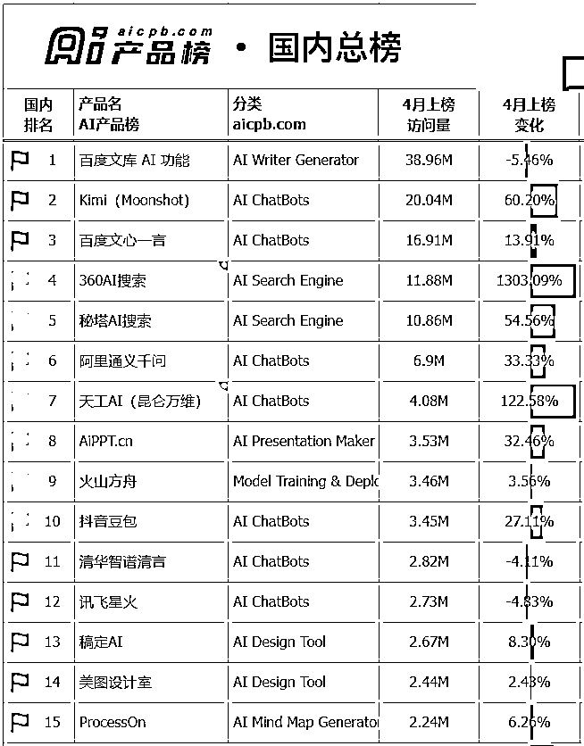

榜单是综合市场体量、用户规模、技术背景、融资情况、行业影响力等维度评出来的。榜单是榜单，好用不好用还得自己上手试。今天我就挑目前口碑最好的四款国内大模型AI工具来做对比测试：

```
Kimi：https://kimi.moonshot.cn/
海螺AI：https://hailuoai.com/
跃问：https://stepchat.cn/
智谱清言：https://chatglm.cn/
```

我在线下的AI实操课里反复强调，用好AI就两件事：第一，找到对标素材；第二，设计好核心提示词。把业务想写的对标内容和关键逻辑喂进去，出来的结果基本不会差，甚至常有超出预期的惊喜。

下面就按我真实写文的流程，演示一下这四款工具的实际表现。

# 1、第一步，找到对标内容

一个清晰的对标主题和对标文章，能让AI快速聚焦在分析和仿写上，这是大模型最擅长的环节。

最近我刷到几篇关于“不上班”的10w+爆文，就打算把“不上班”+“AI”做结合，写一篇同类型的爆款。复制爆款永远是写文的第一性原理。用的提示词是：

```
请阅读以下内容，对文中内容阅读完后，请回复“已阅读”即可。
《其实不上班的出路，远比你想的要多！》：
https://mp.weixin.qq.com/s/y3xp95O9WXzNk_F1ZhQgDA
《其实不上班，也能养活自己的100个自由职业！》 ：
https://mp.weixin.qq.com/s/7eu8p9PNWFyb0gZqE8MKkA
《你发现了吗？朋友圈不上班的人越来越多了》：
https://mp.weixin.qq.com/s/EpT2jned32zTzNIS50kR1w
《做到这些，你就可以彻底不上班了！》：
https://mp.weixin.qq.com/s/PKKIJkAhFFzluxMhXcG4kw
《其实不上班的出路，远比你想的要多！》：
https://mp.weixin.qq.com/s/y3xp95O9WXzNk_F1ZhQgDA
```

Kimi、海螺AI、跃问、智谱清言基本都能正常响应：

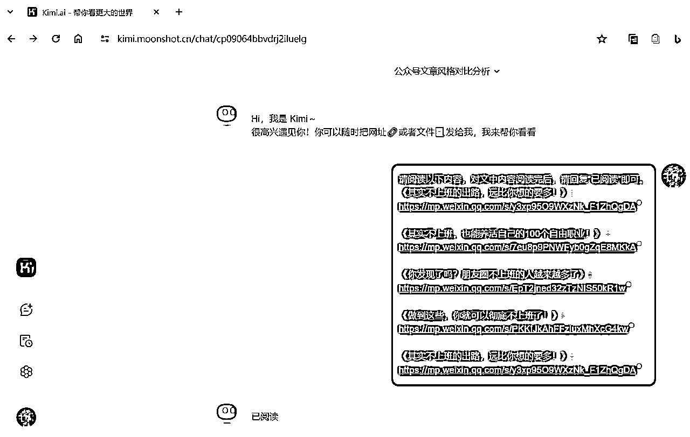

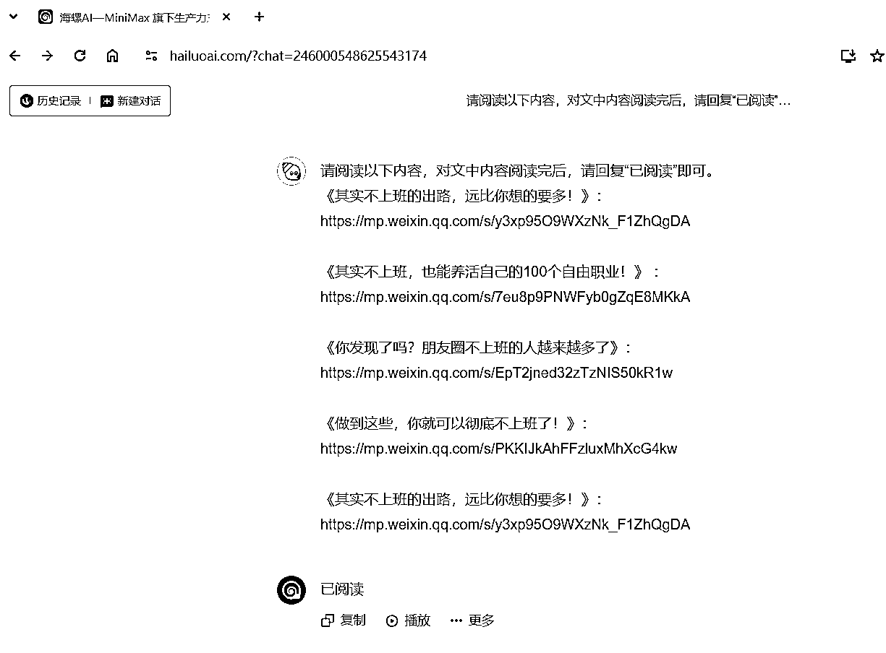

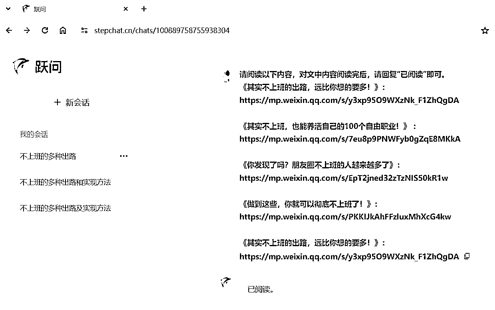

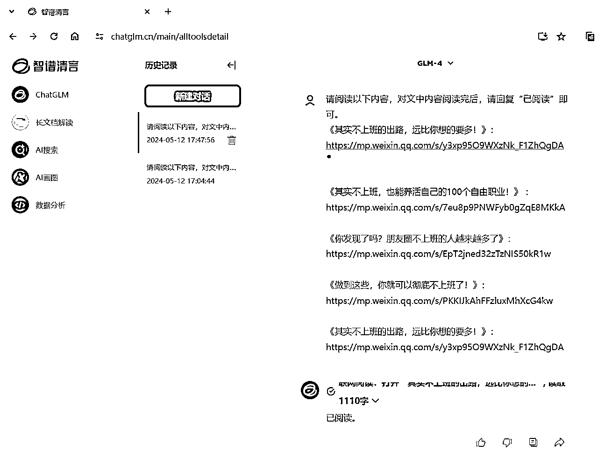

能直接读取链接内容、把链接内容导出成excle表格、以及上传文件做分析，是国内大模型体验感很强的地方。

而链接访问和文件上传，GPT-4.0虽然也有，但早期要靠插件，现在改成GPTS实现，操作门槛和体验都明显不如国内模型。

# 2、第二步，测AI是否真读进去了

接着测试AI是否真的把那五篇文章吃进去了，能不能复述出里面的核心内容。

提示词如下：

```
请问，让你阅读的这几篇文章，你还记得内容吗:
《其实不上班的出路，远比你想的要多！》
《其实不上班，也能养活自己的100个自由职业！》 
《你发现了吗？朋友圈不上班的人越来越多了》
《做到这些，你就可以彻底不上班了！》
《其实不上班的出路，远比你想的要多！》
```

结果智谱清言直接翻车：

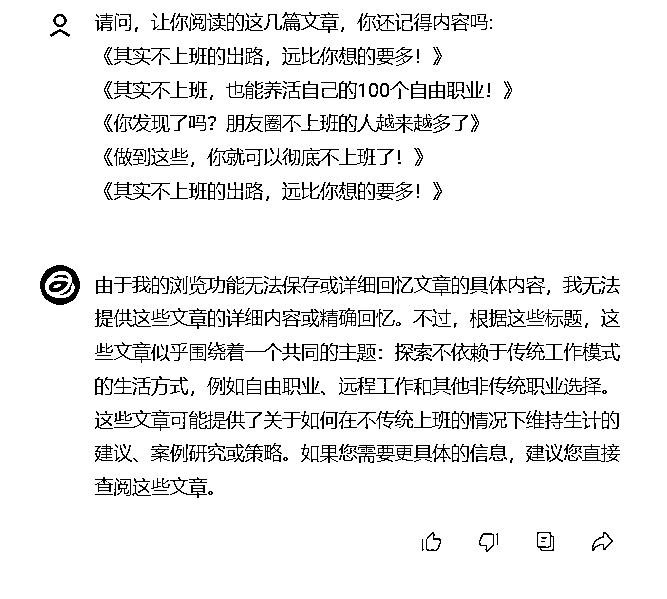

智谱清言在提示词解析和指令理解上明显吃力，因此我直接把它移出测试。文心一言我本来也没放进来，因为实际体验远不如Kimi、海螺AI、跃问顺畅。

另外上下文长度差异很大：GPT-4.0大概8000字左右，Kimi是20万字，海螺AI和跃问号称100万字。所以把原文直接塞进提示词时，GPT-4.0很容易爆表：

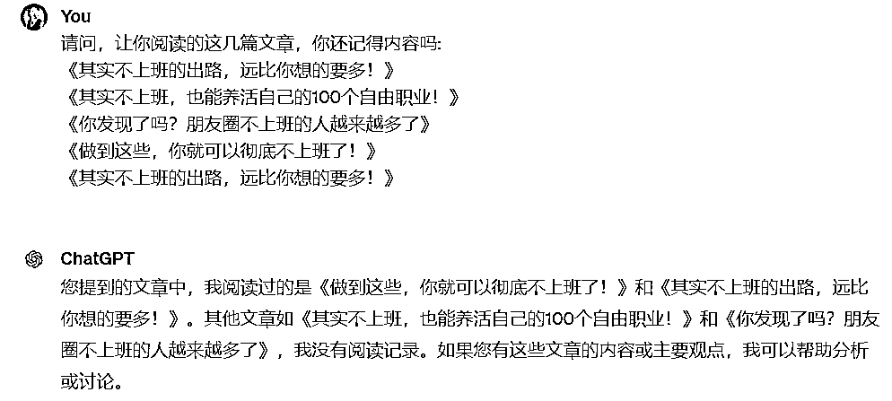

我把链接原文直接复制给GPT-4.0，很快就超出记忆上限，导致前面输入的内容被遗忘。这一点上国内模型优势明显，几十万字的上下文基本能满足绝大多数写作场景。

# 3、第三步，投喂个人背景信息

然后我让AI先记住我的个人简介，建立对我的基本认知。

提示词如下：

```
以下是我的个人介绍，请你熟悉了解，熟悉了解后请回复“已了解”即可。

【昵称】乔帮主
【区域】杭州临平-上海嘉定
【自我介绍】
1、点金帮创始人，三家AI公司负责人，从事AI知识付费+AI培训、AI内容营销、AI工具领域。
2、曾做过黑客、程序员/高级运维、阿里云架构师、阿里云技术总监、畅销书作者、AIGC培训师等多重职业，江湖人称乔帮主。

关注乔帮主：#👸号：点击乔帮主

【主讲课程】
1、《AI实战训练营：让AI成为你的核心竞争力》 线下2天1夜实战课
2、《AI编程：普通人的AI编程课》 线上陪跑训练营
3、《AI新媒体进阶实战营：用AI提高10倍内容生产力》 线上陪跑训练营
4、《AI企业赋能：用AI提高10倍生产力》 线下企业定制培训+咨询解决方案

【拥有资源】
1、成熟的AI课程及AI解决方案 ，可以合作马上变现。
2、擅长AI驱动内容营销 、AI技术开发 、AI技术体系 、AI解决方案 的落地等。
3、擅长为创业者进行AI赋能，提高商业价值。

【目前需求】
AI培训资源及企业AI定制资源。
```

# 4、第四步，基于前文做创新写作

在AI已了解我背景的基础上，让它围绕“AI”和“不上班”写一篇原创文章，先做内容收敛。

提示词如下：

```
值得注意的是，给你的：
《其实不上班的出路，远比你想的要多！》
《其实不上班，也能养活自己的100个自由职业！》 
《你发现了吗？朋友圈不上班的人越来越多了》
《做到这些，你就可以彻底不上班了！》
《其实不上班的出路，远比你想的要多！》

这五篇文章都是👸号爆文，都是围绕“不上班”的主题内容。

我接下来要写一篇围绕“AI”和“不上班”的主题文章，请基于我给的五篇👸号内容基础上，你有什么好的建议？
```

Kimi、海螺AI、跃问三家的输出质量相近，这里放Kimi的截图：

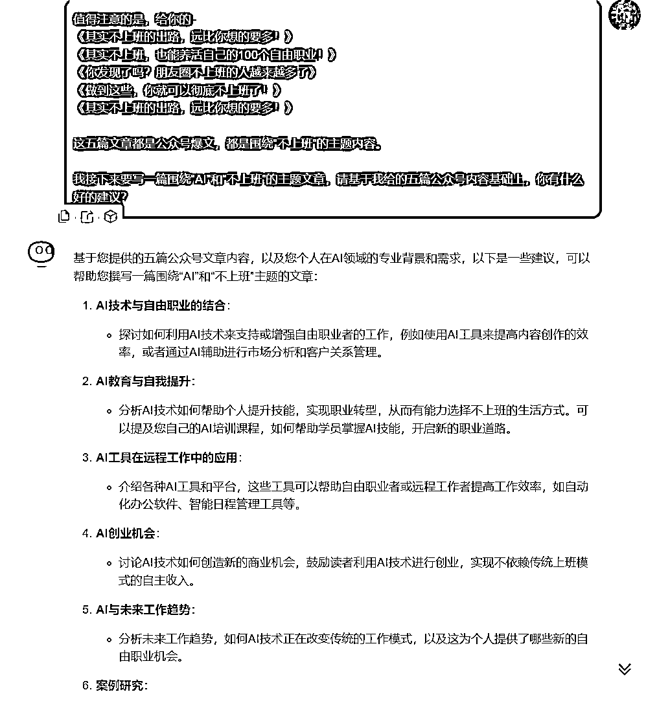

# 5、第五步，指定爆款标题做仿写

接下来我把前面五篇爆款的标题作为参考，指定一个方向让AI去写。

提示词如下：

```
我想写一篇👸号：
《AI时代，不上班，也能养活自己的100个自由职业！》

你熟知👸号爆文写作逻辑，请你基于发给你的内容，帮忙写一篇符合我要求的👸号爆文。
```

海螺AI在生成过程中主动展示了联网搜索的记录，这个细节挺加分的。跃问和Kimi也有类似表现：

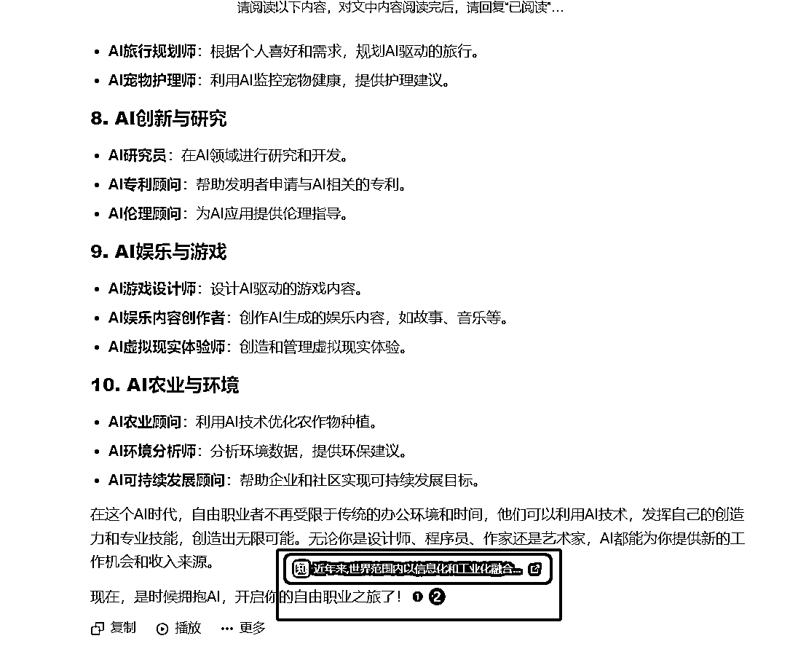

这里我没给AI指定写作风格，所以出来的文章偏书面化，一眼能看出是AI味很重的文本。看Kimi的截图就很明显：

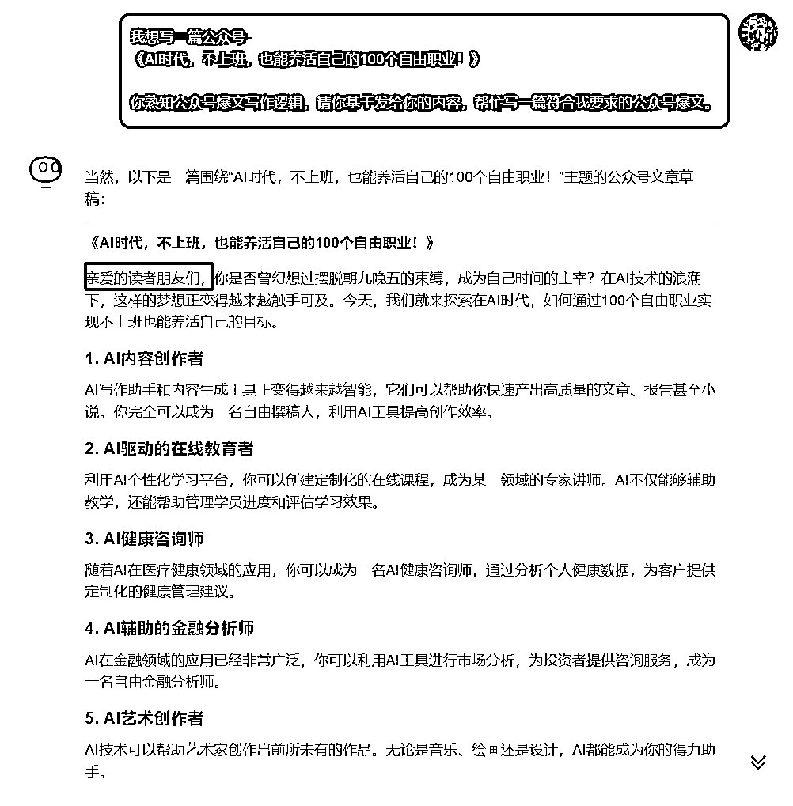

# 6、第六步，提取我的写作风格

要让AI写出像我这样的风格，先把我👸号的历史文章喂给它做风格拆解。

提示词如下：

```
以下是我👸号写的文章：
https://mp.weixin.qq.com/s/pjq2oP93zPr6-0MJGkFl-Q
https://mp.weixin.qq.com/s/CQdvUZb5rFeuvtCeqjyhGA
https://mp.weixin.qq.com/s/_NPO_yZtRPukxLPxVSZ5RA
https://mp.weixin.qq.com/s/9tW1EwUCQrl9rtUPDtZ1kA
https://mp.weixin.qq.com/s/R6Fhb-AHA5ibNT01ebZrhg
https://mp.weixin.qq.com/s/X-wgCmzjMoaplAtJ6tBLwg
https://mp.weixin.qq.com/s/8y8NdnvLZnRAWwr5FetN-A
https://mp.weixin.qq.com/s/iQ-R0AE0D3Kil_ZGHJP4ew
https://mp.weixin.qq.com/s/v75Q1qbSa6T0U4PSmclokw
https://mp.weixin.qq.com/s/gbBXDuz7QZZpJx_sOIC-4A
https://mp.weixin.qq.com/s/gALeuw8tFhEojxT538wnqA
https://mp.weixin.qq.com/s/_Lj5E4bsitg_xDyojU8QUg
https://mp.weixin.qq.com/s/VEYhOAszt8GRpGLnpw6htQ
https://mp.weixin.qq.com/s/kwKq1YYCnt0O4tWeAahE6Q

对比你刚才给我写的文章内容，你觉得在文字表达方式、语气、文案风格方面有什么不同？
```

这一步海螺AI出现了限制，只能同时输入10个链接，我的链接数量超了，所以海螺AI就先退出本次实测。

# 7、第七步，用我的风格+逻辑完成成稿

最后一步，让AI基于我👸号的写作风格，并在内容方向和格式上做限定，输出最终稿。

提示词如下：

```
请你按照你刚才分析的表达方式、语气、文案风格特点，站在我的内容风格上，帮我完成《AI时代，不上班，也能养活自己的100个自由职业！》这篇文章的重写。

重点要求：
1、请按照市场需求，从1-100名进行AI自由职业的排名。
2、1-10名，对岗位做介绍，及说明为什么在这个排名上。
3、1-10名，还需要说明该岗位的收入信息，用户很关注收入多少。收入信息的介绍需要按照以下岗位介绍中描述的收入方式一样，不要只是说月收入多少:
❶ 倾听师，全职收入最高可达4-5W一个月
❷ 拆书师，收入1000-2000元，好的稿子可以上万
❸ 保险经纪人，高提成，做得好的可以月入几万
❹ 剧本杀作者，一般买断一个剧本5000起，如果写出爆款，1个剧本可以收入几十甚至上百万
❺ 婚礼管家，1单收入2000元左右
❻ 高端红娘，1单收入7000以上，做得好一年真的可以年入百万
❼ 婴儿睡眠咨询师，陪跑1个月收入8000
❽ 在大理开民宿，最低1个月收入2W
❾ 宠托师，7天收入5000-8000左右，1年零花钱能赚2W
4、11-100名的自由职业不需要做岗位介绍，只需要给出岗位名即可。
```

实测结果，跃问在文章开头部分的表达我特别喜欢，直接拿来用了。但在前10名自由职业收入部分，跃问对我的逻辑理解不到位，收入描述千篇一律，读起来很死板；11-100名的职业也出现大量重复：

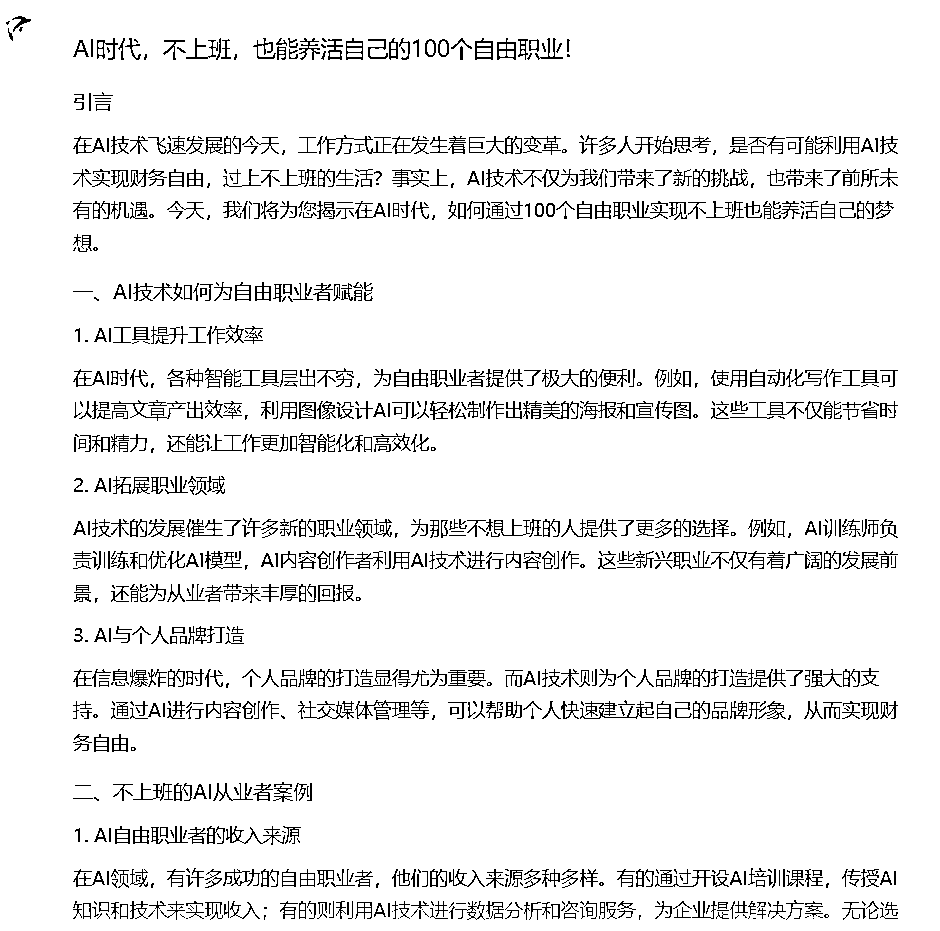

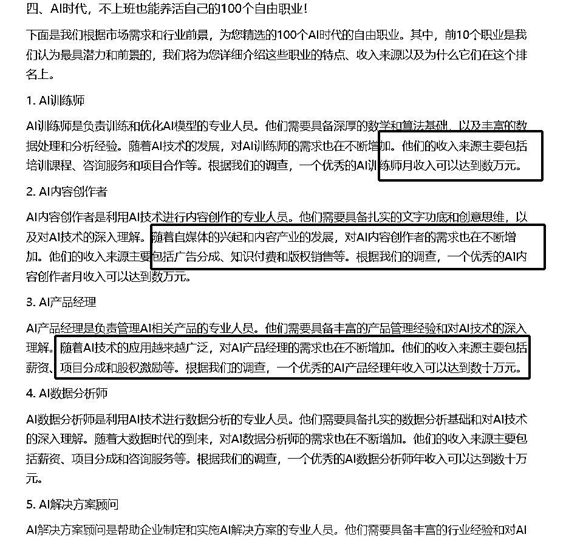

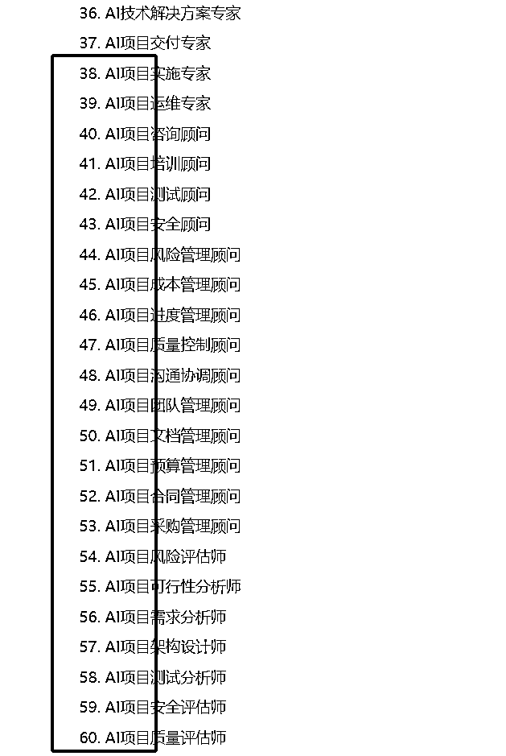

Kimi在开头段落的表现不如跃问，逻辑没完全收敛导致不确定性偏大，但前十职业的收入描述和11-100个职业名称的生成，Kimi对我的要求理解得更到位，整体逻辑更清晰：

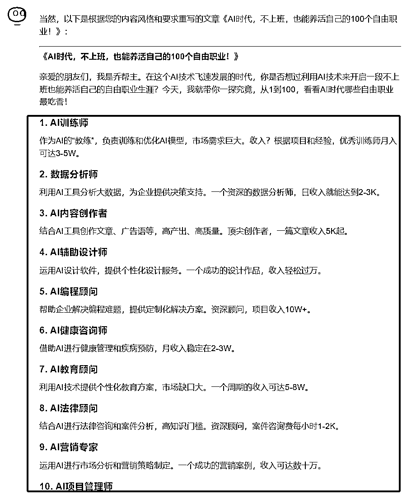

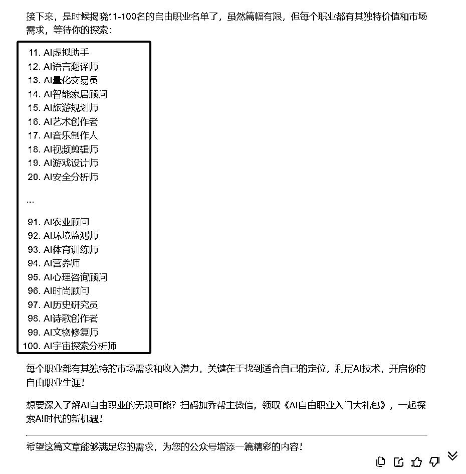

Kimi生成的一段话我觉得写得很好：

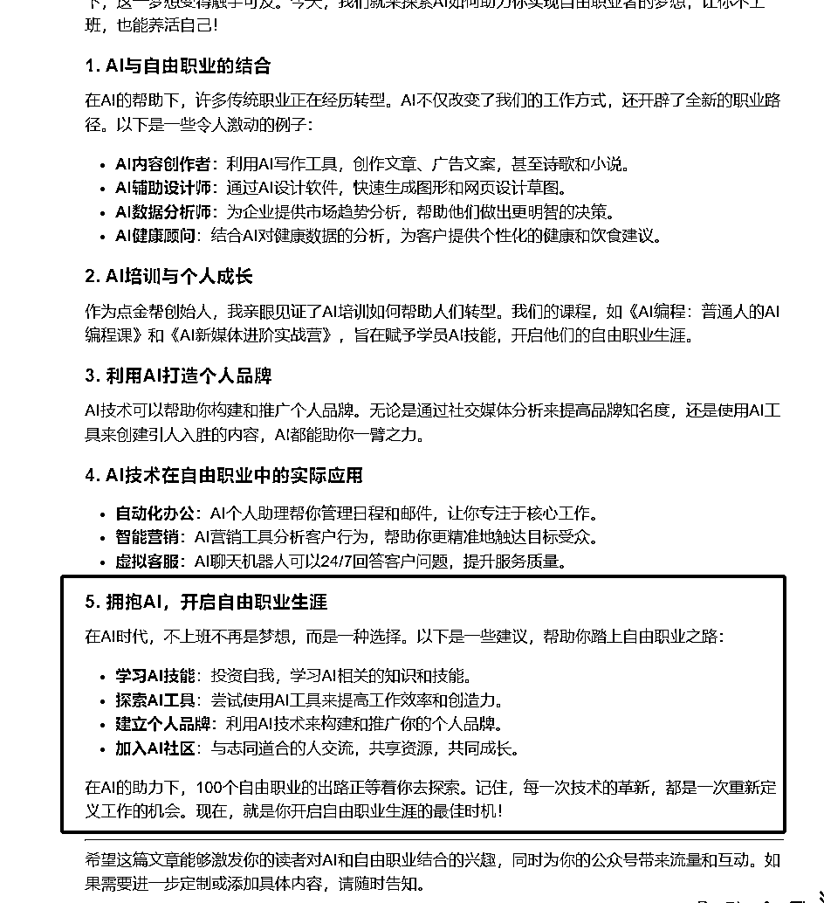

最终我把跃问和Kimi的输出合并整合，就是👸号上发布的版本，几乎零修改。

另外一篇《OpenAI又在改写历史，1分钟了解GPT-4o是个啥》也是用Kimi、海螺、跃问、智谱清言共同生成的。

提示词如下：

```
我要写一篇关于“gpt-4o”主题的👸号，请帮忙整理以下👸号中的内容，提炼关键信息，协助我完成这篇👸号的内容编写：
https://mp.weixin.qq.com/s/pnXY9c9aXR41LeWFx9DEyg
```

Kimi的生成结果最合我心意，直接截取使用了：

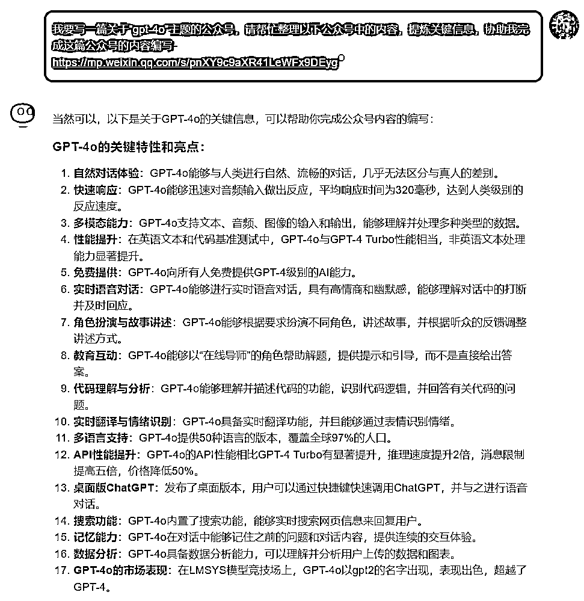

综合来看，权衡各方面，Kimi整体表现最均衡，是目前我最常用的选择。海螺AI和跃问的使用体验也相当不错。测试就到这里，欢迎交流，一起玩转AI！

* * *

往期干货精选：

往期干货合集：

微信：qiaobangzhu-cn，添加请备注：赚钱圈友。欢迎交流！

👸号：点金乔帮主

