# 从大厂 P8 到 AI 自媒体：一个架构师如何用半年撬动 40 万+变现

> 来源：[https://eqsdsj0h4eo.feishu.cn/docx/U30zdNsENof2lFxb4lycT5bEnRd](https://eqsdsj0h4eo.feishu.cn/docx/U30zdNsENof2lFxb4lycT5bEnRd)

我叫大全，90 后两个孩子的爸爸。211 法学院毕业后自学转码，2015 年至今深耕 IT 编程与架构将近十年，前喜马拉雅架构师。

2023 年 11 月 4 日，我正式all in AI 自媒体副业。不到四个月粉丝冲到 3 万+，至今全网阅读累计逼近 500 万，付费学员超过 4000 人，副业稳定月入 10 万，连主业都因此升职为研发负责人，去年转岗技术部门负责人。

先看我的自媒体战绩：

公众号已发 87 篇，总阅读破 10 万，积累读者 5000+。

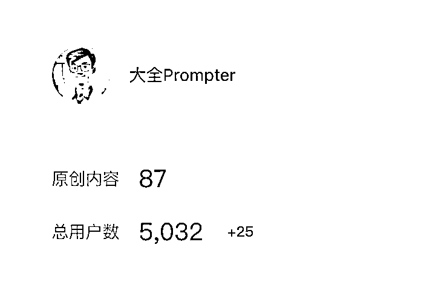

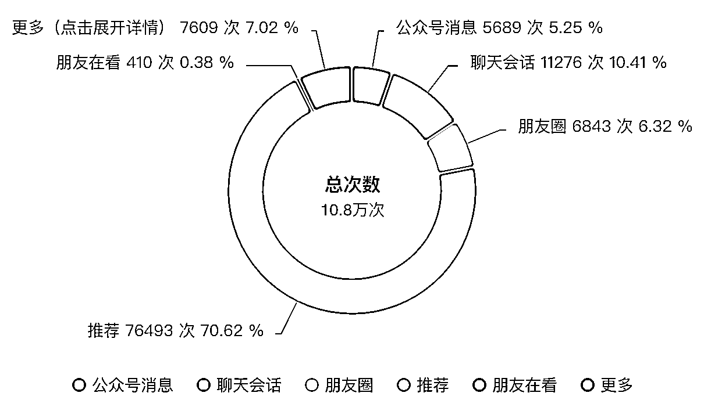

知乎共发 351 条内容，总阅读 160 万，关注者 2188。

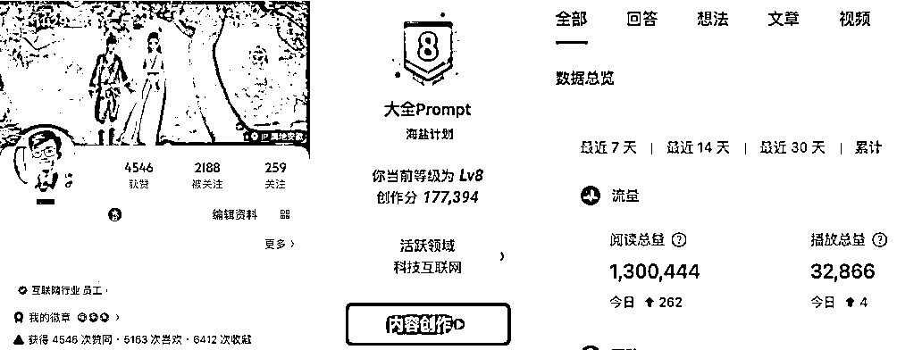

B 站累计 301 个作品，总播放 218 万，粉丝 629。

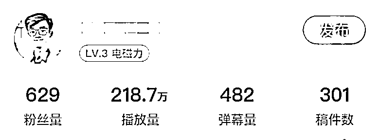

视频号春节期间直播间关注暴涨至 5000+，单场最高热度 2 万，新增粉丝 1817。

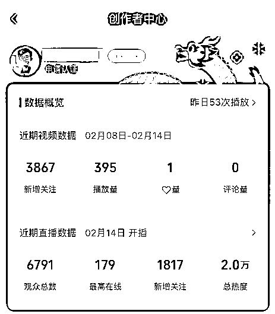

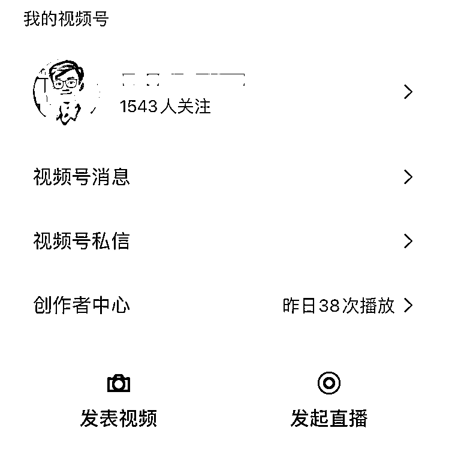

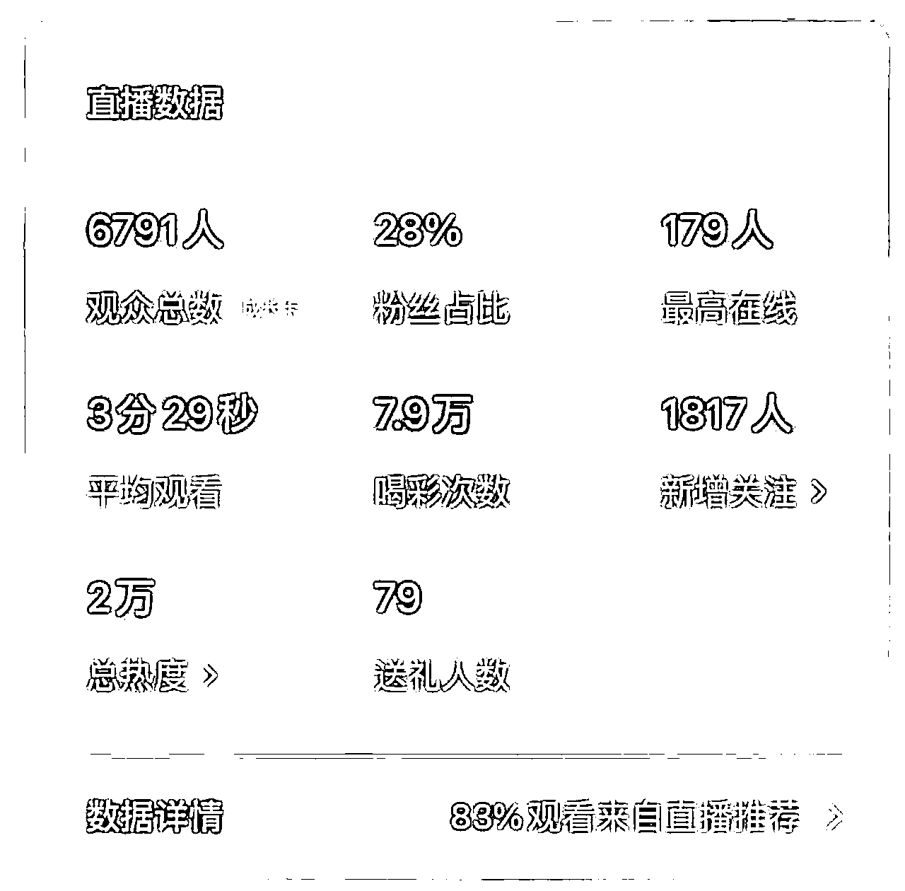

知乎、公众号、视频号、小红书全线开花，尤其是知乎用了两个月多点就冲到 8 级大 V，阅读 150 万，导私域近 5000 人。四个月内累计变现接近 35 万，广告收入也稳定过万。

AI 入局 4 个多月的具体成绩复盘：

1. 全网付费用户 4000+ 人，GMV 70 万，实收变现 35 万，单日峰值变现超 5 万。
2. 发售 AI 入门付费小册，上线半月订阅 3500+，变现 3 万+。
3. 公众号涨粉 5000+，总阅读 10 万+。
4. 小红书 3 天起号，总阅读 20 万，涨粉 2000+。
5. 视频号 5 天涨粉 5000+，最爆一场热度 2 万，涨粉 1817 人。
6. 5 天内办完一场近 2000 人在线的「知乎 AI+IP 掘金」公开课。
7. 知乎 5 天破格开通盐值计划，2 个月到 8 级，涨粉近 3000，总阅读 150 万+。
8. 自研订阅 25K+ 的 GPTs 绘画大师，上榜 GPT Store，变现五位数。

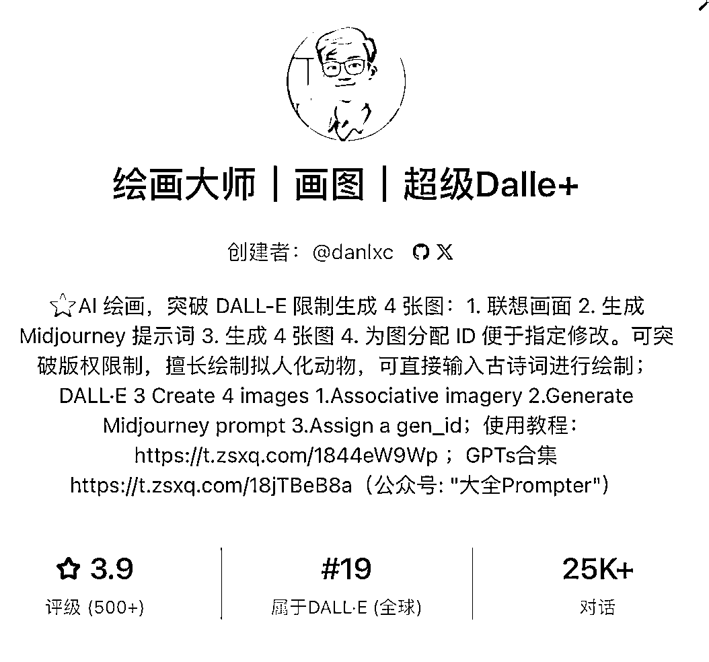

我从新疆农村出发，三次高考才考上 211。大学读法学却自学编程，工作五年做到喜马拉雅 P8，再到入局自媒体四个月实现弯道超车。感慨良多，背后的坚韧和挣扎只有自己清楚。

小时候吃的苦让我百折不挠。按社会对程序员 35 岁危机的说法，我已在淘汰边缘。但在大环境低迷时，我用 AI 副业打开了第二条增长曲线。下面把我的成长路径拆开讲给大家。

全文分为八大模块，目录如下：

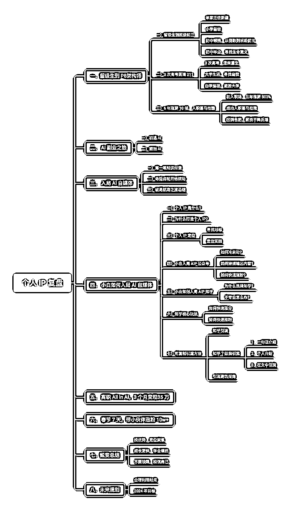

# 一、从留级生到 P8 架构师

## 一）从留级到 211 圆满

我出生在新疆一个偏远小村，家境清贫。父母靠务农供养我成长，苦难中我学会了坚韧。

没上过幼儿园，发育迟缓，两岁入学仍跟不上。小学一年级被老师多次点名，最终成为班里唯一留级的孩子。

初中后开始觉醒，意识到父母不易，考上后奋起直追，几个月时间从倒数冲到前三。

初中毕业时我沉迷阅读，爱给自己取笔名“孺子牛”。那时我才知道每个人都有生日，偷偷把生日刻在木门上。生日那天，我向妈妈要了 1 元钱，买了个面包，那种满足感至今难忘。

命运捉弄，高三压力过大休学一年，绝望到极点。周围人劝我放弃，我却选择复读。连续复读两年，最终考上 211 理科。大学主修政治学，原想从政，后来发现不适合。

大二改名刘幸程，自学编程，旁听理科课程。大学期间我爱好多元：游泳、瑜伽、民族舞、网球、双节棍、拉丁舞，还在大赛里拿过名次。

## 二）六年涨薪十倍，入职喜马拉雅

毕业后职业轨迹：新疆-上海-北京-杭州-上海-合肥。

2015 年去上海做程序员，第一份工作荒废两年后裸辞，闭关几个月重学技术。再去北京拿到外企 offer，薪水涨 500%，好景不长，两年后再次感受到中年危机。

那段时间我买了公路自行车，每天骑 40 公里上下班，坚持半年，听完了《斗破苍穹》数千集。

回到家乡，我给自己立规：要么成架构师，要么转行。2019 年奔赴杭州，长住青旅一个月，面试海康等公司后，喜马拉雅伸出橄榄枝。

在喜马拉雅几年，我带队从 0 到 1 搭建电商中台，处理亿级分销订单，做到 P8。那段互联网黄金期的经历，我至今难忘。

我一直保持运动习惯，每天跑操场、俯卧撑、练双节棍。工作日跑步或骑车通勤，下班去拳击课坚持一年多，还学会了吉他。

卷了几年后我开始思考：大城市的高成本难以兼顾家庭。上海户口和房价都触不可及。

## 三）回合肥，薪资不降反升

2021 年我回到合肥加入初创公司，非但没降薪，还拿到一线城市同等级待遇，并获得两项国家级技术发明专利和一次 CEO 提名奖，公司授予十几万原始股，快速成为核心。

外部环境恶化后公司融资受阻，两次降薪、三个月封闭开发，我常住公司工作到凌晨 1-2 点。最终合肥分部关闭，公司倒下，我在事业巅峰期失业。

离职时公司给出两个选择：回购原始股或保留上市权益。我选择保留价值千万的原始股，希望这是最后一次回报公司。

# 二、AI 副业之路

2023 年互联网最寒冬。我经历两个月求职，拿到一份即将上市公司的部门负责人岗位，正朝技术总监发展。

但多次被挫折打断的经历让我对职场心灰意冷。可房贷、奶粉钱必须还。我决定打造自己的“公司”，掌控选择权。

## 一）初遇 AI

AI 爆火时我起初嗤之以鼻。尝试 GPT 3.5 后觉得惊讶但很“智障”。直到用上 GPT4，被彻底震撼，也陷入对人类未来的迷茫。

一次向 AI 请教，我意外找到方向。AI 不是敌人，会用 AI 的人才是未来。AI 会淘汰工作，但也会创造新岗位。

## 二）拥抱 AI

从 2023 年 5 月起，我开始拥抱 AI，希望借势提升产能并带动更多人。决定做提示词传播者。

我加入了一个以利他为宗旨的 AI 星球，几个月内社群暴涨至 3 万人，成为国内最大 AI 交流社区之一。

# 三、入局 AI 自媒体

## 一）第一次知识付费

我接触互联网很早，却到 2023 年才第一次付费学习。5 月花百元入 AI 星球，信息爆炸导致焦虑，工作忙碌后一度掉队。

9 月重回星球，参加航海计划，一口气报 4 条航线。提示词的深度远超想象，在我心中埋下种子。

## 二）命运齿轮转动

10 月中旬，我花了五位数加入大佬合伙人项目，相当于半个月工资。我盘算时间就是金钱，35 岁危机、房贷、小孩即将出生，压力巨大。但一周纠结后下定决心搏一次。

从此命运转向。一个月定位思考后，11 月初确定聚焦 AI 提示词，当天就在知乎和公众号开始输出。

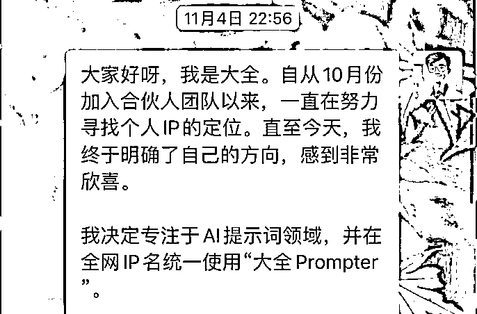

那段时间极度辛苦。我是纯程序员，对自媒体、社交平台几乎零基础，社恐不爱朋友圈。必须从零补课：公域是什么、个人 IP 是什么、如何找对标、知乎底层逻辑、如何做优质内容、如何涨粉变现、如何安全引流、如何成交闭环……

每天上班，晚上 1-2 点才睡。两周到 6 级，一个月到 7 级，两个月到 8 级大 V，权重节节攀升。

知乎发力后势能爆发，我从 AI 提示词航线志愿者成长为万人 AI+知乎航海教练，帮助近千人入门。

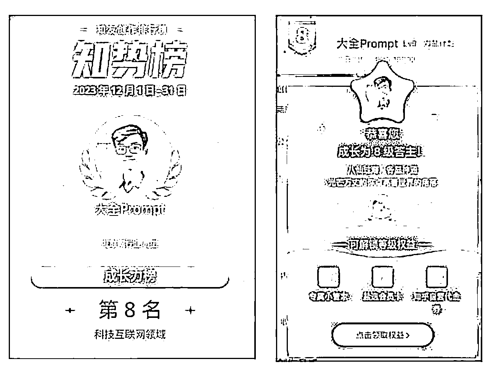

# 三、小白如何入局 AI 自媒体

打造个人 IP，首要做定位。定心定位定江山，先找赛道再持续深耕。

送大家一句话：你很有价值，只是你不知道。

## 一）个人 IP 是什么？

个人 IP 就是个人品牌。当提到某个人，大家立刻知道他在哪方面是高手、值得信任。

个人 IP 与网红的区别：
IP 有人格特质、可持续 10-20 年，基于信任。
网红流量快起快落，2-3 年周期，变现依赖打赏广告。

## 二）为什么要做 IP？

IP 提升信任和转化率。私域 100 人变现力强于公域 10 万粉。可做知识付费、CPS 带货、卖广告，且粉丝属于自己，不受平台限制。

当内容让你喜欢时，你会点赞关注收藏。某天博主挂橱窗，你自然会买。这种闭环就是 IP 的价值。

定位建议：
1）多试错
2）选感兴趣的
3）选离钱近的
4）建立独特风格
5）找对标拆解
6）垂直深耕，一厘米宽一万米深

## 三）个人 IP 定位落地

### 1、寻找定位

多试错很重要。我参加多条航线试探，最后找到提示词赛道。

选兴趣。提示词是程序员日常利器，我也对新技术着迷，所以坚持下来。

找离钱近的方向。AI 数字人、AI 拆书、AI 代写、AI 公众号爆文、AI 视频号等都能快速变现。

建立独特风格。比如别人做普通小红书电商，你做 AI 主题小红书，就能差异化。你的视角和价值，才是别人愿意关注的核心。

想在自己的领域里跑赢同行，光靠埋头努力是不够的，你得有让人一眼记住的独特标签。换句话说，做出差异化，才能从同质化竞争中冒出头。想系统搞懂这套逻辑，可以翻翻《定位》，那本书讲透了怎么抢占用户心智。

关于定位这件事，具体怎么落地呢？

第一，先找参考对象。这一步决定你前进的方向。无论是做小红书博主还是公众号作者，核心动作都一样：找到那些已经跑通的成功案例，把他们拆开揉碎了研究。对标的目的不是照搬，而是学习他们做对的地方。记住一句实话——在找到自己的特色之前，模仿就是最快的成长路径，别不好意思。

第二，宽度一厘米，深度一万米。要吸引精准用户，定位就得足够聚焦。你越是专注一个窄切口，越容易被当成行家，平台也更愿意给你推流量。人的精力是有限的，所以个人IP要“窄而深”，这样才能单点打透。先定大方向，比如AI；再在大方向里找细分，比如AI提示词入门，那你的目标用户就是什么都不会的小白。

第三，持续内容输出。定位定好，剩下的就是不断生产相关内容，而且最好成体系。你持续发一个垂直领域的内容，用户就会慢慢默认你是这个领域的专家，需要的时候自然会想起你。

接着聊聊小白做公众号这件事。

其实早就试过公众号。当时因为一些经历突然想写东西，就重新拾起来了。憋了好几篇稿子，结果阅读量惨淡，没坚持太久。现在回头看，失败是必然的——对一个新东西认知不够就盲目开干，能不翻车吗？就像洋哥说的，要拆解系统，搞清楚要素、环境、关系链，摸清底层逻辑才有突破的可能。当时没复盘，就算每天日更多累也没用，因为压根没抓到公众号的本质。

失败原因主要有三点：一是没有冷启动，没基础读者，文章再好也无人问津；二是账号定位模糊，吸引不到人；三是没借助公域导流，而且那会儿公众号也没什么推荐流。

为什么后来又试一次？23年10月，看到AI星球里说“问一问”有红利，有人几天涨了几千读者。我也去答了几道题，还真引来几个公众号关注。这对比太鲜明了，以前吭哧吭哧写半年也没几个粉，问一问答几题就有效果，简直像白捡流量。但说到底这只是个契机，真正让我下决心的是看了IP商业课，意识到未来是个体崛起的时代，公众号就是连接公域和私域的阵地，是积累影响力的战场。

公众号冷启动真的很关键，没正反馈很难撑住。我的冷启动靠的就是“问一问”。当时效果不错，就持续铺答案，不到一个星期涨了近700个读者，还开通了流量主，赚到了第一笔钱。问一问的涨粉逻辑是：用户点赞后下方会展示你的视频号和公众号，感兴趣的顺手就关注了。分享两个爆款心得：爆款的核心是情感共鸣，受众人群越广越容易爆，情绪触发点越早，被分享的概率越大。不过前期可以蹭热点，后期还是得回归垂直领域，吸引的用户才精准。我当时用AI生成回答，一开始经常被微信识别出AI味，反复调试后才有了带调侃的人类语气，产出速度很快。那阵子每天稳定涨粉100多，最多一天125。这还是在问一问流量尾声，要说高峰期入场，几千上万的涨粉都正常。一个星期后平台规则变了，就没高峰了。

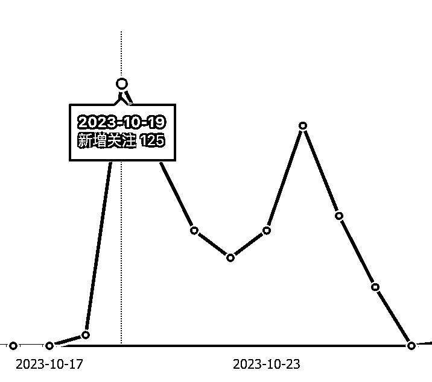

再说说持续产出内容的万能公式，公众号、视频号、知乎都适用。这套思路也是受老师启发：先定好系列（比如基础知识系列）；然后从入门讲起（比如讲AI工具）；接着按由浅入深顺序连续更新。特别强调，开写之前一定锁定自己的定位和IP，这样才能持续输出、吸引精准读者。有篇文章说得好，把公众号当产品打磨，从运营、数据、引流去复盘，把自己当成用户，琢磨怎么服务好他。

公众号怎么快速吸粉？几个亲测有效的方法：第一，找同领域号互推。比如我做AI入门，就找AI类公众号互推，内容相关，对用户打扰也小。第二，请大V帮忙转发。我当时找洋哥，他20多万读者，推一次就带来两三百粉。主动出击可以，但人情世故别忘了，发个红包一来二去就熟了。第三，混高端付费圈子。我们合伙人圈子里大佬多，我有几篇文章被大家帮着转发，不到两天阅读就破5000，还带来几百关注。圈子内偶尔有几十万读者的大V主动要求转载，那流量也相当可观。第四，从公域偷流量。我11月开始做知乎，到现在引流到公众号差不多1000个，知乎才1500粉，这个转化率相当吓人。核心还是那句话：内容必须有干货、有价值，用户觉得有收获才愿意跟你走。

接下来聊最适合小白打造个人IP的平台——知乎。

先看公域的特点：平台算法推荐，穿透力强；主动吸引，引流精准；天花板高，流量不断。这就是为什么大家都往公域跑。

我11月初定位好AI提示词方向后就开始搞知乎，三个多月成绩：累计变现六位数；起号两周多升6级，粉丝800+，总阅读55万+；单日峰值4.5万，两篇稿子13万阅读；1.5个月到7级，粉丝近1500，阅读破100万；2个月到8级，粉丝近2000，阅读150万+；小号5天就开通致知计划开始变现。

为什么选知乎？第一，流量大。跟百度有战略合作，好内容会被百度直接推荐；2023年Q3月活1.11亿。我做的时候有几天阅读快破10万。第二，容易导流。腾讯战略投资，可以在一句话介绍、个人简介和文章里留微信或公众号。但知乎粉丝没啥用，导到私域才有价值，不然就是给平台打工。平台一限流，几年心血就没了。我平均每天从知乎引流十几个到微信和公众号，现在公众号快3000粉，微信也快5000。第三，能快速变现。刚起号就能参加打卡活动拿盐粒和超赞包可提现；方法对了，一周开通致知计划，回答就有收益。我目前打卡加致知计划赚了好几百，广告收益近万，但大头还是私域变现。第四，内容专业、读者质量高。知乎30岁以下占78%，男性56.9%，一二线城市超73%。

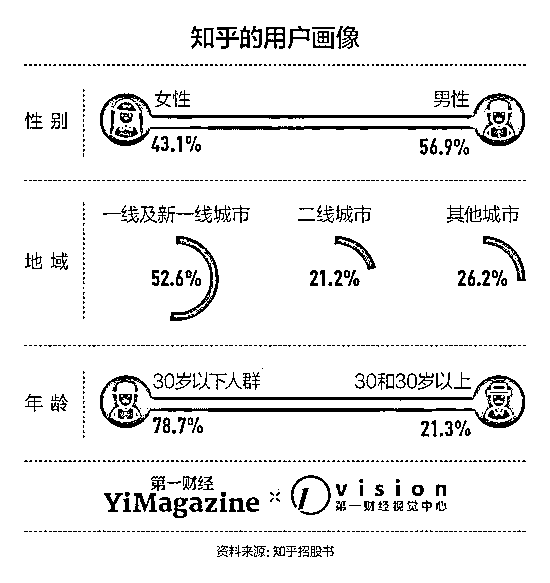

在这个浮躁时代，能静心看完长图文的人，多少有点修养和内涵，付费意愿也更高。所以你的图文吸引的都是高需求、高质量的精准读者。第五，流量长尾。旧问题可能突然翻红，再给你带一波流量。我快一个月没更新知乎了，每天还有近5000阅读，涨十几个粉，引流来微信的也有10个左右，价值巨大。

担心自己不够专业？其实专业是相对的。所谓专业，不是非得90分、100分，你考了60分，能把小白从0带到40分，就是专业。

知乎核心玩法，本质上就是研究它底层的升级维度和评分机制，搞懂怎么快速涨分、怎么写出高质量回答、怎么涨粉、怎么导流。摸清密码之后，持续输出干货就行。要学会拆解平台，这也是拆解系统的一部分。

快速涨分的方法：第一，提高内容优质分。玩知乎就像打怪升级，了解规则就能快速通关。我每天半小时日更几篇，平均日涨2000分，最高一天2万分，一周2万，一个月10万，轻松升7级。带的学员最快23天升7级。优质分是涨等级权重的核心。优质内容标准是：真诚表达专业；内容丰富、结构完整；1000字以上；原创度80%以上；可读性高，配3张图。

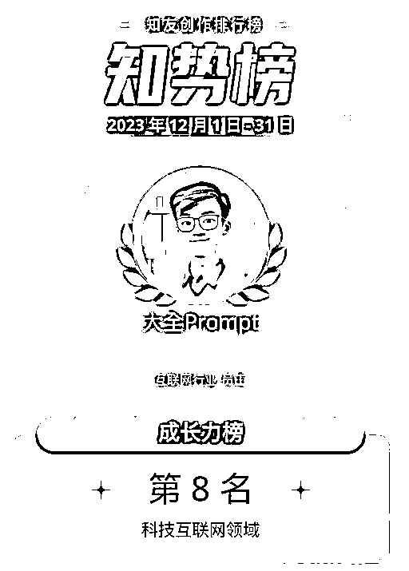

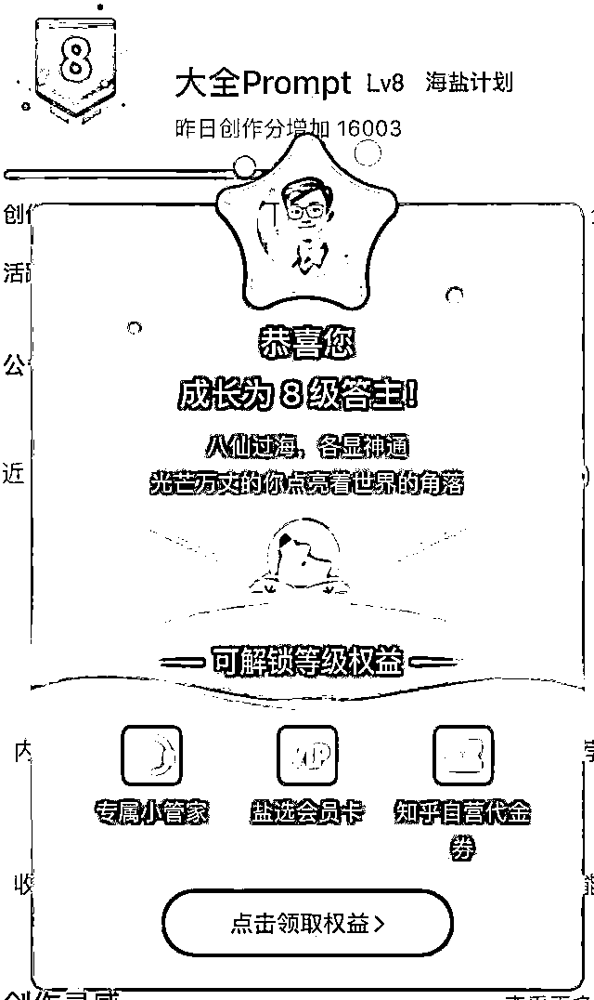

怎么用AI快速产出优质内容？推荐我做的《知乎文案专家》GPTs：https://chat.openai.com/g/g-9eJRg2QVj 使用很简单：把知乎问题丢给它，它会产出口语化约800字的内容、用markdown排版、文末自动生成3张图（符合优质要求）。模板：主题必填，背景和参考内容选填。坚持每天回答1-2个问题，花不了10分钟。先把垂直问题批量回答，约10天开通致知计划，之后回答就有收益。快速到7级后可以做带货、广告、课程等。起号阶段最难，所以推荐你们用这个神器。

第二，提高亲密度创作分。这个权重仅次于优质分，每月末更新。可以找几位伙伴组局，互相关注、点赞、收藏、评论、转发。我12月和1月就靠互助群攒了3万分，直接能把0级号升到7级。

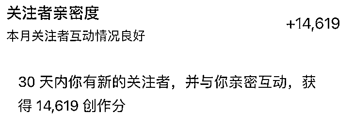

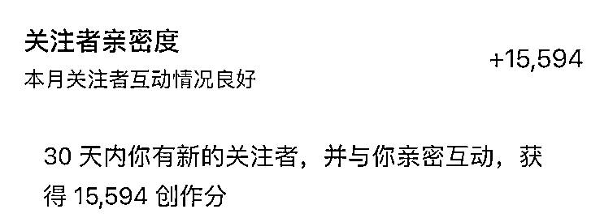

另外，起号初期找大V点赞转发，能极大增加曝光。持续一段时间，平台会判定你是优质账号，之后没有大V推也有流量。大V点赞还会让当天的“知友认可分”飙升。我自己现在也是大V了，一个赞市场价10元哈哈。每日圆环任务也要做，奖励丰富，常送盐粒（100盐粒=1元）和创作分。坚持打卡还能得到18元的1000超赞包，给好文章加曝光，效果立竿见影，前提是文章质量够。

第三，内容自荐。到4级后每月有几次机会自荐往期内容，4-7级每月3次，8-10级每月5次。即将爆的文章和觉得质量超高的都可以试试。

涨粉逻辑很简单：你的内容得帮到别人。只有内容过硬，才能击穿平台、获得推流、留住用户。

什么问题容易爆粉？刚需问题。就是能直接解决用户实际困扰、提供必要技巧、触发深层思考的问题。它们有高参与度和高转化。非刚需问题虽然可能一波流量爆火，但很难沉淀为忠实粉丝。刚需问题的“钩子”就是领资料，例如《360技术总监.PDF》《算法小抄.PDF》《AI入门到进阶.PDF》。

怎么找刚需问题？要选和自己IP定位强相关的问题，别乱蹭热点。第一，关注热榜。每天早中晚刷一下，看到垂直领域的问题马上答，热榜转瞬即逝。第二，关键词搜索。准备领域关键词，定期搜索，选获赞多的内容参考，比如AI方向就用chatgpt、提示词等词。

最后是可复制的引流玩法。做了那么多起号、创作、升级，都是为了引流铺垫。只有起号定位好，才能吸引精准粉丝；只有写出干货，别人才愿意关注；只有到7级，才能大胆引流，否则容易违规。引流才是最终目的。

引流本质就是“加我领资料”，引导用户加微信或公众号。方式有三：个人介绍里留公众号和微信；文章里放福利资料钩子；评论区引导。注意，7级前后操作差异很大，这里先说7级前引流……

很多人跟我说，知乎在7级之前千万别碰引流，可我偏偏不信邪，自己在河边反复试探，终于摸索出了一套相对安全的玩法。当然，代价是进过两次小黑屋，每一次都是血泪教训。

先聊聊知乎引流的常见逻辑：大多数人做知乎，都是想把流量导向公众号或微信私域。我拆解一下具体怎么做。

**第一个入口：一句话介绍**
这里可以直接写上你的公众号或微信号，暗示资料都在公众号里，懂的人自然知道要先关注才能领。但要提醒的是，前期别太早这么干。我自己是到5级才敢放，之前在4级试过一次，结果被系统警告，连个人信息都被重置了。

**第二个入口：个人介绍**
为了让别人更愿意关注你、也为了让引流更顺，个人简介里要适当“秀肌肉”——亮出标签、擅长领域，最好再加一点个人爱好，让人感觉你是有血有肉的人，而不是冷冰冰的账号。

**第三个入口：文章内容**
在正文中顺带提一句“关注公众号领取资料”也行，但前提是内容必须足够硬核。大家关注公众号毕竟多一步操作，如果文章没干货，人家凭什么加？所以先做出真正有价值的东西，引流效果自然就好，这是铁律。

**避坑指南——这几件事千万别碰：**
1. 7级前后，除了公众号，任何其他平台名字（比如小红书）都不要提；
2. 7级前后，任何二维码都不要留；
3. 7级前，任何网址都不要放，公众号链接也不行。

---

再说说我的AI创业故事。今年2月中旬，AI技术突然爆发，尤其Sora文生视频的出现，全世界都沸腾了。我当时就下定决心，离职All in AI。

辞职后，一边是新生的宝宝，一边是焦虑的自己，而且发现全职做副业比上班还累。上班好歹有周末，我那几个月几乎没休过一天，过年也在干活。有一次为了准备公开课，连续干了19个小时。

我以前总觉得私域不重要，一门心思做公域、搞引流。直到某天突然想通了：IP的底层其实是私域，是要真正触达粉丝。这一下把我点醒了。

私域运营刚满一个月，就发生了好多事。春节期间的视频号项目，几天时间我和赵老板就赚了1万多，还带着一批小伙伴涨了近10万粉。

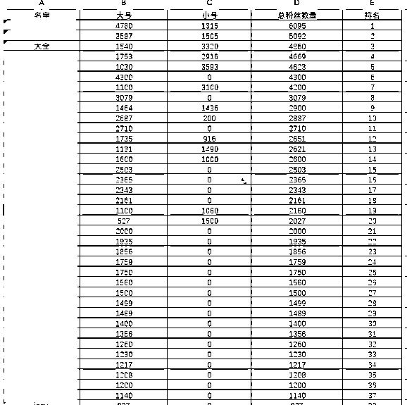

紧接着三周时间，我搭出了自己的产品矩阵，跑通商业闭环，私域赚了近7万。这也验证了一个观点：个人IP和流量的尽头，就是私域。到现在运营私域两个多月，累计收益约35万，增长速度确实惊人。

做个人IP，最关键的是两个闭环：流量闭环和商业闭环。当然，还有一条同样重要——遇到贵人。

我用了90多天基本打穿公域：全网涨粉超3万，阅读量500万，引流私域1万，流量闭环算是走通了。但以前忽视私域，变现能力真的有限。

后来我开始学私域运营，第一步是搞付费陪伴群。靠着公域积累的人气和口碑，陪伴群很快到了200多人，现在接近400人。接着我建了志愿者体系，私域能量一下子爆发，好几个小册都冲到前几名，也因此被老马注意到，邀请我做了合伙人。

老马是我私域之路的第一个贵人。后来又通过老马认识了靠谱老师，这两位对我的私域放大起了决定性作用。

打通公域和私域之后，我顺势推出了IP私教和AI+IP知乎训练营，把手把手跑通的经验教给别人。为什么这两个产品能做成？

IP私教是因为我自己真的从0起步，几个月就跑通了整套IP闭环，所以想带着人复制这条路。毕竟有公域和私域的积累，产品一推出，盲定用户就有20多个。

知乎训练营的起源更单纯——最初只是想帮我的合伙人，让他们按我的知乎方法快速成长，慢慢就变成了训练营模式。

但好产品也怕巷子深，尤其对我这种流量不算大的人。这时候靠谱老师又出现了，她建议我搞一场公开课。我一开始完全懵，只能边学边干，硬着头皮推。留给我的时间只有3天，正常这种公开课至少要筹备一个月。结果我们2天灌了2000流量，7天发售，最终成交10万GMV。

第一次公开课、第一次群发售、第一次视频直播带货……太多第一次了。这段经历让我明白：有些事必须去做，哪怕再难。真正的敌人不是能力，而是内心的恐惧和犹豫。

我偷偷问过很多伙伴为什么愿意跟着我。他们说我的IP之路够接地气，刚跑出来、可复制性强，而且很多人都是看我直播发售才决定加入IP私教的。

直播也是做个人IP的重要环节，但核心一定是真诚利他。只要你足够真诚，又有真本事，观众在屏幕前是能感受到的。

我的完整路线大概是这样：先定位，再做AI干货输出，把知乎快速升到8级，然后引流到公众号和微信私域，坚持利他精神、超值交付，最终实现双赢。半年内，我打穿了公域，建好流量闭环和商业闭环，还搭了低、中、高三阶产品，算是成了一个不大不小的IP。

---

再说说春节七天那个视频号涨粉10万+的项目。

当时两个小伙伴麋鹿和西堂发现了一个惊人漏洞：只用视频号直播放音乐，就能快速涨粉！这种风口稍纵即逝。我和赵老板立刻行动，5天就涨了5000多粉。

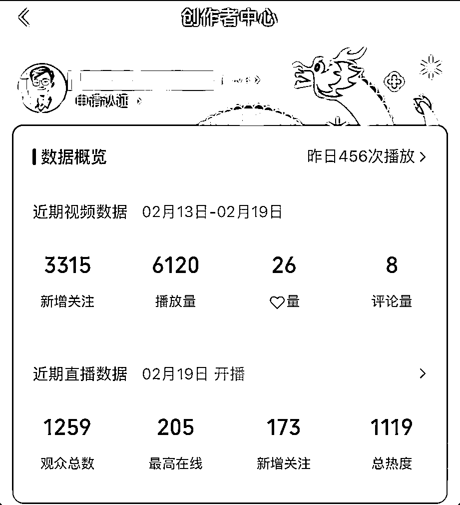

其中一场直播直接涨了近2000粉，而我一共只播了不到7场。

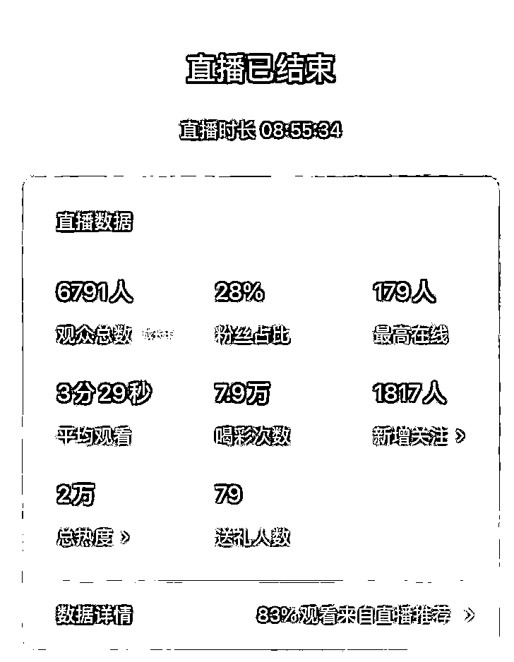

这次经历让我更坚定：看到机会和风口，就要全力以赴。发现漏洞后，我和赵老板一天内对策略迭代了十几次，搭起了项目体系，包括项目群、SOP、志愿者、宣传、引流、交付等一整套机制，堪称神速。

要知道我以前从没搞过这种项目，完全是摸着石头过河。最后10天，75个人一起拿下10万+粉丝，这在视频号涨粉项目里绝对算奇迹。

这个项目对外定价499元，但合伙人免费、百分百返佣，所以短短几天我和赵老板收入过万。

为什么春节最容易让普通人抓到机会？一是大V都休息了，普通人也在家团聚刷手机，你开直播就容易被看到；二是平台内容变少，只要你肯生产、敢直播，平台就给流量扶持。用户活跃度不降反升，大V没更新，大家自然去找新内容。

至于我为什么能快速吸粉，除了时机，还有三点实操：

**第一，自己先跑通闭环，再复制给合伙人。**
我的原则是：自己先做出结果、证明路径可行，才教别人。我的涨粉技巧核心就是“福袋”——直播间设置福袋，用户参与有机会拿礼品或红包，互动性和停留时间都大大提升。福袋数量越多，吸粉速度越快。

我还用小号引导互动，在直播间带节奏、刷评论点赞，人为制造热闹氛围。算法爱推活跃内容，这一招让直播间在平台上的可见度猛增。

**第二，团队作战，才有凝聚力。**
跑通闭环后，我立刻分享给合伙人，让他们一起上车。这是我给合伙人的承诺。发完“召集令”，不少“卷王”放弃春节休息跟我们一起干。我们招募了近百人，10天内实操涨粉，最终整体涨了10万！

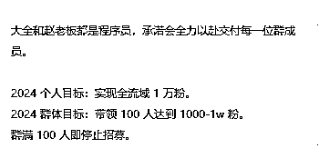

当时实时更新数据、做排名，效率非常高。有合伙人短时间内涨到1.2万粉。说实话我们起步已经晚了，如果再早5到10天发现这个机会，按日均1000粉的效率，这个项目完全能冲到20到30万粉！

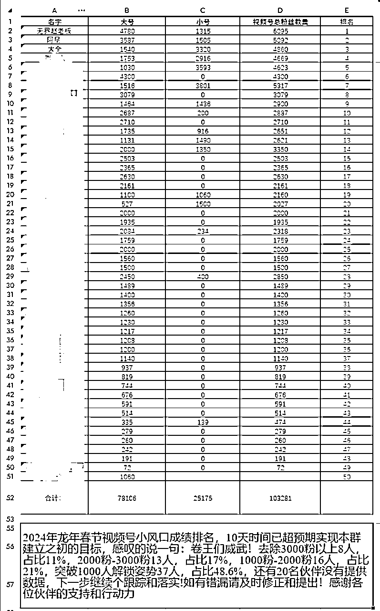

再看数据：3000粉以上的8人、占11%；2000到3000粉的13人、占17%；1000到2000粉的16人、占21%；突破1000粉的37人、占48.6%。其他伙伴没提供数据。

现在粉丝流量本来就贵，即便是付费流量也不便宜。但这个项目刚开始获粉成本才1毛钱，后期涨到3毛多，怎么看都划算。当然，黄金期过了成本就一路涨，所以越早加入越赚。

对那些从没碰过视频号的人来说，能用极低成本、最快速度完成基本盘积累，简直太值了。

**第三，合伙人团队搭建。**
真正让我激动的不是自己涨了5000粉，而是赋能更多合伙人，让他们在我的路径里快速获得正反馈。知识付费最怕学员拿不到成绩——一旦没效果，他就怀疑自己、慢慢失去对你的信任。

所以我们搭团队时几乎不睡觉，带着大家往前冲。近百人的项目，需要极强的统筹协调能力，自己还得专业，掌握快速涨粉的技巧和避坑方法。这对我和合伙人都是巨大考验。

好在我们把表格、干货、流程都备齐了，后期加入的伙伴也有爆发，我们同样组织力量帮忙，最终成绩很可喜。

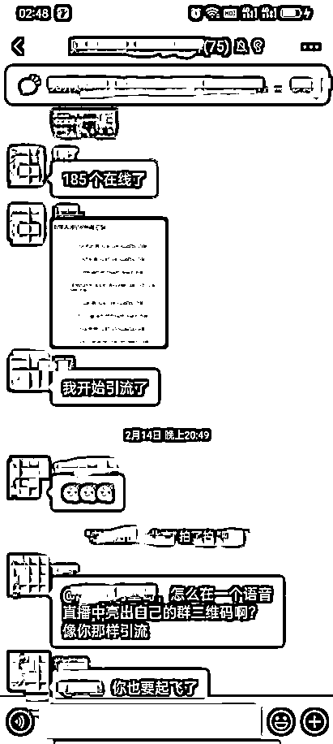

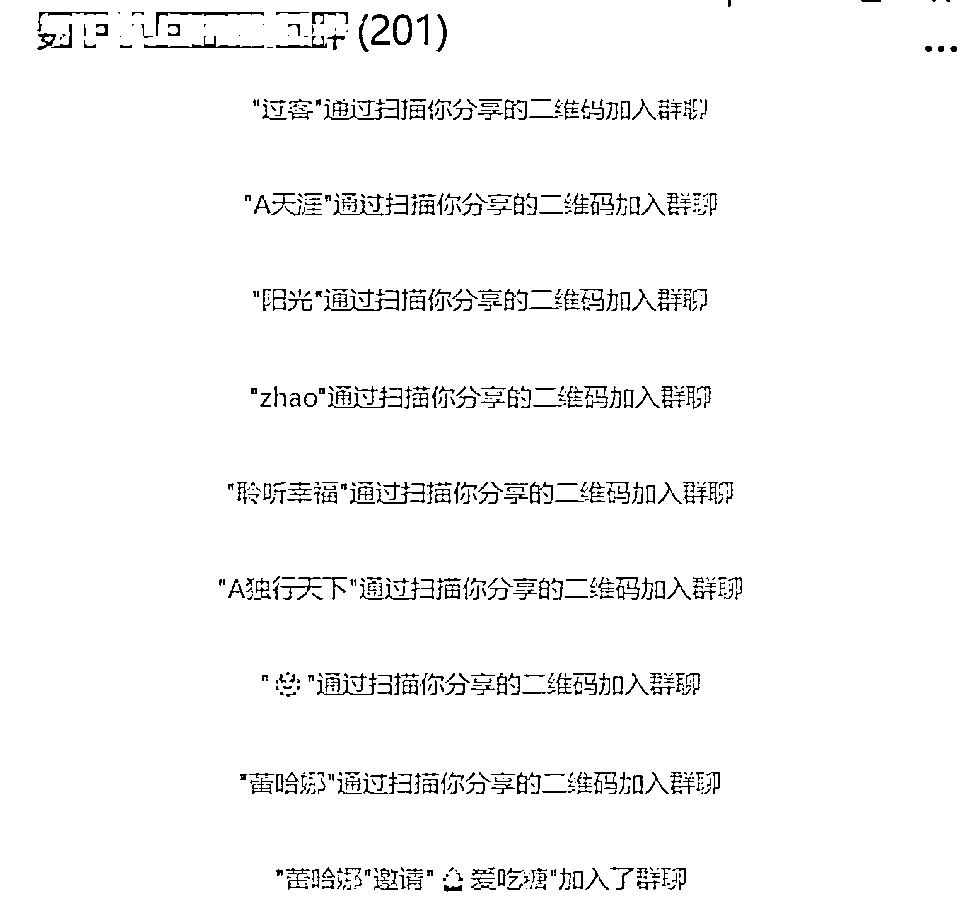

有效的组织和团队，迸发出了巨大力量。感恩所有伙伴！

说个小插曲：2月份做这个小项目之前，我压根没直播过，也不知道该说什么。伙伴们夸我音色好，可我真不敢开口。后来发现大家都不敢，都有畏难情绪。怎么办？只能硬逼自己上，写文案、做大纲、找流程，再向有经验的人请教，一点点完善。

最后，我们都从镜头后面走到镜头前，从说话磕磕绊绊变成侃侃而谈。才华真是被生活逼出来的。走到一群人里，你拉我一下、我推你一把，慢慢就走出来了。现在直播对我来说已习以为常，才一个多月而已。大家也勇敢去试吧。

**再补充些具体策略：**
- 大小号策略：大小号互为粉丝团，开播前10分钟要疯狂点赞、刷灯牌，把热度顶起来。
- 灯牌和粉丝团：分散刷灯牌更能增加互动和人气，前10分钟每分钟刷3到10个。
- 直播间互动：活跃度是吸引观众的关键，用小号点赞、刷灯牌、发评论。
- 福袋设置：前20分钟3分钟一轮，后面调到5分钟一轮，最大化参与和人气。
- 连麦互动：人气下降时找机会连麦，能提高热度和互动。
- 违规处理：避免引流等违规行为，还要掌握申诉经验。
- 开播策略：刷灯牌、点赞、福袋都要有节奏，始终维护直播间活跃。
- 避免违规：不要在直播中提微信或导流，保护账号健康。

视频号涨粉只是我众多实操项目之一，以后还会开发更多小项目给合伙人。我做合伙人产品，是因为我想持续精进、赋能更多对个人IP和AI有梦想的人。合伙人就是一个圈子，我们一起探索、互相学习。

---

最后做个蜕变总结。

作为普通人，我们该怎么抓住AI风口？怎么借助自媒体做个人IP？怎么打通流量和商业两个闭环？我想分享三条法则。

**一、找到自己的优势，定位后聚焦、聚焦、再聚焦。**
做AI自媒体三个多月，我最大的体会是：定位就是找到你的优势，再定方向。定好位，就给自己设近期、中期、长期目标。

很多人比我厉害：有人擅长公域，有人擅长私域，有人擅长产品，有人擅长操盘，有人擅长学习。找到自己的优势，然后聚焦、聚焦、再聚焦，滴水穿石、单点突破，你就成了。这个时代诱惑太多，要保护自己的注意力，珍惜时间，学会给时间标价。付费课程能换成熟方法论、资源、认知和人脉。免费的东西往往最贵——浪费时间不说，还可能误导你。

**二、想成长得更快，先学会模仿。**
要勇于尝试，别低估自己。向有结果的人学习，从模仿开始。我定位后疯狂补课：公域是什么？个人IP是什么？怎么找对标？知乎底层逻辑是什么？怎么做好内容？怎么升到高等级？怎么涨粉？怎么变现？怎么安全引流？怎么制作钩子？私域怎么成交？流量怎么闭环？产品怎么闭环？……

这些问题怎么解决？最笨也最有效的方法就是模仿，最好是贴身模仿。找对标账号，拆解、模仿、定标、迭代、复盘、再对标。看对方怎么解决卡点，最快的方式是直接去咨询对标的人。

**三、不要给自己设限，要相信自己。**
洋哥说过：“世界上没有普通人，只有一直不行动的人；行动起来，你就不是普通人了。”

总有人问我：我是小白，能学会AI吗？我不是程序员，能学提示词吗？我没做过知乎，能报名吗？我零基础，能学AI写作吗？我学历低、没经验，适合做AI知乎吗？

很多人还没开始就给自己设限：我是小白、我零基础、我学历低……所以学不会。反过来，你更应该有强烈的渴望。当你真想干成一件事，全世界都会来帮你。相信自己一定能做成，别瞻前顾后，别怕这怕那，定位好直接行动，边做边调整，事就成了。

我是个资深程序员，以前从不关注自媒体，甚至社恐到连朋友圈、知乎、抖音、微博都不碰。可就是这样一个我，几个月基本打穿了知乎，做到现在的成绩。前几天那场公开课，也是靠谱老师建议我才搞的，我自己完全不懂，只能边问边推，结果有近2000人在线围观，激动得不行。而且那场分享从决定到正式开始只用了5天，正常至少得提前一个月筹备。

真心感谢合伙人们。我说要做分享，大家都争相报名，拉群、分配人员、做海报、发朋友圈邀请，这才有了近2000人的场面。

第一次公开课、第一次群发售、第一次直播卖产品……好多第一次。但这些经历坚定了我的IP之路。有些事情必须去做，真正的敌人永远是内心的恐惧和犹豫。

**成绩总结：**
这些例子说明什么？AI时代，个人IP太重要了。先在公域打造IP，让人对你产生信任，再推出产品时，自然有人追随。但一定要超预期交付，否则IP轰然倒塌，例子太多了。只要在AI风口下找准定位、持续深耕、打造个人IP、合适时机推出产品，之后赚钱真的就像呼吸一样。

---

**展望未来：**
最近我的流量、读者和变现能力都在提升，整个人充满激情，每晚干到深夜。这和之前缺乏正反馈时的状态完全不同——那会儿经常动力不足、输出困难。

加入一个同频的圈子也很关键。跟处于类似阶段的同行互相鼓劲，真的能从彼此身上获得能量。

**合理利用时间：**
记住，不为失败找借口，只为成功找方法。不要抱怨时间不够，每人每天都是24小时，关键看你把零碎时间用在哪。是做了有意义的事，还是刷抖音、打游戏？

我每天上班要开车跨一座城市，来回两个多小时。早上7点起床，8点出门，晚上8点到家，然后再拼命忙到十一二点。这样也能挤出时间做这么多事，相信你也可以。

你有没有发现，真正拉开人与人差距的，不是谁更能熬夜、谁更拼命，而是谁把时间用到了点子上。看了大全的故事，我最大的感受是：成长这件事，靠的从来不是蛮力，而是“聚焦+方法”。

第一，目标要极简。盯住当下最该做的那一件事，其余全部砍掉。不用怕做得少，越集中火力，越容易出结果。

第二，可以试试番茄钟。用25分钟只干一件事，把手机丢远一点，让自己的注意力形成完整的闭环。这种专注带来的效率，比一边分心一边硬扛要高出太多。

第三，学会“叠时间”。做这件事的时候，顺手把另一件事也办了。比如我每天早上要给家人做早饭和午饭，一开始手忙脚乱，堆了一个多小时才弄完。后来不断琢磨流程、调整顺序，把时间叠起来用，现在30多分钟就能全部搞定。所以不要太早说自己没时间，很多碎片真的可以拼起来。我开车来回两个小时也没有浪费，洋哥的商业IP课，我反反复复听了7遍；另外还听完两本书，一本是《刻意练习》，一本是《定位》，这两本都很值得推荐。

第四，每天都要复盘。我习惯早上起来先看一眼昨天的时间账：哪些事拖了节奏？哪些流程还能优化？除了时间，也复盘自己的学习方式、成长和得失。别小看这几分钟，日积月累，进步会看得见。

再说说今年的规划。我给自己定了几个目标：一年至少读12本书，平均每个月一本，主题集中在育儿和经典著作——因为家里二宝四月中旬要出生了，得提前做点功课。原创文章要写到200篇，账号全网订阅冲到5万。同时继续每天输入输出AI领域的内容，把个人IP做扎实，靠写作放大影响力。还要保持深度思考，拎清楚主线，写一些真正能帮到别人、也能提升自己的文章。另外一个很重要的原则：保护注意力。工作的时候切断外界干扰，每天固定时间回微信。其实在开始副业之前，我就属于不太容易被外界带跑的人——不看朋友圈、不刷抖音、不追新闻，手机基本只用于看书和学英语，微信都很少打开。

说实话，我很羡慕那些二十出头就明白要靠自媒体撬动复利收入的年轻人。我上学那会儿，移动互联网才刚刚起来，知识付费还没影子，更别说自媒体和AI了。客观条件不够，人又带着学生思维，不懂花钱向牛人请教，只能自己跌跌撞撞，到了三十多岁才看懂很多事。

人进了社会，总要被现实磨几次。我在职场也挨过打击，慢慢明白：公司付你工资，不是让你来学习的，而是因为你帮公司解决了问题。所以说，八小时之内是为了生存，八小时之外才是你真正的成长窗口。年纪越大，试错成本越高。年轻时多折腾、多吸收新东西，就算失败也没关系；可人到中年，前进困难，后退也难，像被困在原地——不是不想改变，而是生活已经绑住了你的手脚。

所以我特别想对大家说：想做什么，趁早去做。“早”本身就是一个巨大的优势。别等到被生活勒得喘不过气，才被迫找出路。成长路上一定要多尝试，慢慢你会发现个人IP的完整商业闭环，也会越来越明白这个世界的底层逻辑——说到底，就是价值交换。

我始终相信，只要你愿意持续坚持几个月，借助AI这波工具，在自媒体赛道上全力奔跑，赚到人生第一桶金，真的只是时间问题。

现在的我，每天都泡在学习与实践中。困难当然不少，但每次看到有人因为我的内容而有所收获，心里的满足感都会告诉我：这条路值得走。回头看，正是每一个选择造就了此刻的自己，每一次困境让内心更加坚定。未来我会继续在AI领域探索，想为社会留下一点价值，也想为自己打开一个全新的世界。前方充满未知，但我满怀期待与希望，每一个努力的日子，都在为未来的成功埋下种子。

最后再送大家一句话：这世界本没有普通人，只有一直不肯行动的人。只要你迈出第一步，就已经不再普通。

其实我挺幸运。在职业瓶颈最想突破的时候，遇到了洋哥；在定位迷茫的时候，遇到了潘达和小林；想击穿公域、做私域运营时，遇到了老马；产品需要正式发售时，遇到了靠谱、大西、小苗哥；小册子还没推出、正发愁时，遇到了水龙。当然，最需要力量的时候，我遇到了正在读这些文字的你。

真的谢谢你们。愿你生活愉快，副业顺利，路上皆是贵人，人生皆是坦途。