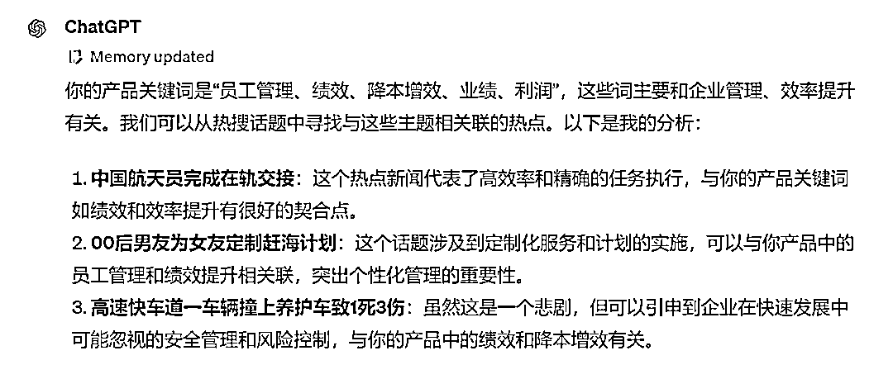
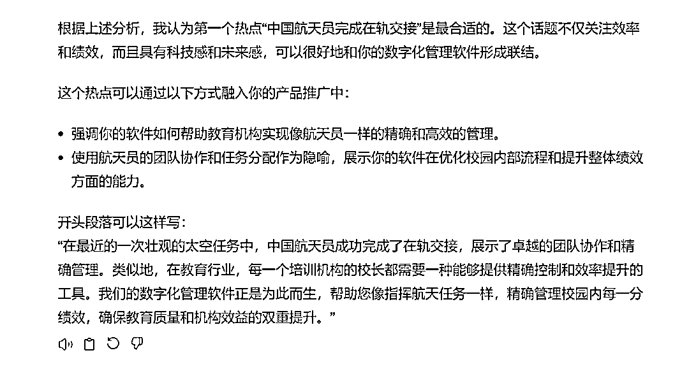
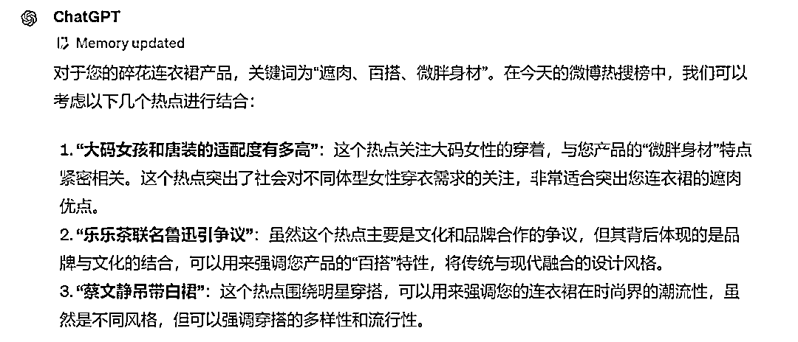
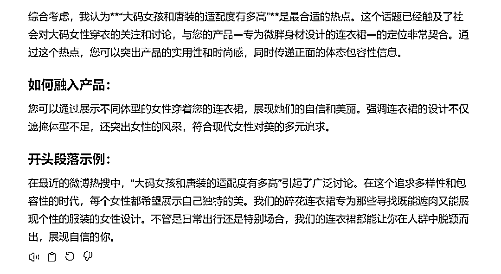
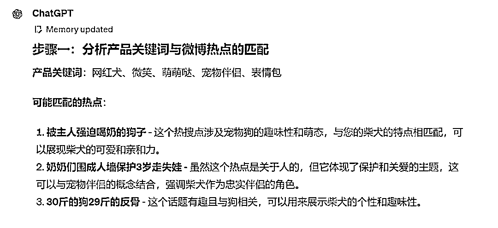
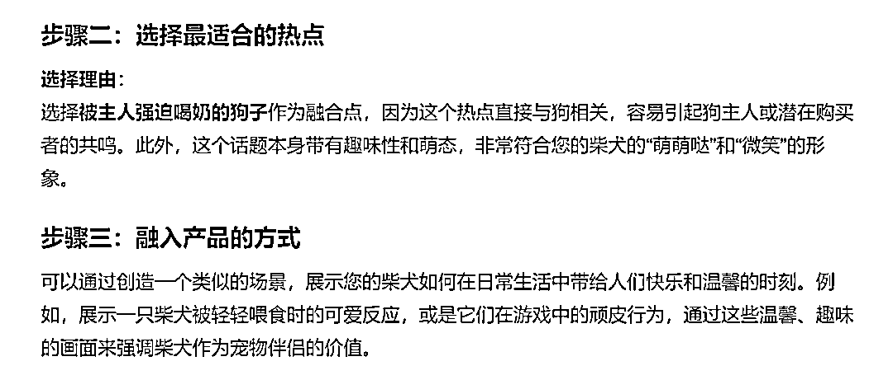

信息流里经常能看到这样的景象：某个话题刚刚挂上热搜，明星的家事也好、企业的负面也罢，甚至只是一条有点离奇的社会新闻，用不了多久就会有一堆内容账号和商家冲上去各说各话。像杜蕾斯、瑞幸这类擅长营销的品牌，更是几乎把借势玩成了常规动作。

做得多了你就会发现，最大的难点从来不是手速，而是角度。找不到自然的连接点，硬把产品话题和新闻拧在一起，读者一眼就能看穿，账号的格调也会大打折扣。

我的解决办法很简单：把“找角度”这件事交给ChatGPT。整套流程并不复杂，下面拆给你看。

**01 先把热搜囤下来**

动笔之前，我会先到今日热榜（https://tophub.today/）跑一趟，把这个聚合站点上微博当天热度较高的条目全部摘下来。

有一天的榜单大概长这样：一对夫妇因为婚后一直没有实际夫妻生活而闹上法庭，最终女方被判退还三十二万彩礼；有人吐槽放假前还要咬牙撑过这两天班；神舟乘组顺利完成太空中的岗位交接；多年前的韩剧角色都敏俊突然被网友翻出来玩梗；古天乐被曝长期坚持一天只吃一餐；河北意外降雪；列车无线网络界面弹出一句脏话，国铁吉讯随即公开致歉；一个00后男生给女友专门规划了赶海路线；演员张颂文因讲价被嫌小气，事后也做出了回应；一辆问界M7与正在路边作业的养护车辆相撞；胖女孩把唐装穿出了独特效果；乐乐茶将文学大家鲁迅做成联名款，引来一片质疑……

刷下来五十多条，内容五花八门，但信息源越充足，后面可供匹配的落点就越多。

**02 把自家的牌摊开**

想让热点自然地搭上产品，前提是先知道自己手里有什么牌。

比如你做的是企业数字化管理方向的产品，那就把相关的词一个个写下来：人员管理、绩效考核、成本控制、业绩增长、盈利能力……写得越细越好，不用管听起来够不够高级。

然后拿出刚才的热搜清单，拿这些词逐一去碰，碰到哪条话题在情绪、人群或场景上能对得上，哪里就是潜在的结合点。

**03 剩下的筛活交给ChatGPT**

思路清楚了，就可以让模型接手。我习惯在对话框里把背景和要求一次说清，大致是这样：

“我运营一个内容账号，固定写某类行业方向，读者主要是某某人群。产品的核心词是XXX，同时我整理好了当天微博上热度最高的条目清单。请你扮演一位常年写热点借势文案的资深作者，产出过大量相关作品。现在请依次帮我做四件事：第一，判断我的产品核心词能跟热搜里的哪些条目产生关联，分别说清原因；第二，从这些候选中选出一个最值得写的话题，并解释你选择的理由；第三，想一个不让读者反感的思路，把这个话题自然地引到我的产品上；第四，写一段直接可用的开头。”

热搜清单直接粘贴进去，剩下的筛选和联想全交给它。

**04 看看实际跑出来的效果**

同一套指令，换三种产品试，得到的是这样的答案。

第一个：数字化管理类产品，目标用户是培训机构负责人，标签是人员管理、绩效考核、成本控制、业绩与盈利。

第二个：碎花裙子，面向二十五到三十岁的年轻女性，卖点集中在显瘦、好搭和对微胖身材友好。

第三个：柴犬繁育犬舍，受众是二十五到四十岁的单身女性，对外的形象标签是热门犬种、治愈笑容、呆萌、情感陪伴、表情包。

模型会把选中的热点、选择的理由、接产品的思路和开头段落都交给你，你只需代入自己的语气做一遍微调，内容就能直接发布。

借势这件事，是不是一下子就没那么玄了？

---

我是菜菜，在网络内容营销这一行干了十三年，目前是三节课的特邀讲师，讲AI营销内容创作相关课程，也长期为人人都是产品经理写专栏。此外我还在生财有术的ChatGPT航海计划中担任教练，眼下专注研究怎么让AI帮助内容创作者、初创公司和企业更高效地产出高质量营销内容。我的微信是38361152，添加时请说明来意。