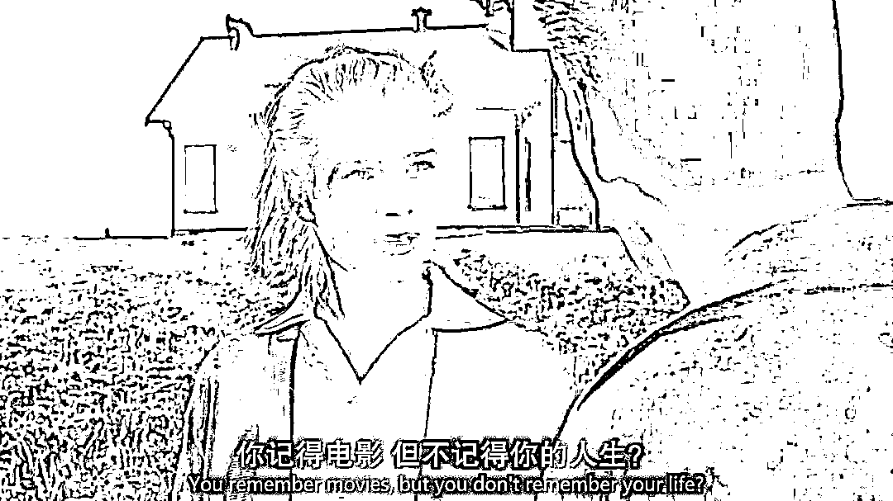

# 《从0到200万粉丝，我把内容心法拆成10条可复用方法论》

# 开场

大家好。下面的内容是我多年做内容的沉淀。我先简单介绍一下自己。

1. 本科四年基本都在做创作，曾经想做电影。我的第一位创作导师是《仙剑奇侠传》的编剧王远老师。在他引导下我拍了不少短片，曾拿到腾讯新视频大赛全国TOP1，也入选过FIRST青年影展、广州大学生电影节。
2. 毕业后进入自媒体赛道，短视频上的第一位师傅是@亲爱的安先生，抖音头部知识类IP。我从编导做到内容负责人，今年年初策划的一期访谈，单条涨粉20万，也助力安老师突破200万粉丝。
3. 之后我也操盘自己的号@游子衿，首条作品破百万播放，自创话题登上📕热搜第三，还被B站东方频道收录。
4. 写这些并非炫耀，而是说明我踩过坑也见过结果。接下来分享10条我反复思考的方法，希望对你有帮助。

# 1、自媒体本质是人与人的连接力

研究透各种技巧后我发现，无论是做公域影响力，还是朋友圈卖货，核心都在相处。

它考验的是你对人性、用户、世界规律的理解，归根到底是与人共处的底层逻辑。

一对一成交，考的是和一个人相处的能力；短视频做公域流量、朋友圈做私域转化，考的是与一群人相处的能力，这需要大众心理学。

怎么练？知己知彼。

想获得关注，就要先懂对方。去体验人际链接的真实感受。比如选题，我常在非工作时间刷各类型内容，重点看评论区，看大众在关注什么、焦虑什么。正是这些观察让我能持续找到好题，也做出高涨粉的作品。

找选题是目的，但过程不能太功利。要真心在意大众处境，站在他们视角思考我在乎什么。我看评论时习惯停下来几分钟，把自己代入对方的语境，感受他的情绪。带着这种共情去创作，自然能打到痛点。

流量与变现，技巧只是表层，内核永远是人。多安静观察世界，从身边人际关系开始修炼。

这条路漫长，考验悟性，更考验底色。善良是高级共情的表现。

# 2、选题是招牌，内容是货品

经常有人问：流量由什么决定？选题代表什么？

很多人答不上来，这很致命。想做内容却不知道驱动力在哪，如何去获取？

打个比方：我卖普通花，店面装修极好，十个人九个进去；你卖顶级花，店面难看，十个人九个不进。花再好没人进门，有意义吗？

店面相当于选题和开头。反之，店面好里面空，进去就走——这就是完播。

一条数据好的作品，需要整体过关，而不是单点突出。很多人没爆，不是做了什么，而是漏掉了什么。这是短板效应，也是技巧要补的位置。

各平台逻辑相通。抖音、快手、B站、📕本质都是内容分发，用户洞察、场景理解、需求把握是核心。抖音的开头=播客标题=📕封面+标题=B站封面+标题。形式不同，本质一致。

真正的心法是一套打通多平台的方法。这属于道；术随时会变。抓住不变，才能获得确定性，确定性决定成败。

# 3、IP与操盘手的关系像伯乐与千里马

有实力的IP最头疼找不到合适的操盘手。很多人分不清两者关系。

现实中很有料、很有魅力的人，账号发几百条却平平；换个号发布却大爆。因为有懂市场的人挖掘选题，加上人物提炼和内容策划，于是：

还是这个人，还是他的话，却出圈了。

我认为IP与操盘手就是伯乐与千里马。

一匹好马，需要人识别出它的特质；再把它放到赛场去比拼；观众才有机会看到；最后才有出圈机会。好选题+人物挖掘+内容策划，就是让马展示实力的全套方案。

好马配好伯乐。反过来，好马没入场券，在场外溜达，观众也看不到。

如果你是好苗子，找到能给你最佳入场券、选好赛场、聚好观众的伯乐，接下来就看你爆发力了。

# 4、取景比器材重要

电影有节拍表，短视频同样有。看电影的人会预留时间地点，而刷短视频是随机的，竞争极激烈，所以节奏、信息密度、开头尤为关键。

怎么设计开头？不能只从文案想。影像是多轨的，要用影像思维来设计，才会形成无意识的催眠。

拍摄上，相机不一定比手机强。关键是取景。

景别选择让观众看到什么、不看什么，一点差异观感就变，划走率就变。情境也可以承载内容，用场景改变观众的认知起点，这也是规避风险的好办法。

# 5、搞明白每一步，再复制放大

必须弄清每一步背后的底层逻辑。准确判断才能掌握可复制的根。

我带人做指导时常遇到三种反应：

1. 没懂也没做，等于没听。
2. 当场就懂且快速出结果。极少见，通常是对方已有大量学习沉淀，和我有共同认知基础。
3. 没全懂但照做。这是大多数，基本能出结果，但遇到瓶颈会迷茫。即便没完全理解，也在大脑里种了种子。

一个人能走多远，取决于认知边界。常说赚钱靠信息差，成功靠信息差，你赚不到认知外的钱。灵感来自脑中已有信息，就像种子长出果实。

我朋友圈随手一句话常有人来感谢，那可能是一年经验浓缩。免费知识易被轻视，因来得太容易。价值十万的话会反复咀嚼一年。

留意重复出现的成功要素，找到让你反复赢的点，就能复制并升级。关键是克服人性惰性，去关注被忽略的细节，承认部分成功来自馈赠。

对他人是认可，对自己是升级。

# 6、盲抄同行是最大陷阱

迷茫时很多人想抄同行，这是最容易掉坑的地方。

第一，你确定他是同行吗？信息不全时看到的都是表象。判断失误就会偏。内容表面像，其实路线和用户完全不同，模仿只会把人群带偏。

短视频是视听合一，信息不止文字。

第二，同行自己可能都还没想明白。有人靠60万播放的爆款来咨询，我一眼看出爆点在哪，但博主自己没复盘，后期均赞跌到几百几千，连自己都复制不了自己。

第三，数据好不等于变现好。外行只看数据。我一眼看出他不懂变现，后面和他深度聊过内容、运营、变现、公私域全梳理，才避免弯路。对创业者，时间就是成本，错路越走越亏。

所以判断是关键，判断源于信息广度。多学、多看，才能提高判断的准确性。没掌握全貌前，看到的多是假象。一步错步步错。

多问、多学习，让信息源饱满，成功率才会提升。

# 7、有武器不一定全用

做短视频要有项目思维：有武器，不一定全用。

我可以做高认知、制作复杂、周期长、难以复制的作品；也可以做轻量的内容，比如我现在账号大部分作品拍摄简单、文案不复杂，前者一条的耗时够后者拍五六条。

为什么？能用三成力拿到八十分，何必花十分力拿一百分？从项目角度看，账号早期更适合前者。

我的打法是：用大部分时间快速用三成力拿多个八十分，偶尔用十分力拿一百分。

前提是我做过市场验证，判断自己在这个领域能降维打击，所以收力创作。大多数人刚起步，定位明确可借鉴，未明确时仍需加大投入。

这也回到冰山理论：有人只露出一点实力，有人已是百倍展示。我不会一直待在舒适区，也会持续挑战高难度来积累经验。

别纠结数据差，复盘就好，能藏就藏。你只要专注做更好的内容。成功后别人不会嘲笑失败，反而成为案例。

勇敢去试吧。做内容要沉住气，别盯着一时得失，有长远布局。数据不好继续干，做更好就行，别玻璃心，记得你的人。

自媒体不是单靠创作，而是综合能力的比拼。

# 8、花时间越久，护城河越深

自媒体需要全栈视野。

起初我看重内容，把市面课程几乎都学了。后来发现，好内容也会死在分发。算法觉得不好推给错的人，怎么办？

于是我学算法与运营。发现这能锦上添花，但内容好、算法对、数据好，却变现不了怎么办？投入产出低怎么办？

接着我补商业思维，学公域也学私域。虽然不是强项，却形成叠加优势，能用创业者思维给账号做规划。

即使理论扎实，实操仍会卡。于是我去当了头部创作者团队唯一的编导，一边学一边实战，持续提升内容力。

自媒体既要内容思维，也要商业思维。粉丝不等于变现，赛道决定天花板。我帮朋友把万粉账号做到月入六位数并超额，但有的赛道上限本就有限。

建议全方位学习。我有四年导演加两年从业经验，仍持续投资大脑学习。现在我一人包揽拍摄、出镜、撰写、剪辑、运营、商业。

相信投入时间越多、能力越广，护城河越高。

# 9、把时间花在看不见的手上

现在我能稳定把控爆款规律并复制。但下一步要做的是创新与测试。

创新测试前期可能数据平平，看不出水花，但一旦成功，回报是百倍千倍的，投产比最高。

就像大厂会专门设部门做研发，前期投入不一定划算，一旦成功就是最大回报。我们需要测试精神。

这不仅是创作思维，更是做事态度。看不见的投入才是关键。所以我会刻意做一些实验，不只看表面数据。数据能力已掌握，下一步是持续创新，逼近边界。

# 10、学完技巧，放下技巧，做真实的自己

做自媒体让我明白电影学习中最缺的能力：先学会生活。

大学拍片靠灵感和天马行空。后来跟《仙剑奇侠传》编剧王老师学科班编剧，再考上上戏导演研究生系统学习，拿了高分，补齐了导演知识。

但回头看，学电影时太聚焦技巧，身边人都是电影圈，朋友圈都是入围新闻。越关注电影视野越窄。大学作品自嗨，很难触达观众。即便入围电影节，也只是筛选后的小众。普通影院观众才是大众，也是自媒体用户。

转到自媒体后世界变宽了。技能可赋能各行各业，认识各领域人才，视界变大，生活更丰富。

创作也更轻盈，能快速产出即时反馈。我开始更体谅他人、换位思考：观众想看什么？为什么看？不想看什么？如何在坚持自我和迎合大众间平衡？

刷抖音能看见众生相，看到时代关心什么、为何感动愤怒。伟大作品共鸣的核心不是技巧，而是对人性和生活的深刻理解，再用技巧传达。短视频同理，技巧只是沟通桥梁。

我现在想做的，是大众能懂、自己喜欢、能带来社会价值的内容。最近更关注那些拍摄平平、人物普通却能引发共鸣的作品。接地气、真诚、自然，在自媒体上反而最难。

多少人不敢对着镜头说话，能在镜头前像生活里一样，这本身就不简单。我练习近一年才接近。除了天赋型选手，大多数创作者的最高境界是：

关心时代，用心生活，体验喜怒哀乐，记住那种感受。

最后，学完技巧后，放下技巧，真诚做自己。

以上是我从朋友圈常发思考里整理的一小部分，希望对你有启发，欢迎一起讨论。

祝愿大家都能多出爆款，多赚大钱！