40天佣金13万、矩阵崛起之前，我也走过很多弯路

大家好，我是唐威。熟悉我的伙伴知道，早期我一直在视频号上绕圈，结果平平；后来换了一种矩阵式打法，40天拿下13万佣金（整体GMV约21万）。先放几张某阶段的后台截图。

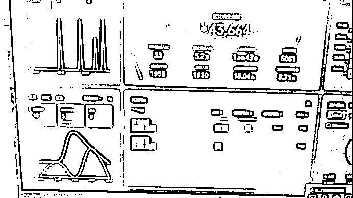
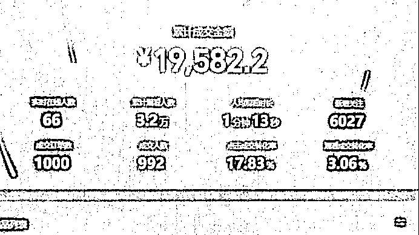
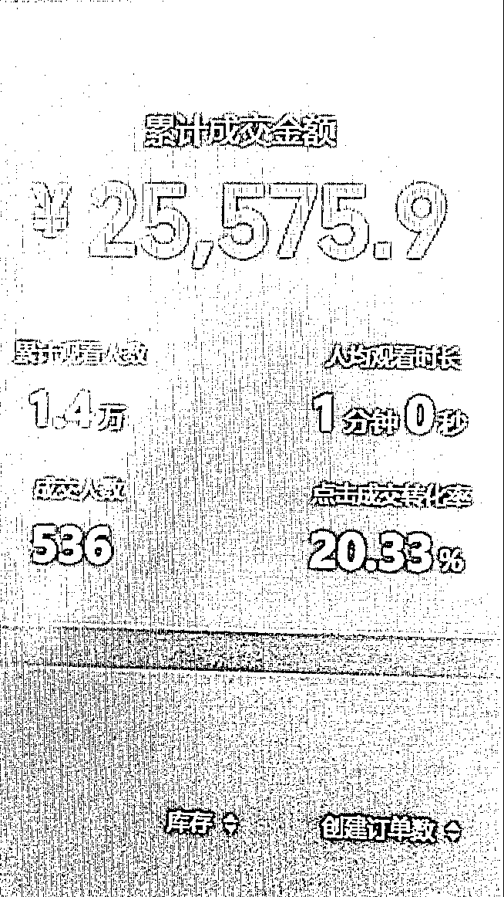

这份成绩其实是我去年12月跑出来的，但因为私人原因一直没公开讲。前几天账号又爆了一次，大家不断追问“怎么才能持续出单”。我静下来复盘，发现其中藏着一段不短的前半程。

在生财圈子里，我见过太多人反复摇摆：要不要不断换项目？还是深耕一个？我给不了标准答案，但我的经历或许能带来一丝启发。

外人以为我做什么都很顺，其实我同样卡壳过。我也经历过漫长的爬坡期，好几年憋着一股劲打磨基本功，无数个晚上自我怀疑，差一点就彻底放弃。今天看起来轻松，不过是因为当年的积累没有白费。

一、四处碰壁的那些年

1. 无货源：第一次真正“做生意”

大学时偶然接触无货源，没人带，全靠自己东摸西摸。当时在拼多多做食品类目，后来一个人忙不过来，拉上三位朋友组成四人小队。

足足做了两年，吃过亏也赚过钱。最后能活下来，靠的是两件事：会找参照对象、对产品有感觉。

先学会看同行。我会快速锁定那些卖得好的对手，拆解他们选品的思路——爆款之所以成为爆款，背后一定有理由。但只抄爆款注定走不远，因为市场已经被人占住。我要做的是了解爆款的底层逻辑，再跟着节日、特殊时机和当下的流行风向去选品，趁窗口期快进快出。时间久了，判断力自然就有了。

2. 小红书矩阵：一次扎心的失败

无货源没做多久，政策打击越来越重，同行和买家的投诉不断，平台的限制也在升级。我清楚，这个模式的红利到头了。

于是转战小红书，做矩阵商单。打法很简单：搬运娱乐类视频养号，粉丝满1000后接广告，一条单子大概180元。我们一组人干了3个月，铺了40个账号。一开始算着未来收入，兴奋得不行。

很快现实就泼了冷水：小红书涨粉慢、起号慢，账号生命周期还很短，一个号最多接20条广告就废了。为了维持规模，必须不停开新号、反复养号，运营成本高得惊人。再加上官方出手，收入少、成本高，渐渐入不敷出，只能止损。

3. 视频号初期：理论全会，下手全废

后来我报了一个视频号训练营。课程本身很好，但和我“八字不合”。它教的是找对标、找素材，可这套东西我早在小红书时期就会了。真正缺的是选品、赛道、直播细节这些实操方向。那段时间我最大的感受是：什么道理都懂，就是不知道第一步往哪踩。结果很惨，几乎没产出。

二、遇到对的人，局面开始反转

1. 一句点拨，让我重启

还在和视频号死磕时，我遇见了孟总。他对于赛道和实战的思考，立刻让我心里一震。 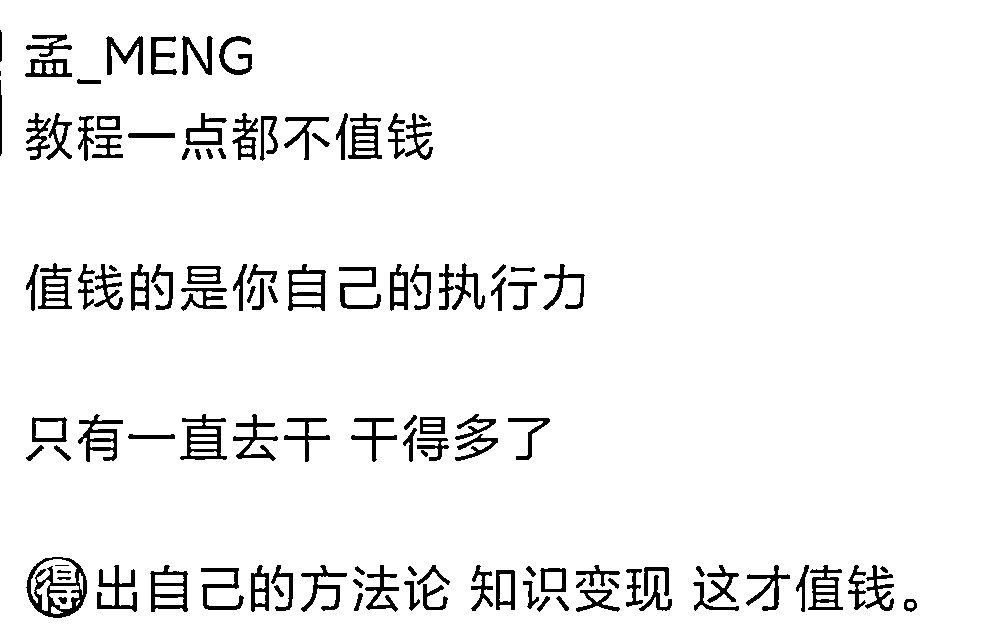

我这才反应过来：自己最强的从来不是突破性思维，而是执行。像之前那种需要人喂饭、把细节揉碎了递到嘴边的模式，才真正适合我。于是果断加入他的项目。

2. 这次起步出奇顺畅

好在我之前有一批账号，又有剪辑底子，配着详尽的教程和孟总的随时答疑，整个跑流程几乎没有卡顿。他连直播时的音乐、贴纸、链接设置、头像简介都要把关，后台数据更是帮我一直盯着。 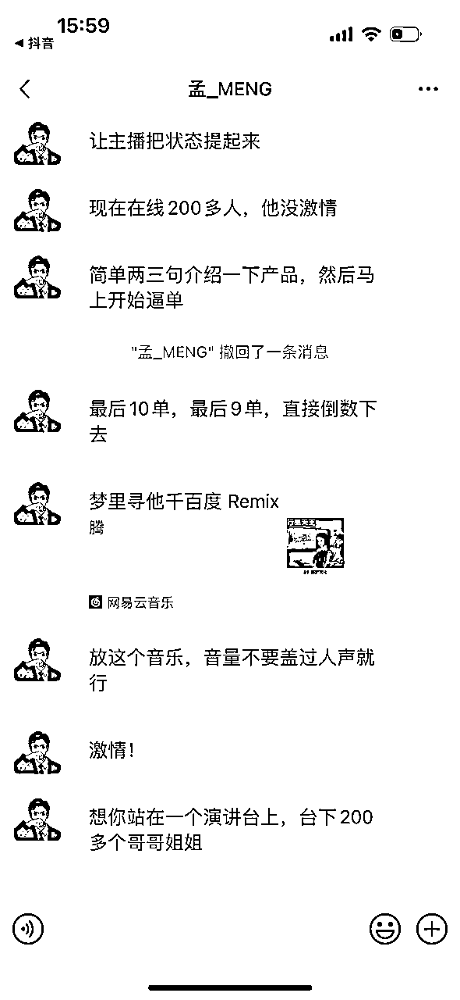

3. 用数据说话

- 12月26日，入局第3天，GMV打到5729.9；28号佣金到账3038。 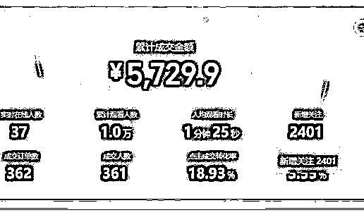
- 1月9日，孟总全程在线陪播，我还没意识到问题在哪，他已经提前提醒。那场直播打出了43664 GMV的新纪录。 
  
  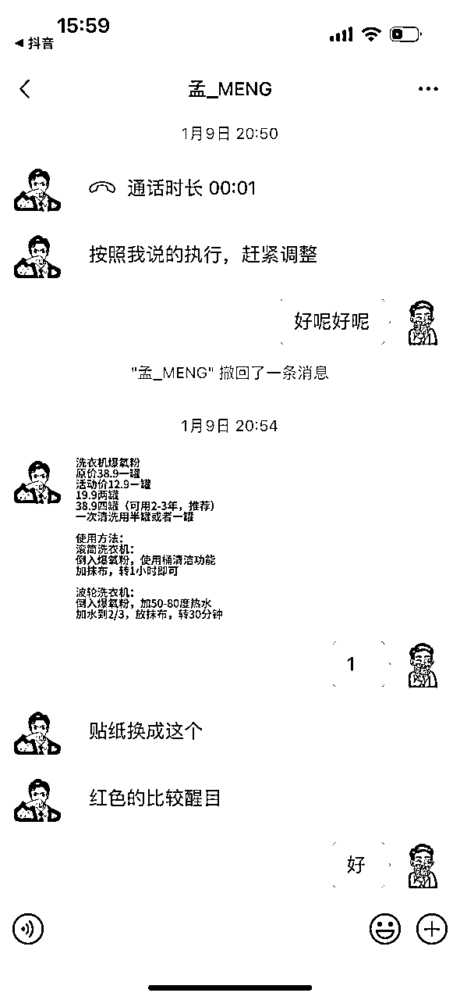
  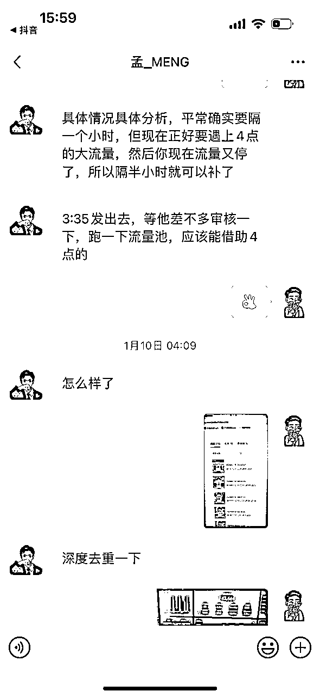
- 1月12日，我把单次佣金纪录拉到27806。 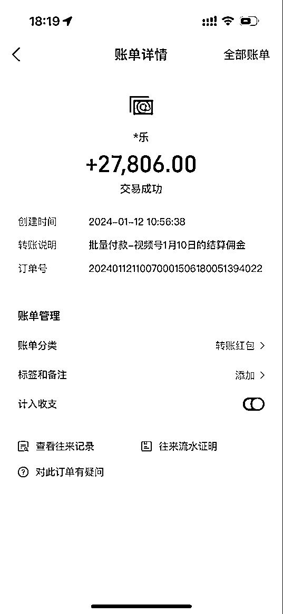

和搬运素材相比，实拍的收益高出一截：平台给流量更大，自己的素材被别人带走还能拿分成。所以我先用搬运跑通收入，再逐步转向实拍，爆款概率越来越稳，接连出了好多个百万播放。到2月1日，累计佣金突破了13万。

4. 放大矩阵，巧借外力

到3月，我没再单打独斗，而是把小团队整合起来，把矩阵规模进一步放大。 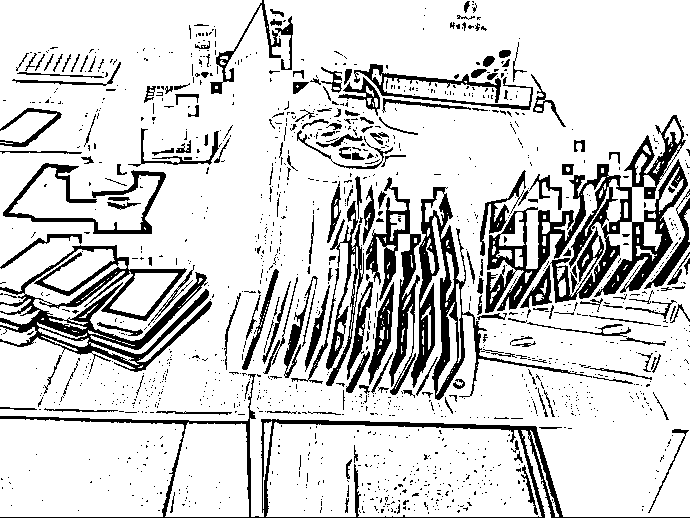

孟总一直强调，号越多，收入天花板越高。在视频号这种红利期，我越来越信“多铺号就是捡钱”的说法，做矩阵和团队的动力也更足。

不过做到40个号之后，我一度卡住——账号都被我用完了，还能怎么放？直到看见燕子在群里的分享，脑子里的一扇门才算打开。 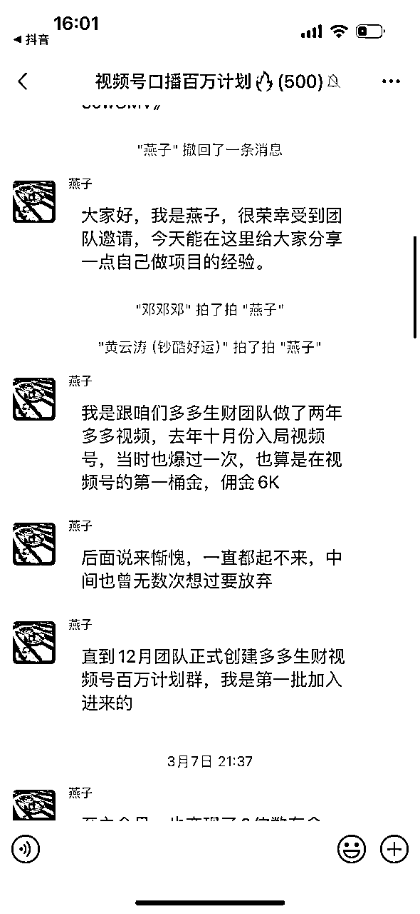
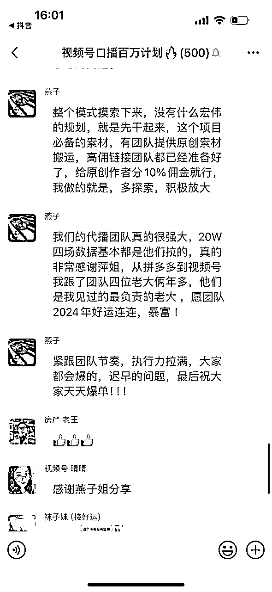
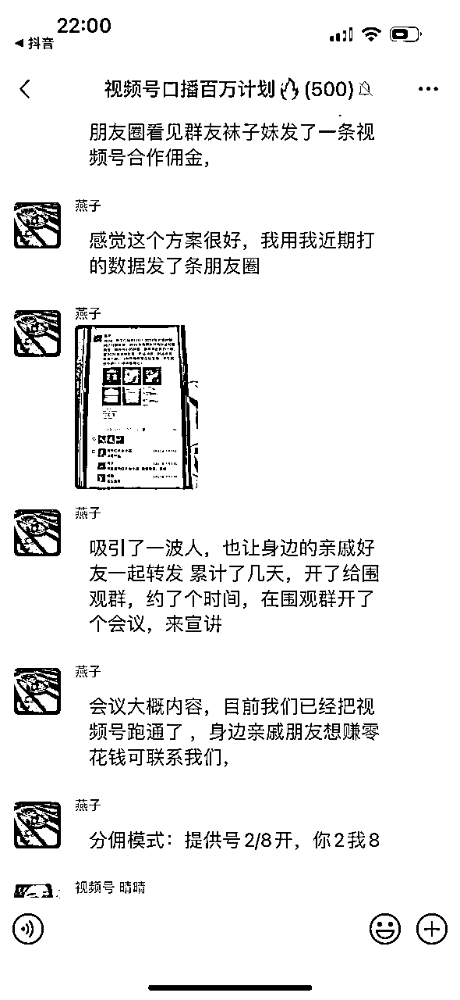

她的核心思路是：别把精力耗在“自己必须有号”上，要学会用别人的账号分佣合作，构建一种裂变式的利益分成。之前团队做不大，是因为设备、时间、精力都有限；现在借对方账号，我的素材和运营能持续变现，账号方也能分到收益，两边都划算。个体力量终归有边界，借力才能把盘子做大。之后我们的数据一直在线，4月团队准备冲击百万GMV。

三、复盘之后，我最想分享的四点

1. 没有一步路是白走的

可能很多人觉得我折腾那么久，浪费了时间。但我不这么看。正是无货源阶段，让我对“跟着市场节奏走”有了直觉，群里发来一批品，我很快能筛出适合自己的；春节前小炒酱、调味料这类品我一拿一个准。小红书的搬运、去重经验，又无缝衔接上视频号的剪辑需求。

当时做这些事的时候，我真不知道自己会在哪一刻用上它们。可等到孟总和红利出现时，过去攒下的技能刚刚好全部对接上。自己走过的路，没有一步会白费。

2. 执行力，就是最大的杠杆

互联网最迷人的地方，就是变化快；最残酷的地方，也是变化快。我看到很多人拿到教程后反复纠结，等鼓起勇气时风口已经过了。我的做法很简单：先冲下去，边做边修正。正因为这种不够聪明但足够快的方式，成绩才得以在短时间内爆发，团队也能不断破纪录。

3. 流水不争先，争的是滔滔不绝

表面看我好像很稳，其实那阵子我差点急疯了。 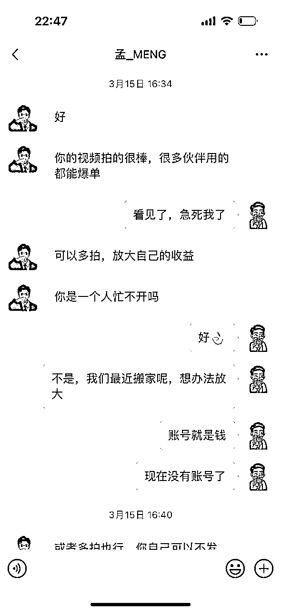

家里搬家、琐事缠身，我几乎没有时间拍视频，群里的伙伴却一个接一个爆单。焦虑不断发酵，我特别害怕错过所谓的最佳窗口。后来孟总告诉我一句话：流水不争先，争的是滔滔不绝。 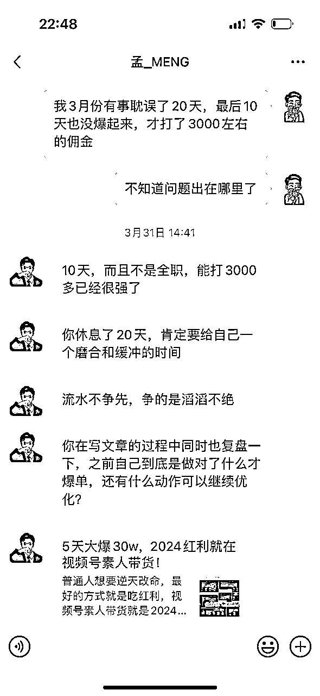

这句话一下子点醒我。任何项目都要拼长期、拼稳定，与其慌乱地追赶别人，不如把有限的时间用到极致，让自己的“流水”不断线。

4. 用长板去赢

孟总几次说我在这件事上有天赋。起初我不太信，但做着做着就明白了：拍视频、直播恰好是我擅长且喜欢的事；再加上过去经历给我带来的选品优势，做起项目来确实比别人顺。 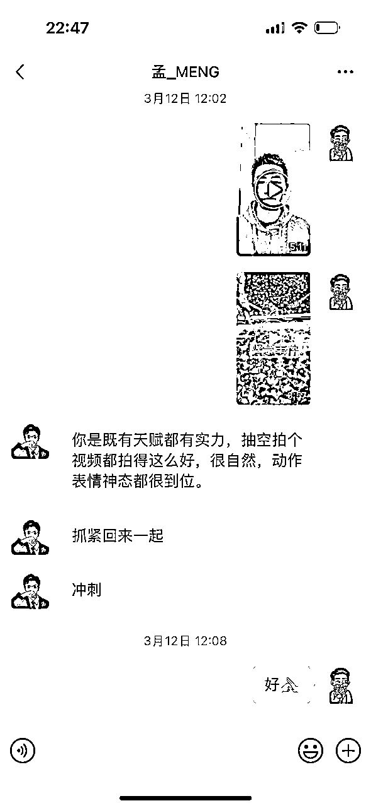

顺的时候也提醒我，别再拿短板较劲，把强项打磨到极致，收益和自由自然会来。

四、最后，是感谢

真心感谢孟总，带我走进这个项目，让我重新找回信心，也让我真正拿到结果。
感谢团队里的每一位小伙伴，大家一起扛、一起拼，才让这套打法越跑越顺。
感谢生财有术这个平台，填补了信息差，也让我链接到宝贵资源、遇见改变轨迹的机会。

祝大家在各自赛道里，有钱赚、有方法、有伙伴，真正地生财有术！

