# 小红书矩阵搭建：技术SOP全拆解，看完就能直接上手

平台天然反感批量养号，做矩阵这件事，说白了就是跟平台的检测机制斗智斗勇。能不能跑通，核心不在于你砸了多少手机、囤了多少内容，而在于能不能让平台相信：你每一个账号背后，都是一个真实、独立的正常人。

很多人一聊矩阵，就只会说“多买手机、批量做内容、快速注册”，听起来简单粗暴，真操作起来却一脸懵：手机买了，内容也有了，发出去就是没有流量，自己还找不到原因。其实问题往往出在底层架构上，而不是内容本身。

决定矩阵能不能玩转的关键，就三个维度：设备、网络、账号。任何一环出了漏子，都可能被平台限流。比如有人图省事直接在手机上多开几个号，量小的时候没事，一旦量上来，怎么发都没量，那多半是被识别成“单系统多账号”了。最直接的表现就是：新号没有出现“恭喜”，笔记投不了推广，甚至建不了群聊。踩中这些，号基本可以注销重来。反过来，只要能看到“恭喜”或者能正常过推广，说明号的底子是干净的，后续内容质量不差，流量自然会来。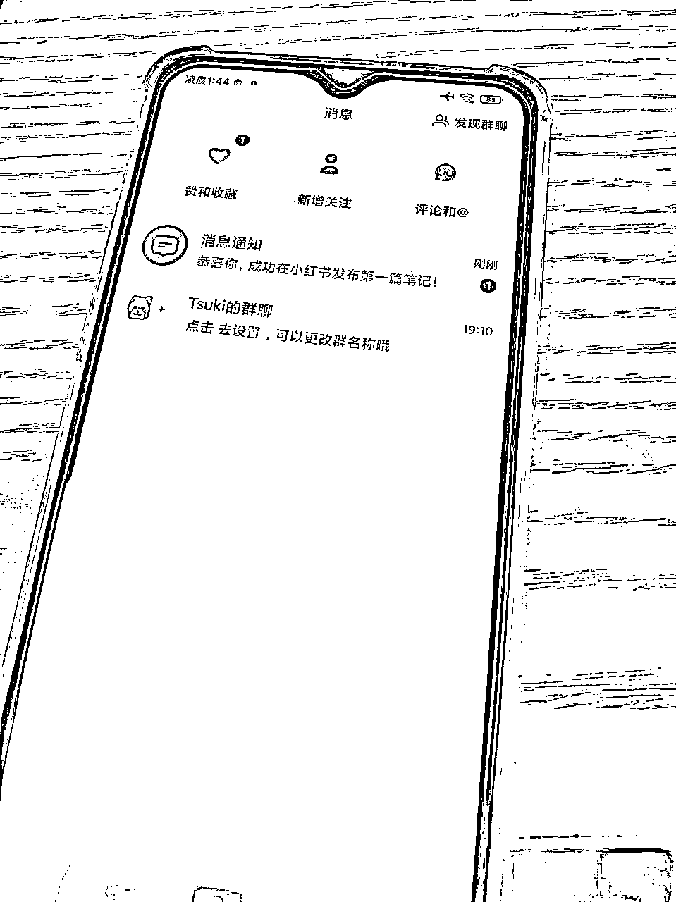

## 一、设备篇：手机是地基，选不对全白搭

安卓还是苹果？没有一套方案能通吃所有场景，得看你的具体打法。

- 安卓的优点：黑科技软件多，群控工具丰富，刷机方便，价格实惠。
- 安卓的缺点：老机型、低版本系统，更容易被风控圈中。
- 苹果的优点：整体设备权重比安卓略高一截。
- 苹果的缺点：改机麻烦，对系统版本有要求，采购费劲，价格也贵。

如果是一机一号，苹果基本稳；但要做矩阵，就得综合刷机、成本、群控这些复杂因素来考虑。

### 采购避坑要点

**安卓：**
1. 系统版本选Android 10及以上。
2. 最好买已解BL锁的手机，方便刷机和改机（不打废号流可忽略）。
3. 处理器别追最新款，以高通为例，骁龙835到865之间足够（不打废号流可忽略）。

**苹果：**
1. 避开6s及以下机型，风控概率高。
2. iOS系统版本保持在12.0到16.6.1之间比较稳妥（不打废号流可忽略）。
3. 后续有改机需求，就选A12及以下的处理器。

### 刷机：二手手机第一步

买二手手机，不清楚它是不是工作室淘汰下来的，最好先彻底清一遍。不然平台可能因为设备“脏”而限制流量。账号违规之后，同样建议清理。

清理方式一般分双清、三清、四清，或者直接重装/更换系统。常说的双清，指的是清除手机数据和虚拟空间数据；四清及以上，连系统一起删掉重装。注意，这个操作的前提是手机已经解BL锁，没解锁先解锁。买二手手机也是门技术活，不然看着能用，实则怎么做都没流量。

**安卓线刷（以小米为例，原理大同小异）：**
1. 下载对应型号的ROM包，渠道：https://onfix.cn/rom。注意区分线刷包和卡刷包，线刷包是连电脑刷机用的，卡刷包是拷进手机用的。
2. 去网上搜“品牌+刷机工具”，一搜一大把。
3. 手机进入fastboot模式后接数据线连电脑。小米一般是关机状态下，同时按住电源键和音量减键。
4. 先选ROM包路径，勾选“全部删除”，再加载设备，最后点刷机。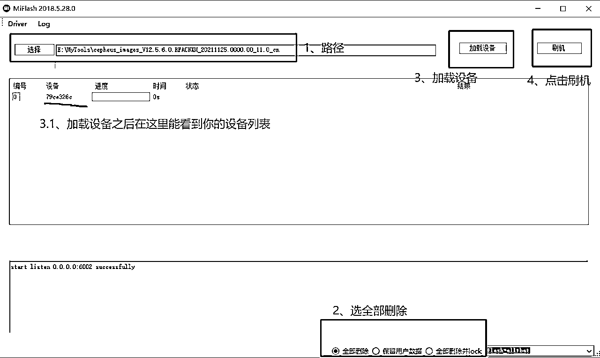

**安卓卡刷（以小米为例，原理步骤都一样）：**
1. 准备对应ROM包，下载渠道同上。
2. 下载TWRP，先查自己手机的型号代码，比如小米9的代号是cepheus。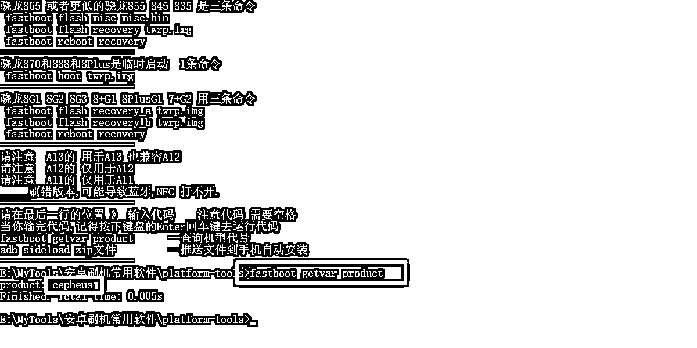
3. TWRP在刚才的ROM下载渠道也有，或者去开源平台找：https://sourceforge.net/projects/recovery-for-xiaomi-devices/files/。不同型号、不同系统对应的TWRP包不一样，注意分辨。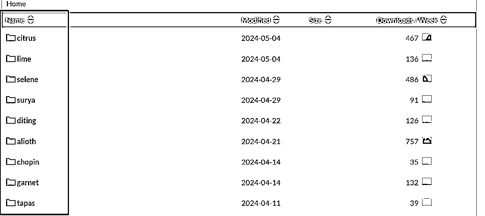
4. 下载时看文件名里的A多少，比如A13可用于Android 13或12，A12只对应12，A11对应11，A10对应10。都没找到就下最下面的TWRP通用包。只下载TWRP，橙狐暂时不考虑。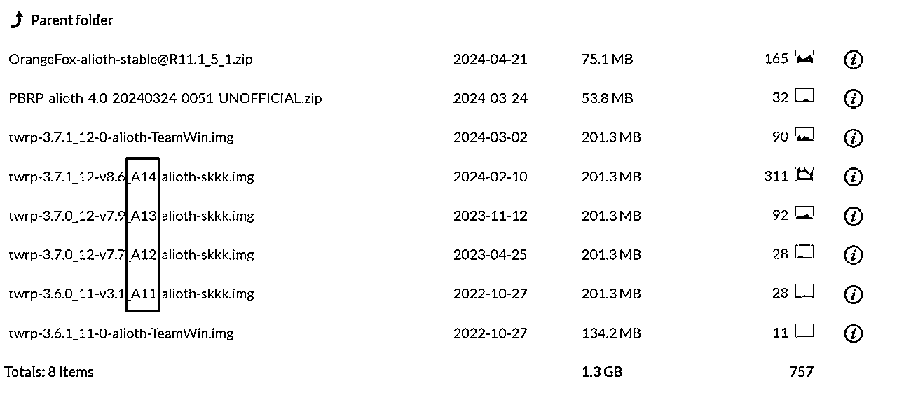
5. 安装TWRP，执行命令“fastboot boot + 下载好的twrp文件路径”，回车。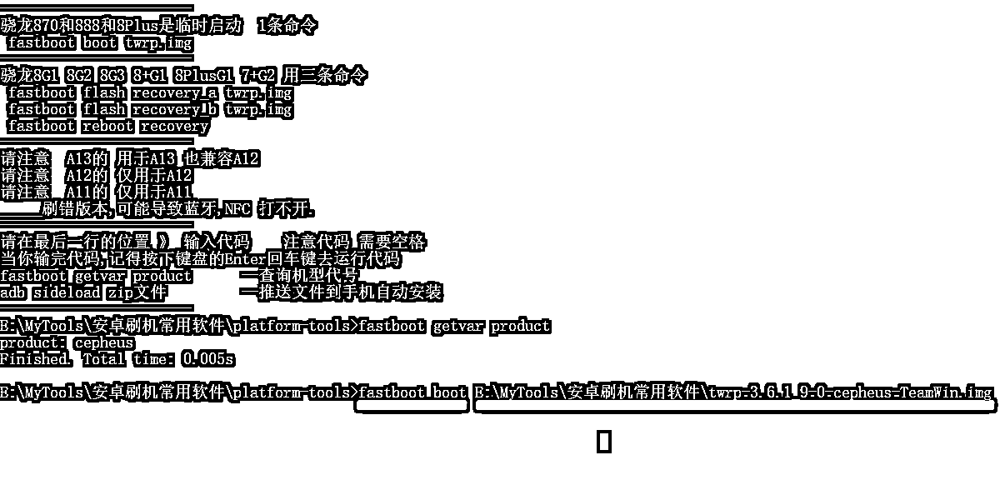
6. 提示OKAY就是成功，等手机重启自动进入TWRP界面。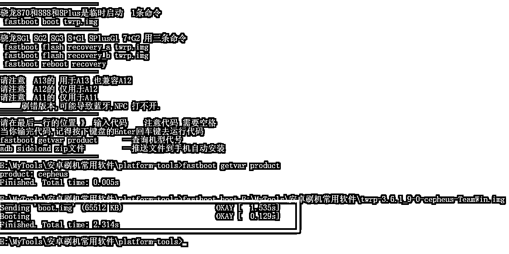
7. 不习惯英文可以切中文，然后滑动最下面的滑块进入。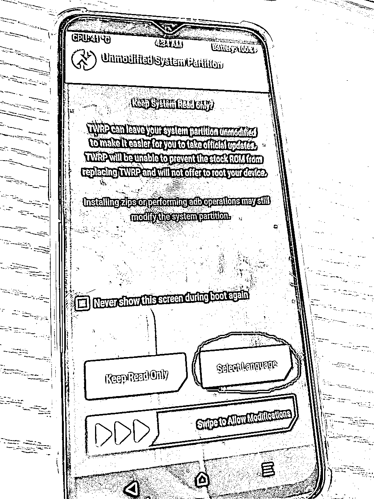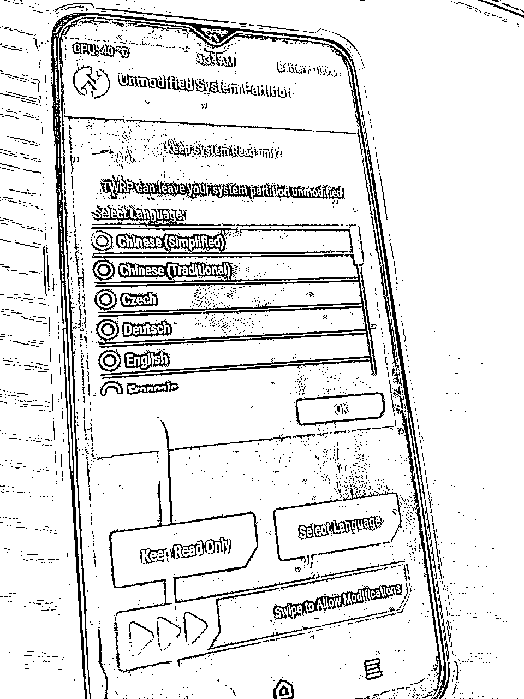
8. 想双清就点“清除”，想重装系统就点“安装”（图1）。进入安装后选择对应的系统包。装完先别重启，去“清除”界面点“格式化Data分区”再重启，否则可能开不了机。点“清除”后滑动滑块就是双清（图2），也就是清Cache和Data。要三清或更多就进“高级清除”（图3），勾几个就是几清。注意勾了System就是清系统，清完必须装新系统才能开机。最下面的USB-CTG必须勾选，不然可能清掉电脑目录下的文件。清完重启手机即可。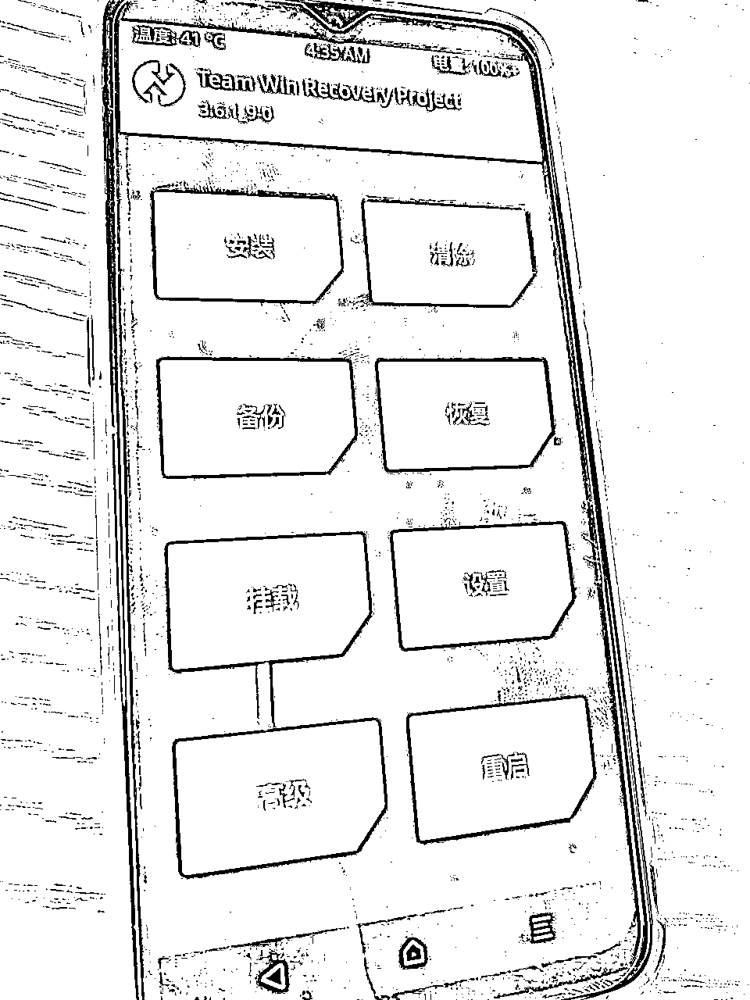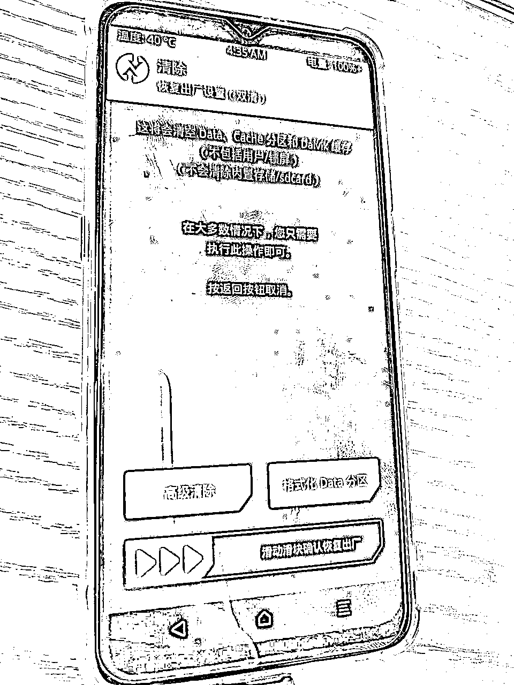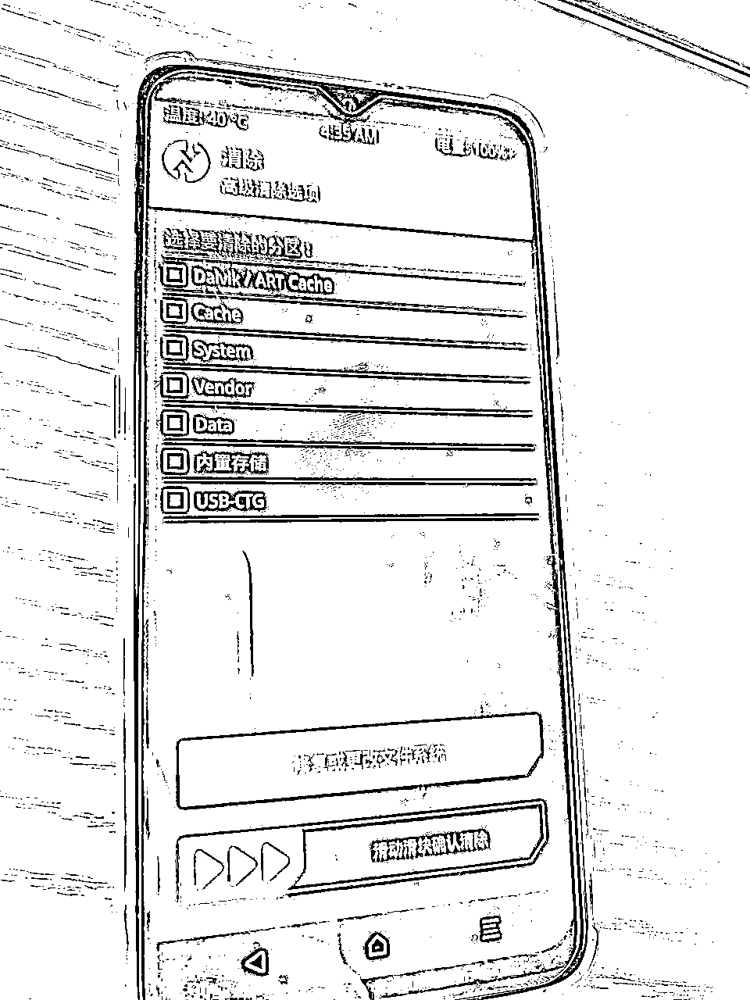

另外，手机要做软改的话，最好也装TWRP，在里面安装面具等软件。要做硬改就不用TWRP，开9008端口就行。

**苹果刷机：**
一般还原出厂设置就够了。想重装系统，用爱思助手（https://www.i4.cn/），找对应型号的固件下载安装。注意：如果手机原本是iOS 14到16之间的版本，别下载新固件，直接还原就好。如果手机已经是该型号能升到的最新系统，那就无所谓，随便选个可刷的固件装。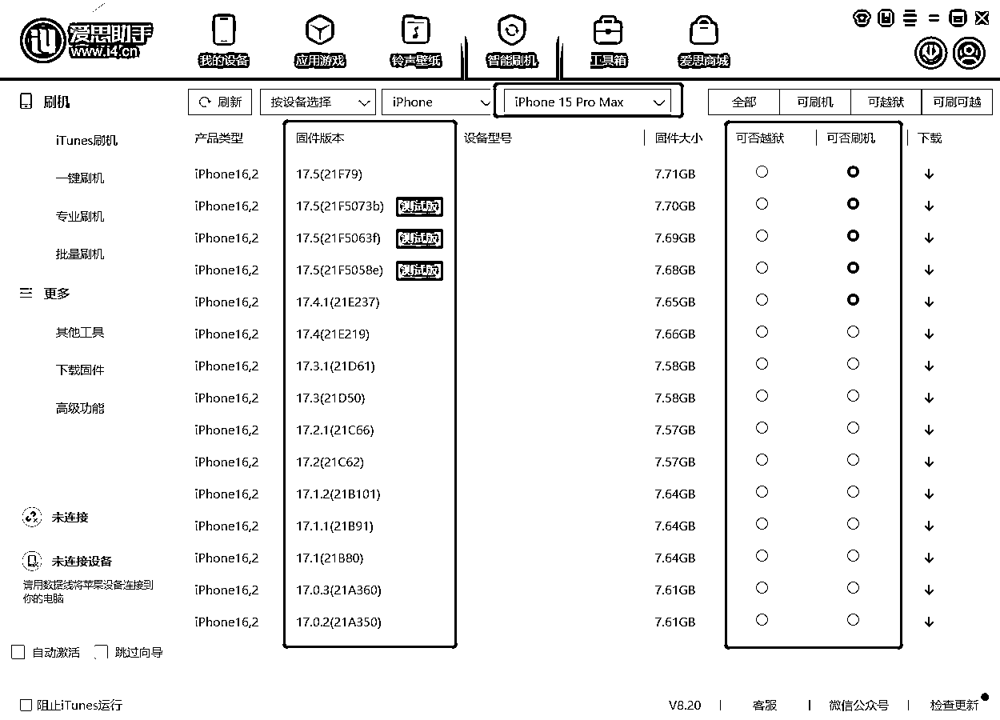

## 二、网络篇：矩阵的隐形支柱

要做矩阵，绝对不能所有手机连同一个WiFi，数量一多必被检测异常，然后限流。不连WiFi是玩矩阵的基本常识。

如果用正常手机卡的流量上网，最好没事多走动，换换基站，别长时间固定在同一个位置。但几十上百台手机堆一起，就算一机一卡一号，基站一样，账号照样有被限流的可能。这时候就有两种解法：全国跳物联卡、软路由。

### 网络解决方案

**1. 正常手机卡/流量卡：**
一机一卡一号，每台手机只登一个账号，配一张卡，用卡的流量上网。月租越低越好，能上网就行。如果只用来上网，可以买流量卡或物联网卡，月租10到30之间，按流量套餐收费。缺点是得经常带手机走动换基站和IP；而且二三十台设备密集堆一个地方，短时间集中发帖，容易被限流。

**2. 物联网卡：**
有些物联卡支持所谓的“全国跳”，开关飞行模式之后IP就变，这样就不用担心多设备同地点发帖被限流。但要注意区分优劣，有的卡跳的地区很少，有的限制跳不出省（比如重庆等地）。优点是小型矩阵的最佳方案；缺点是同一地点可跳IP有限。

**3. 软路由：**
矩阵网络的终极解法。通过一个路由器发射多个WiFi信号，每台手机连不同WiFi，实现IP隔离。可以装路由系统或直接买软路由来配。普通家用硬路由系统固定、功能单一；软路由可自行安装功能强大的系统。主流系统有ROS（功能强但门槛高）、iKuai爱快（中文界面，友好）、openWrt（开源免费，多平台）、immortalWrt（openWrt分支，功能更全）。优点是功能强大，满足矩阵网络需求，可以独享纯净IP；缺点是不容易上手，IP要另外购买。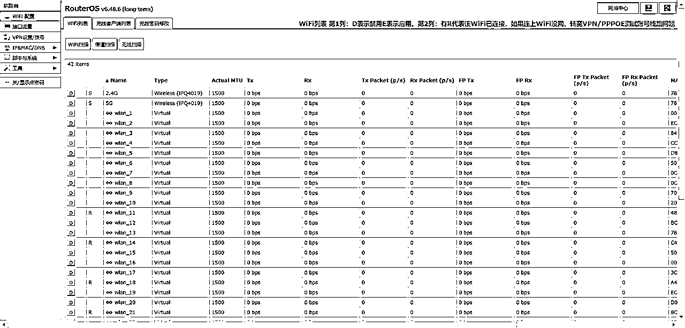

### 软路由配置简说

路由器本质就是一台电脑，装系统和给电脑装系统是一个逻辑。除了路由器，普通电脑、小主机、闲置安卓手机都能当软路由。篇幅有限，只提ROS和openWrt/immortalWrt。

**ROS安装：**
ROS系统是梯度收费的，不同权限发射WiFi数量不一样。买自带ROS的路由器（比如Mikrotik入门系列）一般是3级权限；上千块的软路由通常带4级权限。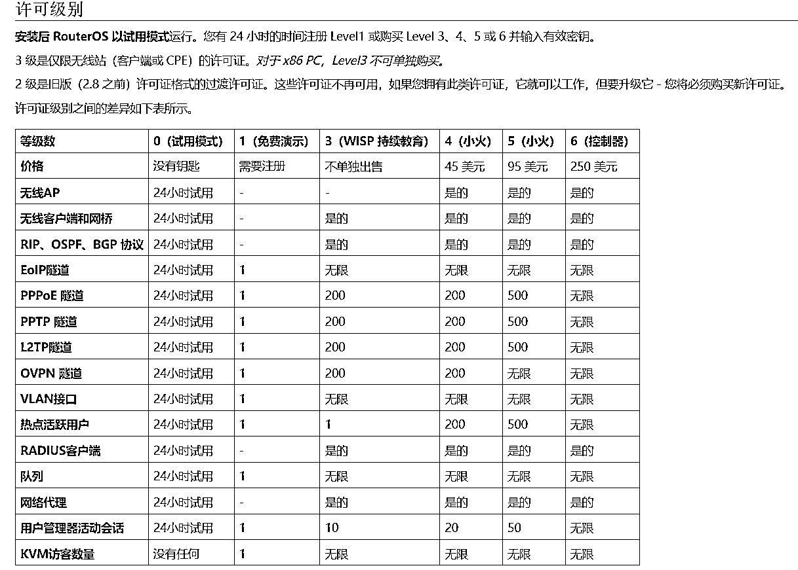
如果没有买带ROS的路由，可以去这里下载正版系统：https://wiki.ros.org/ROS/Installation，或者搜“学习版”。买带ROS的路由，按操作手册配置：https://wiki.mikrotik.com/wiki/Manual:TOC，两个手册可以结合看：https://help.mikrotik.com/docs/。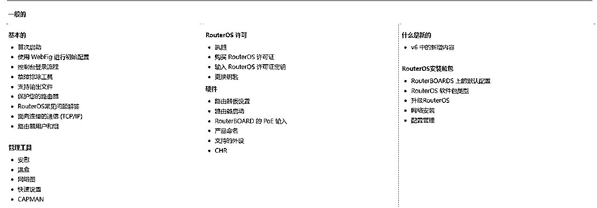
装完进入后台，配置时一般用l2tp协议，后面租对应协议的IP。然后依次填服务器地址和密码，启动WiFi即可。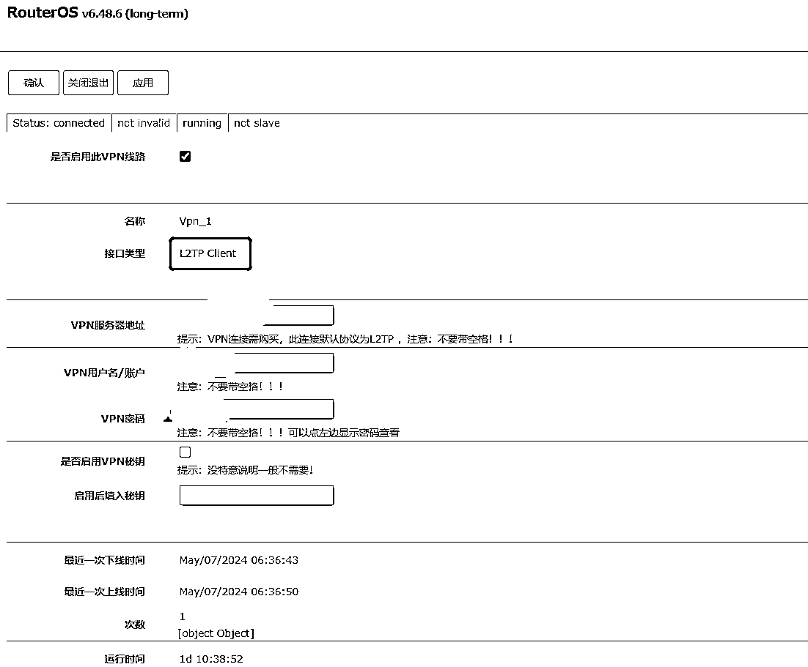
IP配置完可以看下IP界面。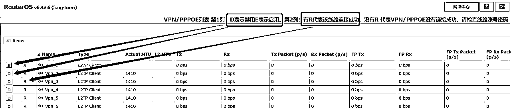
WiFi界面同理。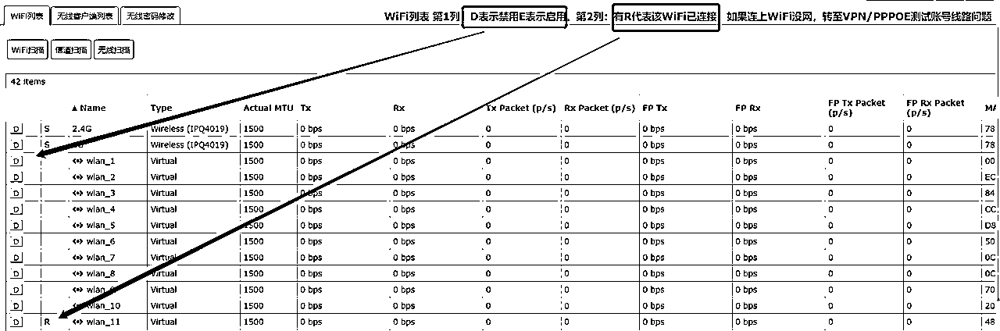
线路没问题之后，WiFi名称最好随机化，中间加个标识，自己能分清哪条WiFi就行。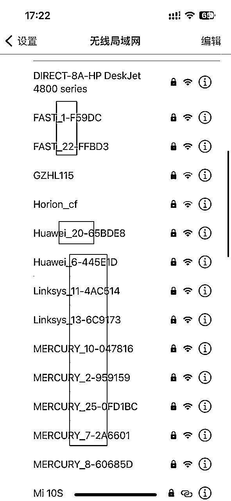

**immortalWrt / openWrt安装：**
1. 先上官网查自己路由器型号是否支持，以及该装哪个版本。用电脑当软路由，直接搜x86/64。
immortalWrt查询：https://firmware-selector.staging.immortalwrt.org/
openWrt查询：https://firmware-selector.openwrt.org/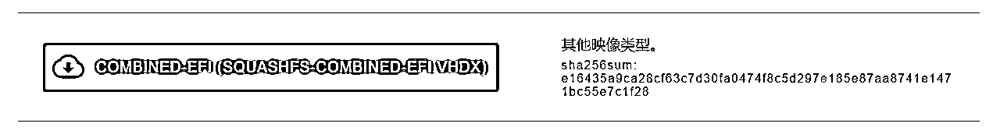

2. 路由器支持刷openWrt的话，按官方文档操作：https://openwrt.org/docs/guide-quick-start/factory_installation。
想在电脑上装，就借助虚拟机。下载VHDX后缀的文件；只有img的话，用StarWind V2V Converter（https://www.starwindsoftware.com/starwind-v2v-converter#download）转成VHDX。

没有虚拟机先装VMware，下载：https://www.123pan.com/s/g520Vv-uIWid.html

2.1 新建虚拟机时，注意选择“自定义”，网络选“桥接网络”。而且充当路由器的电脑必须直接插网线，最好从主路由拉一根线出来。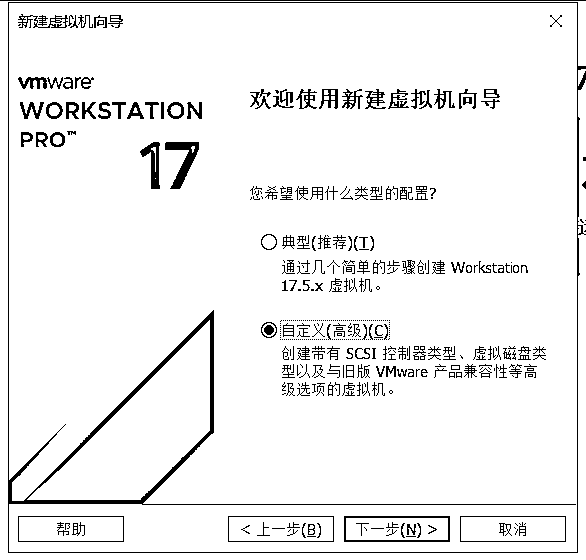
虚拟硬件不用选太新，默认就可以。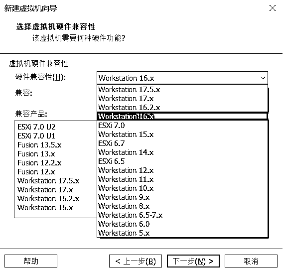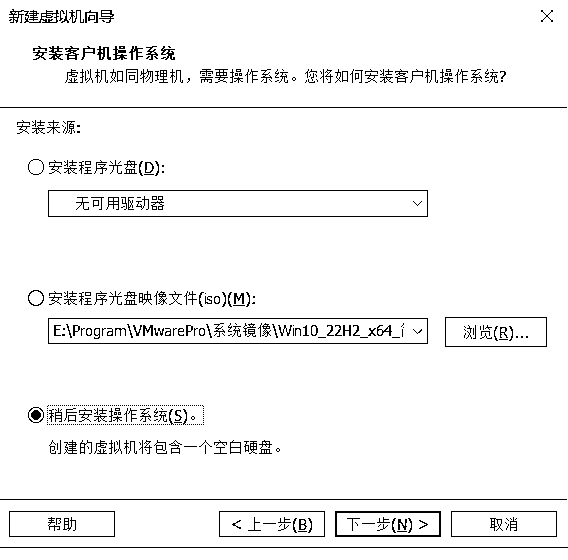
操作系统选Linux，版本按下图选。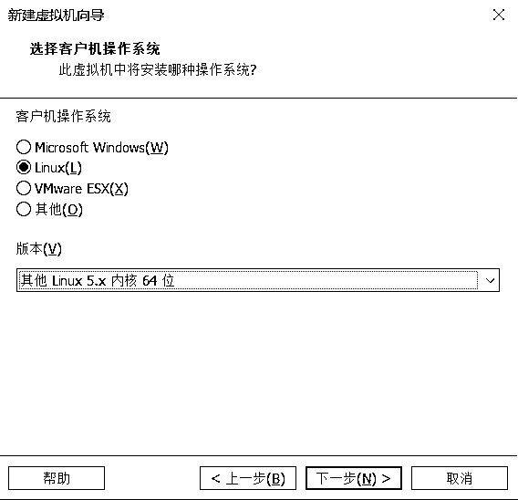
名字随意取，安装位置建议别放C盘。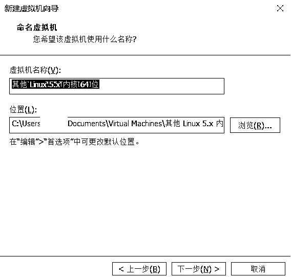
虚拟机配置默认即可，电脑配置好的可以多给点性能。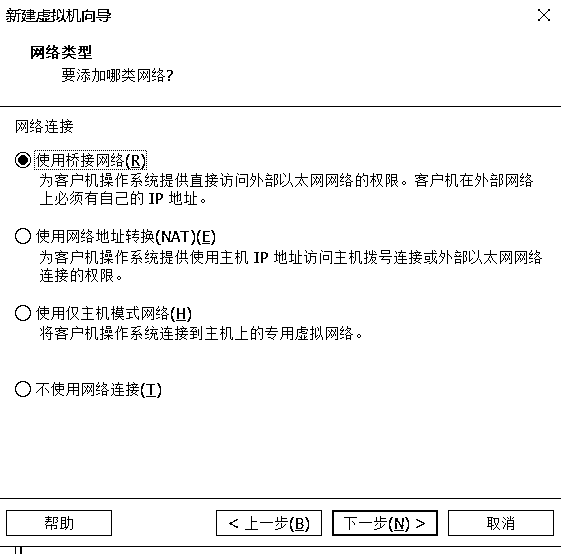

装完进入系统，输命令“ip a”查看路由器当前IP。如果和网关IP重叠，需要修改。一般第一次安装是192.168.1.1，直接改掉。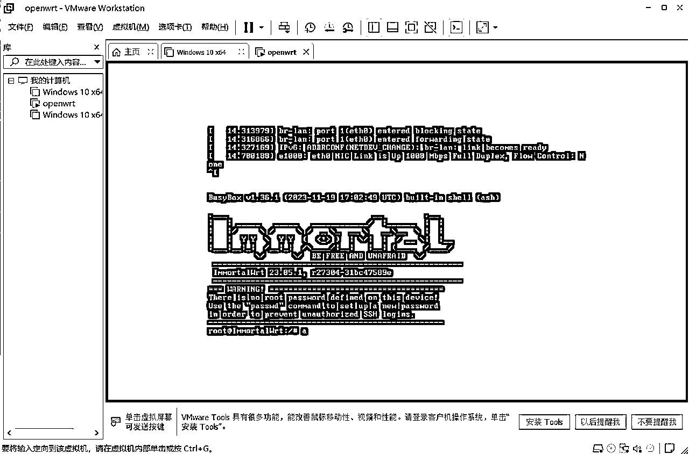
输入“vim /etc/config/network”，用方向键把光标移到需要改IP的区域。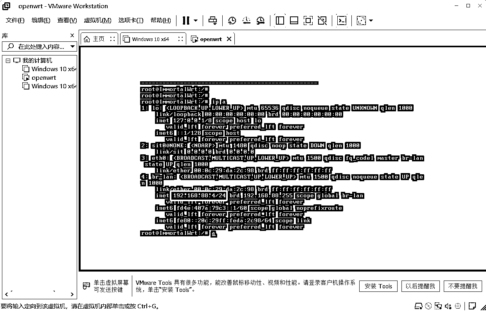
改完之后，光标移到下方空白处，输入“:wq”保存退出。接着输“/etc/init.d/network restart”重连网络。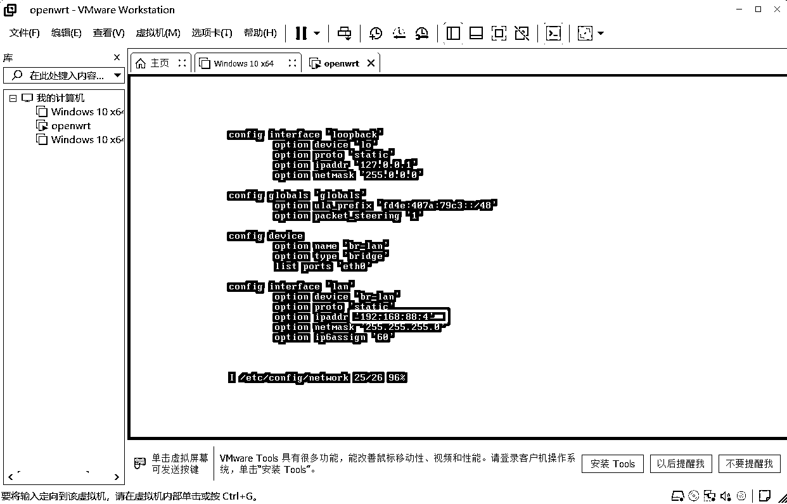
再输入“ip a”确认IP是否改成功。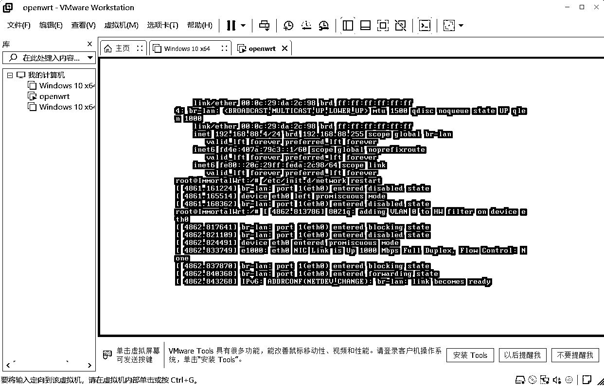
最后在浏览器输入刚设置的IP，进入管理后台。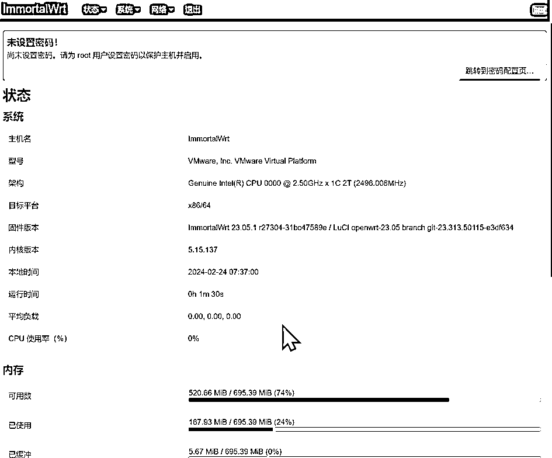
然后按手册设置IP：https://openwrt.org/docs/guide-user/start
注意，openWrt/immortalWrt一般支持SOCKS5协议的IP，购买时留意。

## 三、账号篇：手机卡决定权重

你自己手机玩一个号，直接注册就行。但矩阵要做几十上百个号，甚至打废号流，每天注册量大，就得研究什么样的账号更显正常、更有流量。

账号背后，就是注册用的手机卡类型。常见的有一网厅卡、广电卡、虚拟卡（注册卡）、dt号（地推）、lj号、自己的手机卡。这些卡资源网上很多，或者找做矩阵工作室的朋友问一下，也能找到。

不同卡对应的账号权重大概是：自己的手机卡=lj号 ≥ dt号 > 三网厅卡 > 广电卡=虚拟卡（注册卡）。

按需选择就好。如果设备、网络环境很干净，权重高，随便什么卡都能出恭喜、过推广。但做矩阵的，环境不干净是常态。所以对设备或网络没把握时，尽量选权重高的卡注册。

## 四、软件篇：群控管理

手机一多、账号一多，管理就是大问题。互联网上解决方案很多，群控软件就是其中一种，一台电脑管理几十台手机，这技术早就有。

市面上群控软件一大堆，针对不同平台的都有，自己按需找就行。

最后说一句：矩阵不是买手机、发内容那么简单，设备、网络、账号每一项都值得认真搞定。底层架构打扎实，后面才轮得到拼内容。希望这份技术SOP能让你少走弯路，直接开始实操。

本文整理自【搞定小红书流量】社群分享，想获取更多社群干货，可加V：life210302

做账号矩阵，很多人第一个卡点就是“群控”方案怎么选。其实，不管你做小红书还是做别的平台，核心判断标准就那么几条。我身边不少朋友都是在这上面吃了亏才明白的。

先聊 WiFi 群控。软件拿到手，第一件事是问它的后台有没有架服务器。如果已经架好了，那恭喜你，手机跟装群控的主机完全不用连在同一个无线网络里。你人带着手机出门，用普通数据流量照样能控制，随时随地都能操作。

但如果这套软件限定要同一个 Wi-Fi 环境才行，那就得再去确认一个点：能不能做 IP 隔离。如果不能，这软件趁早别碰，不然所有设备都暴露在同一个 IP 下面，很容易被平台盯上。

至于走数据线做群控，倒没什么复杂讲究，分线器得早早备好。尤其是设备一多，USB 口根本不够用，没有分线器会非常难受。

写着写着，不知不觉就到了好几千字。我觉得已经写得很细了，但肯定还有不少没聊到的地方，希望看到的人真的有收获。虽然我拿小红书来打比方，实际上其他平台也一个样。欢迎来找我交流，+V：life210302，一起冲流量，一起暴富！