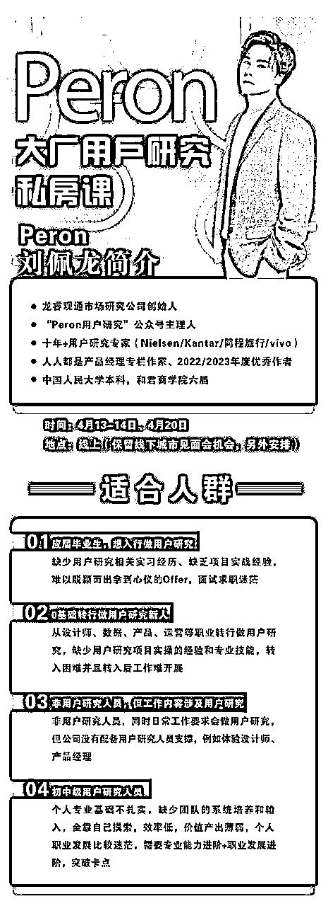
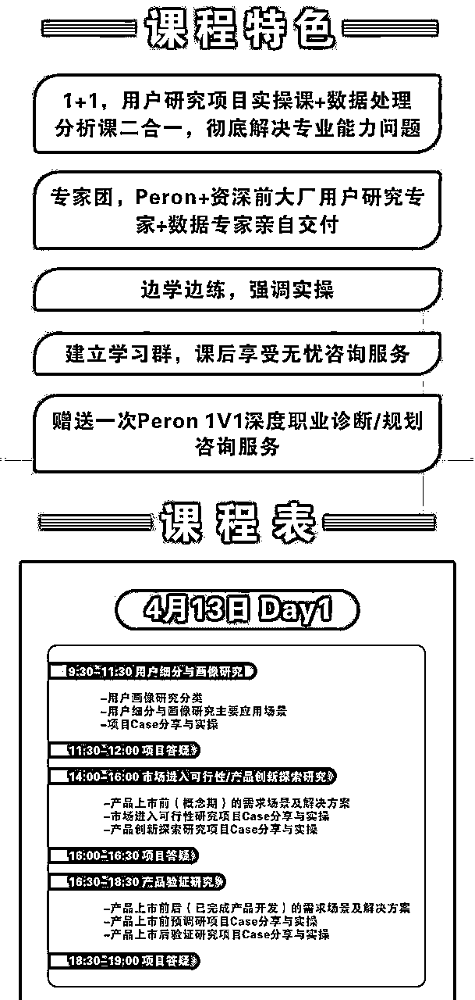
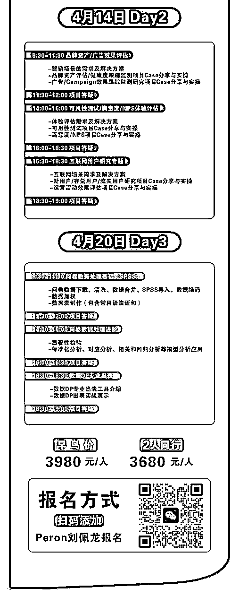
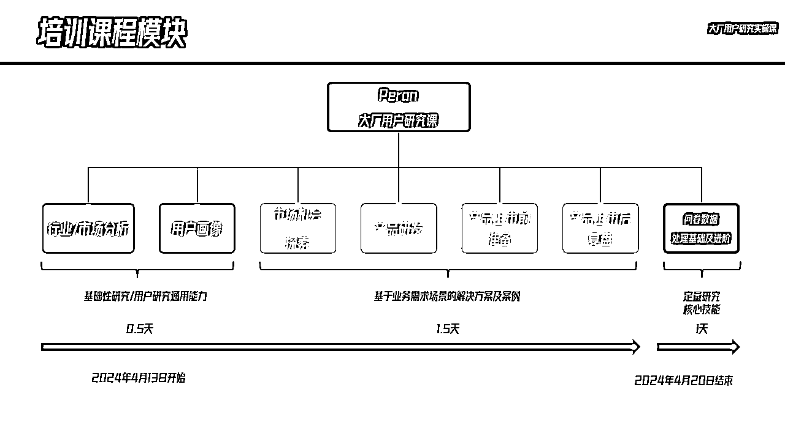
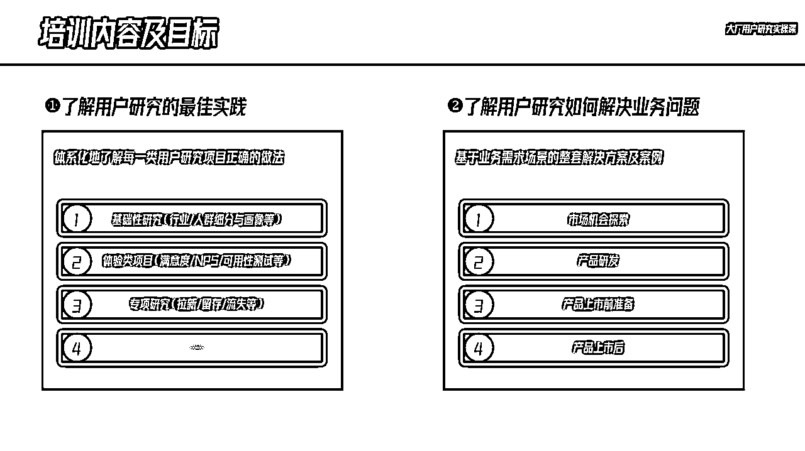
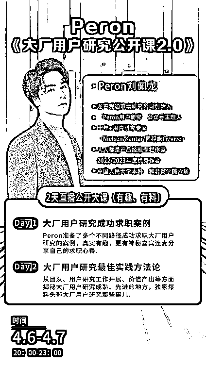
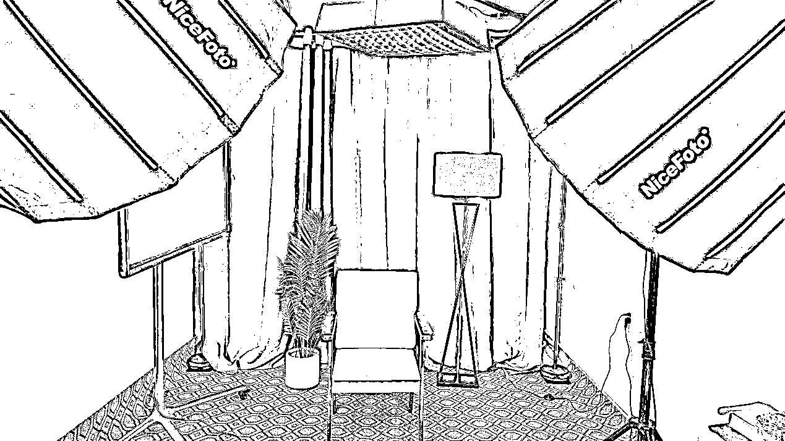

# 垂直小众赛道做知识付费，首月GMV破15万，我踩过的关键点

大家好，我是佩龙 Peron。

龙哥盟第六、七期成员，35岁，上年从大厂出来创业不足一年。主做B端市场调研与用户研究交付，顺带做C端知识付费。

2023年，受够了职场消耗叠加35岁焦虑，我从某大厂裸辞，本想彻底转行。没想歪打正着，回头发现自己十年积累的市场调研/用户研究经验，依然是社会价值最大化的一条路。

离开大厂后，有朋友主动上门找我承接用户研究外包。于是先注册了咨询工作室，后来业务变多组建了团队，并在2023年12月把主体升级为一般纳税人有限公司，正式把这件事当成终身事业来做。

专业服务是资源盘子的问题。没有历史客户沉淀，B端做起来非常吃力，尤其前两年没资质根本进不了采购体系。所以我从2024年3月下旬起，把B端交付完全交给团队，自己把精力全部挪到C端知识付费。

我给自己定的第一个目标，是做一个三天集训，安排在4月中旬。赛道很窄，客单价不能低，最后锁定3980元/人，理想招30人。

从定目标到开课，留给我的招生窗口不到一个月，还要抽时间备课。说实话，我心里一点底都没有。用户研究本就是个极度垂直的小众领域，3980的定价在普罗大众眼里不算便宜。全网加私域粉丝不过万，能用的只有不到4500粉的👸号和不到1500粉的📕，抖音、视频号完全是空白。

结果却出乎意料。不仅30个名额满员，其中约四分之一的学员当场升级了9999元/年的1对1导师服务，首月GMV顺利突破15万。

是怎么实现的？

01
有信任背书的IP，才有付费的可能

这次发售之前，我在各大平台断断续续围绕市场调研/用户研究写了数十万字。赛道太专业，阅读量平平，几乎没有直接回报。换个人早就停了。我坚持下来的初衷很简单，就是复盘自己的日常工作，并希望同行能有所收获。

正因如此，我收获了第一批铁粉。人数不多，但黏性极强。很多人加我🛰️表示感谢，并明确说如果未来有付费产品会优先支持。这就是我做知识付费最初的底气。

2023年8月，我开始把自媒体从工具号转向IP号。靠内容换广告费的路径在专业垂直领域基本走不通。我试过开小号做👸号流量主，几十篇十万加，平均阅读几万，最后广告收入才一万多。想靠成交活下来，核心就两件事：内容专业够硬，人设真实可信。

于是我开始释放更多个人成长和创业心路。👸号恢复更新，第一篇《快35岁大厂裸辞决定换一种活法》破2k，第二篇《大厂离职4个月，我找到了一条适合大多数人的新出路》破1万，远超此前几百阅读的专业干货。

2023年9月，👸号从“用研那些事儿”更名为“Peron用户研究”，并同步启动了📕、知乎、人人都是产品经理的矩阵运营。先占领图文高地，再图谋短视频直播。截至2024年4月开课前，全网图文搜索用户研究，我的名字基本在前排。

粉丝虽只有几千，却高度精准。凯文·凯利的1000铁杆粉丝理论是创业者的经典底牌：只要有1000个愿意为你持续付费的核心用户，就能稳定生存。我达不到1000铁粉，但从几千精准粉里筛出几十个付费学员是完全可行的。这就是结果的底层原因。

做垂直小众IP，我的四个体会：

1.专业为本
在细分赛道，至少要有5年以上沉淀和可验证的结果。知识付费终究要拼专业，你可以用头衔忽悠一阵子，但会被市场反噬。

2.流量时代，情绪价值>实用价值
目前我输出的多是实用干货，人设偏正经严肃，缺少人格魅力。这是大厂训练出来的通病。我刷到过一个“听泉鉴宝”的IP，公益鉴宝这么小众，却靠不走心的幽默感做到全网千万粉。干货+节目效果，才是未来。

3.IP不必完美，但必须真实
过度完美的人设会拉开距离。周鸿祎做网红能成功，就是因为他不装、敢坦诚。带点瑕疵却真实的IP，更容易共情。成长型的IP比出道即巅峰的IP更有生命力。

4.别轻易抛弃老本行
基于自身专业做知识付费，是有社会价值的。反之，自己没做出成果就去教别人赚钱，有庞氏骗局的味道。热点会轮动，专业垂直赛道反而会在红海中成为机会。

02
产品要紧扣用户真实痛点

要做出打得动人的课，我做了三件事。

一、1对1咨询
此前我带过一个年费1V1学员，在辅导中对当下从业者的困境有了直观体感。日常的求职单次咨询也让我保持对需求的敏感度。1V1不赚钱，但能持续校准产品。

二、社群问卷验证
在多个用户研究社群发起问卷，回收上百份反馈，痛点高度一致：

1.专业基础薄弱，项目经验不足，做研究靠拍脑袋。中小企业、转行人员普遍缺乏方法论，领导也不清楚最佳实践是什么。

2.缺乏沉淀与标准化，效率极低。学员反馈写方案、做问卷、写报告每次都要从零思考，反复推倒，浪费大量时间。

3.定量研究能力薄弱，数据处理是短板。乙方时数据处理多由DP完成，到甲方才发现自己不会SPSS出表。很多人只能做描述性分析，无法做业务洞察。

三、课程设计与迭代
基于调研，我设计了周末两天的《用户研究项目实操课》+周六一天的《SPSS问卷数据处理实操课》，课程名《Peron大厂用户研究私房课》。IP+“大厂用户研究”做钩子，目标是让学员对标大厂最佳实践。

目标人群锁定四类初阶从业者：

初阶是知识付费的主流规律。中高阶也能做，但产品形态不同。后续我与和君商学合作的《和君商学·战略用户研究班》就瞄准中高阶，核心卖点是资源、人脉和导师背书。

最初的课程大纲为：

第一次调整：学员反馈工作日晚上更好，且担心内容太基础。课程体系升级得更系统，并明确课程价值为“把事情做正确”+“做正确的事”。

调整后招生明显加速。

第二次调整：部分学员时间冲突或只想上部分内容。我决定一期学员可免费复训二期，同时把三天课程拆成两个独立课单独售卖，各2980元，总价6000元。对比之下，一期打包更划算，还赠复训。私域购买力会透支，所以二期招生我转向📕、B站、抖音等公域。

03
图文预热打底，直播负责成交

3月24日我在👸号首发招生文案《Peron大厂用户研究私房课/训练营一期报名，你确定不进来看看吗？》并配海报，距4月13日开课仅20天。阅读只有五六百，朋友圈+📕同步推送，咨询为零。

按部就班在👸号连载干货、星球回答问题、朋友圈隔三岔五提醒。两三天只来2-3个报名。逛公园时我甚至跟朋友说能招到5个人就不错了。

但我清楚，高客单知识付费决策周期长，后期会集中爆发，于是没有放弃。

二、直播公开课
图文存量，直播变现。没有时间做短视频，我只能用直播直接对话用户。

决定在开课前连做几场干货直播。4月6日《大厂用户研究求职攻略》，4月7日《大厂用户研究最佳实践》。

直播经验几乎为零，我还是硬着头皮上了。3月27日先发海报。

直播间我直接花了3万多找专业团队搭设备和场景。为什么一步到位？

先小步试错是稳妥做法，一步到位赌未来是激进做法。我选择后者，因为我认定直播是变现核心，必须用专业水准起跑。

首场邀请了三位大厂背景朋友连麦。虽然踩了全套坑：前一天才发现视频号低于500粉无法电脑直播、连麦回音、麦克风失灵半小时、互动不足……但效果远超预期，两场下来学员超20人，直播投入迅速回本。

4月12日晚，我借课程升级再做一场答疑直播，报名冲到25+，临近30人目标。4月13日开课当天，教室里整整齐齐站满30人。

04
写在最后

这次经历带给我的不是15万的数字感动。那笔钱对大厂人来说很常见。

真正改变我的是对“目标-路径-执行力-结果”这一闭环的底层自信。我开始相信很多看似不可能的事，只要路径对、执行拉满，都能实现。

正因为如此，在4月20-21日和君商学十周年聚会上得知合作办班机会，我立刻申请开设《和君商学·战略用户研究班》，同样不到一个月招生期，先干了再说，结果放一边。

这就是亮剑精神。