# 用 AI 批量做毕业答辩 PPT，小白也能做到月入过万的完整拆解
作者：龙哥

# 一、我是谁

大家好，我是龙哥，95后。

1、做代写相关这行已经九年了，大学一毕业靠写作就赚到人生第一个百万。
2、2023年开始接触 AI，把它用在工作室里降本提效。
3、为了健康硬是减掉了30斤。

自我介绍就到这儿。
以后有机会再慢慢补全这些年的经历。
下面直接进入正题。

# 二、AI 做答辩 PPT 到底是什么，以及能赚多少

## （一）答辩 PPT 是什么需求

### 1、全日制毕业生
每年全日制毕业生的高峰在3到6月。
这批人群最常需要的就是答辩 PPT、答辩陈述稿、答辩可能被问到的问题预测。

### 2、在职非全日制
一年有两个招生批次，春季和全日制毕业时间重合，大概2到6月。
秋季批次则集中在10到12月。
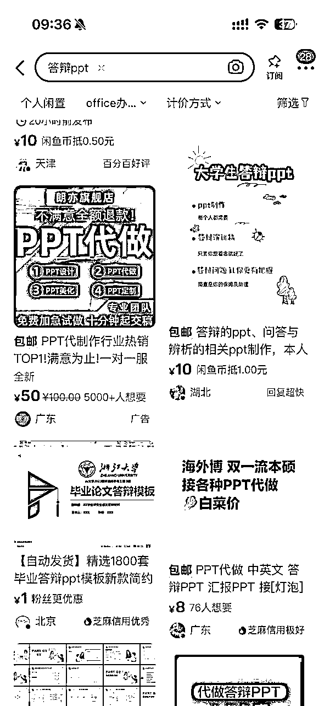

综合来看，需求量非常稳定且庞大。
我说的并非卖现成模板，而是根据客户自己的论文去定制化制作，用 AI 辅助完成，所以效率极高。

## （二）收入情况，拿数据说话
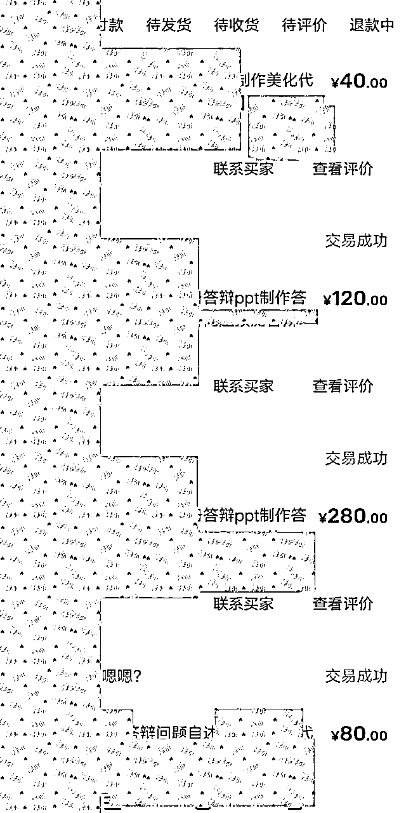
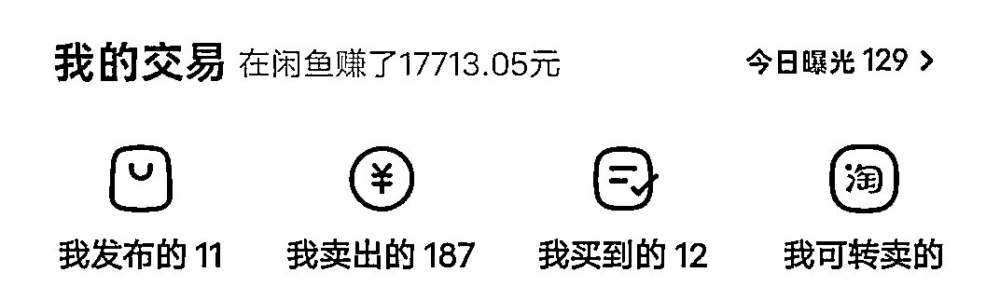
这个收益里还混了代写文案的收入，光 PPT 就成交了上万，还没算🛰️私单。
因为我主业还是代写，所以 PPT 这块并没有刻意放大。

从数据能看出三件事：
1、这个项目是真的能赚钱。
2、新手也能上手操作。
3、我本人已经把从接单到交付的完整闭环跑通了。

# 三、哪些人做这个项目更有优势

## （一）有 PPT 基础的人
本身就会做 PPT，再学会这套 AI 方法，竞争力直接拉满。

## （二）在校大学生
大学生最懂大学生，身边同学就是最直接的客源，冲就完事了。

## （三）会用 WPS 的小白
只要会 WPS 的基本操作就能起步。
当然，有耐心、愿意学习的，哪怕只是会用电脑的，认真上手也完全没问题。

# 四、整个项目的运作逻辑

核心流程很简单：接单 - 制作 - 交稿

## （一）如何拉到单子
主要渠道有闲鱼、📕、朋友圈。
淘宝商家也可以接，但单价偏低，不太建议。
我自己做的是闲鱼赛道，因为平台用户本来就是冲着买东西来的，成交速度更快。
📕我还没实操过，但长尾效应更好，我也打算之后尝试。
闲鱼的缺点是不能拖，5分钟内不回复客户可能就流失了。

## （二）制作环节
前期主要是我和办公室的伙伴自己做。
也试过外包写手，质量不稳定，沟通成本太高。
所以现在主推自己用 AI 做。
熟练后一个 PPT 耗时在半小时到两小时之间，通常一小时左右搞定。
我有点强迫症，做的偏慢，正常人会更快。

## （三）交付环节
只要成品过关，客户通常会主动介绍同学朋友过来，形成自然裂变。

# 五、闲鱼上架和沟通话术

## （一）商品上架
别自己瞎写。直接找同品类销量高的对标账号。
搜索“答辩 PPT”，看评价多、销量高的店铺，把标题和描述抄过来融合。
可以 A 店的标题 + B 店的文案，自己微调一下即可。
千万别纯原创，因为爆款文案里本身就带了大量搜索关键词。

## （二）主图
有设计能力的可以用稿定设计等工具自己做。
我前期比较懒，直接去📕搜“答辩 PPT”，用其他卖家的主图搬运，也能在淘宝找。
前期先跑通再精细化。

## （三）快捷回复设置
百度一下设置方法即可。
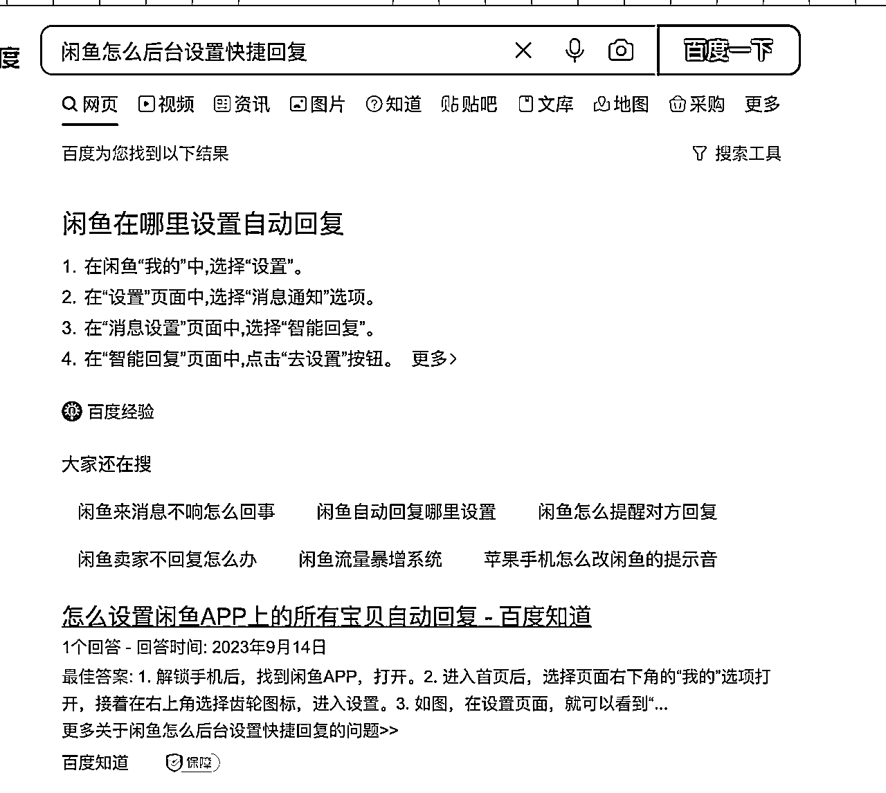

## （四）个人形象设定
头像和自我介绍也要对标。
比如设定一个“在读研究生代做 PPT”或“PPT 设计师”的身份，更有信任感。

## （五）冷启动刷单
刚开始没流量，可以找亲友帮忙刷。
最好用买家号，也就是没有卖家记录的账号。

刷单步骤：
1、先模拟真实买家，搜关键词进三家店问“做答辩 PPT 吗”，聊几句。
2、再进自己的店铺浏览商品，停留一下。
3、和“客户”聊完后下单。
4、第二天发货并好评。

刷浏览量也可以买，店铺看起来像老店更有信任感。

## （六）接单沟通话术
先问：您的答辩 PPT 有什么具体要求？
是否有固定模板？没有的话我会选一个简洁大方的。
什么时候要？
大概需要多少页？
您的预算是多少？

逻辑是：
问模板是为了判断是否需要严格按学校格式来。
问时间是为了判断是否加急，加急可以溢价。
问页数是因为很多卖家按页数收费，也有客户只说老师要求讲3-5分钟。
问预算是为了快速筛掉砍价型客户。

# 六、定价策略

价格弹性很大。
我最开始 40 元左右也能成交，后来提到 300 元。
建议先去闲鱼问几家同行，把价格区间摸清楚再定。

一个小技巧是做三档报价：
120 元包改 3 次
100 元包改 1 次
简单交差 60 元

或者：
5年设计师 200 元包改
5年设计师 100 元改 3 次
3年设计师 150 元包改

客户有钱选贵的，没钱也不流失。最低价是你觉得“接了也不亏”的底线。

# 七、实操全流程

## （一）先吃透客户需求
1、先确认客户是否有特殊格式要求。
2、出于隐私，我就不放成品图了。

### 1、有固定结构的需求
客户会截图发来学校要求的框架。
这时论文章节和要求不一定一致，需要你用 AI 归纳整合。
比如论文章节是绪论、概念、问题、对策，但学校要求的是另外一套。
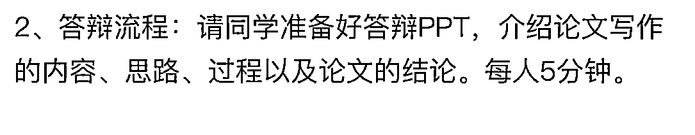

解析：这种属于强制结构，必须按要求重排。参考示意如图：
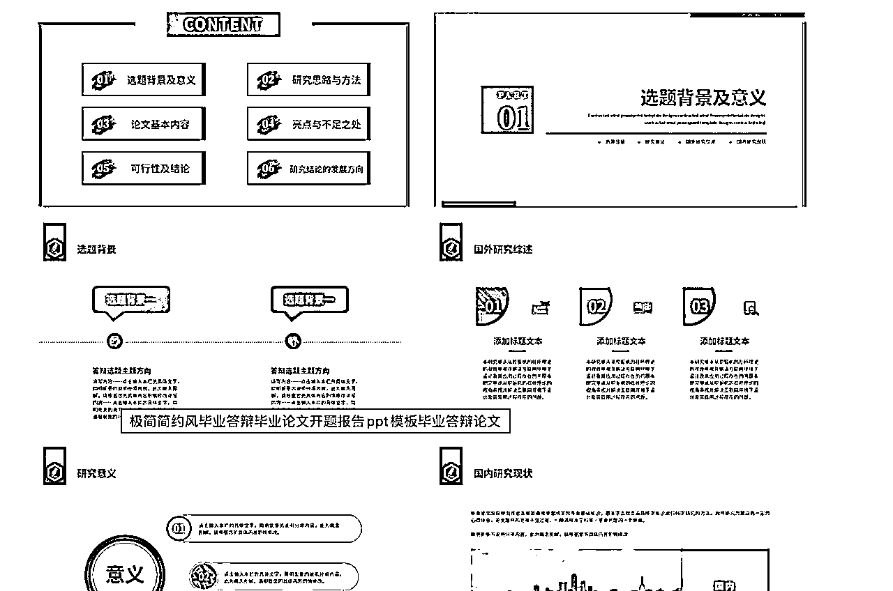

### 2、无固定结构的需求
客户没要求，就直接按论文目录梳理即可。
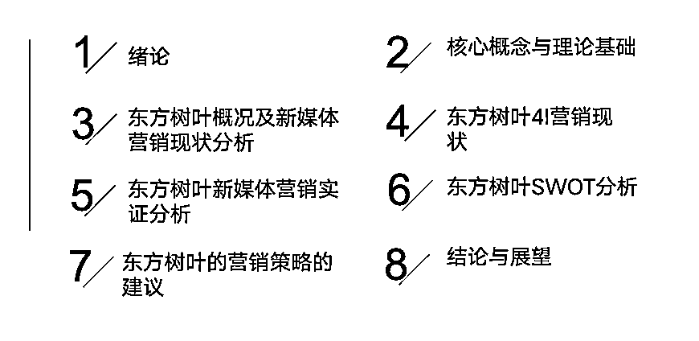

### 3、陈述稿是什么
基于 PPT 内容写的口语化讲稿。

### 4、答辩问题是什么
根据论文内容预测老师可能会问的问题。

## （二）模板去哪找
1、免费网站：https://www.1ppt.com
优先选蓝色系简洁大方的模板，别点付费的。
2、稻壳会员：淘宝搜“稻壳会员”，3个月 8.8 元，性价比极高。
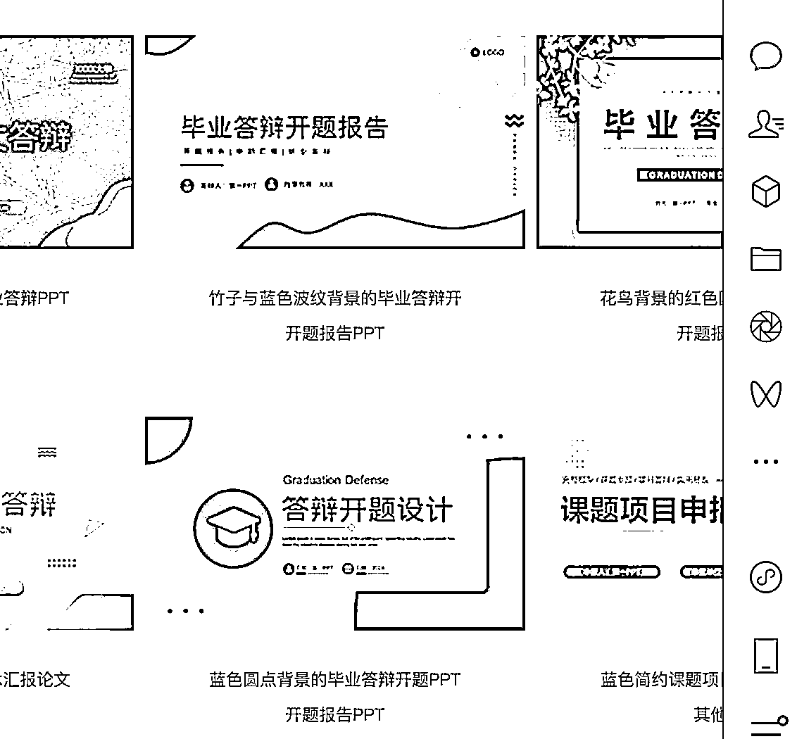
3、AI 工具：我习惯用 Kimi。
https://kimi.moonshot.cn/share/coboftsudu6f9brc2j0g

## （三）PPT 和陈述稿制作
1、先看需求
2、选模板
3、用 AI 归纳论文
话术示例：
请根据这篇论文写一份答辩陈述稿，约1000字。结构为：开头自我介绍、研究背景及意义、论文主要内容按目录展开约500字、创新点及不足、感谢指导老师。
点击链接查看和 Kimi 智能助手的对话 https://kimi.moonshot.cn/share/cp2n622tnn0v5qd9jub0
务必核对 AI 输出是否与原文一致。
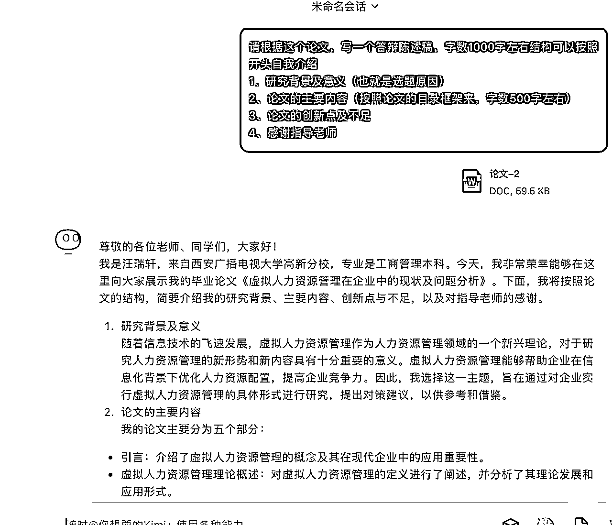

客户通常希望正文部分更详细。
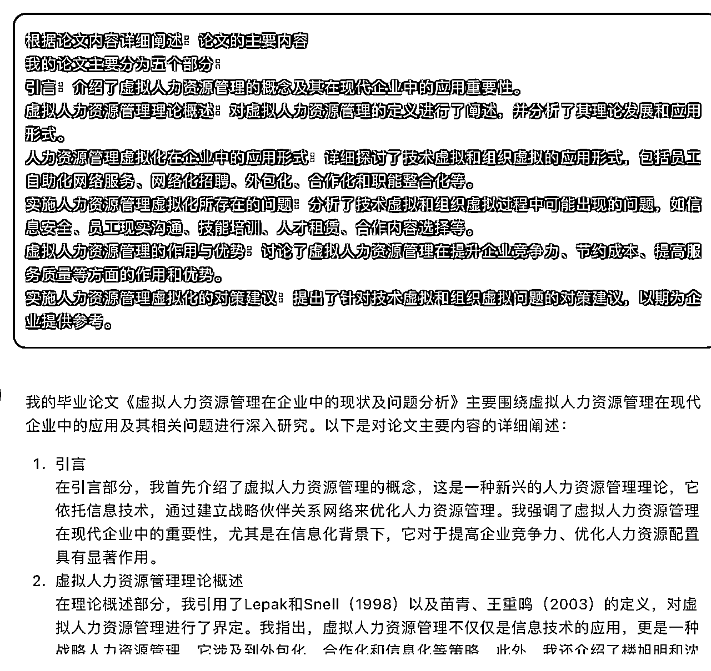
整理好后套进选好的 PPT 模板即可。

稻壳使用技巧：模板分页数不够时，用智能图形功能调整，最后统一颜色风格。

## （四）答辩问题预测
如果客户给了问题就按题做，没给就让 AI 预测。
我常用的问题库如下：
点击链接查看和 Kimi 智能助手的对话 https://kimi.moonshot.cn/share/cp2nd08fkflf2f7unreg
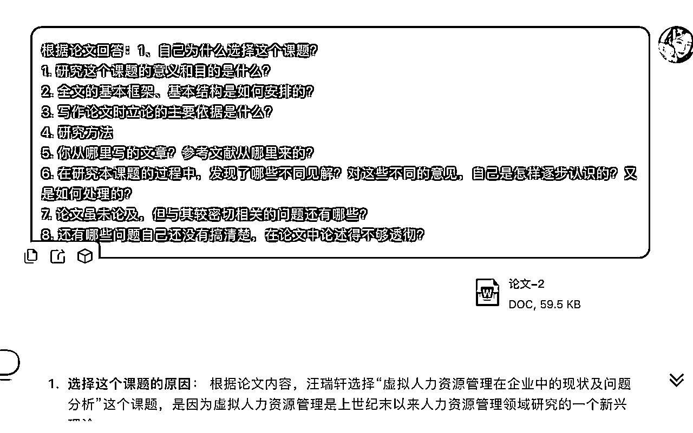

1、为什么选择这个课题？
2、研究的意义和目的是什么？
3、论文整体框架如何安排？
4、立论依据是什么？
5、研究方法是什么？
6、参考文献来源？
7、研究过程中遇到哪些不同观点，如何处理？
8、与本课题相关但未论及的问题有哪些？
9、有哪些没研究透的地方？

# 八、项目瓶颈

这个项目月入十万以上理论上完全可行，自己单干过万也轻松。
但我没放大，主要卡在以下几点。

## （一）接单端
1、单量太多一个人接不完，闲鱼要求5分钟内回复，极度考验在线时长。
之前一天成交四千的时候，两人轮流盯手机。
2、招客服/员工难。员工本身有代写活，分成的话大家都转做 PPT 不写文案，还会出现私下接单。PPT 需要对接和修改，员工不愿意加班处理。

## （二）制作端
1、外包质量差，返工和售后成本高。
2、自己做速度慢，一天 1-2 个。培训写手用 AI 也需要时间。

## （三）沟通端
很多客户说“你看着做”，过两天又说学校要求变了。需求不确认清楚，售后会无穷无尽。

# 九、理想运作模式

## （一）写手团队
先招会做 PPT 的人，拉群统一培训。最好是价值观一致、能快速执行的同频伙伴，类似航海式团队。
我最后选择办公室自产，因为线上做的废的多。

## （二）客服团队
从写手里筛选出做过、懂流程的人来客服，报价和需求确认更精准，减少售后。

## （三）流量
可以从内部培养，也可单独招。

整体来说，这个 PPT 项目最初只是为了给办公室增加收入，结果大家都累了。代写我做了九年，现在的卡点和代写基本一致。
我还写过很多代写的教程，包括 AI 代写，有空会整理出来分享。
欢迎交流。
## （四）合作
目前还没找到靠谱的团队承接。

# 十、项目延展方向

1、卖答辩 PPT 模板
2、卖课程，教学生自己做答辩 PPT

如果觉得有用，给个点赞吧，么么！
xiaosujx997