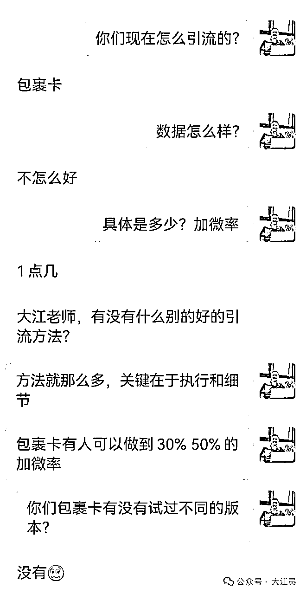
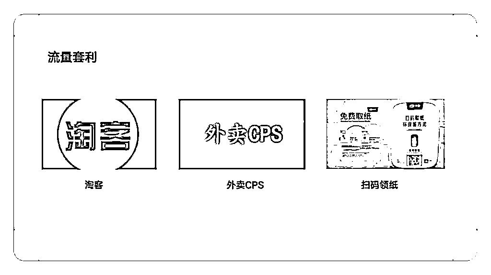
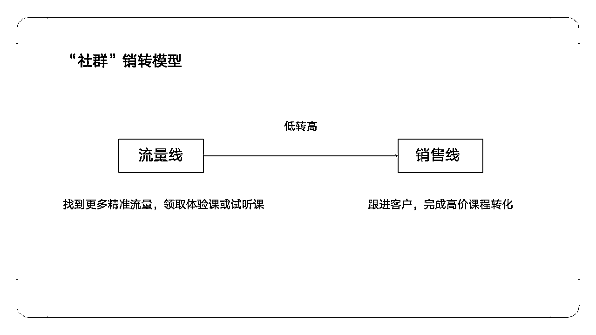
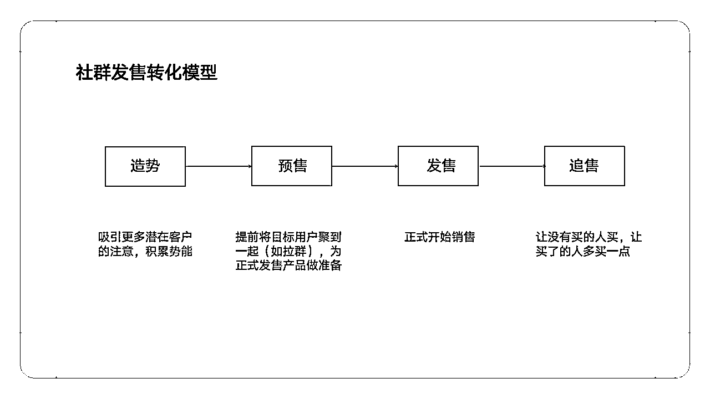
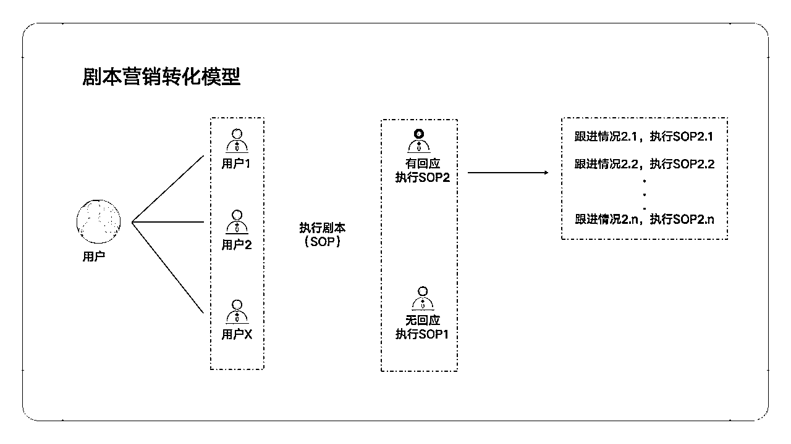
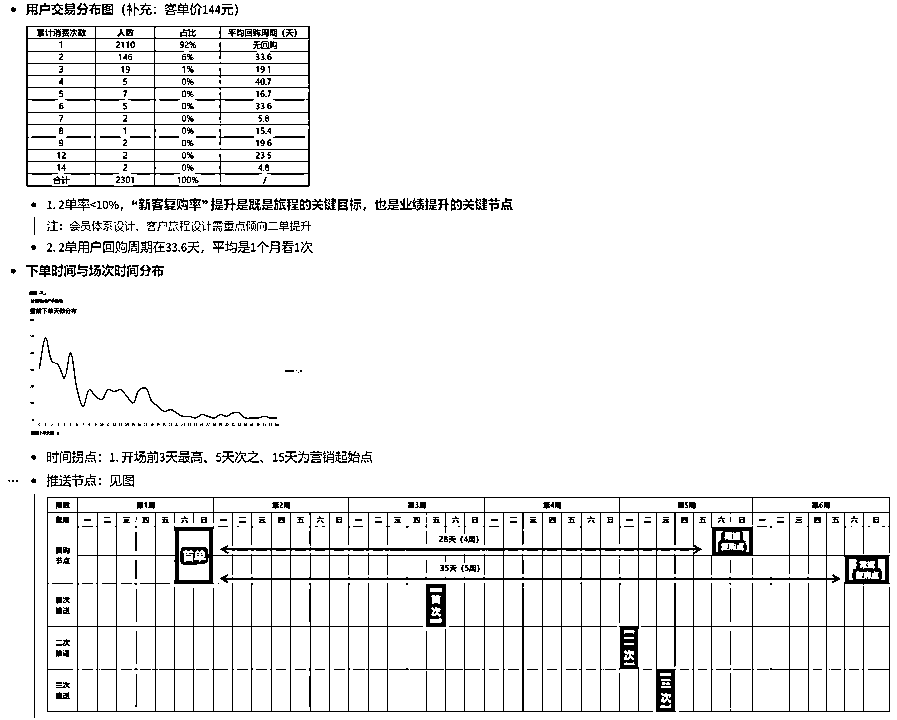
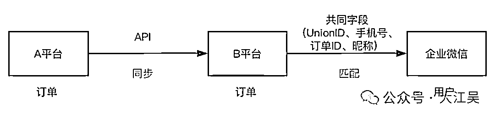
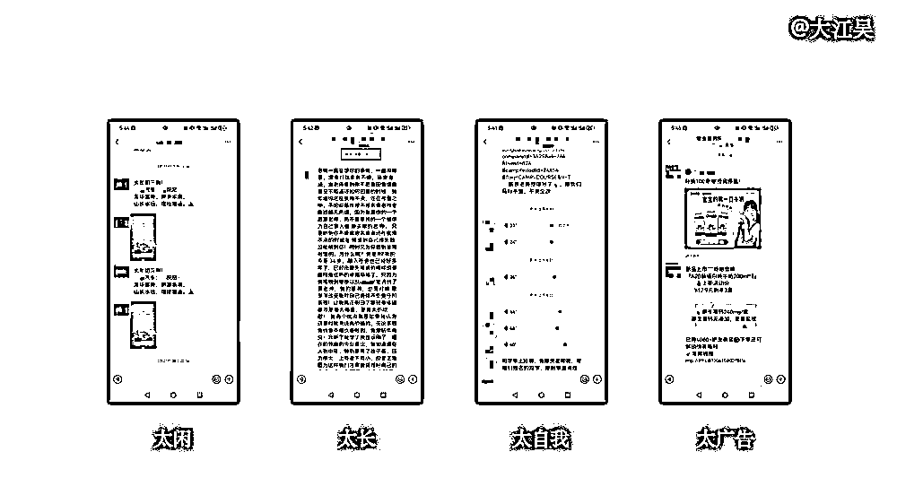
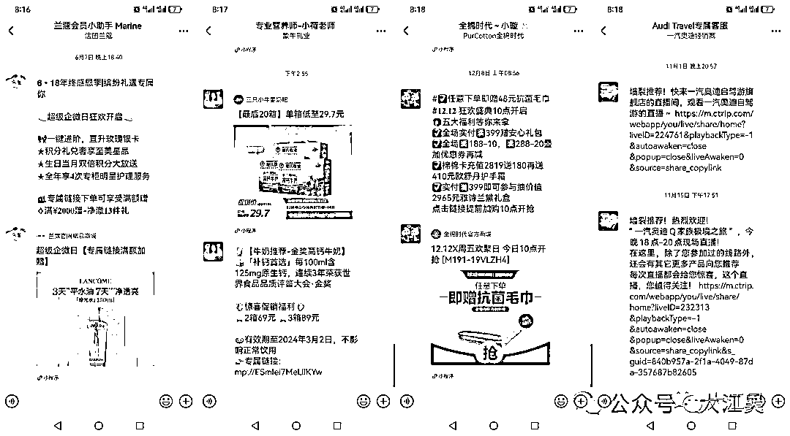
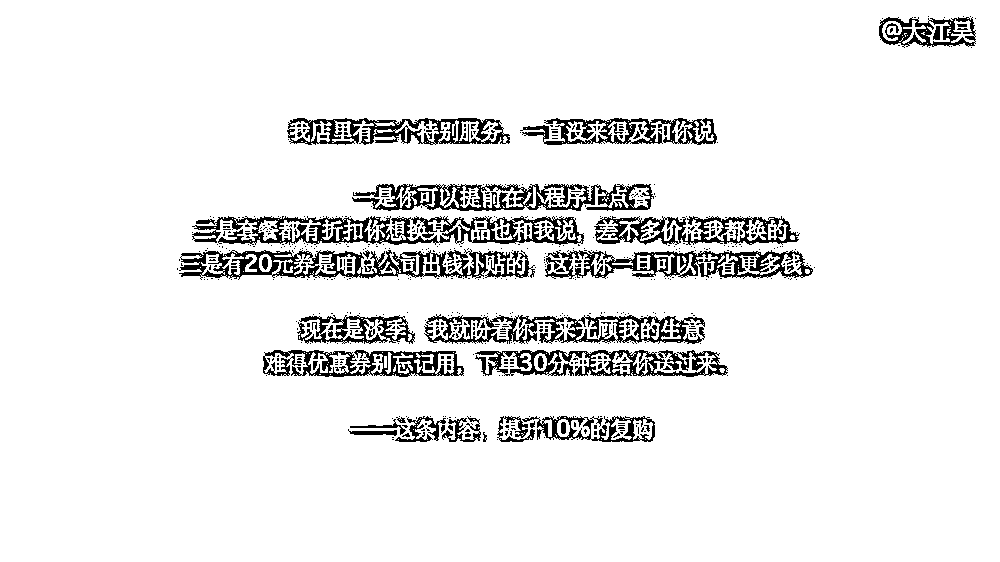

# ('公司入局私域的坑有哪些？', (2, 14))

《私域运营排雷实录：团队、内容、工具，我替你趟过一遍》

我是一名长期做私域运营服务的咨询师，副业是自己采购自己配送的社群团购。这些年见过太多品牌冲进私域运营，又悄悄退场。下面的坑，大多是我亲身踩过或帮着客户填过的，今天摆出来，给自己长个记性，也给同行提个醒。

先厘清概念。2020年二季度，腾讯财报第一次用了“私域”说法。大意是，广告主可以在公众号、小程序这些自有领地里，和用户建立长期稳定关系，而非只做一次买卖。拆开看：长远、忠实、付费、连接。所以私域运营的本质，是关系生意，不是流量生意。

业绩有通用算式：销售额=流量×转化率×客单价×复购/转介绍。看这个算式，关键在后半截，复购和转介绍。搞不清这一点，出发即偏航。

第一关，搭团队。私域运营要立项，立项就得有人干。不少企业不立项也不设岗，稀里糊涂开始，稀里糊涂结束。常见的坑有四个。

坑一：决策者不投入。有的把私域运营甩给广告投放团队。投放团队只会买量，不懂客户维护。更重要的是，私域运营要跨部门协调，涉及利益分配，没有最高层拍板，寸步难行。比如，人手从哪来？平台不导流怎么办？定价要不要跟公域一致？业绩算谁的？这些问题，只有决策者能决断。私域运营是典型的“最高负责人工程”，最高负责人不背，项目必烂。

坑二：牵头人不行。有的公司派老资历的人带队，有的从外面挖操盘者。老资历可能学不动，外来者容易夸海口。负责人必须有学习力，因为玩法新；还要有管理力，因为牵扯广。简历上写着过亿规模，但那是平台红利还是个人本事？赚钱了吗？搞不好请回一尊赔钱菩萨。

坑三：起步就扩编。有的公司财大气粗，上来就配齐营销、客服、文案。现在用人成本高，还没见收入，先见支出。干三个月一算账，钱都花在工资上，决策者急了，说私域没效果。其实前期只要一两个人，先把流程走通。

坑四：活多钱少。执行层不配合，往往是因为任务加了，工资没加。老板舍不得分钱，员工凭什么多干？私域增量出来，分一杯羹给干事的人，账才算得过来。

第二关，定人设。私域运营里人物形象有三个坑。

坑一：没形象。并非所有品类都需要人格化，但有没有，效果差十倍。非一线品牌，光喊品牌口号，用户没感知，信任难建立。花钱买流量，没有形象接不住。

坑二：客服型形象。一线大牌用客服型没问题，普通品牌不行。想想看，用户只有鸡毛蒜皮才找客服，你能主动找他的，无非是评分、促销、券。这架势，撑不起成交。

坑三：包装出来的形象。有人想塑造一个完美人设，但人设不是名字，是行为。你说自己是创始人，干活像个客服，用户就当你是客服。而且假形象迟早塌房，网红翻车的例子还少吗？背后是法律和道德风险。

第三关，做获客。引流这件事，也有三个坑。

坑一：只要量，不看质。拉来泛粉一万，不如精准用户一百。看算式：10×0.1×1×1=1；1×1×2×2=4。流量越不精准，转化和复购越差，成本还往上走。

坑二：只拉新，不养熟。好友数减掉流失数，才是真实资产。比如加100人，删掉一半，等于白干；但成本却按100人付了。人留不下来，后面生意全没戏。

坑三：找方法不如抓落实。引流不好就四处讨经验，其实方法不外乎几个要素：渠道、诱饵、时机、路径。要反复测试组合。比如电商常见用短信、电话、包裹附卡片、站内信。平均加粉率一两个点，有人能做出三五十个点。

第四关，抓成交。这里有三大坑。

坑一：拿流量思维算私域账。过去电商讲曝光、点击、转化，那是流量逻辑。私域运营讲留人、养人、超级用户逻辑。别只看一次买卖，要看用户一辈子的总价值。比如一人每天8.8元喝咖啡，每月喝20天，喝30年，这笔钱算下来很惊人。

坑二：没有成交机制。最常见的做法是把私域当销售渠道，每名销售配一台手机，流量一多就加销售，成本失控；销售太少，流量又浪费。其实有很多一对多玩法：流量模型；社群转高客单模型；限时群发售；一对一剧本营销；私域导回公域；动态+群+直播+单独沟通的组合。玩法不在多，找到适配自己的才重要。

坑三：没有数据就开车。不清楚人效、不清楚盈亏、不清楚赚没赚，全靠拍脑袋。数据是运营的仪表盘。比如我们服务过一个演出客户，数据显示二次购买率不到一成，且产品只有单次票，于是我们推了次卡，复购明显上升。还有推送时间，数据指出午休和下班前是打开高峰，那就把推送排在这些时段。

数据打通也可能是坑。有人花大钱做系统对接，结果订单通了，客户没通。原理是两步：第一步，用接口把订单从A平台同步到B平台；第二步，靠相同字段（比如UnionID、电话号码、订单号、昵称）把人跟单对上。腾讯生态内可以自动关联；其他平台需要用户自己提供号码或单号。用户未必肯提供，数据就是死数据。

第五关，做内容。决策者常忽略内容，其实内容决定了私域能走多远。

坑一：不把内容当回事。看看现在各家的私域内容，普遍惨淡。内容是私域的地基：加好友后的欢迎语、培育时的沟通脚本、入群邀请、直播留人话术、客服答复、群发文案、动态墙素材。有位前辈总结：私域价值=个人吸引力×加好友力×内容质量的平方×产品实力×运营功夫。内容趴窝，整个系统都趴窝。

坑二：语言不打动人。很多品牌学大牌，发硬广，用户扫一眼就走。硬广长这样。说人话的内容长这样。如果只改一处，那就是把内容写得像人说的话。

第六关，选工具。工具不是越早买越好。

坑一：买太早。需求没清楚就买系统，跟先买跑步机再决定跑步一样。私域运营还没跑通，微信自带功能足够，手动也能干。等流程固定了，再考虑上工具。

坑二：贪多贪便宜。运营总想功能全、价格低，好向上面交差。可真正常用的功能没几个。功能堆得越多，操作越麻烦。而且工具越厉害，对用的人要求越高。看看AI就是这道理。工具只提供技术支撑，不代替业务思考。比如获客，核心是策略加内容，技术反而是次要。

坑三：被工具反噬。期待工具解决一切，就会猛加功能，结果每天忙忙叨叨，产出一点没多。这是本末倒置。

成功没法照搬，失败可以绕开。私域运营这条路，孤独又多变。少跳一个坑，就省一段冤枉路。希望这份清单，能让你走得稳些。有问题欢迎来聊。