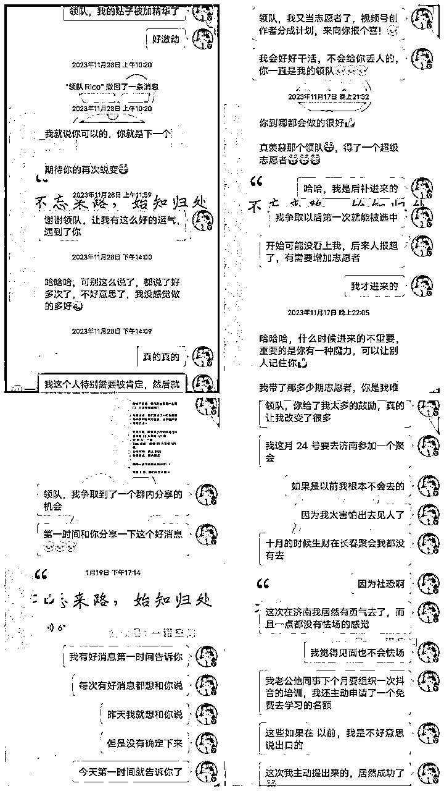
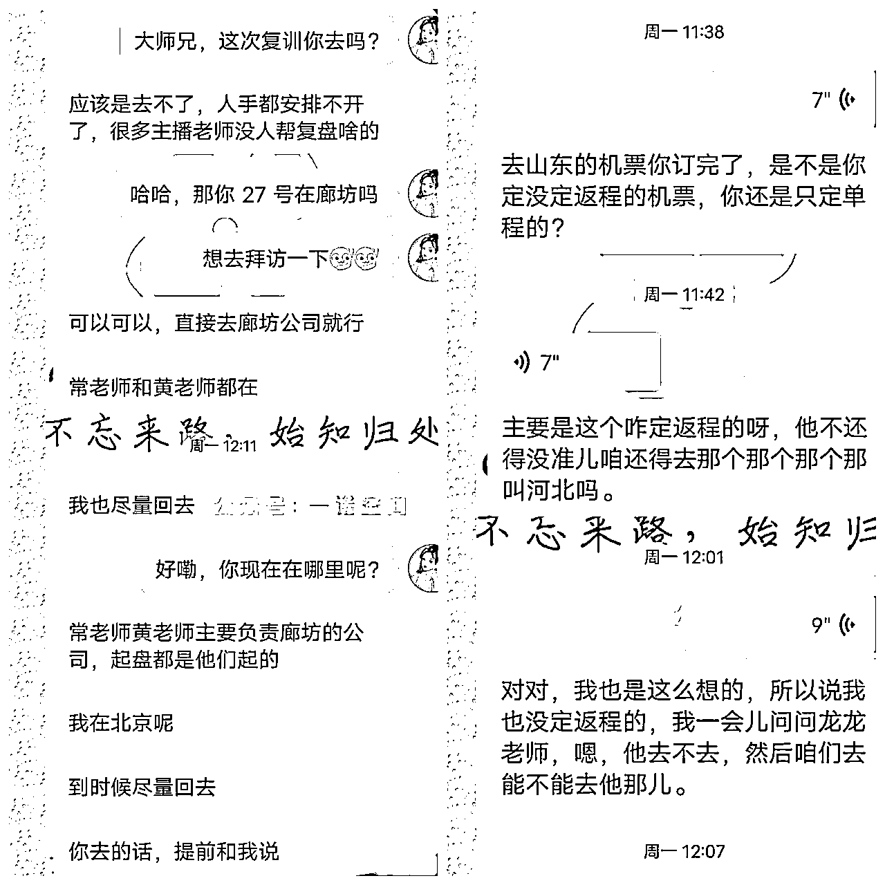
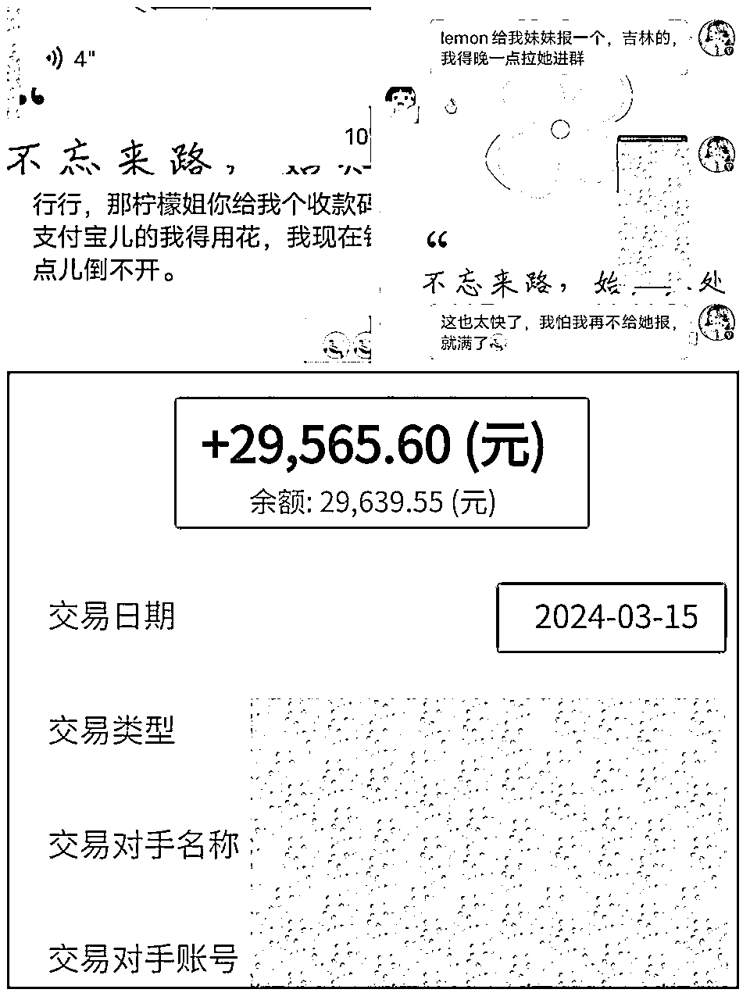
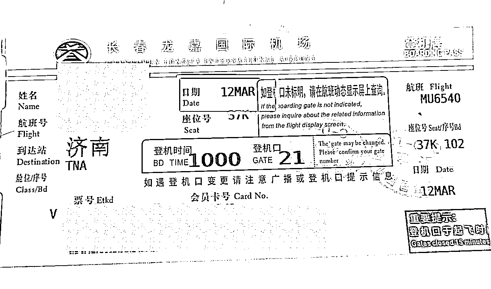
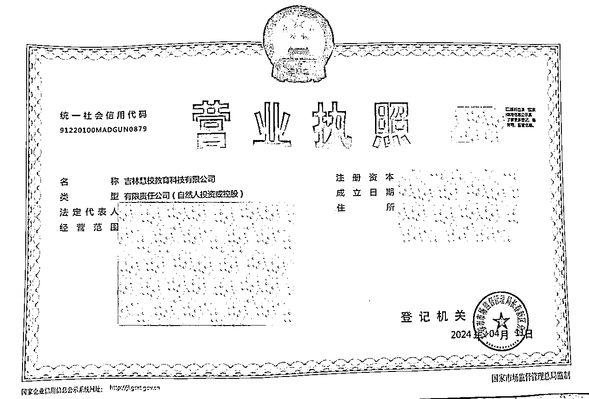
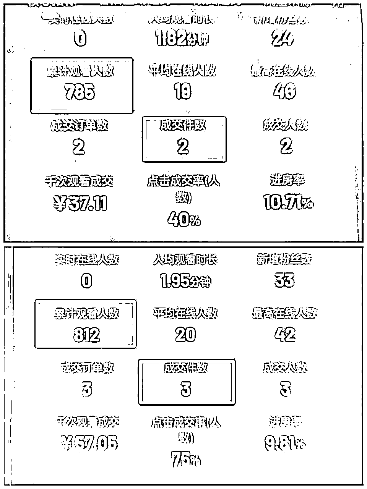
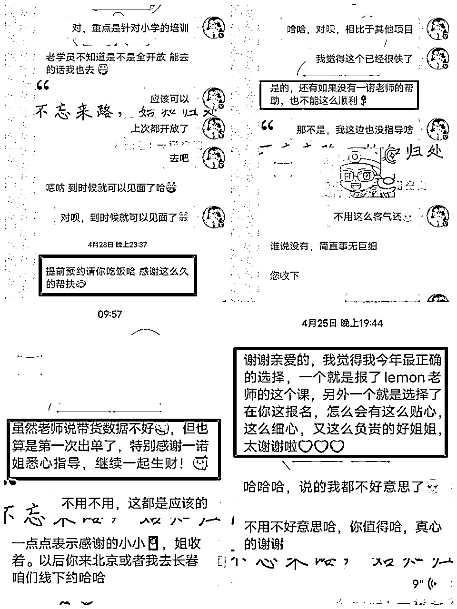
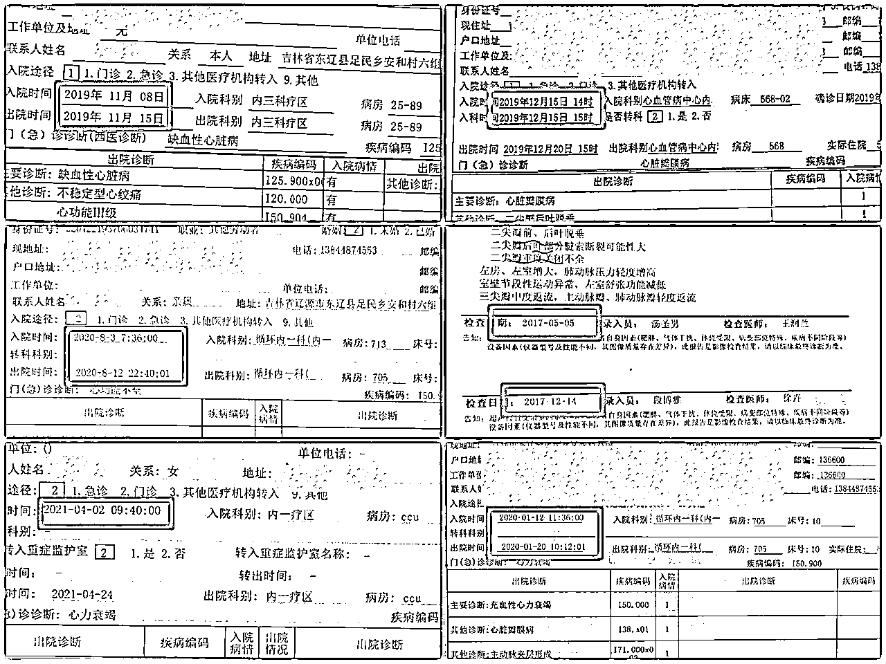
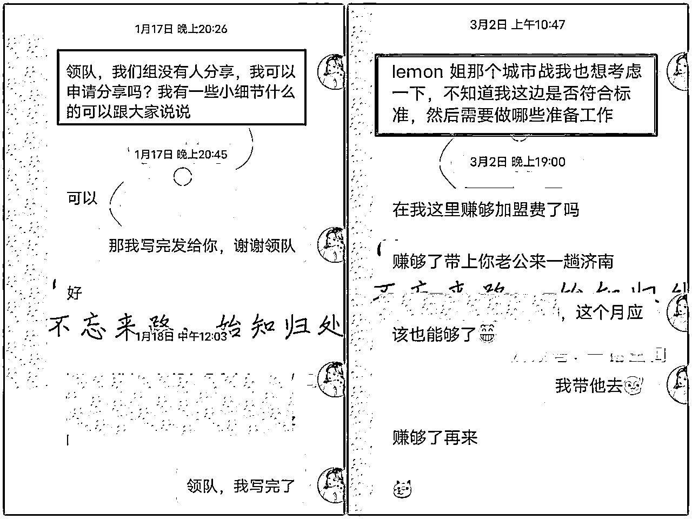
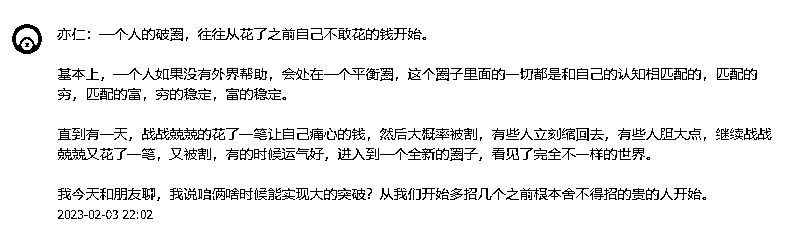

# 38岁中年三无女生，从0到稳定月入2万+的赚钱之旅

38岁，东北农村出身，身体有残疾，父母离异，母亲重病，主业亏了十几万……听起来很像“一手烂牌”？但就是这样一个我，用一年时间，从迷茫焦虑的“三无”中年女人，变成了稳定月入2万+的教育规划师。今天不讲大道理，只把我的真实经历和关键转折点分享给你，希望能给同样在项目里打转、看不到方向的圈友一点力量。

先简单交代下我的过去：1985年生于东北农村，天生胯骨脱位，3岁父母离异，七八岁做了三次手术。2016年妈妈主动脉夹层手术，2019年起因心衰和类风湿卧床，反复住院。2024年我自己的主业项目又亏了10多万。听起来挺惨的，但也正是这些经历，逼着我养成了“凡事提前打算”的习惯——2013年药品行业还行的时候，我辞职去做药品代理；2015年房价起飞前买了房；2020年主业刚露出下滑苗头，我就开始试水副业。只是当时没有系统方法，也没及时止损，最后亏了10多万。

直到2023年4月加入龙哥盟，8月第一次当航海志愿者，命运才开始转向。当时我很自卑，幸好有志愿者身份加持，得到领队Rico和船员们的鼓励认可，从此好运接连而来，直到遇见教育规划师项目，完成逆袭。

我一直相信：上帝关上一扇门，必定会打开一扇窗。希望我的故事能成为你迷茫中的一束光。

## 一、逆风翻盘的5个关键节点

### 1. 加入龙哥盟

其实之前我做过网课代理，早就听说过龙哥盟，但总觉得花2000多买内容不如几十块买盗版划算，甚至觉得付费的人“脑子有问题”。现在回头看，小丑竟是我自己。

加入后我发现了几个巨大的价值：

**①搜信息太方便了。** 有精华帖、风向标，想搜教育相关内容，直接关键词一输，系统又全又清晰，不用自己瞎翻。

**②航海项目治好了拖延症。** 我属于自制力极差、但好胜心又很强的人，自己搞项目很容易拖到放弃。但航海有打卡、有教练、有志愿者督促，好胜心一上来，21天收获比我闷头看帖几个月都大。

**③信息差值钱。** 能不能赚钱，除了知识，更重要的是信息差、资源差、人脉差。这些只在少数圈子里流动，赚钱的资源起码领先外界6个月，而这6个月往往就是项目的红利期，晚来一步只能喝汤甚至当炮灰。

**④能直接链接大佬。** 在外边找行业精英很难，还容易被割韭菜。但赚钱的精华帖都是龙哥筛选过的，垃圾信息少，想找人还能直接问鱼丸。

那阵子我疯狂刷精华帖，学到了很多项目共性，也关注着风向标，这都为我后来做教育规划师打了底。

### 2. 航海志愿者之旅

这是我突破自我的重要转折点。去年8月，我报名了视频号带货志愿者。因为身体原因加上各种琐事，我一直很自卑，线上还好，特别怕线下见面。记得去年长春圈友组织线下聚会，我犹豫半天还是没去。

但做志愿者时，我把东北人的热情和真诚全拿出来了，得到了领队和船员们的认可，最后被评为A+志愿者。那种被优秀创业者需要和肯定的感觉，给了我巨大的鼓励，语言都形容不出来。信心有时只需要一次被认可、被需要就够了。正因如此，后来我才敢去济南参加lemon教练的线下培训。

真心建议大家去做一次航海志愿者，21天肉眼可见地成长。赚钱不会辜负努力的人，你的付出一定会被看见，更重要的是心态的变化。

### 3. 走到线下，被真实震撼

都说线上聊千遍，不如线下见一面。去年年底，我终于鼓起勇气去济南参加lemon教练的线下课。

我主业做药品代理，主要靠电话销售，很少见客户，偶尔参加药交会也见不了几个人。副业也是纯线上操作，网课代理、闲鱼都是网上成交，从没见过线下面基。

到了线下才发现，所有的自卑和恐惧都是自己想象出来的。在赚钱这个搞钱的圈子里，目标都很纯粹，就是搞钱。现场有真实的直播场景、真实的成交记录，一群人都在聊怎么赚，确实被震撼到了。

当时我还是个小透明，但丝毫没被排斥。几天下来，我和大家熟络了，能约饭、约出行、讨论直播卡点、交流学习。以前的我已经很久没有社交了，圈子基本锁死，而这次彻底打开了。

### 4. 第一次月入2W+

去年主业亏了10万，我对做项目本不抱期望，只想比打工强一点就行。38岁转型很尴尬，打工跨行难，原行业又不景气，平均工资才3000多，根本不够花。

但做教育规划师的第二个月（2月工资），我就达到了月入2W+。当时太激动了，完全没想到能赚到这个数。对很多大佬来说这可能不算啥，但我激动得哭了一晚上，压抑很久的情绪彻底释放了。

记得报名时学费6999，我还是用花呗付的，纠结了很久才下定决心。结果两个月就回本了，后来还给我妹妹也报了名。庆幸加入赚钱，庆幸遇见领队Rico，庆幸参加教育规划师航海，庆幸遇到lemon教练，更庆幸自己没有放弃。

### 5. 签约城市站，开了公司

线上销量稳定后，我老公也辞职一起干。我们都处在中年职业危机里，他公司经常拖欠工资，有时两三个月不发，综合考虑后决定辞职。

这个决定不是冲动，而是赶上了天时地利人和。lemon教练的眼光很超前，我还在为月入2万沾沾自喜时，她已经开始布局全国城市站了，把每个省份做成一个站，覆盖高考、中考、小升初、幼升小、中职等赛道。

我们果断决定签吉林城市站，得到lemon老师认可后，三月份又去了趟济南签约。有了城市站，前景更清晰了：小课包收入、后端转化收入、地级市加盟收益，总部都有分成。

从济南回来就干起来了。四月份我们在长春注册了公司，前几天刚租了办公室，准备大干一场。

说实话，人到中年从没想过二次创业，而且上次失败后，我一度觉得自己根本不是创业的料，目光短浅、优柔寡断、全凭一腔孤勇，抗风险能力很弱。这次如果没有山东总部和lemon教练的支持，我肯定没这个勇气。人一辈子没几次改命的机会，来了就必须拼尽全力抓住。庆幸，这次我抓住了。

## 二、做教育规划师的收获

### 1. 经济和事业的收益

经济收入前面说过了，中年还能开启一份自己的事业，特别感恩。而且能带着妹妹一起做，觉得更有价值了。我妹在东北小县城开药店，这几年市场不景气，她之前连抖音都不玩，飞书更不会，性格内向，工资也低。现在她一天直播两场，每场2个多小时，能带货两三单，一天赚300块（按60×5算），在小县城已经很满足了，还能兼顾药店、孩子和老人。以前都是她帮我，这次能帮到她，真的幸福。

### 2. 社会价值的体现

人总需要被认同、被肯定、被需要。我以前做项目也认识些圈内人，但一直是小透明。直到当志愿者被需要，后来在教育规划师项目里慢慢被大家认识。每次听到大家亲切地喊“一诺姐”，能帮他们解决问题，我都特别开心。我的方法很简单：主动、真诚、利他。

以前我不敢表达，怕说错被笑话，怕大佬觉得我蠢。后来发现，规矩都是自己设的，大家都很忙，没人盯着你出丑，真正困住你的只有自己。大胆表达、真诚待人、利他主义，真的会有意外收获。

### 3. 家庭关系的改善

都说贫贱夫妻百事哀，女人的情绪决定家庭氛围。谁想做怨妇呢？不过是压力太大，钱不够花，才容易吵架。做教育规划师以后，家庭氛围明显和谐了，一来忙着赚钱没空吵，二来金钱能解决80%的烦恼。以前带妈妈住院只能去县城，每次花一万左右，一年至少两次，很吃力，还会怪自己没本事带她去好医院。现在我可以带她去长春的大医院，作为女儿也安心了。

## 三、教育行业前景有多大？

刚接触教育规划师时，我只知道高考报考指导师。接触四个月后发现，变现方式多到超乎想象。

**高考规划：** 前端19.9小课包，利润能到60+，场均销10+，每场1-1.2小时，一天播2-3场，收入1200-1500/天；高考志愿卡199-299，成本几十，均价利润100+，一天引流30-50人，淡季转化2-3单，旺季5-10单；后端志愿填报每人6000-8000；还有海外留学等。

**初升高：** 小课包利润销量同高考；中考志愿填报99-199/人；初升高预高一课程15天6999-8999；对接私立高中解决分流问题。

**小升初：** 小课包引流；家庭教育指导课程；报考指导、学区派位；游学合作。更多玩法我还在了解，但可以肯定，这条赛道未来大有可为。

## 四、我的几点感悟

### 1. 项目怎么选？

**①选有壁垒的。** 互联网项目迭代太快，今天爆款明天就下架。越是简单的事竞争越激烈，赚点小钱却不踏实。做有知识壁垒、难而正确、能持续深耕的事，开头难，但会筛掉一堆急功近利的人，后面越来越轻松。

**②考虑时间成本，选利润高的。** 以前卖网课，单课9.9，卖50单才抵一个会员利润，后来就改招会员。闲鱼无货源也一样，低客单和高客单花的时间差不多，利润却差很多。同样一小时，当然选赚钱多的。

**③找差异化。** 网上到处都是“割韭菜”的贴子，看到大佬晒收益就冲动入手，结果被虐成渣。很多项目确实不适合小白直接抄作业，像我最初照搬大主播的直播脚本，被碾压得渣都不剩。后来才学会做差异化竞争。

### 2. 机遇、圈子、资源

项目之外，圈子和核心人物的引领更重要。

**①真诚、感恩。** 东北人的真诚热情是我的底色，一无所有时，这可能就是你的幸运石。大佬什么人都见过，更愿意提携懂得感恩的人。也别瞧不起不如你的人，口碑都是自己攒的。

**②早就是优势。** 如果我再早几年加入赚钱，可能早就找到方向了。我直播能力只能算中游，但因为早，有足够时间熟悉市场、优化打法，才有机会做城市站。种树最好的时间是十年前，其次是现在。

**③抓住每次机会。** 项目是死的，人是活的。遇到好项目、好机遇，一定要狠狠抓住。志愿者报名、航海分享、项目报名、城市站签约，我每次都挣扎很久才敢开口，怕被拒、怕失败。虽然也被拒绝过很多次，但至少争取过，不后悔。

**④圈层和资源太重要了。** 你是谁不重要，重要的是你和谁在一起。回想这几个月，我的进步快得不可思议，以前的努力并不比现在少，为什么结果天差地别？可能因为以前在外围打转，接触不到核心思想，像工兵一样一步一挪。好的圈层能给你加持资源，关键信息只在少数圈子里流动。

借用龙哥大佬的一段话，与大家共勉：

## 五、感谢的人

说这么多，就两个字：感恩。

感恩凌心带我进入龙哥盟，感恩平台提供这么好的机会，感恩lemon老师带我入圈、给我那么多支持。

也想对所有赚钱圈友说：找到适合自己的项目，持续深耕，一定能拿到结果。加油！