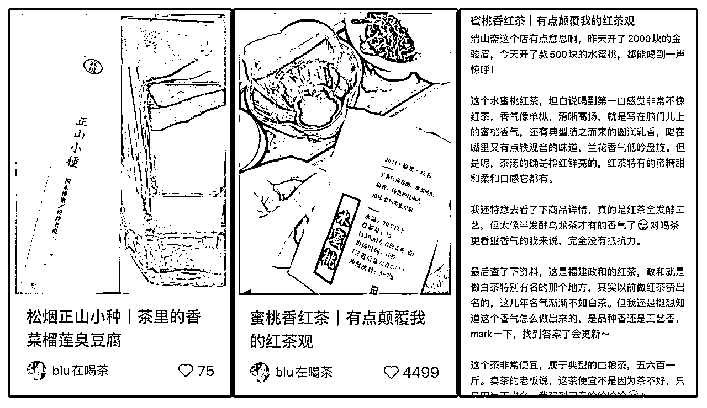
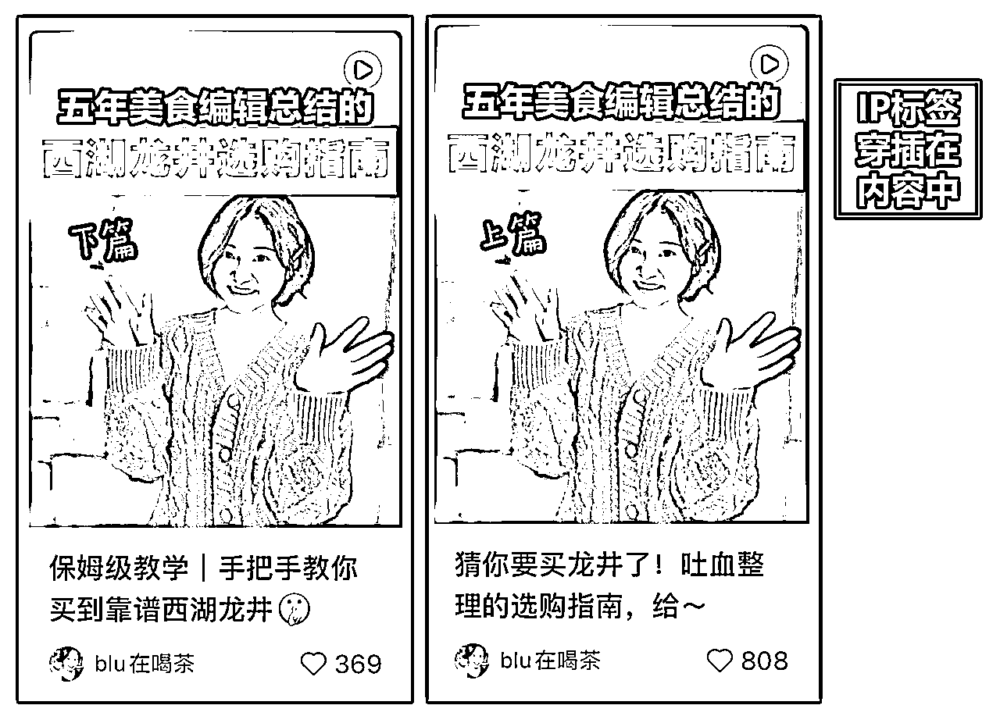
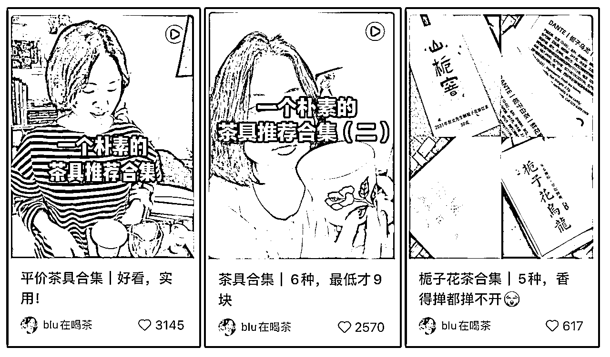
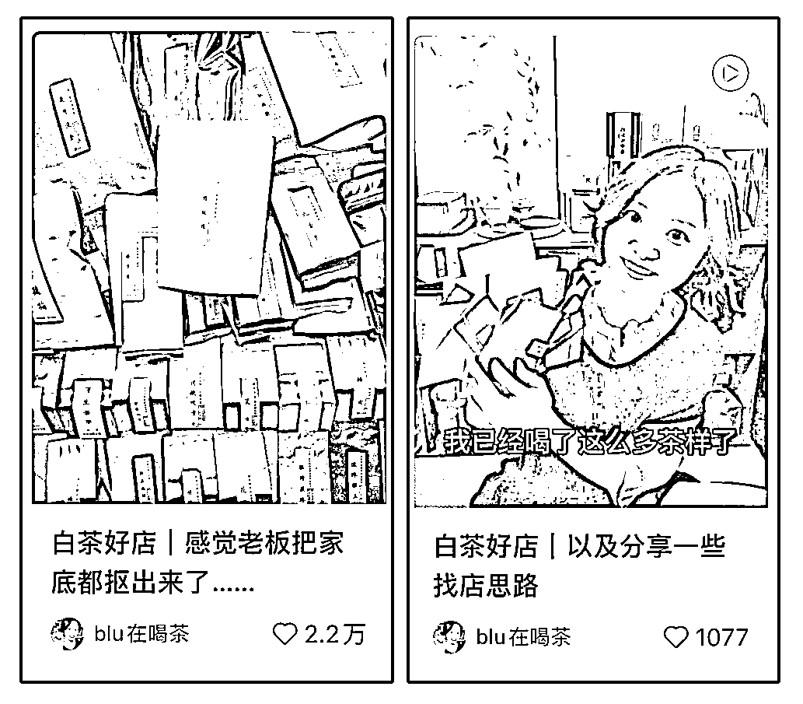
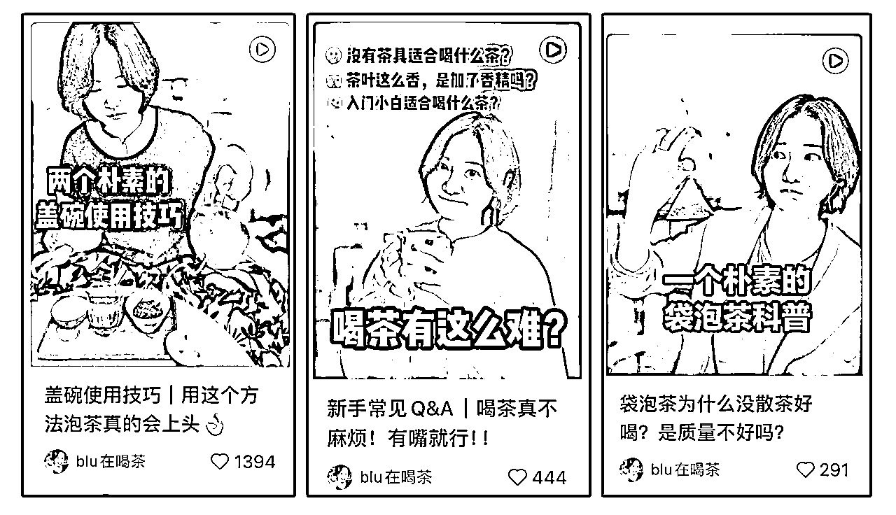
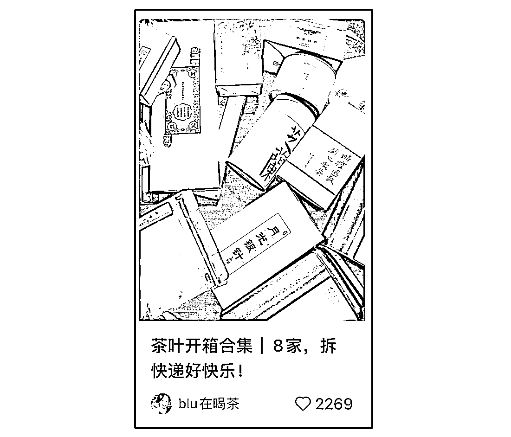

# 用8种选题，打造高变现能力的买手IP

从一个买手IP的内容选题，能看到什么？

此前我从账号整体维度拆解过小红书茶叶买手@blu在喝茶，她曾两次进入小红书买手榜。这次换一个角度，只管看她的选题结构。你会发现，一个能持续卖货的买手IP，并不需要天天追热点，而是把选题搭成一套体系，让商业价值自己长出来。

她的日常内容大致分7条线：单品测评、选购攻略、合集清单、观点分享、单店种草、方法科普、开箱记录。另外还有一条更新频率不高、却每次都很有分量的“IP故事”线，通常出现在关键节点，比如拿到小红书百大买手、获得台湾茶协会认可的时候。这套组合下来，账号同时具备三重能力：能快速种草转化，能靠人格化积累信任，还能在低粉阶段持续出单，不需要跟流量和噱头死磕。

接下来，一条一条拆。

### 1、单品测评/种草
她写蜜桃香红茶时，说自己的红茶观念被“撞了一下”；写松烟正山小种时，则把它归到“茶界的香菜、榴莲、臭豆腐”阵营，用一句比喻立住个性。

单品测评最大的坑是容易被当成广告。想避开它，内容就要有细节、有私人视角，像在跟朋友聊某件东西好不好用，而不是站在宣讲台上背书。夸赞要克制，好坏都讲，才显得客观。配图也一样，多生活场景，少精致卖家秀。标题可以套用：店铺名+产品名+一句直给的感受。

### 2、选购攻略
她在龙井需求最旺的时候发过一份选购指南，直接对目标人群喊话；另一篇西湖龙井教程，则把新手当“小白”来带，一步步讲透。

选购攻略要服务新手，还要卡准大众需求集中的时间段。比如春季很多人想买龙井，就做龙井；年节前后普洱送礼需求大，就专门出普洱。写的时候记得把自己的买手标签、喝茶经历自然带出，信任感会加倍。标题路子很清晰：一个“费心整理/零基础跟学”式的前缀，再加上具体品类的选购指南。

### 3、合集清单
她做过平价茶具合集，强调好看又实用；也把6种茶具放进一份清单，最低只要9块钱；还有一篇栀子花茶合集，收录了5种香气汹涌的茶。每种清单都有让人点进来的理由。

合集最怕变成无聊的目录。想要打开率，清单必须有一个尖锐的记忆点：平价、实用、特别全，或者小众独特。不同品类有不同优势，不要照搬模板。标题公式是：一个特色词+具体品类合集+一句话点出亮点。

### 4、观点分享
“喝茶烧钱”这种说法，很多人听过也烦过。她直接抛出一句反驳，再真的算了一笔喝茶账，让茶友直呼“被说出了心声”。

观点类内容有时比干货还容易爆，关键是要做粉丝的“嘴替”，或者给出一个反常规的角度。喝茶烧钱这个选题，既是爱好者的内心共鸣，又带着点反常识意味，所以数据亮眼。买手IP不只要卖货，也要偶尔亮出态度。

### 5、单店种草
推荐白茶好店时，她用“老板把家底都翻出来了”来形容一家店的储存量；另一篇则在推荐之余，分享自己筛选好店的思路。

单店种草同样会被怀疑是软广。破解的办法是降低表达姿态：像闺蜜之间分享新发现一样，优点说透，小槽点也可以提，真实感比完美感更重要。如果还能附带一套找店方法论，内容价值会更高。

### 6、方法及科普
讲盖碗冲泡，她强调这套手法会让人“越泡越上头”；新手问答里，她直接表明喝茶不用搞得太复杂；介绍袋泡茶时，她用一个大家共同的困惑——“为什么不如散茶好喝”切入科普。

方法类内容要把“效果”放在前面，让读者第一眼就知道学了能获得什么好处。科普类内容则要选那种人人都隐约有过疑问的话题，比如袋泡茶和散茶的差距。标题可以按三条公式来套：器物用法+实际效果；新手常见问题+一个态度；某个现象+为什么+可能原因？

### 7、开箱记录
她做过一次茶叶开箱合集，一口气拆了8家店的包裹，标题里直接写着拆包裹的快乐。

开箱类内容最适合做成合集，几个包裹一起拆，比单拆一个更有连续感；也可以选择拆一家有话题度的网红店，吸引力同样很强。标题公式：开箱对象+开箱记录+一句真实感受。

### 8、IP故事
小体量博主怎么拿百大买手？带40种红茶去现场，为什么被人说“最有故事”？新粉丝凭什么快速信任你？她把这些都写成内容：用朋友报喜的语气分享荣誉，把经验做成复盘，再用一篇“个人使用说明”降低陌生感。

IP故事不需要多，但每一条都要有分量。拿到有含金量的荣誉、完成重要节点时，把它当成喜事和朋友分享，而不是挂在头顶炫耀，反而更能赢得信任和好感。这类内容存在的意义，就是让大家看到屏幕背后那个具体的人。

这套选题逻辑不仅适用于小红书。做买手IP，抖音、公众号、视频号都能复用，只需要按平台氛围调整语气和包装。

另外有一个时间线值得玩味：以上内容大多在2022年上半年发布，2023年中重新编辑，而那时小红书正好在大力推动直播买手。提前把内容信任攒够，等平台红利真正到来，变现自然接得住。认真拆一个账号，你会发现，所谓“高变现能力”，从来不是某一个爆款的结果，而是一套选题闭环的积累。