# 用一套直播间，打遍全平台：我如何把一个主播的工资，变成五倍收入
作者：龙哥

# 开场白：

大家好，我是龙哥，今年才正式加入龙哥盟。

简单做个自我情况说明：

一、2015年到2020年，我沉迷淘宝客。早期做社群淘客和招商淘客，佣金月入峰值超过20万。如今这条线虽然躺平了，但每月依然有几万块的稳定 passive income。

二、2021年all in 抖音短视频+直播带货。现在团队常驻主播20人，抖音单月销售额长期稳定在8000万以上。

三、2022年切入🛰️视频号，照搬短视频+直播带货的打法，用矩阵操作。目前运营矩阵号50+，视频号月销售额突破2000万。

四、2023年开始做跨平台直播同步。抖音、视频号、快手、📕、淘宝、京东全开，一个主播在播，等于同时为多个平台赚钱，收入直接叠加。

# 正文：

去年做直播到一定阶段后，我明显感觉到一个问题：入局的人太多，平台大盘流量被不断稀释。想靠单平台持续吃到大流量越来越难了，瓶颈感很强。一次饭局上，朋友随口问了一句“能不能一套直播间同时推几个平台”，这句话点醒了我。

于是我带了两个人专门去啃这件事。研究各平台的规则红线、测试同步推流的技术方案，前面炸了不少号，走了不少弯路。熬到最近，终于沉淀出一套相对稳定、可复制的多平台同步播法。今天就在赚钱跟大家掏心窝子讲讲。

这套多平台同步直播的打法，我已经实操跑通了。它更适合已经在单平台做起来的创业者老板，用来做增量，不适合从零起步。做得好的话，直播收益不是翻倍，是翻三倍。觉得干货有点多，点个赞支持一下。

我们现在常态化同步开播的平台包括抖音、视频号、快手、📕、淘宝、京东，甚至电脑带得动还能继续加。前面这些平台我们都实测过，并且都已经产生真实成交。所以今天分享的不是概念，是已经验证能赚钱的方法。

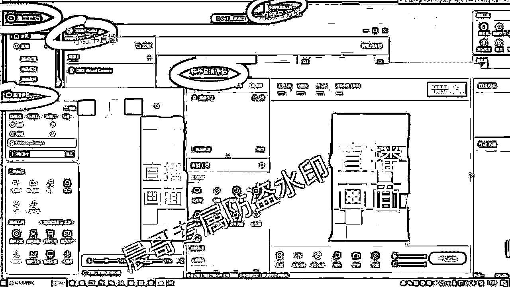

# 平台一：抖音

抖音电商目前依然是直播带货的战略主战场。大盘流量大，竞争也极度内卷。流量上来后很容易触到天花板，投流、千川推上去也很难再有质变。很多老板的第一站都是抖音，原因很简单：现在依然是流量为王。

抖音的玩法生态已经很成熟了，教程满网都是，赚钱上也有大佬的精华帖。我这儿也有自己起号时用过的资料，有需要的可以私下找我。

今天重点讲多平台增量。这套方案是给存量直播间做加法的，不是用来冷启动的。新手建议先把一个平台打穿再说，增量是后话。当然天赋异禀的例外。

抖音的核心打法是短视频引爆+直播承接，形成短视频、直播、付费投流的三频共振。想要规模化，必须配合付费投放，所以内容拍摄能力和直播间的人货场调性，才是决定上限的关键。

我们做的是女装，用的相机直播，把面料细节拍得很清楚，场景走温馨居家风，参考图如下：

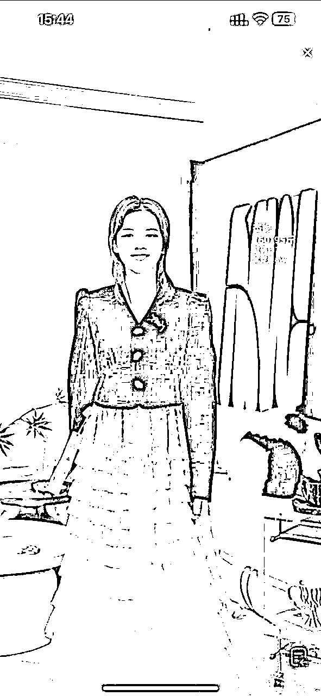

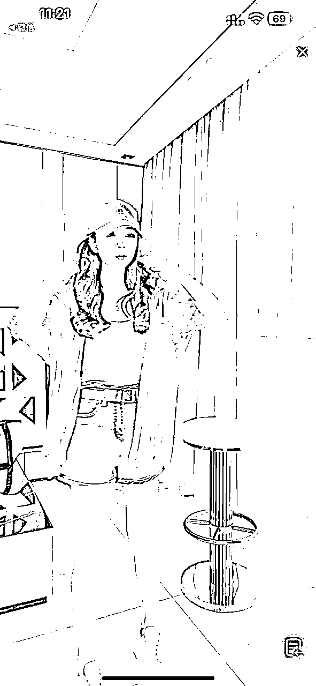

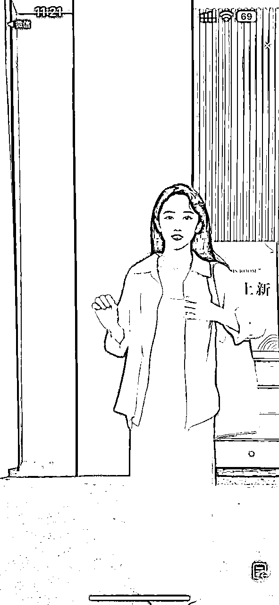

这么一套直播间搭建下来，成本在8-10万，性价比方案也要5-8万，不太适合小白入局。场地搭建有疑问可以单独交流，每个品类配置差别很大。

大致费用清单供参考：

| 设备 | 数量 | 总价 | 备注 |

| 电脑I7+32G内存 | 2 | 10000 |  |

| 相机A7S3微单 | 1 | 23000 |  |

| 镜头24-70GM | 1 | 15000 |  |

| 直播间灯光金贝 | 3 | 6000 |  |

| LED显示屏 | 1 | 2000 |  |

| 装修直播间 | 1 | 20000 |  |

| 声卡麦克风 | 1 | 2000 |  |

| 采集卡 | 1 | 2000 |  |

| 其他小配件杂项 | *N | 1000 |  |

| 总计费用预估 |  | 81000 |  |

常规配置是主播+副播+中控三人组，有预算的话再配拍摄、剪辑、客服。话术方面，抄同行爆款的框架再结合自家产品特点微调，就是一套高效话术。

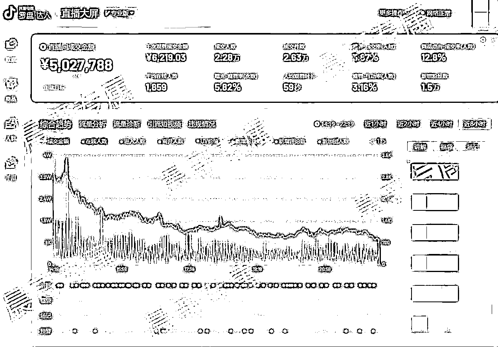

# 平台二：🛰️视频号

为什么把视频号排第二？因为从去年开始，视频号就是电商圈的顶流，就像今年的📕一样，大小玩家全涌入。根本原因在于🛰️庞大的社交流量池。视频号日活去年3.6亿，今年目标6亿。所以我们也把视频号放到战略第二的位置，销售额仅次于抖音。昨天的战绩如下：

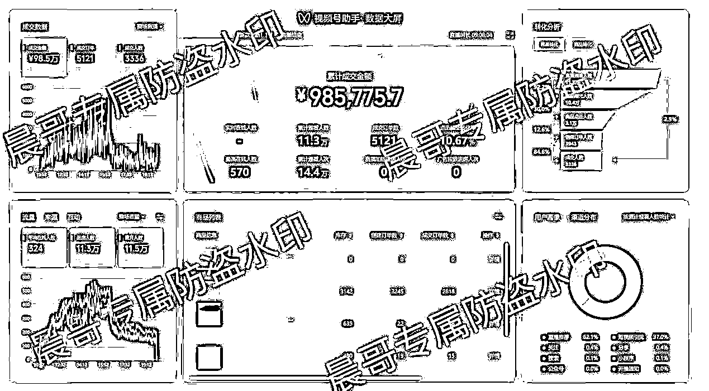

做无人直播的时候，我和很多人一样被判定录播，困扰了很久。后来在多平台同步的尝试中，找到了一种相对稳妥的规避方案，目前跑下来没再出过问题。

视频号本身是支持多平台联播的，但抖音+视频号同步容易被判定为录播，核心原因就是主播对视频号用户缺乏互动。我们现在的解决方案是：如果主播以抖音为主，视频号这边就配一个客服专门做文字弹幕回复，互动数据不会断，也就不会被判定。

现在我已经不做无人化了，全部回归真人带货盘人货场。只要主播能兼顾两边弹幕，有来有回的互动，停留和互动指标就会很好，平台自然流就会持续喂。

视频号目前主流是靠自然流。我们也试过红点和ADQ投放，红点回本比能做到10以上，可以放量；ADQ回本在2.5左右，目前以红点为主。新手投放要谨慎，逻辑很多。

数据截图如下：

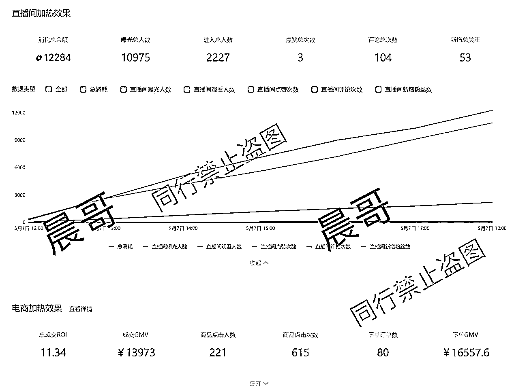

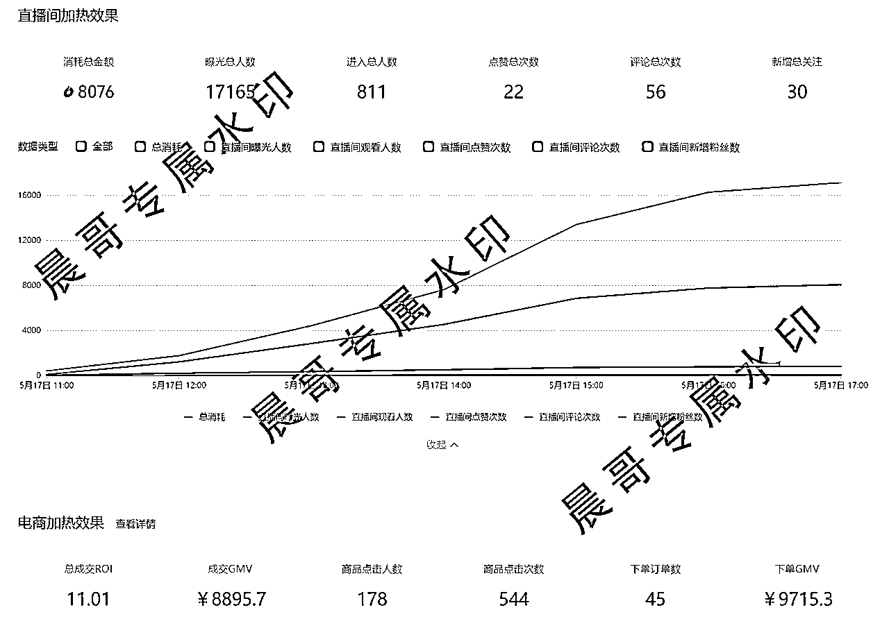

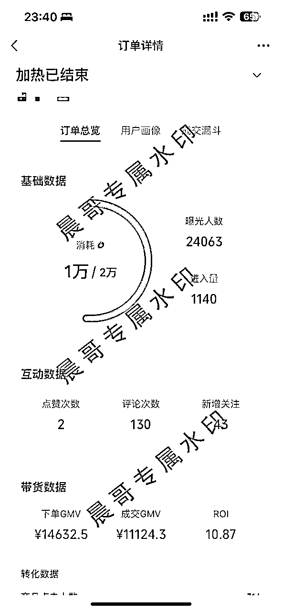

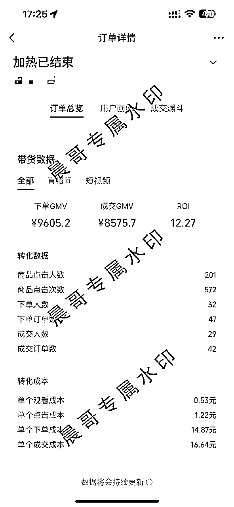

人货场部分和抖音同步，这里不再赘述。差异点在操作细节：建议不要卡库存或改价，视频号用户多为中老年，手机卡、网慢、手速慢。挂播321后多留一点下单时间。

额外提醒：市面上还在说视频号能做无人直播的千万别信。去年我们玩过，5月还能做，后面封号严重，现在还有身份证连坐风险。我们现在只做真人直播，卖无人化方案的，基本就是割韭菜。

# 平台三：快手

快手直播我们起步比视频号早，但热度不如视频号。

多平台挂播的思路就是，能带来流量的平台全做，不挑市场。投入成本基本就是一台手机，划算。

快手目前靠挂播吃自然流，日播一场，稳定销售额在3000元左右，爆款除外。短视频有基础播放量时，微投放引流到直播间，成交率不错。

# 平台四：📕

📕电商今年全面放量，笔记带货遍地开花，无货源玩家大量涌入。但我们做的是直播，不是笔记。

📕直播目前还在早期阶段，直播入口比较隐蔽，但官方扶持力度在加大。618期间官方就明显放开了店播流量口子，后续大概率是主战场。

官方动向我们一直有在盯，需要进群的可以找我拉你。

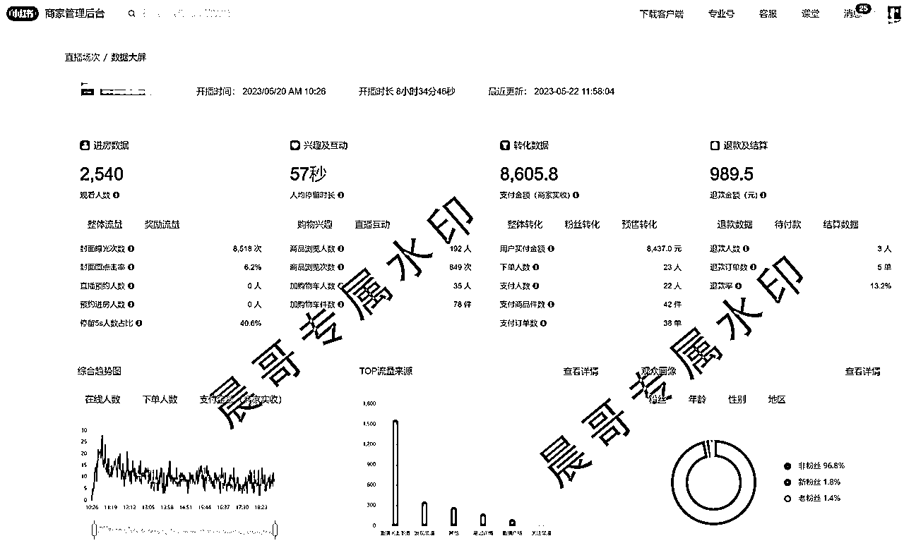

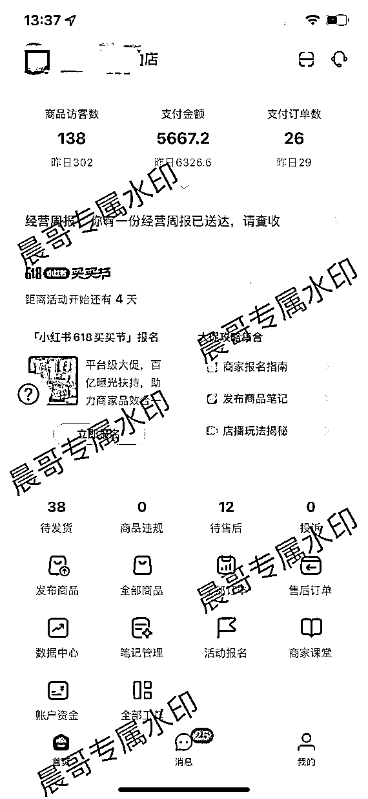

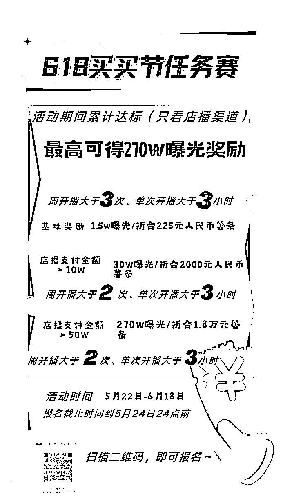

# 平台五：淘宝直播

淘宝直播曾是老大哥，如今因流量分配机制，商家普遍流向抖音。淘系这些年在内容上反复尝试，从创作者平台到光合平台，再到逛逛，都没起大水花。今年直播板块开始发力，官方放出消息会加大直播流量扶持。

实测下来，新账号、新店铺扶持有限，有基础的老号、达人号或店铺号，还是能拿到倾斜流量的。淘宝的赛马机制很明显，层级从D1往上爬，流量就逐步放开。我们主要做挂播，拿基础流量就能出单，一天也能有几千收入。

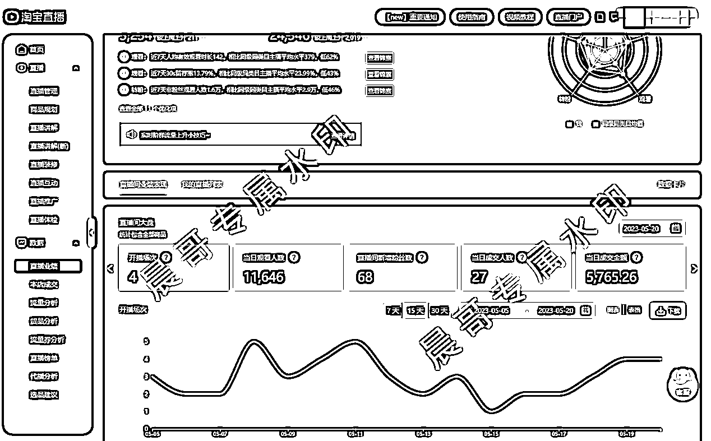

小而美的平台我们不浪费精力精力，有想让我测试的可以留言。我们核心还是集中火力在主流平台。

# 收尾：

这就是我目前跑通的多平台同步直播方法论。再补充一下心态变化。

刚入行时很浮躁，学点皮毛就猛干，市场没调研清就上。运气好小赚一把就飘了，结果迎面就是违规、差评、瓶颈。低谷期焦虑暴躁，甚至病急乱投医被割过韭菜。那段时间谁都不想聊。

后来看到@盗坤大佬的文章，一句话点醒我：直播带货的核心永远是人货场。于是我放弃黑科技、放弃所谓的七步起号、放弃大师课。开始扎扎实实打磨类目、场景、话术。虽然没那么性感，但慢慢走出来了，焦虑退了，业绩稳了。

别被抖音上的一夜暴富故事带偏，脚踏实地才走得远。我就是一个普通人，幻想过暴富，也被现实收拾过，现在更享受每一步踏实的积累。

第一次在赚钱发稿，写得不够完美，欢迎批评指正。也希望做直播的朋友多交流，互相进步。有多平台直播的问题随时找我。

最后感谢@藏锋把我拉进赚钱这个高质量圈子。