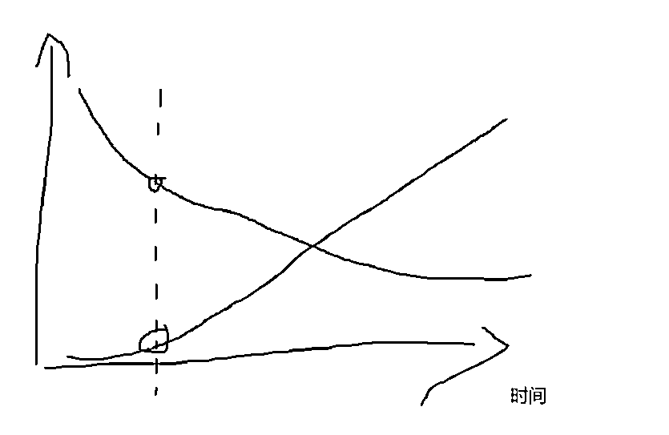
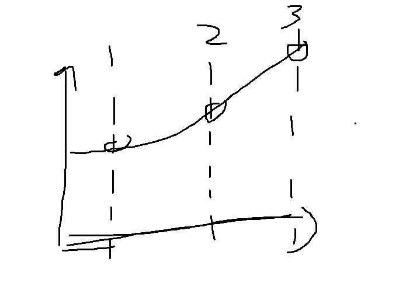
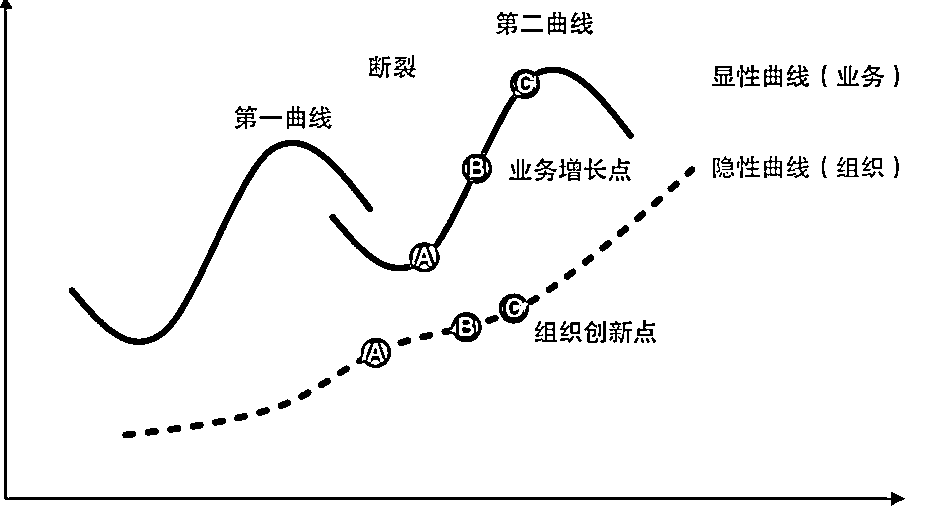
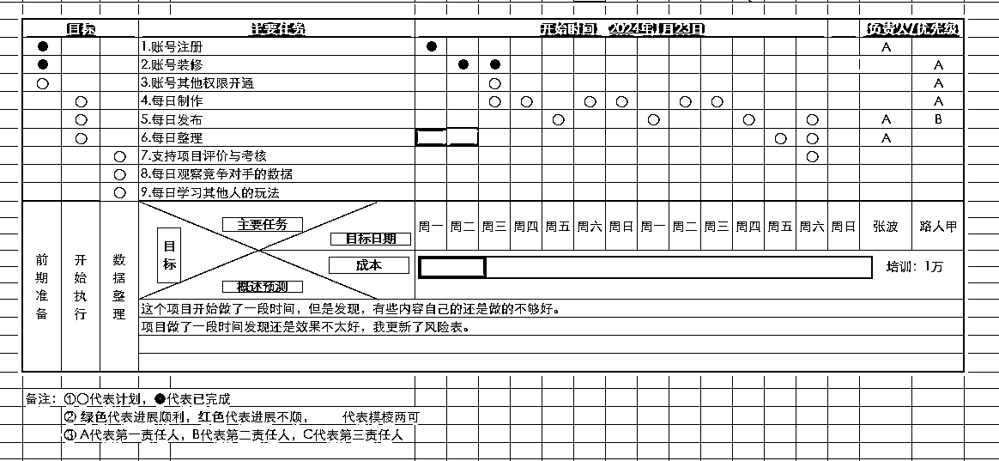
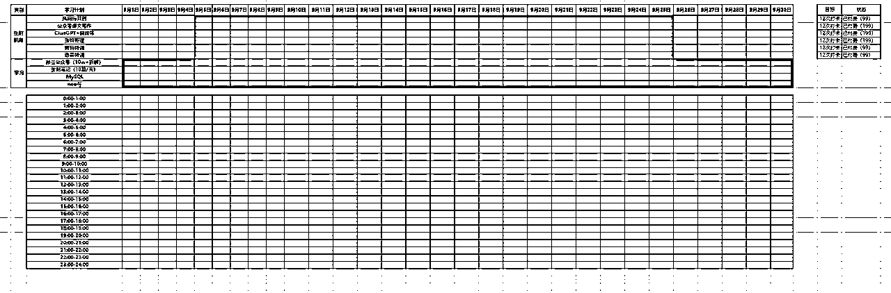
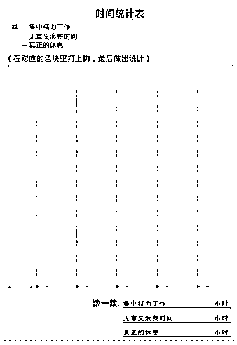
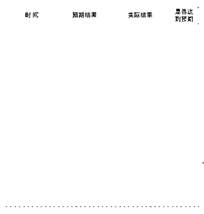
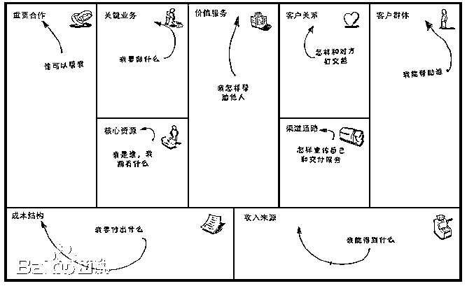
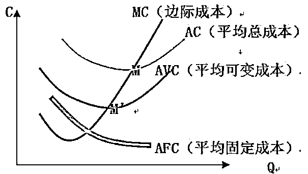

# 给在自由职业路上迷茫的你：一份实操复盘笔记

# 开场

2024年3月，我在社群里担任答疑教练，航海期间负责日常日志答疑。几天前把这些答疑整理了一下，粗略统计下来也有万字左右。先做成一份粗糙的梳理放出来，希望能帮到正在卡壳的伙伴。后面有空再慢慢把它系统化、规范化。

#  free职业到底是什么

还在上班也完全可以做自由职业。自由职业不等于在家办公或自己开公司，关键看心态，是想真正干成一件事，还是得过且过混日子。

在职时间有限，就选投入不大、见效快的方向，并且要吃自己擅长的东西。比如你会用GPT写稿、会SD出图、会剪视频，就直接用这些技能上手，别花太多时间去从零学技术，先把结果拿到手再说。

如果已经离职，就要先盘点自己的优势，挑自己真正感兴趣的方向。比如赚钱航海里就有不少项目，先全面评估一下适不适合自己，能不能快速跑出反馈。

总结下来就是：迷茫期多交流。卡在某个点就去找和你处境相近的人聊，别问一个就完了，至少问十个。我很多认知外的问题，也是找不同地区、不同背景的人聊出来的。

怎么找长处？不是朋友圈告诉你的，是你自己愿意做的那件事。

学会接受不完美。别人指出的毛病，觉得对就改，觉得不对就坚持做下去，用结果回应质疑。

行动永远是答案。加油。

我自己的《航海项目-个体/副业项目实践操作初步指南》就是一个例子，这是我为自己量身定制的找项目SOP，问了很多人、查了大量资料、经历过多次航海才沉淀下来的。

迷茫时就去动，越不动越迷茫。

# 关于自由职业的一些思考

1、自由职业也好、在职也好，都离不开学习，尤其是学习别人的实战经验。时间充裕就多看，时间紧张就少看，但要持续。跑不快就跑久。
2、看到的经验都要做筛选。别人对外分享的通常只是冰山一角，信息差一定存在。要理性分析：当时竞争大吗？有没有前期积累？有没有资源加持？别照搬。
3、认真做事、不投机取巧，一步一个脚印，成功只是时间问题。

在做👸号爆文的答疑里，见过两个典型：

一个从10月开始写，坚持到现在才出结果，3个月的积累最终开花。

另一个也坚持了3个月，方向一直没变没效果，后来换方向不到一个月就爆发了。

项目有机会、有竞争，最后拼的就是执行力，看谁能坚持到最后。

坚持一天很容易，坚持一段时间很难，没结果时坚持更难。

想开始一件事，先往最坏处想一想，难的时候你扛得住吗。

定一个方向做一段时间，观察投入产出有没有变化。如果一个月左右还零反馈，可能方向就有问题。

# 用渐进明细来判断状态

渐进明细的核心是：起步时风险最高，像一条蓝线，随着推进风险会逐步下降。

黑线代表收益，起初为0，随着时间推移应逐渐抬升。

一段时间后复盘一下，收益有没起来？风险有没有降？

比如风险没降、收益为0、投入却在暴涨，这条路大概率不适合你。

把黑线理解为变现，蓝线理解为投入。后期能收回成本的拐点，往往就是出爆款、出现“奇迹”的时刻。

# 怎么提高效率、赚更多钱

入了门、项目跑通后，最常问的问题就是效率和变现。

我的建议是做复盘：

1、哪些环节可以标准化？
2、哪些环节可以用AI替代？
3、哪些环节可以外包？

每天复盘、每周复盘、每月复盘。复盘做得多，就能看清哪些时间可以压缩，哪些是重复劳动。整理成SOP后就能放大。

复盘完还能看技术能不能复用到新项目，新项目再复盘，形成循环。

总结一句话：第一个项目最难，一定要花时间复盘，越细越好。找到短板，能不能提升效率、节省时间。

优化到瓶颈后，把SOP固化下来，可以让家人帮忙或找个兼职按流程执行。这样才能去做第二个、第三个项目。

不复盘、不标准化，越做越累，投入产出不成比例。随便找人帮忙还挑三拣四，最后质量和情绪都受损。

复盘要从现在开始。死磕复盘，这也是管理者乃至顶级领袖的习惯。复盘不是加压，是找方向。不会的就去学，哪怕今天没成绩，明天争取有。

# 时间管理怎么做

要有计划，懂得劳逸结合，掌握大致的时间节点。

要有月计划、周计划、日计划，带着节奏走。

时间管理现在更强调以重要性来排优先级。

推荐看看《小强升职记》，里面很多自测工具，跟着跑一遍时间管理就不成问题。

# 精力管理怎么做

推荐一本《别让猴子跳回背上》。

自己的事自己干，不属于自己的事就交给别人。谁的猴子谁负责。

能者多劳，但别把自己压垮。

精力管理要考虑工作时间、通勤、吃饭休息等现实损耗。

做个表格，记录每天最耗精力的环节。

看哪些部分可以压缩、节省。方法就两种：增加可支配精力，或压缩浪费时间。

一天只有24小时，看看还能不能挤出时间，不能就砍掉无效消耗。

时间管理和精力管理没有唯一解，这两本书只是起点，更合适的方法自己去找。

# 在职的情况下如何兼顾自由职业

1、自由职业不一定需要大量时间，关键是沉下心去做一件事，也不是必须离职。心态对了，利用好身边资源就能产生价值和收益。
2、自律是永恒话题，解法是增强计划能力。很多人从副业起步，每天下班后2-3小时坚持做下去，慢慢就会越做越好。
3、别总问自己怎么不够自律、没人督促、投入不够。这些是内在问题。先给自己定每日/每周/月计划，然后复盘完成度。用行动塑造性格。
4、只靠周末做就是形式主义，一周2天，一年也就96天，能干什么。想做自由职业，先从一个投入小的小项目开始，慢慢养成习惯，也改善性格。

# 被动转自由职业后如何提升认知

1、很多自由职业者是被动转型的，主动转型的人目标更清晰。航海的价值之一就是帮助大家校准心态，在交流中提升认知。
2、自媒体探索一年多，坑基本都踩完了。依然要自问：这段时间有没有做计划？执行得怎么样？项目复盘了吗？问题到底在哪？小问题往往是关键。
3、计划和复盘之后，更容易找到靠谱的搭档。自由职业者之间更需要取长补短，而不是互相抱怨“我没赚钱”。遇到问题先分析总结，再请教是否可行。
4、工具和玩法大同小异，一步一个脚印、实事求是就能提升认知。认知不是天上掉的，是踩坑总结出来的。

比如以月为周期，这个月收益0，就分析原因，下个月如何改进。第二个月还是0，那就是连续两次0，必须变现。

总结：你若盛开，清风自来。

# 如何提高创业成功率

一定要有自己的商业模式，能理清方向并提高成功率。常用的工具是商业画布：

注意两点：

1、所有分析和推演都要基于能看到的数据，有些结论在理论上成立，落地未必行得通。
2、商场如战场，推演再完美，也可能被执行力更强的竞争对手抄过去。

凡是预则立，不预则废，很多想法很好，但发展往往偏离预期。通过实践发现矛盾，再实践，形成闭环。

# 成功需要心理建设

别神话自由职业：

1、提升专业能力，别在职场温水煮青蛙。比如AI技术就要持续学。
2、持续学习能力很重要。有人一个月看一本就满足了，一年12本提升有限，现在的知识更新速度，一本书远远不够。
3、我的公式是：过硬的技术+足够的学习力+身边资源=项目成功。顺序不能乱。人脉再好，技术和学习不行，最终项目还是要交给别人，自己只能做掮客，收益低还辛苦。

总结：想做自由职业前先求稳再求发展，居安思危，别掉进舒适区。

# 资金与时间的权衡

引入一个概念：边际成本。每多一份产出，要付出多少代价。

时间与金钱的配比要根据潜在收益来定。

第一种：用资金换时间。要算投入能不能收回。比如项目潜在收益1万，花5000买资料、2000买设备，净收益就低了。如果一周回本还行，三个月回本就是垃圾项目。

投入1万，收益也只有1万，还要自己投入精力，那就是为了经验“为爱发电”。

是否投入、投多少，心里要有预期。

第二种：用时间换资金。不想付费或成本太高，就靠自己研究变现。适合蓝海、低竞争项目。收益和技术都在自己手里，后续还能打包课程变现。

付不付费要分析。如果项目成熟、收益合理、能快速回本，可以付费；如果资料不全、回本周期长、有能力就自己研究。

要综合投入的钱、时间、变现周期、潜在风向，结合自身情况决策。

项目收益评估可以用贝塔分布估算：=（最高+最低+4倍平均）/6，基本比较准。蓝海项目更靠经验判断。

# 项目收款怎么做

1、起步期可以适当降价，也要做好坏账准备。这个阶段核心是积累案例和口碑，把交付做好、把业务做大。
2、坏账出现后学会合理催收。可以问是否二次合作、给点折扣、能否介绍朋友等，灵活处理。
3、客户稳定、项目增多后，要建立收款流程。比如40%预付款、30%中期、30%验收。此前客户少就不要这么做，先以拓展为主。

项目多了要维系客户，流程化操作，避免关系破裂损失潜在合作。

人情世故要学会变通，换个语气、换个思路，往往有更好的结果。

# 计划与复盘能力的重要性

复盘决定上限。

迷茫时就复盘：每日、每周、每月。

找人请教也是复盘过程。付费或免费都一样，先自己把问题想清楚再去问。大佬最反感无效抱怨。

被割一次，就学会复盘为什么被割，然后破茧。

我喜欢的故事：五祖弘忍让弟子作偈，神秀写“身是菩提树”，惠能劈柴听不到讲经，写“菩提本无树”。利用好身边资源的人，认知成长更快。

成功的面子是给别人看的，里子自己清楚。

找大佬解决问题，如果自己不复盘，现场想问题、只会抱怨，大佬只会无奈。

展现出你的执行力或思维力，否则就自己努力成为大佬。

# 重返职场还是继续自由职业

问题：如果以前是公司优秀员工、资源配齐，后来自由职业有所成绩，现在是否该回去。

分析一方面：

1、公司管理者往往只负责一块，未必通晓全业务。
2、公司资源是老板的，有人帮你做分析、控风险。
3、副业和自由职业不一样，有稳定收入做副业，和零收入做自由职业是两回事。

离开职场要问自己：

1、是否完整接触过全业务？短板能补上吗？
2、离开公司资源，自己能独立支撑吗？
3、一段时间内无收入，能否生活和抗压？

建议：

无论在职还是自由职业，都需要两样东西：技能和人情世故。

技能要持续学习，提升效率的方法，如时间管理、项目管理、沟通管理。效率高了，无论在哪都能稳定产出。

人情世故：多待人好一点，收起锋芒。别人赞成的不反对，别人反对的不赞成。吵赢了架可能后面穿小鞋。

“江湖不是打打杀杀，是人情世故。”自己做就要自己扛决策、资源、风险。

# 什么心态适合自由职业

自由职业一定要是自己真心想做或想尝试，而不是为了逃避。心理学上的墨菲定理，逃避心态做事很难做好。

建议两种心态：

1、我很愿意做这件事，已经准备好，迫不及待迎接挑战并坚持下去。
2、我就是不喜欢朝九晚五，时间自由对我效率更高。那就用高效率来弥补自由带来的不确定性。

逃避从来都不是办法，面对或换玩法，二选一而已。

最近把自己常用的工作闭环重新理了一遍，认知-计划-执行-复盘，PDCA的骨架，换了个说法更顺手。复盘这件事，很多人只把它当成自责的工具，其实它更像一把双刃刀。用好了能把好事也复出来，把开心的瞬间复盘成可复制的方法论。

复盘有用与否，取决于你是不是真的需要它。还没到那个量级的阶段，觉得复盘是浪费时间很正常。复盘不等于只扒自己的坑，失败可以复，好事也可以复。甚至做时间管理、回味一段快乐的时光，本质上也是在复盘。

我们总习惯把复盘当成PUA，却忘了风险从来不是单向的坏。风险即机遇，也是挑战。一个问题没有绝对的对错，既可以是错的，也可以是对的。时间是最公正的老师，很多账单得等社会来收，时间来判。

所以复盘也可以选择性进行。生活已经足够满意，家庭稳定、事业平稳、资金充足，完全可以不用复盘。反之，如果每天下班都在焦虑，烦心事堆成山，又不想躺平，那复盘就是不得不用的解压阀与导航仪。

有些话只能点到，不能全盘喂下去。每个人承受的方向不一样，与其递一把他接不住的刀，不如给一段他能立刻用的话。真正的引导是让对方有选择的余地，而不是把他拽进你的战场。

喜欢但不赚钱，还是赚钱但不喜欢，这个矛盾几乎是每个想做自由职业的人都会撞上的。答案不能抄，得自己拆。

第一，要实事求是。给建议的人过得比你好，听三分就行，王健林的小目标对你可能是空中楼阁。给建议的人比你差，可以听，但认知天花板会限制你。最靠谱的是和你在一个量级的人，或者把高手和普通人的意见取个平均值。

第二，接受落差。看了太多成功案例，照做却没结果，从热爱到厌恶的坠落感很常见。宣传和实操往往差着十万八千里，出现偏差时，回到第一条的实事求是来校准。

第三，活在当下。项目选择和自身资源强相关。富家子弟可以随心，普通人必须脚踏实地。看起来大家都有选择，实际上选项早就被现实筛掉了。

第四，学会裁剪。别把别人的方法论当圣经，全盘照搬。只取你能用、能消化、能解决当下关键问题的那一部分，其余放一边。解决问题的路从来不是唯一解，判断力才是核心。

给别人提建议，也是分层次的。第一层是解决问题，直接给做法和步骤，知道怎么干，但不知道为什么会发生。第二层是提出问题，开始思考因果，把自己的理解带进建议里，可信度更高。第三层是理解问题，站在更高维度预判发展和潜在风险。

给建议前先自检，认知有限就别把人带偏。万能的办法也都有副作用，就像网上说的所有问题都能花钱解决，副作用就是永远要花钱。方案要算次生风险，解决了一个小问题却引爆一个更大的问题，就要重新评估。有些时候带病生存，比强行治疗更稳妥。

找事业方向也有两种思维模式。以结果为导向，我要赚钱，所以先做📕，喜欢旅游就从旅游类目切入，再倒推操作步骤。以目标为导向，我要把📕做好，所以先研究规则、拆解对标，做好了变现自然来。我更倾向前者，项目做好不一定赚钱，赚钱了项目一定做好了。无论哪种，都需要持续的积累和迭代。

认识自己的技能，要先诚实。初期别一上来就找最赚钱的项目，找一个你能稳定落地、能玩转的能力区间先打胜仗。等项目跑通了，再叠加新技能。创业是循序渐进的事，不是靠一口吃成胖子。做你想做的事是创业，为了别人的目标去打工，最后依然是打工。

自由职业听起来很轻，做起来很重。每个字展开都是体量。我在做复盘，也把大家的问题复盘了一遍，写了篇自己的自由职业心路：https://t.zsxq.com/183Cwa2CC，算是对这部分的一个补充。

神话的底色其实是实事求是，只是常人觉得不可思议。很多人没开始就问怎么赚钱，做几天没收益就慌。教员说过要学先进，要靠实践论和矛盾论处理问题，别搞本本主义。实践是检验真理的唯一标准。

启动时别铺太大盘，控制投入。发挥长处能同时降低资金风险和时间风险。赚到钱要懂得投资自己，判断项目有没有上升空间，短期收益是否匹配预期。是继续投入时间划算，还是及时止损重启更划算。投产比超过1:2的项目值得加码，1:1的项目就要警惕衰减。

一定要能标准化，能复制，能躺着产生现金流。变现靠的不是说教，而是铁血般的执行力。

离职这件事很开放，只能说个人经验。思想、规划可能没问题，先自检是否符合自身现实。保障上建议能扛住至少两年的生活费。收入上要量化，比如兼职剪辑能稳定cover基本开销，航海项目📕店铺作为第二曲线，现在每月收入多少，投入产出比如何。兼职的内容可以多平台分发，但别把未来几年都押在单一技能或单一平台。

建议三点：创业是靠综合实力长跑，不是靠一时热血；如果计划通不过，要有Plan B，包括重返职场；清楚自己能扛多久的无收入期，能承受多大的压力。

自由职业的模式看人。资源多、渠道广，可以做战略，用金钱换时间，找专业的人干。资源少、资金紧，就只能战术上抠细节，靠执行力堆。穷则战术穿插，富则火力覆盖。

听建议找方向的核心是适合自己最好。提升能力与认知，保持学习姿态，别让别人的下限收割你的上限。高手和普通人都要问，但要知道什么时候该停。有些人还在进步，有些人已经停滞，跟着停滞的人走就是死路。

解决问题的终极方式是交流与沟通。资料和课程解决不了的问题，就去聊。问题越大，聊的人越多越好。聊之前先明确自己要什么、解决什么，别上来就抱怨。免费建议和付费建议都要客观对待，别迷信价格。给过反馈的人，才会持续给你干货。解决问题的顺序是找到问题、思考方法、尝试落地、复盘总结。

我常用的分析模型很简单。先定性，问题是什么性质、什么状态。再定量，这个问题影响多大、涉及多少。最后量化，怎么把影响拆成可执行的指标一步步落到地上。

借用《三国演义》里的两句话收尾。

曹操说英雄胸怀大志，腹有良谋，能包藏宇宙之机，吞吐天地之志。

刘备说大丈夫行于乱世，即使逆境，也当屈身守份，以待天时。

春天到了，选择权始终在你手里。