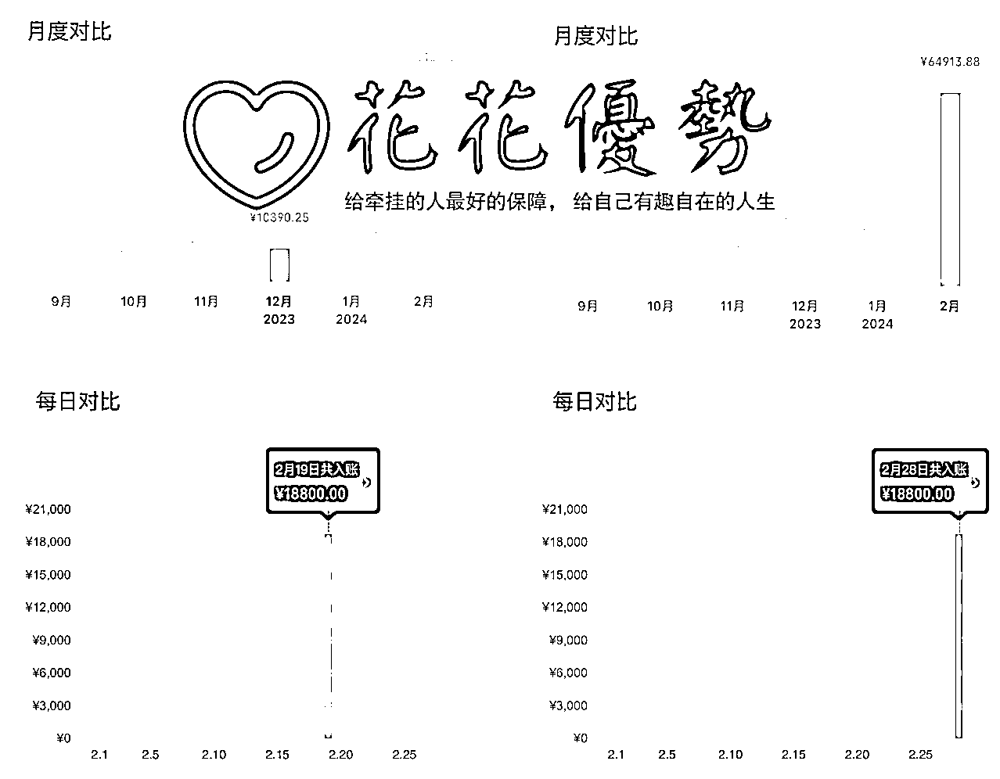
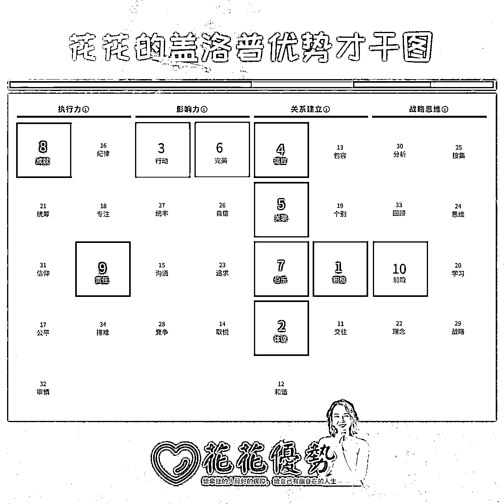
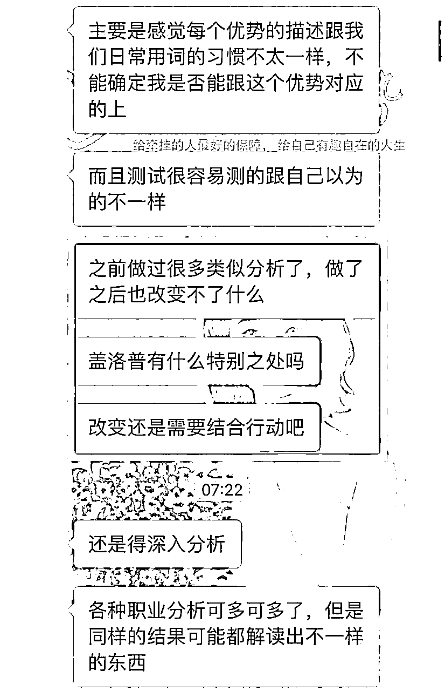
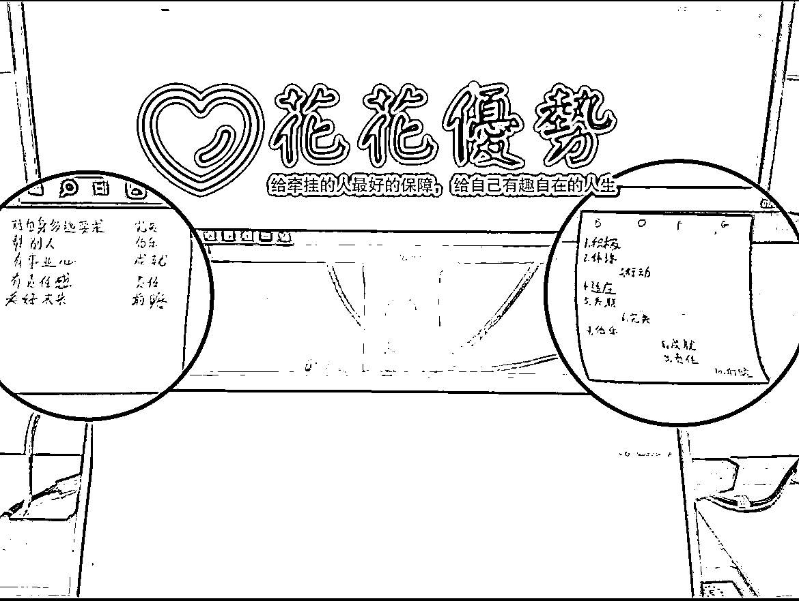
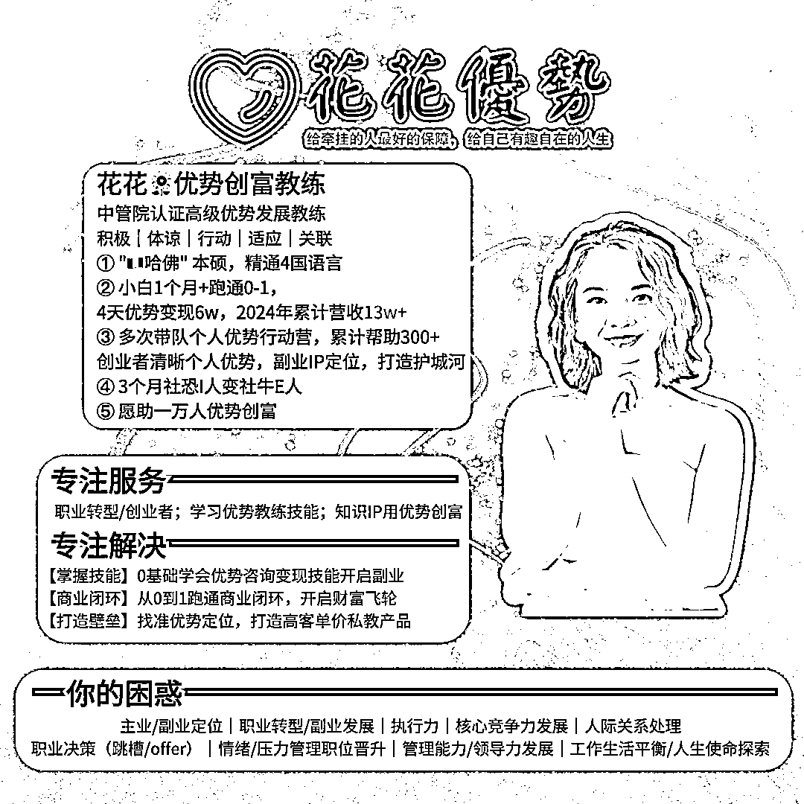

# 从0到月入5W+：一个普通人的知识付费逆袭样本

> 别急着划走，这篇内容值得你读完。它讲的是一个人如何用最笨的方法，在最短的时间里，把副业做出成绩。

我是花花，一个靠盖洛普优势测评转型的创富教练。今天想把这段经历完整拆给你听，没有藏着掖着，全是掏心窝子的话。

先晒成绩：2024年1月，我收到了第一个咨询红包；到了2月，副业收入已经冲上5W+。对很多大佬来说这不算什么，但对我这种从零起步、连知识星球是啥都不知道的小白来说，已经是里程碑了。

回头看时间线：2023年9月21日，我开始接触自媒体；11月底，确立“优势创富教练”方向；中间换了3次定位；12月中旬正式启动轻创业。到了2月，我的营收在10天内冲上了5W+。

当然，和群里那些月入六位数、七位数的老师比，我也会焦虑。坦白说，看到别人报喜，心里没有波动是假的。但整体上，我对现在的进度很满意。要知道，今年2月之前，我的副业收入没超过5000块。

更早之前，我身边没人相信我。我加付费社群，朋友说我被PUA；有人默默删我🛰️，有人说“劝不动你，希望你回头”；爸妈半夜打电话问我是不是遇到杀猪盘、进了传销。但我从来没动摇过——我清楚自己不适合辞职创业，没那个胆子；可我也知道，只靠上班，永远翻不了身。于是，我走上了轻创业这条路。

## 我的成长底色

我从小在山里长大，是个爱往山上跑的野丫头。虽然爸妈都在身边，但他们要打工，我们从没住过真正意义的“家”。那时我特别羡慕同学能带朋友回家玩，也羡慕有人接送上下学。但这种匮乏反而让我早熟：独立、有主见，学业全自己管，三年级就开始自己上学、做早饭。

父母都是农民出身，文化不高，每天为生计拼命。我半夜常听到他们讨论欠了谁的钱、今天累得胳膊都抬不起来。他们总说：“你要好好读书，别像我们这样。”这些话让我养成了很务实的金钱观——只买真正用得上的东西，不为虚荣买单。这后来成了我盖洛普才干里“责任”和“完美”的底色。

因为从小物质和精神上都不宽裕，我骨子里有些自卑。所以我拼命读书，成了别人眼里的“书呆子”，终于考进大学，来到大城市。但越长大越发现，自己好像没什么核心竞争力，哪怕名校毕业，也觉得自己普通得不行。

直到遇到盖洛普，我才真正看懂自己：原来我那些“讨人喜欢”的特质，背后是“成就+前瞻+适应+完美”这一组才干在起作用。我也终于学会接纳自己，把天性打磨成优势。

## 我的盖洛普之路：3次定位，2个月，1个转折

当时我买了不少合伙人的产品，老师们很专业，拉群给我做定位，还发了一张超详细的表格。我填得抓耳挠腮——尤其是“你能提供什么资源”那一栏，憋了半天，才写下：共情、沟通、文件整合，精通4国语言。

接着就是连续翻车：
- 想做留学IP，结果后端不稳定，放弃；
- 转做📕自媒体IP，结果太耗时间，主业兼顾不了；
- 再做儿童英语启蒙，我英语虽好，但内容输出卡壳，连朋友圈都不知道写啥。

2个月换了3个方向，我现在都觉得自己够折腾的。其实，这些半途而废不是因为我不努力，而是才干没对齐：“行动”才干让我快速开始，但“成就”才干没被激活，所以总是虎头蛇尾。当时我还不知道这些，只觉得做什么都不对劲。

转机出现在11月中旬。我看到苏姐的盖洛普公开课，顺手就申请加入了。说实话，之前我很排斥盖洛普，觉得它和MBTI差不多，测了也没用。但听课才两周，我就被导师的专业圈粉了。我突然发现：原来我喜欢的是盖洛普，它能解释我为什么成为今天的我。我想用它帮更多人活明白、活自洽。

那次之后，我用盖洛普重新复盘了自己换定位的经历，也明白了为什么一直在原始模式里打转。后来，公开课结束前一周，我二话不说交了1000元审核金，申请加入合伙人。隔了没多久，又追投了18800元。

这笔钱看起来冲动，但我知道自己不是一时上头：
- 作为小白，我没有变现技能，也没有商业闭环的概念；
- 但优势创富教练这个身份，能同时满足我前9个用力过猛的才干。顺着才干走，才能走得久。硬撑着做，只会自我怀疑。

## 优势 = 才干 × 投入，真的不是鸡汤

虽然11月底就决定了方向，但我直到12月中旬才开始学习。说白了，拖延症又犯了——这是“适应”才干的副作用。为了治自己的拖延，我交了100元定金进了“新手村”，不写完作业就不退。

我给自己定了高强度的2-3周计划：不用精细到小时的日程表（那会让我窒息），但每天有最低KPI。我把通勤的2.5小时、午休45分钟、睡前3小时，以及周末全部砸进学习里。那两周我几乎不看社群消息，朋友圈照常发，一天至少3条，不管有没有人看。

神奇的是，我不仅没被累垮，反而很有成就感——每完成一个KPI都像打了一个漂亮的通关。身体在忙，心却安静了。

学完课程，我开始招志愿者练习咨询，在社群里找公益来访者。1月23日，我接了第一位付费来访者，红包9.9元。再之后，就是2月那波5W+的进账。

你可能会问：盖洛普测评真有那么神？说白了，它只是个工具。但它的颗粒度特别细，能让你精准地找到问题根源。

记住这个公式：**优势 = 才干 × 投入**。才干是中性的，前十才干是你的潜力区。用得对就是优势，用不好就是劣势。如果不投入时间、精力和刻意练习，你的十把宝剑就是十把废铁。

很多人做完测评就完了，以为像算命一样能改命。但测评只是让你更懂自己，懂不等于问题会自己解决。了解之后，还要接纳、抽离、管理弱点、发挥长处，再加上持续投入，才能长成别人拿不走的竞争力。

**你对自己了解得越清楚，行动起来就越有底气。**

如果你打心底不想努力，对赚钱也没野心，那下面的话你可以不用看。承认自己爱钱、想改变命运，并愿意为之付出时间精力，这才是靠谱的态度。

有位圈友说过一段话，我特别认同：“0到1需要的不是能力强度，而是心态强度。你以为自己不可能，其实是你从来没向可能出发。”

性格真的会决定命运。很多时候，你不是没有潜能，而是看不见自己行为背后的模式。那些能成事的人，不管才干属于影响力、执行力、战略思维还是关系建立，都做对了一件事——把正向表现发挥到极致，同时死磕阴影面。

就像靠谱说的：“有条件作恶但从不作恶，有条件放纵也极少放纵。”

一记耳光打醒你的，往往不是别人的劝说，而是自己的顿悟。盖洛普测评码可以找任意教练买，找我有优惠价410元。越早认识自己，越早投入，越早开始复利式成长。这跟你什么学历、什么背景无关，只跟你是否渴望“自洽+核心竞争力+快乐搞钱”有关。

我现在工作电脑上贴着两张便利贴：右边是我的前十才干，左边写着怎么用前6-10才干对冲前五才干的阴影面。每天提醒自己：优势 = 才干 × 投入。

## 真诚，是最好的销售策略

认识我的人都说我直爽，讨厌绕弯子。在这个信息透明的时代，你想找的资料，随手就能搜到。所以对别人藏着掖着，真没必要。你真心实意，对方反而觉得你靠谱，愿意为你买单。

靠谱还说过：“销售的本质是问题的解决和情感的愉悦。满足其一就能成交，两个都满足，就会裂变。”真诚，正好两样都占。

再说说“利他”。你一定听过“利他才能长期成功”，但我想强调一个更高级的概念——**有我利他**。这是苏姐教我的。

什么意思？普通人做副业，是想让自己未来不那么被动。如果只顾利他、不考虑自己的商业闭环，你可能收获一堆“谢谢”，然后就没有然后了。免费的给多了，别人会珍惜吗？不会。忘我的付出，往往换不来付费，只会让你不被当回事。

如果目标是做慈善，那没问题；但如果你想做商业，就必须“有我利他”。在不伤害核心利益的前提下，尽情去帮人、鼓励人、成就人。记住：商业才是最大的慈善。你好我好，两好合一好，才是真好。利他法则的最后一句是“与人合作”，只有合作才能形成集群效应，再小的个体聚在一起，也能排出倒海之力。

## 付费链接贵人，是最快的路

为什么我坚持付费买高客单产品？因为我清楚自己悟性有限。笨鸟先飞，那就找靠谱的老师带飞。我尤其偏好终身制产品，因为不用赶时间，可以按自己的节奏开花。

市面上的合伙人产品分两类：一类适合从0到1的小白，手把手带你跑通；另一类适合已经跑通0到1、想放大到10甚至100的人。周期有1年、3年、7年、10年，还有终身制。核心目的就两个字：链接。

如果你还没经验，建议先买体系化的课程，打好底子。有人问，为什么要付费链接？因为白嫖心态很难得到真东西。大佬理你，也只会说“运气好”，不会把可变现的信息交给你。况且，不付费还问东问西，既不礼貌，也不真诚。

我一直觉得，时间成本比钱贵。能付费解决的问题，别犹豫。我今年30岁，有主业，没时间慢慢试错。平时点个几十块的外卖我都要琢磨一会，但投资自己、学习赚钱的能力，我从来不含糊。如果你暂时没钱，那就先上班攒钱，给自己攒一笔轻创业基金。我自己就是工作两年省吃俭用，存下了启动资金。

2023年，我在自媒体副业上前后投了7W+。我的风格就是：看准了，立刻投。因为如果舍不得花钱请教对的人，很可能选错方向、盲目执行，最后一场空。选择大于努力，跟对人、走对路，再配上执行力，很难不出成绩。

还有一点：你越会分钱，就越能赚钱。没有人能单打独斗一直赢。在给不出等量资源的时候，最好的配合就是听话照做、执行到位。不懂的先自己搜，搜不到再问，问清楚、记下来，然后干，干完及时反馈。等你出了成绩，自然能跟贵人做资源互换。

这就是我一个普通人的全部打法。希望每一个想改变的你，都能找到自己的那十把宝剑。

成年人的关系能走多远，关键就看双向的价值能不能持续对上。

当然万一你刚起步，前几次合作学的费比较高，手头确实紧，也完全可以包一个体面点的谢师红包给带你的人表达心意。等下一次有了成交，记得第一时间把收益分给一直支持你的贵人们。

以上便是我关于“付费链接”上的一些真实体感。

## 做一个高能量的人

别自己硬扛。遇到不懂的领域就去跟靠谱的人学，认知跟不上就花钱去接触认知更高的人，借着他们的视角去打开新的世界。

我出身农村，没背景、没资源、没起点。对于我们这种普通人来说，找对贵人带路，然后老老实实执行，是最快让自己具备持续赚钱的能力的路径。

要是发现自己执行力一直上不去，可以先自查一下是不是前十才干的阴影面在作祟，或是过度发挥了。

也可以找一位优势咨询师来帮你梳理。很多问题，自己根本看不见，只有借助外部的提问才能被点亮。有时候不是你不想做，而是你没意识到真正拉低执行力的原因在哪。

定位到根因，解法自然就近了。

【价值的流向永远是从高能量的人流向低能量的人，付费行为也永远是低能量的人向高能量的人买单】

所以，你想长期做哪一边的人？

# 六、重复做对的动作 - 盖洛普之持续创富

做商业其实不需要天赋异禀。你只需要把该做的事持续做对，结果自然会来。

如果你看到这里，说明我们有同样的诉求，都是想拥有稳定创富的能力。

当你已经找到适合自己才干的细分方向后，接下来的关键是什么？

其实要想做到持续创富，核心就靠四件事咬合：专业技能、产品、商业闭环和定位。

少了其中任何一块，闭环就转不动，钱也就进不来。

把每一块的标准作业流程写到极细，然后照着做。

## 一项能变现的真技能

并非所有技能都能直接换成钱。

比如会做PPT算技能吗？算。但能靠它直接赚钱吗？很难。除非做到了顶级，让大佬争着付费找你做，可大多数人自己就会做。

比如统筹协调能力很强，也很难直接变现，除非你去开活动公司，那样做就会陷入又累又卷的红海。

什么技能才叫好？简单说，就是你交付的价值肉眼可见，客户愿意掏钱买单。

在知识付费赛道里，好技能的典型是咨询/教练，和销售，或它们的组合。既能给专业价值，又能给情绪价值，基本就不用愁收入。

## 产品

归根结底，无非是卖货、卖别人的货、卖自己。个体创业者大多卖的是自己的经验和知识。

卖自己的产品时先问自己：凭什么让人买我的？
卖别人的产品时要想清楚：我有转化能力吗？客户为什么要从我这里买而不是别人？

产品要分层：引流品、低客单、高客单。很多人的结果不好，根源不是没流量，而是：

① 没有高客单产品做收割
② 缺乏销售转化和承接能力

## 商业闭环

一个跑得起来的闭环必须同时具备：流量、信任、成交、交付。

① 流量
闭环需要持续有优质新客进入你的私域。公域混群、大佬互换，都是高效方式。收入没到100万时，更建议聚焦私域，把时间用在刀刃上，副业时间有限的情况下私域足够支撑到100万。

② 信任
信任来自专业背书、真实案例、共同圈层、人品口碑。做私域的朋友圈四件套本质就是你的线上门面，头像、背景、签名、朋友圈内容，每天都要保持专业且能促成成交的状态。

③ 成交
要敢谈钱。别不好意思推给朋友。你认真筛选过才推荐，这本身就是在帮对方避坑。如果产品真的能解决她的痛点，你在做善事。

再强调一次：商业才是最大的慈善。

成交时一定要结合对方的真实处境，找到产品里能打动她的那个点，保持真诚又体现专业。

记住：价值没到，价格不报。

特别是高客单，差一两千并不是不买的理由，客户买的是“能不能解决当下最痛的点”。

④ 交付
交付必须靠谱、稳定、超出预期。普通人的口碑很难得，好好护住自己的羽毛。

## 定位

定位每个人理解都不一样，有人认为是赛道，有人认为是核心价值。

副业里的定位本质是一个转化过程：你把外界输入的信息，通过自己的优势才干加工，输出成可被市场需要的价值。

从优势视角看，定位就是找到你最精准的位置。你可能热爱某个领域已经有积累；也可能以你擅长的方式切入某个角色：专家型、运营型、资源型。

想清楚你要服务的客户在焦虑什么，你能提供什么独特价值，你如何同时为多方创造价值。

每个人都像拼图里的一块，也像花田里的一朵花。要脱颖而出，需要颜色、香味、高度、花型、叶片等等差异化特质。

没有清晰定位，99%的人连开始都开始不了。即便开始了，也会反复摇摆。我刚入自媒体时的亲身经历：两个月内换了三次定位，因为当初选的合伙人项目完全没有方向感。

┅⁽⁽ଘ✦分割线✦ଓ⁾⁾┅

# 结语

如果你要的是稳定，你得到的会是稳定的岗位、稳定的贫穷，和稳定的被社会碾压。

只有当独立赚钱能力和商业能力都扎实了，生活中出现什么变故你都能云淡风轻。

这才是成年人的尊严。

给在乎的人一份真实的保障；
给自己一份自在有趣的人生。

如果你读到这里，有任何一段话对你有启发，并在未来帮你多拿一些业绩，那我就很满足了，一起成人达己！

