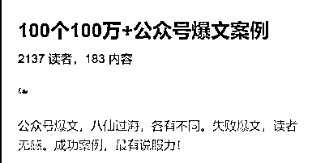
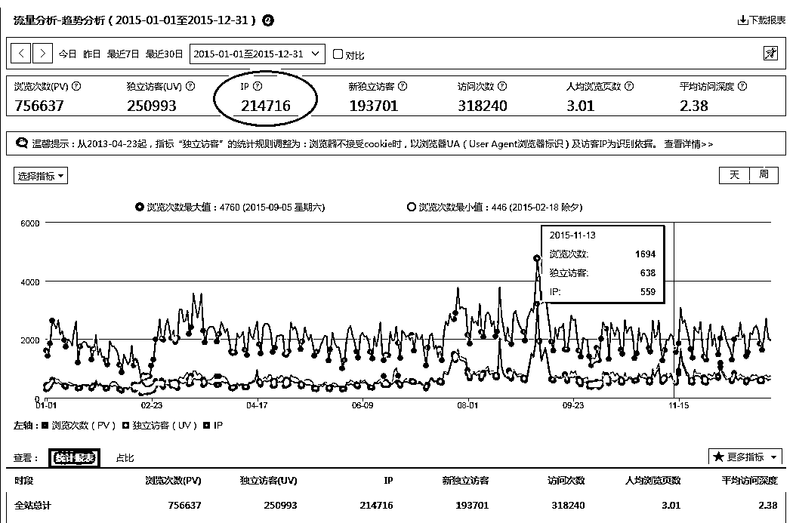
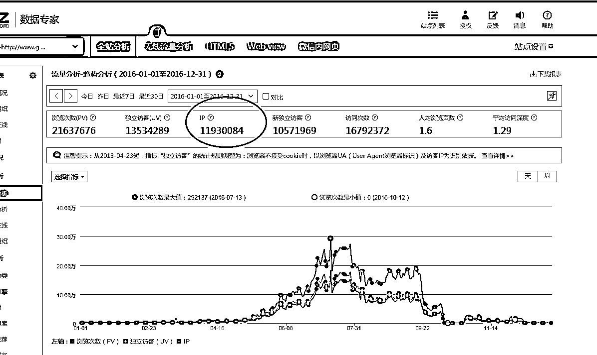
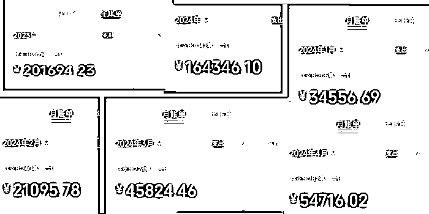
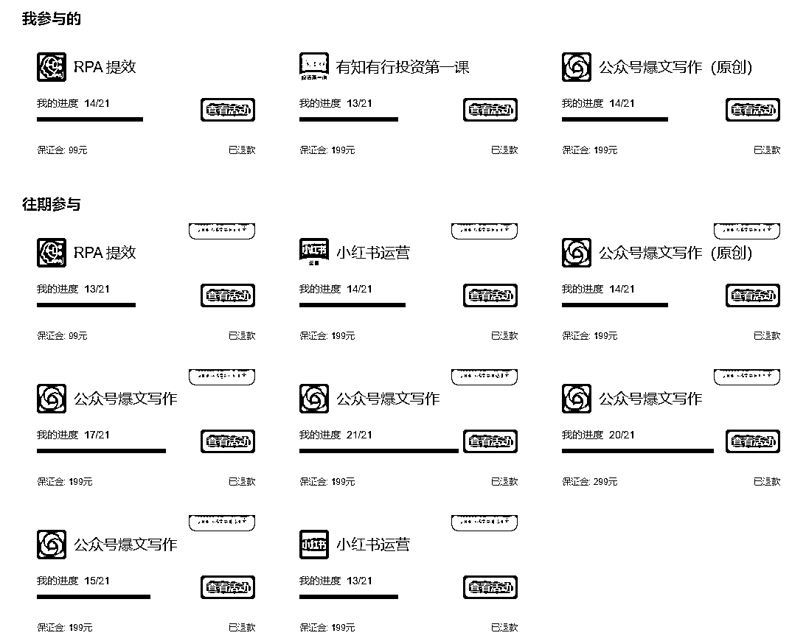
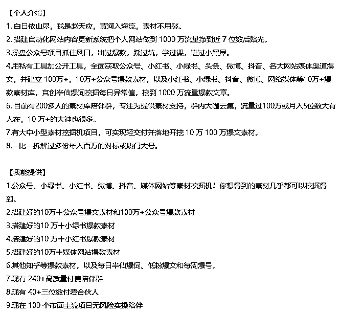
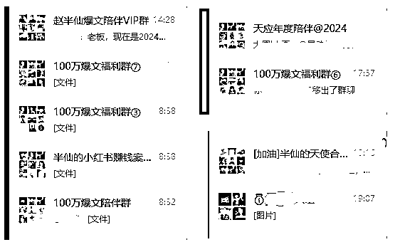
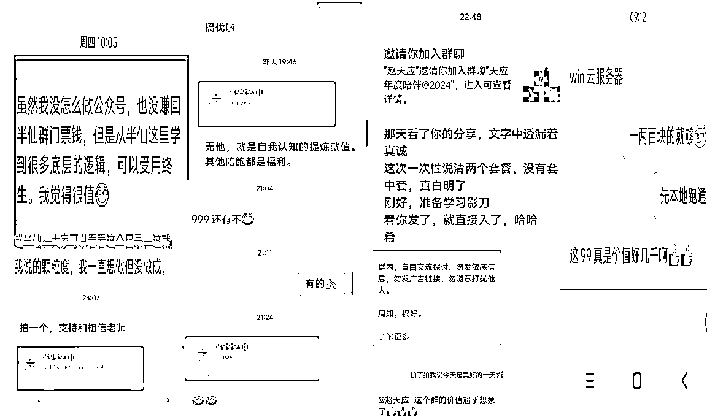
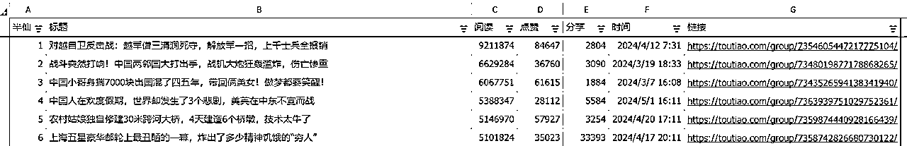

# 20240510（赚钱发布初稿已经删）：80后中年大叔龙哥盟：左手职场右手副业，挖掘1000万素材赚到10万+GMV的故事

见字如面。赚钱的朋友们好，我是赵天应——就是那个总爱拿“白日依山尽”开场的80后大叔。

一个在职场摸爬滚打了近二十年的普通中年人，去年年初，我还没有任何私域基础，好友数几乎为零；一年之后，私域好友超过3000人，没有实物产品，靠内容素材和社群陪伴，硬是把成交额做到了10万以上，到手六位数。不算多么耀眼的数字，对我这种既没背景、也没技术、更没流量的职场透明人来说，已经像是翻过了一座大山。

回顾这一年，我把它拆成五个阶段，想给同样是素人、同样想通过副业找到第二增长曲线的朋友一点参考。

**一、草莽期：手上有什么，就拿什么打**

我不属于那种很会做规划的人。学医出身，因为学制改革少读了一年，最后手里拿的是管理学学士学位。参加工作第一个月，到手工资439元，却硬是在体制内连续拿了五年县级优秀。表面上很安稳，内心一直不太安分。

网络对内向的人天生友好，不需要拼人脉，不需要靠关系，一根网线就能连接外面的世界。2010年我开始折腾个人网站，最初只是兴趣，后来想离钱近一点，就往地方门户的方向做，闷头猛干，一度把搜索流量做到了本地第一，甚至压过了当地非常牛的官方平台。但没人引路、缺技术、少资源，整整干了五年，到2015年全年IP也只有20万。

2016年，遇到了愿意为我指路的人。朋友拉我去听了一堂SEO公开课，我第一次知道什么叫TDK、什么叫关键词布局。2500块钱的学费，换来的是一整套流量思维。后来又经人推荐，花了5000多块跟着一位“大神”继续学，他只讲了两节课：一节讲百度移动端流量巨大，一节讲怎么把流量挖出来。因为不懂技术，我没去碰站群，反而把注意力全部收回到自己的小破站上。不到一年，网站访问量做到了1000万。

这段经历让我明白了三件事：一是踩中了移动互联网的风口；二是我敢花钱买认知，遇到有价值的信息从不手软；三是贵人引路比一个人瞎摸重要太多。也是从那时起，我意识到知识本身不产生效益，真正值钱的是把知识与工具结合，让它落地运行。可“好钱坏钱”的规律很快在我身上应验——凭运气赚来的快钱，后来靠“实力”亏得干干净净，投资暴雷、一切归零，整个人也消沉了很长一段时间。

**二、破局期：从自己最能打的地方死磕**

都说七年就是一辈子。那几年对我来说，好像真的过完了一辈子。2023年处理完手头的事，我决定重新出发。都说环境不好，那就先不晒收入，晒晒我那些年交过的“学费”吧。

也是在网盘里，我翻出了很久以前别人送的资料，里面的内容虽然带着旧日子的痕迹，底层逻辑却依然耐人寻味。于是我下了决心：光看资料还不够，得亲自进去看看圈子里的高手们正在玩什么。就这样，通过涛哥推荐，我加入了赚钱。

刚进圈子的时候，我几乎每天刷精华刷到停不下来，项目多、信息量更大，每篇帖子背后都有人赚到钱，可我越刷越迷茫，根本不知道从哪里下手。

直到航海来了。第一次报名，我连打卡入口都没找到，草草结束；后面第二期第三期，索性把自己当成一张白纸，老老实实按步骤走。先模仿、不创新，把别人验证过的方法跑通，再慢慢加入自己的理解。结果意外写出了百万阅读的爆文，还从同行的内容里挖到了一篇近千万流量的爆款。顺着这个发现，我自创了一套“半仙情绪大法”：要么把情绪捧到极致，要么把愤怒拉满，用热点素材加上情绪出口，爆文一篇接一篇。当然，情绪没收住的时候，也没少被平台“请”进小黑屋。

2023年，我前前后后付费超过六位数，其中最有价值的一句话，其实是最朴素的常识：商业离不开人、货、场，也离不开流量、转化、客单价、复购率。你要服务谁、给他们什么、在什么场景下交付，这比盲目追逐项目重要得多。

后来，我把十年前玩过的自动化采集技术捡回来，又从零学RPA，搭工具、建素材库，从爆款排行中不断筛选、归类、深挖，直到挖出那篇千万级的爆款内容，我彻底相信：素材挖掘完全可以做成一条能够稳定输出的副业线。

**三、私域期：陪伴比价格更有吸引力**

一个人跑得太孤独，我想把手头素材分出去，找一些同频的人一起往前赶。恰好当时花西子事件上了热搜，全网都在嘲笑某主播卖79元太贵，我干脆“顶风作案”，也定了个79元的价格。结果不到一阵子，就等来了近百位朋友。

起初我以为交付就是“拉群、发素材”，后来群友们的反馈教育了我：大家真正需要的，除了素材本身，还有使用的方法、挖掘的工具、持续更新的动力。我开始借鉴赚钱圈里高手的打法，基于素材推出“👸号100万”小报童专栏，慢慢做到了2000多人订阅；再用福利群和素材包作为社群门槛，持续在群里真诚分享，靠价值吸引同路人，逐步搭建起陪伴陪跑模式。

到今天，我已经有了5个近千人的陪伴群、1个近300人的年度素材群、1个150人的年度付费陪伴群，还有1个近80人的年度陪跑群。从免费群到低价、中价、高价，各个价位都跑出了自己的形态。

那段时间我还给自己梳理过一张资源地图——👸号、📕、小绿书、抖音、🧣、知乎，凡是能产出爆文的地方，基本都摸了一遍。

但奇怪的是，群建了一个又一个，人数却没有持续猛涨。后来我才意识到，问题出在定位上：我的“货”是素材与陪伴，我想服务的是“想通过素材做出爆文的人”，他们最需要的“场”，可能不是海量资料，而是持续输出、贴身陪伴的氛围。把“人、货、场”真正对齐之后，社群开始活了起来。

也是因为这群伙伴，我像是给自己建了一所“自我学校”：我在交付价值，也从他们身上得到反馈和动力，一群人互相成就。

**四、工具期：人越想偷懒，越要学会借力**

懒惰确实是刻在人性里的基因，我也不例外。这没什么不好，关键是把“懒”用在刀刃上。

从早期入手三套旗舰版火车头采集器，到后来用RPA搭建自动化工作流，再到用关键词交叉组合生成大量页面，我做的一直是同一件事：把重复劳动交给机器，把时间留给判断。素材量越大，越要借助工具去排序、分类、去伪存真，别让信息把自己淹没。

工具只是武器，真正决定输赢的，是你知不知道这场仗怎么打。

**五、后悔期：宁可做过后悔，也别错过后悔**

如果现在问我，2023年重新选一次，还会不会加入赚钱？我的回答只有一个：会。

“最小后悔法则”让我想得很清楚——人到了晚年，回想起现在“能做、想做、该做”的事，如果因为犹豫而没做，才是最难以释怀的遗憾。所以，宁可做过后悔，也不要错过后悔。

人到中年，不是理由；身在职场，不是借口；不懂技术，推脱无用。贵人引路，不必着急；拆解对标，持续积累；凡是过往，皆为序章；何以解忧，唯有行动。

这趟复盘写下来一万字，飞书文档里有完整版，阅读大约需要一刻钟。链接放在这里：https://owd2uo0wwxk.feishu.cn/docx/ZWpVdeky4o9vyJxeIkRc6yMunSf

如果你也和我一样，没背景、没技术、没流量、没产品，希望这篇故事能给你一点出发的勇气。至于已经盆满钵满的大佬，这篇或许不太适合你，可以直接划走啦。

说实话，最近一段时间我整个人状态很矛盾。一方面对未来焦虑到失眠，另一方面又不断掏钱买课加群找方向。折腾下来大半年，反复琢磨、向圈内人请教、啃书本，最后才理清思路——把价值感偏低的尝试全部砍掉。我把重心放在了赚钱反复提及的两个阵地：微信👸号和📕。聚焦的点很单一，就是👸号爆文素材的沉淀。既然已经决定出发，就没有回头的打算。

# 我的私域社群实践

抛开别的因素谈未来十年，最靠谱的个人变现路径，大概率还是微信私域和社群生态。

当时点醒我的是赚钱龙哥老板的一个拆解案例。去研究你想切入赛道里的头部玩家，找到他们在用的5000好友规模的对标样本，加好友去观察内容打法、拆解选题逻辑、索要资料、复盘运营手法。这个学习路径非常高效。那些一线实操者的经验，只要愿意学，收益就能回本，而围绕它延伸出的机会基本都是正向产出。

圈内常说流量最贵。流量进来后需要接住的地方，微信就是最好的容器。可以说微信就是社会的一个微缩版。你不太会去注册第二個支付宝，却很可能有两三个微信号。微信提供了一对一、一对多的免费聊天能力，提供朋友圈这种可发图文视频且能互动的宣传位，提供视频号这种可直播可录播的个人频道，提供转账红包群收款在内的闭环支付系统，提供像个人期刊一样的👸号。所以在当下环境里，如果要找一个价值洼地做社群载体，微信私域几乎没有替代项。

又经历了一轮赚钱大学习后，靠谱和理白等前辈给了我明确指引：要有载体，要有可交付成果。单纯囤素材有意义，但很难放大。同时要尽最大可能蓄水私域。我一边持续沟通请教，一边直接付费复刻做出现金流的大佬产品，借鉴其搭建逻辑，快速搭建出除素材之外的产品形态，让社群价值更厚。

最后定下来的载体是基于小报童的👸号案例库。结合赚钱的赚钱案例、其他大佬发布的小报童案例、📕和视频号模型进行破局。我从自家原本定价666元的内部素材库里，手工挑出市面上很少见的百万级流量文章，用AI辅助加自己的爆文实操经验，对每篇案例做解读分析，附数据、判断、链接、配图。定价十元，先内测再找人分发，卖出了四百多份。小册不指望赚钱，它的价值是帮我筛选出同频的人。

随后这个专栏被一群牛人反复打磨。初审通过，二审打回两次，大修后赶上选题和风口，销量迅速起量。小报童订阅很快突破两千，GMV直接来到两万多。

销量只是表面，更关键的是私域沉淀和超预期交付的理念。我把来领取福利的人全部拉到小报童福利群里，由此积累了十几个自己的社群。

最开始我只想一次性放素材，后来主动拉长到近一个月持续输出。原本只讲爆文小报童，逐步加入我挖掘到的低粉对标账号案例、我实操中踩过的坑、被限流被关小黑屋被踢出池的经历，以及我亲自测试有效的提示词和值得尝试的赛道，全都真诚分享在群里。

我也会明确告知大家，如果需要更深入的内容，可以从福利群进阶到年度陪伴群或年度陪跑营，那里有更硬核的分享和一对一诊断陪跑服务。

赚钱出来的大佬，用涛哥的话说，大部分都具备极致利他属性。我把自己的卡点、现状、初步想法整理出来，通过语音咨询交流后获得很强的信心，于是按建议直接优化开干。

通过精细化分享和持续福利投放，很快有近两百人加入年度陪伴群，七十多人参与陪跑。至此，10万+爆文之外，个人GMV也站上了十万。

社群其实兼具功能、投资、情绪三层属性。之前做小绿书项目时社群被冲击过，有惨痛教训。所以这次我反常规操作，不把所有人堆在一个群，而是分散到三四个小群。既能降低风险，也更符合我喜欢小而精的分享习惯，信息量可控，我能覆盖到每个问题。当然这也导致大家更多是潜水听我输出，偶尔提问。但我更看重小而美——福利群解决功能需求，通过链接我获得投资视角，而我最在意的是社群的情绪价值。

因此我很少在群里发红包，也很少请外部大佬来客串。内容基本源自我的实操复盘、素材认知和赚钱的风向标精华贴，以及优秀大佬传递的信息，经过提炼加工后输出。

我更倾向从底层逻辑切入，讲清楚爆文的底层规律，营造真诚分享的氛围。硬是将十块几十块的社群，通过素材、分享和自然推介，做出了群友反馈价值上百的效果。

# 工具提效：人有惰性，需要武器

信息爆炸之下，社群是展示个人、分享经验的平台。但群多了，需求也碎片化，怎么高效响应是个问题。赚钱推出的RPA航海对我帮助很大。我的体会是，知识星球赚钱天花板当然是赚钱，但更重要的是看赚钱在押注什么项目。航海就是很好的观察窗口，甚至本身就是生产力工具。

群多需求多，就需要更好呈现方式。一方面我持续产出素材类的精品内容，包括写文用的榜单、日常福利，都用从赚钱学来的RPA做自动化。另一方面把飞书和RPA结合，把之前分散的分享整理成群内稿件，通过RPA自动对劲爆素材进行分块分类，用进度表和数据盘的形式在社群持续展示，提醒大家除了常规素材，还有更新的参考。

爆文工作重复度高，于是我组建小团队，除了自动化挖掘，还尝试开发批量爆文工具。RPA可以处理高重复低创造的环节，比如素材采集分类分发，效率提升，人力释放到创造性工作上。

开发的工具融合我自己的实操经验，结合大家常用的kimi、gpt、文心一言、包含十余种模型的poe框架、能白嫖gpt4的coze等模型，配合挖掘到的爆款素材和写作思路，做出首版批量生产工具。它解决思路匮乏、不愿动手、写不出三种痛点。我手里积累不少十万加百万加的素材，用户挑选匹配内容，大模型就能产出初稿。对新手尤其友好。

自动化能处理基础工作，但个性化需求仍需人盯。我通过日常聊天反馈持续跟进，提供定制化内容，增强凝聚力。后来根据群友需求，还开发了今日头条批量工具和头条素材挖掘工具。这次不是单纯挖素材，而是以需求反推工具和打法，把项目本身作为载体。

通过小报童、工具组合与赚钱训练，我逐渐理清了IP1.0、IP2.0、IP3.0的路径。

IP也是一种杠杆工具，能持续放大个人价值。

IP1.0核心是做出吸睛的内容或成绩，比如写文章做视频出小报童，目的是获取注意力。核心在于定位垂直，朋友圈、👸号、📕信息统一。

IP2.0则要开始打造品牌辨识度，让品类想到你。比如做SOP教程、开公开课、带小项目。

IP3.0目标是建社群强化互动，形成忠实粉丝，通过粉丝扩大影响力。人都有环境依赖，所以需要共同氛围，让成员一起做事、做出成果，形成用户证言，在2.0基础上复制到更多人，成就他人、帮他人赚钱。

聚焦技能点击穿，再带领更多人拿到结果，需要长期死磕。有形的RPA工具和无形的IP工具，能让社群价值持续增长。

打个比方IP像种树。1.0播种，2.0培育，3.0是树长出枝叶吸引鸟类栖息，形成生态。

不会怎么办？去学更多方法，用头脑沙盘、死前验尸、目标对齐、三级火箭等拆解对标，多混社群看别人怎么做。当然这块我还要向赚钱大佬多学习，我也只是刚起步，借着赚钱看到一点光。

# 最小后悔：行动过才不悔

光说不练假把式。说多了都是废话，努力做过才不后悔。

人生归根结底是说到做到。

别看我在网上说得风生水起，我骨子里是闷葫芦，是个I人。日记写了近十年，每天两点一线，上班回家，独来独往，心事自己扛。除了付费渠道认识的网友，能说心里话的人很少。

大家都忙，陀螺一样转，也可能装忙。像我这种不安分出来折腾副业的人，很多时候被视而不见。有段时间我连朋友圈都不敢更，更别说卖货。但我一根筋，不想搞微信多开，也不愿双持。想明白赚钱更重要后，一不做二不休，把微信里两千多人全部打标签，非工作内容全屏蔽。破釜沉舟后发现还有几个熟人点赞，原来漏标了，赶紧补上。

我总担心能力不够达不到预期，犹豫了好几个月才加入赚钱。直到看到涛哥介绍和福利，情绪上头，一狠心付费。这次决定给我打开了窗口。后来认识更多赚钱大佬，他们真诚直白全交付的沟通方式给了我很大动力。

我一直不见兔子不撒鹰。但看到这些大佬社群里说的和做的高度一致，原来真有本事的人确实能做到。这让我明白，有时候要先相信再看见，才能看到更多。

在高人指点下，一个小小的爆文素材产品，对我已是副业的一大步。不到半年，私域流量翻倍，精准好友增加三千。

虽然很多人做小报童上千订阅就能做到几十万上百万，我的商业化走得很慢，但这已是我继当年all in搞站后的又一次尝试。通过分享陪伴陪跑，我给自己建了一所自我学校，链接了一群优秀同伴，完成了一次相互成就。

人生有种哲学叫最小后悔法则。晚年回望，现在能做想做该做的事没做，会不会后悔。现在让我重选一次2023年加入赚钱，答案还是要。

人间清醒，搞钱要紧。宁可做过后悔，也别错过后悔。别等老了再后悔。

有贵人指路，不用焦虑，不必害怕。拆解对标，持续积累，精进不止，未来才不会变差。

凡是过往皆序章。人到中年不是理由，身在职场不是借口，不懂技术不是托辞。解忧唯有行动。

感谢阅读。谈钱不伤感情，白日依山尽，我是赵天应，欢迎链接。