# 1 万聚光砸出近 100 万营收，这套打法我直接复盘给你

> 原文：[`www.yuque.com/for_lazy/zhoubao/buqr0hqaxsn5lwxh`](https://www.yuque.com/for_lazy/zhoubao/buqr0hqaxsn5lwxh)

## 爽！聚光投放 1 万，营收近 100 万！

作者： 谢无敌🐱闪亮猫传媒

日期：2024-05-20

Hi，赚钱的伙伴们好，我是谢无敌，闪亮猫传媒创始人。

经常听到商家抱怨：客资不好转、质量参差不齐。

说个背景，我主营线下实体家居，线上在小红书主要做客资获取。

就我目前这个品类，**平均花 1 万块做聚光投放，撬动的营收能接近 100 万**。

下面这几单就是近期实打实的签约案例👇

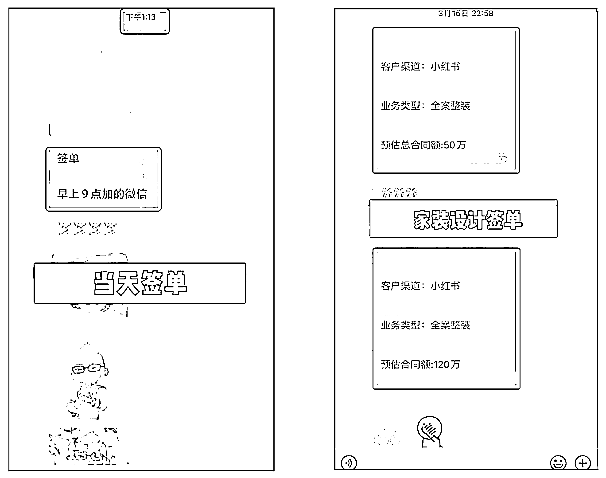

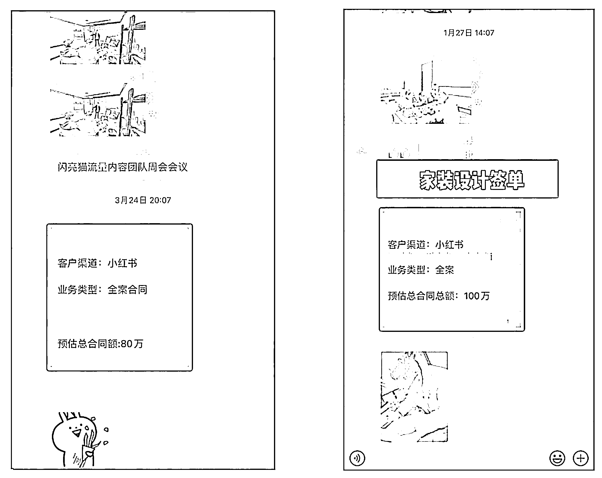

粗略一算，单个线索成本也就三四十块，跟市面上其他投放渠道一比，性价比明显更高。

今天就把聚光投放怎么打才能把开口率拉满、让投产比做到百倍级的思路拆开讲，准备入局的朋友可以细看。

**一、内容侧怎么布，才能让笔记更愿意开口**

**二、策略侧怎么布，才能让获客真正转化**

**三、开口率翻倍的关键抓手**

## **一、内容侧怎么布，才能让笔记更愿意开口**

#### **1：主页即门面，信息先一步触达**

用户点进主页，第一眼能看懂你在卖什么、去哪里找你，这步很关键。

轻量型引流可以直接把**线下门店地址、线上店铺、社群、瞬间**等入口挂在主页上，马上完成曝光。

像有实体店的品牌，就很适合用公域做产品与服务的直接展示，把精准人群引进来。

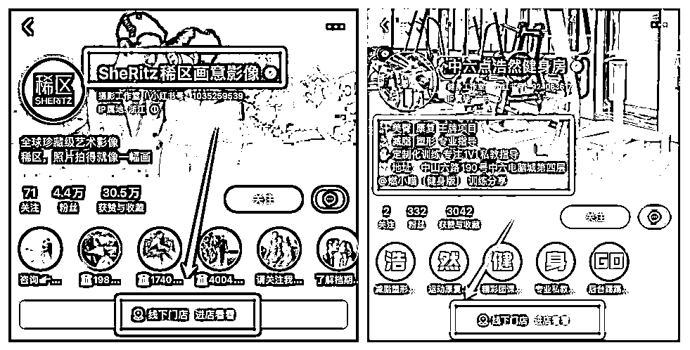

#### **2：写好转化笔记，决定私信留资的概率**

除了主页，真正拉开口的核心还是转化型笔记怎么写的。

做转化笔记的底层逻辑就是做爆款。

什么样内容更容易让人留资？

**关键词布局——决定能不能被看见**

用户都是靠搜索来的。

笔记里如果能自然带上**核心词、品类词、产品词、品牌词**，就能增加被搜到的概率，提升自然曝光。

思路就是抢占搜索资源，抢占关键词排位。

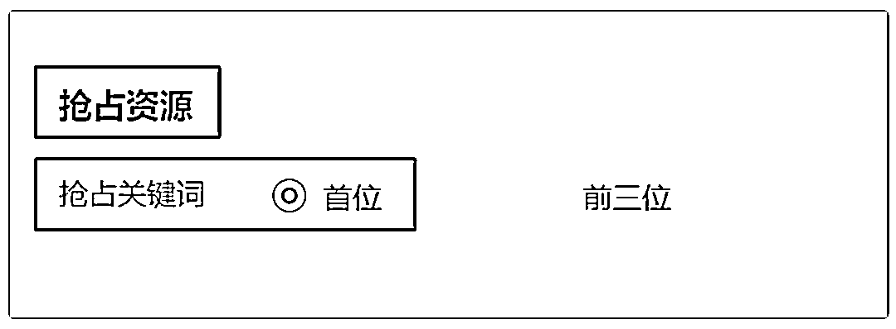

**封面质感——决定愿不愿意点**

封面好看与否，直接影响点击率，也影响后续的开口量。

拿“冰箱”举例，同样是卖冰箱的，封面精不精致，互动数据会差很多。

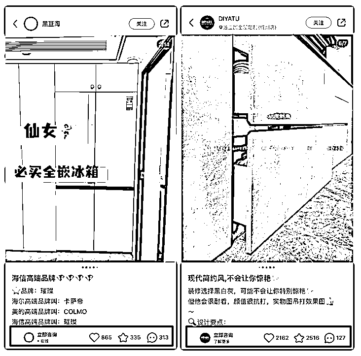

一个调性统一、有质感、能吸睛的封面，往往在曝光阶段就已经赢了。

**内容深度——决定愿不愿意咨询**

封面把人拉进来，内容要把人种草。

优质的内容能提高用户种草概率，提升互动，同时带来咨询请求，也就把留资开口率提高了。

还是以“冰箱”投放笔记举例👇

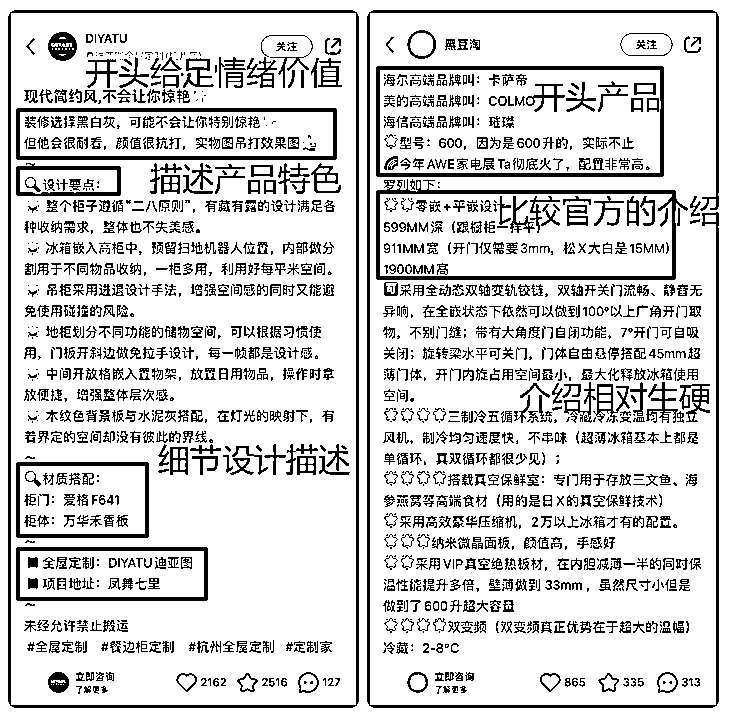

能看出一条高转化的笔记，一般会包含：用户需求点、痛点拆解、产品卖点介绍、细节强化，结尾顺势做留资引导。

既让用户快速get到产品价值，又提供情绪价值与信任感，自然导向咨询。

**KOS 矩阵——承接转化最后一步**

除了品牌官方号，很多商家会用**KOS 内容矩阵，也就是关键意见销售**来打。

KOS 本质上是小红书里品牌线下导购、销售顾问、主理人、产品专家或助理类账号。

他们扮演品牌代言、用户推荐、产品连接的角色。

这类账号具备专业服务能力与品牌知识沉淀。

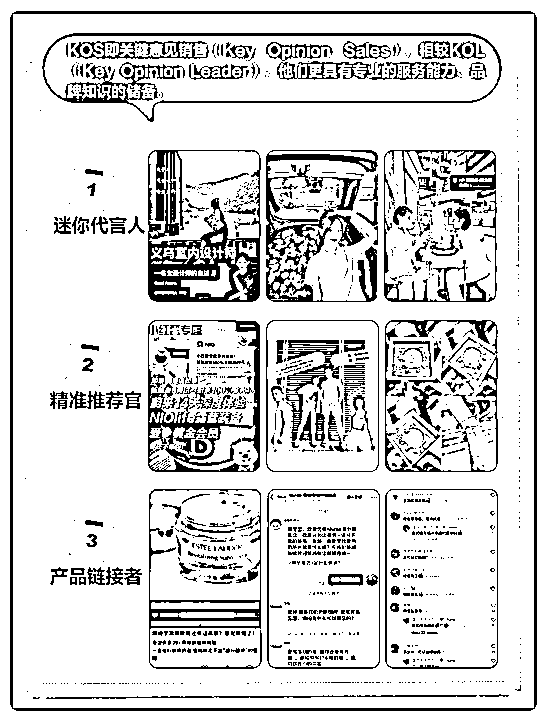

品牌通过多账号专业种草，做**内容铺排与转化引导**，扩大曝光并提升客资效率。

大致分三类：

1.  **品牌自建账号：**企业申请创建或把员工号绑定到企业号，成为 KOS。员工离职无法带走，无需实名认证。
2.  **员工个人号：**企业申请，员工授权后个人号与企业号绑定。员工离职可解绑。
3.  **松散关联号：**简介或笔记暗示与品牌有关，但实际无官方关联的个人号。

内容上，KOS 更像一手新品和专业分享的入口。

依托专业积累与销售技巧，以门店形象搭建信任壁垒。

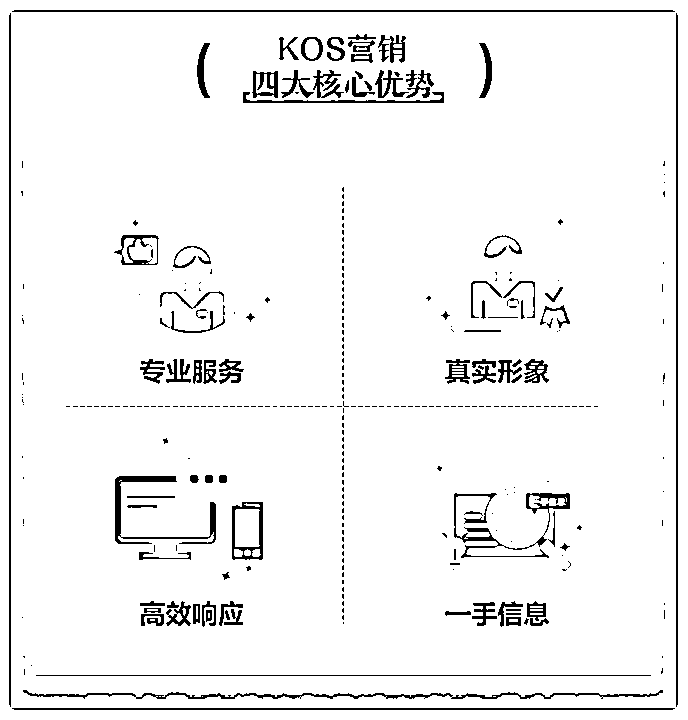

KOS 背后是经过培训的真实导购，主要在用户被种草后承接兴趣，**帮品牌完成最后的转化闭环**。

**小贴士：**

每个 KOS 号最好自身笔记超过 10 篇，保持日更 1-3 篇的频率，对企业号的开口率与转化量提升非常明显。

## **二、策略侧怎么布，才能让获客真正转化**

#### **1：门槛要低，响应要快**

**“把私信开口率做上去”**

笔记带来私信后，最关键的是承接与转化能力。

用户刚留言 15 秒内就能得到回复，流失率会大幅下降，开口率自然上去。

可以借助介绍语+关键词+数字的形式，配置常见**问答与自动回复**组件。

既能引导留资，也能降低用户开口成本，提升转化效率。

小红书私信投放常见的两种打法：

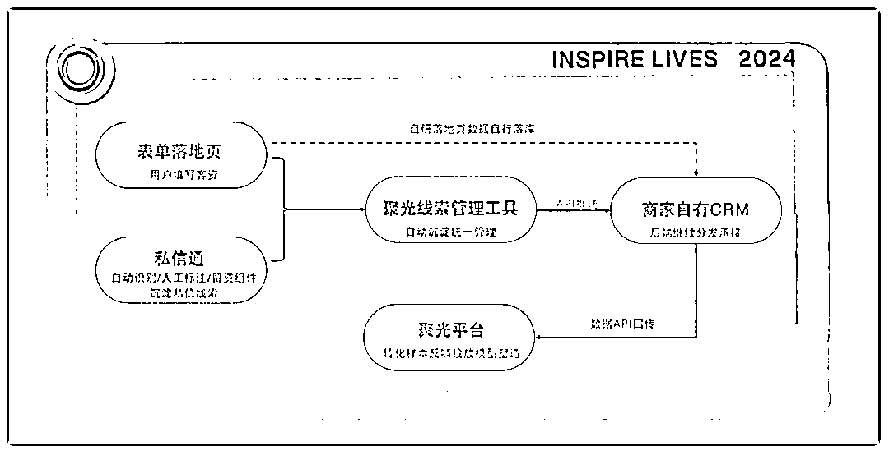

#### **2：戳痛点，送福利**

**“把私信留资率做上去”**

从用户真实痛点出发，给到一个合理的钩子，比如**免费领资料/课程、私信领优惠券**等。

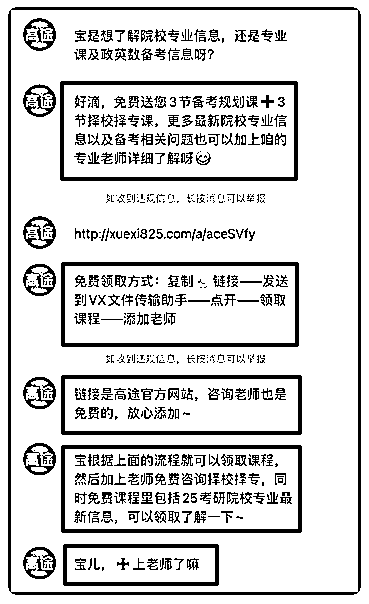

福利是最直接拉动留资的手段，结合用户刚需，既能解决对方问题，也能把留资量拉高。

#### **3：铺关键词，放大量**

**“把曝光转化率做上去”**

通过挖掘潜在客户的真实需求，用**核心词、痛点词、关联词、行业词、品牌词**做布局。

围绕用户需求做关键词覆盖，扩大触达面。

比如“浴室装修”、“小户型卫生间”这类推广笔记文案：

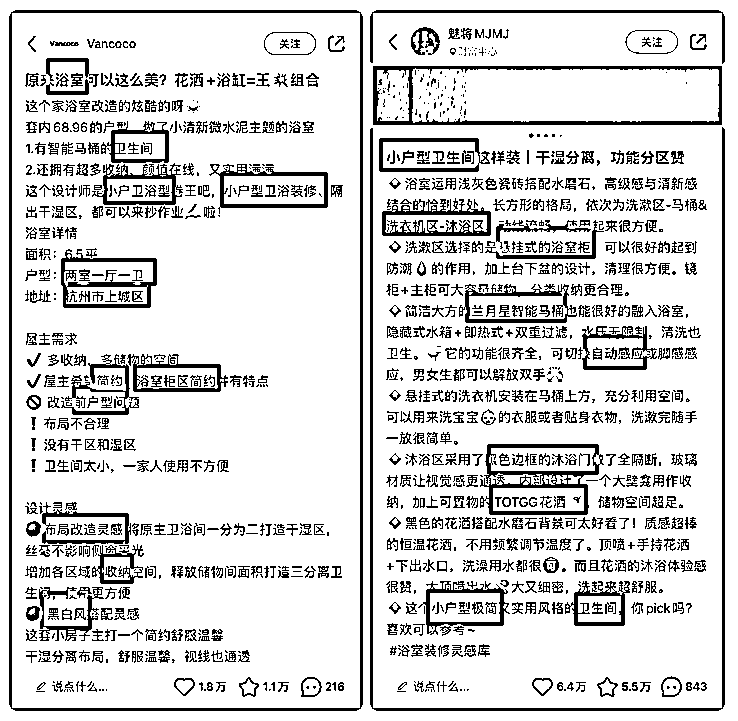

文案里埋入多种属性词，用户搜相关词就能触达，同时解决痛点、引导转化、提升获客量。

## **三、客资开口率翻倍的核心要素**

不少商家已经在小红书跑通了**投放+获客**的闭环。

除了投放与运营策略，笔记选题与内容质量，才是广告能否高转化的根本。

#### **1：先找准需求**

搞清楚目标人群真正疼什么。

可以通过小红书**行业调研、用户互动、客户反馈**来提炼需求并优化。

也可以对标同行优质内容，结合自身产品进行复盘投放。

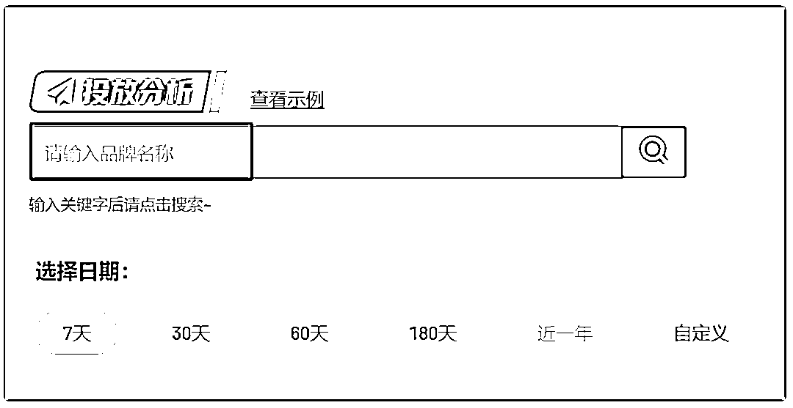

#### **2：主动引导开口**

设置快捷问答，**第一时间响应**粉丝咨询；

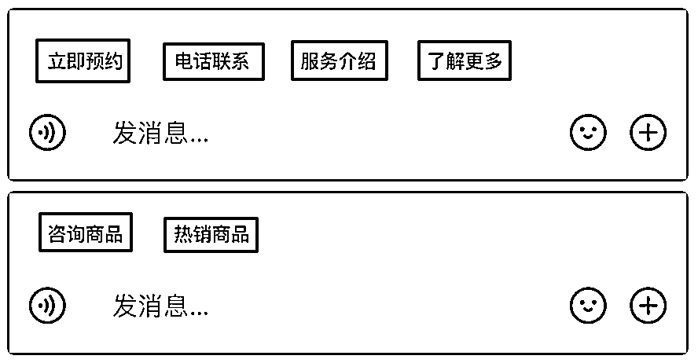

突出价格/福利/活动时间节点，**制造紧迫感，促使开口；**

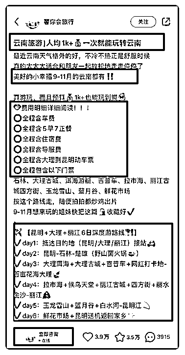

用同理心去沟通，**化解用户顾虑、解决需求**，推动深度对话。

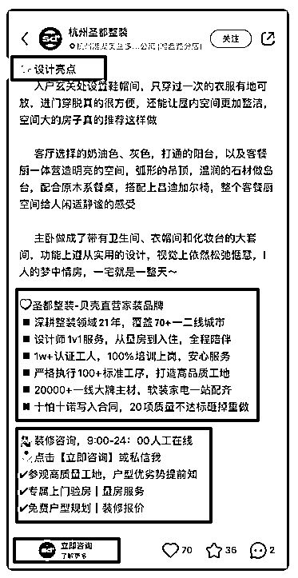

最后说一句，小红书商家想提升**获客开口量、压低产投比**，核心在于持续优化内容，做用户真正感兴趣的东西。

既要吃透平台规则与大方向，也要发挥自身专业优势，前后端配合打通。

找到适合自己的打法，ROI 上来就不再是难题。

* * *

评论区：

暂无评论

* * *