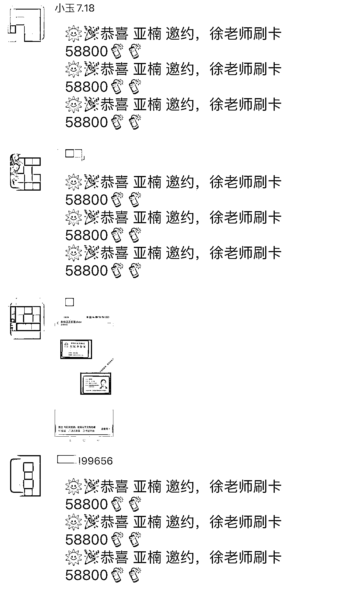
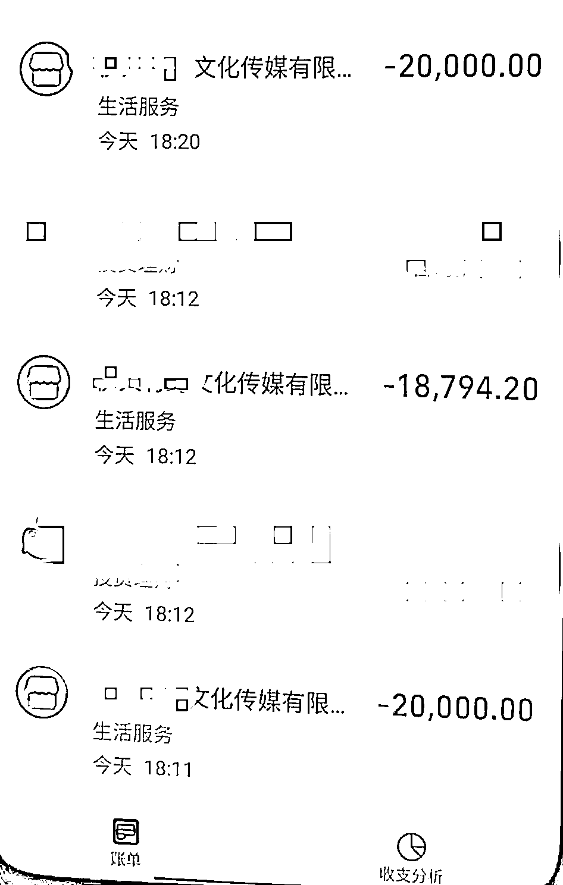
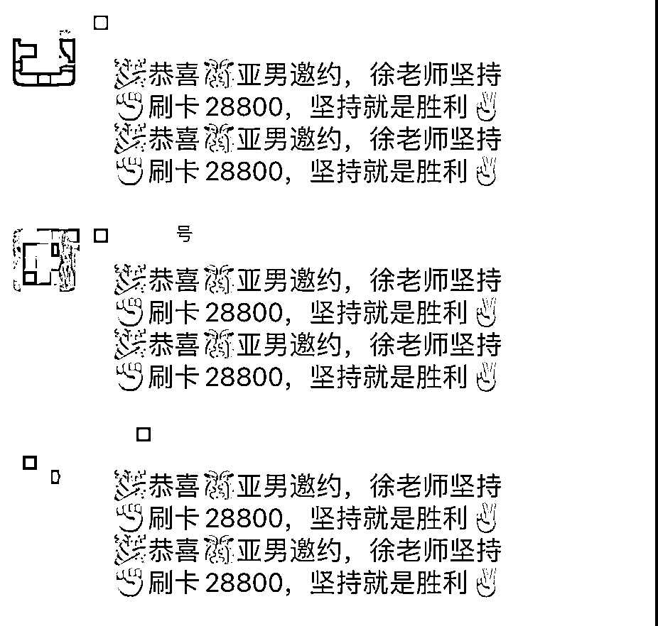
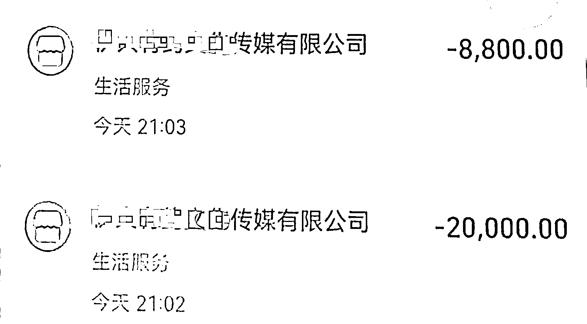
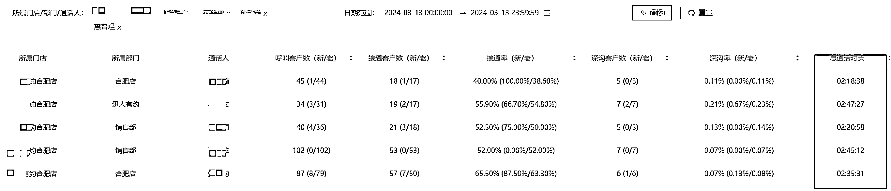
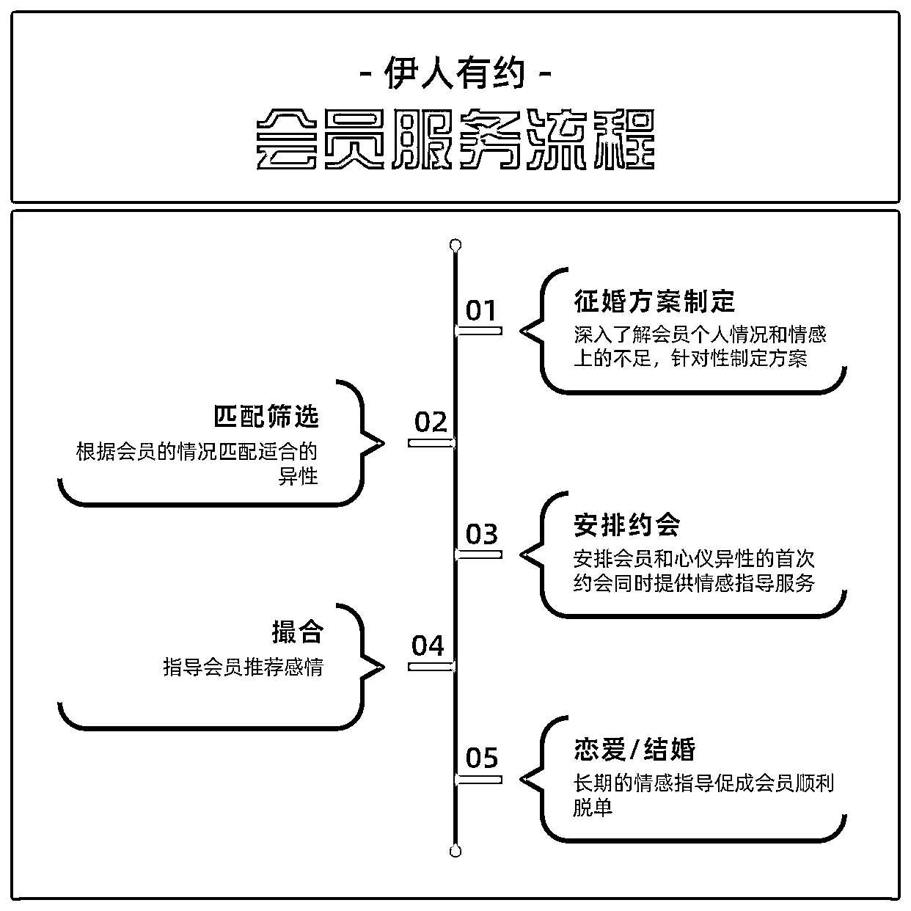
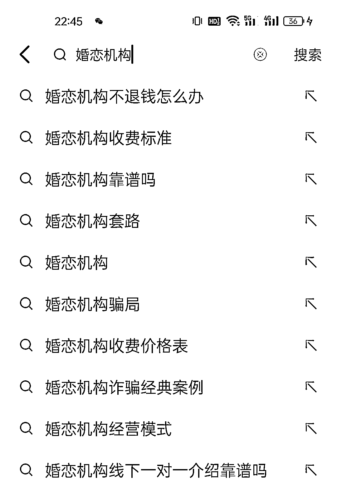

# 一年之内，带12个人把婚恋公司做到年入600万，我是怎么落地的？

> 原文：[`www.yuque.com/for_lazy/zhoubao/cncs4c6a2ukdkokb`](https://www.yuque.com/for_lazy/zhoubao/cncs4c6a2ukdkokb)

## 一、先让自己走一遍客户的路

很多人对通过婚恋机构相亲这件事挺陌生的，不知道来的人是什么样，先带大家免费体验一遍从进门到脱单的完整感受。

## 二、我们跑通的运转逻辑

我在珍爱干了5年，店长也是我以前的同事，我在MarryU、我主良缘也待过一段。横向对比下来，珍爱的打法最值得复用。现在我们的链路就是：新媒体获客->电话邀约->面谈->线下一对一跟进。

另外，培训是我们的重中之重。招到对的人很难，养好一个对的人更难。所以每天雷打不动开早会1小时，前10分钟排任务，后50分钟全用来补技能。干过几年的人都知道，婚恋不是干一两年就能成高手的行业，销售话术、情感经营、恋爱沟通、心理学全都要堆量。后面我会单独展开培训这块。

## 三、获客现在只做一件事

目前获客渠道非常单一，全靠抖音、小红书。没做线下活动也没做地推，这是我们接下来要补的短板。

创业前我对这两个平台完全是小白，所以前期把很大精力都用在研究怎么引流上。现在市场部3个人，月均能拿下1500条有效线索，刚好匹配我们6个销售的需求。

赚钱群里做流量的大佬太多，具体玩法就不细说了。

## 四、销售团队的现状与考核

### 团队配置
销售是流动性最大的板块，我们长期维持在6人左右。3个人月均能做到10万+，2个人稳定在5-10万，剩下1个垫底月贡献3-5万。有人会问，一个人一个月10万是不是很难？门槛在，但不算高。我和店长在珍爱时期月均30-40万，还带过6人团队单月冲到200万+。

### 价格体系
男单客单价区间在8000-13000，对技能要求相对友好。正常新人2个月练熟流程就能接手。女单客单价均价在2万左右，对能力要求明显更高。

会员付款截图

### 我们怎么管
1、通话时长
销售的核心工作是电销邀约和谈单。新人前两个月主攻邀约即可，之后再上手谈单。不谈单的情况下，每人每天通话时长必须≥150分钟，不够就加班补。我的逻辑是：成交不了可能是能力问题，但邀约不出来一定是态度问题。

通话时长

2、资源利用效率
每个销售手上大概捏着150条左右的资源，每天会新分5条。我们把资源分层，销售按40321的优先级去跟进。每周盘一次库，对超过7次不接听、不回信息的低意向客户直接丢回公海，用这种方式把高意向的筛出来。

管理者每天会盯数据：电话是否按流程和话术执行、资源跟进是否按优先级。如果发现有人拿到新资源打一次不接就丢公海，我会当场指出，甚至暂时停止给他分新资源。因为不珍惜资源的人，不值得继续投入。

## 五、服务团队的定位
服务部目前3人，对服务的要求很简单：把付费会员服务好，有续费是加分项。

很多人觉得交了钱就必须包找到对象。我想说的是要把预期拉回现实。我们会直接和会员说：付了费不代表一定能结婚，我们能保证的是介绍的人真实、是真心想脱单，以及你们在情感能力上一定会有成长。

315前段时间曝光了一些头部机构的乱象，我也想说婚恋圈很容易被误解，网上搜一下全是“骗子”、“婚托”、“退费”、“套路”。行业里确实有想赚快钱的搅局者，但大部分创业者最初的初心还是成人之美。每次收到会员脱单的好消息，那种精神上的满足是钱换不来的。

不排除有些人来当搅屎棍，但我相信大部分做婚恋的都是怀着成全别人的心态在做这件事的！

会员恋爱撤档仪式

会员结婚赠送锦旗

## 六、为什么要把培训做成体系
认识的不少同行，业绩忽高忽低，核心原因就是过度依赖某一个销售。某个销冠状态好时月入10万，状态差或离职就直接掉链子。这个问题几乎每个团队都会遇到，解法只有一个：把培训做成常态。

1、 新人孵化
入职前3天熟悉流程、背话术、抄写、背诵，通过考核才能上岗。

2、 日常打磨
每天早会1小时，针对近期高频问题做点状提升。

3、 用培训拉状态
业绩下滑或状态不对时，多听优秀录音，迅速找回手感。保持常态化训练，专业度就能持续上升，人效自然最大化。我们团队除了核心2-3人，其他人都是可替代的，新人能快速补位。销冠也不是固定名额，这个月A状态好资源就向A倾斜，下个月B更好，销冠就是B。

我认识的行业前五水平的老师，坐车、洗澡、上厕所、排队都在听自己的谈单录音。想在这个赛道长期有竞争力，就必须养成持续学习的习惯。

## 七、收尾
下次我会把电话邀约、谈单技巧、客单提升等更具体的实操拆开讲，希望对赚钱圈里正在做或想做婚恋的朋友有帮助，也欢迎感兴趣的朋友一起交流。

* * *

评论区：

咿呀花花 : 说实话，交费以后，就开始 Pua 了

朱倩南 : 整体门店运行思路，其实领导者的思想很重要。你说的肯定有这种情况

田媛 Karen : 我一直好奇和疑问，团队的人或者这个业务的核心成员尤其业务口的，都得是已婚的吗？或者换种说法，从事某个赛道必须要有相关经验吗

朱倩南 : 不需要，我们家未婚的多

A 千韭说 : 受益了！[强] 很强。

朱倩南 : 感谢🙏

李鹏 : 希望其中没有套路，谢谢

奇了个遇 : 难怪最近一堆人给我打电话

* * *