嘿，各位圈友，我是张波。论形象，就是那种走在人群里你绝对不会多看一眼的普通男生，搁以前，大概还会被贴上“屌丝”标签。但2023年4月18号加入赚钱之后，我的剧本彻底改写了——从公司裁员边缘的失业者，一路折腾成现在月入六位数。这一路的滋味，真不是几句话能说清的。

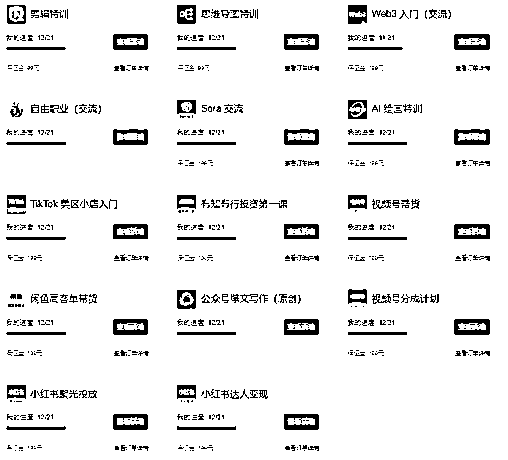

打完所有卡的那一刻，我坐在屏幕前愣了很久。回想这一年多，像过山车一样。写这篇分享，不为别的，就想给刚进圈的新人、还在原地打转的伙伴们一点参考。2024，希望大家都能赚到钱，咱一起富起来。

## 初入场时，纯属“潜水员”

说实话，进赚钱之前，我是在别处东拼西凑看过不少零碎搞钱内容的。那时候还在公司打工，天天被活儿追着跑，压根没空细琢磨。后来偶然听见“航海”这个词，好奇心被勾起来了——这玩意儿真能让我多挣点？抱着试试看的心态，我踏进了赚钱大门。

进来第一天，就被铺天盖地的帖子惊到了。各种晒收益的、分享月入几万几十万的，看得我眼花缭乱，怀疑人生。那会儿鱼丸的微信群也没啥干货，基本就是拉新。从2023年4月到6月，我基本属于隐身状态，有人问我就敷衍两句，转头继续上班摸鱼，后来干脆把星球晾到一边——心里甚至犯嘀咕：“我是不是交智商税了？”

## 被逼到墙角，才开始反思

转折来得突然。公司项目没起色，老板开始公开质疑我能力。那时候我真觉得自己混到头了，再不找后路就彻底玩完。于是跑去BOSS直聘刷简历，随手又翻开了赚钱星球。可看着那些帖子里吹得天花乱坠的项目，我嘴角抽搐——真能赚？怕不是又要交学费吧？可眼下已经一无所有，还能失去什么？

那阵子整个人是绷着的：白天上班如同上刑，晚上回来吃不下饭，每天八点去公园跑步，跑到筋疲力尽才回家，洗漱完倒头就睡——要是不把自己折腾累，根本睡不着。

## 苦学RPA：给人生装上“加速器”

当时我正干着项目经理的活儿，却连个助理都没有，工作量堆成山。实在扛不住了，我想通了：与其怨天尤人，不如投资自己。随后咬咬牙，付费买了圈友的RPA课程——说到这儿，估计老圈友知道是谁了。

RPA这东西让我眼前一亮：如果能解放双手，我是不是就能从重复劳动中挣脱出来？那个劲儿一上来，真是拼了老命去啃：入门课几小时搞定，进阶课啃了两周，实战部分又磨了半个月。群里不少人好奇我为啥这么卷，只有我自己清楚——钱和时间都砸进去了，学不会就是血本无归。凭那股狠劲儿，我硬是拿下了这项技能，后来回看，这是我这辈子做得最值的一笔投资。

## 航海启程：第一次下水，被泼了盆冷水

5月的航海报名我完美错过，只能等下一期。那段时间刚好另一个社群也在搞航海，我就顺手报了几个，边跟着练边有人答疑，还挺美。说巧不巧，我撞上了几位做公众号的教练，他们带我打开了新世界的大门，我开始试着运营自己的公众号。

之后赚钱航海来了，自然锁死名额，心潮澎湃。梁靠谱和杨涛那场直播，我到现在都记得那句“下场干，弄脏手”——那句话像针一样扎醒了我：别想了，干起来才有饭吃。

刚起航那阵，私聊里塞满了卖课的，个个张嘴就是“跟我学，月入过万不是梦”。说实话，那一刻也心动过。但看着自己公众号每天几块几十块的收入，虽然微不足道，却是我亲手赚的，心里踏实。最后我愣是一个付费课都没买，死磕自己摸索。现在回想，要是当时没忍住掏了钱，估计又是另一个故事了。

## 当“卷王”是被逼出来的

刚跑通公众号那会儿，我还是个啥都不懂的小白。看教练在群里热心解答别人的问题，自己也鼓起勇气去提问，结果压根没被当回事。那几天心态都快崩了：是我的问题太蠢了？还是我不配？

后来才回过味儿来，人家教练也是要恰饭的。有人私下发过红包，有人买了付费咨询，我这一毛不拔还想白嫖，搁谁身上都不乐意。想通了之后，我不再指望别人，干脆每天晚上扒别人的问答，自己复盘总结，硬生生把运营技能磨了出来，账号也一天天有了起色。

航海结束后，我一度狂得没边，觉得公众号这点破事也算个项目？差一点就放弃续航。幸好及时醒悟，选择继续坚持。续期之后，看着圈友们的分享，自觉啥干货都没有，只能一篇篇整理别人的复盘，从中偷师。

印象最深的是有次我在群里问猫哥关于2345邮箱的事，一个圈友突然跑来打岔，非要聊闲天，可我就想知道那个答案啊！那时候脑子也轴，不知道私下单独问，直接在群里跟她杠起来了。也是从那天起，我憋着一股劲儿，逼自己每天在群里输出，时间一长，我就成了大家口中的“卷王”——这称号一直跟到现在。说起来，我还得谢谢那位惹我生气的船员，是她点燃了我的斗志。

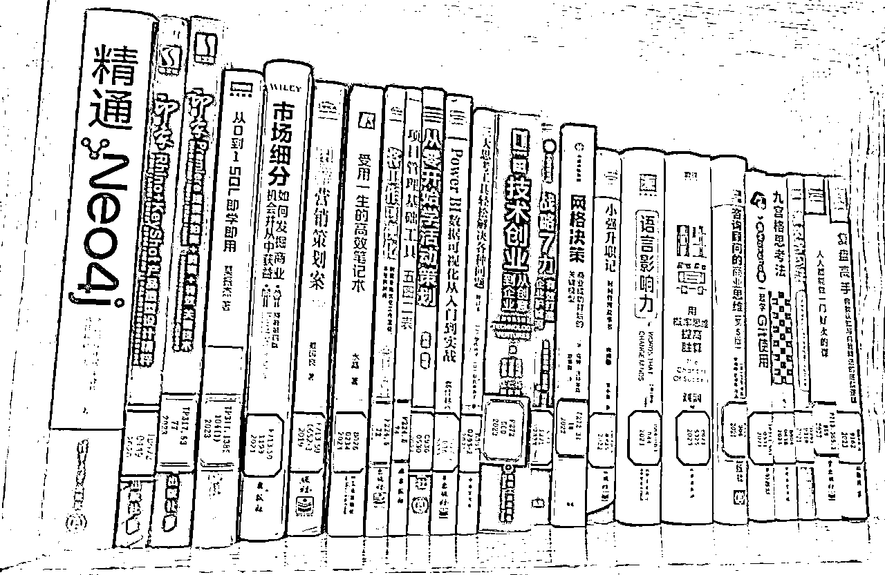

忙航海项目的间隙，我还会跑图书馆借书，专门找提升综合能力的资料，补自己的短板。

## 熬出头之后，做了个“反人性”决定

公众号做顺了，收益一天比一天稳，我的第一篇精华帖《公众号爆文进阶教程》也出炉了，得到教练、领队和志愿者们的认可。那一刻我知道，自己已经具备当教练的本事了。但当时满脑子想的都是“自己赚钱不香吗”，对当教练这事儿完全提不起兴趣。

毕竟，我那时候还在秘密筹划一盘大棋，谁都不能说。直到12月，我才松口答应做公众号爆文教练，今年3月又接了自由职业教练的活儿。如今那件大事办完了，也终于有更多时间回馈圈友了。

能和大家一起成长，分享我掉过的坑、踩过的雷，其实是件很有滋味的事。我也盼着在教练这条路上，多碰到几个同频的伙伴，一起搞出点名堂。

## 一口气读完所有精华帖，我疯了吗？

公众号项目稳定后，我开始担心流量会突然“断奶”。假如有一天平台不给推流了，我的收入怎么办？为了解决这份焦虑，我立下一个flag：把赚钱所有精华帖全部读完。

推动我这么做的，是梁靠谱那句让我浑身一震的话：“赚钱的精华帖，只有两个人看完了——一个龙哥，一个我。”好家伙，这我必须也得做到，不能掉队掉得太难看。

### 梳理方式：打印！打印！打印！

一开始我也只是闷头看，结果看完就忘，遇到问题也不知道问谁。后来偶然看到一个卖个人提升课的推销，但没激发我行动。纠结了半天，我干了一件说出来挺“傻”的事：把所有项目帖子先快速过一遍，挑出有价值的直接打印出来，看不明白的地方做标记，再去搜相关帖补课。当时总结下来有50多个项目，我买了100个文件袋、一堆便利贴，给每个袋子标好项目名。

因为家里有打印机，我买了几瓶墨水开干。量有多大呢？我打报废了一套原装喷头，换国产的又废了，最后只能再上一个原装进口的。

### 筛选内容：从航海手册开始

面对赚钱海量信息，我一开始是抓瞎的。作为一个刚跑通项目的菜鸟，每天新帖多到让我觉得不吃饭都看不完。

后来索性换个思路：不看别的，先把航海手册从头到尾挨个看，毕竟这些都是精华中的精华。等我吭哧吭哧把前两期大航海手册盘完，正好撞上“精华共读”这个航海——瞬间眼睛放光，这不就是为我量身定做的嘛！从此，我主要就啃精华共读的帖子，效率一下就上来了。

### 梳理内容：把大佬“一网打尽”

读完手册后我胆子越来越大：能上手册的大佬，肯定有两把刷子。于是我把他们挨个“点兵点将”，一个一个找出来，把他们的帖子全学了一遍，边看边做笔记。

接下来主攻精华帖，结果无意间翻到鱼丸整理的各种合集——好家伙，这简直是宝藏！我像饿狼扑食一样全部刷了一遍，一沓一沓的干货拿到手软。（PS：鱼丸合集该更新了喂，搞点新鲜的！）

### 效率开挂：滚雪球式成长

越往后读，我的辨帖能力越强。像七小、家蒙、轩辕这些老手分享的省时技巧，我用到飞起。知识像滚雪球一样越滚越大，现在随便丢一篇帖子给我，我几秒就能抓住重点。而这个习惯我也一直保留着——持续整理，随时复盘，随用随查。

### 现状：敢和大佬平等交流了

看的东西多了，脑子里的东西自然就多了。现在有圈友加我好友，哪怕对方是大佬，我也能接上话了。印象最深的是跟轩辕聊他写的“贝叶斯概率”，那篇帖子的底层逻辑我们掰开揉碎了聊了好久，全程没有一句废话。

如果你不知道做什么项目，把赚钱所有项目全看一遍；如果你不确定某项目适不适合你，就去看100篇这个项目的精华帖。

## 时间管理：我的“挤压式生存法则”

常有人问我：你每天干这么多事，时间到底哪儿来的？不会是吹牛吧？

### 第一阶段：拿RPA换时间

说实话，我也经历过一边上班一边做项目的忙乱阶段。直到9月底彻底离职，才从老板的阴影里走出来——那时候公众号已经稳定运行，甚至老板解雇我还赔了一笔钱。

而这期间，RPA就是我的时间外挂：公司里的琐事、公众号的重复劳动，统统交给它。要是没有那几个月拼死拼活地学RPA，我根本抽不出精力搞副业。说到底，掌握一个好工具，比加班到秃头强一万倍。

### 第二阶段：每天只睡4小时，坚持到12月

开始读帖那阵子，时间又不够用了。RPA能自动化工作，但学习这件事儿没法自动化啊。刚开始全凭意志硬扛，也没想着花钱学什么时间管理课。倒不是没钱，是怕别人知道我在悄悄“内卷”，万一都来卷，我的信息差优势不就没了？

就这么硬撑到12月中旬，另一个社群正好没安排新航海，我干脆把这当老天白送的两个月——每天只睡4个小时，剩下时间全扑在阅读上。几个月的疯狂输入，效果肉眼可见。

### 第三阶段：每天3小时，雷打不动

现在我已经养成了雷打不动的习惯：每天花3小时左右翻帖子，哪天不看浑身难受。今年也早早完成了续费，算是给自己一份承诺书。我也真心指望更多圈友输出好内容，大家一起受益，共同往前冲。

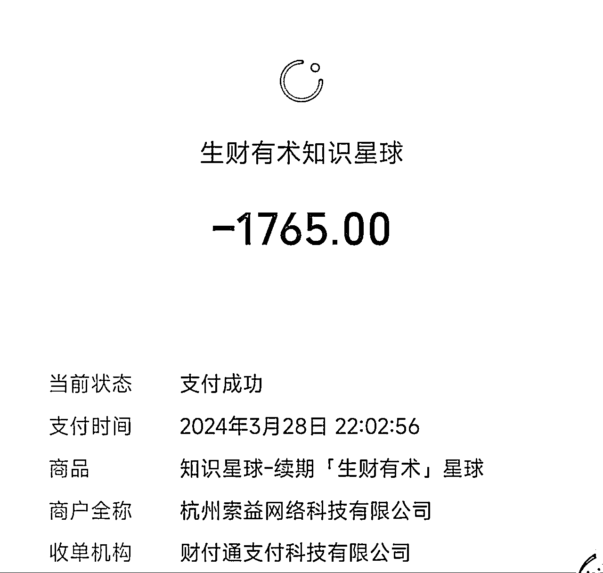

## 总结：时间管理的本质

说白了，时间就那么多，难题在于你有没有本事把每一分钟榨出最大价值。时间越紧，越要靠策略去优化效率，而不是单纯拼时长。

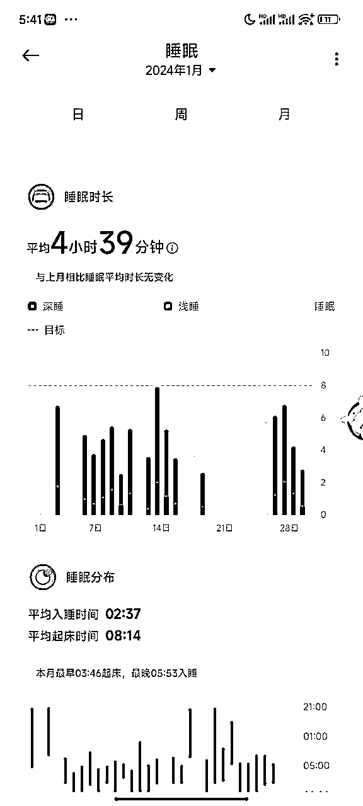

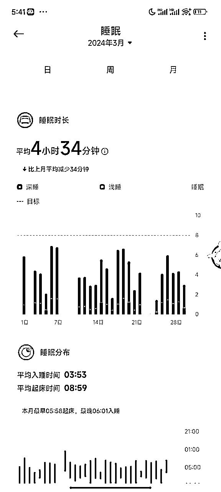

没时间？那就更难办了。

我举个自己的例子吧：现在每天睡眠也就5小时上下。我知道这样不健康，可眼下除了“多挤时间”，还有别的选择吗？本来起点就落后一截，你再不跑起来，怎么追得上那些跑在前面的人？

时间管理说到底，是在事业成就和个人状态之间找平衡点。我承认，我还在摸索调整中，如果你有更好的办法，欢迎随时来聊。

自踏上赚钱这条路以来，回头看看，我先后经历了五次航海。从一开始对航海体系几乎两眼一抹黑，参与的频率自然不高；但随着每一次实操下来，能力在不断累积，我也变得越来越主动，报名和投入的意愿显著提升。

即便有些航海在打卡和互动的维度上做得不够理想，我也始终坚持把航海里学到的东西和星球里高质量的精华帖结合起来。学习不止于理论阅读，落地的执行才是关键，我会把每一次的收获真正用在项目上，确保学习能转化成结果。

## 1、2023年9月（初次航海）

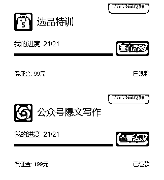

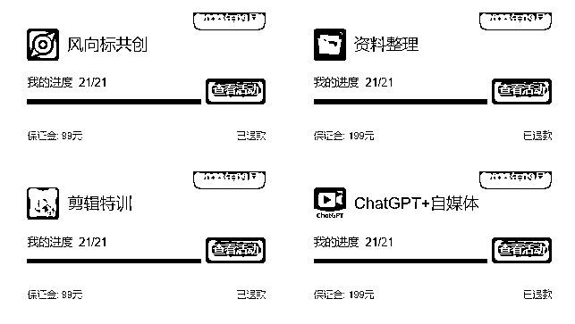

第一次上船，我并没有报太多项目，而是经过反复比对后挑选了最合适的方向。整体上我把航海内容分成了两类：变现类和投资类。

变现类：公众号爆文写作、ChatGPT自媒体、资料整理；

投资类：选品特训、剪辑特训、风向标共创。

变现类：

核心都围绕公众号在转，一次完整的打卡下来，基本等于把三个模块串起来做了。ChatGPT自媒体主要是围绕提示词设计，批量产出公众号可用素材；资料整理则是拆解对标账号的文章，吸收写作套路；公众号爆文写作本身就是变现落点。

投资类：

剪辑特训是我为后续做抖音、视频号等短视频平台做的提前布局，当时重点是把视频剪辑的基础操作和逻辑吃透；

选品特训：带货是视频变现的主路径，选品能力决定成败，我希望通过它建立起一套可用的选品方法，为后续带货打基础；

风向标：核心是训练趋势嗅觉，提升对市场风向的洞察力，对抓机会和做决策帮助极大。

## 2、2023年11月

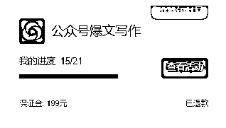

11月可以看作是9月的延续，这次我把重心完全放在变现能力相关的项目上，其他方向没有续报。当时为了腾出时间，我开始大量阅读其他航海项目的帖子做横向学习。

## 3、2023年12月

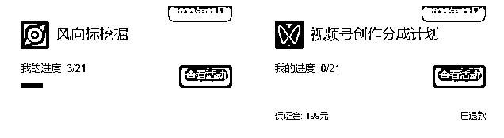

这一期我原本想报名视频号分成计划，系统地去练内容创作和商业化。但机会来了，我被选中担任风向标挖掘的志愿者。权衡之后我选择接下志愿者身份，先把视频号的计划暂时搁置，全身心投入志愿服务。

作为志愿者，我既能帮助圈友一起挖掘有价值的信息和趋势，也能切身体会服务的价值。团队协作下来，我们梳理出了一套较为成熟的挖掘流程，最终帮助大家的上岸率提升到了90%以上。

志愿期间我也私下研究过视频号分成，但在没有系统陪跑的情况下，自学效率远不如集体航海。因此在志愿结束后，我毫不犹豫地报名了下一期的视频号分成计划，想借助航海的节奏更深入掌握创作方法论和变现打法。

## 4、2024年1月

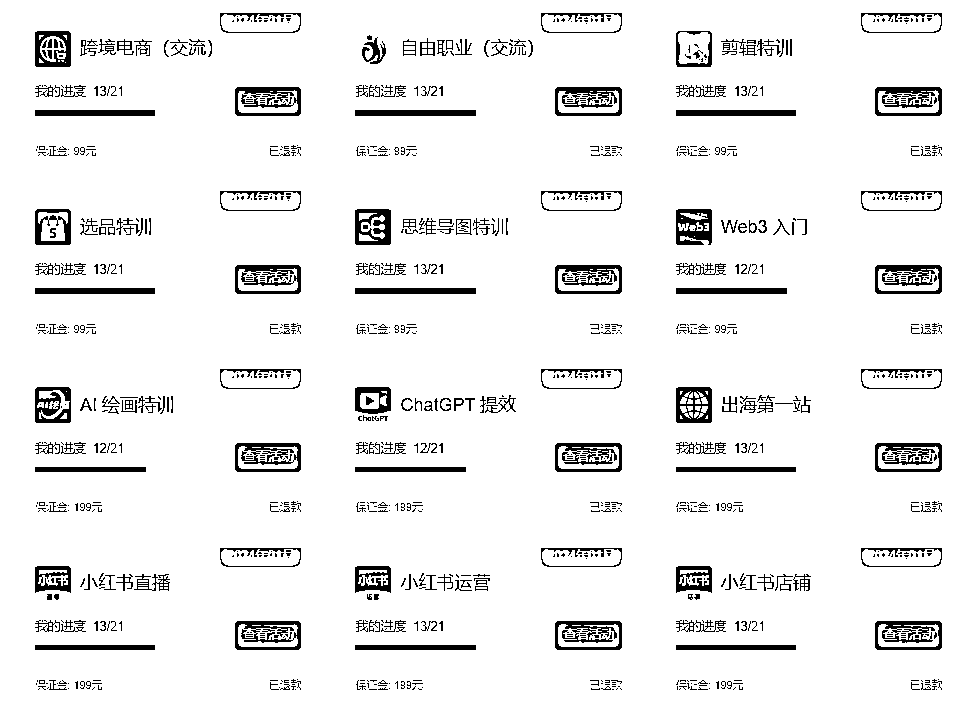

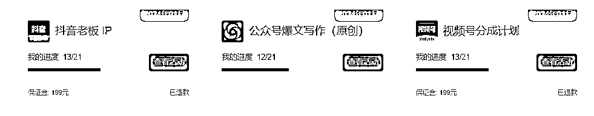

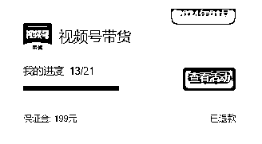

对我而言，这一期是集中发力的爆发点。之前几个月的拆解、复盘和积累，全部在这一个月集中显现出来。我同时参与了多个航海项目，即便闲鱼二手书、优势挖掘、运动等项目并未报名，我也在这些赛道独立跑出了效果。

这一期我还担任了公众号爆文的高手领航教练，共带了五次航会，并输出了一篇精华帖和一篇普通帖，得到了圈友的认可。外界看到的只是结果不惊讶的人，忽略了我前面几个月近乎隐形的深耕。很多项目在正式开启前，我就已经用自己的方式跑通了流程。所以对我来说，参与航海更像一次成果的呈现仪式。

## 5、2024年3月

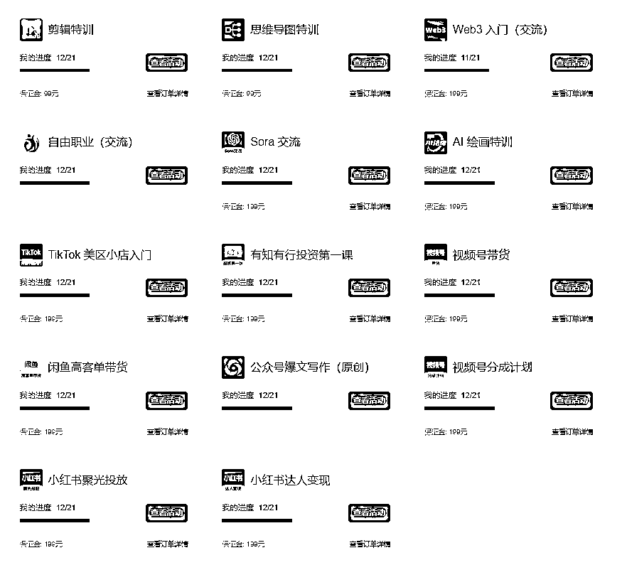

这一期我继续保持高频参与，其中不少是连续多期报名的老项目。它们已经成为我成长路径的重要支点，我在其中不断沉淀经验，也清晰感受到自己的变化。

持续报名的动力既来自兴趣，也来自对复利的认知。每一次航海都是新的探索，每一次挑战都是自我升级的契机。未来只要赚钱还在持续提供这些学习场，我就会继续报名参与下去。

## 总结：

总结自己在赚钱的历程，我参与了超过90%的项目。每个项目都有其独特的价值，它们拓宽了我的知识边界，也锤炼了我的执行力。我对各项目的特点已有较深认知，能够结合自身性格和优势，选择最适配自己的赛道。

路还很长，挑战不会少。但真正限制我前行的，从来不是时间，而是我自己的心态和决心。只要保持学习渴望，持续自我挑战，没有什么是做不到的。

# 六、项目执行

执行是目标落地的核心环节，而客观公正地记录问题是执行力的重要保障。仅靠记忆不可靠，时间一长细节会模糊，情绪和偏见也会干扰判断。

我保持每天复盘的习惯，一方面回顾当天执行，另一方面为下一步做规划。我会把执行中遇到的技术卡点、协作摩擦、时间分配难题等全部记录下来。这样既方便后续检索，也能在求助时把问题描述清楚，也让别人更快给出有效建议。

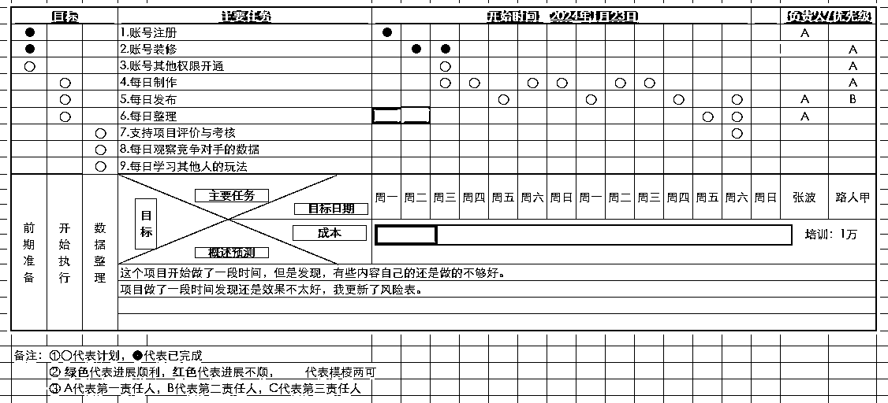

## 1.WBS拆解

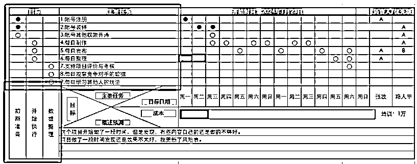

红框里的那套做法，本质就是WBS拆解。把整体任务拆成阶段，每个阶段明确交付，再按自己的实际节奏进一步拆分，不要把太多事情堆在一起。

项目→任务→工作→日常活动，即把大项目拆成任务，任务拆成可执行的工作，工作拆成每天的具体动作。

## 2.进度表

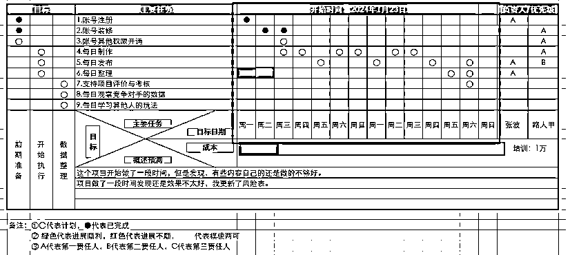

• 进度跟踪与监控：用可视化表格把数据填进去，收集数据能直观看到进展，便于及时调整时间表；

• 目标日期：建议按天设定目标，每天记录做了什么，后续复盘时能快速还原路径，新的操作思路直接写在阶段概述里。

## 3.责任分配矩阵

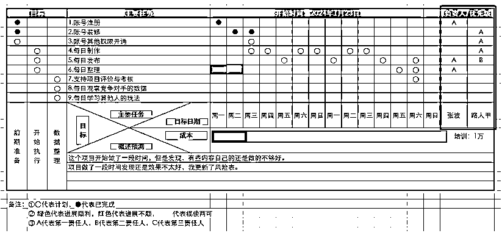

• RACI矩阵实操：每个人按职责把事做对，记录清晰后问题定位更快；

• 沟通与协作：对他人的请教和反馈做好记录，后续复盘更有依据。

## 4.风险管理更新

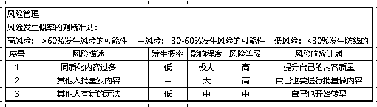

项目推进中必须动态更新风险管理，及时捕捉变化，找到问题点。不要等撞了南墙才回头，要做到前置分析、及时整理。

更多做法可参考：《航海项目-个体/副业项目实践操作初步指南》

# 七、遇到问题

## 1、项目问题

执行中遇到问题是常态，应对方式体现心态和解决能力。我遇到的典型问题有：

a、公众号爆文：分类难以稳定维持，账号体量不足，原创度偏低；

b、小红书：如何快速冲破1000粉并提升互动；

c、视频号、抖音：播放量提升和带货转化能力亟待加强。

解决的关键是先找到问题，再找到根因，最后给出对策。这往往需要市场调研、技能补齐或向专业人士求助。

## 2、资料问题

资料方面的困扰相对好处理，常见的是内容更新慢、经验过时、核心方法不愿公开。我的做法是走项目资料混合路线。前面已经把资料整理并打印归档，遇到公众号卡壳时，我会去看小红书的打法是否能迁移；小红书遇到瓶颈，我也会参考抖音、视频号、公众号、IP朋友圈的玩法。

通过跨平台混搭资料，我把知识边界拓宽了，实效也比较明显。

## 3、执行力

执行力偶尔也会掉线。目前所有项目都由我一人推进，靠RPA辅助操作，但时间仍是瓶颈，暂时没有扩编预算。

我一方面提升个人效率，另一方面也在探索更可持续的解决路径。

## 4、时间管理

时间管理目前已做到极致，现有3台电脑+RPA协同作业，招聘解决不了当下问题，下一步还在思考新的增效方式。

# 八、突破瓶颈

困扰我最久的瓶颈其实只有一点。

## 项目分析

1、公众号单价持续走低，AI生成的内容容易被限流，需要把写作手法拉向更接近人工的质感；

2、引入播客、抖音等优质内容，通过语音转文字等手段进行二次加工；

3、未来单价可能继续下探，但公众号的基础流量仍在，冬天过去春天就不远了。

## 未来选择

• 继续堆量做号，用AI批量产出后发布赚快钱，等限流再换号；不推荐。

• 提升内容质量，延长账号生命周期，逐步培养腰部账号；这是长线方向。

• 现在入局爆文的人很多，最终能留下的是能快速适应变化并做出应对的人。

若继续输出劣质内容，公众号赛道必死。为此我学习了离散数学、悖论、笛卡尔坐标系等底层思维，解决了模型问题后，项目仍保持稳定收益。

# 九、个人建议

从小白走到现在，有几点感悟供参考：

## 1、认清自己

不要过度美化自己，认为自己是天选之子。脚踏实地分析优势劣势，做到扬长避短，而不是空想暴富却无实际行动。

找准优势后，拼的就是执行力，不接受任何借口。

## 2、认清别人

只有真正看清别人，才能判断建议是否对你有用。别被精美的海报和华丽话术带偏，要用理性去拆解分析。

## 3、认清项目

赚钱内外项目很多，报名航海或启动项目前，先认清自己，再判断自己是否有落地可行性。身边资源能否支撑？梦想美好，现实需要匹配。

# 十、未来规划

接下来我计划聚焦三件事：

## 1、利他

利他是我成长的核心驱动。未来我希望每期都报名担任航海教练，用自己的实战经验帮助更多人。我相信输出能反哺输入，既能推动他人成长，也能倒逼自己升级。

我不再满足于写帖子自嗨，而是希望把技术突破应用到每一位船员的实操中，让大家从参与者变为操盘者。

例如本期公众号航海，有船员坚持3个月无收益，看完我的帖子落地后开始变现，这让我很有成就感。这是对努力最好的反馈，也是利他精神的体现。

## 2、复盘

复盘是能力提升的关键。我计划建立日复盘、周复盘、月复盘机制。日复盘用于微调策略，周复盘用于审视中期目标，月复盘用于校准长期方向。

通过系统复盘，我能更快发现问题、保持方向稳定，实现持续成长。

## 3、优化

过去一年我沉淀了大量资料和帖子，未来一年我将把实践经验与资料结合，形成深度沉淀。

目标是产出几十篇高质量干货。

杨帆正当时，期待与你同行。