# ('全职宝妈，跑通AI简历从0-1，满怀期望', (2, 22))

**全职二宝妈的闲鱼AI简历复盘：两天27单，我从0到1跑通了**

我是阿敏，两个孩子的妈妈。去年，我还困在家里带娃，没有收入，成天为钱焦虑，总想着能找个线上的兼职。有一天，我在朋友的朋友圈看到赚钱拉新的内容，当时半信半疑，但好奇心上来了，还是领了一张试用卡。没想到，打开精华帖后就入了迷——原来网上有这么多赚钱门路，各种副业拆解看得我眼界大开。

一点没犹豫是假的。正式加入要1965元，对一个全职妈妈来说压力不小。但那时只有4月3日晚上8点能享受最低价，我特地定了7点50的闹钟，到点咬咬牙付了款。后来我越来越相信一句话：人的改变，往往是从花了一笔“不敢花的钱”开始的。

进圈后，我基本天天泡在精华里。看别人月入几万、几十万，既羡慕又忐忑，我也幻想自己有一天能在网上赚到钱，哪怕一个月几千块就够了。那段时间我边看帖边找项目，会先盘算自己和项目的匹配度，再跟着操作。结果却是“一看就会，一做就废”，做了好几个项目都拿不到结果，心里又累又慌，怀疑自己是不是方法不对，还是项目已经从蓝海卷成红海了。后来慢慢想通：读懂了和会做是两码事；如果我不会引流、不会剪视频这些基本功，项目难度自然更高，短板只能一个模块一个模块地补；如果项目已经变红海，再照抄老玩法也行不通。

转机出现在10月。我刷到饭饭的《AI+简历修改，首月盈利7000+，低成本高收益的保姆级教程，附带多个接单平台详细操作步骤及避坑指南》，感觉这就是为我这种零基础的人准备的。当天看完就动手，当天还真的出单了。要特别感谢饭饭，早在这篇分享前我就加了他，每回遇到客户沟通上的问题去请教，他都能及时给出建议。

说说实际成绩：10月18日正式开跑，当天接了9单，基本都是应届生；10月19日再接18单，应届生和往届生都有。那两天，我算是在闲鱼上跑通了AI简历修改。跑通后我才真正理解线上交付是怎么回事：熟悉平台、获取客户、解答需求、制作简历、交付收款，一环扣一环。

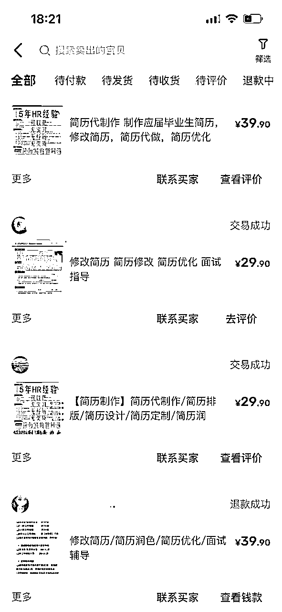
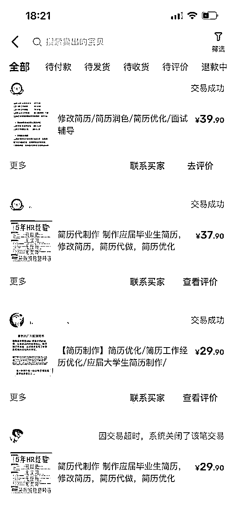
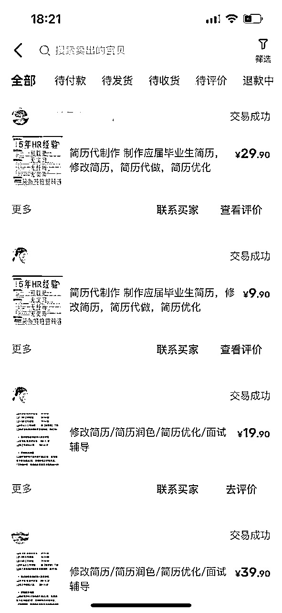
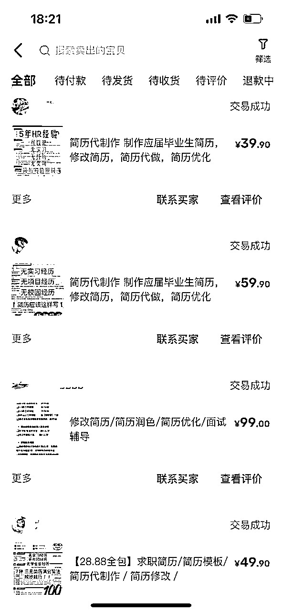
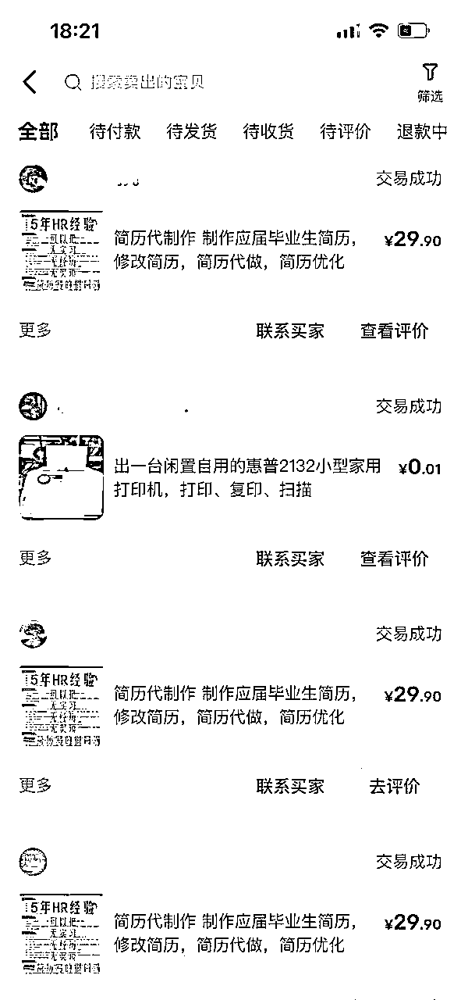
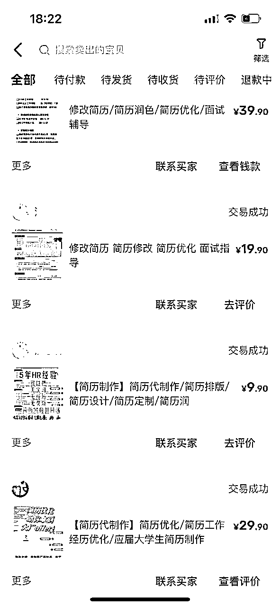
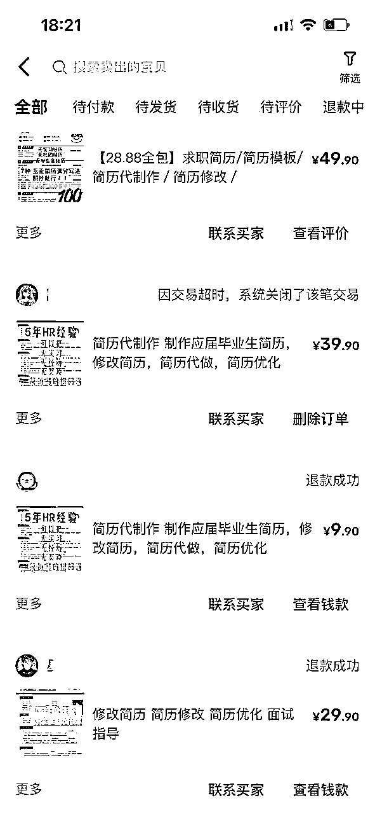
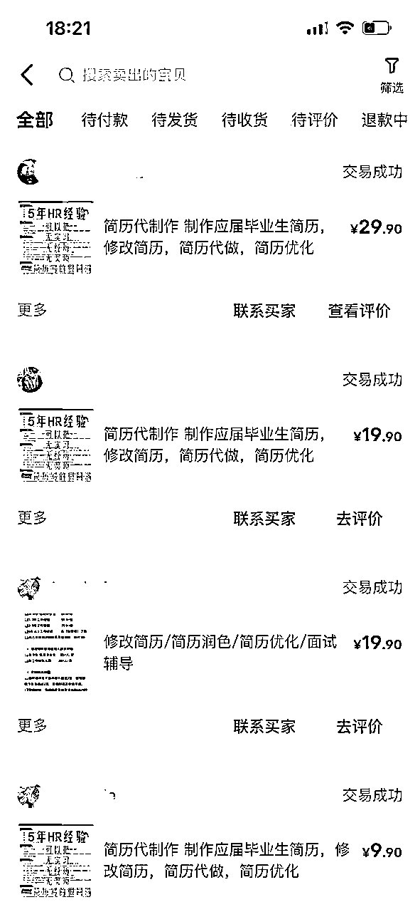

下面把我的实操方法梳理出来，想试的圈友可以直接参考。

**一、准备闲鱼账号**

先装好闲鱼App并注册。如果之前卖过闲置，像我就是直接用老账号。账号包装有三点：头像随意，别太随便就行；昵称改成“XX简历制作”“XX资深人力”“XX求职辅导”这类；简介要把实力亮出来。可以参考这两句话：

- 大厂HR出身，熟悉校招和社招，一对一帮您优化简历、润色文案、定制内容，欢迎来聊。
- 8年人力管理经验，累计做过上千份简历，专注针对目标岗位完善个人经历，助你顺利拿offer。

**二、发布商品**

在闲鱼搜索“简历”“简历修改”，优先点开“想要”人数多的链接，看同行是怎么设置标题、描述和关键词的。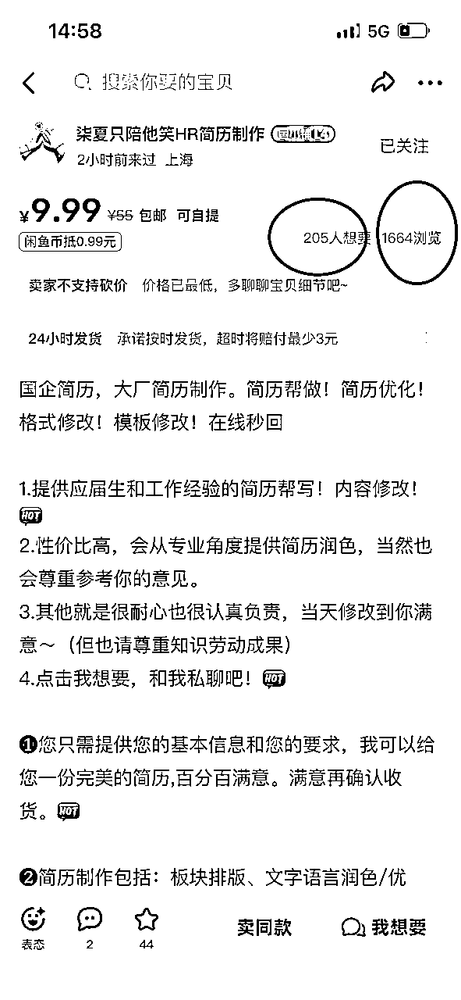

标题不一定非要自己硬憋，可以直接借用同行思路，也可以适当改成自己的话。我观察下来，比较好用的卖点方向有三个：

- 主打综合服务型：国企、大厂简历都能做，代写、优化、格式修改、模板修改、在线秒回；应届生和有经验者都接，专业角度润色、板块排版、尊重客户意见，当天改到满意，满意再确认收货；一对一私人定制，拒绝套模板，发Word和PDF两个版本，修改次数不限；每天限量出售，重质量、靠口碑。
- 主打速度型：最快两小时出稿，简历代做、定制、优化、中英文润色修改都能接；连续两年面试邀请率超过91%，根据目标岗位丰富简历内容、提炼优势业绩；应届生没有经验也能一对一深挖；7年大厂HR经验，给予免费建议；24-48小时出稿，出稿后30天内免费修改。
- 主打资历型：7年上市互联网公司+外企招聘经验，4年社招、3年校招，参与过简历筛选、面试和面试题目设计，也培训过面试官；岗位覆盖开发、产品、运营、市场、销售、客户等；实习、校招、社招简历都能做，量身定做，三天内免费修改，可提供面试指导；15元起，按简历复杂程度调整，也可以自行出价，能接受就接，加急加10元。

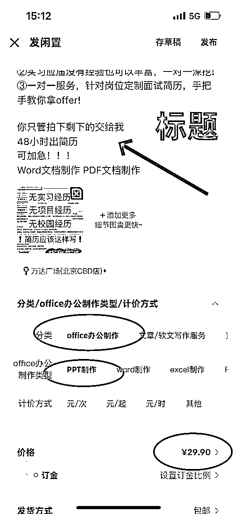

**三、发布时的四个小细节**

1. 分类要选“office办公制作/PPT制作”，我做简历一般选“PPT制作”。
2. 发布地址尽量选一线城市，大城市求职需求更旺盛。
3. 标签加上：#简历 #简历制作 #简历优化 #简历修改 #简历润色 #应届生。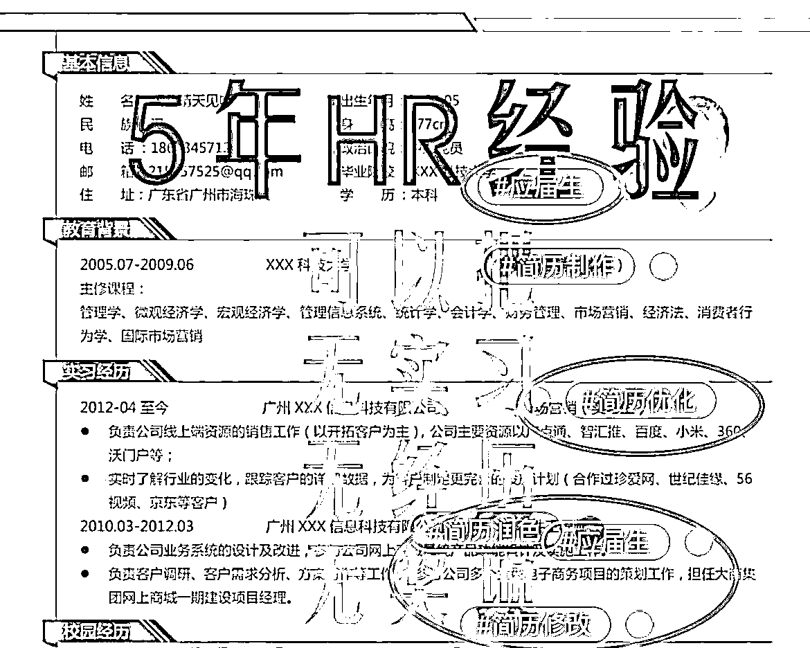
4. 商品图千万别直接保存别人的图片用，图片最下方往往有对方闲鱼号的水印。先把水印裁剪干净，单独建一个“简历图片”相册存放，发布时随机组合。

商品图我用【搞定设计】【创客贴】【美图秀秀】比较多，图越简单越好，简单反而更真实。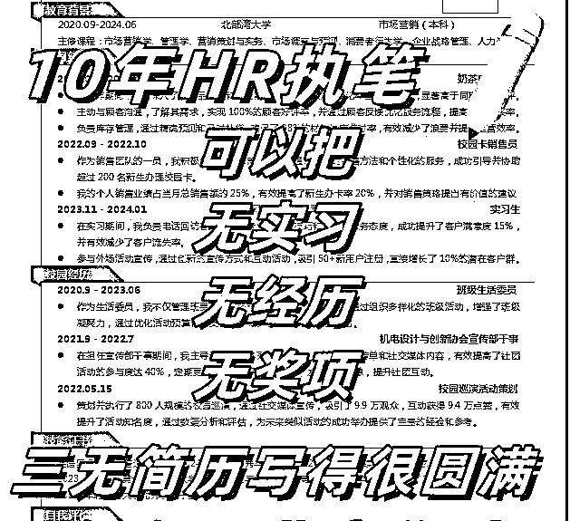
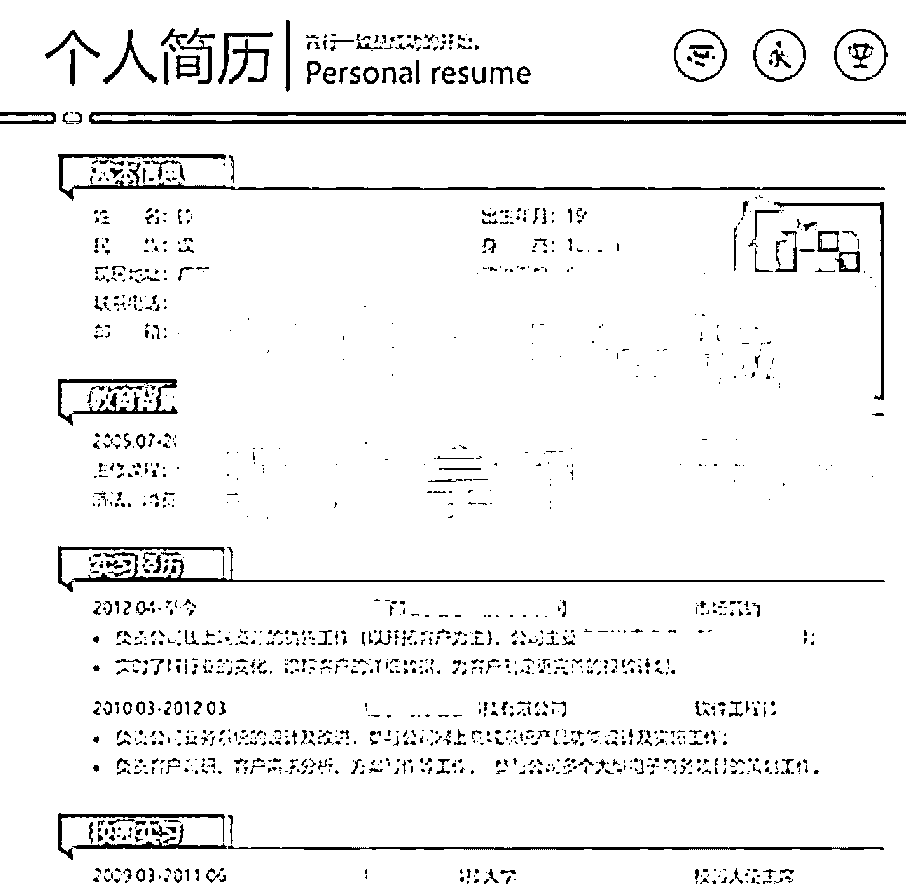

**四、接单后的处理流程**

1. 先问客户是应届生还是往届生。应届生比较好处理；往届生重点在工作经历润色，还要看工作经历和目标职位的匹配度。
2. 往届生最好让他发一份旧简历，在原有基础上修改润色，比自己从零写更高效。
3. 发几套简历模板图让客户自己选款式，不要替他做主，免得做出来不满意。
4. 一定要问清目标职位和岗位要求，这样在工作经历里才能突出匹配度。
5. 约定交付时间，一般24小时内出稿；急单要额外加钱，多数客户都能接受。
6. 报价参考：应届生统一29.9元；有经验的39.9元起；遇到优质客户、付费能力强的可以往上加；只要模板的话9.9元一份，也有这样的需求。
7. 交付方式：简历做完后，在闲鱼后台选择“无需发货”，先在微信上把带水印的简历截图发给客户；客户确认没问题，去闲鱼点“收货”，再通过微信发无水印的Word+PDF两个版本。免费修改2次，超出次数另收费。记住：客户没有确认收货前，千万不要先发无水印文件，否则很容易跑单，我自己就吃过几次亏。

**五、两个亲测有效的引流技巧**

第一种是打电话：客户拍单后，订单信息里能看到电话，我直接打过去说自己是闲鱼卖家，要加微信沟通简历要求，基本100%能加上。

第二种是引导客户自己发微信号：比如自然地问一句“我怎么把文件发给你？”，对方通常就会把微信发过来。

最后，真的特别感谢赚钱这个平台，也特别感谢饭饭。我是通过他写的《被低估的赚钱项目：揭秘月入1W+ 的手机壳行业的暴利拆解》加了他，当时请教手机壳开店的事，他居然直接把货源商家发给我，我特别惊讶，那是我第一次遇到这么愿意分享的圈友。后来因为别的原因没有去做手机壳。再后来他又建议可以卖高考志愿填报数据，比如专业录取分数线、招生计划、院校分数线。记得是晚上11点多，我们立刻行动起来，先买数据再发闲鱼，一直讨论到12点多，第二天他就出单了，执行力太强了。他的朋友圈和围观群我基本每天看，AI简历、AI代写、写作店铺这些项目他一个个做起来，成长速度飞快，我也跟着学到很多。

今年我也算在赚钱慢慢找到了自己的方向。希望新的一年能持续成长，把项目做熟练，赚到更多钱，早日走出全职妈妈时期的迷茫。也祝所有圈友都能发大财。第一次写文章，如果对你有用，欢迎点赞鼓励一下～