# 半年入局赚钱：一个普通人的认知重塑手记

> 来源：[https://lqhefhcsx54.feishu.cn/docx/JguIdOfeJoXZI6xrI0bca1Hynfg](https://lqhefhcsx54.feishu.cn/docx/JguIdOfeJoXZI6xrI0bca1Hynfg)

# 一、自我介绍

大家好，我是薄荷Heidi，90后，普普通通的一个人。

我是在2023年通过播客《搞钱女孩》了解到赚钱，11月正式入群。当初给自己定的小目标是半年赚15万，这个数字到现在还没实现。可即便如此，赚钱带给我的冲击，远比数字本身更强烈，我的认知被彻底拆开又重新拼装了一次。

# 二、认知被拆解又重组的历程

## 1、加入赚钱之前

大学毕业后我做了7年打工仔，黑电行业的IE工程师，主抓现场管理。日常就是推5S、应付检查，所谓的精益改善大多停留在发现问题层面，真正动手改造的是工装和工艺工程师，而我做的项目结束后也拿不到任何可沉淀的经验，更换算不成收入。

更消耗人的，是集团、总部、兄弟部门、领导、第三方...日周月季年的质量安全现场检查。每次通报要来，人人紧绷加班搞卫生做面子，走了就原样复原，形成了死循环。

我搞不清自己的价值在哪，却总觉得自己在为公司拼命。正应了纪钟老师那句话：没有积累的工作，是最差的商业模式。

最终是家庭、亲密关系、亲子关系、职场全线崩盘。我垮了，出现明显躯体反应，甚至一度想结束这一切。脑子里却有一根细线在拉我：该醒了，走吧。于是我抑郁离职。

## 2、离职后的半年空窗

家人并不理解也没有支持我的决定，但内心有个声音一直说：你是对的，去做你真正想做的事。

那半年我几乎住在书店和图书馆里，沉浸在书海的呼吸感中。小说、经济学、哲学、心理学、名人传记、日本系亲子书、佛学...各种题材轮番啃。

经济学告诉我育儿哪里出了问题，哲学让我看见工作的症结，心理学揭示了我被煤气灯操控后抑郁的根源，名人传让我直面自己的懦弱，日本书把亲密关系的裂痕归因到原生创伤，佛学则让我看见人性的复杂。

我慢慢觉得路并不难，世界的好东西很多，值得去探索。周一图书馆闭馆我就抱着书去咖啡店，其余时间都泡在馆里，读书笔记用小红书和思维导图来整理。

## 3、入局赚钱的第2个月

《搞钱女孩》里的每一期我基本都听完了，对雪姨和小辉的资源链接能力很佩服。刚开始听到雪姨让小辉进来时我还有点笑，后来自己进来才发现赚钱是个宝藏坑，不进就亏。

三天体验期是客服领的，一进来就被海量帖子淹没，最扎我的是纪钟老师那句：不明白什么是真正的努力，都在用战术上的努力掩盖战略上的懒惰和迷茫。扎心却清醒，我暗自决定要提升思考与创造力，去打造稀缺性。

### 项目拆解营

体验期结束后，鱼丸找到我，推荐了一个很适合新手的项目：5天带教+实操，每天约20分钟，手把手带你试探4个变现方向、拆解8个具体案例，最后我交出了4份项目拆解。

#### 收获感
原来日用小事都能变现，只是我以前没见过。项目拆解营像个起点，也为后续探索铺路。

就像全职妈妈泳怡说的，行动力就是立刻做，观望只会原地踏步。陈雪老师也推荐过赚钱的航海实战要下场，于是我报了2023年12月的航海，选择了我熟悉的思维导图方向来做升级。

### 2023年12月航海实战

社恐的我在群里每天打卡，还收到志愿者柏芝的持续鼓励。真的很感谢她，催打卡也不让人反感，满满真诚希望学员进步。她抛出的一个表情包“你练了=我练了”把我推着去冲志愿者榜，还教了我提升效率的小技巧。也是她让我在思维导图里找回价值感，焦虑和迷茫被冲淡了。

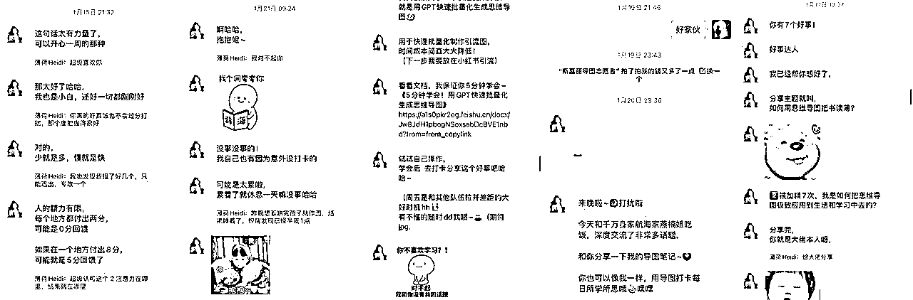

#### 成果记录
每天都能收到来自志愿者和自己的正向反馈。最终好事上墙13次，被柏芝点名分享。

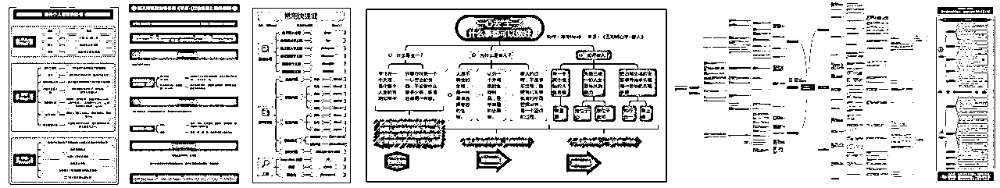

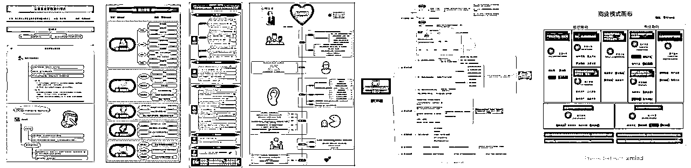

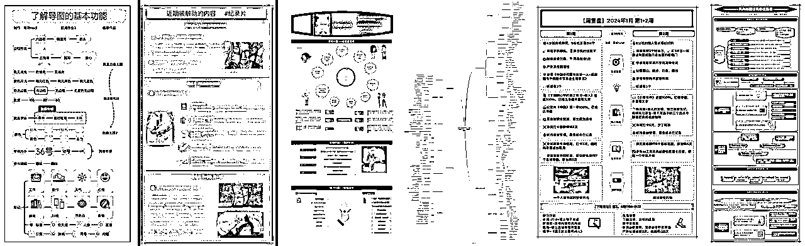

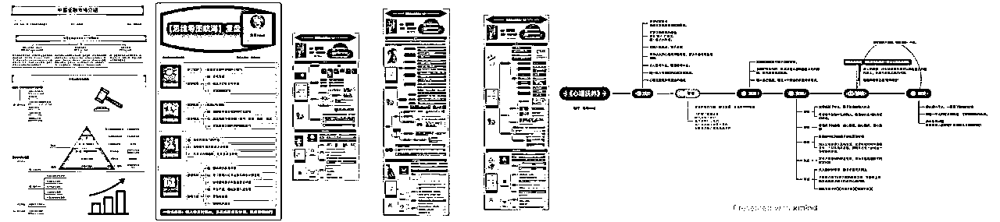

12月的这次思维导图航海，初衷不只是拿回保证金，而是把基础作图功底打牢，让不同样式的导图呈现更清晰。柏芝提醒我不要放弃任何出圈机会，于是我虽然没被选中，却也积累了动力。我把自己13次上墙的心得和优秀圈友的好事都整理了一下，虽然粗糙，但也是一种对标学习。

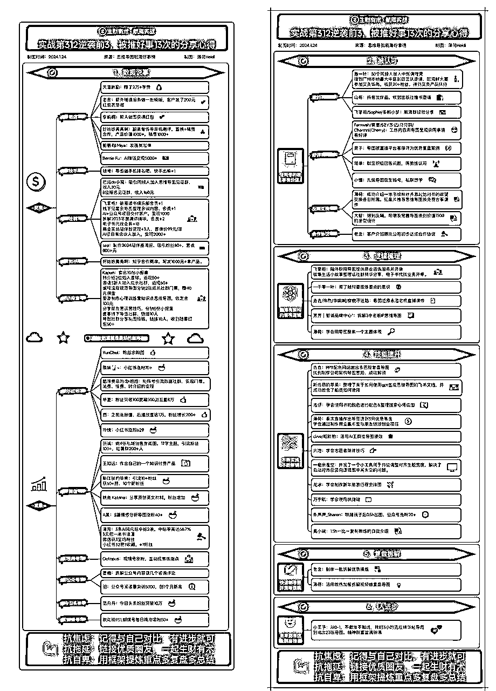

最后柏芝带领小组拿了榜首，还私人赠送了我郭拽拽的新书《前途无量》。书里提到王阳明“事上练”，反复叩问自己打算怎么赚钱，能减少内耗。

漫画《一人之下》里张楚岚爷爷说：木秀于林风必摧之。怕朋友开路虎，外界要求太多应付不过来，对外太累，不如向内求己。修心，知行合一，练对了。

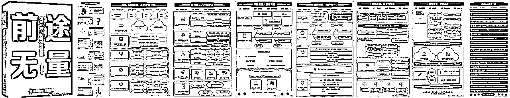

#### 总结感悟
真实的是结果，牛逼的是长期拿结果的人。向结果致敬，向有结果的人靠拢。

做完这次导图后，我不再畏缩了，有目标有榜样就去学。学习阅读是低成本的元能力，学完要输出，如今的我也是如此。虽然作品不算惊艳，但对我而言是读书的肯定。

基金里那句“按纪律操作，做好配置，等风来。听话照做，风来了猪都能飞”深得我心。大佬们高速成长的本质，都是极度饥渴、主动学习、独立思考，而不是刷浪式伪学习。

思维导图是倒逼输出思考的好工具。用杨涛老师的话说，“船大好抗风，船小好掉头”，一切都来得及。

## 4、入局赚钱的第4个月

### 风向标·赚钱机会挖掘训练营

航海结束后，我对风向标产生了兴趣，把原本无目的刷手机的习惯改成了带着疑问、敏感和好奇去刷小红书、抖音、视频号。

发了第一篇风向标后，鱼丸邀请我加入赚钱挖局训练营。首期内测开放了四个垂类：小红书、AI工具、TikTok、视频号，7天通过分享+实操掌握挖掘方法，培养商业嗅觉。我第一个报了名。

选了当时正火的AI工具赛道，发布了3条AI主题风向标，中了2条，中标率66.7%。龙哥大大的认可给我极大信心。

#### 成果记录
中标风向标链接：
https://wx.zsxq.com/dweb2/index/topic_detail/811442121441112
https://wx.zsxq.com/dweb2/index/topic_detail/588444582122424

后来要把四天分享整理成飞书，我又用竖版思维导图把鱼丸的课程梳理了一遍。

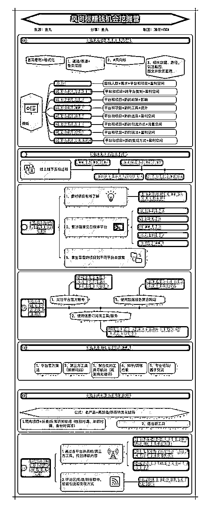

#### 感悟
1、风向标的发布是有方法的，发什么、怎么挖都很关键。
2、AI赛道信息密度很高，我的两条中标风向标都来自B站的大神。
3、做完竖版导图后，每当找不到好风向标，我就会拿出来复盘：是渠道不对、没挖到变现点、还是偏见作祟、没刷星球中标贴？多问几遍，灵感往往就蹦出来了。风向标挖掘营让我进入了进阶阶段。

### 风向标共创

因为中过标，鱼丸推荐我进风向标共创群。群里有龙哥不定期点评，还有前沿机会分享，能认识交流，前提是每月在星球至少发4条风向标。

当时我更在意能和龙哥同群，根本没想4条难不难，直接报了名。进群后龙哥没说过话，我也没好意思去搭。后来想明白了，风向标只要求发，不要求中，这本身就是最小目标，最容易执行，像每天看一页书一样。

#### 成果记录
截止现在，我累计发布风向标41条，中标5条，中标率约12%。

中标合集：
小红书--
https://wx.zsxq.com/dweb2/index/topic_detail/4844514255158218
https://wx.zsxq.com/dweb2/index/topic_detail/1522444152115852
本地生活--
https://wx.zsxq.com/dweb2/index/topic_detail/211185248882121
AI工具--
https://wx.zsxq.com/dweb2/index/topic_detail/588444582122424
https://wx.zsxq.com/dweb2/index/topic_detail/811442121441112

#### 感悟
A、风向标要短平快，140字内把赚钱信息和核心玩法说清。
B、我把它当兼职做，既有收益又能输出价值。
C、每天发十几个对我不现实，但每月4条让我能更好利用碎片时间。
D、找风向标本身就是观察力的训练，是我的商业笔记和灵感收藏夹。赤面M老师说得对，风向标就是你的灵感来源库。
E、锻炼商业嗅觉，也是在锻炼网感。
F、后续要拓宽信息渠道，中标率会有提升。

中标不多，但中标说明方向和触觉是对的，我又往前迈了一步。

### 风向标·项目拆解直通

因为顺利通关赚钱机会挖掘营，我直接获得了项目拆解交际花的直通名额。12个选题认领，7天内完成拆解并发帖，可得术值，被加精还能拿龙珠碎片。

没有买付费数据工具，我拆解了一个视频号家庭教育的知识付费博主，没被加精，但收获不少。

#### 成果记录

#### 感悟
A、以前很少写帖子，这次模仿圈友，笨拙地交出了星球第一篇帖子。
B、学会了从表象往下挖，写之前必须搭框架，思考要表达什么、怎么表达、如何呈现，是深度思考后的输出。
C、项目拆12个聚焦话题，7天内3天回填记录，避免堆到最后一天，能降低拖延。我佩服赚钱在活动设计上的用心，希望以后多些这类训练。

### 2024年3月航海实战

过年那段时间有点松懈，只偶尔找风向标。直到3月航海重启，我又满血复活。

在风向标共创群里，张波老师鼓励我结合成都小天老师的打卡表，15条船全部上岸，还做了公众号教练、5次高手航海、写了1篇帖子，时间管理惊人。他说除了睡觉都在打卡，平均19小时/天在航海。

张波老师还给了干货：普通人三条路，1、不要命的航海，能上的都上；2、不要命的看帖，精华普通都看；3、大量的付费，龙珠榜从上往下付费。我抱着观摩学习的态度报了3月航海。

#### 成果记录
这次高强度上了7个航海，全程打卡。回听高手分享后，我把航海分为两类：变现类和感受类。

变现：TikTok海外短剧、AI绘画特训、闲鱼高客单带货
感受：早睡航海、剪辑特训、思维导图特训、有知有行投资第一课

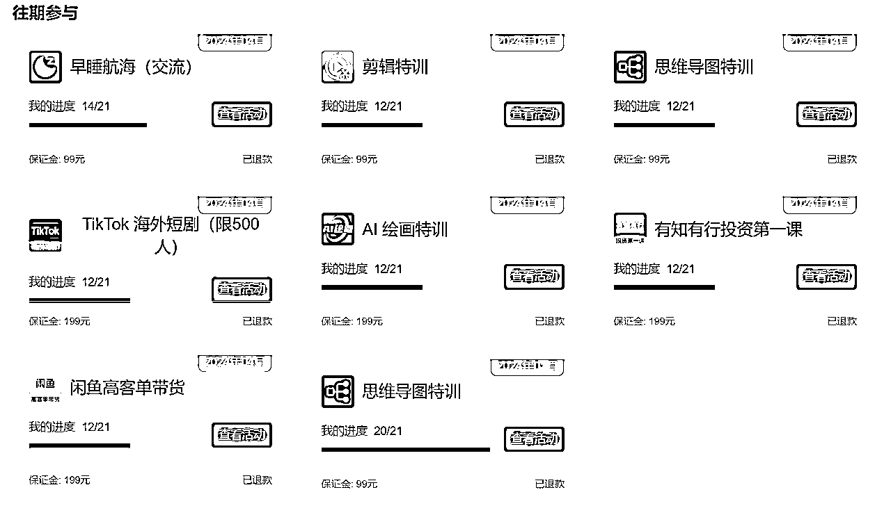

#### 感悟
A、变现：
a、短剧和剪辑
这是我认知被刷新的点，原来刺激点要给足才有人看。我没剪过片，只用过剪映一键剪辑，正好在剪辑特训里用上，赚美金很香。但网感差导致剪辑片段不吸引，去重效果不好，时间长基础不稳，最后只消化了手册没真正剪，导致效果一般。

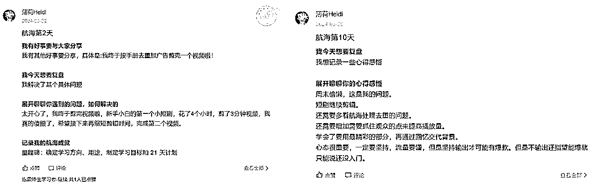

b、AI绘画
是我的兴趣方向，观察了不少AI账号，建立了提示词库准备引流。但涉及多款软件，自己摸索只到认识阶段，没深度使用，也没拓展玩法和延伸，导致变现遥远。只学不用的坑我踩了，后续要动起来。

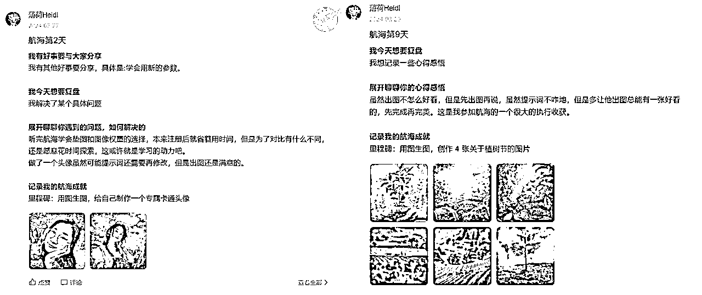

c、闲鱼高客单
刷新认知的是找小众需求，情绪消耗比低客单小。教练提供了货源和售前售后话术，核心在选品。我却选自己喜欢的而不是客户需要的，注意力分散，航海结束没达到50个品的指标，也没成交。但选品思路和全流程操作我学到了。

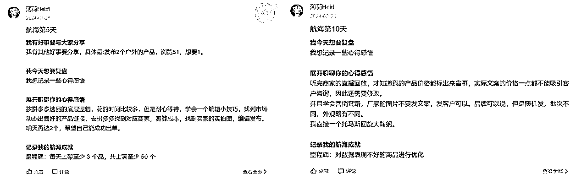

B、感受：
d、早睡航海
特别又刷新认知，原来早睡能赚钱，更是自我觉知的训练。【此消彼长】的方法让我理解早睡是回归自我决定，让自己做决定很有力量。早睡是10X增长的基础。

把早睡当秩序原点后，我对自己更诚实。只在睡觉这件事上不犯错，其他错误才会触发反思。思想在“贪多嚼不烂”和“不学怎么会”间摇摆，后来我不再纠结报7个航海的事，晚上告诉自己早睡，第二天诚实面对未完成的部分，祛魅挤水分扎实前行，这带来勇气和力量。

航海结束后，我基本能在孩子安顿后10点关灯、10点半入睡，早上6点起床，多出1小时自己的时间。做什么都行，有这1小时就很自信、感恩、有能量。

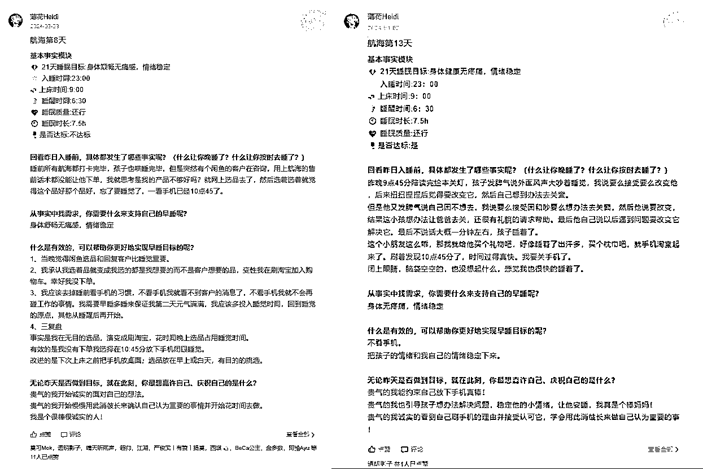

e、有知有行投资第一课
以为是基础理论课，结果是认知突破。对于普通投资者，绕开知识传递只谈策略都是徒劳。了解投资底层的运行原理，才能在市场中更宁静自由。

抬头看远方，中短期不确定里藏着长期确定性，优质资产会随时间增值。要建立自己的投资系统。买任何资产都要摸清底层规律、秉性脾气，知道钱从何而来是否合法可循，才能保证一直在牌桌上，不因短期波动动摇。

后来我在有知有行配置了四笔钱，关注市场变化，静待结果。

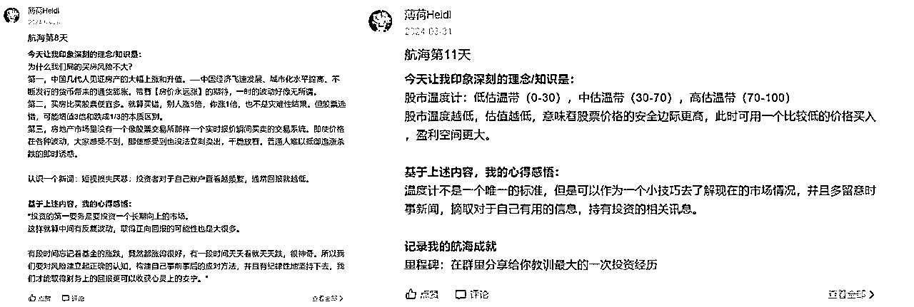

f、思维导图特训
第二次选择是因为12月航海群里罗卜教练的提醒。思维导图的核心是思路，工具只是实现手段，用来表达思路。

一次线下活动、一场直播，主动点输出导图，被看见的机会就多。这次我输出了其他航海的高手分享，更坚定了思维导图能链接优秀人群、摆脱追责焦虑的价值。

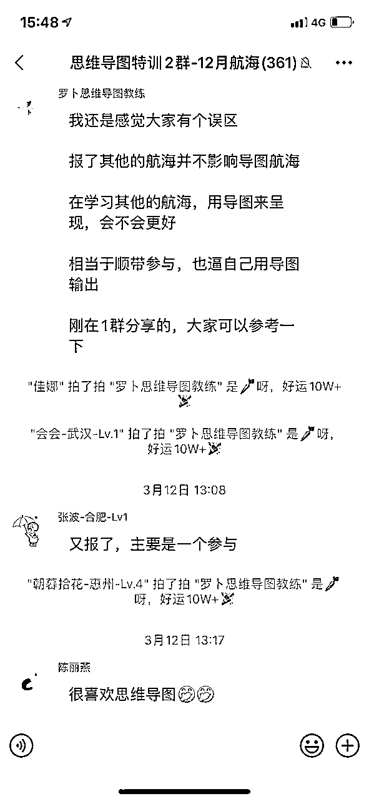

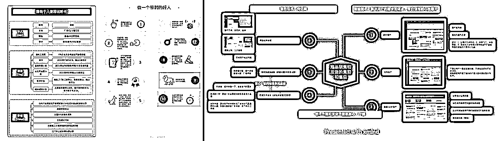

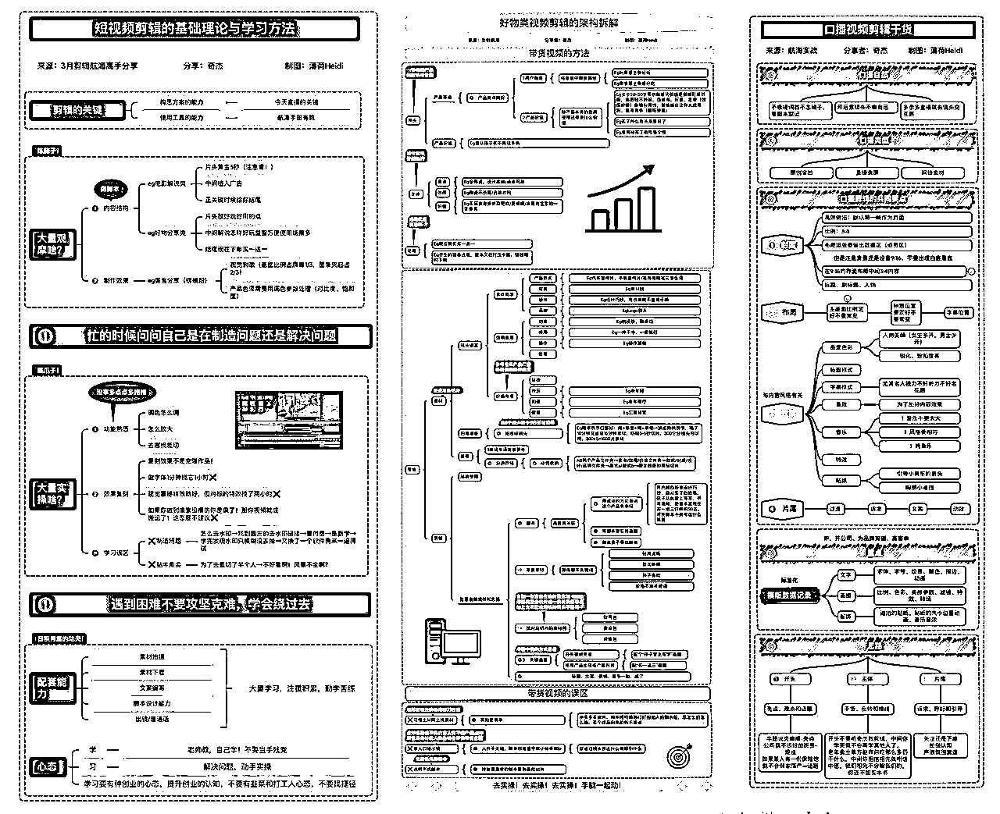

总体来看，3月的航海像一只蚂蚁用触角探路，慢慢走出糟糕的舒适区，迎接森林里的更多挑战。我又进入了下一个进阶层级。

## 5、入局赚钱的第6个月

2023年4月末的深夜，罗卜老师在群里随口提了一句“打算组个线上共创，哪些小伙伴感兴趣，做优秀的精华帖/项目导图”。老师没提条件、没提奖励、没提承诺，隔天我就举手报名了。

我只是想在做精华帖导图时找到自己想要的东西，没有期待术值、周边或链接大佬。

报名的第二天，罗卜老师才公布“KPI”：
A、至少产出30张优质导图，或持续3个月分享；
B、导图群不承诺直接收益，仅作日常交流和思维提升；
C、早日共创100篇导图贴；

2024年，我在龙哥盟做了一件特别的事——把精华帖熬成思维导图。

先说成果：4月交了一份，5月一口气做了11份，加上你现在看到的这篇帖子，算是用图把半年走过的路串了起来。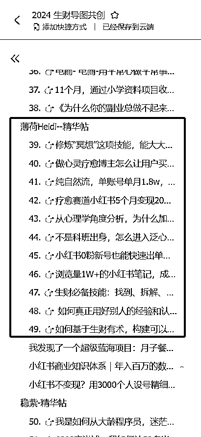

这份活儿，让我从一个只会看帖的旁观者，变成了真正下场动手的人。也想把一路上那些扎扎实实的感悟，重新说给你听。

**首先是一扇眼界的窗。**

那天在视频号直播间刷到涛哥的分享，聊的是创业、内容、流量、职场、成长、副业。听完不过瘾，又找到圈友整理的“赚钱日历精华共度”，内容按主题汇总，对话体写得很细。我一看到就觉得：这不天生适合做成导图吗？所以我的第一份作业，其实冥冥中早有储备。

最深的体会有三点：

第一，内容量大到做不完，但我选择先做先交。作图时有些点我未必真吃透了，可越是反复触碰，越是叩击认知。就像“如何快速学习他人经验和认知”，一开始我只是点头记下，直到后来读到刘小排那篇精华帖，才惊觉“守破离”这三个字的重量。

第二，道理是相通的。不同大佬讲相似的观点，例子不同，语气不同，落到我脑子里的深浅也不同。有些话，得见了三次以上才有感觉。

第三，思维导图就是我的精华库。它逼着我去理解、记忆、复盘，再从碎片里长出属于自己的知识体系。我离心里那个“个人商业知识体系”又近了一步。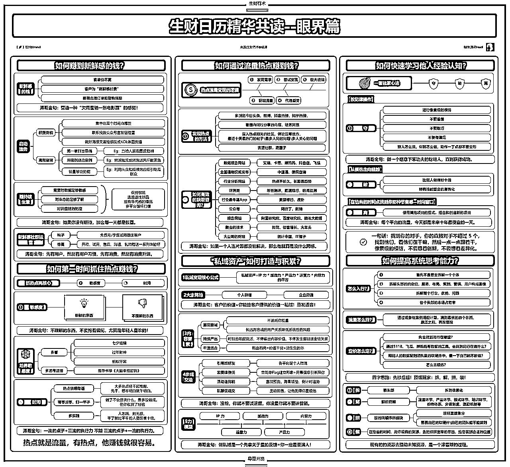

**然后是向内探寻的缘。**

因为我曾是抑郁、颓废、迷茫的二胎妈妈，对沙拉的创业精华帖格外有感，五月决定去拆解“泛心灵”内容。

一来，冥想不是我刻板印象中的“发呆打坐”。它其实是有意识地观察内心的状态，像搭起一座内外之间的桥。

我试着早起冥想，有一次直接睡了过去，但我没有苛责自己，只想着下次再把警觉拉回来。

后来我把冥想带进生活。做完导图第二天去山里徒步，专注心跳和脚掌落地的感觉。走着走着，不觉又被领队的节奏带走，等到停下时眼前一黑、手脚发软，说了句“完了”就向前栽。幸好领队看见我脸色惨白，一把拉住我，喂了颗糖才缓过来。

徒步真得按自己的节奏来，还得随时觉察自己身体和情绪的状态。还有，千万别一个人走野路，出事情没人照应太可怕了。

还有陪孩子看纪录片。以前他看我刷手机，现在我放下屏幕，留意他眉毛和表情的动静，觀察他的坐姿，陪他琢磨画面背后的意思，顺便想想生活里我们可以怎么做。孩子在慢慢学会处理情绪，我也在往“不吼不悔”的方向走远。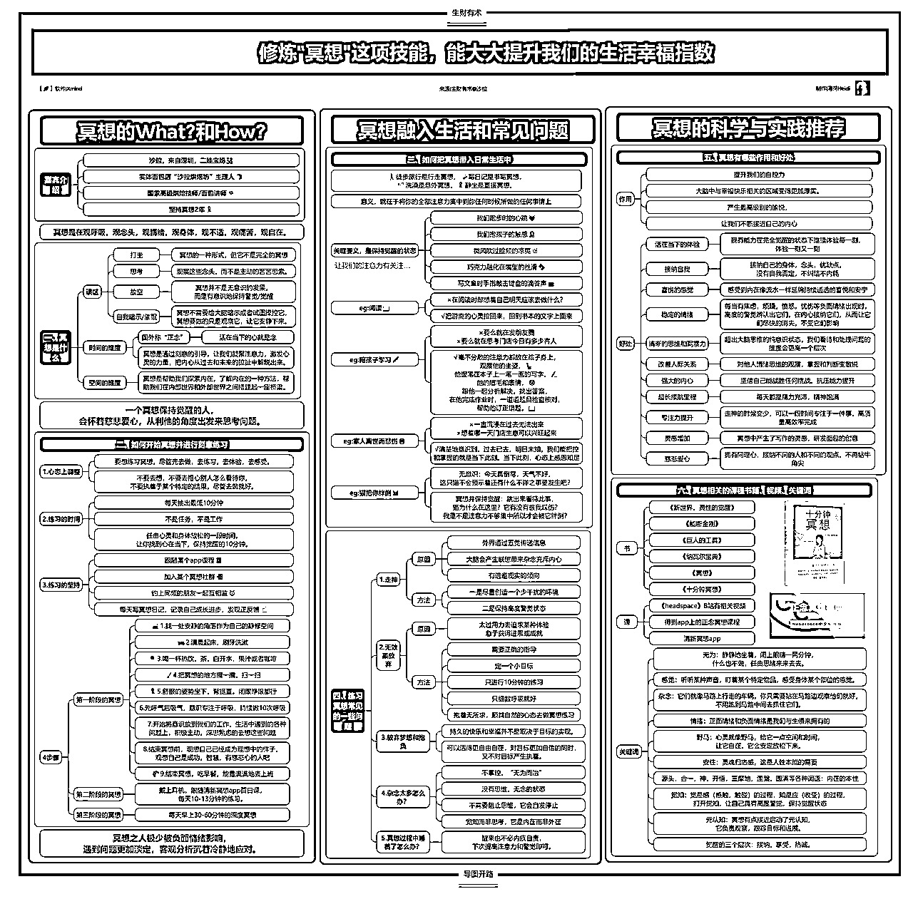

**再聊聊“心灵疗愈”这门生意。**

拆了篇“心灵疗愈博主怎么让用户买单”，收获有两点：一是理清了身心灵行业的疗法差异，也能找到对标账号，从起号、搭建账号到引流整个链路都讲得细致，尤其是私域维护的部分；二是这赛道潜力不小，但疗愈者得先把自己修好，否则不仅消耗自己，也传递不出真正有能量的东西。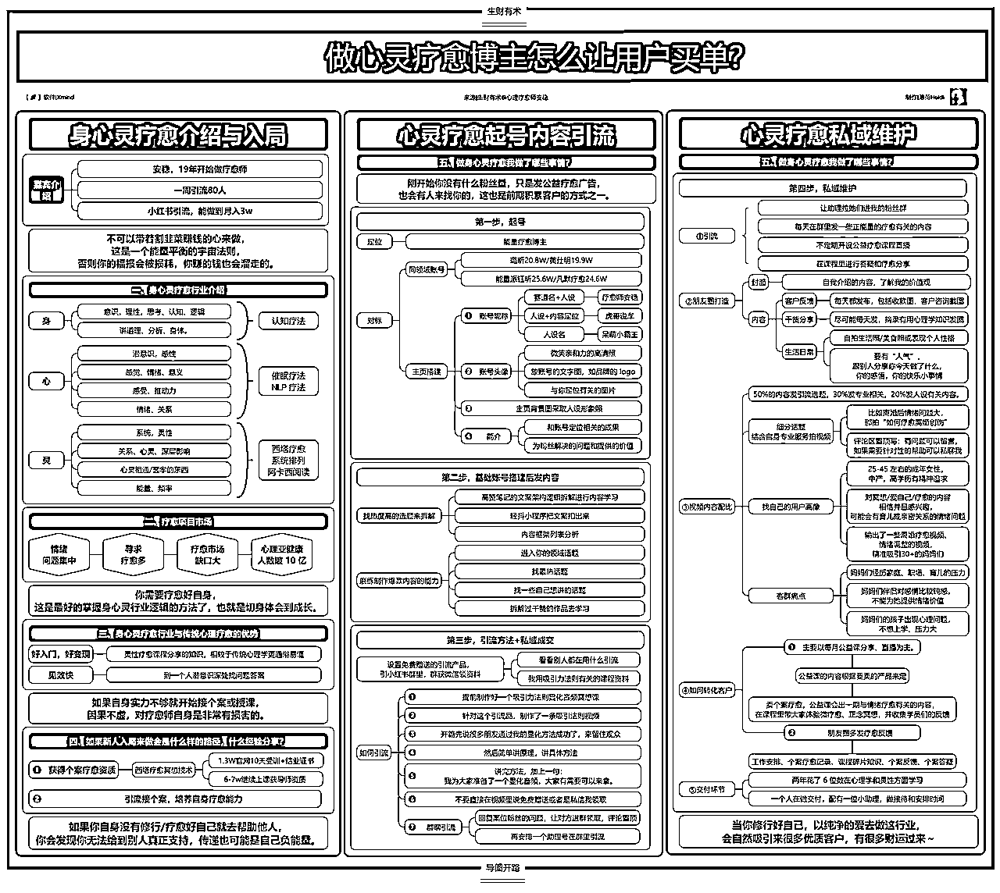

还有一篇适合小白直接照做的项目，可像素级模仿。樾樾那句话我太喜欢了：“晴耕雨读，静候天时。”前期重点在短视频这一块。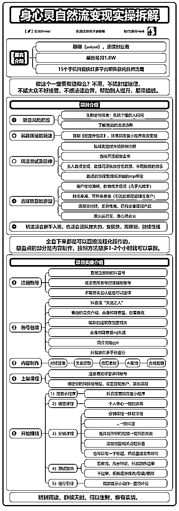

另一个主打高客单的疗愈项目，思路是小红书只用来引流，私域才是大本营。西瓜姐的账号升级实操给我很大启发——原来我那个“只丢读书笔记”的小红书，完全值得再拆再改。

内修能量、外修影响、加上高维智慧作底，项目才落得下来。说到底还是那句话：自己先修好。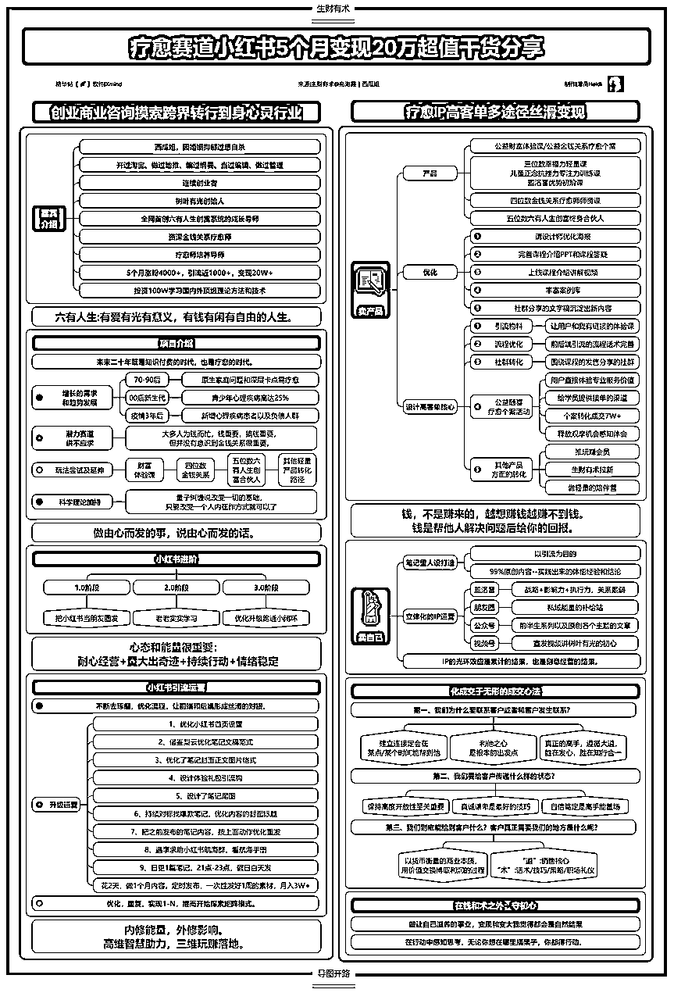

**还有一篇叫我后背发凉的帖子：**

“为什么加入赚钱三四年还是没赚到钱”。读完那篇，我才知道人做成一件事要经历三个阶段，少一个都不行。那个“水的例子”让我立刻想起教孩子认字：我直接买了字卡让他读，跳过了身体和情绪的过程，直奔思维，结果他根本不买账。后来我让他说说看到文字时的感受，他才慢慢学进去。

反观自己，赚钱这件事上，我身体感受太少、认知太浅，情绪又常常内耗；一边只想不做，进度当然慢。所以现在我不想结果了，先动起来，边看帖子边做图，把大佬的认知刷进脑子里，重构自己的认知，再把“守破离”一条条实操出来。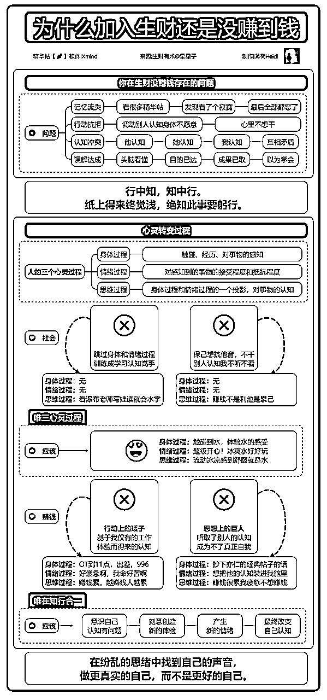

**那个“非科班怎么进泛心理赛道”的帖子，给了我一种新活法。**

做咨询师的导师，也是新手入门的路子。鱼了了提到“咖啡随喜咨询”——在不好意思收钱的阶段，用小客单切入，既能积累信任，也陪客户一起成长。

她还说：“静之，思之，五六分把握即做之，做中学，事上练。”以前我总怕流量来了接不住，现在不这么想了。有一点把握就开干，把背包先扔过墙，后面的事自然有答案。

私域维护本质上就是深度陪伴和情绪价值的传递。客户成长前后都需要引导，在每个阶段帮他们看清挑战、提供解法，让他们长出突破的力量。一个完整闭环下来，既长久也高客单，利他，也利己。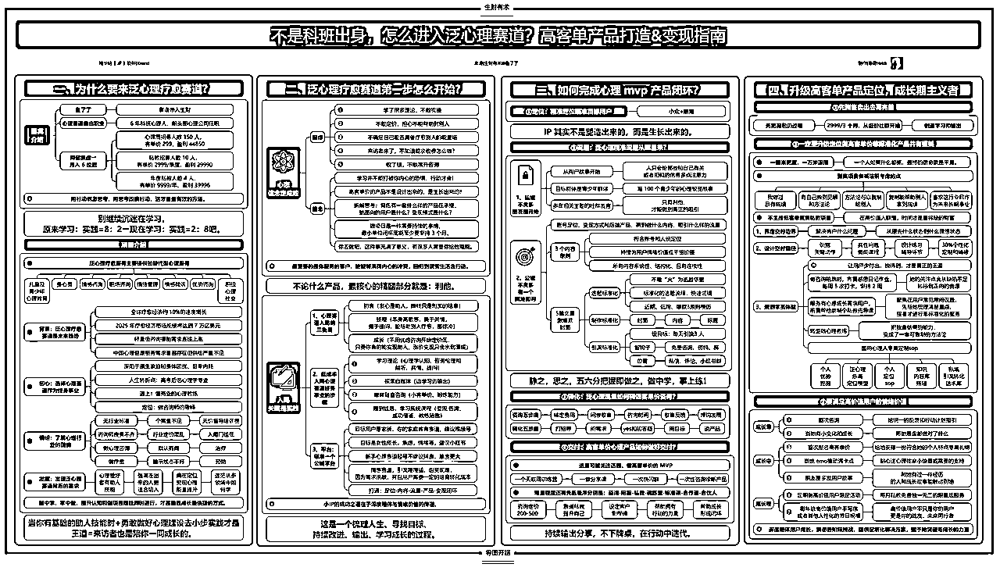

**小众赛道的爆单玩法，也值得每个内容人听一听。**

那天我偶遇谢无敌老师的播客，脑子里只有一个念头：满满干货，做成导图得多好看。结果发现早有人做成精华帖，确实佩服。

“低粉爆单”四个字我早听说过，却从没仔细研究过。无敌老师讲的选品、测品、内容策略，是所有小红书电商人的必修课。哪怕不做电商，这套内容制作思路也值得学——互联网时代，流量密码终究是内容。

所以，我的小红书账号是时候改头换面、认真运营了。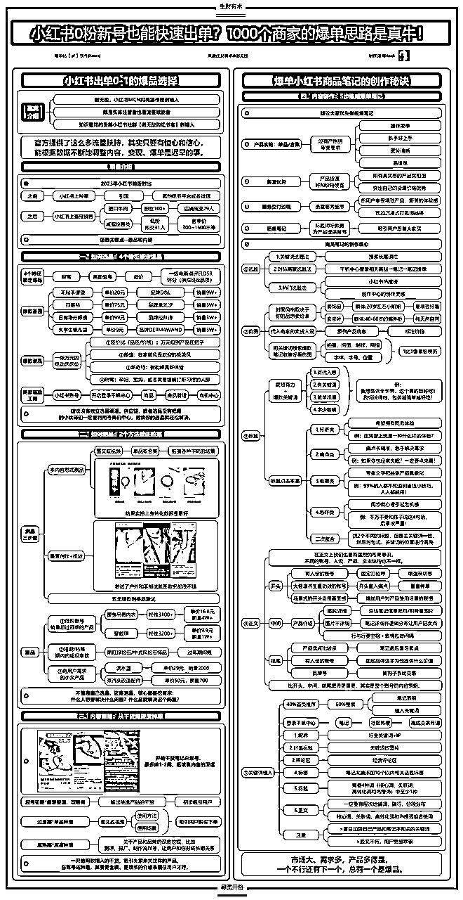

**还有那种成本2.8元、浏览量1W+的爆款笔记。**

我一看完，第一反应直接翻到第四步想抄捷径。但刘小排那篇“守破离”狠狠打了我的脸：普通人第一步【守】，就是像素级模仿——别人怎么说，你就怎么做，动作一丁点都不能变形。

别偷懒，别跳步，你还不知道这一步为什么存在；
别取巧，别乱改，你还没有资格保证自己比原版更好；
别傲慢，别低看任何招式，成为专家之前，先收起偏见，因为偏见本质上是傲慢。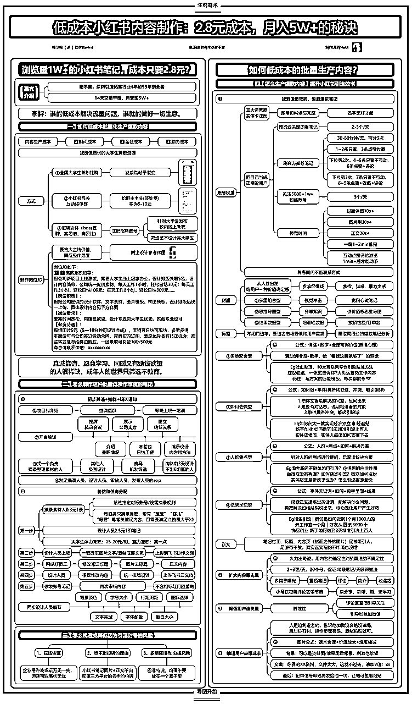

**还有一堂“找、拆、学对标”的公开课。**

某次罗卜老师在共创群里说新人营有直播分享，我立刻申请作图，问完截止时间就开干。

举手，意味着把自己推向机会的中心；承诺，则是对自己的硬约束。这样一来，拖延就很难有借口。

抖音、视频号、小红书，这些平台小白低成本就能起号，加上老师们的真实案例，我们对标起来更顺手。新人营对新人友好得不像话，可千万别为了交作业而敷衍，得真正下场去实操。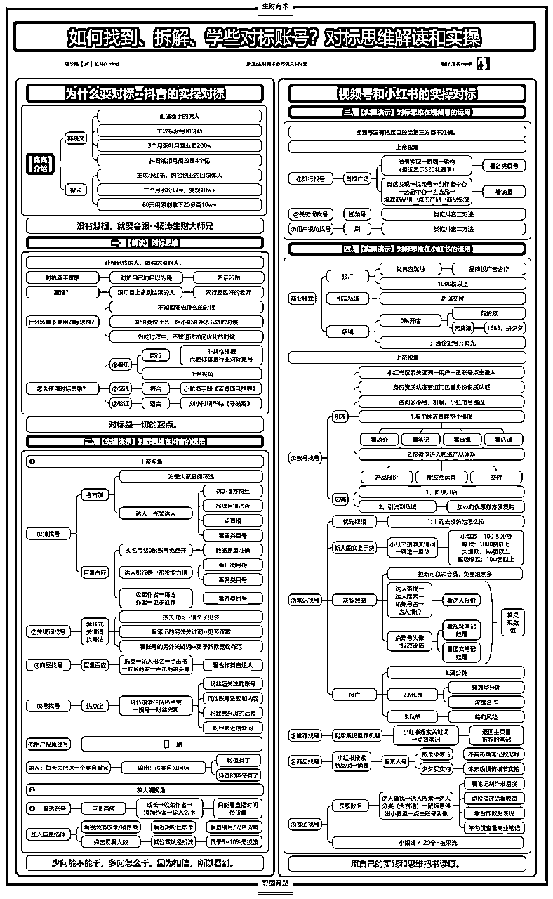

**终于说回“守破离”。**

晓文老师直播时提到了原帖，我这才发现，杨涛、郭晓文、刘小排都聊过这三个字，说法和例子虽不同，核心不变。刘小排老师那句，讲得尤其准：

“龙哥盟是桥。桥的起点叫「守」，过桥靠「破」，找终点靠「离」。”

这三个阶段顺序执行，跳不得。只要还没拿到真实现的成果，我就继续老实“守”着，再从晓文老师和梨云老师的实操里接住，从像素模仿开始。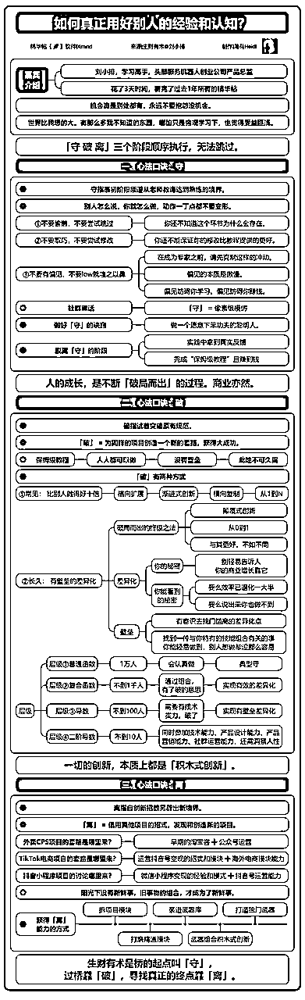

**最后撞见一套“个人商业知识体系”的底层逻辑。**

徐宿老师讲的是根本。我过去以为，把自己所有的想法、点子分门别类装进导图，就是知识体系了。后来发现那只是“知识”，没按因果、需求、交易的原则来组织，所以永远是散的。

现在我有意识照本质去想问题，慢慢重构自己的商业认知框架。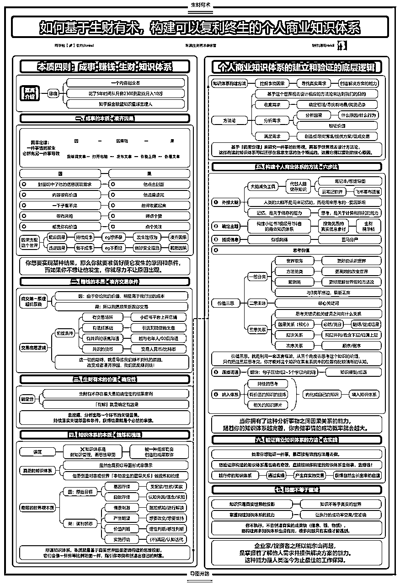

回头看这半年，所有精华帖归纳起来就三个字：

**守**——像素级对标，不折不扣学；
**干**——下场弄脏手，动手才有答案；
**利**——极致的利他，就是利己。

—-

**我对自己的五个期待：**

1. 立定一个方向，严格按“守破离”走，先下场把动作做起来。
2. 先赚到1块钱再说：小红书粉丝冲1000，引流100人；公众号日更，粉丝破100，引流100人。再从1块钱开始。
3. 继续做利导图，把精华帖的导图持续输出。
4. 风向标中标率提高10%。
5. 早睡早起，今年读50本书。

**对新人，我也想掏几句心窝子的话：**

第一，尽早选一个方向，把那个方向的精华帖读透。去付费请教原帖作者也好、做成导图也好、直接下场实操也好，总得选一样。信息差、认知差、行动差，就是这么一点点拉开的，拉开之后，钱自然就近了。

第二，降低期待，定一个“踮踮脚”就够得着的目标。正反馈能让人咬着牙走下去，而不至于在迷茫和焦虑里翻车。我会去参加风向标共创、导图共创，就是出于这个原因。

第三，认清自己。追风口不丢人，但风口与你资源能力不匹配，就可能是坑。挑自己擅长、感兴趣、又有资源的领域，匹配度越高，越容易拿结果。

第四，快速执行，小步试错，小步快跑。别眼高手低，动手、总结、再动手。路是一步步试出来的。

第五，多举手，多利他。导图上手快、花样多，本质是深度思考后的精华再提炼。新人们学完一定去用——一场直播、一次线下、一篇文章、一个社群分享，都可以成为你链接大佬的入口。

最后，谢谢搞钱女孩，谢谢柏芝、罗卜老师、鱼丸。没有他们，没有这篇帖子，也不会有这个崭新的“薄荷”。

更感恩龙哥，感恩赚钱这个大平台，让我能边学边进。

一切终归一句话：何以赚钱，唯有实战。