# 裸辞半年零收入，靠一个野路子翻身：3个月赚了8万多，全盘复盘

> 来源：https://iqkghbz2ppm.feishu.cn/docx/LUz5dSOS8obAdfxkqD1cPUzinpb

圈友好呀，我是兰兰，做过互联网HRBP。

讲真，在接触副业这件事之前，我就是个纯纯的小白。但那时候不知道哪来的勇气，脑子一热就裸辞了，一心想着去外面闯出一片天地。

然而现实很快打了我的脸——商业认知几乎为零的我，在创业这条路上摔得鼻青脸肿。

就在我焦虑到快撑不住的时候，我的两位贵人出现了。多亏了几许老师和忌廉推荐的项目，我才终于找到了突破口——从单月佣金3w+，到三个月累计收益8w+，整个人像是开了挂。

这两位引路人都是赚钱圈友，他们不止一次跟我提到赚钱这个平台：这里有各种搞钱的前沿风向标，也云集了各路大神。于是我毫不犹豫地在418那天加入了赚钱，想看看自己还能在这里遇见什么新的可能。

现在算算，加入赚钱才40天左右，但里面那些精华帖子带给我的冲击是真大——不仅彻底刷新了我的商业认知，还让我做项目时思路更开阔、迭代更快了。

虽然跟赚钱里那些大佬比起来，我这点成绩根本不算什么。但对我来说，这是从0到1，熬过无数个深夜才换来的。所以我想好好做一次复盘，既是给自己未来多一分底气，也想告诉那些同样想破圈、想搞钱的朋友：连我这个项目小白都做到了，你们一定也可以！

# 今天这篇分享，主要讲五个部分：

一、蒙着眼睛往前冲，注定头破血流
二、线下摆摊，意外遇到转机
三、保姆级项目复盘
四、日佣金破1000的秘诀：真诚才是必杀技
五、认知升级之旅

# 一、啥都不懂就硬闯，结果可想而知

就像每个男孩小时候都有个奥特曼梦，我相信每个打工人心里也都藏着一个创业梦。

当时不想继续浑浑噩噩地过日子，我果断裸辞，和两个中医大的朋友合伙创业，想着抖音、小红书、视频号全都干一遍！

功夫不负有心人，折腾了一个月，我居然很快就看到了曙光：

1、小红书播放量干到13w+，粉丝破千
2、抖音出了条近30w播放的爆款视频

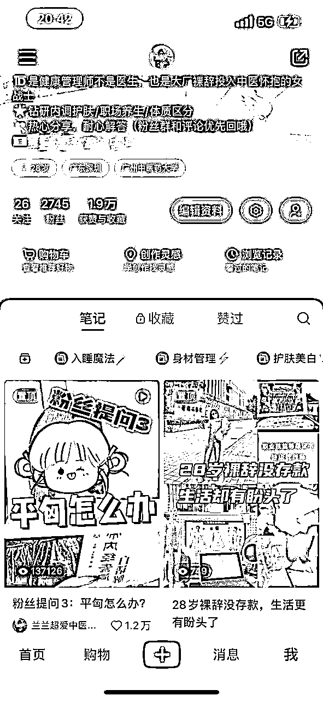

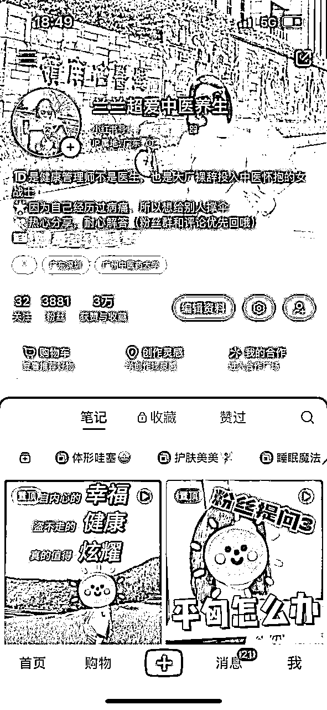

拿到了正反馈，整个人像打了鸡血一样上头！

于是我开始无脑复制之前的操作，加大投入。也就在这时候，迎来了人生第一条广告——800块钱入账！

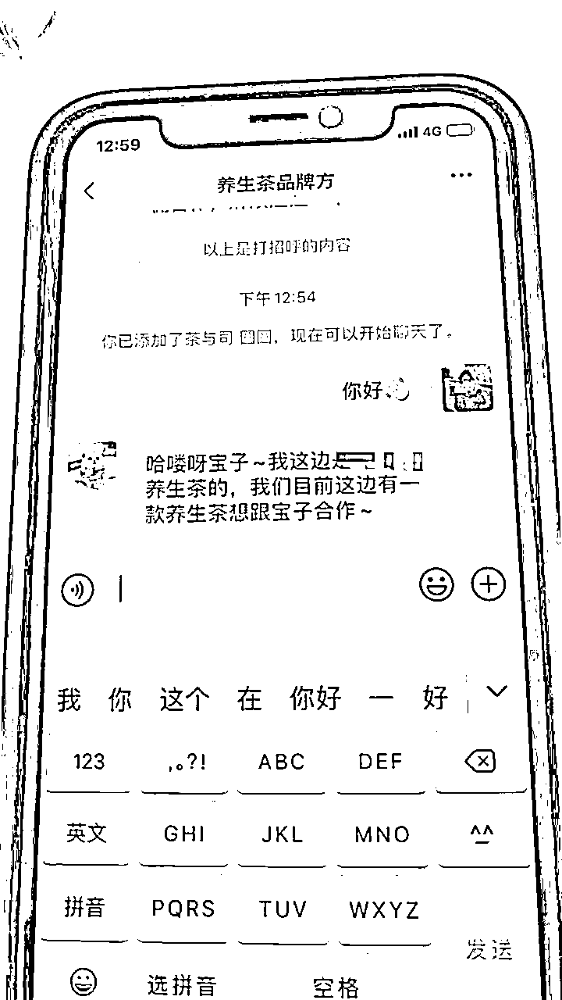

接着越来越多的广告主找上门来，一切看起来都顺风顺水。

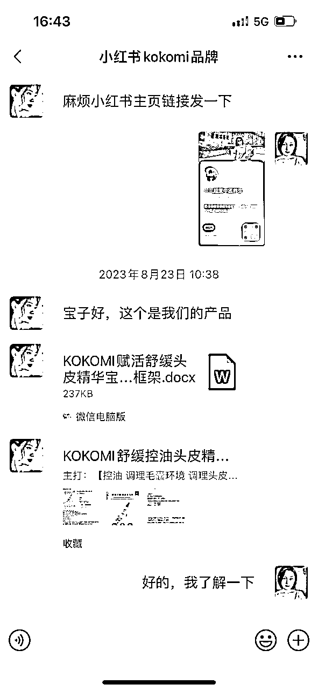

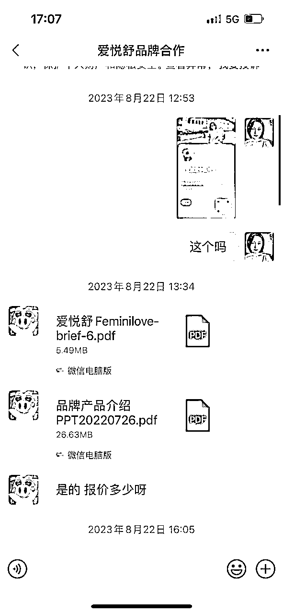

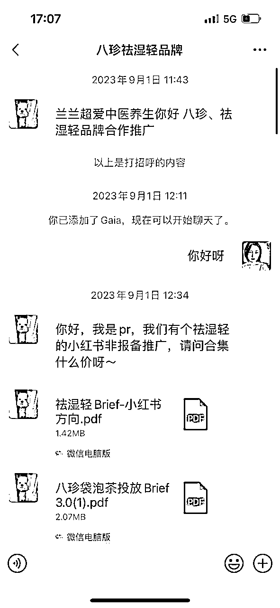

但人生哪有什么坦途？认知不够，学费来凑。

2023年8月——“高光”过后才半个月，爆红之后紧接着就是封号。因为完全不了解平台规则，小红书、抖音接连阵亡，视频号也凉凉了。

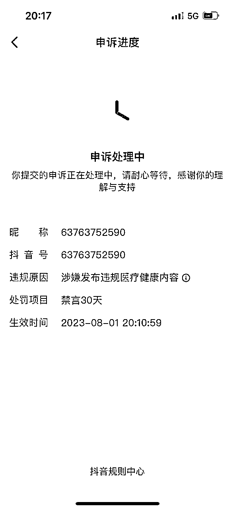

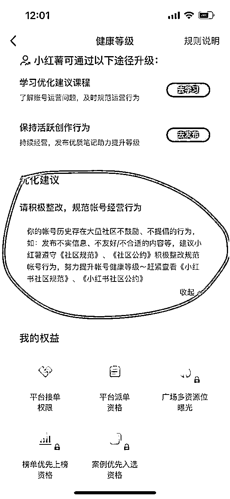

没有变现闭环，更谈不上什么商业结构。连续好几个月零收入，两个合伙人默默地“心照不宣”散了伙。

面对这种惨状，我既没打算放弃，也没想死磕，而是选了第三条路：线下去。

既然线上老是被封，那我线下摆摊，你总不能封我了吧！

于是我开始马不停蹄地参加各种线下集市；像个溺水的人一样，只要看到一点点机会，就拼了命想抓住。

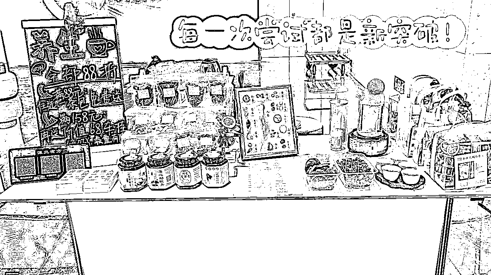

# 二、线下摆摊，命运的齿轮开始转动

## 1、上天关了你的门，一定会给你留扇窗

说实话，线下摆摊没让我赚到什么钱，但它给了我一个破圈交流的机会。

那天，忌廉带着几个朋友来照顾我生意，买了几包养生茶。闲聊中，我随口说了下自己这些经历，提到做自媒体苦于没有引路人。

没想到，一次普通的聊天，竟然让我打开了“新世界”的大门。

忌廉跟我说，有个叫几许的朋友，一直在做副业，手头有个不错的项目，推荐我找他聊聊。也是那一次，我第一次听说了“赚钱有术”。

## 2、引荐：遇见几许，初识项目

就像忌廉说的那样，几许老师很低调，也特别有耐心。看到我那窘迫的自媒体经历，他伸出了援手。

裸辞大半年，经历过短视频爆红、账号被封，到现在还在线下苦苦挣扎零收入的我，真的觉得赚钱太难了。

但当几许老师跟我介绍了抖音半真人直播项目后，我的认知直接被刷新了！！

这个项目击中我的，主要有三点：

①小白也能上手，对技术要求几乎为零；

②投入贼低，一台电脑、一个账号就能起步，其他杂七杂八加起来也就几百块；

③最让人上头的是！开播就能见钱，正反馈来得比闪电还快⚡！

二话不说，我当场加入，执行力直接拉满，咔咔一顿操作猛如虎！

眨眼三个月过去，我不光自己赚到了佣金，还因为持续钻研和真诚分享，帮了不少小白快速拿到了结果。

不仅收到了好多伙伴的认可！这些正反馈对我来说，比佣金本身更让人振奋和感动！

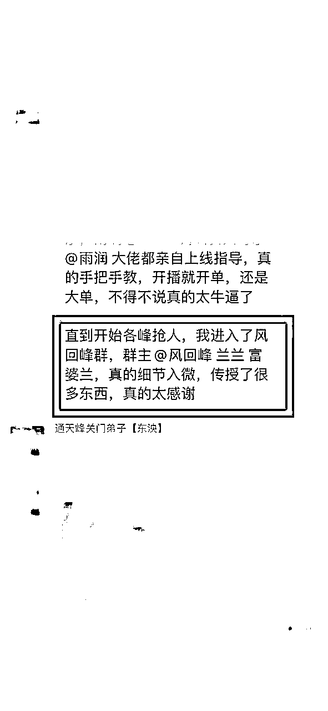

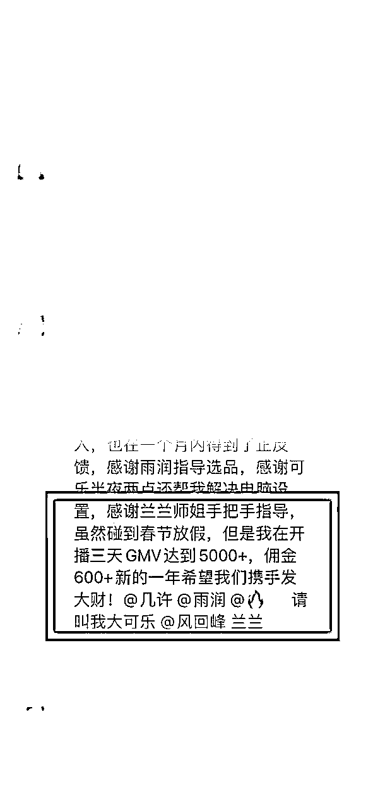

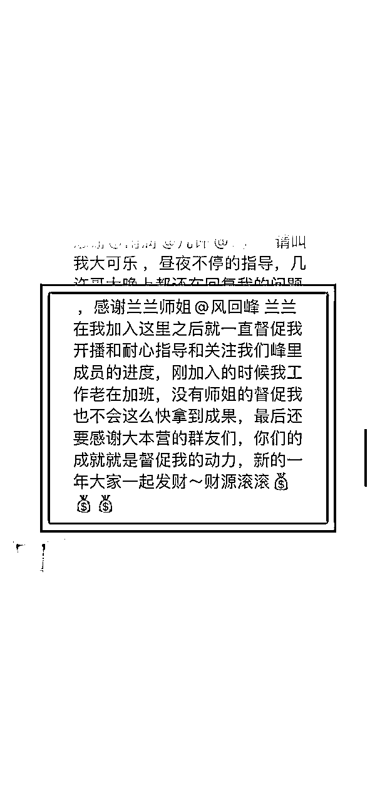

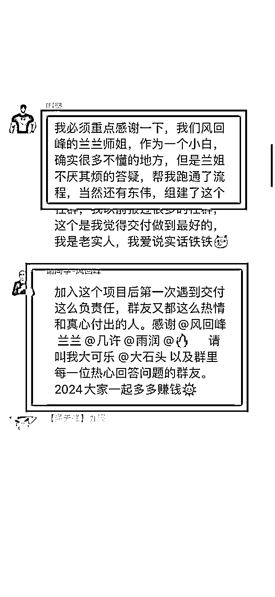

那接下来，我就从一个小白的视角，好好复盘一下我是怎么把项目跑通的。

# 三、保姆级教程：从零到一的完整复盘

## 1、抖音半真人直播到底是啥？

刚接触的时候我有点懵：抖音真人直播我听过，无人直播也听过，半真人是个什么鬼？

后来才明白，这个玩法其实就是把两者融合在一起，搞出来的一个蓝海赛道。

说白了，核心就是：真人直播一段时间，同时录屏；录完不关播，把录像循环播下去，躺着赚钱！

我个人的最长纪录是：直播1小时，循环播放720小时1分钟——也就是说躺赚了整整30天，累计干出近8w的GMV！

传统的无人直播，是偷录别人的直播间，然后剪剪拼拼、去除重，搞一堆操作来实现录播；

而抖音半真人直播完全不一样：自己真人出镜、自己设计直播间素材，所有东西都是原创的——违规风险大幅降低，真正实现躺赚！

听着好像不难，但作为项目小白，我清楚自己几斤几两。底子薄，那就笨鸟先飞！每天拼命学、厚着脸皮问，遇到不懂的就死磕，跑通了就做笔记。

很快，我的第一个高光时刻就来了：

有一场直播，播了不到64小时，GMV直接破2w！！

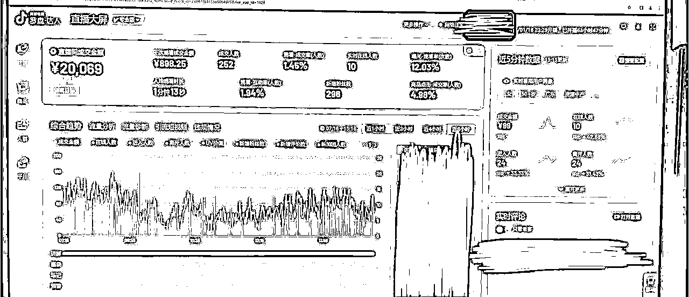

第6天！GMV冲到4w+！！！

按20%佣金来算，我一个星期就赚了8000块，直接是学费的好几倍——这结果完全超出预期啊！

这个成绩，是入项目前的我想都不敢想的！

接下来，就从项目小白的视角，给大伙儿拆解下我是怎么做到的：

## 2、底层认知：流量不是王道，转化才是！

之前自己瞎折腾个人IP的时候，总被网上各种乱七八糟的课程灌输：流量=收益。

但深入做了这个项目我才清醒过来：流量不等于钱，转化才是。

10个带着明确需求来找精准商品的人，比1000个来直播间瞎晃悠的人值钱多了！

而且抖音半真人直播走的是搜索流——这意味着，咱们不去和大主播抢流量；只精准锁定那些有明确搜索意图、有消费计划的用户。

所以，搜索量权重就成了关键中的关键。这个权重上不去，用户压根看不到你。

想通了这点，就能时刻提醒自己：怎么把每一场直播的“人”、“货”、“场”做到严丝合缝的配合。

举个例子，我想打男装这个品类，那必须想清楚这三点：

##### ①人：我到底要卖给谁？

常规做法是通过精选联盟和巨量指数去对比：只要月销量除以搜索指数大于10%，这个品就能打。

但我想了想，如果人人都这么做，那估计很难做出差异化成绩。

于是我在这个基础比例上，做了两个调整：

1、搜索量卡在5w-30w之间，这个看巨量算数的数据就行。

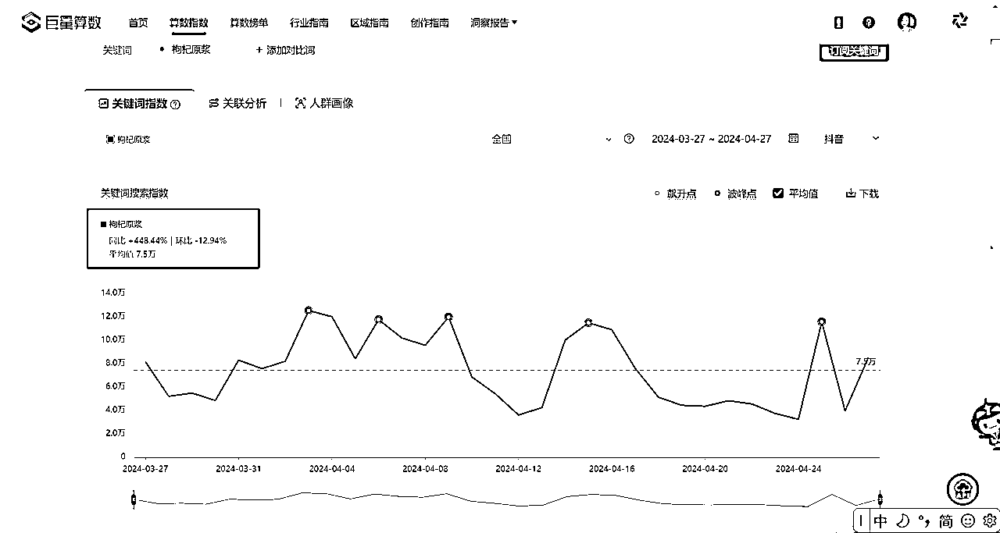

2、锁定目标GMV对应的人群

也很好理解：如果数据分析下来，低价位（比如20-50元）的GMV更好，那我就锁定这个价格区间的人群——比如学生党、刚步入职场的应届生。

##### ②货：链接怎么选？

课程里教的选品标准是：佣金率＞10%、商家综合评分≥80分，就咔咔一顿选，全挂小黄车就行。

但满足这两个条件的品其实非常多，五花八门的商品摆在面前，怎么让用户快速下单？

这个问题是我某次在超市买洗漱用品的时候突然想通的：

我对自己要买的洗漱用品是有个心理价位的，高于或低于这个区间，我都不会多看。

看到价格合适、品牌靠谱的，拿上就走了。

这不就是搜索流的场景吗？！

那些带着明确目的来搜商品的用户，心里大概率也有自己的预期价。只要把他预期价位的产品都摆在他面前，转化率不自然就高了么？

所以，半真人直播里，一定要搞清楚你的目标群体适合什么价位，选品就围绕这个区间来。

别贪多，别广撒网；有取舍，利益才能最大化。

##### ③场：直播场景怎么搭？

直播间的场景就是你的门店，只不过从线下搬到了线上。

同样是逛街，你是愿意走进高大上、简洁整齐的专柜？还是堆满促销海报、看着眼花缭乱的超市？

把自己代入目标客户的角色，答案自然浮出水面——这也决定了直播间的视觉风格，以及商品的陈列方式。

我搭过上百场直播间，研究过几百个同行的场景，总结下来核心构成就是这几个要素：

a.色调风格

b.背景：图片、视频

c.标题：文字、排版、动画

d.前置：商品、文字、底部挂片

e.产品：幻灯片、实物、长图轮播

f.主播：服装、妆容、滤镜

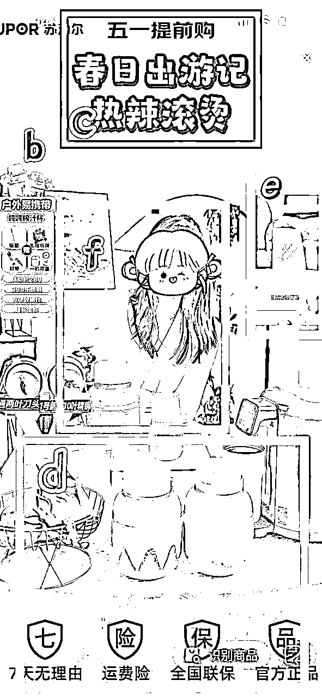

记住：每个元素都必须围绕目标客群的喜好和需求来设计，转化才会稳步提升！

## 3、前期准备：账号与权限

### ①基础条件：1000粉+电商权限+电脑直播权限

直播的硬性要求是1000粉丝，找网上的买粉渠道，一天就能搞定，大概100块上下。

分享几个我常用的渠道：

http://wealth8.y677.xyz

http://aisou.xn--49st2e24g0tfkrnp1k.com/

https://wushen.zixyepp.top/#/

（复制到浏览器打开就行）

涨到1000粉之后，一定要第一时间开通两个权限：电商带货权限和直播伴侣权限！

不然掉到1000粉以下就播不了了，到时候还得重新花钱刷粉、还要再等一天，麻烦死了！

【电商带货权限】开通流程：

step1：点“我”→右上角“三”→抖音创作者中心→抖音电商

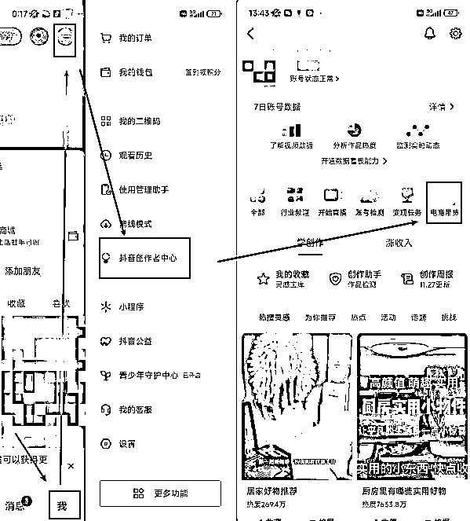

step2：开通抖音电商

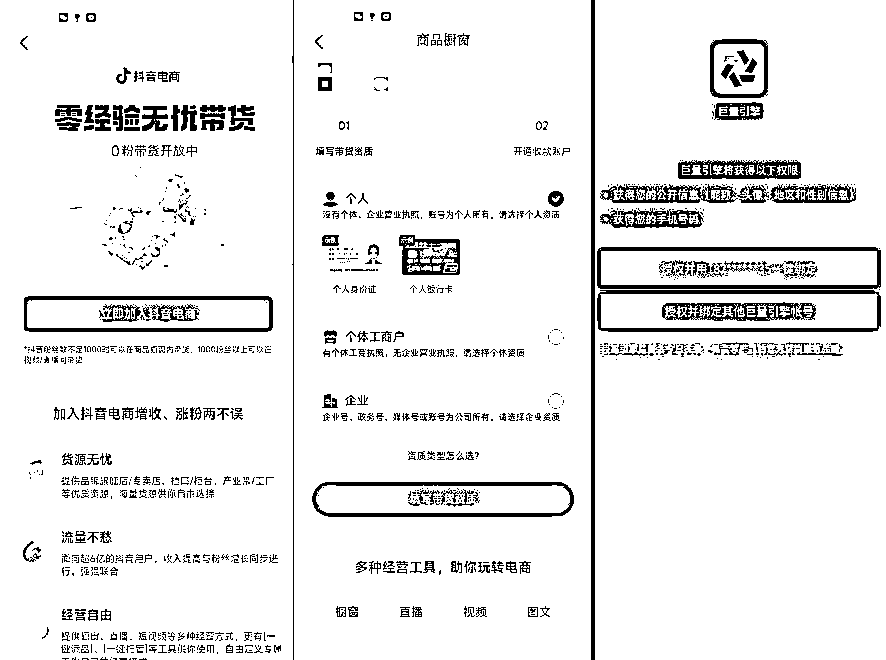

step3：实名认证

按页面提示，上传身份证正反面照片就能完成

step4：绑定银行卡

银行卡信息必须和实名认证的是同一个人，图片里红框标的位置是填银行卡预留手机号

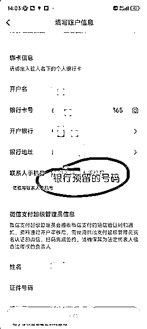

step5：超级管理员信息

下面的手机号和邮箱可以用自己的，不一定非要和抖音登录号一致。最后等几分钟审核就行~

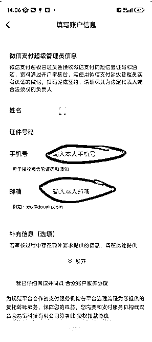

【直播伴侣权限】开通流程：

两种方式：A、手机；B、电脑

A、手机端：点主页“+”号菜单→右上角“电脑”按钮→按提示开通

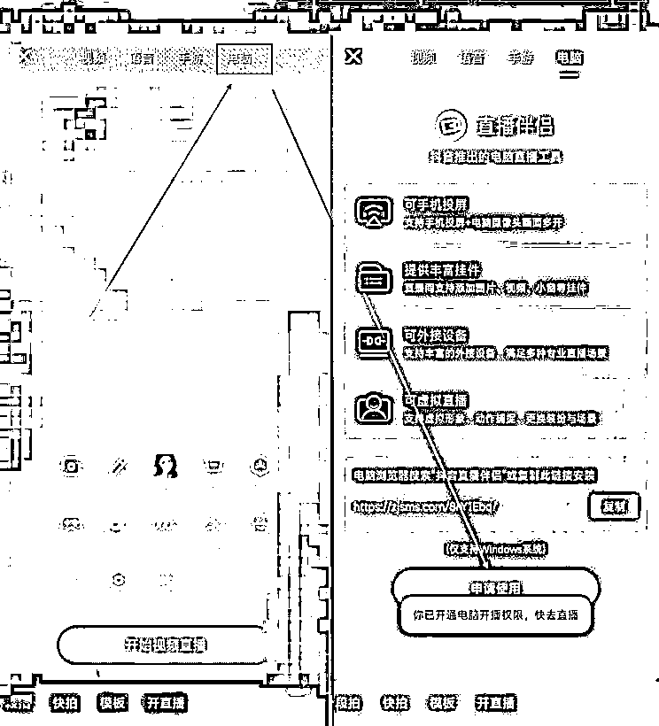

B、电脑端：下载安装“抖音直播伴侣”→扫码登录→点【申请开播权限】→点【确认申请】→搞定！

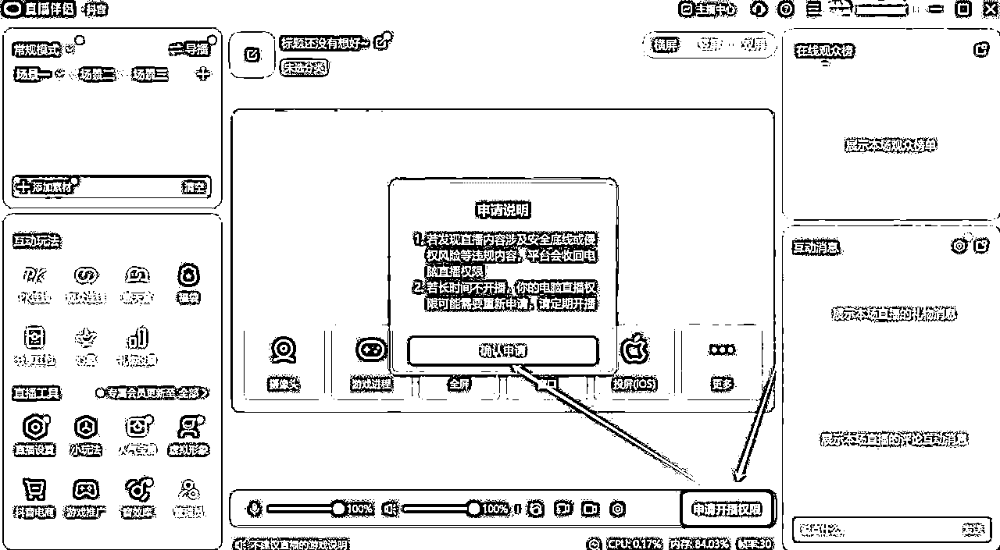

### ②缴纳保证金

打开抖音APP：我→右上角“三”→创作者服务中心→商品橱窗→立即开通

点“保证金缴纳”，用支付宝交500块，就能正式开启带货之旅了！

（以后不做了，这500块还能退回来，放心~）

### ③开播顺不顺，要看会不会养号

抖音账号必须要实名认证，还得绑定银行卡。

如果账号来源不稳定，那账号本身就是稀缺资源！

那怎么让账号顺利开播不违规、甚至一开播就有流量？

核心就是：养号。

新号、老号都得养。

特别是新号，不养个4-7天，限流的概率很大。

我就踩过这个坑：新号没养就直接开播，结果流量跟心电图的直线一样，一个观众都刷不进来。

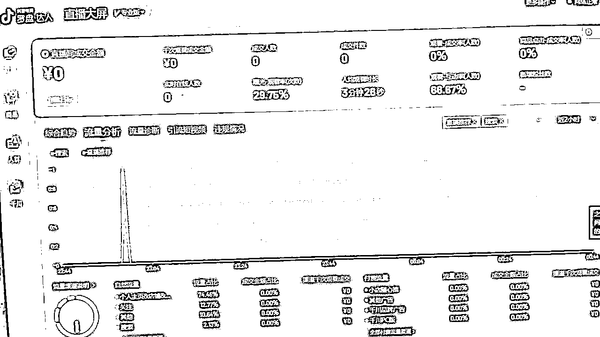

我当时找了一圈原因：话术已经预审过了；素材基本模仿同行；商品链接也都是高评分没违规的。

那为啥还被抖音关小黑屋了呢？

想来想去，只剩一个解释——账号本身的问题：太新了，什么用户行为数据都没有，一上来就卖货，抖音不把你当“二道贩子”才怪，不给流量也正常。

这么一分析，我老老实实回去养号了。

照着正常用户的行为来：

1、每天发几条随手拍的内容

2、刷至少1小时的直播——注意，不能主动搜直播间，让系统自然推给你，越自然越像真人用户

3、刷几块钱的小礼物送送主播

4、下单买点东西：不需要的话，拍完退掉也没毛病~

一周后，我用同一个号重新开播，流量果然哗哗地来！✌✌

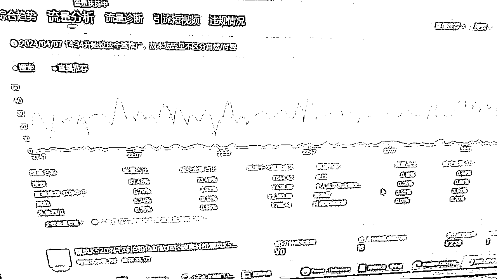

## 4、选品：选对了品，真能“站在风口上猪都能飞”

选品这个环节，是我在整个项目里最沉迷的部分。

如果开播前要准备3天，我得有1.5天全泡在选品这上面。

因为几许老师一直强调：在选品上多花点时间是值得的，每一个品都值得你用心对待。

品选对了，那感觉就是“站在风口上，猪都能飞起来”的爽！所以到现在我都觉得，这成绩里多少带点运气成分~

不过，选好品虽然不容易，但也没那么玄乎，照着这两个方法，基本都能选到还不错的品：

### ①看看身边人都把钱花哪了

艺术来源于生活，选品也是。

有一次，我挑了好几个品，正纠结不知道选哪个。
结果刚好看到闺蜜在那拆一堆快递，其中一个就是我的备选品……

这个巧合让我反应过来：生活里到处都是能带的品！多观察身边的人经常买什么、愿意为啥花钱，往往能挖到很不错的品！

我干脆做了个小问卷，让闺蜜们填自己最常用、最舍得花钱的品类。

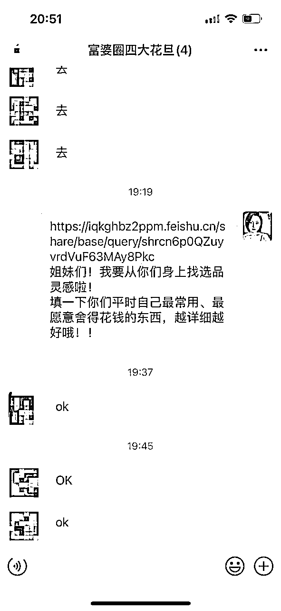

就是这份小问卷，让我挖到了又一个大爆品，播一场躺赚一万多的那种~

### ②找小赛道里的小赛道

抖音半真人直播，主打的就是小赛道。

说白了，大主播的赛道咱们抢不过，那就另找出路，啃那些不太起眼的“边角料”。

我们一般用巨量算数来验证这个小赛道值不值得打，条件是这个品的趋势往上走、平均值大于5w，就可以尝试。

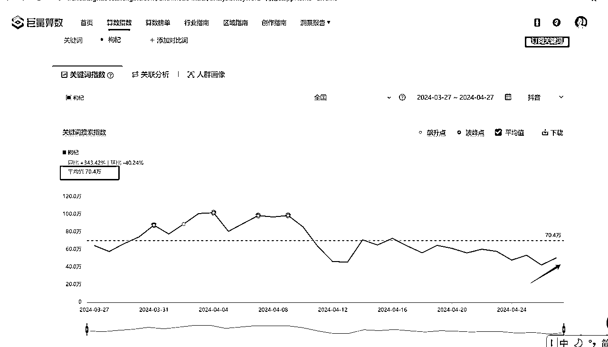

小赛道的底层逻辑很直白：蓝海、避开竞争、闷声发大财。

理解了这点之后，我又琢磨了一下：能不能把“避开竞争”玩到极致？专挑小赛道里无人直播同行都看不上或没发现的小众细分领域？

答案是——当然可以。我的方法也不复杂：纵向裂变。

仔细想想，不管什么品，都能沿着品类往下细分出更垂直的子类目。

就像细胞分裂一样，好品类里的细分品类也在不断裂变更新。

拿上图那个枸杞举例吧。既然枸杞这个品类能打，那我想挖更深一层的小赛道，怎么纵向裂变呢？

可以参考这个路径：

step1：创作者中心→电商带货→选品广场

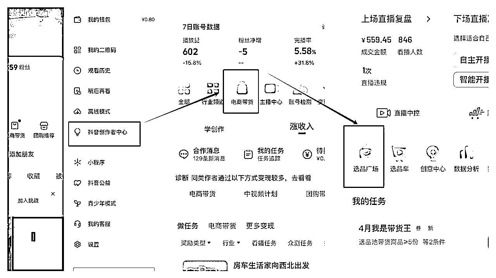

step2：搜索框输入品类名→看搜索框下方的分类标签，继续往下挖

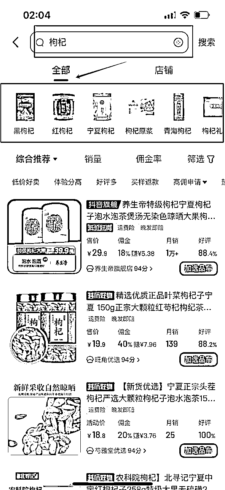

看，枸杞往下分，还有黑枸杞、红枸杞、宁夏枸杞……

step3：看中的细分品，再用巨量算数确认一下搜索指数——一个新品就这么挖出来了！

### ③数据验证：佣金率+销量双管齐下

光看巨量算数太单一了。

更得结合佣金率和销量来看：

综合排序下，佣金率平均值≥20%、销量均值上千的品，基本都能打：

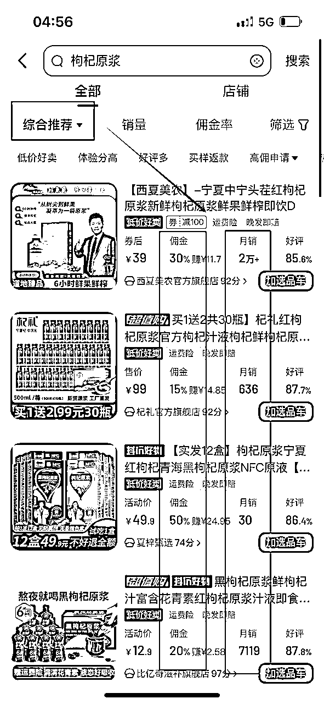

## 5、场景搭建：不整那些虚的，同行就是最好的老师

直播间场景搭建，听起来好复杂，本质上就两个字：作图。

那么问题来了——新手小白，没学过设计、连审美都没有，怎么做图？怎么搭出一个能出货的直播间？

很多人问我，怎么快速摸透一个直播项目？我的答案永远只有一句话：去看同行。

别急着闭门造车，先找到那些已经替你验证过市场的人。同行成百上千，到底盯谁？我的习惯是用抖查查来看数据。具体操作并不复杂：登录抖查查→搜对应产品的直播间→把开播时长超过24小时、销售数据排在前面的同行筛出来。那些稳扎稳打跑了很久的直播间，才是真正值得研究的对象。

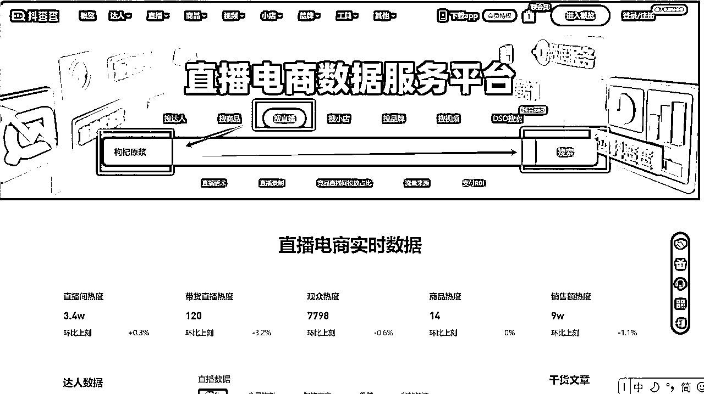

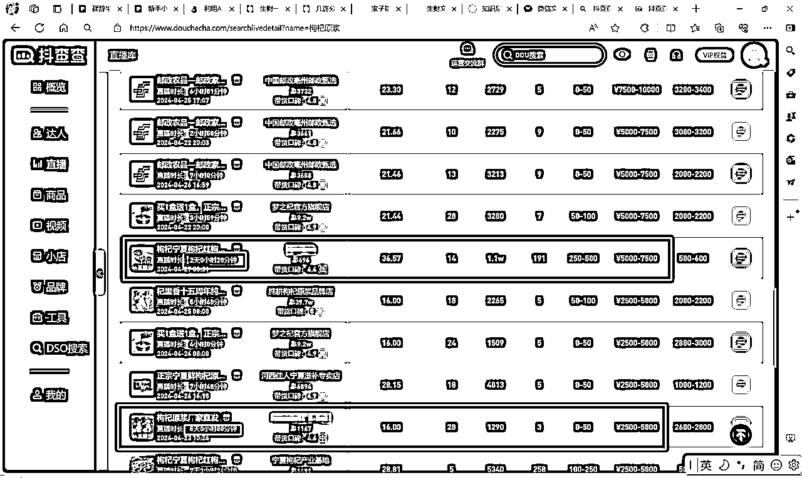

找到对标对象以后，别光看热闹，要系统性地扒。我通常把直播间拆成六个模块，逐个放大来看：

a. 色调与风格：是暖色温馨、可爱少女，还是简约冷淡？
b. 背景：用的是风景图、商品陈列图，还是动态视频？
c. 标题：写了哪些内容？关键词如何排版？有没有副标题？
d. 前置区：底部挂片还是商品图陈列，还是两者都有？
e. 产品展示：文字写什么？放的是商品图、实物还是视频？
f. 主播：妆发造型、穿着道具、滤镜程度如何？

拿我之前拆的一个直播间举例：

那间直播间的整体感觉是：暖色系，温馨家居风，带一点可爱；背景是很ins风的房间，有简单的挂画和装饰；标题的文字跟节日、季节有关，字体可爱俏皮但没有动画，排版是副标题+主标题；前置区放了一张桌子，上面有商品陈列、水果原材和底部挂片，水果和果汁的颜色特别饱和；产品部分以视频为主，展示使用场景；主播是淡妆清纯风，衣服居家、舒服，没有厚重的滤镜。

照这个标准去抄到80分，绝大部分问题已经迎刃而解，开播效率和转化率直接拉到满。

千万别自我陶醉，更不要封闭起来。同行能持续出单、能跑出高GMV，本身就说明这套东西已经被市场和消费者认可。

记住一句话：同行，才是最高明的老师！再说一遍，最高明的老师，就是同行！第三遍还是要强调——最好的老师，是谁？是同行！

接下来聊聊一个很反直觉的现象：念稿也能出单。

刚开始时，训练营让我们去录同行的口播，然后照着念。我当时很不理解——稿子读起来都不顺，逻辑也乱，连我自己都讲不明白，消费者凭什么买单？

但现实很快打了我一巴掌：真的能出单。

这件事让我想明白：在那种半真人直播场景里，口播话术并不是决定转化的关键。想想看，24小时循环播放录像，不能逼单，也没办法实时回答公屏问题，直播间照样咔咔出单。可见主播念稿的内容，根本没有想象中那么决定性。

那为什么随便念一通逻辑不清的稿子也能卖出去？我后来从项目底层逻辑里找到了答案：我们打的是搜索流量。点进直播间的人，本来就带着明确的消费目标。只要他能搜到你的直播间，转化机会就已经出现了。

所以，能被目标用户搜到，比什么都重要。

先说目标人群的定位。你得清楚你的用户是谁，年龄层和性别圈是什么，才能还原出他们的生活场景，把场景写进话术里。这个也能用抖查查解决：在“商品”里输入目标品类，搜索结果里找到你想打的商品；

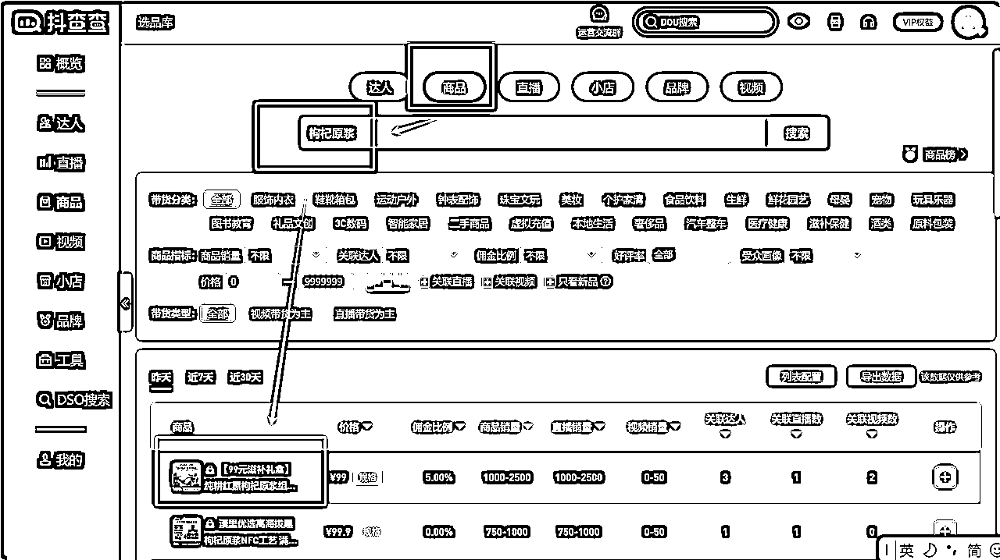

点进商品详情页，找到“商品观众画像”，用户画像一下就清晰了。

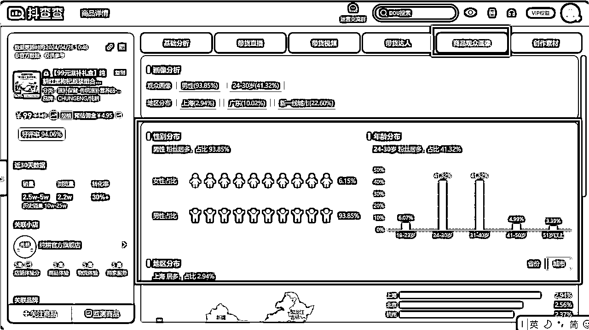

有了画像，再往话术里加入对应的生活场景，痛点痒点自然被戳中。

然后是直播间的标题、昵称和头像。标题尤其关键，它直接决定用户会不会看到你。怎么取？把自己当成产品的用户，想想如果你要买这个品，你会在搜索框打什么词；去看看这个品类里有哪些大品牌，蹭一蹭热度；还可以在搜索框输入关键词，看看下拉框里有哪些长尾词和组合词。

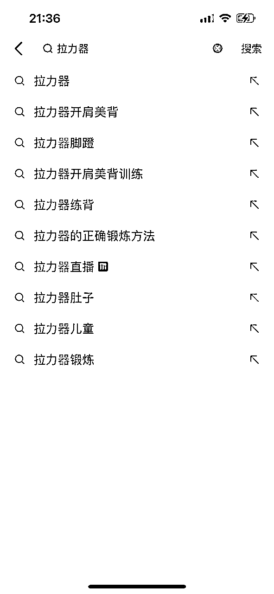

昵称和头像就简单得多：把昵称换成“XXX产品企业店/工厂店/专卖店”，头像放一张不带logo的产品图。

接着是客服话术，这是成交转化的关键一环。我们的直播是24小时循环录像，消费者有问题打在公屏上，口播没法回答，怎么办？用工具“小不点”来帮忙。把消费者可能问的问题整理出来，设好关键词，提前准备回复，转化率就能明显提升。而且互动越频繁，流量也会越好。

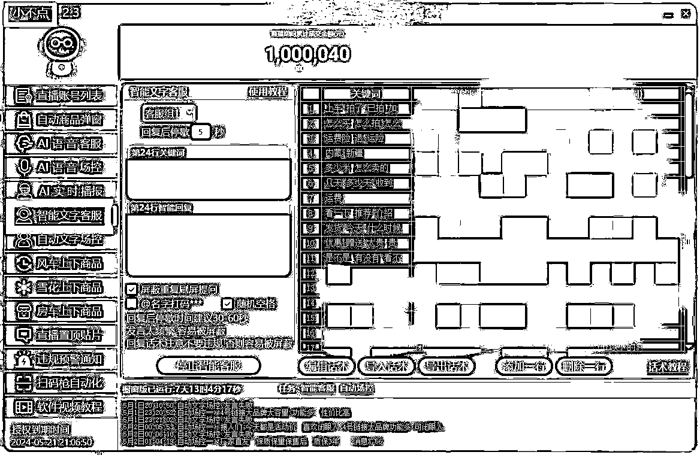

那关键词怎么收集？我强烈推荐一个地方：淘宝和京东的“问大家”。路径很简单：去淘宝、京东找同类商品→点进“问大家”→看消费者都在问什么，把共性问题整理出来。那里面的素材，真的多到用不完。

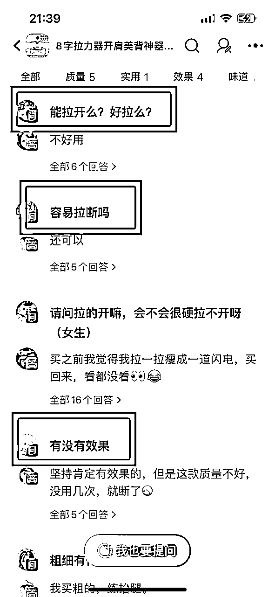

建议你定期去自己的直播间看看提问记录——早上起床后、午饭前后、傍晚6到8点、睡前，这些时间段都可以。把同类问题设置成自动回复，不仅解决了很多人的疑问，也实实在在拉高了成交转化。

以上都搞定，就可以开播，进入“躺赚”模式了。

第一步，把准备好的标题复制到“开播设置”里，直播间介绍可以留个小钩子，引导消费者多去滑动小黄车。

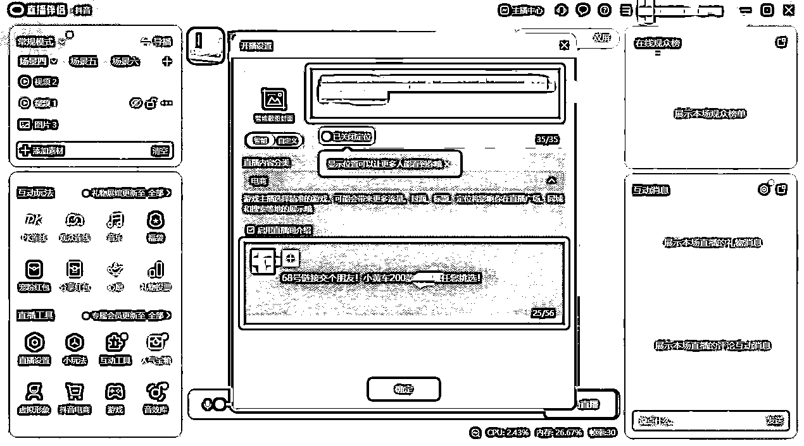

第二步，在直播设置里处理音频，有两个注意点：麦克风的输入音量要拉到最大，降噪调到-60，这样进到直播间的声音才够大、够清晰；扬声器设备要和电脑保持一致，不然放BGM时声音传不出去。

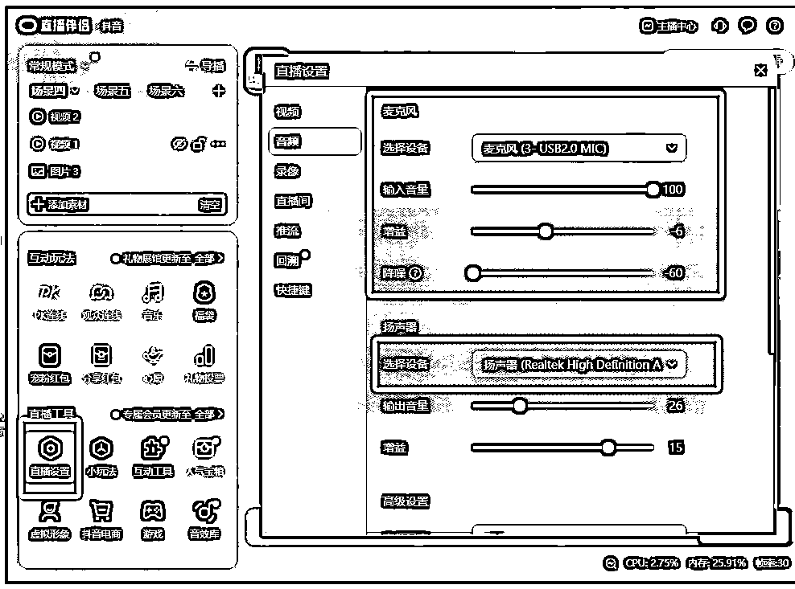

第三步，把做好的直播素材，按“场景→添加素材”的路径依次加进直播间。场景搭好就能开播了。注意人的比例要合适，既要占画面的大约三分之一，也要和商品保持真实比例。我有一次打马克杯这个品，结果杯子比头还大，那一场的数据别提多惨了。

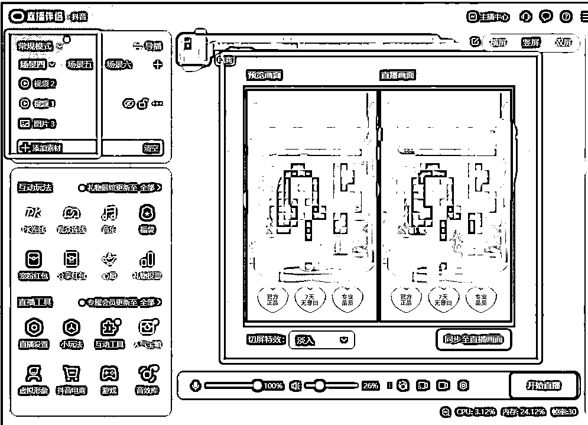

再说说我对做这件事的一个体会。想把单个环节做到极致、把一点放大十倍，真的太难了。作为业余选手，想在短时间内让任何一个环节实现质的飞跃，基本是异想天开。但把多个点都放大50%呢？很简单。选品时多对比几个；编话术时多看看专业主播；开播后每天多花十几分钟看看用户提问，补充关键词回复，优化小黄车商品。每个环节多钻研一点，用心多一点，最后的收益提升远不止一点点。

所以，你选择1×10，还是1×1.5×1.5×1.5×1.5？

再说一段我自己的故事：常怀感恩，真诚真的会有更大的可能性。

锦上添花谁都会，雪中送炭才珍贵。我一直很感激几许老师在我最困难的时候拉了我一把。他对一个小白都毫无保留地真诚，我认定这个贵人，有机会一定要报答。后来机会来了：那段时间我经常在群里积极回复新人的问题，可能也因为我的成绩让老师看到了我的勤恳。加入项目第四周，老师改了交付模式——从大群分出小群，由一些师兄师姐当峰主带队，让进去的小伙伴能有更紧密的交流、更有归属感。老师邀请我也当峰主。

说实话，第一反应是怂。我一个小白，万一把人带歪了，影响自己倒没关系，砸了交付口碑可赔不起。但几许老师一句“必要时你找我”，立刻给了我底气。那就当吧！说好的感恩，不就来了吗。

而给我更大底气的，是团队真诚的氛围。群里没有一个人担心泄露赚钱密码而藏着掖着，真真诚诚分享是大家共同的调性。我相信，只要用真诚帮助别人，结果不会差。于是峰主模式开启：小伙伴有疑问、需要远程支持，我都尽可能第一时间帮忙，就像当初几许老师和优秀的师兄师姐帮我那样。

说实话，有一阵我也觉得当峰主好累。要一直回应大家的需求，有时半夜还得远程帮忙检查开播参数，觉得耽误自己赚钱。但看着每周收益稳步上涨，甚至稳定到每天佣金过千，我才慢慢意识到：辅导别人的过程，其实也在强化和夯实我的打号能力。开号速度和质量都越来越好了；遇到流量问题，也能快速判断人货场哪里出了毛病，优化完继续抢流量、抢收益。

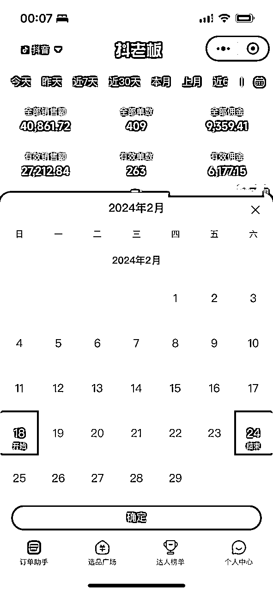

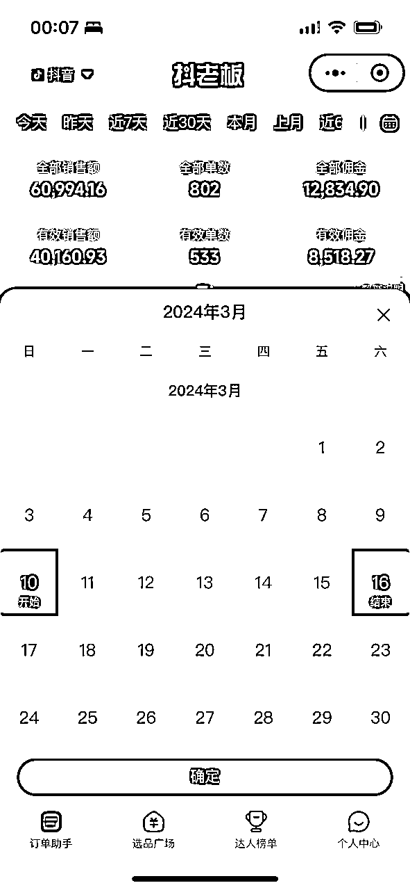

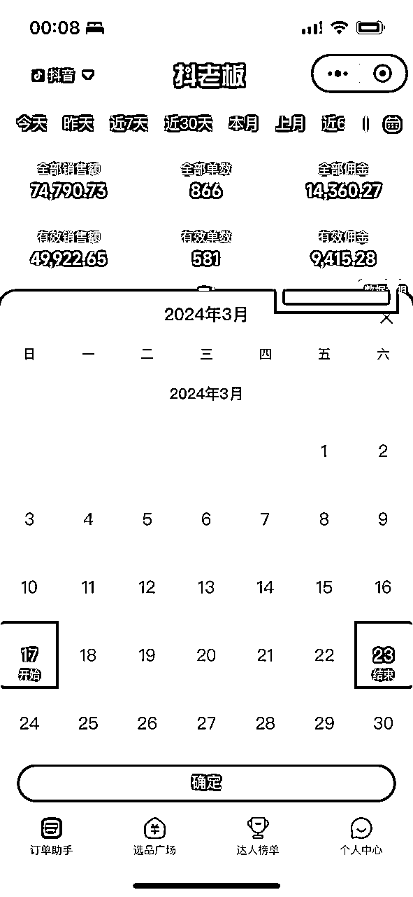

最后聊聊认知上的升级。回想过去一年，我从一个毫无商业认知、还裸辞的打工人，变成三个月收益超过8万的自由职业者，真的痛并快乐着。站在项目小白的角度，我想分享几点：

第一，尽可能去撬动身边资源，勇敢突破现有系统。不管什么时候，都别太看得起自己。一个人的认知和资源太有限，尤其是刚进入新领域的小白。想靠原有体系内寻求突破，往往是徒劳。少了外力，很难有真正的变化。只要设置好容亏底线，没到底就逼自己一把，去新系统里获取更多能量和可能性。

第二，信息差永远存在，多琢磨、多钻研。别以为互联网让信息彻底透明了，信息差其实到处都是。大到一个小白也能躺赚的项目，小到一个选品工具或操作步骤。只要多主动研究、复盘，你就一定比昨天的自己赚得更多一点。

第三，遇到问题，把注意力放在解决问题上，而不是情绪上。如果一直陷在“好难”“好焦虑”里，你既找不到解决思路，也没有继续前进的勇气。

以上文字，献给所有伸出过援手的前辈和老师；也献给每一位同路人。前进的路上，我们不孤独。期待我们在赚钱这条路上，都能遇见更强、更富的自己。