从打工到做公号：独自摸索，靠流量分成赚了18万

各位好，我叫小P。刚来赚钱没几个月。前阵子看到一些伙伴发过做公号的复盘帖子，很有感触，也想把自己进这个圈子之前那段实操记录一下。

一、事情的开头

做这个之前，我原本是搞产品工作的。后来公司业务黄了，一直没找到新的方向，整个人挺迷茫。有个朋友跟我介绍了个路子：用公号发稿子赚流量分成。闲着也是闲着，我就决定试试。正好那阵子在研究用AI写稿，感觉能干，于是当晚翻出一个早年注册后一直闲置的号，改了个名，发了头一篇内容。

二、初试阶段

也许是号龄比较久，加上选的赛道是当时很火的情感类，连续发了十来天，居然跑出一篇10万+。那会儿我有点飘，马上又搞了4个号来发同类内容。结果除了原有的号，其他几个发到三四十篇，一个都没被系统选中。我开始怀疑是不是路子不对。后来翻了不少同类账号，发现大家的数据也都在掉。看来是赛道太挤，流量不够分了。心态这才稳了些，那段时间也赚了几千元。

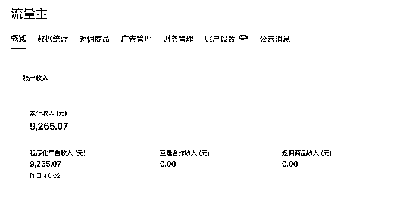

三、扩大规模

遇到问题就得解决。既然情感赛道走不通，那就多试几个方向。国庆回家，我把亲戚们的微信号都要过来，一口气开了10个号。平时刷推荐流的时候，看到什么爆款就往对应的群里丢，等于给自己搭了个素材库。

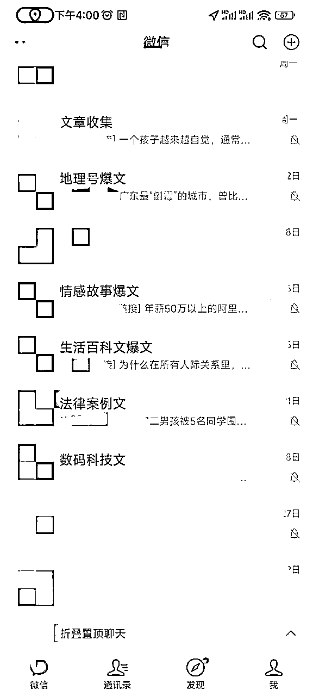

这次除了情感，新号还分散到了地理、民生、社保、时政、娱乐等一堆方向。因为不同题材要用不同的指令，我开始攒各种提示词，还换上了GPT-4。升级后最爽的是有了联网搜索能力，写科普类的内容基本不用费劲。我会先把角色、流程、要求都设定好，然后像这样给它下指令：

```
请联网搜索相关资料，并以《xxx》为题，写一篇1500字议论文/叙事议论文/故事。
```

也可以让它先列大纲再动笔：

```
我准备以《xxx》为题，写一篇1500字的议论文/叙事议论文/故事，请联网搜索相关资料，并为我列一个文章大纲。
```

这批新号里，半数被系统选中，我也第一次体会到单日进账破千的滋味。到这时候，累计赚了差不多两万。但也踩了几个坑：稿子爆了以后，没有趁热重复发，浪费了不少流量；某个赛道一旦打开，没有立刻再加号冲进去；也缺少止损标准，在这些没跑出来的账户上面花了太多时间。

四、发现职场向

到了11月，十月份开的那批号先后被选中，又先后没了推荐。但10月中旬开的其中一个账户，让我看见了一个新方向：职场内幕。起初也是随便试试。没想到这个账户猛得离谱。之前我也写过10万+，但基本就是二三十万阅读。这个号突然有一篇稿子直接冲到100多万，那阵子我发完稿就坐在电脑前不停刷新，生怕哪里出问题。

中间还有个插曲：一篇10万+被人举报我抄袭。我当时特别慌，到处搜办法。其实那篇只是标题相近，内容是自己原创的，不是洗稿。想杠到底，后来想想还是算了，就加了对方留的微信，诚恳道歉，提出删文。对方人不错，饶了我一回，真心感谢。

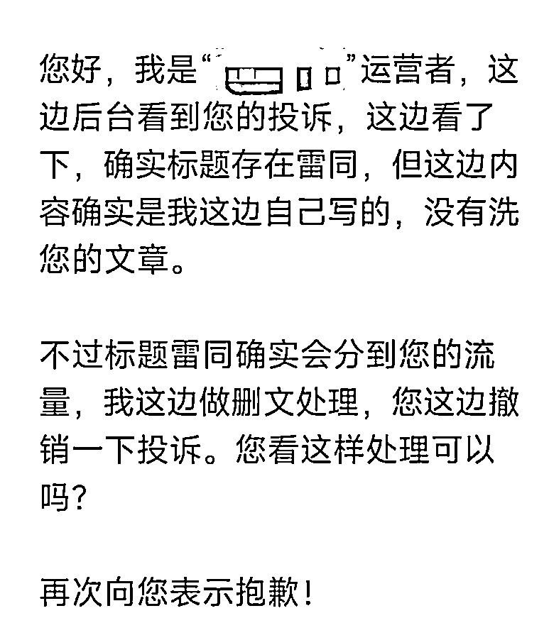

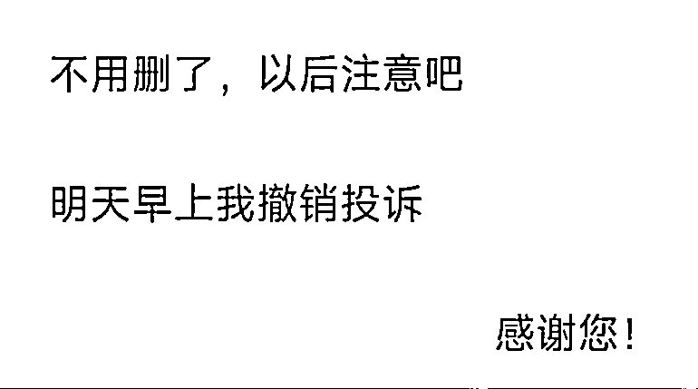

连出几篇爆款后，这个号单日收入直接破了5000。可惜辉煌没持续太久，11月中旬这个号突然没了推荐，收入一下子掉下来，心里挺失落。但做了两三个月，手感已经有了，我信能爆一次就能爆第二次。路子对了，剩下就是执行。

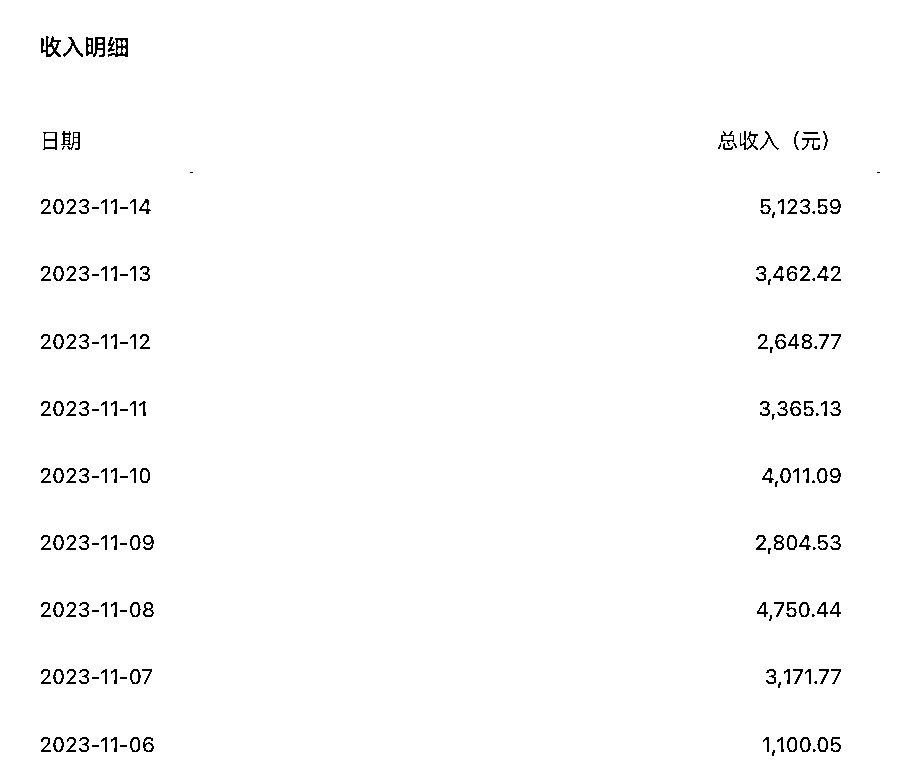

五、做细做透

复盘了前期的教训，我决定集中火力做已经跑通的职场向内容。但研究了不少榜样号，我发现同一个方向上，每个人的写法都不一样，各有各的路子。关键在于做细。比如，泛职场不够细，但专写职场里人情世故的号就很细；泛剧评不够细，但只写《三十而已》的就够细。我把收集到的参考号按更具体的标签重新分类。

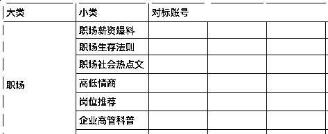

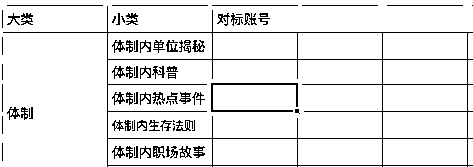

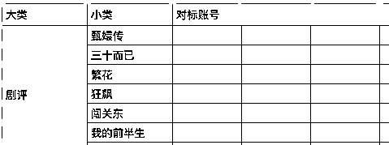

内容要聚焦，标题也要聚焦。最好把关键词直接怼到标题中，那段时间公号的推荐机制对标题关键词非常敏感。这也就是很多热帖都长一个样，比如“单位里，xxxx”“莫言说：xxxx”“《三十而已》：xxxx”“xxx退休金，xxxx”的原因。

参考号和示例都有了，我再次找亲戚朋友帮忙，开了一堆新账号，全部压到职场向的各个细分点上。这次赌对了，新账号基本发10到30篇就被系统看上，从12月到春节前，我天天都过得很滋润，几个号轮流给我惊喜。这是整个阶段收益最好的一段。

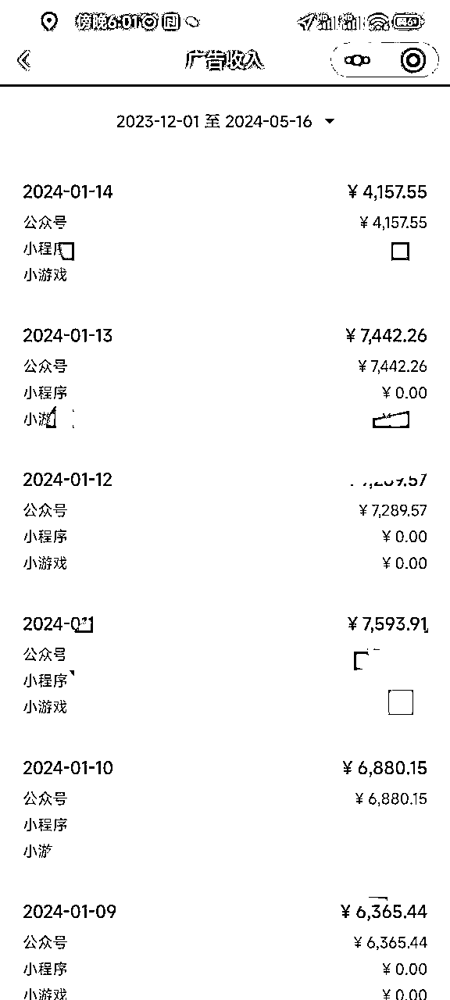

六、尝试自动化

做到这个程度，瓶颈就出来了：一个人用AI写稿，产量上限摆在那，而且能借的账户也快借光了。当时关注的一些号主都在聊RPA，我花了一周把流程跑通了。整体思路是两条线：第一条，先用工具找到头条上的参考号，然后爬下对方的标题和正文放进表格，再用RPA批量丢给AI改写，最后自动保存；第二条，只收集爆款标题，搭好一个原创写作的对话，剩下交给RPA批量生成。

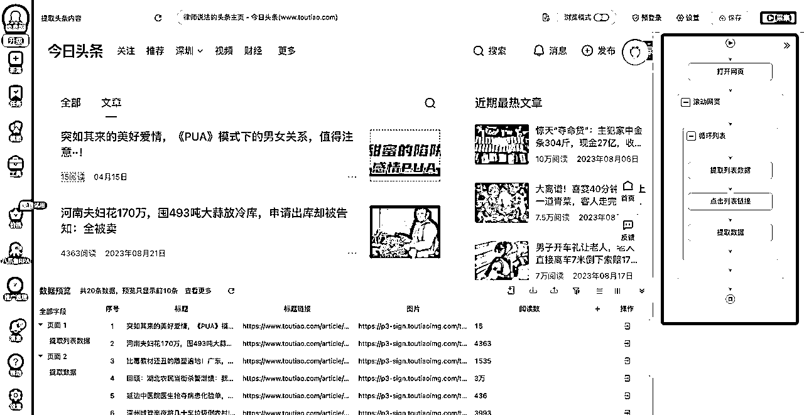

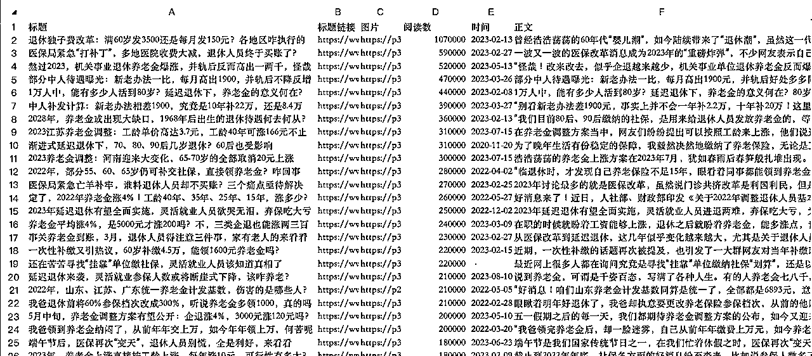

自动化确实省力，一个晚上能产出几十篇甚至更多。但问题也很明显：批量生成的稿子没法像人工那样反复让AI改，质量通常比较一般。再加上三、四月以后，平台推荐开始更看重内容本身的质量，而不是标题，这批自动化账户的入选率远不如之前。所以我说，进来太晚，没吃到太多肉。

七、整体情况

现在回头看，以前被选中的旧号已经慢慢失去推荐，新账户又越来越难被选上，整体收入比前几个月差远了。这几个月，注册了又注销再重来的，一共操作过42个账户，靠流量分成赚到18万。

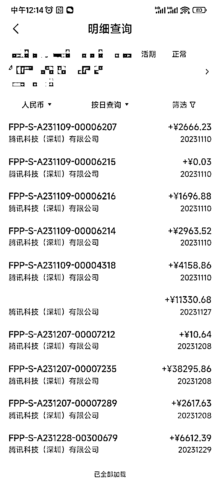

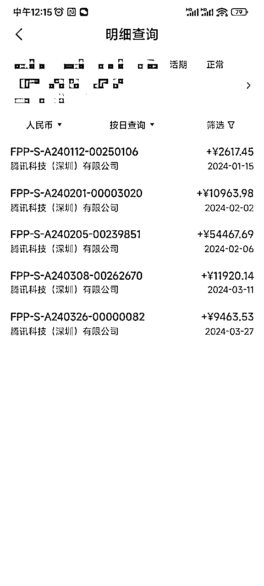

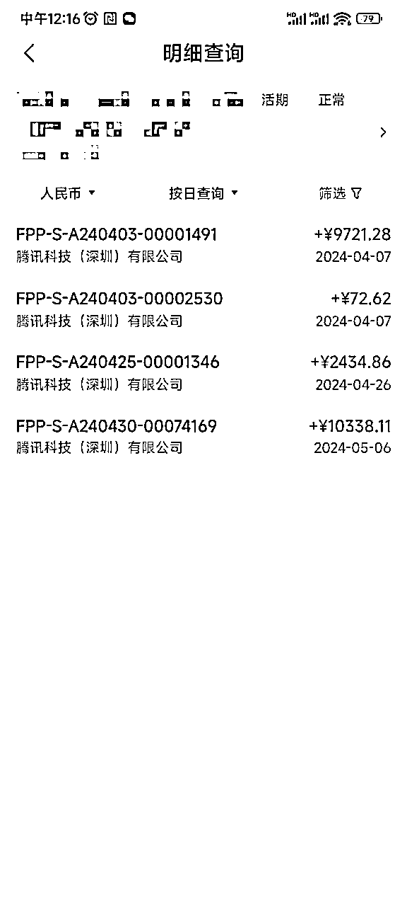

这点成绩，跟其他伙伴比真不算什么。

八、最大的教训

这次最核心的问题，就是把自己关起来单干。所有事都是自己一个人想，遇到问题就自己上网搜。坏处是信息太滞后。进赚钱以后，我天天刷大家的帖子，经常觉得“原来还能这么玩”“早知道就该到这里来”。如果早一点来，多认识些人，多请教，多合作，收益肯定还能再高一些。当然，这些都是后话了。

九、现在还适合做吗

现阶段，我的回答是：这不是随手写写就能躺着赚钱的事了，但依然有搞头。

原因很简单。平台推荐算法一直在进化。早期算法简单，只要选题蹭上热门，标题够吸睛，稿子就很容易爆。现在平台越来越精，一定会限制博眼球的标题，越来越看重内容质量。光靠一套指令词批量生成，流量会越来越难拿。

另外，一个赛道热了，大家都涌进来，内容千篇一律，分到每个人头上的推荐量自然就少了。平台也不喜欢太多同一个模子出来的内容，会慢慢压。

平台会不会针对AI写的稿子下手？我觉得不会，平台要打击的是质量差和胡编乱造，不是工具本身。只是用AI写特别容易写出这种货色。所以不管用不用AI，关键是把稿子质量提上去。

十、后续的机会点

接下来的机会主要在两方面：一是找更细、竞争者更少的方向；二是把以前出过爆款的话题换一种角度或换一个赛道重新写，常常能再火一回。

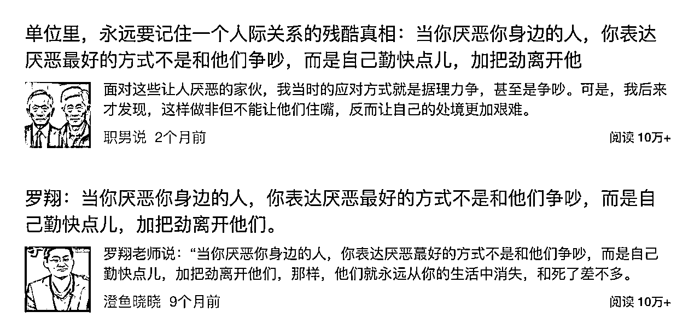

内容质量上，如果你能原创出高水平的稿子，就走原创路线，不过团队化操作可能不太适合；用AI的话，就继续打磨提示词，让稿子别带机器味，读起来更自然。

十一、两个小技巧

怎么减少机器味？几个办法。

第一，用更强的大模型。简单说，高级模型配简单指示，往往好过普通模型配复杂指示。

第二，AI写的东西之所以显得呆板，是因为它在默认情况下会挑概率最高的词句，像“首先”“其次”“总的来说”“想象一下”这些。要解决，就在指令里直接禁止这类套话，再调整一下temperature参数，让输出更多样。

```
## 写作限制：
1\. 不允许使用首先、接下来、然后、最后这样的连接词
2\. 不允许使用“想象一下”
3\. 不允许使用“总结来说”
4\. 不允许使用“在探索……时”或类似的句式
……
```

第三，可以直接让AI模仿你喜欢的文风，网上有不少教程。

第四，最根本的办法还是你自己会写，把AI视为普通工具。自己把观点和案例想好，让AI帮你理出大纲，再照着大纲填充。拿它当一支更快的笔，别指望它包办一切。

微信里怎么找选题？几个月以前的玩法是追最新的热帖标题，跟得够快，有机会摸到10万+；跟慢点，也能有几万阅读。现在微信对重复内容的限制严了很多，短时间内的雷同标题基本拿不到推荐。换个思路：别追最新的，去找几个月以前出过爆款的稿子。找到以后，先看看这个标题最近有没有人写，如果到处都是，就不要碰；如果没怎么见过，可以试试。

十二、写在最后

以上是我这几个月折腾公号的一些复盘。头一回发帖，写得不好大家多包涵。有问题随时来聊。以后我可能会拿一部分精力去试试其他方向。最后想感谢两位伙伴，因为看了他们分享的公号经历，我才决定写下这篇。希望里面有些细节能给你启发。