# 盘一盘：我如何把校园早中晚餐到寝做到日单破万、日赚过万

> 来源：[https://ua10f6r1eif.feishu.cn/docx/W46XdJX7to4oRXxpWwLckfU3nTc](https://ua10f6r1eif.feishu.cn/docx/W46XdJX7to4oRXxpWwLckfU3nTc)

# 早餐到寝实操篇

大家好，我是木陈林，一名赚钱第八期圈友。2023年2月到11月，我在校园综合服务团队负责高校早餐进寝业务。团队覆盖北京、上海、广州、天津、河南、山东、西安、合肥、武汉、福建、厦门等十几个城市的大学城，十几个人马一整年下来，把日均订单和日均净利润都稳定在了一万左右。

整体打法很清晰：先租好小程序，再在校内组建团队，谈妥周边商家，早晨由商家把餐品送到校门口，由学生团队分装配送，学生扫楼收单至此闭环。

盈利主要来自两块：一是按商家流水抽取20%的佣金；二是日均出餐超200单、达成长期合作的商家收取2万到5万的合作保障金。平台跑通后，后续维护成本很低，一个学校就能持续收钱。

我个人负责北京片区，10天内完成了20所高校的铺设。下面把完整链路拆开说。

# 一、机会的发现与扩张路径

## 1. 机会怎么找出来的

我加入公司时团队在做校园环保，疫情后这条线基本停摆，拿不到钱。我们急需找一条能快速变现的赛道。

观察到大学生的拖延属性，尤其秋冬季懒得出门买早餐。于是先在上海松江大学城做试验。松江当时已有竞争对手在上外、华政、工程大等校铺设，每天五百单左右，但只做了三所。我们学了过来，直接复制并铺满整个大学城，做了六七所学校，日单就冲到一千。

模式验证有效后，我们开始复制到上海其他高校：上海大学、同济、华东理工、上师大、海洋、海事等。

上海跑顺后，团队南下广州。广州大学城十几个学校集中在一个岛上，竞争极其激烈。我们一开始用满五减二、免配送、首单免、压低商家价来抢量，结果不赚钱、单量也没起色，果断止损。只开了广州大学、广州中医药大学、广州美术学院、华南理工大学等几所就转场武汉。武汉做了传媒、湖北美术、湖北经济、华中理工等，锁定了几家意愿强的长期商家。

4月天气转暖去北京打硬仗。北交第一天直接爆500单，商家忙不过来。我们一晚上没睡，从昌平跑到海淀，凌晨12点开始帮老板包包子、做煎饼、打单、打包。结果第一天早上还是迟到了半小时，被学生骂了一通，口碑掉了一大截。之后我们在系统里加入了限单功能，避免商家爆单。

北京校招效率极高，2天就能开一所：下午谈商家，晚上招人，第二天就能上线。十几个人马不眠不休，十天开了20所高校：北外、北交、北语、北林、第二外、外贸、人大、地质、北航、北农等。

之后去天津、河南、山东，本地渠道少，主要靠抖音、小红书找资源，折腾两个月只做了少量学校，单量不高就关停了。

暑假我们用QQ频道给校园墙引流，效果还不错，SOP另外再提。

9-11月回上海、北京、山东稳盘，并新拓展福建、西安大学城。

（单量利润截图及现场照片视频略）

之前看到有人摘我的文章去割韭菜，特此声明：本人尊重龙哥盟平台，希望能结识志同道合的创业伙伴，不会拿此项目做培训割韭菜。未经本人允许，禁止外传，违者必究！

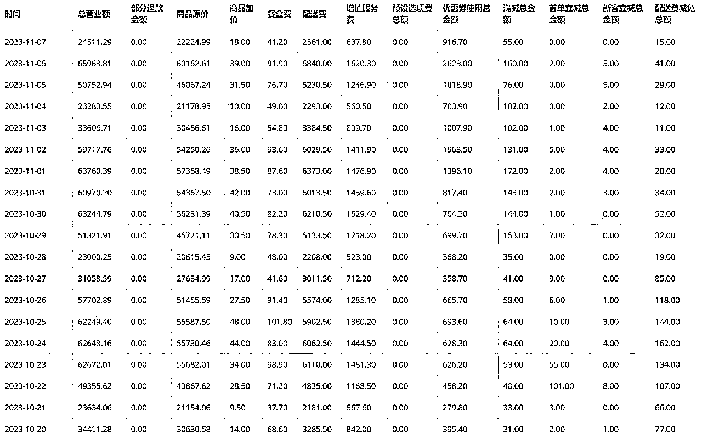

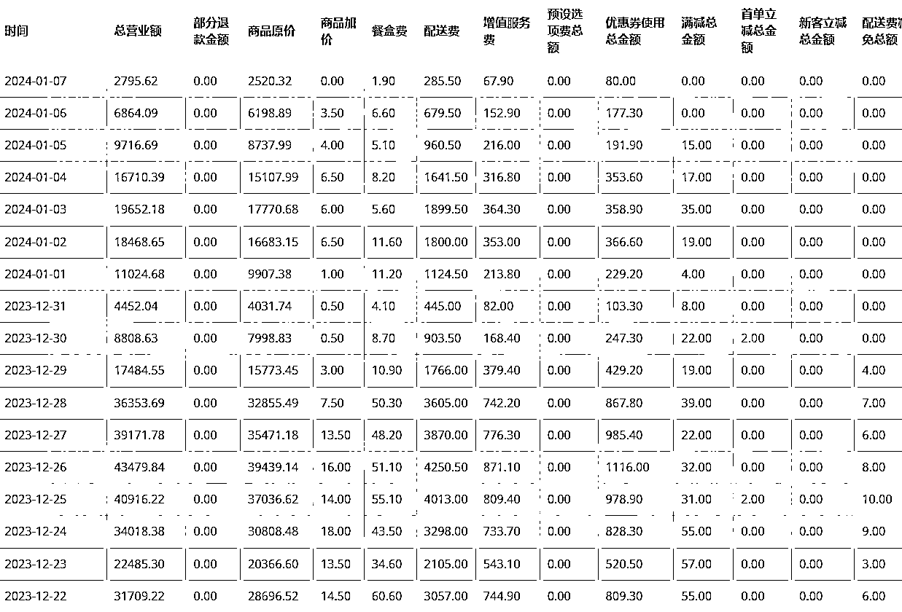

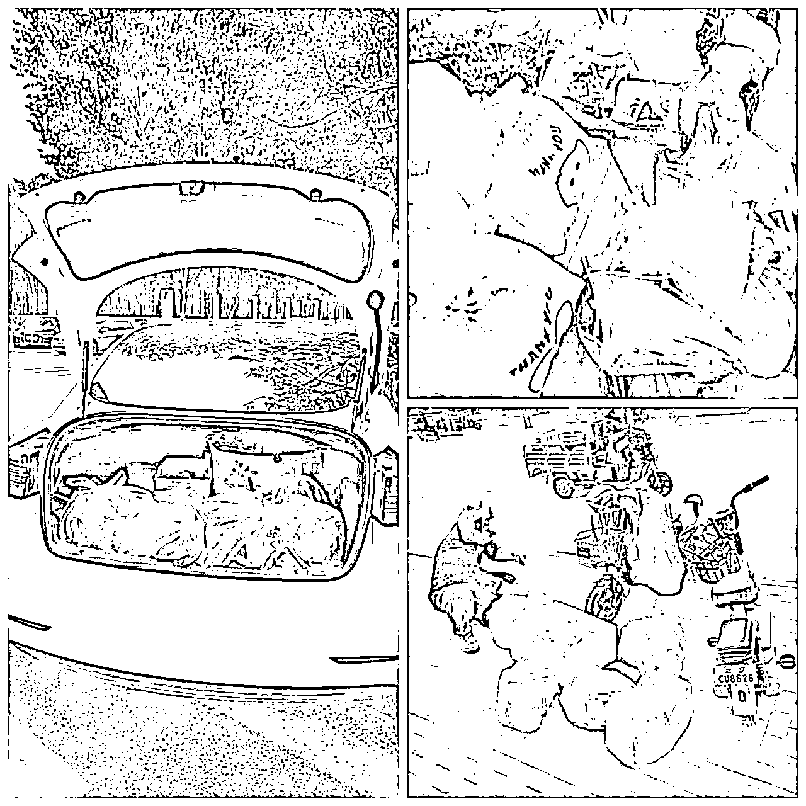

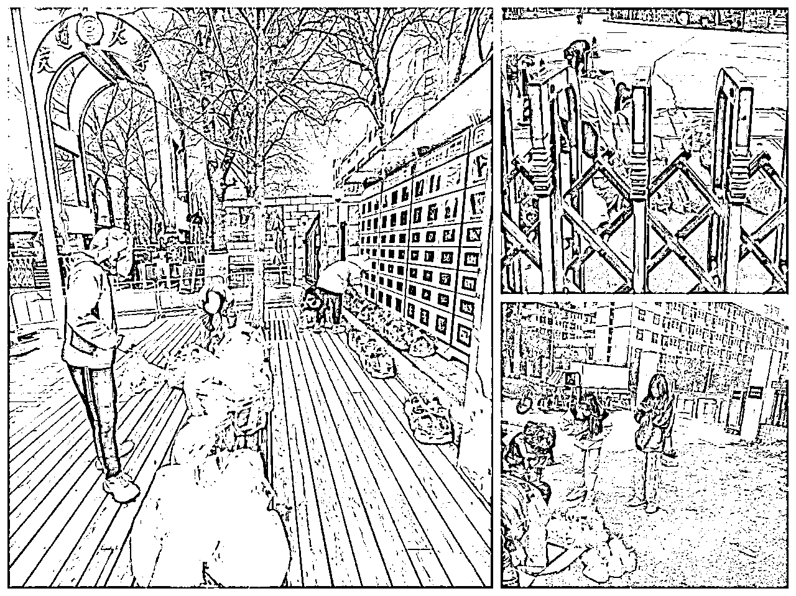

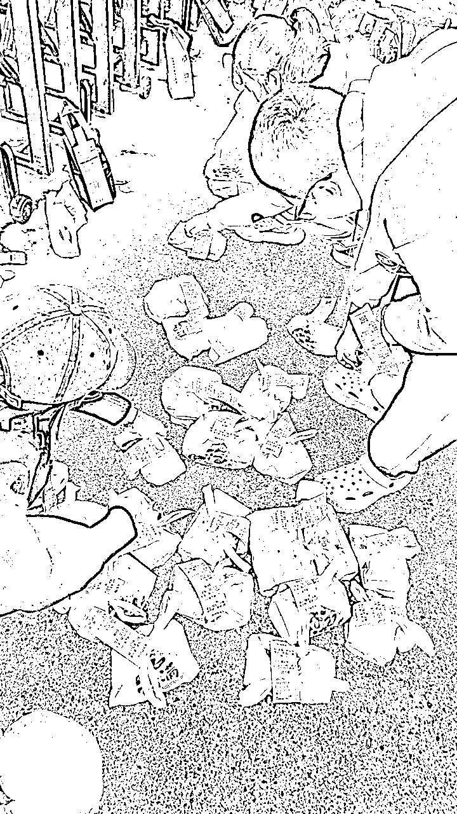

# 二、问题与组织架构

## 1. 团队怎么分

| 部门 | 负责内容 | 薪酬 |
| 市场部 | 面谈商家、收集资料、反馈小程序BUG | 项目分成 |
| 后台运营部 | 小程序对接、商品上架、菜单调整、后台维护 | 固定工资 |
| 校园管理部 | 现场面试、筛选学生、楼栋监管、管理学生经理、处理送餐问题 | 项目分成 |

## 2. 日常运作节奏

1. 工作日开启钉钉定位，到场在群里报备。
2. 早上收尾后回酒店休息，下午一点复盘。
3. 复盘后前往下一所学校谈商家、面试学生。
4. 下午收集商家菜单、身份证银行卡信息，上架商品。
5. 晚上再与老板对齐，确保次日凌晨到店教学。

## 3. 常见卡点

学生资源如何获取？如何与校内同学有效沟通？怎么谈下校外商家并拿到银行卡和身份证？后期如何稳定运营校园团队？学生与团队的分成怎么给？这些坑我后面会一点点解答。

# 三、落地流程与经验沉淀

## 一、校内已有学生资源

### 1. 小程序端搭建
#### 1.1 平台选择
https://www.lewaimai.com/（乐外卖）
https://www.keloop.com/aboutus.html（快跑者）

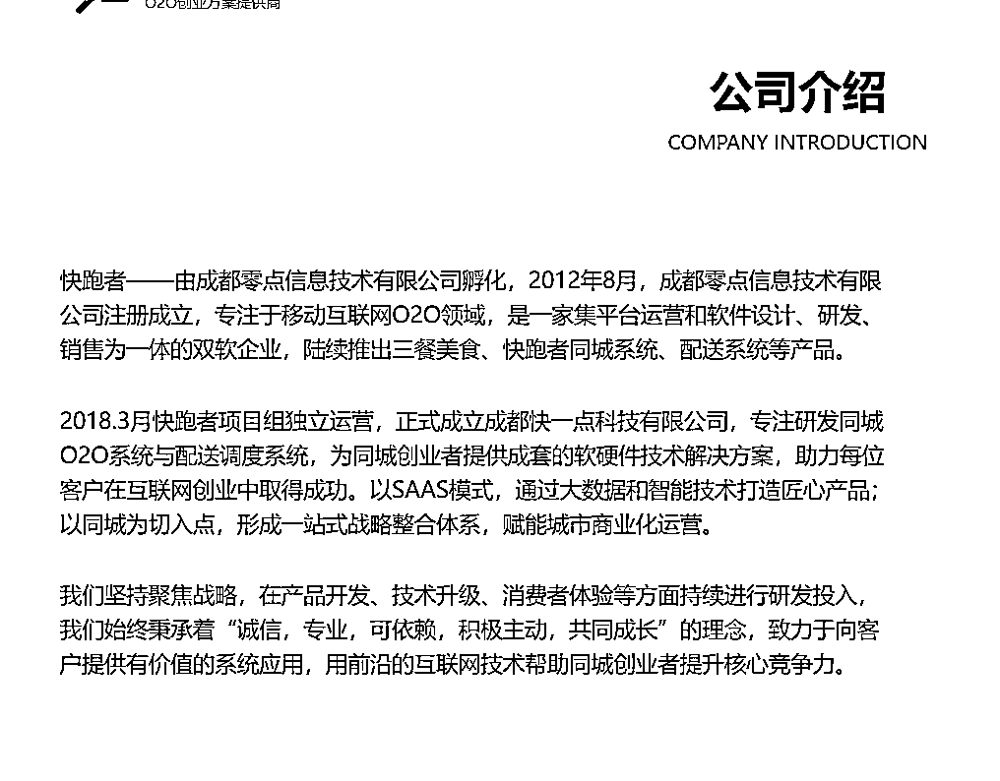

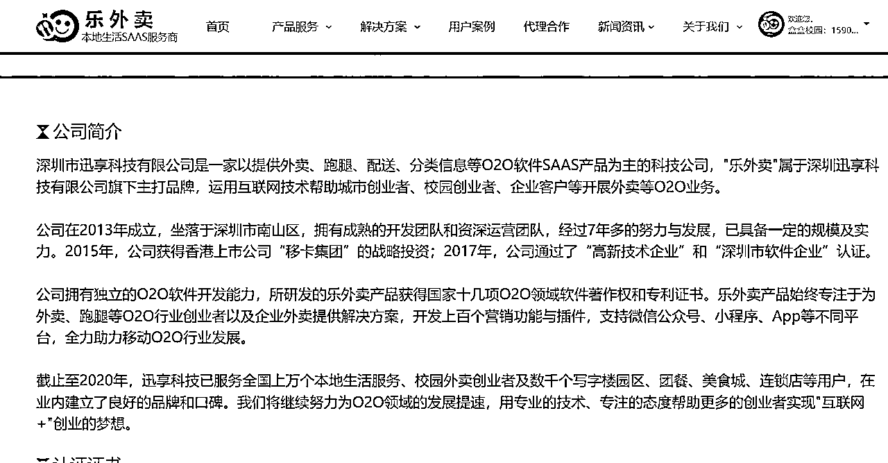

#### 1.2 费用与合作
一般按月或按年租用，规模越大单价越低。初期功能精简即可，便宜试用。

#### 1.3 模板参考
对标你好同学、盒盒校园、嗨FUN猫等小程序，越简洁越好。

### 2. 校园端启动
#### 2.1 群发引流
可在自己持有的跑腿群、二手群、脱单群、兼职群、创业群、宿舍群、互助群、午晚餐到寝群里推送。进群话术：我们已完成早餐到寝搭建，进群有福利。

有校园墙就直接投放。

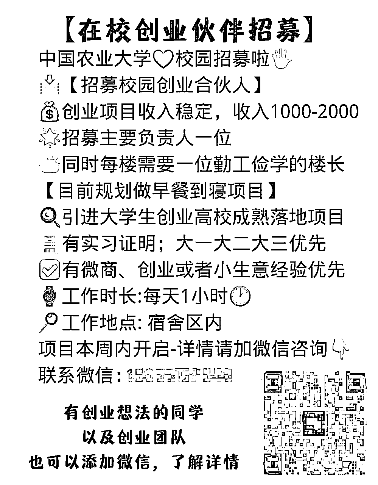

#### 2.2 面试与招募
通过二维码添加面试官，电话沟通流程与报酬，约第二天下午3-6点或晚自习后当面面试。

#### 2.3 面试校园经理
先讲项目：每天6:30商家将餐品送到离宿舍最近的点位，学生点单、分餐后送到寝室挂钩处，完成一单。薪资按周或月结。

再考察学生的逻辑、表达、校内资源。拒绝资源太多想白嫖的、油嘴滑舌的。

让候选人现场去招楼长，渠道同上，当天或次日中午给结果。

最终筛选以楼长招募数量为主，辅以表达和履历。

#### 2.4 扫楼拉新
经理带楼长逐寝室敲门。话术：我们是大学生创业项目，晚上下单早上送到寝室门口，有保温袋保暖，后期会挂挂钩，请放心购买。

扫楼是重中之重，楼栋拉满人才算成功。不会扫的要多安慰，愿意冲的要给信心：把楼栋人数拉到百人，后续基本不用再扫。

不愿扫直接换人，扫楼不建议先给钱。

#### 2.5 群体量要求
群里至少800人。经验值：男生转化率约20%，女生约37%，女生更懒更需要早餐。因此送餐与客户群体以女生为主。

人拉到800-900，直接发小程序链接，最好当天拉群、下午谈商家、晚上就能下单，效率最高。

#### 2.6 学生薪酬
| 身份 | 薪酬标准 | 结算 | 职责 |
| 校园经理 | 每单0.3-0.8元（总单） | 月/周结 | 群管理、维系关系、漏餐上报 |
| 校园楼长 | 每单1-2元（送餐单） | 月/周结 | 送餐、扫楼、群内宣传 |

### 3. 商家端
#### 3.1 找商家
美团筛选品牌、校门口实地走访、高德地图检索、早上去谈成功率更高。首选品类丰富、价格适中的店。商家必须认同项目。

#### 3.2 谈判话术
“老板您好，我们做学校团餐创业项目，客户群1800人，日均点单400人，六七家商家一起服务这所学校。”

老板心动后谈价格：“学校单量大，能否给到八折？我们还要发配送员工资。”八折是抽佣的关键。

再说送货：“早上能送到校门口吗？学生不方便出门。”

最后要资质：“我们是公司对公打款，第二天到账，能否提供银行卡和身份证正反面绑定？”拍照并发群上架。

到店教学时价格不准乱改，先锁定。包子类控制在1-2.5元，优先巴比、早阳等连锁。酱香饼小份3-4元大份5-8元。粥类皮蛋瘦肉粥8.8元，素粥6元左右，荤粥10元内。肠粉10元内，馄饨可作为备选。小笼包不超过10元。肉夹馍8元左右为宜。杂粮煎饼6-7元备选。

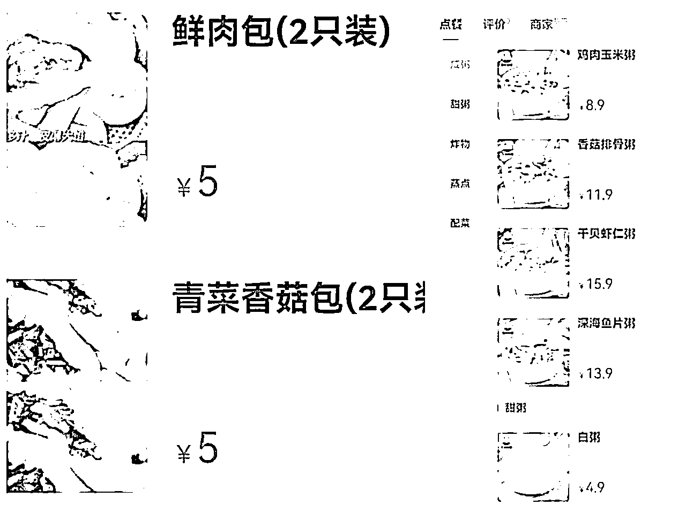

#### 3.3 凌晨到店教学
绑定打印机，推荐飞蛾、商鹏。教会老板看后台、备货单、打印小票、查看收入。用保温袋打包，带老板去校门口认路，后续送达及时报备。价格由对接人统一调整。

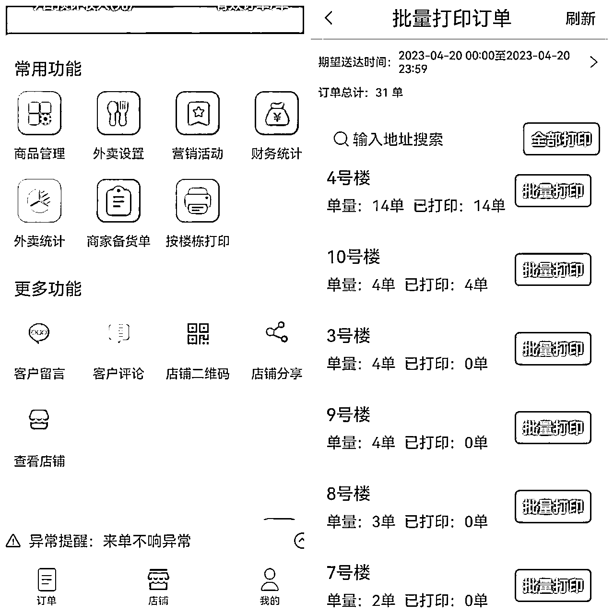

#### 3.4 对接群与客诉
商家、学生经理、校园员工拉群统一对接。漏餐先由校园经理垫付，一周汇总后从商家后台扣回。用表格记录每日漏餐，服务必须即时响应。

## 二、校内无学生资源
靠校园墙和校内渠道引流。抖音、小红书找目标学校的校园墙资源，沟通投放。广告内容：招校园创业者，早餐到寝负责人及送餐员。预算控制在300以内。

筛选标准：有真实人数、无冲突业务、可持续运营、有活人评论。

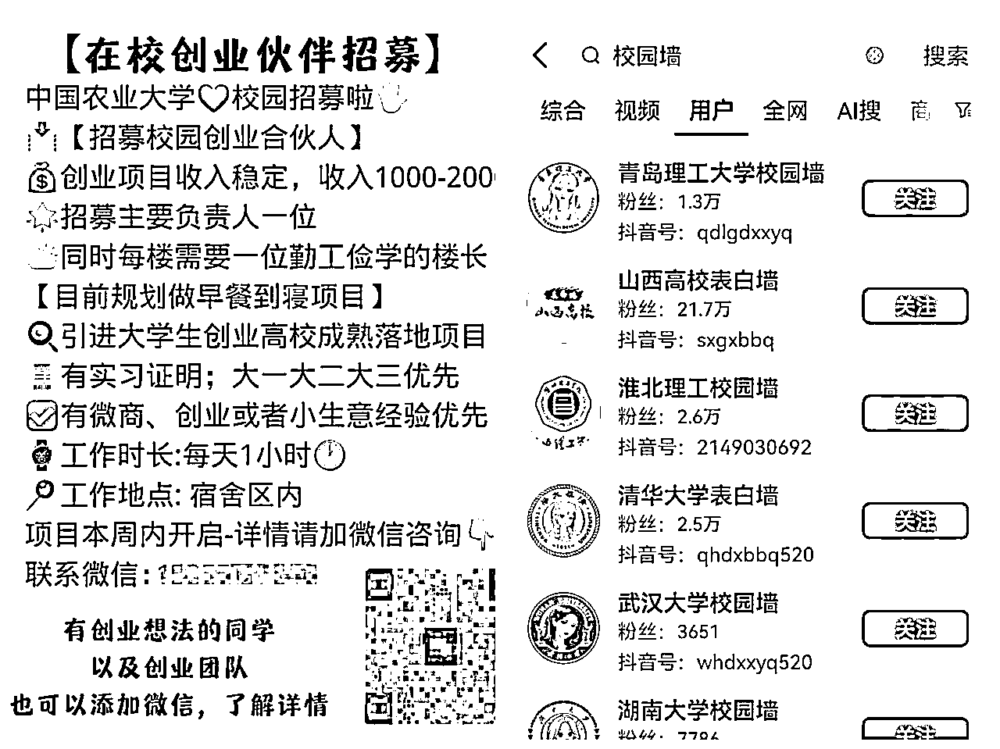

# 四、后期维护与关键注意点

1. 每栋设负责人，负责分餐核对。
2. 楼长必须准时，迟到直接换。
3. 商家立规矩，迟到罚款。
4. 必须用保温袋，PDD约0.25元/个，费用0.3元由商家收取。没有保温服务做不起来。
5. 起送价4元左右，配送费1元归楼长，经理拿总单0.3-0.6元提成。
6. 新校初期限流30-50单，避免商家爆单。凌晨去店辅导出餐。
7. 绑定打印机，京东飞蛾打印机约299元，先提供给商家，一次教会。
8. 熟悉流程后可做3-7天促销：满5减2、免配送，久了亏本。
9. 多和商家谈让利，尤其是传统早餐店，八折之外还能再压。
10. 熟练后可做隐藏差价，举例1.5元肉包八折后1.2元成本，学生端卖2元，差价归己。
11. 学生团队做得好，节日发红包维系，口碑会带学弟学妹。
12. 定期看后台，单量下滑要排查配送或商家口味问题。
13. 大学生契约感弱，需多沟通、多给赚钱机会。离职就让其推荐新人。
14. 人员流动是常态，学校里有能力的人很多，换就换了。

# 五、最后的话

这个项目前期搭建极其反人类，靠的就是利用学生的惰性。一定要找靠谱合伙人一起分润，才能走得长远。

各位赚钱圈友，大家好，我是木陈林。

23年2月到11月，我们团队在全国高校跑了一圈，做出了日均1W单的早餐到寝平台。走到武汉大学城的时候，我发现了一个特别亮眼的团队——江汉大学的一伙人，专门做午晚餐到寝。他们基本把整个江汉大学的午晚餐市场都拿下来了，连美团和饿了么在当地都干不过他们。

他们一天稳定跑600到1000单，到底是怎么做到的？疫情反反复复的那两年，他们凭什么能活下来？我把江汉大学负责人聊了个底朝天，整理出一份全网少有的详细打法。有资金、有能力的伙伴，可以直接抄作业。

再强调一遍：本文仅供赚钱圈友参考学习，千万别拿去搞培训、割韭菜！侵权必究！

先说最核心的盈利逻辑：平台抽商家15%～20%的佣金。也就是每一单，你都能从营业额里切出一块蛋糕。

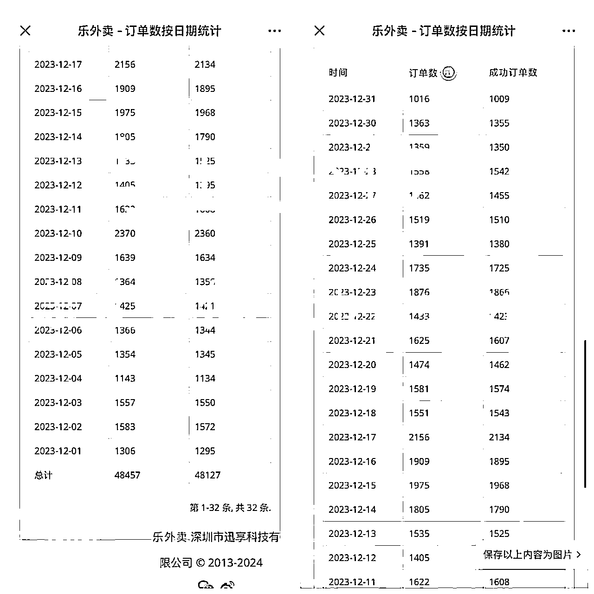

# 一、商机是怎么冒出来的？

21年到23年，疫情此起彼伏，动不动就有地方大面积封控。武汉很多大学生被关在学校里，只能吃食堂。江汉大学当时管得不算严，校外的外卖只要刷校园卡就能送进学校。

有人就盯上了这个空子：学校里面明明有一个现成的外卖市场，为什么不做个平台连接起来？去校外谈商家，学生线上下单，再让骑手或者楼长送到寝室。商机看到了，撸起袖子就开干。

# 二、团队怎么搭？钱怎么分？

项目要想跑得动，先把人安排好。他们当时的分工很清楚：

- 学生市场端：专门跟校外商家谈判、收商家资料、处理商家问题，拿项目分成。
- 技术后台：负责小程序问题处理、菜品上架、菜单调整、后台资料修改，也是项目分成。
- 宣传送餐端：负责扫楼宣传、送餐上楼，一单一元。

跑起来之前，团队其实要面对一堆难题：

1. 商家抽点怎么谈？后期活动怎么推？
2. 怎么把学生团队组织起来？
3. 每天怎么高效管理？
4. 几个合伙人分钱怎么分才不闹掰？
5. 小程序搭建的时候，缺各种证件怎么破？

别急，下面我一条一条拆。

# 三、全部流程和实操经验

先说个大前提：午晚餐到寝这个事，最好你在学校原本就有学生资源。早餐比较轻量，毛利低，管理简单，早上那一下午就结束了。午晚餐完全不是一回事，时间跨度长，需要的楼群和送餐人员都很多，没有本校的同学和管理层兜底，少餐、漏餐能把人搞崩溃。

## 1. 把小程序搭起来

市面上好用的第三方平台不少，资质问题他们能帮你解决。我们首推快跑者、乐外卖、逐趣、零点。证照、收款账号、系统后台，全都给你搞定。

小程序的费用按体量谈，一般5000一个学期，或者一年。设计上，直接对标“Hi这位同学”“谢谢有你”这两个做得不错的校园平台。

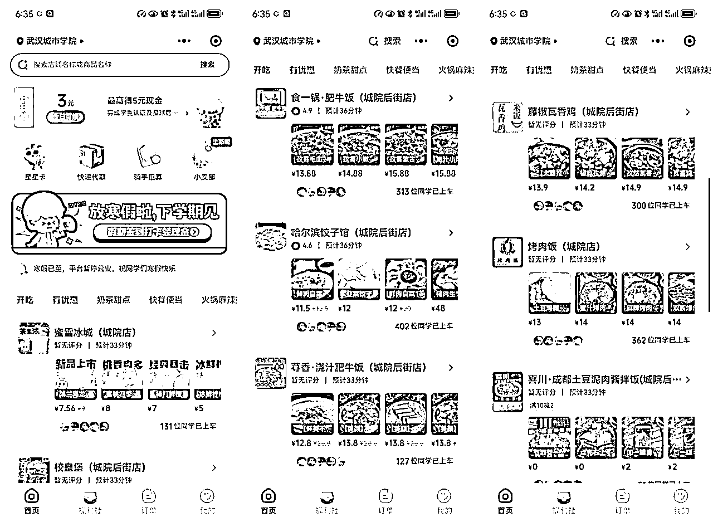

## 2. 校园送餐端怎么建？

在楼群、跑腿群、二手群、脱单群、兼职群、创业群、宿舍群、互助群、早餐到寝群等所有能触达学生的群里，发招聘信息招楼长。

送餐员也可以去美团众包等外卖平台找，首推专业外卖员，送得快、事情少、效率高。

楼长加了微信，简单聊聊项目，说清楚送餐价格（一单一元）、送餐时间（中午11点到1点，晚上5点到7点，可以灵活调）。人确定之后，校园负责人带着楼长一起去扫楼。

扫楼一定要带物料！比如印了小程序二维码的小卡片、小徽章。话术大概这样说：“你好，我们是本校同学做的创业项目，午晚餐可以把校外的商家送到寝室里，以后你躺在被窝里就能吃饭了！”

大部分学生根本扛不住这种诱惑，冬天那么冷，谁愿意往外跑？你只要把这个蓝图一画，他们就愿意进群点餐。

扫楼的关键是：必须带楼长去扫。这样他们才有动力。遇到不会说、不敢讲的学生，多鼓励、多安慰，把他们的赚钱热情激发出来。一个学期集中扫一次就够了，扫好了后面就不用再扫，专心送餐。

还有一点要特别记住：把送餐的同学当合伙人，不要只当苦力。除了送餐费，也要给他们分享一些赚钱项目和认知提升资料。你要知道，愿意来送午晚餐的学生，一定是非常缺钱的。你只给钱，不给他们成长，楼长流失率会高得吓人。

送餐车辆尽量让他们自带电瓶车。实在没有，团队帮忙租，200到300一辆，价格还行。

## 3. 午晚餐楼群的硬性要求

第一，人数必须过千。第二，群内每天都要发小程序点和点餐文案，比如“同学们，每日午晚餐推荐来啦！今日推荐沪上阿姨+大鸡排……”给学生一个点餐方向。第三，偶尔发个红包，做做社群福利。第四，建群的当天或者第二天，就去找几家校外商家试着送起来，不要等！等久了学生就觉得你是骗子。

## 4. 商家谈判

校内商家不建议碰。这里头涉及到学校外包食堂、食堂领导、学校政策、领导决策，利益链条太深太乱。校外商家简单得多，最多是给宿管阿姨发点红包打点一下。

商家怎么找？从美团、饿了么，或者校外实地走访都行。

谈判的时候，记住一个心态：你一定要在上，商家在下。你是来给他带客源的，帮他提升营业额的，他应该感谢你！所以绝对不要怂，扣点问题一碗水端平讲清楚。

现场可以这么模拟：“老板您好，你这边主要是做面条的吧？我们是学校内部同学的创业项目，做了一个午晚餐到寝平台。现在我们平台大概有几千人，而且楼群还在不断扩大，想问老板有没有兴趣合作？”

老板大概率会问怎么合作。你就说：“我们学校人多、单量大，能不能给我们便宜一点？给个八折加1元跑腿费。你要是会聊，要个七折、15%抽成加1元跑腿费也行。只要不亏本，学校门口的商家基本都会点头，因为他们就是指望这段时间赚钱的。”

老板答应了，再跟他说：“现在国家对小程序的管控比较严，钱都是第二天才能打到您银行卡。麻烦您提供一下身份证正反面、银行卡账号，再加上食品安全许可证和营业执照。”

愿意给的，直接合作。不愿意的，pass掉，外面有的是商家。

商家只管出餐，你尽量多谈一点跑腿费，给送餐学生多点收入。

后期怎么跟商家谈活动？

打电话：“老板您好，我是XX平台。最近单量有点下滑，我们准备做个满五减三的活动。目的是帮你们拉单量，我们这边也会配合扫楼扩大楼群。做几天单量肯定能有明显提升。你出2元，我们出1元。”

老板要是问“做了活动没效果怎么办？”，别慌，直接画饼：“老板，你看我们的体量！学校这么多人，我们做个活动，轻松加千把人进群。分到你店里，一天多个十几二十单根本不是问题。你放心交给我们就行。”

做生意，一定要给老板信心和希望，他才会跟你长期合作。而且活动谈判本身就是一种筛选：愿意出钱做活动的商家，说明有野心、想扩大影响力，值得多帮他们做套餐、做宣传。帮商家赚到钱，你以后去店里吃饭都不要钱。

## 5. 菜单价格

菜单价格一定要便宜，对标学校食堂，千万别加价！学生群体对价格敏感到了极致。

给点参考模板：盖浇饭11元左右，鸡排饭9.9左右，米线9～15元，面条8～15元，套餐饭8～20元，牛肉饭14～20元，粥类4～20元……

冬天所有饭盒外面必须加保温袋！商家自己有就用，没有就必须买。不然饭送到手里冷透了，没人会点第二次。加几毛钱保温费都行，看学生接不接受，这笔钱自己收也可以。

## 6. 拉商家对接群

把商家、学生负责人、楼长拉到一个对接群。学生端会有很多商家群，把群折叠就行。少餐漏餐，在群里直接说。

千万不要拉大群！不要把商家全搅和在一起。商家很容易吵架，遇事互相扯皮，后期你做活动、做管理都会很痛苦。

## 7. 帮助商家绑定后台

当天上架完后台端，就绑定账号。市场端的人帮商家绑定打印机，下午教会商家操作。第二天午高峰时，去商家店里蹲一下，看后台有没有异常。

这样，一个完整的商家流程就跑通了。

## 8. 后期运营

第一，正式运营起来后，每天一定要发送餐小程序。第二，商家和学生有问题，第一时间处理。第三，合伙人分钱：出钱多的应该多分，做事多的多给。送餐同学按约定给就行。

## 最后几点经验

- 有没有校园资源，基本操作逻辑差不多，根据校内实际情况去落地就好。
- 不肯帮商家赚钱，自己绝对赚不到钱。
- 搭建期确实累，但一旦跑通，后期几乎不用盯，很省心。
- 项目不建议做得特别大，频繁出差成本太高。最好集中团队力量，先打下一个城市的大学城。

好了，这次的分享就到这里。还是那句话：仅供赚钱圈友学习参考，切勿拿到市面上割韭菜！侵权必究！