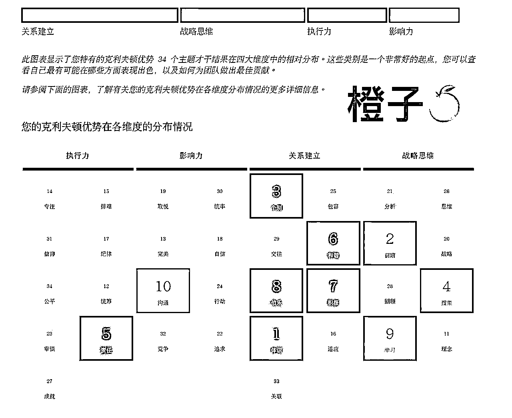

# 一个月2350万，我靠盖洛普把销售死结打开了

> 来源：[https://q07m9lrm5ih.feishu.cn/docx/XvZrdPRGcoy3VyxjkASciGXNnEh](https://q07m9lrm5ih.feishu.cn/docx/XvZrdPRGcoy3VyxjkASciGXNnEh)

大家好，我是橙子是锦鲤呀。

去年11月加入赚钱，日常是一家金融机构国企的员工，工作内容里带销售理财产品的任务；业余则在做盖洛普咨询教练。对我而言，最有成就感的就是能把一件事在很短的时间内做到位，而这一次，正是在加入赚钱、上了个人优势航海课之后实现的。

一年前的我，焦虑、迷茫，业绩常年卡壳，每天都在拷问自己离开平台还能做什么、能成什么事。那种自我怀疑像个死循环。可现在我可以笃定地说，正是因为盖洛普，我把主业卖理财这件事的卡点给拆了，一个月做出了2350万的业绩。

这波爆发不是运气。思维变了，销售的阻力也就消失了。盖洛普让我看清了自己的优势组合，个人优势航海让我更认识自己，找到真正适合我的打法。与其干等机会上门，不如主动把思维调过来。下面我把这段转变拆成四个部分来讲：

一、我的成长轨迹
二、盖洛普怎么帮我破销售局
三、2350万成交过程拆解
四、一些经验分享

非常感谢赚钱，感谢个人优势航海，感谢盖洛普，让我换了个角度看世界看自己看未来。也感谢靠谱、醒醒、苏姐，顺序不分先后，是你们让我看见了更多潜能。

详情可移步飞书：

## 一、我的成长轨迹

从小到大我都是那种听话的乖乖女，唯一叛逆的一次，是坚持要退学去读国外研究生，和爸妈争执了很久才成行。回头想想，很多人觉得在国内读研已经不错了，为什么非要出国？说白了，在读研时我忽然意识到，人生如果顺理成章就是毕业找个离家近的工作、结婚生子，那样一眼望到头的生活我接受不了。我想先去看看更大的世界。

毕业后我进了地产投资，就是大家都知道的那家。结果地产暴雷，我没了应届生身份只能重找工作。运气还不错，我进入了一级股权投资。每天都在和创始人、投资人交流，学习很快，眼界涨得很快。

本以为越跳越好，我进了大国企，却没去到想去的岗位，被安排基础岗位轮岗，等机会调动。于是我的身份变成了：主业金融国企员工，前一级市场投资人，因缘际会现在做理财产品销售。

我内心并不甘心。我想要每一天都有成长，前一份工作很符合我的需求，现在的岗位就不太对味。对理财销售这件事，我有很强的心理抗拒，觉得自己做不了也做不好，于是浑浑噩噩耗了半年。直到3月参加了个人优势航海，做了一次盖洛普测评，过去的行为模式才被点亮，卡在我心里的销售难题也松动了。下面附上我的盖洛普结果，可能初看没太大感觉，接下来我会结合结果讲我是怎样破局的：

## 二、盖洛普如何帮我打开销售卡点

测之前，我总觉得自己不喜欢现在的工作，不适合销售，KPI很难完成，也找不到方法。测完后才明白，我的销售风格其实是有迹可循的。

1. 先说产品。我的【责任】天赋靠前，所以对销售的产品必须有内心的认同，先完成自我说服，才能把价值传递给别人。
2. 再说客户。我的【学习】、【前瞻】、【搜集】偏强，所以更愿意和能给我成长感的客户交流，对这份工作我需要价值感、意义感和持续的输入。
3. 最后说风格。销售分专业型和情绪型，我偏向后者。关系先行，这跟我的【个别】【体谅】【沟通】有关，我更擅长站在对方视角去聊。

同样的测评也帮我复盘了过去业绩不佳的原因：

产品层面不认同：
大环境差，不知道理财对客户的意义；
担心理财亏损，客户怎么办；
一旦信任崩塌就很难重建。

客户筛选错位：
爱去开发陌生客户，却建立不了深层信任；
对熟人推荐会觉得目的性太强，怕伤感情；
觉得销售应该个性化，反感用标准SOP要求我去找客。

销售方式不对：
思维没转换，还在用一级市场的专业对话模式；
不积极，对新环境新模式有抗拒。

明白了问题，就开始调整：

1. 建立对产品的认可
发挥【积极】，克制【责任】过度发挥，也克制【体谅】和【前瞻】的过度发挥。别总往很远想，理财期限本就灵活，用短期产品降低风险预期；别过度担心亏损，经济大势左右不了，我们能做的就是在可预见范围内帮客户选更稳的产品、规避最大风险。没有100%安全，但有可控。

2. 筛选客户
克制【体谅】和【和谐】过度发挥，多用【积极】。很多内耗其实来自关系建立天赋的过度反应。还没发生事，脑子里已经演了上千种可能，顾虑他人感受，怕影响朋友关系。但换个角度，我的推荐是多一种选择，讲清利弊不是强迫。用【积极】告诉自己，这是在帮对方，而不是害对方，推进就顺畅了。如果真会因此伤关系，那可能本来就不适合做这个客户。客户需要筛选。

3. 调整销售风格
过去我更多发挥【前瞻】【学习】【搜集】的战略思维，想要和能带来成长的人聊。但现在的客户群体很广，有老师、有普通上班族。于是【沟通】要结合关系建立，用【个别】去识别每个人的特点，再配合【沟通】和【体谅】让客户感觉我始终站在他那边，而不是只推产品。在【和谐】的加持下，成交率自然提高。

产品本身差异不大，差异在人。对我来说，用优势天赋提供情绪价值，让客户感到舒服，就是我的差异化，也是成交的关键。

打通卡点后，我在一个月内累计业绩达到2350万。下面复盘一下具体是怎么做的。

## 三、2350万业绩成交复盘

### 1. 客户来源
累计2350万来自3个自然人客户1350万，1个机构客户1000万。

自然人客户是值班时在门口偶遇的客户，邀请进来沟通休息，逐步挖掘需求，给专业建议和方案后成交。机构客户是老客户转介绍，跟进周期长，需要考虑资金流动性、收益性、安全性的平衡。关键是让对方相信我、相信平台，差异化既靠专业也靠沟通方式。

#### 自然人客户
从认识到成交往往要很久，建立信任是核心：

沟通频率要拿捏好。太频繁像推销，太久不联系又冷掉。人性会觉得频繁推销的产品没价值，好的产品靠吸引。

关注真实需求。不能为了完成任务而卖。那个一次买200万的客户，从完全不信到怀疑到了解再到成交花了两个月。他们买理财是为了安全和养老，钱来之不易。我会用身边长辈举例，反复强调要谨慎，没想好别买，不要带着不确定心态做决策，也别全信销售，理财有风险要看承受能力。这种“劝退”反而促成了后续开单。

情感共鸣很重要。我会陪叔叔阿姨聊生活日常，每次见面3次、电话2次。到后面阿姨提问，叔叔会帮我回答，形成内部和谐沟通。

个人IP打造。朋友圈营销我用得不多，线下亲切感更重要。盖洛普显示我的关系建立和战略天赋偏强，我就用这些优势来推动成交。

售后目前做得一般，逢年过节联系为主，靠前期情感维系建立信任。

总结下来，自然人成交仍遵循链路：流量-转化-产品-成交，缺一不可。

#### 机构客户
介绍半年累计购买超2000万。产品大同小异，成交靠理解需求。

客户是建筑类企业，日常资金重安全和流动性，先推7天可随时取的产品；年底资金回笼、工程停工时再推3个月左右的产品。一定要先满足当下需求建立信任，再根据企业属性做延伸。

沟通上和自然人不同。创始人资产雄厚、眼界开阔，不需要太多情感共鸣，更看重实事、经济、现状。这时我的【沟通】+战略思维发挥作用，【学习】和【搜集】让我储备足够知识，跟创始人聊得来，了解需求后成交更容易。

售后上机构创始人很忙，需要高效沟通，每次维护会结合现状和个人爱好聊，【个别】天赋发挥很大。

## 四、经验之谈

以前我很羡慕那些能侃侃而谈、以对等姿态成交的人。现在我也做到了。没遇到盖洛普前，我怀疑过自己很多次，那时半年业绩2000万。遇到盖洛普后，我学会最大化用优势去做事，一个月就完成了过去半年才完成的业绩。

我是个喜欢想未来的人，这与【前瞻】有关。过去不知道如何倒推，所以焦虑迷茫。我输入很多却很少输出，看见厉害的人常觉得自己渺小。

细看履历，毕业即进投资岗，接触大老板和优秀投资人，眼界被打开，知道世界不止一种活法。那时思想是自由的。

换工作后我却把自己禁锢了，忽略了眼前的可为之事。销售能力和咨询能力都是长期刚需。当你开始关注，你就会有所收获。不是怕做不好，是怕不想做。

命运不总把你直接送到想去的地方，有时给的是惊喜。如果没有这次机缘来到这个岗位，我可能不知道自己销售潜能这么好，也不会探索副业、遇见赚钱、遇见个人优势航海，更不会确认自己向往自由的决心。现在我很坚定，一个人不依赖平台的技能才是核心竞争力，依靠自己才是真正的自由。

借用爱情公寓一句：我更清晰自己想要的生活是自由的，每天有新的探索、新的风景、新的冒险。可能不是居无定所，但一定更鲜活。

最后，再次感谢赚钱、个人优势航海、盖洛普；感谢靠谱、醒醒、苏姐，让我看见了更多潜能。