# 小红书做海外游学，2个月利润50W+（生财有术）

在小红书做海外游学，2个月利润50W+，我把全套玩法拆给你看

我是易寒，在新西兰做旅游，也是龙哥盟航海训练营小红书旅游赛道的教练。最近我和小伙伴搞了个新项目——海外游学，两个月利润50W+，先放一波客户付全款和定金的截图，都是真金白银。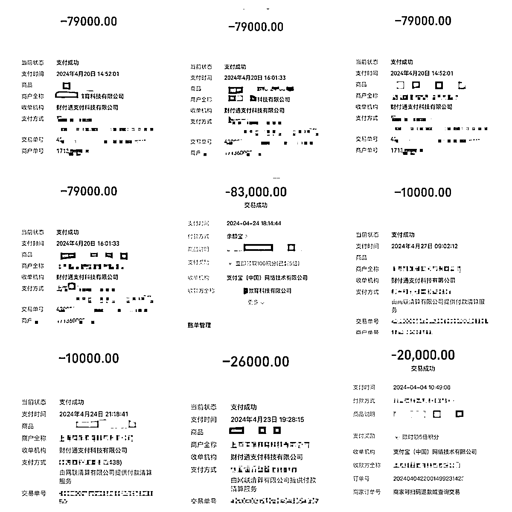

熟悉小红书的都知道，搞钱路径还是那套：起号、投流、加微信、成交。怎么起号，我之前写过两篇帖子，虽然平台玩法变得快，但底层逻辑没变。今天主要聊点新鲜的，全是实战干货。

一、海外游学赛道：闷声发财的蓝海

海外游学到底是什么？它不是单纯旅游，也不是纯粹留学，而是“游+学”。孩子们用1到4周时间，去国外上语言课、参观名校、住学校或寄宿家庭，再玩一圈当地著名景点。家长的目的很简单：要么给孩子留学探路，要么让孩子开眼界。

为什么我这么看好这赛道？三个原因。

市场正在爆发。疫情结束后，海外游学需求井喷，人数和市场规模都在快速恢复。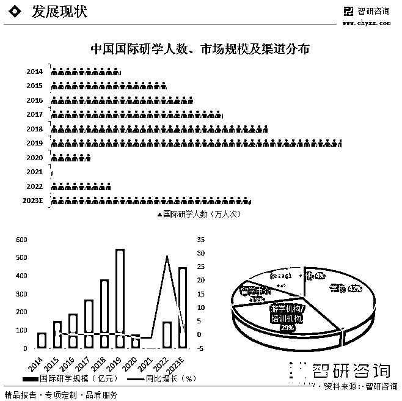

客单价高到离谱。数据显示，海外游学目的地以欧美为主，美国和英国最多，德国、加拿大、日本、澳洲也不少。每个学生一次游学平均消费3.5万元。愿意掏这钱的家庭，根本不比价，只问品质好不好，利润自然就高。

复购率高得吓人。普通旅游基本是一次性买卖，但游学不一样，老营员占比常常超过60%。有钱人的孩子每年寒暑假都要出去。我有个客户，去年暑假让孩子来新西兰游学，今年1月就已经在订7月美国游学的位子了。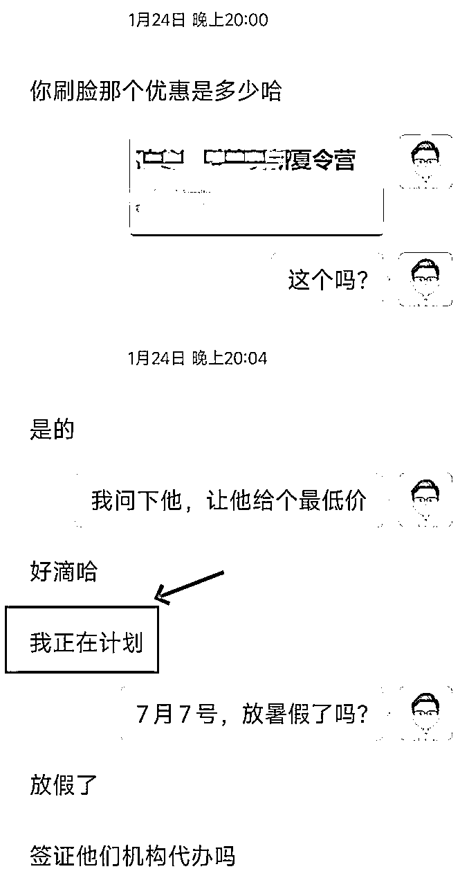

这赛道普通人能干吗？能，而且是蓝海。门槛低，不用旅行社经营许可证，注册个体户就能投流。因为做的人少，聚光获客成本也低。产品也好复制，游学的吃住学玩都是固定流程，我们做了销售SOP手册，新手团队一小时就能学完直接干。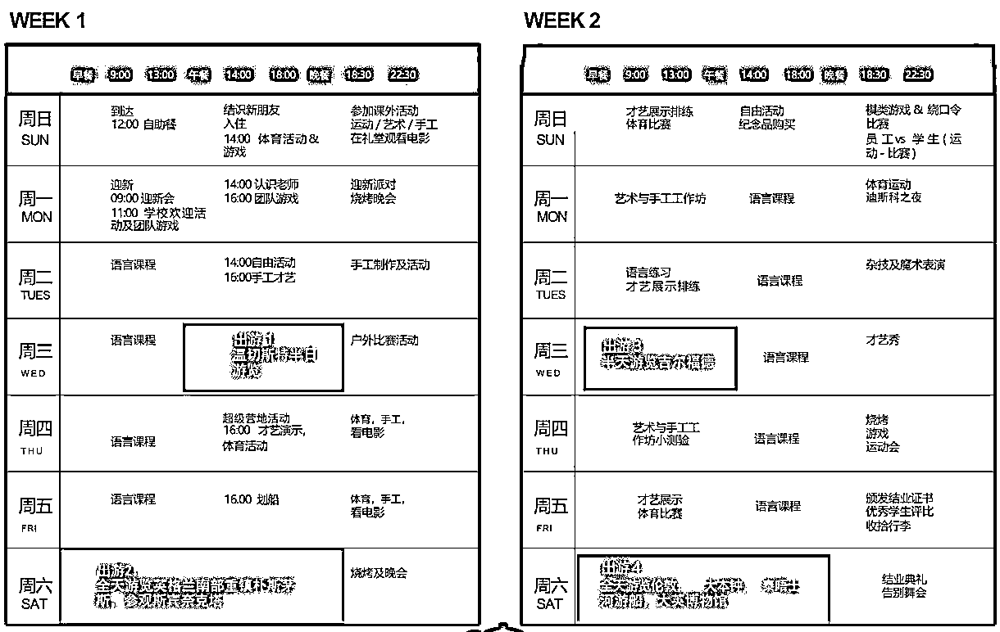 最关键的是佣金高，家长注重品质不压价，一单佣金过万很常见。哪怕你只负责推微信不管成交，单笔也能拿大几千提成。

二、蓝海赛道怎么找？

我去年7月开始做新西兰旅游，那时候就常有游客跟我说：刚带孩子参加完插班游学，再来报个旅游团。我马上调研，发现新西兰游学是个好赛道，但当时旅游业务刚起步，没精力搞。直到今年初，春节旅游旺季忙完，我才正式启动海外游学，带着团队同时做美国、英国和新西兰三个目的地。两个月的实战证明，这步棋走对了。

蓝海赛道好在哪？首先是风险小。雷军说过，创业就是要做风口上的猪，风来了猪都能飞起来。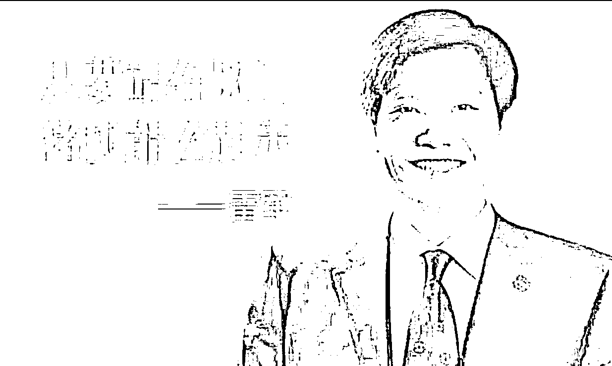 蓝海赛道客户多商家少，供不应求，就算你做得差也能赚到钱，稍微做好一点就能大赚。红海呢？商家全是修炼多年的老狐狸，新手赤手空拳对一群全副武装的人，怎么打？

第二是竞争小、利润高。行业早期都是暴利的，越早进越能吃到超额利润。等商家一多，就开始内卷。你看新西兰留学中介的利润变化：最早收中介费2万起步，加上学校返佣，利润是A+B；后来0中介费，只剩B；再后来有的中介连B都反一半给学生，变成0.5B。这就是卷的代价。早点进场，等别人卷的时候，你已经有壁垒了。

第三，稍微努力你就是第一。花爷说过，90%以上的小红书博主根本不懂怎么做小红书。蓝海赛道里，懂运营的高手更是凤毛麟角。你稍微用心一点，就能做成行业第一。有了第一的位子，客户和定价权都在你手里，赚钱不要太爽。

具体怎么找？拿美国游学举例。
第一步看数据。先打开巨量算数，美国游学搜索分很高，内容分很低，说明搜索的人多，做内容的人少。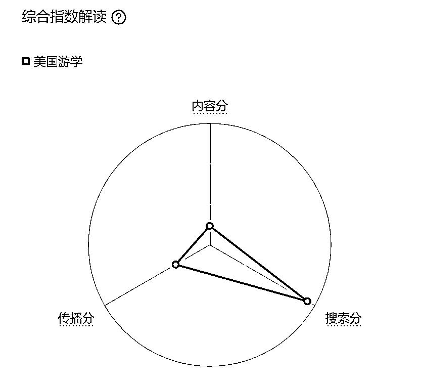 再看小红书聚光后台，搜索指数2227，有同行在买词，竞争指数高，说明市场能做。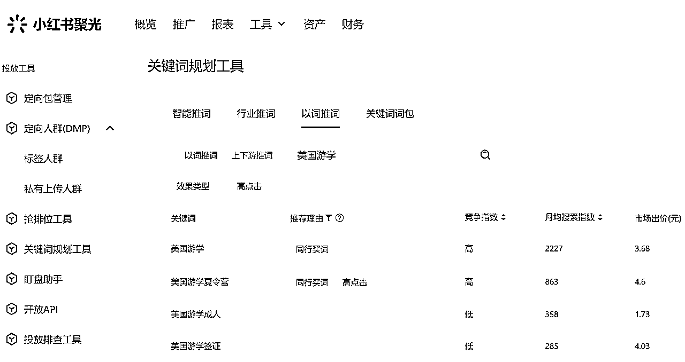
第二步分析同行。在小红书搜“美国游学”，搜索指数这么高，笔记居然才1万篇，妥妥的蓝海。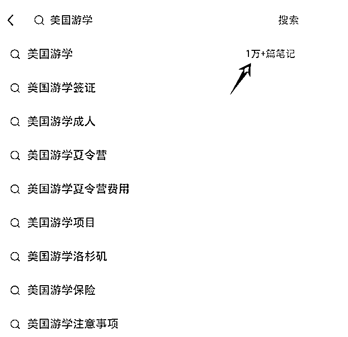 没概念？搜一下“美国旅游”，快100万篇了。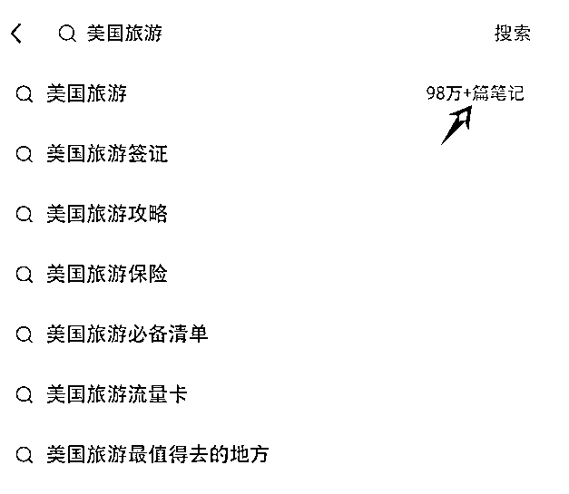 再翻最热的图文笔记，分析一下同行都在做什么。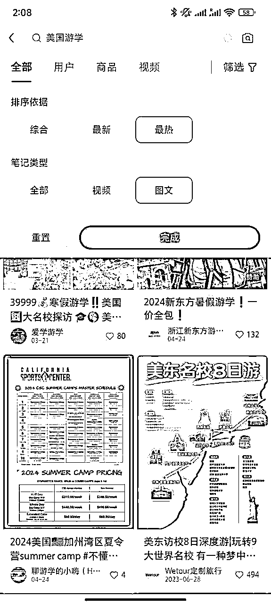 结果发现，做得好的只有EF和新东方两家，竞争小得可怜。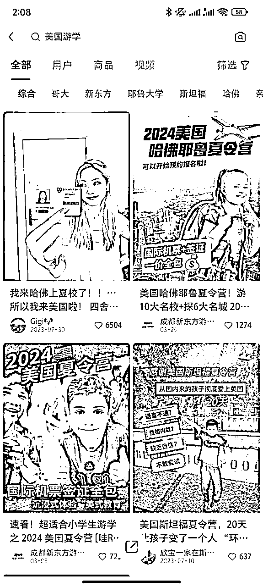 后来事实证明，我们发的第一篇笔记就爆了，微信加了几百人。

三、好产品怎么选？

找到赛道之后，选品决定生死。电商圈有句话：七分靠选品，三分靠运营。我做新西兰旅游时出单很多，选品好占了大半功劳。我合作的两家旅行社，一家是新西兰排名第一的华人旅行社，1998年成立，26年产品口碑；另一家在台湾定制游市场份额第一，跟很多综艺节目合作，客户体验极好。有了过硬的产品，出单就是顺手的事，老客户转介绍特别多，最狠的一个老客介绍了6单，哪怕我们5月涨价25%，人家还是选我们。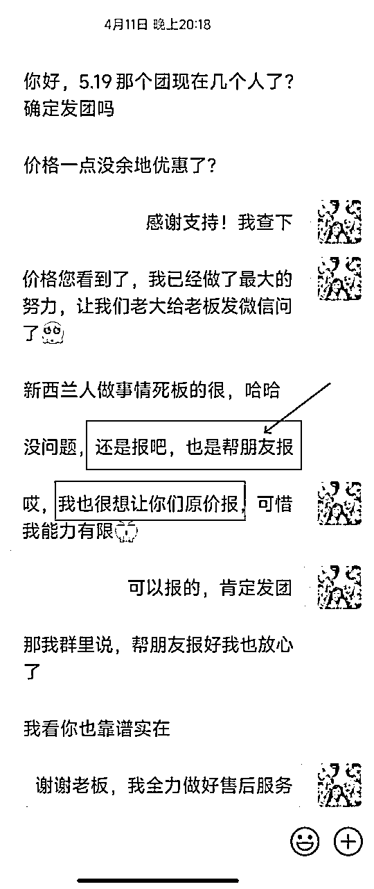

什么样的产品能成爆款？要顺着人性需求走。马斯洛需求层次摆在那里，越往上，客单价越高，商家的溢价权越强。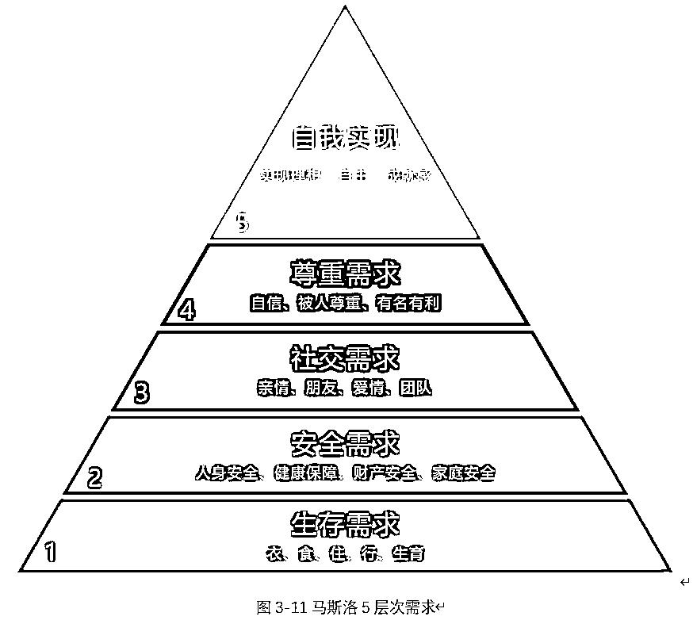 我们做美国游学时发现，很多家长送孩子去游学，真正目的是为将来读美国名校做准备，这属于“自我实现”层级的需求。美国本科四年400万起步，这种客户根本不看性价比，只看产品够不够独特。我们翻遍小红书的美国游学产品，发现全是标准化的“大路货”，没有一个让人眼前一亮。于是，我们跟美国本地供应商签了独家协议，专门定制了一款美国名校游产品，单价7万9。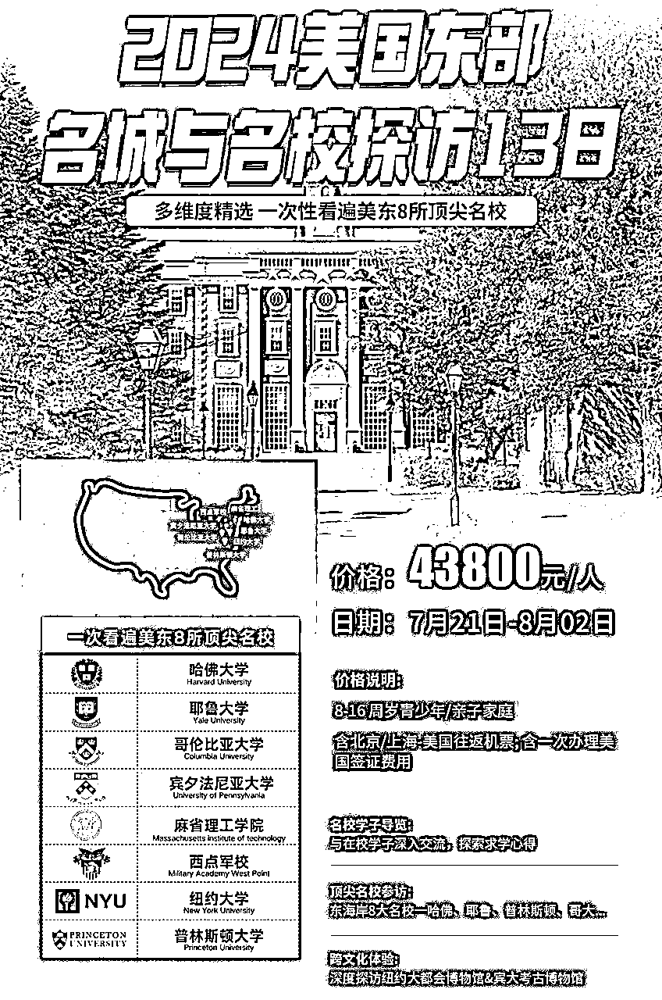 这个产品有多狠？吃住全在哈佛大学，每个学生配一个哈佛在读研究生当助教，同吃同住同学习，谷歌创始人亲自授课，哈佛教授带着做实习，还能全程参与NASA的科研项目。因为供应商手握独家资源，国内同行想模仿都模仿不来。当然，独家是有代价的——签了对赌协议，最少要报名20人，否则有很苛刻的惩罚。结果怎么样？我们很快就完成了20个名额。

新手选品要注意四件事。
一，别怕麻烦。刚入行不懂选品很正常，但要多去小红书、抖音、快手、天猫这些平台找产品，顺藤摸瓜找到商家，把产品拿到手研究分析。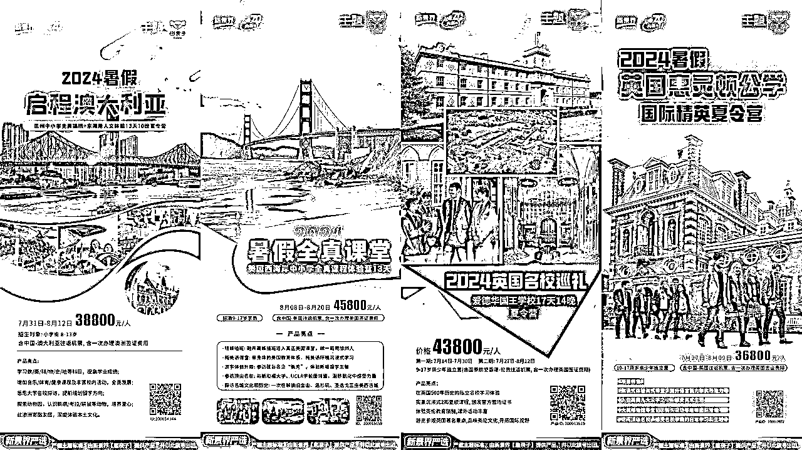 认真分析几十个产品，你就入门了。然后发笔记测试，测几次就能找到适合自己的。
二，用数据判断，别自嗨。你喜欢的客户不一定喜欢，要以数据为准。举个例子，你猜老外对中国的什么最感兴趣？武术、熊猫还是中餐？谷歌关键词工具显示，搜索“中国”排名前30的关键词里有28个是关于中国算命的。你是不是很意外？这就是数据告诉你的真实需求。
三，打爆单品，别做杂货铺。产品越细分，用户越精准。我们只关注“想去美国读名校”这一个群体，只推这一款产品，把每个环节做到极致，才能打爆。
四，别自己吓自己。怕高客单卖不动，怕低价不赚钱，怕热门竞争大，怕冷门没客户……这些恐惧都是想象出来的。前怕狼后怕虎，不如回去上班。创业就要狭路相逢勇者胜，淘宝那么难做，照样有人年年赚钱。

具体到海外游学选品，还有三条建议：一看学习和游玩的比例，1:1是比较合理的；二看价格，欧美游学3万到4万是底线，低于这个数服务必然缩水，比如美国14天游学，光机票就要8000到1万；三看机构专业程度，寄宿家庭有没有提前给信息，几个孩子住一起，每天怎么安排，这些细节都要抠。

四、小红书变了，怎么应对？

春节之后，我明显感觉到小红书变卷了。具体三个表现：
出爆款难了。以前做图文就是无脑模仿爆款，经常出2万小眼睛的笔记。现在呢？我发笔记经常只有几百小眼睛。因为平台上只要出一个爆款，一两个小时内就有一堆人模仿，最后就是大家一起不爆。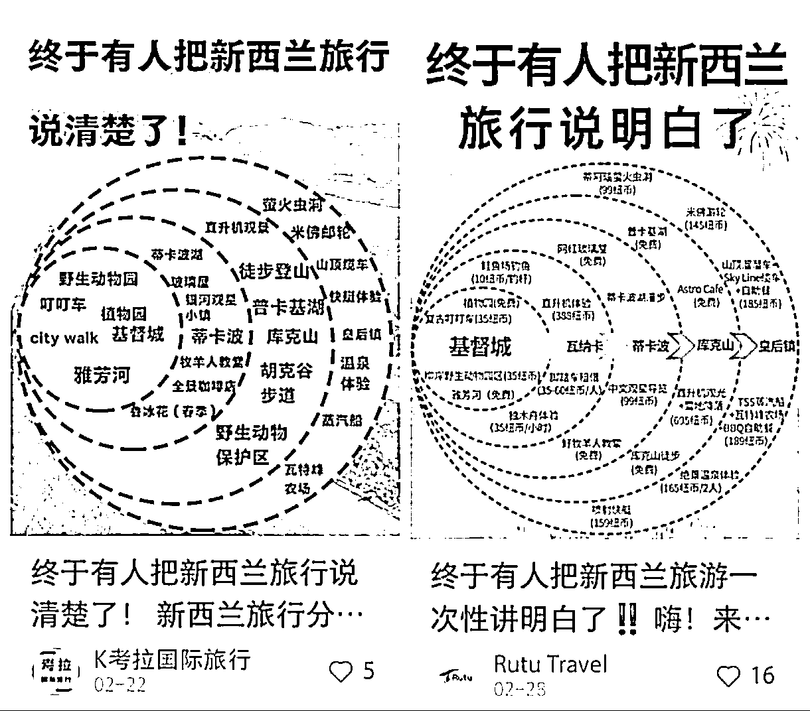

投流成本涨了。新西兰旅游加一个微信，去年最低8块钱，现在涨到45块，还在继续涨。

成单率降了。去年加10个微信能出1-2单，现在加20个微信都难成一单。小红书的推送机制是，客户点开一篇新西兰旅游笔记，平台就一直给他推同类型笔记。商家越来越多，产品都一样，只能拼价格。我们做品质游，价格没法拼。我问过小红书官方对接的人，说这是全平台普遍现象。花无百日红，所以遇到好项目，一定要及时All in！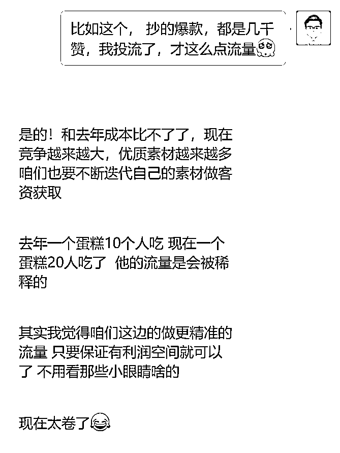

至于我们是怎么应对的，怎么继续稳定出单？篇幅原因，这篇文章写不下，后面单独写一篇。先关注，别错过。

五、高客单成交心法

加了微信只是开始，怎么把大几万、十几万的产品卖出去，才是真功夫。我做新西兰旅游时，私人定制产品客单价10万左右，去年7月到现在成交了50多单，最低7万，最高27万。海外游学产品最低4万，最高15万，其中卖得最好的是美国名校游7万9这款产品，每加13个微信就能成交1单。下面就拿它拆解高客单成交。

我们销售SOP的全程是：心态准备 → 通过好友 → 基本信息了解 → 语音沟通 → 面试 → 逼单 → 付款/淘汰 → 进入售后。

先说心态。卖高价产品最忌讳的就是自己先怂：“这么贵，卖得出去吗？”你必须对产品有绝对信心，我们卖的是稀缺品，供需极度不平衡，客户是哭着喊着求着要买。人性本质是“恃强凌弱”，谈判中心理位势决定胜负。你越怕丢单，越唯唯诺诺，客户越不把你当回事。反过来，你要全程控场，成为对话的主导者。就像追女孩，高价产品的目标客户是女神，女神不缺跪舔的人。你自降身段，只能沦为舔狗。展示你的高价值，让她来追你，反而容易成。

再说语音沟通。加了微信，做了基本沟通，一定要马上约语音。这是我们做旅游得到的铁律。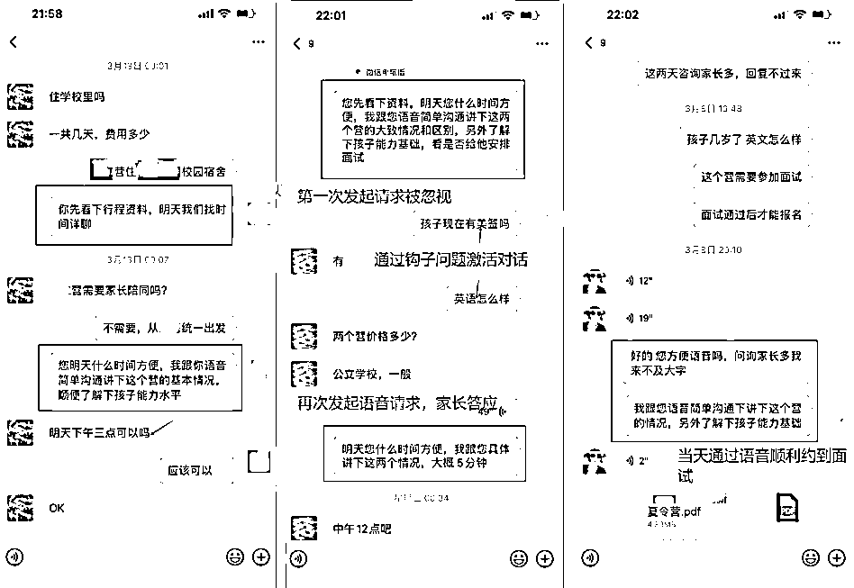 为什么？
第一，客户此刻最主动。资料发完后，客户会开始提问：价格、时长、机构资质、营期、是否全是中国孩子、英语要什么水平……这个阶段是客户最想解决问题的时候，他对你有需求，你必须抓住这个窗口，建立主导角色。一旦错过，后面就被动了。
第二，掌握主动权。很多卖点和情况不是三言两语能说清的。你如果一直用文字回答，就得打一大段，占满整个屏幕，看起来是你特别急、特别主动，心理位势一下就低了，后面谈判很难翻盘。语音沟通，节奏在你手里。

好，以上就是这次实战拆解的全部内容。最后想跟新人说一句：海外游学产品利润高，新手完全可以先从推微信赚佣金开始，哪怕不管成交，一单也有大几千提成，跑通流程后再做深。机会属于先动手的人，别等了。

###### 5.2.3 原因三：能实现实时互动影响

文字聊天本质上是单向投递，消息发出后就失控了。客户看不看、回不回，全凭他心情。你发完一条长文，对方可能在刷视频，半天不吱声，你只能干着急：明明聊得不错，怎么忽然冷场了？

这种模式下很难去影响决策，尤其是客单价高、非刚需的品类，推不动。

切换成语音就不一样了。语音是同步在线的，客户听的时候无法分心，必须集中注意力跟你交流。你能立刻捕捉到他的语气、停顿和反应，当场调整话术去引导和影响。

###### 5.2.4 原因四：能快速建立人味信任

纯文字是冰冷的。语音条多了，很多人直接懒得点开，干脆划走。活生生的声音、语气、停顿，才让人感受到对面是一个真人。正是这种真实感，能让客户对你降低防备，建立起第一层基本信任。

#### 5.3 面试机制

语音沟通顺畅后，我们不会直接报价成交，而是让客户填写资料预约一次面试。面试通过，才有资格购买。是的，客户想买，我们也不一定卖。

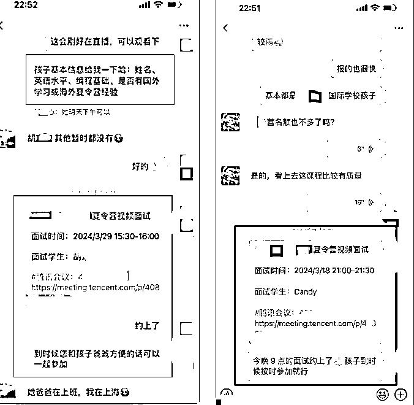

安排面试的核心目的有三点：

###### 5.2.1 目的一：筛掉低意向

连表都不愿意填、约不到时间的客户，意向本身就不够。客单价摆在这里，意向不足根本谈不出结果。与其耗时间，不如早点放弃。

###### 5.2.2 目的二：拔高门槛

我们的产品是稀缺型的，有明确标准，只对标客户才能交付。必须面试通过，才能进入游学名额。

越是难得到的，才越被珍惜。我们实操证明，加了面试环节，成交率明显提升。

最好的参照就是劳斯莱斯。

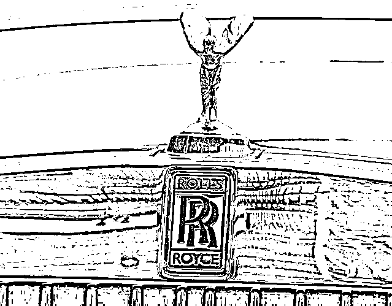

想买劳斯莱斯，并不是有钱就能买。早期甚至规定只有贵族才能拥有。如今依然分层审核：第一梯队“银灵”面向国家顶级人群，如元首、政要、王室。第二梯队“银羽”面向国家支柱型精英，如影响力企业家、知名人士。第三梯队“银影”则要求有购买力且背景干净、无不良记录。

正因为设立了门槛，劳斯莱斯才成了身份的象征。

###### 5.2.3 目的三：促成环节

面试本身就是一次高强度的临门一脚。开着摄像头，彼此能看到表情，家长的信任感会骤升，仪式感也拉满。信任上来，成交概率自然水涨船高。

#### 5.4 逼单窗口

面试结束后，必须在30分钟内发出面试反馈。刚结束的那一刻，是家长体验最鲜明、情绪最高点。趁热打铁才有效，拖到第二天，感受就淡了，追单成功率会断崖式下跌，这是用血泪换来的经验。

反馈内容通常是“已通过”，告知可以直接报名，并立刻询问家长倾向哪个营期。表面是选营期，实际是在做意向确认。

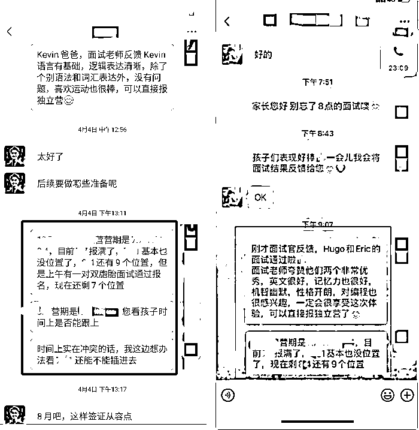

意向强的家长会直接报出营期名称，意向弱的会说再考虑一下。后续策略要分情况：

1、已确认营期的，直接引导进入支付流程。
2、说再考虑的，第二天再跟进一次逼单。但实话说，大部分这类客户会在巅峰体验后反应平平，后续很难再转化。

#### 5.5 付款与淘汰

付款前，几乎所有客户都会进入质疑期，很少有人一遍没问就直接打款。问得少的，会挑几个关键点；问得多的，会反复确认细节。

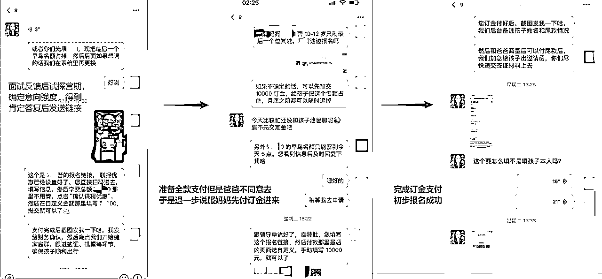

这是正常心理，尤其线上成交，不在各种细节上“找茬”，心里很难踏实。我自己买几百块东西，也会抓着客服问半天能不能退、坏了怎么换。只要开始揪细节，就说明他已经在心里做好购买了，只是在等一个能让他安心的回答。

换个思路，客户的“变脸”其实是决策期的信号，说明他在认真评估。要抓住这个关键时刻快速响应，给他推一把。

如果客户特别纠结，可以给一个缓冲方案：名额紧张，先付1万元定金锁定席位，保留到X月X日前可无理由退款。先降低决策压力把人收进来，尾款后面用理由继续敦促。

对于最终没付款的客户，做好标签归档，系统分类，下个游学季再激活。

#### 5.6 节奏控制

从加微信到成交，全流程的节奏感决定成败。标准路径是：通过好友—>信息摸底—>语音沟通—>面试—>逼单—>付款/淘汰—>售后。单客周期必须压在2-4天内，不算面试预约等待时间。

超过4天，客户基本两种结果：要么已付款等待服务，要么彻底冷却进入淘汰池。超过这个时间再捡，费力又无效。节奏拖沓，流失是必然。

同时全程要营造紧迫氛围：营期将满、面试名额有限、临时保留名额仅24/48小时有效。把客户带进你的节奏里。

篇幅有限，海外游学高客单成交SOP就到这里。有需要的圈友可以私聊交流。

## 六、新人如何切入？

#### 6.1 先把小红书玩明白

小红书听起来门槛低，做起来极卷。平台玩法每两个月就变一次，过去有效的套路现在可能直接失效。我们一直聚焦小红书，也在持续更新爆款笔记方法论。想稳定拿流量，必须紧跟最新打法。

#### 6.2 企业号认证+投流起量

小红书的旅游类目对企业资质要求很高，但海外游学相对容易进场。花几十块注册一个个体户，经营范围带上“自费出国留学中介服务”即可。

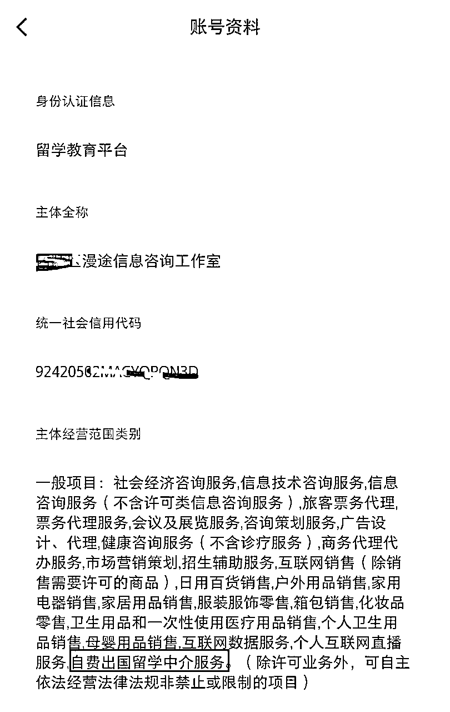

企业号认证完成后就开始投流。现阶段聚光投流门槛很低，每月最低1000元消费就能带微信。对比游学动辄上万的利润，这点成本完全可以忽略。

#### 6.3 供应商选择是生死线

项目成败，70%看供应商。

原因有三：

###### 6.2.1 产品是否够独特

现在做游学的人太多了，产品同质化严重。没有差异化，根本卖不动。选择在目的地本地的一手供应商，优势非常明显。我们的美、英、新游学，都是跟当地大供应商深度共建，全程参与产品设计。这样产品独家，不易被复制。

###### 6.2.2 孩子安全风险

带的是孩子，家长容错率为零。供应商经验不足导致生病、意外，销售方要背连带责任。

###### 6.2.3 交付质量与佣金

游学交付变量太多。引用坤哥一句话：钱到手不一定是你的，完美交付才能落袋。本地一手供应商交付更稳，佣金也更高。国内转手供应商，佣金被层层吃掉。

当然新手首要目标是跑通。国内靠谱旅行社的游学产品，哪怕佣金低、特色弱，先上手跑通流程。完成永远比完美重要100倍。

#### 6.4 老客维护与裂变

海外游学复购率很高，做好服务一个客户一年能赚好几万。寒暑假持续复购。

裂变也很简单，客户的同学圈就是你的精准池。有老客户背书，成交阻力会大幅下降。

今天的分享就到这，希望对想做海外游学的朋友有帮助。欢迎感兴趣的圈友一起交流，共赢。