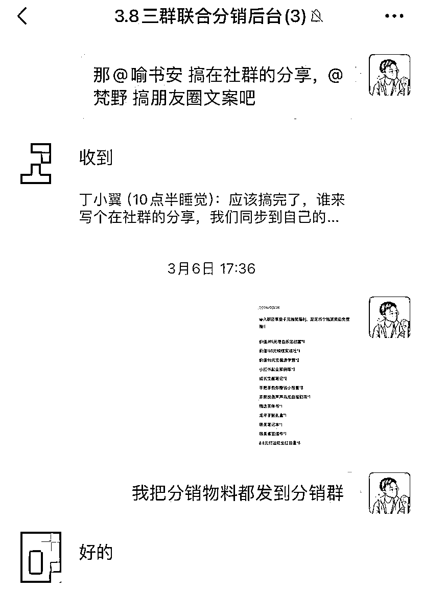
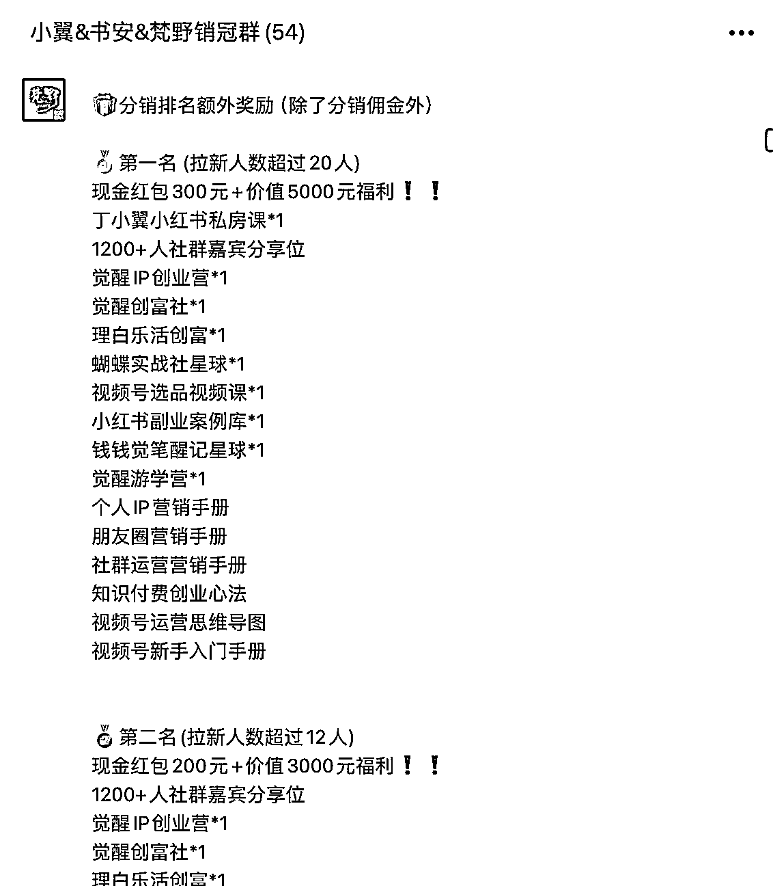
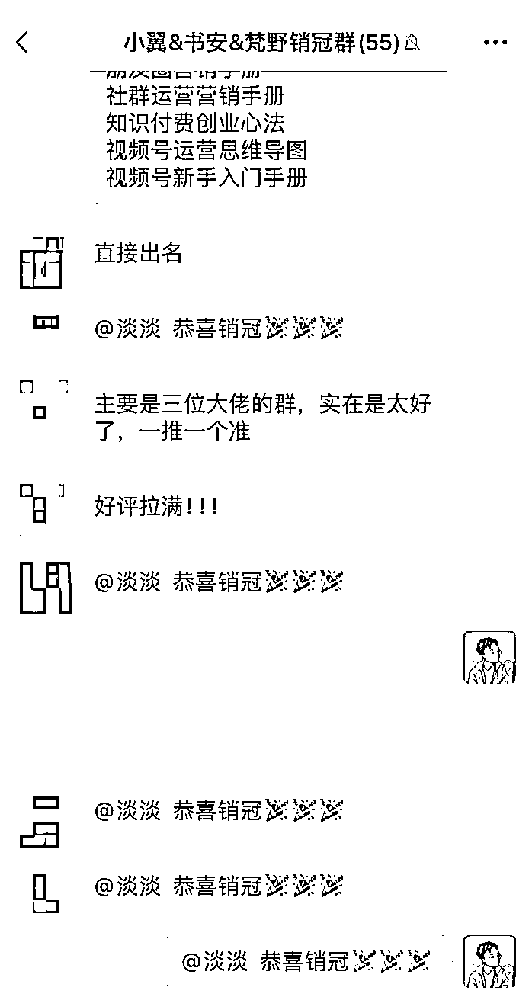
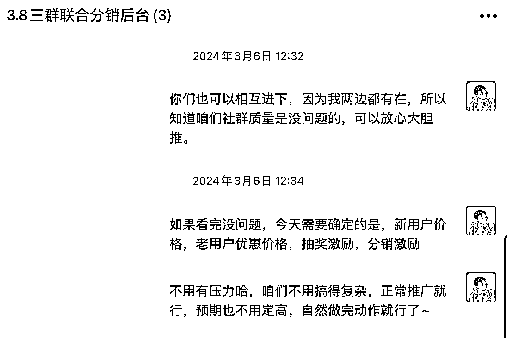
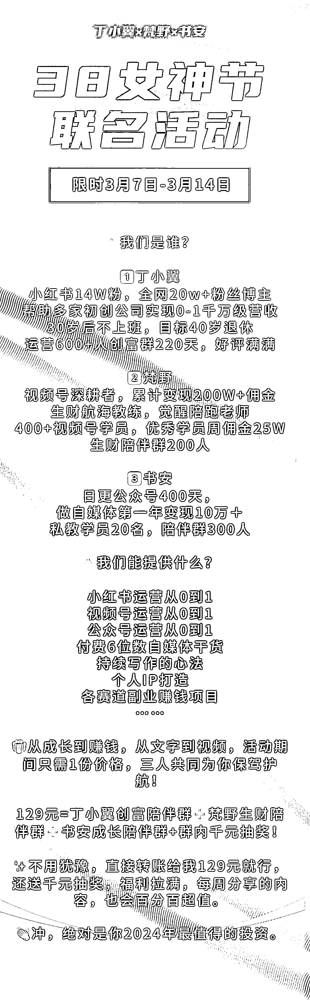
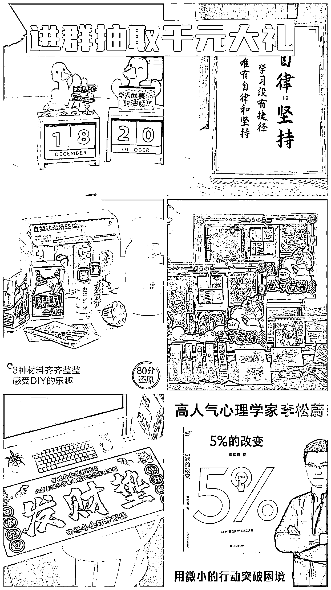
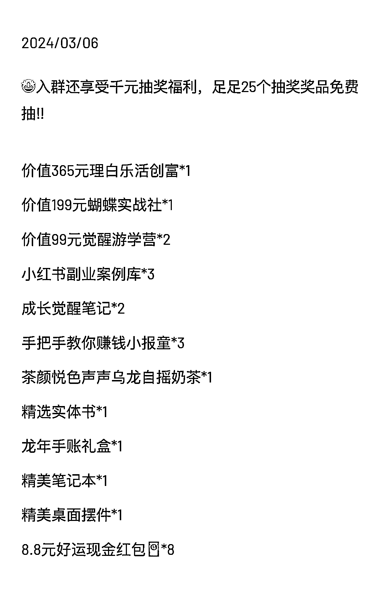
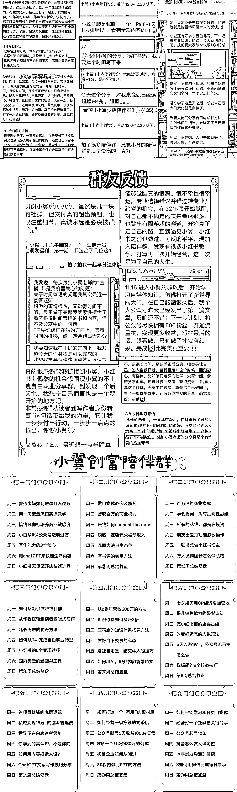

# 三个陪伴群联动发售，7 天做到 4 万+ GMV，私域小白是怎么打赢这场女神节战役的？

## 女神节联名限时发售，7 天 GMV 破 4 万+，我们到底做对了什么？

作者：丁小翼
日期：2024-06-19

大家好，我是小翼。上次我们 3 个群搞了一波女神节联名售卖，复盘数据是这样的：

**3 个陪伴群一起做拉新，GMV 最终冲破 4 万，平均每群净增 300+ 人，目标完成度超过了 6 倍。**

把这次实操的思路拆开来看，基本可以归为 4 条做对了的事。下面是我的一手复盘，文末有完整物料包可以参考，拿去用了记得回个感谢就好。

## 1、起盘的关键：抱团借势，别单打独斗

这次说实话有点被动。3 月 6 号我看到梵野姐的群在准备分销方案，3 月 8 号就是女神节，我 3 月 9 号就要出发去旅行。时间窗口只剩两天，但正好之前见过类似打法案例，觉得值得一试，于是直接发出邀约，梵野和书安很快就点了头。

选人的逻辑，其实就两点：

第一，价值观要对得上。能看出来对方长期在讲什么、发什么朋友圈，平时不做输出，别人根本不知道你是什么样的人。

第二，人设和渠道要互补。我们三个人，📕、视频号、👸号分别有积累，流量池也基本不重叠。能力叠加起来，覆盖面就宽了，对用户也更划算。

除了抱团，这次还蹭到了三层势能。

节日势能是其一。女神节这种固定节点完全可以提前备货，节日做优惠用户不会觉得廉价，反而更买账。做内容也一样，蹭节日热点比日常发的效果要高一个量级。

个人势能是其二。三个人的私域一起宣传，不是 1+1+1，而是大于 3。自己一个人喊，声量肯定没这么大。

圈层势能是其三。活动第一天我们就去合伙人圈子里报进度，而不是等收官再晒。等于把活动实时曝光出去。圈子里信任成本很低，资源对换、借势破圈很容易，就把学费赚回来了。这是我目前最认可的小 IP 发展路径。

以前我挺排斥“抱团”这个词，觉得自己能力够全，不需要组局。后来明白，自媒体本质是放大器。个人时间、精力、流量都有天花板。今年的变现逻辑就是破圈+组队。付费社群不只是让大家来学习的，也是用来找信息差、找队友的。只有把资源动起来，才不是单向学习。

## 2、操盘的关键：分工清晰、执行到位、随时调参

多个人合作，就得有人牵头。这次两位信任我，我来整体负责。但我们是第一次合作，梵野和书安在私域活动上也基本算新手。

我的分工原则很简单：不会的我来，擅长的交给对方。

最重要的宣传物料，社群文案交给写作感强的书安，朋友圈分销文案交给已经研究过案例的梵野，我自己负责最后的排版设计。因为时间太紧没外包，完工比完美重要。

分工一明确，推进速度很快，半天内物料全部就位。

活动期间的即时调整更重要。过程中总会冒意外：首个分销群被举报解散了，小白第一次出单怎么激励，分销价被乱压怎么办，怎么保证公平等等。我都会立刻在内部群同步，马上改策略。我们三人的判断很快能达成一致，这也得益于前期选人的准确。

特别感谢两位给我发挥管理价值的空间。书安还问我是不是有带过团队。

我觉得管理最核心的点是：让每个人都觉得这件事重要，用好长处，给合适的事。

自己必须冲在前面，用户可能看不到你，但团队必须时刻感受到你在推进——完成了什么、剩下什么、谁来跟进。这样节奏才不会散。

我们三个人都是典型的 I 人。一次实战比任何破冰都有效，打赢了胜仗就是最好的团建。

有人问我，小白怎么去找大佬合作。我觉得“三个臭皮匠顶个诸葛亮”，小白+小白+小白也能大于一个大 IP。关键是找对人，放下流量大小的心结。我选书安和梵野，看重的是靠谱和可配合，这次只是个起点，成败都是经验。

## 3、分销的关键：利他设计，大方分钱

拉新活动里，分销占比最好在 50% 以上。我们这次刚好 50%，也是主要增长点。

想让 KOL 愿意推，也要让第一次参与的小白能赚钱，我们的激励是这样做的：

1. 佣金调到 80%，一单到手 103 元。
3. 再叠加阶梯激励，额外准备了万元福利池和奖金。
5. 我们知道 KOL 除了钱更看重曝光，额外给了 5 个群的嘉宾分享位，这是他们最稀缺的资源。
7. 同时允许 KOL 把自己的陪伴群产品一起带上，和我们联合曝光。

所有分账都是即时到账。不藏着流量也不抠着钱，才是长期合作的基础。

邀约我是一条条手写去谈的，真诚比模板有用。最终有 80 个 KOL 加入分销，整理后剩下 50 多个活跃，前三名就贡献了上百单。

被拒也是常态，但被拒也是曝光。对方可能手头有别的安排，不代表下次不能合作。至少这次接触建立了认知，后续遇到相关需求会想起你。

自媒体人不要怕尴尬，线上变现和线下性格无关。

价格上我们也兼顾了老粉感受。原来我的群年费 119 元最高，这次三群联售统一定价 129 元，老用户只需补差价即可入另外两群。

## 4、心态的关键：先降预期，再谈交付

这点听起来虚，实则决定成败。

1、开局我们把目标压得很低，平均每群只定 50 人新增。50 人是我觉得靠自然动作就能做到的保底，达成后团队就有信心。

第一天上午我们没动员 KOL，先看自然流量能到多少。结果当晚就达成了。势能起来后，再去邀约 KOL 推，成功率更高。后面目标被大幅超出后，我们反而要收一下节奏，防止社群被低价倾销。

2、拉新只是开始，交付才是生意。三个人的共识都是：人数增长是好事，但能不能留住合适的人，更看后续内容和运营。

营销是入口，交付是续航。一个社群不可能满足所有人，筛选和服务才是长线。

### 最后附上全套活动物料给大家参考，有用就点个赞，后续我会继续出复盘。

再次感谢@梵野@书安 的背靠背配合，中间我还去旅行了，大家互相补位配合得非常好。希望未来能和更多伙伴组队破圈，做更大的联盟。

* * *

评论区：

WU casa（吴雪* : 又是精华贴预定了，太棒了🌟有可能做资源链接吗？有水果资源，想做海南青椰。不知道对你们的群体有吸引了吗？

丁小翼 : 欢迎交流呀

WU casa（吴雪* : 可以的话➕B18835932615

* * *