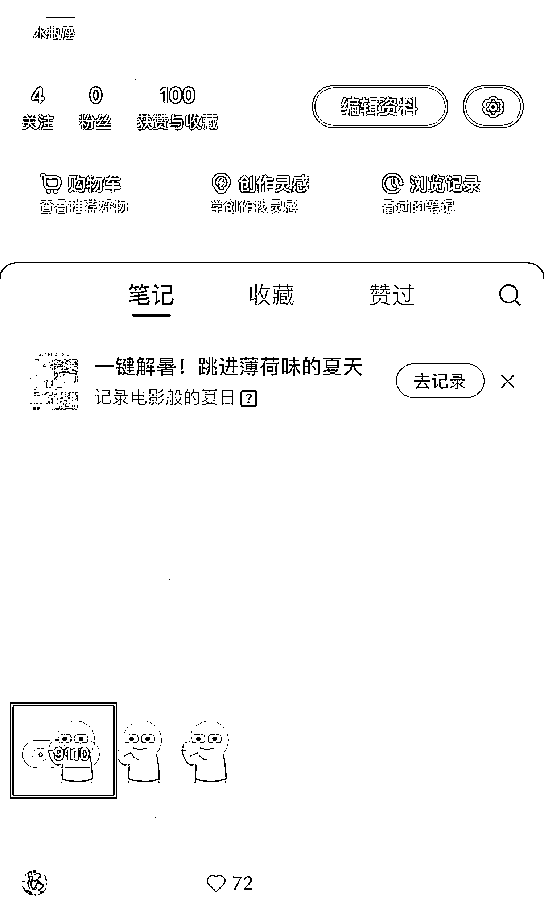
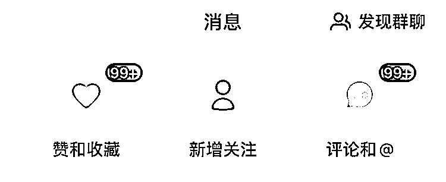
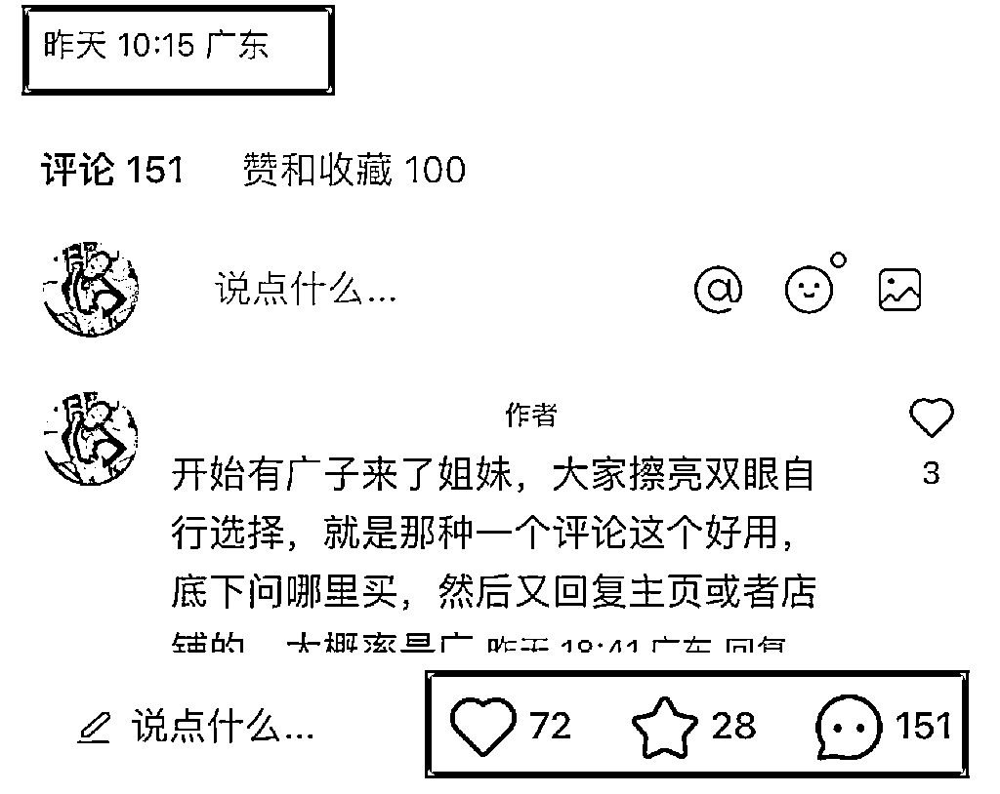

# 新号冷启动实战：📕首篇笔记如何直接破 99+❤️
作者：龙哥

## 实操经验：📕新号如何第一篇笔记就出 99+❤️

作者： 加麻

日期：2024-06-18

新账号第一条图文隔一天就破了上万曝光，点赞评论双双卡 99+，而且评论量反超点赞，先上数据截图：

对于新号来说，首篇不一定非要大爆，但如果能在起号初期、甚至第一篇就拿到小爆，对账号的成长节奏和项目推进都是加分的。好处大概有三点：

1、拿到正反馈，信心和执行力会立刻起来；
2、让系统快速判定账号垂类标签；
3、养号期结束，直接进入内容产出正循环。

但要提醒一点，盲目追热点流量是坑。泛娱乐、明星八卦这类流量虽然大，却很难承接变现，还会稀释账号垂类。所以别看到有热度就发，非自己能变现的赛道坚决不碰。

先明确我们该发的方向：

行业细分赛道 or 行业大盘类目

以美妆项目举例，细分关键词可以拆成这几类：

场景类：夏天粉底液
功效类：粉底液推荐遮瑕持久不脱妆
人群类：敏感肌粉底液/孕妇可用粉底液

大盘类目则更宽：

产品类：粉底液
品类类：粉底液小样

关键词怎么拆更细，可以参考我之前写的《📕不同搜索词解析》。

选定关键词后，关键是怎么做才能让数据起来。

📕的综合评价分大致是：点赞 1 分 + 收藏 1 分 + 评论 4 分 + 转发 4 分 + 关注 8 分。可以看到点赞收藏的权重偏低，评论、转发、关注才是重头戏。对以带货为目的的号来说，排序是 评论数 > 转发数 > 关注数。关注和转发很难主动控制，所以我们要把重点放在制造高互动的笔记上。

怎么做高互动？核心逻辑就两条：

1、内容预埋互动点。在标题和封面上直接抛问题、发起投票、表达争议观点或蹭产品热点，引导用户出来分享经验和看法。
2、主动运营评论区。第一时间回复用户评论，既是做服务，也是把自己的回复算进互动分里。

搞懂逻辑后，说说新号首篇要 99+ 的具体打法：

1、养号期。新号注册后先养 2-3 天，期间不发内容不做三件套，只用行业大类或细分关键词去搜同行笔记，点赞收藏评论，让系统逐渐把你推给垂直人群。

2、内容设计要设问。看似随手一问，其实都是算好的。围绕行业关键词设计用户能接话的问题，比如美妆赛道：

①粉底液和气垫到底怎么选？标题就放这个点，内容里写自己纠结求解答
②刚上完妆不到一小时就融了，怎么让底妆更服帖？
③真的存在好用的橄榄皮粉底液吗？求安利

3、发布执行。先去扒同行互动高的笔记结构，再把行业关键词植入到标题和封面。常见的高互动结构有新手提问、使用困惑、求推荐等。养号到位后对标同行，数据基本不会差。唯一要避坑的是首篇别发吐槽类，很容易被判定为负面内容直接限流，这是血的教训。

希望这套起号思路能帮到你。

* * *

评论区：

暂无评论

* * *