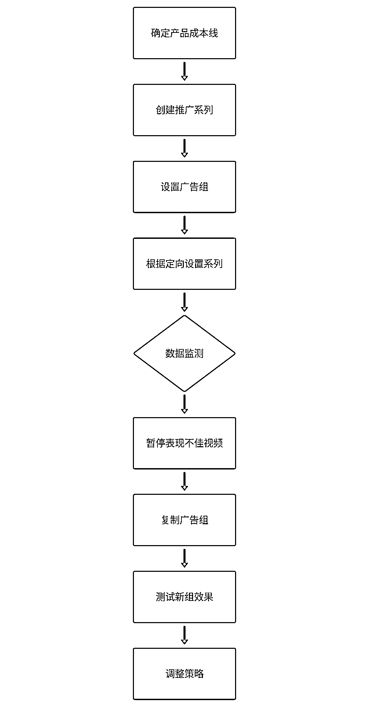
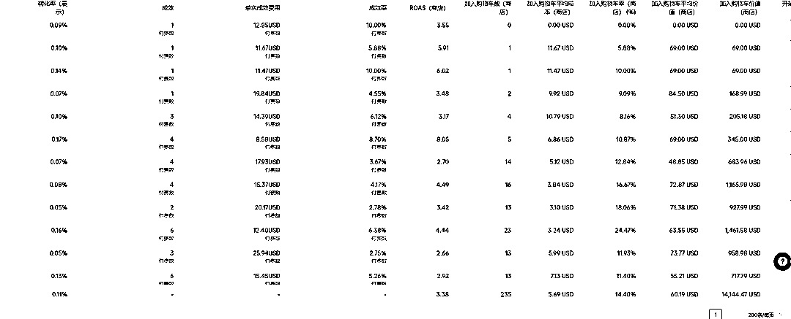

TikTok 小店投流，新手应该先搞懂这套逻辑
——来自 Pipiads 投流教程的优化整理

很多刚开始做 TikTok 小店的卖家，面对广告后台总是一头雾水：账户怎么建、出价给多少、素材放几条、数据从哪里看？这篇不教你花式操作，只把最核心的测品和扩量思路讲透。内容源自 Pipiads 数据网站的投流分享，我重新整理了一遍，更适合新手阅读。

**先搞清楚：为什么要测品？**

测品不是“烧钱听响”，而是用最小成本验证市场反应。你选的品、拍的素材、装修的店铺，到底能不能卖？投一笔小预算，让数据反馈答案。跑通了就放大，跑不通就及时换方向。这就是测品的核心。

**测品时广告结构怎么搭？**

新手别一上来就铺很多账户。用 1～2 个投放账户，每个账户里建 5 个广告组，每组放 3～10 条素材。初期用系统自动投放，5 个组里面安排 3 个通投、2 个不同兴趣定向，跑出数据后再调整出价方式。整个过程就是不停地观察、关停、复制，把有潜力的组慢慢养起来。

可以参考这个广告系列结构：
- 系列1：通投、通投、兴趣1、兴趣2、兴趣3
- 系列2：通投、兴趣1、兴趣2

多账户、多素材、多广告组，本质上是为了扩大测试面，让市场来投票。出价策略上，手动出价和自动出价可以结合。用阶梯出价法，从 5 美元起步，最高测到 20 美元，每次上下调整 1～2 美元，找到合理的出价区间。

预算怎么给？记住两条：
- 广告预算至少预留产品利润的 50%；
- 加预算时，直接加到出价的 20 倍以上；复制出来的新组，统一给 20 美元预算，继续复制。

**数据指标和优化方向**

盯紧五个指标：CPM、CPC、CTR、加购率、出单率。

- CTR 高于 2%，说明素材吸引力在线。
- 点击率高但没人加购，重点去看素材和落地页的匹配度，以及人群定向是不是精准。
- 加购多却不出单，就要检查定价、运费、优惠玩法，还有落地页的信任度。

参考目标值：CPM 控制在 10～20 美元，CPC 在 0.2～0.8 美元，CTR 大于 2%，加购率大于 5%，出单率大于 1%。

遇到问题也照方抓药：
- CPM 太高：大盘环境影响或定向太窄；如果 ROAS 还不错，CPM 高一点也能接受，说明人群足够精准；一旦 ROAS 下滑，就换素材或换产品。
- CPC 太高：尝试优化视频素材，把营销卖点讲得更清楚。
- CTR 太低：创意本身不够抓人，重新打磨素材。
- 加购多不支付：优化落地页，检查支付通道是否顺畅。

**两种投放方式，按需选择**

第一种：先算清楚产品的成本和盈亏线，确保投出去不亏。然后为每个产品建单独的推广系列，按不同定向配上对应兴趣和素材。跑起来后，表现差的视频果断暂停，表现好的保留并缓慢加预算。同时复制多条相同广告组，持续验证。旧系列快掉量时，提前复制新系列补上，避免投放断档。

提价时要控制速度，不要一下翻倍，每次增加 20%～30% 比较稳。复制广告组时，保持每次 5～10 组，其中大部分（约 80%）最终都会被关掉，留下的才是优质组。

第二种：用系统自动出价来跑视频创意。视频创意不变，按不同定向建系列，让系统自己出价。这种方式主要是测试产品的大概转化成本，帮助确定出价区间。后续复制组的操作和第一种相同。

**定向和素材的进阶建议**

定向太窄，计划很难跑量；定向太宽，人群不精准。一个计划如果跑量不错，你想收紧定向，别直接改原计划，先复制一份再调整。

新计划完全不消耗，最直接的办法就是换素材。素材创作要保持节奏，每天有不同类型的内容上新，同时复盘老素材的数据，找出优化方向。素材质量可以看三个数据：3 秒播放率、点击率、转化率。

**实操中的扩量方法和案例**

现在 TikTok 的系统越来越完善，投放操作也越来越简单。扩量方式就两种：复制组和加预算，两者可以同步进行。很多卖家纠结：是用品牌式投法（建 5 个组，一直加预算，让系统自己找人群），还是复制组手动去撞人？直接说结论：都可以，各有优点。如果想省钱，前期测品阶段更推荐用复制组的方式去手动撞人群。

下面用一个客单价 70 美元的产品案例来拆解测品期怎么做。背景是：新店铺、细分类目、没建联达人，正常 ROAS 在 5 以上。准备期混剪了 5～10 条素材，用混剪素材来拉动店铺动销。因为产品之前经历过店铺被封，团队对出价范围和素材方向已经有了底，所以直接做了三类素材：达人讲解、开箱展示、使用场景。这三类混剪组合几乎可以当成爆款模板，也适用于大多数产品——讲解 + 测评 + 使用场景。

跑法走复制组。素材之间差异很明显，组与组的数据差异也会很明显。数据差的组关掉，数据好的组保留，缓慢加预算，同时再复制新的组，反复筛选出优质组。

筛选标准仅供参考：
- 刚起量时先看 CPM，异常就直接关；
- 预算 1 美元以内有点击时，点击率低于 1.5% 关掉；
- 消耗到 2～5 美元时，观察总花费是否落在 10%～20% 的区间内；
- 有加购但不出单，花费到 30% 关掉；
- 有出单且 ROAS 高于 3，复制广告组并加预算。

记住这个漏斗优先级：出单 > 加购 > CTR。最终还是要看总 ROAS。素材迭代也不能停，多类型测试、高光帧测试都要做，具体案例具体分析。

**最后想说**

投放没有绝对公式，也不是只有一种正确跑法。与其纠结投法，不如把时间和精力放回素材创意上。这篇是新手扫盲篇，希望帮你减少一点迷茫。

另外，Pipiads 作为专业 TikTok 广告数据分析及选品平台，拥有目前市面上最全的投流数据，可以多用来参考。

有读者在评论区问过：“关于 CPC 高时要改视频并加强营销卖点这句，是不是原文有错字？”这里统一回复：这句话确实容易让人困惑，大家按“优化视频内容和营销话术”来理解就好。

