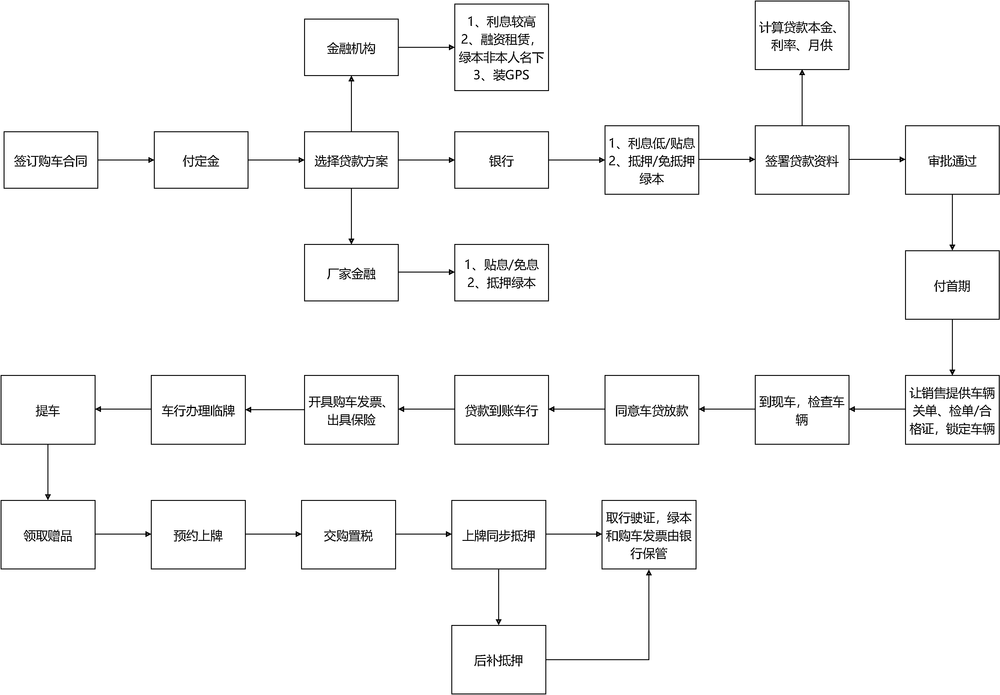
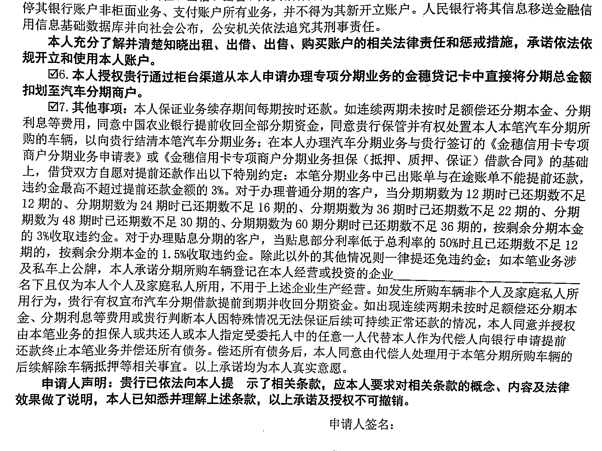
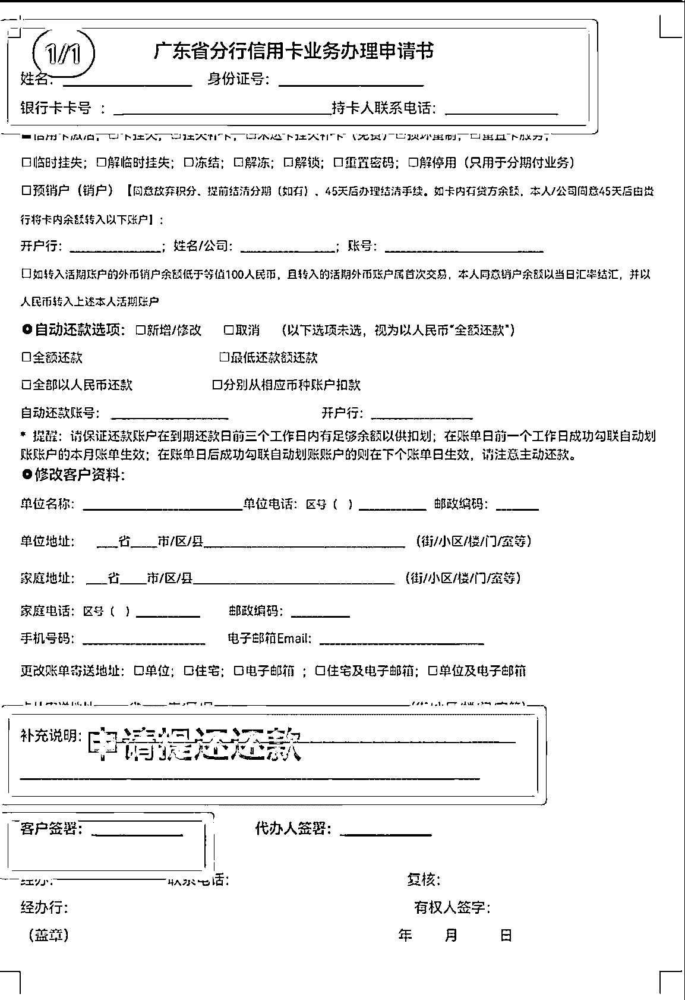
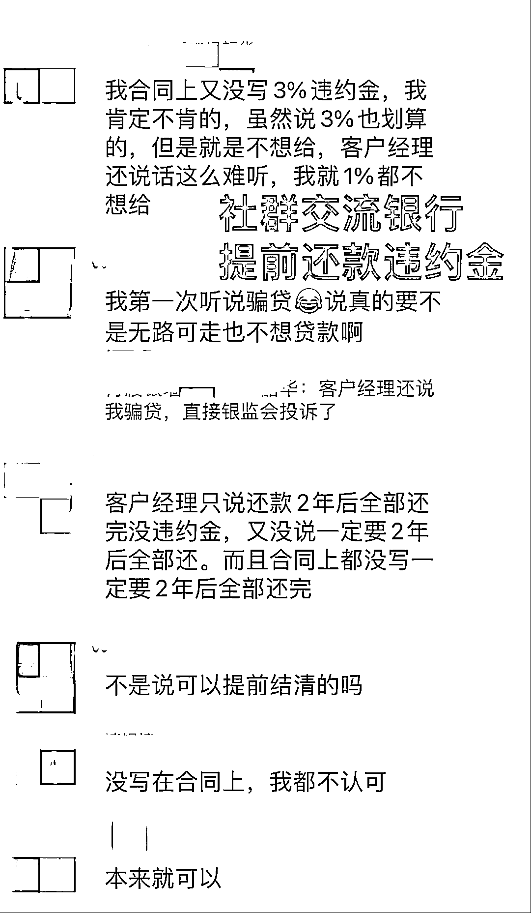
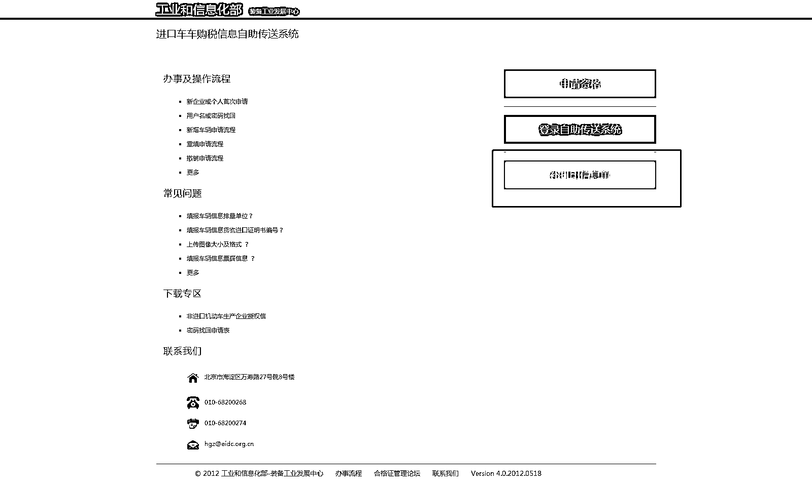
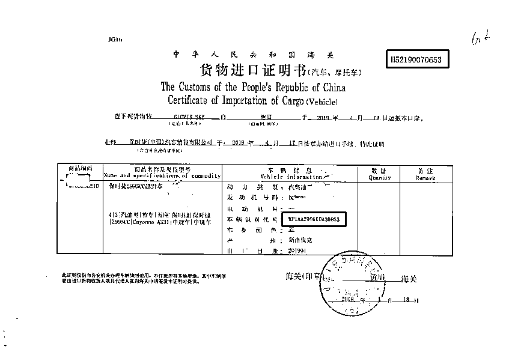
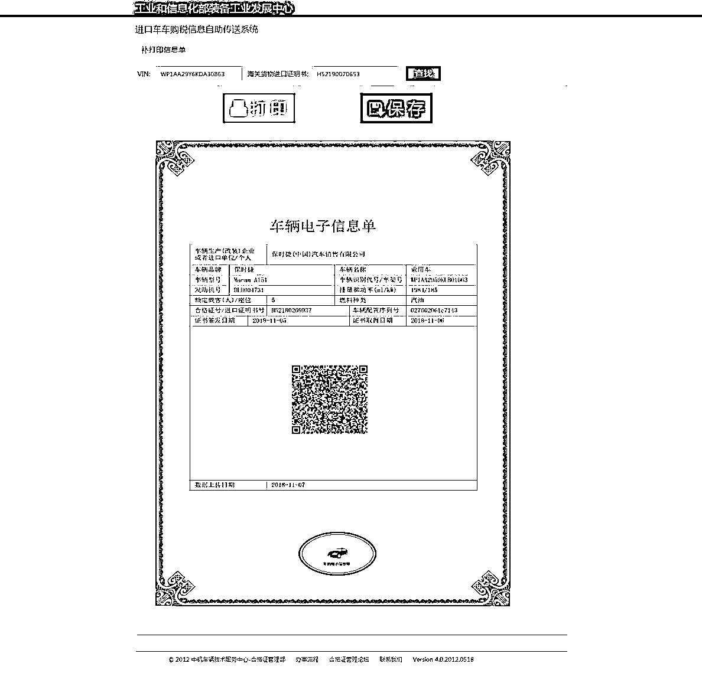
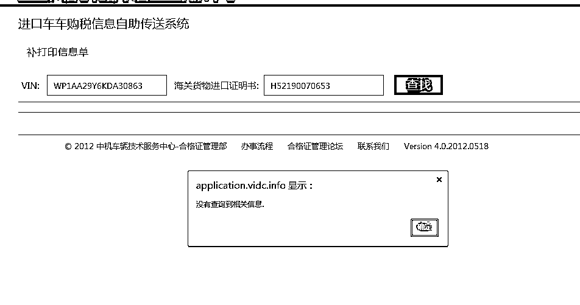

# 买车贷款前必看，不踩坑

标题：贷款买车前，请花5分钟看完这份“避坑地图”，少花冤枉钱

正文：

大家好，我是陶陶。在金融行业干了15年+，银行、小贷、担保公司都待过，做过车贷风控总监，也做过4S店金融培训师。前段日子和赚钱圈友聚会，聊起本职，发现很多人对车贷、房贷、信用贷、经营贷几乎没概念。这些事学校不教、家里不讲，可一踩坑就是几十万甚至上百万的损失。今天专门讲讲买车分期那些坑。

先看整体流程。买车分期，先搞清楚全局和每个节点，才知道钱怎么花、哪里容易出问题。

接下来是重点注意事项：

一、看车别冲动。如果4S店里有认识的销售，一定提前约好再去。否则你直接被记为“自来直客”，再想找熟人或者经理要优惠，基本没戏。

二、签购车合同要多留心。裸车价＝厂家指导价－店家优惠价，不同店优惠力度差别很大，别以为4S店全国统一。合同上务必写明发票价就是裸车价，发票价直接决定你能贷多少、购置税交多少。签合同时一般要付3000到5000元定金，之后反悔不买了，定金通常不退（不过看销售人品，有的也能商量着退）。

三、购置税怎么算？公式是：发票价÷11.3。销售给你说“一价全包”的时候，千万别信。

四、杂费要心里有数。上牌费正常500到1500元；按揭手续费一般3000元/笔，中高端品牌按贷款金额算，通常不超过贷款额的3%。

五、保险建议在店里买第一年。新手磕碰难免，店里买的好处是维修直接走直赔，不用自己先垫钱。险种参考：第三者责任险200万起步，再加车辆损失险。

六、任何让你交GPS安装费、GPS流量费、出车费的说法，都是耍流氓。这些费用根本不需要。

七、关于车贷本身。销售100%会劝你分期，原因很简单——银行给车行返佣，这佣金说到底还是从你利息里出的。车行合作的金融机构通常有3到5家，利息从低到高排序：银行＜厂家金融＜融资租赁公司。如果你征信好、收入稳定，优先选银行；资质一般，可以选厂家金融，有时碰上厂家贴息活动，能省下好几千块，但销售大概率不会主动提，你得自己问；如果征信差、收入证明拿不出来，可能只能走融资租赁，利息更高，而且绿本可能不在你名下——车登记在租赁公司，你要签租赁协议、每月交租金，租期结束再过户。这种方式比较极端，慎选。

选方案时，必须搞清楚四个数：本金、月供、年限、月利率。

万能公式收好：
总还款额＝月供×期数
总利息＝总还款额－本金
月利息＝总利息÷期数
月利率＝月利息÷本金

正常车贷月利率在3到5厘，超过这个范围就得警惕了。

特别提醒：车贷利息按复利算！意思是每期你都在还本金，但利息依然按贷款总额计算。而房贷、经营贷用的是单利，也就是年化利率。所以横向比较时，一定要分清楚“年利率”和“年化利率”，别被概念绕晕。

八、提前还款违约金。不管银行、厂家金融还是融资租赁，都会规定必须满多少期才能免违约金。而且每家银行不同，同一家银行在不同地方的支行也可能不一样。我们准车主群里就有两位朋友，在同一家银行办的车贷，违约金比例竟然不同。

所以签借款合同时，其他可以不看，提前还款违约金的条款一定要看清。参考比例是2%到3%。

还有一种操作：银行要求你把剩余利息一次性存入，结清后再冲销部分利息。

遇到这种情况，一定先到银行填写提前还款申请表，把该冲销的金额写清楚，免得后面扯皮。

九、如果你征信干净、名下有房、车贷金额不超过50万，一定要主动申请“免抵押”。好处很明显：绿本不用押在银行，年审或改装外观时不用去借绿本；更重要的是，以后想卖车，不用先结清贷款赎回绿本，省一大圈麻烦。

十、交首期之前，一定锁死你的车。怎么锁？让销售提供这辆车的“出生证明”——进口车看“货物进口证书”和“进口机动车辆随车检验单”，国产车看“合格证”。另外必须拿到“发动机号”和“车架号码”，这俩是一车一号，独一无二。进口车还能去政府官网“中机网”查验真伪，点“补打印信息单”，输入VIN号和进口证明单号即可。

输入车架号和进口证明书号，正常会显示：

如果车架号不存在，也就是说车辆不存在，会显示另一个界面，这时千万小心：

十一、最佳放款时间：一定要等现车到店，再同意放款！因为贷款一放，利息就开始算，你就要开始供月供。如果车还没到、你连车都没摸到，利息却已经产生，你愿意吗？有些车行为了冲月底业绩，会赶着开票、赶着放款，甚至不经你同意先操作。这个坑必须避开。

十二、不要让车行提前开发票。提前开票最大的坑是车船税：早开一个月就多交一个月。还有车龄也会受影响。如果只是跨月问题不大，但开票时间超过三个月，去上牌时车管所会收滞纳金。

十三、想多开几个月临牌？可以，但一定要先去车管所把购置税交了。等临牌换够了再去上牌，就不会面临大额滞纳金。我有个客户开的是兰博基尼，开票一年后才去上牌，滞纳金罚了60多万——真金白银的教训。

十四、临牌期间保险不生效！这句话请念三遍。没上牌之前，所有刮蹭、意外，保险公司都不赔。新手车主尤其要小心。

十五、买保险时，要查一下这辆车有没有“二次投保记录”。行业内判断是不是二手车，不看公里数（那玩意儿能调表），而是看是否有过投保记录。如果已经有投保记录，说明这车可能不是新车。

十六、上牌抵押后，车管所会发《车辆登记证》，也就是绿本。第一页是你自己的名字，第三页是抵押权人（银行）。绿本和购车发票原件都要交给银行归档，自己一定要留复印件或拍照存在手机里。以后续保、年审、卖车都用得上。

十七、还款提醒：每个月收到银行短信就按时还，也可以在手机银行App查看贷款明细。千万别迟还或不还，逾期记录会影响你以后的贷款。车贷一般走信用卡，有账单日和最后还款日，通常账单日后20天是最后还款日，具体以你贷款银行的规定为准。

十八、万一逾期了怎么办？逾期1-2期，银行经办会打电话来协商。如果确实遇到困难，一定要好好沟通，申请展期、债务重组，或者按当前还款能力重新分期。连续逾期3期以上，律所就会介入，这意味着银行把这笔贷款列为不良，开始走司法程序。一旦走到这一步，律师费也来了，还会收到催款函、上门贴通知，然后冻结你的银行卡、🛰️、支付宝，最后查封资产。雪上加霜。所以别逾期！提前做好资金规划！

我是陶陶，在广州做助贷和垫资过桥业务。以上是结合多年经验整理的买车分期避坑指南，希望能帮到你。我还在做个人自媒体账号“陶陶银行圈”，专门科普贷款知识，帮年轻人提升财商，用好金融工具，让财富持续增长。

