# 📕AI代写：一个程序员三个月赚了12W的实操复盘
作者：龙哥

## 从兼职程序员到月入四万的AI写手

各位圈里的朋友大家好，我是龙哥，年头才刚入圈的新人。平时我在一家互联网公司做开发，上班时间是上午十点到晚上七点。下班的空闲时间，我都在📕里折腾AI代写服务，三个月下来进账超过12万。这就是AI风口带来的真实红利，先给大家看下我的收益记录。

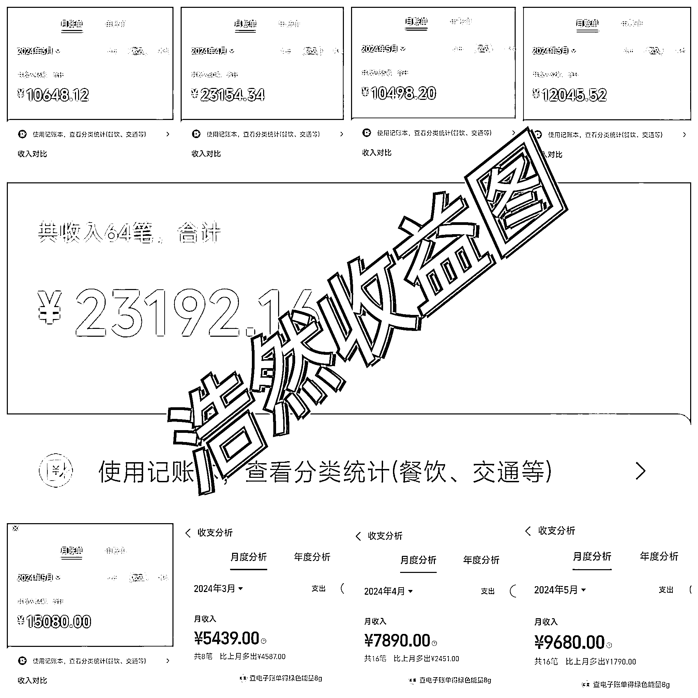

在这个圈子里潜水了很久，很感谢徐宿老师一直以来的鼓励，这才鼓起勇气把自己的经验整理出来，希望能给还在项目里摸索的朋友一些启发。

**为什么我会盯上AI写作这个方向**

要聊起因，得从之前的创业尝试说起。年初我做抖音无人直播，做了一个月，收入能到五千左右。但这项目有个硬伤——没有自己的场地，账号也总被限制，很难扩大规模，收入完全不稳定。这种状态下我必须找新方向，去找一个更靠谱的出路。

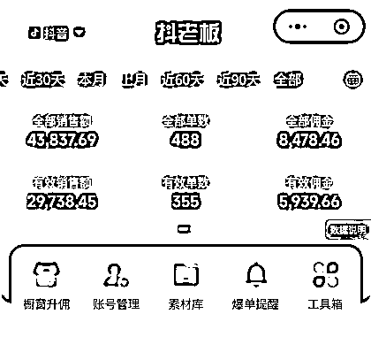

后来通过徐宿老师的推荐，我参加了一个三天的体验营，里面的内容让我眼界大开。也是因为这个契机，我正式进了赚钱。在圈子里逛了一圈，发现项目真多，每个看着都值得做，但真到下决心的时候又不知道怎么选。当时大家都在说📕的机会大，我也跟着去看无货源电商的各种玩法，方案都构思得差不多了，结果看到平台在严打无货源模式，马上收手转方向。

转来转去，我突然意识到自己陷进了一个普遍的心理误区——怕失败。之前在无人直播上赚到过钱，这个经历反而成了我的枷锁，让我心里觉得每个新项目都得成，不然就是不行。但回头想想，错过窗口期才是最大的损失。算了，干就完了，就算摔跟头也认了。

心态调整好之后，我回到📕精华帖刷思路，又开始审视自己手里的牌——我的程序员背景，如果做个人IP号，黏性可能会比普通种草号好很多。参考了梨云提到的守破离思路，我不再用自己的主观判断盲目开头，转为去找成熟的对标账号。那段时间整理了三十多个计算机赛道的博主，把他们笔记的选题和行文都拆了个遍。发现那些爆款笔记的选题，许多都围绕计算机答辩或论文辅导展开，评论区里求助的人特别多，需求端非常活跃。

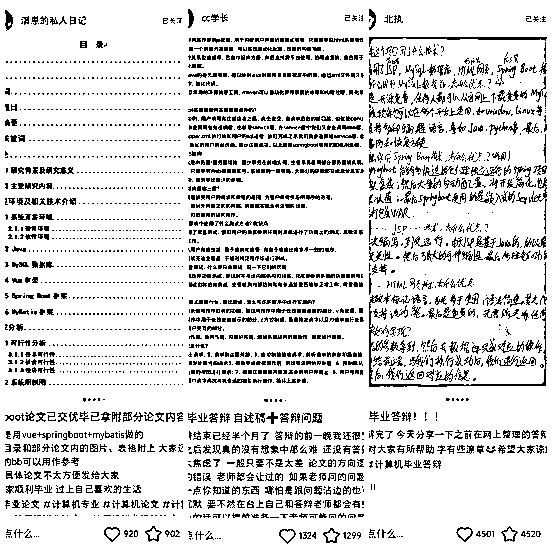

3月4号这天我印象特别深。头一回模仿对标账号的风格，用AI生成了一篇写论文技巧的笔记。发出去之后我心里完全没底，隔几分钟就刷一次后台，看看有没有人点赞。结果赞没涨几个，反而有人私信我，问能不能代写论文，题目是——WEB应用测试用例并行执行优化策略研究。

看到这个题目我第一反应是拒绝的。我是大数据方向的程序员，平时也没接触过测试工程这块，虽然都是写程序，细分领域的知识差得还挺多。但转念一想，我手里有AI工具，这不就意味着我能打通不懂的领域吗？那个瞬间我改变主意接下了。

那两天几乎没怎么合眼，靠着一句一句问GPT，把论文初稿给"挤"出来了。客户收到稿子后觉得质量还行，又陆陆续续给我介绍了他的同学。就这么着，AI代写这条路算是趟出来了。

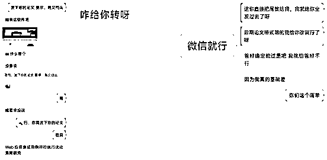

后来我又发过一篇笔记，引流了五个客户，收款四千，但是账号因为引流违规被系统封了。当时难过了一会儿，想着要不换平台。可巧的是，我在赚钱精华里刷到了📕解封的教程——换个🐧和🛰️号登录，再绑定原来被封的手机号，这样手机号就被释放出来可以重绑，就能把账号捞回来。按这个操作果然成功了。

**不靠发笔记，在评论区截流**

账号回来了，我就更起劲地刷内容研究玩法。后来注意到评论区截流的效率，比老老实实发笔记要高得多。我的操作是在各个帖子下面留钩子，写“计算机方向论文代写，个人写手，赚点零花”之类的话，后来干脆直接去私信那些在评论里求推荐的人，效果更好，就是号被封的频率也高，🐧号得多备几个。

具体怎么截流呢？我一般这样操作：📕里搜“计算机论文”，按时间排序看刚发的帖子，点进评论区——找那些五天内发出来的“求推荐”“求介绍”的留言，直接后台私信。私信的内容大概是：“同学，是需要写论文吗？本人写过不少，成功率有保障，可以看看我的主页。”

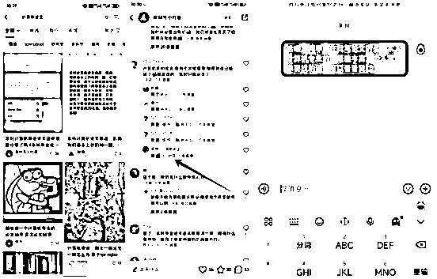

这种话术空的时候可以用GPT多造几个版本，同一个时间集中发出去的内容千万别都是同一个模板，容易触发风控机制。

把客户引到🛰️这个环节，是管得最严的地方。我摸索出的相对稳妥的方式是——把含🛰️号的截图存到📕的表情仓库里，私聊的时候直接发图片，图片记得多准备几张，不能同一张图片到处发。发完记得要把📕的聊天窗口删掉，能降低被盯上的可能。

AI代写这个项目，说到底是一个有头有尾的商业模式。流量搞到了，后面的交付没做好，业务也撑不起来。

**谈单与报价的提升方法**

我身边也有不少朋友做过这个赛道，他们最大的困惑是不知道怎么跟客户谈。我分享下自己常用的办法。新手最怕的就是谈单，其实谈单首先要把客户真正要什么搞清楚——客户的专业方向、是写全新稿还是修改、字数多少、学校要求，问明白再开价。行业内惯例是按照字数来定，下面是一份市场参考报价，大家可以拿去做底。

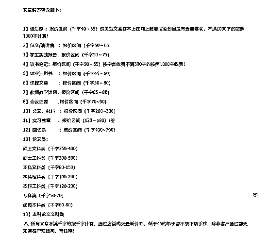

我拿一个实际案例说明：一个单子原本以为只能卖一千，最后成交价翻到了两千五。这个单子的成交过程是——刚开始我急着报价，客户只说了八千字，我以为就是普通二本学校的论文。后来聊深入了才知道是一本院校，要求完全不一样。摸清情况后我报了2500，整个沟通过程里客户感受到我的专业判断，就没再犹豫，直接成交了。

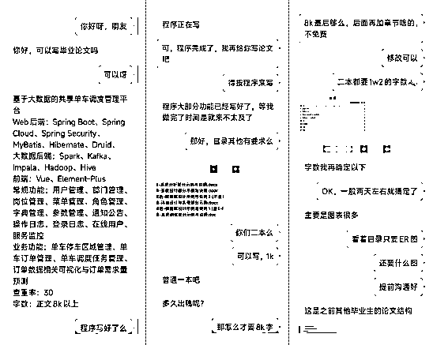

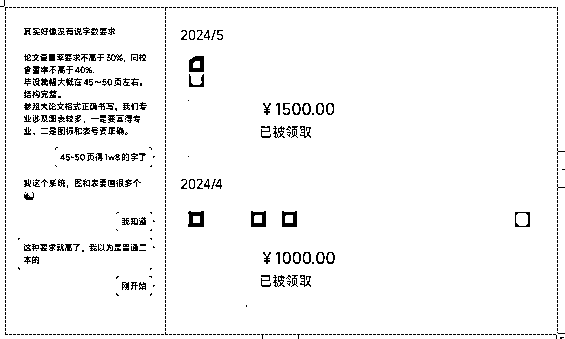

**做好交付，让客户主动帮你传播**

我一直相信，交付质量过关，客户就会帮你转介绍，口碑会自己裂变。最开始接单的时候，这类论文我没写过，也不知道什么标准才叫好。但我告诉自己：先把初稿弄出来给客户，按他反馈去改，这样既让稿子变好，我也能积累经验，一举两得。坦白说一开始我甚至以为所有学校的论文格式是通用的，后来才发现每个学校要求都不太一样。我一边跟学生反复确认，一边晚上熬着用百度查、上B站跟着视频学排版。慢慢地我也发现，这个市场上愿意把交付做到位的人其实很少，评论区里全是吐槽被坑的。

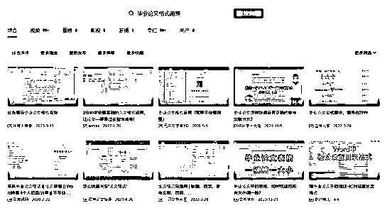

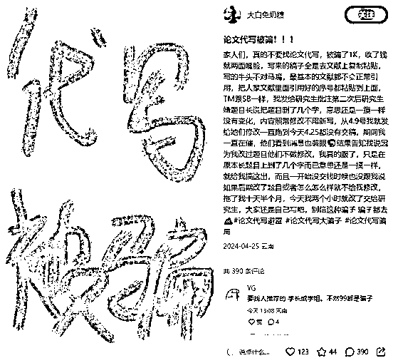

我自己因为交付口碑好，客户直接把同班同学介绍过来，后来又拉来其他专业的同学，基本上承包了他们学校相当一部分代写需求。

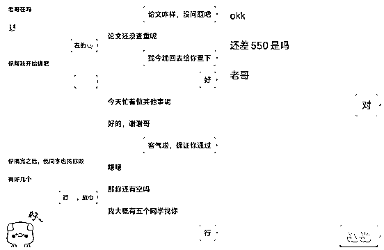

有了信任基础之后，我的报价空间也打开了。有一单三千的论文，就是老客户推荐的——第一次交付攒下的信任，让我涨价也有了底气。想在这个赛道持续赚钱，必须把交付当回事，这也是所有高收入写手的共同点。

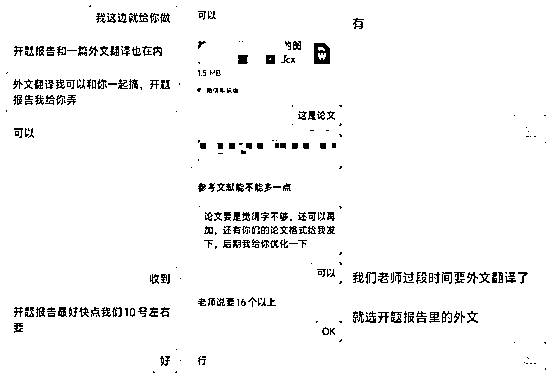

那到底什么叫交付思维？按我的理解，**交付思维就是真心实意地对待每一个客户，把每一份稿子当成作品来打磨，绝不敷衍了事**。你把自己放到客户的位置上想——如果别人用这种态度服务你，你会满意吗？我做过写手也做过派单的人，见过很多糊弄客户的，这种人往往合作过一次就不会再有下文。糊弄客户等同于自断财路。如果稿子质量差，不仅转介绍没指望，连复购都没有。很多人不知道的是，AI出的初稿和最终交付稿之间，还隔着润色、去AI痕迹、调排版这些工序。论文有论文的格式，演讲稿有它的语感，这些基本功都得自己掌握。

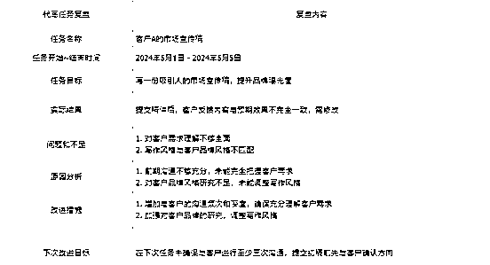

交付思维还意味着“以终为始”。客户找你来写，你跟他聊完需求，心里就要有一条从开头到结尾的路线图——文章要怎么写、内容怎么安排、最终要呈现什么样的效果。这种能力当然需要时间养成。如果在执行中发现思路跟客户要求对不上，就要回头做复盘，找出偏差的原因记下来，下次避免。这里放一个我做复盘的参考模板。

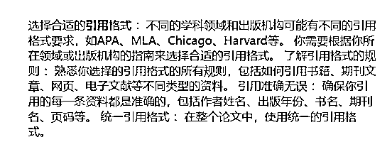

再细一点说——客户的期待每家都不一样。有的非常看重内容的专业深度，有的更重视行文是否生动、有没有新意。跟客户沟通时要把这些要求确认清楚，写进稿子里逐一落实。沟通能力也是绕不开的，要能听出客户话里没说明白的潜台词；同理心帮你切换视角，体会客户用稿时的感受，才能交付更贴心的内容。

操作环节里，往往是一些小事决定了成败。写作这一行，细节就是专业度的体现，内容、语言、排版、整体观感，一步都不能省。特别是专业类的文稿，参考文献引用的格式细节都会直接影响客户对你专业能力的信任。我看到有的人写完一整篇论文，参考文献一条都没有引用，这就是大忌。

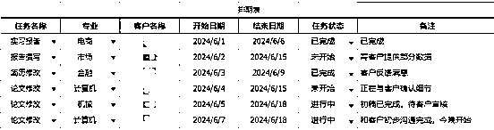

时间管理更是不能掉链子。客户给你交期，你就要爽快地按时交货，**准点交付是对客户起码的尊重**。在保证质量的基础上，合理分配时间、按节点完成，不仅增加客户满意值，也提高了你自己的口碑和效率。我见过太多没有时间观念的人，或者拖到最后才草草交稿的，这类人很快就会被市场淘汰。我会用一个排期表来管理所有单子，推进的时候盯着表格不让任何一单拖后腿。

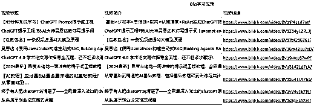

还有一点——能力要持续进阶。AI代写赛道内卷是必然的，随着工具进化，竞争门槛一直在抬高。只有保持专业能力的更新，才能站稳脚跟。这种能力不单单指文笔，还包括对各类文体格式的信手拈来、对客户需求的理解，以及熟练使用AI工具的能力。我平时会存一下关于AI实操和排版技巧的学习资料。

所以我的结论是——交付思维并不只是一种工作态度，而是一种职业操守。在这行混，有交付思维才可能提供好服务、建立信誉，也才能在大浪淘沙的竞争里活下来。

**用GPT写一篇计算机论文的做法**

那么我们拿到一个论文单子之后，具体怎么开工？我就用自己帮人写计算机论文的实际流程来拆解一遍。

通常一篇完整的论文包含六个模块：学校封面、摘要、目录、正文内容、参考文献、致谢。学校封面由学生自己提供，剩下的都得靠我们来完成。

先从确定目录说起。开始之前一定要去问学生有没有学校公布的规范目录，有的话直接拿来用；没有的话，就去📕搜索同学校或同类型的论文目录作为参照。目录必须跟学生核对到完全一致，这一点很关键——如果目录没对齐，后面所有的返工都是灾难级的量。

然后确定主题。论文跟帖子一样，核心信息是围绕一个主题展开的。主题一般是学生直接给到你，类似命题作文。拿我接过的一个实例来说，题目是：基于Java技术的教务管理系统设计与实现。

接着就到了内容喂养的环节。注意，不要一上来就命令GPT生成全文。它本质上是一个模仿能力很强但缺乏常识的写手，你得喂素材给它理解真实的需求。以计算机论文为例，最重要的是核心代码，我把Controller层的代码复制到txt文件上传给GPT，让模型先吃透整个系统的业务流程和功能逻辑，这样才能在动笔时有据可依。

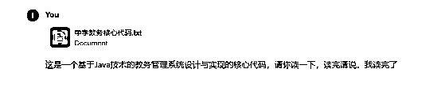

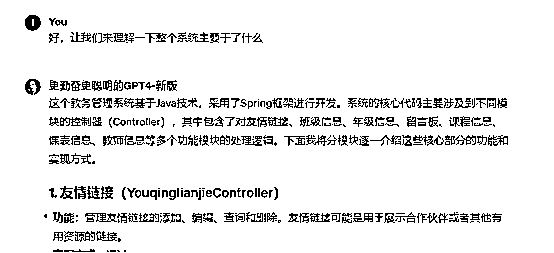

素材喂完之后，就让AI开始搭框架。如果自己对要写的东西有一定认识，最好也人工复核一遍AI的分析有没有偏。一般问题不大，但还是有必要检查。这时候我会在对话里输入一段框架生成指令，让它输出一个结构完整的目录。有了框架后，再和学生的要求对照，让AI逐步调成和目标目录一致的版本。

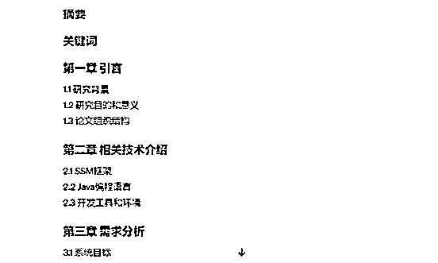

有一个疑问是重点：AI给出的框架不一定和学生要求的一致。如果有出入，继续让它按学生给的模板改，直到一致再动笔。

框架确定之后，就可以让GPT按模块开始写了。我会按小标题一个接一个地写，每个小节开始之前，让它先列出写作要求，避免它跑偏。如果它忘了要求，就提醒它。比如从摘要开始，写完摘要后记得让它列出关键词——我自己那边的命令就是：请先列出要求，然后生成摘要，摘要生成后列出关键词。

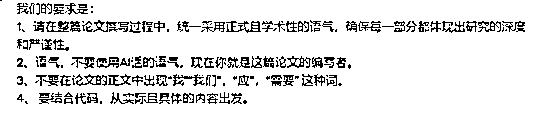

接下来是正文每一章的生成。每开一个章节，我都会先让AI回忆一下前面的内容和章节结构，再根据大框架列出当前章节的小结构，确认无误后，让它一节一节地输出内容。这期间我必须保持警觉——AI生成的内容并非全都规范，要自己把关。

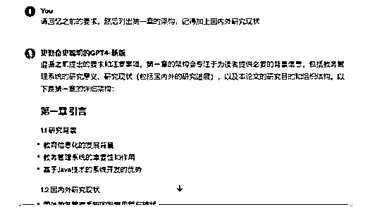

如果接到的是一个自己不熟悉的新领域，短期内判断不了也不用太纠结，先把初稿交出去，让客户的导师帮忙提意见，修改阶段虽然费些工夫，但每一次修稿都是经验积累，以后会越写越顺手。

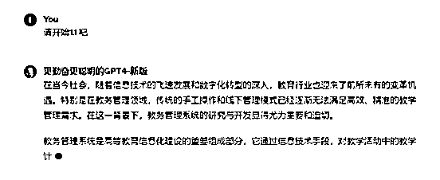

第一章写完了就接着第二章，过程同上。

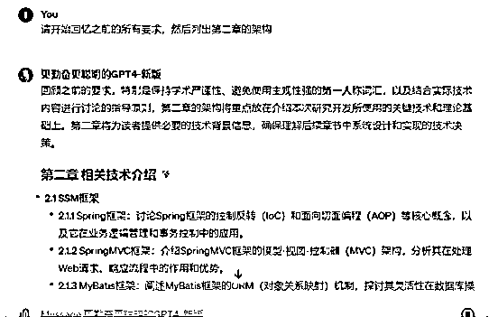

从2.1到2.x一节节来，直到写完整章。

第三章、第四章也如法炮制。

特别需要注意的是，到第四章经常会涉及画图和表格，有的学校会要求三线表格式。画图这块我会用processon，它的内置AI功能做流程图和时序图效率很高。至于怎么快速画图，我后续有空再单独出一个教程细说。

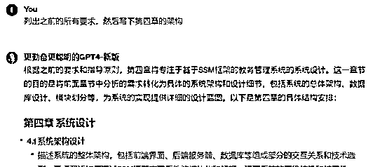

这就是我三个月里跑通的完整流程。回看整个过程，AI代写能不能赚到钱，说到底就是流量获取和交付能力两端发力，再加上中间细节的把控。希望我的经验能帮到还在观望的朋友。别怕试错，也别等准备好了再开始，机会不会等你——它藏在每一篇笔记里，藏在每一条评论里，也在每一次大胆的尝试里。干起来，你的故事也许比我的还要精彩。

从实操角度看，一篇计算机类毕业论文的整体推进其实是有固定套路的，我把自己的打法拆给你看。

第五章通常是系统实现部分，这一块最核心的就是把界面截图转成说明文字。我一般会让学生把关键页面的截图直接发过来，把这些截图嵌入到当前正在写的论文文档里，然后整篇上传给 GPT 去生成功能描述：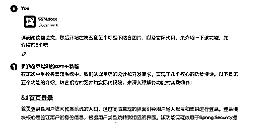 有时候模型也会顺带把代码片段也写出来，这个要看具体需求。有的同学需要代码示例，有的只想要纯功能介绍，如果不需要代码，就直接告诉模型只输出功能说明即可 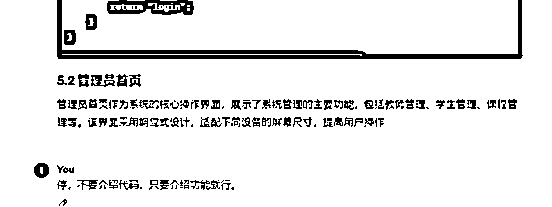 接下来进入第六章，开篇先做一个简短的回顾梳理，理清思路后再搭建章节骨架，把 6.1、6.2... 的小节标题列好，结构确认完再依次填充内容 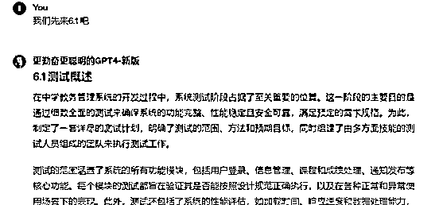

第六章里有一个容易被忽略但很关键的点，就是要单独生成一张用例表格：

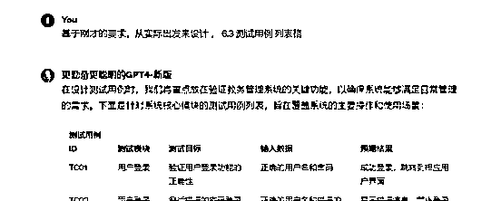

等第六章收尾，就进入第七章总结部分：

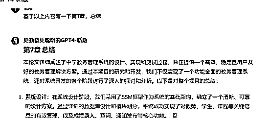

最后是致谢部分：

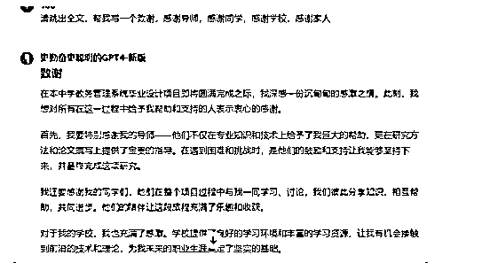

到这里论文的主体内容基本就完成了。剩下的就是附录部分，主要是参考文献。

参考文献的素材我一般在知网和万方找：
网地址：[`www.cnki.net/`](https://www.cnki.net)
万方数据地址：[`www.wanfangdata.com.cn/`](https://www.wanfangdata.com.cn)
找文献的方法很简单，直接把论文题目原样复制去知网检索，没有结果就把题目简化一下再搜。

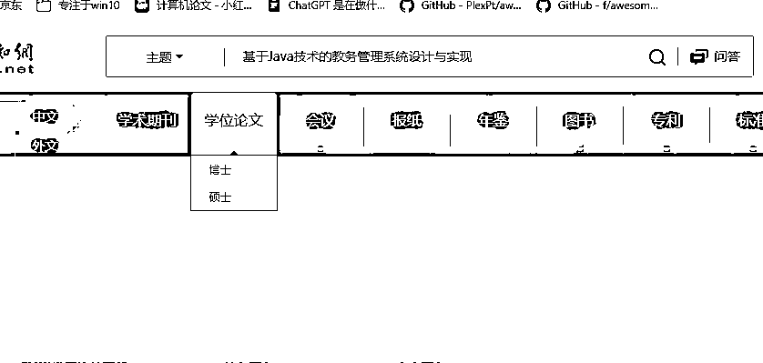
比如我会把题目精简成更通用的关键词，检索成功率会高很多，下面这些思路你都可以参考借鉴

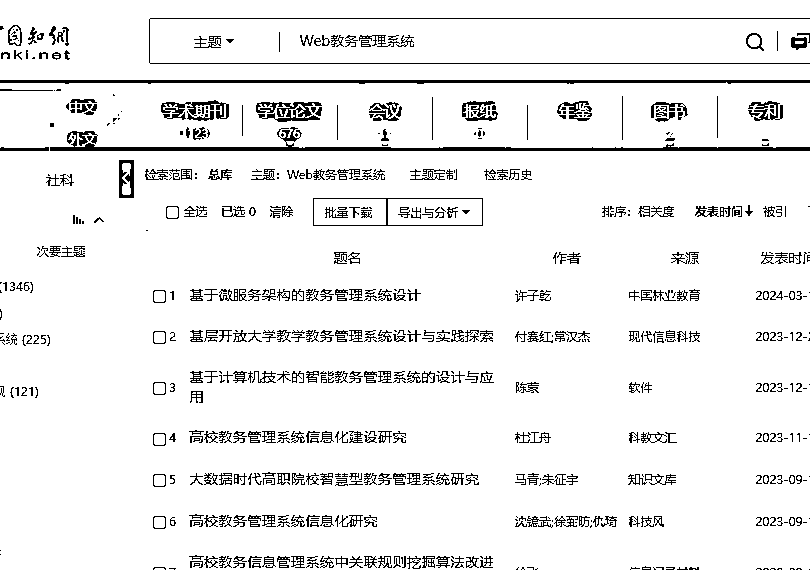

### 论文格式修改教程

主体写完之后就是格式调整，这一步要根据导师和学校的具体反馈来改。格式调整的实操演示我放在了一个 B 站视频里，大家直接看就行：[`www.bilibili.com/video/BV1s84y1A7z4/?spm_id_from=333.337.search-card.all.click`](https://www.bilibili.com/video/BV1s84y1A7z4?spm_id_from=333.337.search-card.all.click)

另外 WPS 也有一键排版的功能，需要开通会员，排完之后仍然需要人工微调，所以我更推荐学会手动调整的逻辑。

有意思的是，整篇论文下来，我只在目录部分用过结构化提示词。因为每个学校的目录规范差异很大。但写了十几篇后我发现，正文脉络几乎是固定的：第一章引言，第二章技术综述，第三章需求分析，第四章系统设计，第五章系统实现，第六章系统测试，第七章结论。大多数院校都沿着这个流程走。所以下一篇我会讲讲怎么用结构化提示词，把一篇 60 分左右的计算机论文快速搭起来，后续再按老师意见做局部微调即可。

**6、查重&降重**

正文定稿后，下一个环节就是查重和降重。我个人常用的查重入口是 paperpass:[`www.paperpass.com/`](https://www.paperpass.com) 这个平台免费，方便先自查，但准确度有限，最终还是要让学生用学校指定的系统再查一次。

查完之后就是降重。不同查重系统的判定规则不一样，常用的降重手段大概有这几类：

1. **同义词替换**：把常用词换成近义词，比如“重要”换成“关键”，“发展”换成“进展”等。
2. **句子结构调整**：改变语序或重组结构，比如把“提高生产效率非常重要”改成“非常重要的是提高生产效率”。
3. **句式变换**：同义改写，比如把陈述句变被动句，长句拆短句，短句合并成长句。
4. **段落重写**：对重复度高的段落整体用自己的话重述，保持原意但表达不同。
5. **引用和标注**：对难以改写的部分增加规范引用，用标注与原文区分开。
6. **增加原创内容**：在关键节点加入自己的理解、分析或案例，提升原创性。
7. **图表和数据**：用图表替代部分文字描述，并在图注中补充说明，降低重复率。
8. **专业术语替换**：在不改变含义的前提下，用近义专业词替换，比如“客户满意度”换成“顾客满意度”，“市场占有率”换成“市场份额”。

还有一种更直接的操作，就是把被标红的高重复内容删除，前提是保证论文逻辑通顺且字数达标。

我常用的降重提示词也整理好了，可以直接复用。

**6、其他变现玩法**

AI 写作的变现路径远不止论文。围绕论文本身就能拆出：论文撰写、论文润色、论文降重/降 AI 率、答辩稿撰写、答辩 PPT 制作。再延伸出去就是简历写作、PPT 制作、文案撰写、主持稿、书籍写作、剧本创作等等。整体变现空间很大。我还总结过一个写作时间线，写作有旺季淡季，按节奏走基本能平滑掉周期波动。

**7、新手小白经常遇的八大问题**

把身边刚入门的朋友的问题汇总了一下，统一解答：

1、起步需要什么准备？
一台能用办公软件的电脑，和一部用来做流量的手机就够了。电脑干活，手机引流。另外要持续提升对 AI 工具的使用熟练度。

2、初期去哪里找单？
📕和闲鱼是接到一手单的主要渠道。不会做流量的朋友可以去淘宝或 Boss 直聘接二手单练手，价格会低一些但适合积累经验。

3、AI 能写所有类型的论文吗？
不能。我会主动拒绝自己不熟悉的领域。早期我不懂机械、建筑等方向的论文就不接。后期遇到同行分单，自己抽成即可。

4、AI 写作的天花板在哪？
单写手模式，一个月 4-5 万可能就是上限。如果做成工作室，掌握流量方法后招写手分成，月入 10 万是有可能的。

5、客户嫌弃怎么办？
新手期很常见。先请客户指出具体不满点，按要求修改。结束后一定要复盘，避免重复犯错。

6、遇到客户跑单怎么防？
我 99% 的单都在🛰️成交。只在闲鱼成交过少量。🛰️接单先收 30%~50% 定金，开始工作。完成后让客户付尾款再交付成品，或先给带水印的 PDF 预览。没定金的单不接。

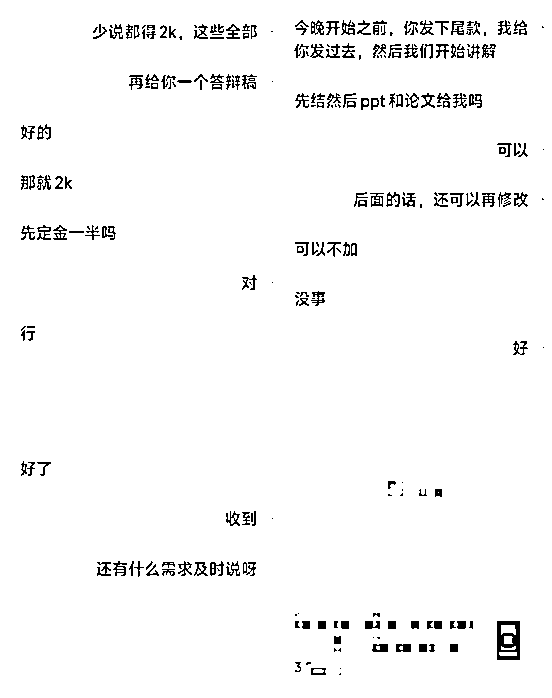

7、📕截流回复率低怎么办？
主要两类原因。一是去人家发论文模板的帖子下面截流，客户可能只想要模板，写作需求很少。发 50 条私信才回 1-2 个很正常，鱼塘选错了。二是去回复一个月前的老评论，对方早就找好人了，回复率自然低。

提升方法：搜索关键词 xxx 专业论文，找评论区活跃、评论时间在 3 天内的帖子截流，回复率会明显提高。

8、写作用哪个 AI 工具比较好？
国内我常用 KIMI 和秘塔写作，国外用 ChatGPT4。工具没有绝对好坏，要看场景。比如需要结合国内最新资讯写稿，秘塔写作的时效性会更好。不同场景配不同工具效率最高。

如果想入局还有其他疑问随时交流。

**小结**

AI 写作的市场非常大，专攻一个细分赛道也能吃得很饱。起步建议先做自己本专业的论文，熟悉流程跑通闭环后再跨专业接单。

我自己是程序员背景，一开始只做计算机方向的论文，流程跑顺后速度大幅提升。刚开始一篇要两天，现在三四个小时就能完成，简单要求的两小时搞定。

PPT、演讲稿、答辩稿这些也是高频需求。高端 PPT 一页 50~200 元，答辩 PPT 一页也能做到 15 元，客单价更高的就是论文类服务。文科类论文基本能全靠 GPT 完成，理科类则需要一定的专业知识支撑。

**用自身专业做底座，用 AI 做放大器，切准流量赛道，就是这个模式的核心。**

感谢一路帮助过我的老师们，感谢@徐宿 老师在商业知识体系上的私教，让我对变现有了系统认知；感谢@梨云 老师在📕运营上的耐心指导；感谢@龙哥 老师创造的龙哥盟社区，让我在迷茫期找到了可深耕的方向。

今天的分享就到这里，希望对你有帮助。

* * *

评论区：

K 同学 : 厉害

小鹅 : 牛的

张大气 : 真好

浩然 : [呲牙]一起加油

浩然 : 感谢夸奖

黄增添 Tony : 厉害了！！请问 AI 写作有没有大众化的赛道？PPT 算吗？我的专业比较偏门

兰凯翔 : 就像文中所说，你刚开始对某些方面不了解，所以不去碰这方面，用我举例，可能我对 99%的都不是很了解，如果尝试用 gpt 硬写，会不会特别水

浩然 : 会的，但是给我的话，我还是会尝试下，因为客户的正反馈，会给我指导哪里需要改正，哪里是正确的需要保持。

我身边有一个大二学生，一开始也是啥也不懂，我让他先尝试的是从演讲稿写起，慢慢来就能看到结果，现在他也会写 PPT，和一些结课小论文了。

* * *