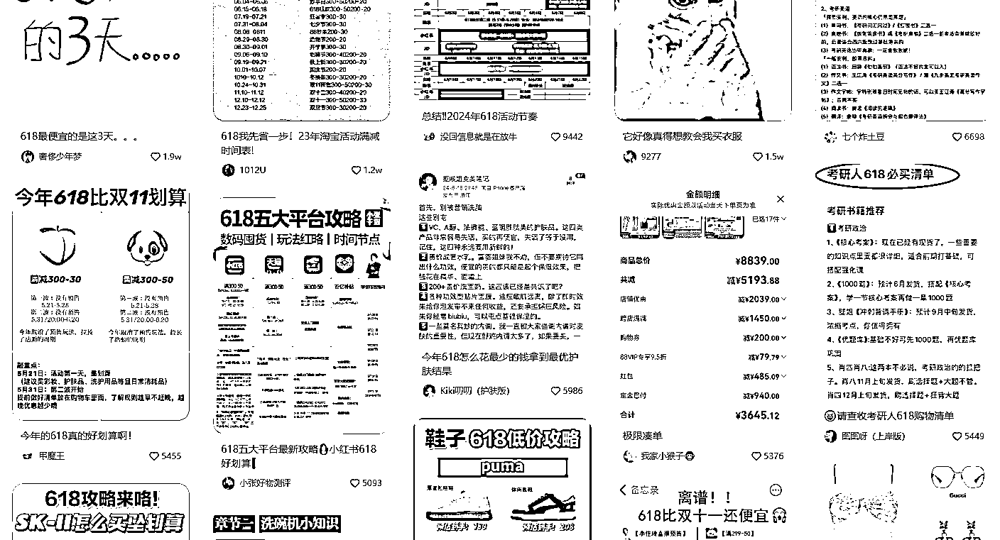
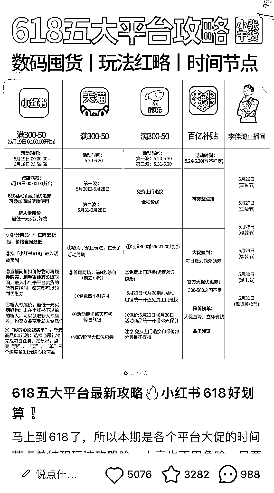
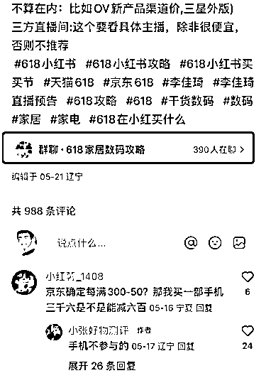
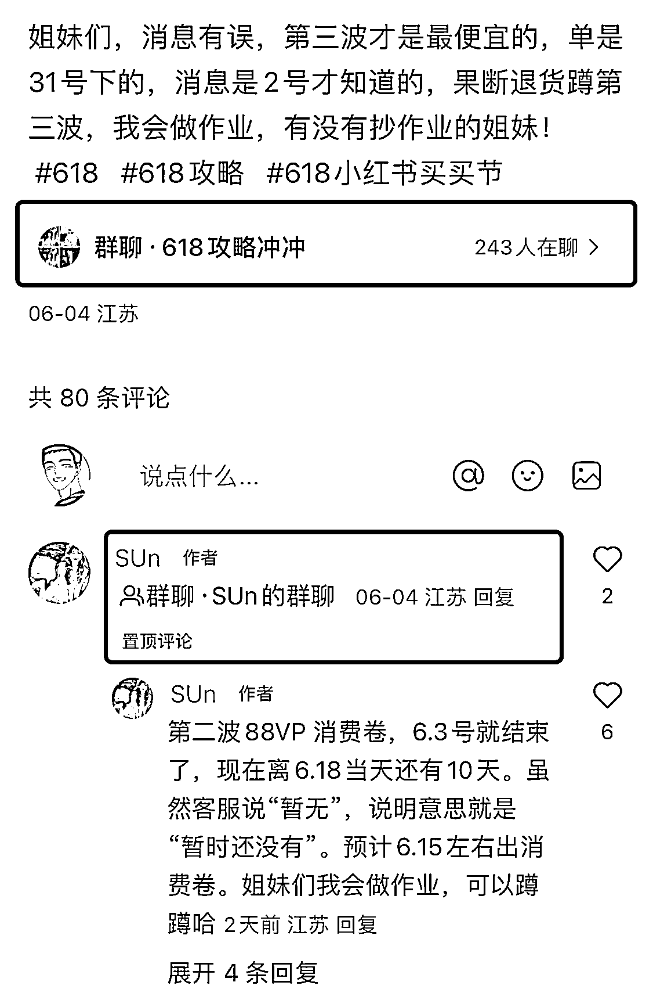
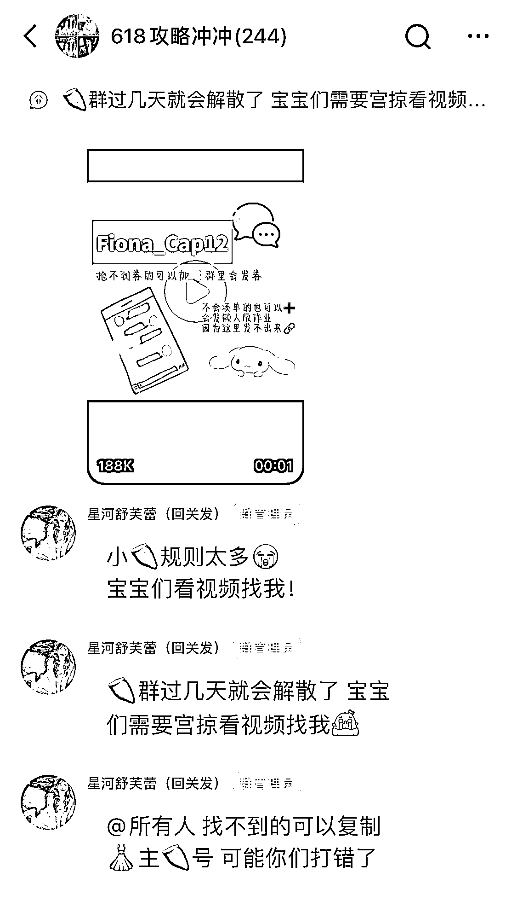
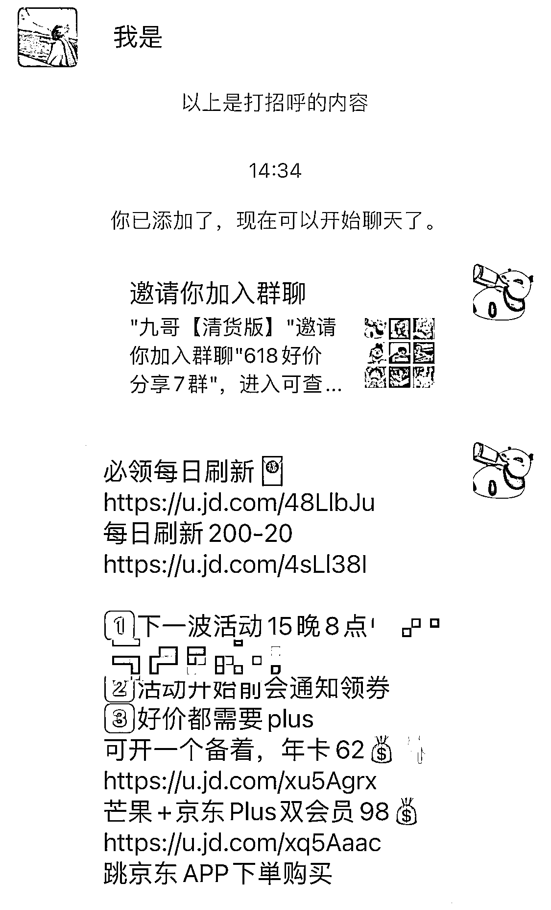
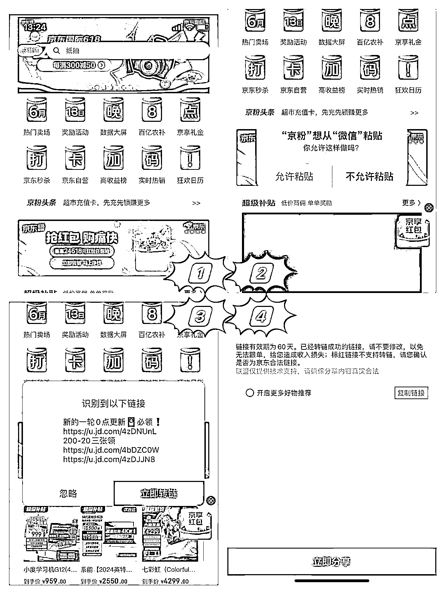
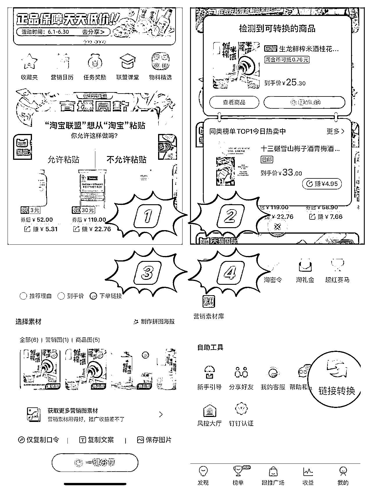
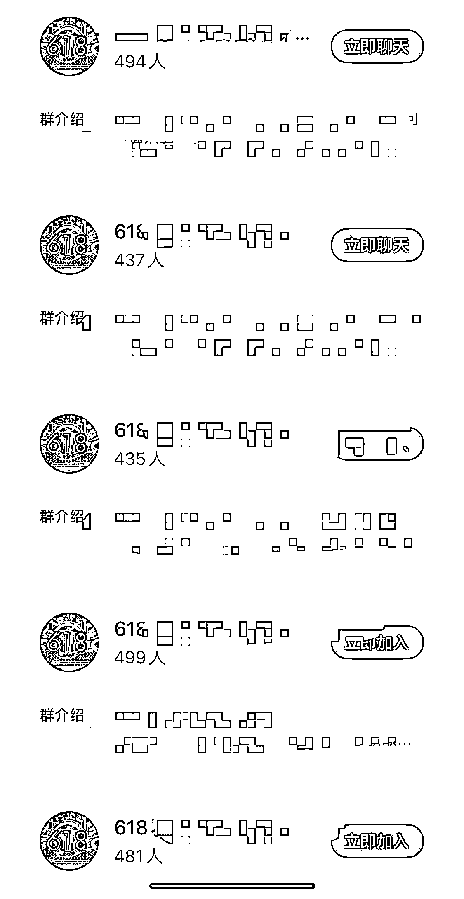

# 零成本玩转京东CPS：📕引流2000+，单人带货GMV破60万

## 📕引流到🛰️做京东CPS，0门槛月入过万的实操拆解

作者：苏木

日期：2024-06-14

各位伙伴们好，我是九哥，专注📕运营四年。

每年618和双11都是淘金季。去年在徐宿老师的点拨下，我试过📕团购，那会儿赚了几千块。今年我把赛道换成了京东CPS分佣，没想到收益直接拉满。

这个项目门槛极低，底层逻辑就一句话：用📕吸来对促销感兴趣的人，导到🛰️私域后发京东商品链接成交，赚取佣金。虽然看起来简单，实操里却藏着很多坑。为了一起带新人快速上手，我把自己跑通的完整流程掰开讲。

## 一、从购物焦虑里找机会

618、双11大家都在买，活动年年升级，玩法却越来越复杂。
优惠券、跨店满减、定金膨胀...算下来像在做奥数题，很多人直接放弃。需求一出来供给就跟上，📕上迅速冒出一堆购物攻略，教大家买什么、什么时候买最划算。

这些攻略耗时间、竞争者又多，必然有人在背后变现。我拆解了几个头部博主，发现套路惊人地一致：

先把用户拉进📕群，再在群里引导加🛰️，最后在🛰️里发链接下单赚钱。因为22年就玩过CPS，我一眼就看懂了。于是我立刻照着这个模式开干。

## 二、别做泛流量，做精准类目

我扒了同行的笔记数据，发现“全平台618攻略”是最火的选题。内容无非就是各平台什么时候开售、哪个时间点最便宜，全是公开信息，复制粘贴满天飞。

泛选题流量大但用户也泛，而且早被大号占位。我换了个思路：不做全平台，只做单一品类。比如只写“618家电/数码/美妆的降价节点和到手价”。信息更垂直，用户更精准，竞争也小。

实测下来，数据体量差不多，但评论区质变了。从以前的“蹲活动”、“求链接”，变成了“这个怎么买”、“有没有优惠”。精准用户来了，转化自然就高。

📕不允许发外链，所以下一步必须把人导入🛰️私域。

## 三、私域承接的合规玩法

引流方式我试过很多，踩过坑后现在只用这一套，安全又高效。

早期我在爆款笔记下评论让私信我，结果被同行盯上举报，笔记直接没了。吸取教训后，我改用曲线玩法：在正文里放📕群聊入口，把流量先导到📕群。

对于表现好的笔记，我会在评论区置顶群链接，标题写成【618+品类+抄作业/跟买群】。这是官方允许的群聊功能，不违规也不怕举报。

进群的人基本都是真想买这个品类的，对价格敏感。因为群里不能发京东链接，这就成了顺理成章加🛰️的理由。

群公告里放我的🛰️添加方式，粉丝加进来后我再拉到🛰️商品群，专门发链接和选品。整个路径顺滑。

## 四、分佣链接怎么生成，3分钟学会

这是变现的最后一环，很多新手卡在这里。其实京东和淘宝的操作都很容易。

京东链接操作：
1、复制商品链接打开京粉，多数情况会自动识别。
2、如果没识别，点击左上角转链，手动粘贴链接→立即转链。
3、转链成功后点立即分享即可。
小技巧：京粉支持批量转链，一次搞定多条，效率很高。

淘宝链接操作：
1、复制链接打开淘宝联盟，一般会自动识别，点击允许粘贴。
2、点赚分享链接，选择复制口令或文案发群。
3、没自动识别就去我的-链接转换手动转换，再重复2步。

不会挑品、不会算活动价怎么办？完全不用自己研究。直接进同行的群，把别人的链接用你的分佣工具一转，再发到自己的群里就行。站在巨人肩膀上，省心又高效。

## 五、从MVP到放大的三次关键迭代

这个项目不是一蹴而就，我是边做边调，一共迭代了三次。

① 公域引流突破
最开始我只开了2个📕群，虽然笔记有自然流量，但进群速度慢得像蜗牛。后来我刷到一个同行发了抽奖笔记，流量炸裂。我立刻抄作业：用抽奖笔记导流。

结果笔记一发，📕群一天就满员了，最后我建了10个500人群，🛰️好友加到爆。

② 私域承接突破
流量来了，群却被举报禁言了。引流话术不能太直白，审核很严。我试过把群主转给小号，结果小号第二天也被封。

后来我发现一个漏洞：新成员入群欢迎语的审核最松，而且其他人看不到。于是我把加🛰️的方式写进自动欢迎语，新人一进来就能看到指令，既合规又隐蔽。靠这个方法，我的🛰️500人群拉满了6个。

③ 变现规模突破
当公域笔记稳定出流、私域承接不流失，成交自然就起来了。最终我通过京东联盟做到了GMV突破60万。

## 最后说两句

多看、多抄、多试。看到数据异常的笔记一定要拆解，判断能不能复制立刻上手。别空想，数据反馈最诚实，快速迭代才能卡住风口。618的时间窗口够你跑通一遍，趁热打铁直接为双11蓄力。

* * *

评论区：

无想 : 好有生意头脑

苏木 : 就爱瞎折腾

老师傅 : 好厉害[强]，执行力杠杠的，小小建议，如果在📕那边想办法先发一波 红包密令，再导入私域，有可能佣金收入会增加一点点，毕竟从公域导私域的过程会流失用户

苏木 : 恩，感谢建议，密令有同步发，效果不好估算，就没提

* * *