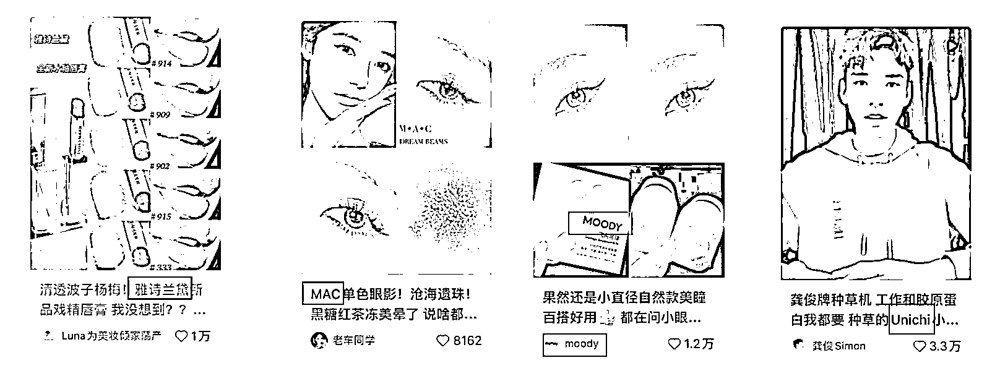
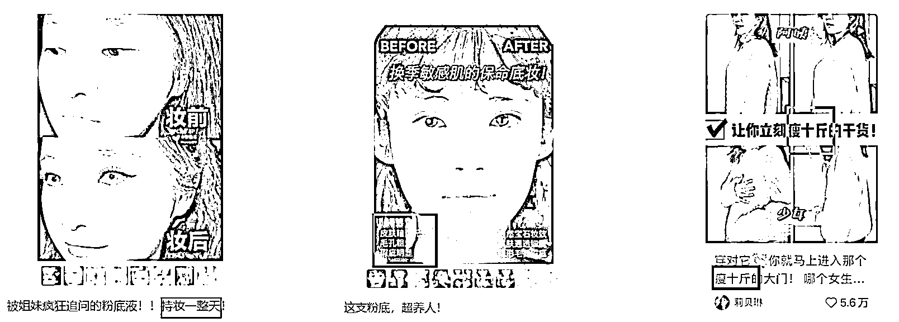
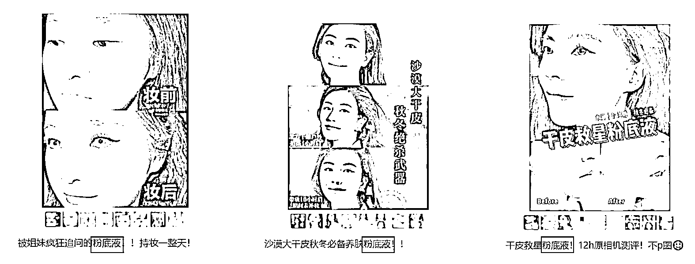
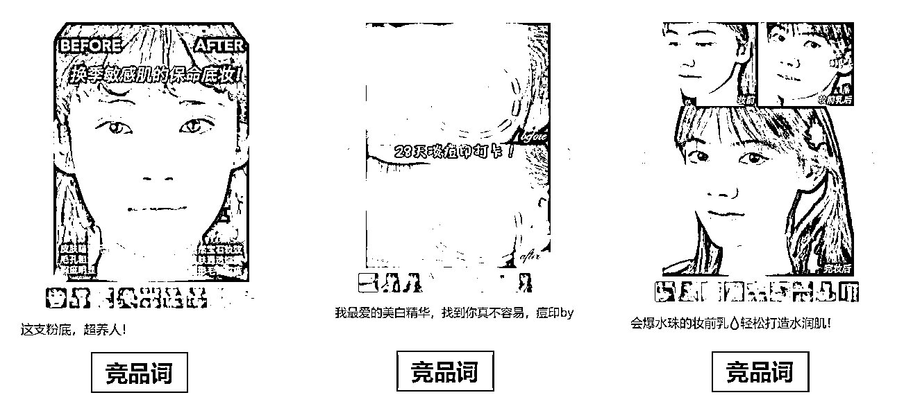
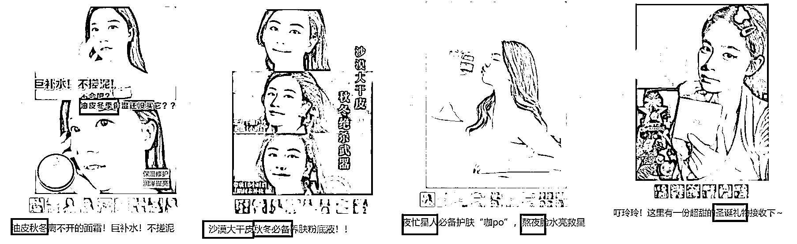
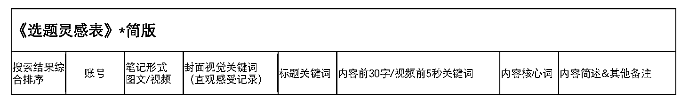

# 解码小红书搜索：不同关键词在笔记里该怎么玩

## 小红书搜索词分层拆解

作者： 加麻

日期：2024-06-11

关键词大致能分成五类：品牌+产品词、功效词、竞品词、行业类目词、人群与场景词。

ps：老板一般更在意品牌词和核心产品/功效词，投放时要做到 24 小时精准匹配抢首位，预算单独开、不限额、抢位权重拉满。

以雅诗兰黛举例拆解：

品牌产品词：雅诗兰黛 DW 粉底液 核心表达有 DW 粉底、Doublewear 粉底液、甚至只写粉底液
功效词：控油、补水、美白、修护、抗皱等
类目词：粉底液、水乳、精华、面膜等
竞品词：竞争品牌的品牌词
场景词：熬夜、加班、秋冬、春夏、节日等
人群词：上班族、熬夜党、学生党、30 岁群体等

一、品牌产品词
用户搜品牌或产品名，往往是刚接触这个品牌，想在小红书里快速判断卖点、口碑和综合实力。这一波流量是高度精准的新客，必须用最易消化的方式把品牌想说的话讲清楚。

这类笔记要把品牌名、产品名、带 LOGO 的商品图直接放在标题和首图上，适合做品牌合集型笔记或促销型笔记，去撬动转化意向强的用户。

二、功效词
功效词的转化潜力同样很高。小红书内容的核心就是回答“搜这个词的人能得到什么价值”。功效词最好在选题阶段就预埋进去，后续用短语匹配做补充，再根据数据反馈拓展长尾。

创作时要围绕单一具体功效展开，标题、封面、正文里都要出现对该功效的明确描述，比如前后对比图、成分功效解析等，让搜相应功效的用户更容易点进来并产生转化。

三、行业/类目词
用户搜类目词时，90% 已有模糊需求，想看这个品类现在流行什么、大家都在推什么、有没有新玩法。这时候靠硬广式卖点很难打动人，需要用高赞内容去拦截。

标题或首图里必须复现这个类目词，比如用户搜“粉底液”时，看到标题/封面出现“粉底液”的笔记，点进来的概率会大幅提升。

四、竞品词
截流用的关键词。不同产品线要配不同的竞品词，比如 A 牌粉底液的对手是 B 牌，那投放 B 牌关键词时，就要用高热度的粉底液笔记承接。

用竞品词做的笔记要注意避坑，别在标题或首图直接露出自家品牌名，先放大产品功能和效果，品牌安利放到文末，否则关键词转化会掉。

五、人群/场景词
小红书营销绕不开场景化思维，要想清楚谁、在什么情况下会用你的产品。

公式很简单：什么人 + 什么场景 + 得到什么效果
结合当下天气、人群习惯如熬夜加班学生党、以及节日节点来做选题，首图和标题一定要把场景词高调呈现，才能抓住近期有需求的潜在购买者。

加餐一：
笔记生产方法论：从品牌自身特性出发，结合热搜词锁定【核心词】，再去挖该词下的热门笔记共性

1. 在 App 发现页搜核心词组合，如“特性词+品类词”、“人群词+功效词”，例如日系摄影照、婚期化妆等。
2. 按时间倒序筛，优先看近 2 个月内赞藏高的笔记，内容时效性更强。
3. 整理《选题灵感表》，萃取优质笔记的用户偏好共性，总结可复用的规律。

加餐二：**一篇能跑量的笔记基本功**

✓ **一篇只讲一个卖点**
小红书一篇笔记对应一个话题。贪多求全等于什么都抓不住，不建议乱蹭关键词堆砌，体验差且不利于曝光。

✓ **首图和标题决定点击**
首图/封面+标题是点击率的核心。优质封面和标题能快速抓住注意力，提升点击进而拉高流量。投放时一个创意至少积累 3000-5000 曝光再判断点击率，低于基准线就优化封面标题。

✓ **别做标题党**
分发不只看点击，还看互动和关注。标题与内容不符，点击高但互动差，后续流量会被限。

✓ **严禁刷量作弊**
互赞群、刷数据等行为会被判定为数据作弊，对账号有累积且不可逆的惩罚。

* * *

评论区：

暂无评论

* * *