# 抖音图文不止能带货，图文 SEO 搜索流量这条路也值得试试

> 原文：[`www.yuque.com/for_lazy/zhoubao/alikxmbi8iodsyah`](https://www.yuque.com/for_lazy/zhoubao/alikxmbi8iodsyah)

## 白杨 SEO：除了抖音图文带货，抖音图文 SEO 搜索流量方法也可以看看~

作者： 白杨 SEO

日期：2024-06-14

前言：写这篇的缘由很简单，有朋友之前跟我聊过抖音图文搜索的事，就整理出来分享一下。希望对想做抖音搜索流量的同学有参考，特别是做 B2B 细分赛道的，建议收藏转发。

文章大纲：

1、抖音图文到底是什么？常见的图文带货玩法是什么？

2、抖音图文 SEO 究竟是什么？能不能用？

3、抖音图文 SEO 如何拿到精准搜索流量？【重点】

4、为什么 B2B 垂直细分赛道更适合做？

**抖音图文是什么？常见的图文带货是什么？**

说白了，抖音图文就是在抖音里发图片加文字的内容。图文概念再通俗不过了，就是图+文。

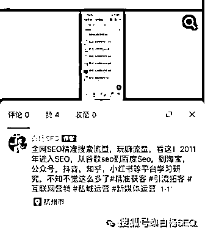

一张图还是多张图都可以，文字可以叠加在图片上，也可以写在发布时的正文里。抖音 2016 年 9 月上线，主打短视频，2021 年 10 月才开始内测图文功能，到现在也已经有三年多的时间了。

外界普遍认为图文是抖音对标小红书种草的尝试，不管是不是，至少它让抖音除了视频之外，还有了图文承载用户需求的入口。

抖音图文带货是什么？

简单讲，就是借助图文内容在抖音上做商品推广、实现带货拿佣金的一种方式。呈现形式大概是这样：

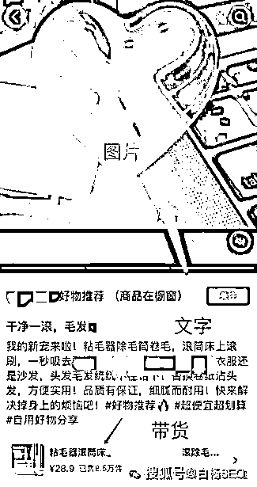

图文现在火成什么样？可以说已经成了自媒体变现的一套常用打法。赚不赚钱因人而异。

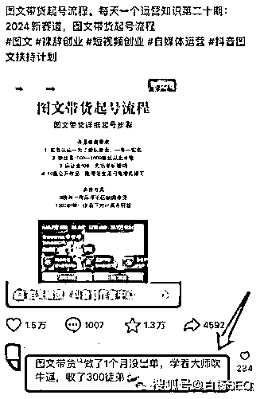

我的个人看法，仅供参考。如果想玩图文，可以亲自去试试看。起初大家只是用图文记录生活，后来有人开始卖货，也有人开始做搜索排名引精准流量，用法不同而已。

**抖音图文 SEO 是什么？靠谱吗？**

提到抖音图文 SEO，可能很多人会陌生。毕竟很少有人把 SEO 和抖音图文绑在一起讲。

简单解释下：抖音图文我们知道了，就是在抖音发图文。SEO 的本意是搜索引擎优化。合起来就是做抖音图文的搜索排名优化。更直白点，就是用图文内容去占领抖音搜索关键词的排名。

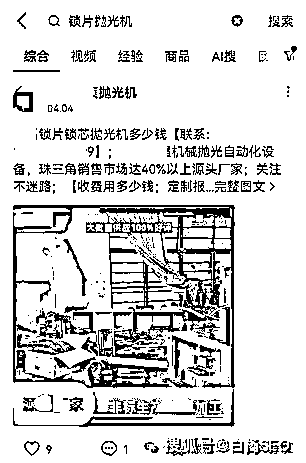

从图上看，你可能觉得只有正文里有关键词才会被收录排名，其实不然，图片本身出现关键词也有效。下面会结合实操展开。

那靠谱吗？靠不靠谱最终要靠实操验证。抖音图文 SEO 并不是 universal 通吃，适合的场景主要集中在 B2B 垂直细分领域，具体原因后面会说明。

**抖音图文 SEO 精准流量怎么做？【重点】**

总结下来，主要抓住这几块：

1、用 SEO 思路先找准关键词

第一步要有核心词，也就是你的产品或服务主词。比如做线路板生产的，核心词就是线路板、PCB。做全网 SEO 精准流量的，SEO 就是我的核心词，精准流量也算。

确定核心词后，再扩展出与业务相关的长尾流量词。可以借助 5118、爱站这类 SEO 工具。以爱站为例：

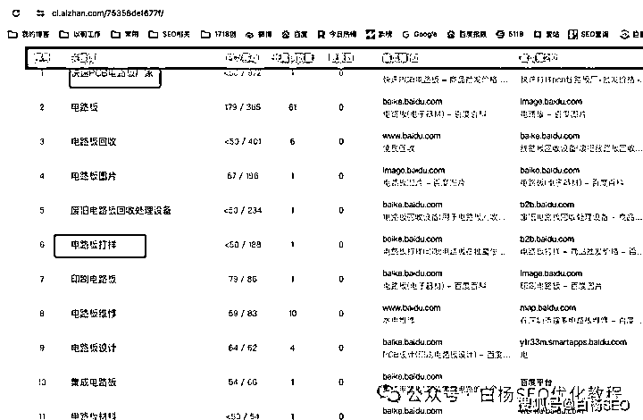

觉得工具指数不准，也可以看巨量指数里的抖音搜索指数做参考：

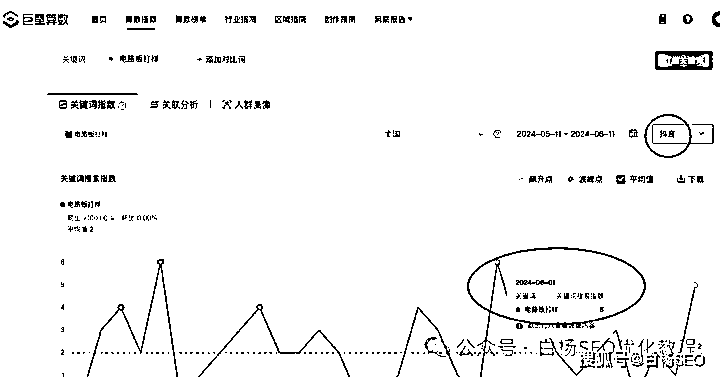

拿到一批流量词后，再去抖音搜索框里看下拉词，收集与业务强相关的用户真实搜索词。

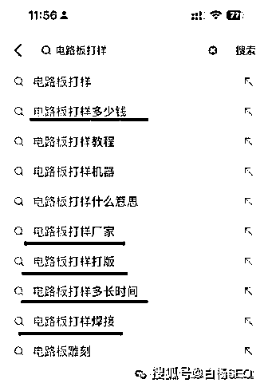

同时，用这些流量词去看看同行在做什么，用户更偏好什么内容，做之前可以先做竞品参考。

2、关键词布局要自然

所谓布局，就是把目标关键词合理放进你要发的图文里。除了正文描述，图片上的文字、标签里都可以放。

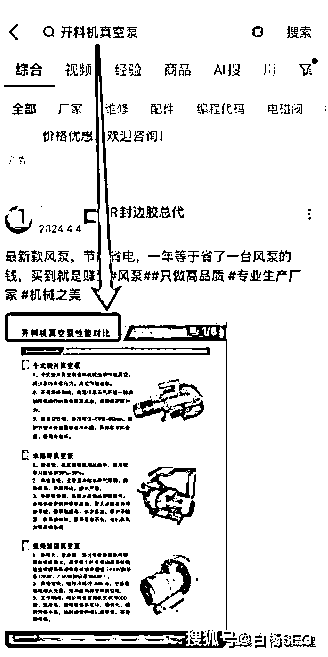

注意别学老式百度 SEO 那种堆砌关键词的做法。图片、正文、标签任一位置出现一次，位置自然即可，密度不用刻意堆。

3、素材与音乐的基础要求

图片必须是原创且高清，这是底线。原创容易解决，自己拍产品即可，高清建议用好点的手机或相机。

抖音图文尺寸，横版 1080*608px，竖版 1080*1920px，竖版更常用。图片要清晰展示产品、功能、卖点，同时配一个合适的热门 BGM，提升完播和停留。

4、标签用好

发布图文时可以加 # 标签，最多 5 个。标签一方面能获得抖音的系统推荐，另一方面就是关键词占位。

标签建议和内容强相关，并且可以从小词到大词排列。比如发一篇《抖音 SEO 怎么做的图文》，标签可以是 #抖音#抖音排名#抖音SEO#抖音SEO优化#抖音SEO怎么做，也可以换成抖音关键词排名、抖音搜索优化等相关表述。

5、善用合集功能

想让作品排名更稳，最好在发布时把图文放进一个合集。SEO 里，合集的权重通常高于单篇作品。

可以在抖音 PC 后台创建合集，后续发布时一键归类。

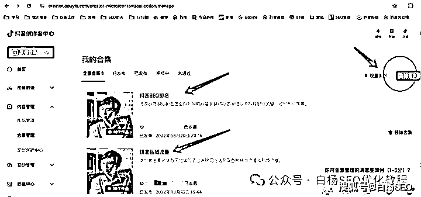

6、增加互动引导评论

发布时可以加提问、投票等互动设计，鼓励用户留言、收藏、分享。用户行为是搜索排名的重要信号之一，尤其是真实评论。

以前有人靠刷数据，现在平台更看重真实的点赞、收藏、评论。评论尤其重要。

有人会问真实数据从哪来？市场上肯定有“五毛党”“水军”“多账号”等操作。白杨 SEO 不主推这些，但要说明的是，只要有排名需求，就会有研究和玩法。说好听点是合理利用规则，说难听点是钻空子，大家自己把握。

7、排版模板+批量矩阵

光靠关键词和数据是不够的。

第一，图片上的文字排版要干净美观，最好做成固定模板。小红书的热门笔记模板思路就可以借鉴。

第二，考虑矩阵化批量发布。SEO 精准流量里一直存在质量派和数量派的分歧。数量派认为流量面前数量就是王道；质量派更看内容质量。

个人一直偏向质量，但对传统企业来说，自己做内容能力有限，初期可以用数量来占位。长远来看，各平台最终都会打击纯垃圾内容，毕竟用户体验是底线。

**为什么一定要 B2B 垂直细分行业更好？**

讲完怎么做，你可能会问：这流量有什么用？能转私域、能成交吗？为什么特别强调 B2B 垂直细分？

先说用途。如果是 B2B 业务，决策链条长，需要先咨询，你可以在图片或正文里留电话，落地页或私信也能放联系方式。企业蓝 V 认证就可以直接展示地址和联系方式。

如果是个人操作，多备几个号，做搜索流量本来就是这样，心态要放开。

再说为什么 B2B 垂直细分好做。

2C 赛道前十名基本都被视频占满，竞争大、内容同质化严重，视频本身也更直观。

B2B 的垂直细分领域不同，很多流量正在从百度迁移到抖音。抖音生态里这类内容本来就少，图文和视频的供给都不足，这就形成了机会。很多传统厂家只会投广告，下场做内容的不多；第三方服务商也对行业不够懂，这就是机会窗口。

有人说抖音图文在视频面前不算主流，毕竟抖音是短视频平台。但在特定细分赛道，情况完全不一样，随便搜一下就能感受。

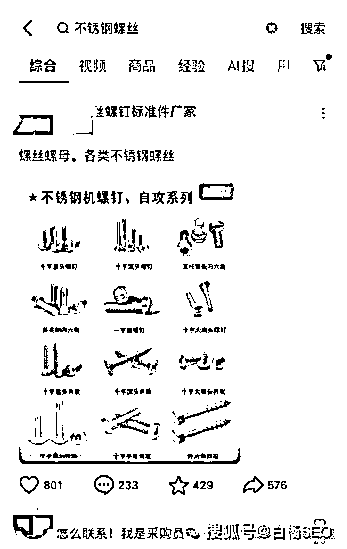

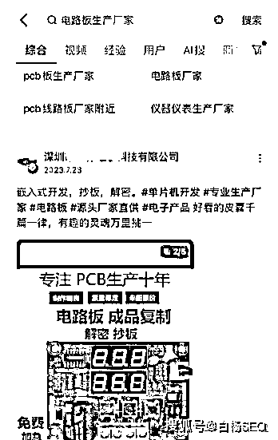

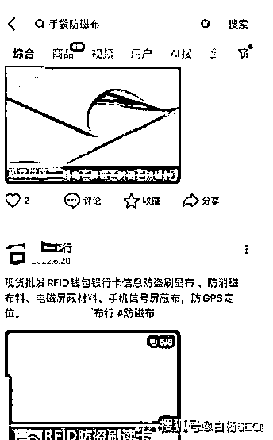

最后提醒一点，如果想做，千万别相信“保证上榜第一”“XX 系统包上榜”之类的承诺。关键要看这个关键词值不值做，是不是你的目标用户在搜，是否产生业务价值。不要轻易预充几千上万去买系统，有疑问可以找我聊聊，我身边也有朋友在做这块。

如果你觉得这篇内容对你有帮助，欢迎继续关注，也可以转发给需要的人。谢谢。

**作者介绍：**

白杨 SEO，专注 SEO 十年，全网 SEO 流量实战派，对互联网精准流量有深入研究。全网同名：白杨 SEO。

* * *

评论区：

暂无评论

* * *