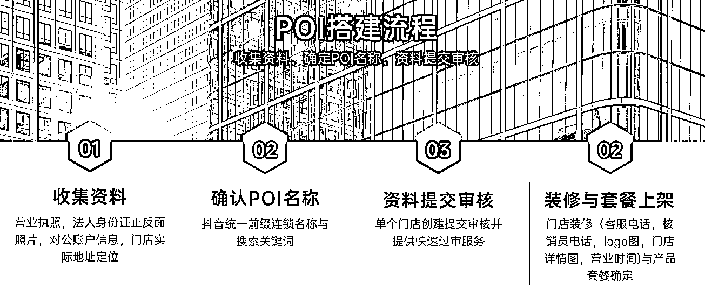
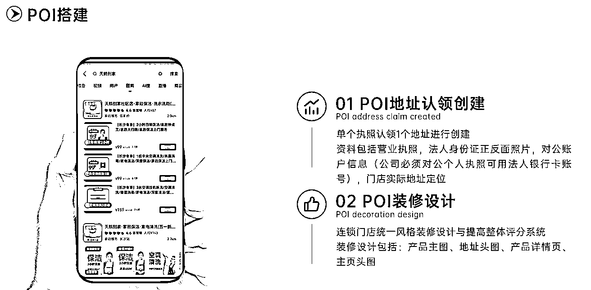
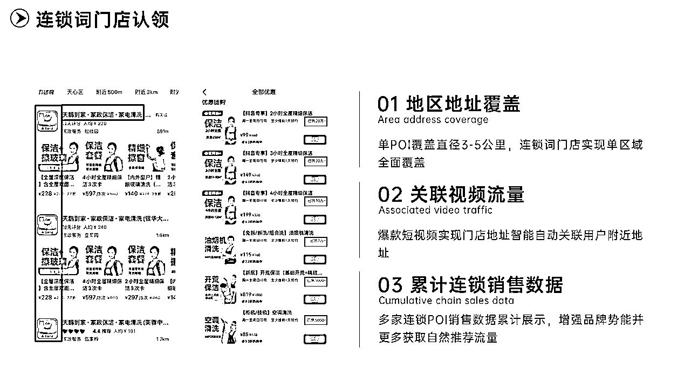
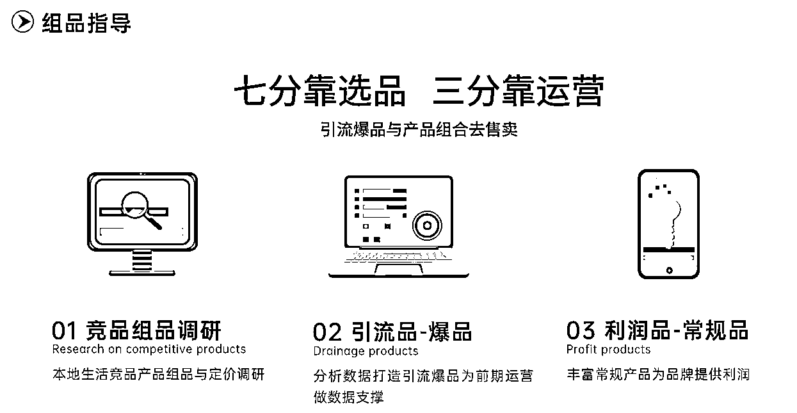
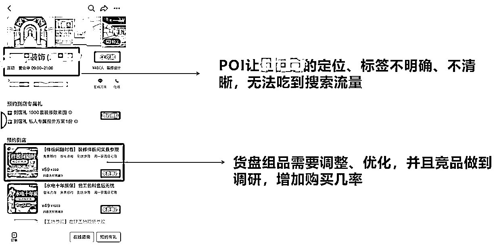
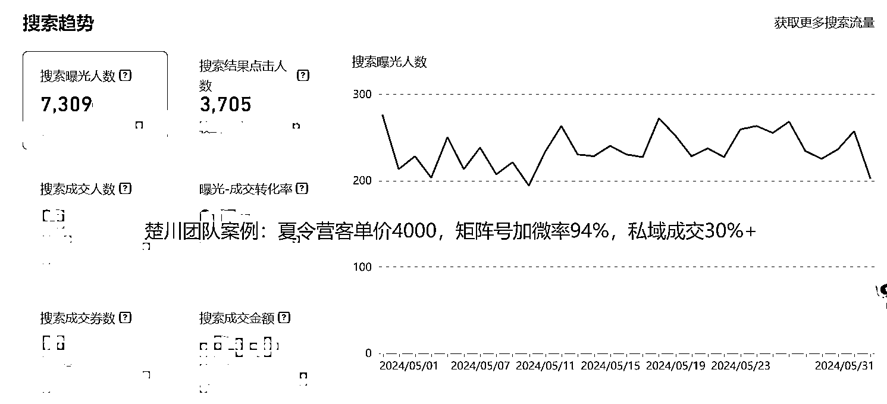
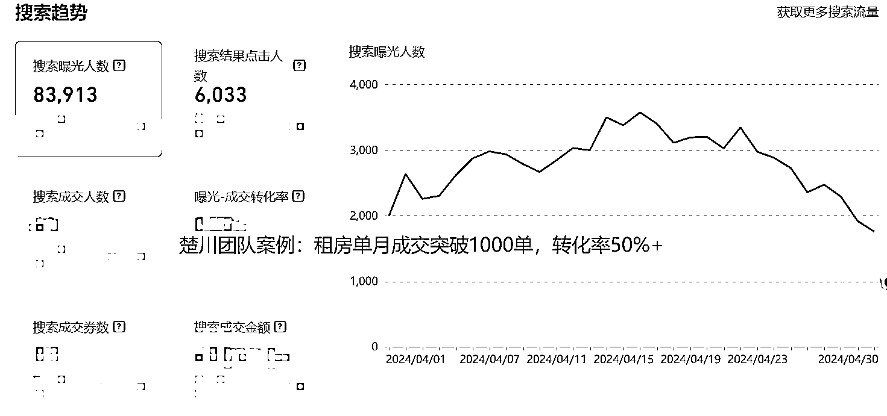
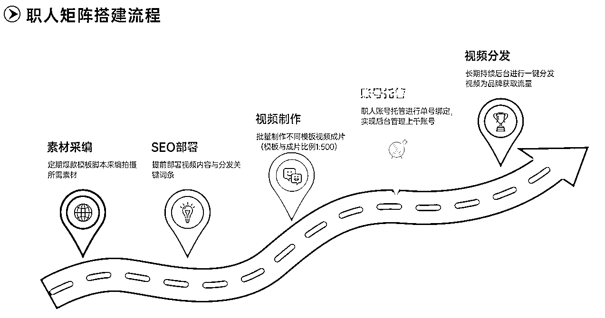

# 那些在抖音卖不好的实体品牌，往往连这门基础功课都没做
作者：龙哥

今年抖音本地生活依旧势头很猛。平台换了新管理，整顿大类目，狠抓服务品质，内部经历了一轮大调整之后，商家管理体系总算有了雏形，本地推也开始全面发力，给商家带来实打实的扶持。抖音用三年时间证明了短视频平台的一个可能性：实体生意，完全值得用短视频重新做一遍。那些美团一直没能渗透进去的类目，抖音靠着短视频一步一步打了下来，如今本地生活体量直逼美团，正在迈向万亿级大关。

但在这个大机会面前，很多实体品牌却始终卖不出声量。我们聊了不少连锁品牌，发现一个共同的毛病：从0到1的阶段，大家的“营销基础建设”实在太弱。结果就是冷启动跑得慢，或者流量起来一波、卖着卖着就迅速衰减，怎么拽都拽不回来。

我们自己接手的一些客户，前期沟通也经常看到这种问题。POI没有搭建和装修，抖音SEO没部署，职人矩阵完全空白，组品和经营分一塌糊涂——这些基础没打好，我们的营销节奏被严重拖慢，服务利润也被拉低。更尴尬的是，品牌方自己压根意识不到这些有多重要。

我也听同行说过不少类似情况：很多品牌入驻抖音，完全就是野路子。门店SKU直接照搬上架，然后达人探店+品牌大场一顿狂轰滥炸。这像极了斗地主开局就把王炸和四个二全甩出去，后面就没牌可打。传播一轮比一轮疲软，因为一开始就没想清楚门店承接、线上组品、真实投产比，最终三率难看、ROI低到打击信心。拿不到持续结果，几乎是必然的事。

那到底什么是抖音生活服务的“营销基建”？我的理解是：你在抖音开店，跟线下开店一样，也得选品、装修、做招牌、发传单、搞开业。这些动作在线上再来一遍，后面的营销速度才能越跑越快。否则流量一冲起来，门店基础和流量承接直接崩盘。

具体展开，就是四个方面。

**第一，POI要连锁化经营。**  
这是抖音开店和上团购的第一步。做好POI上架、名称优化和连锁化布局，就是在帮品牌做辨识度、圈流量、筛用户。例如“天鹅到家-家政保洁-家电清洗”，等于是给抖音店招做了两层业务标签，流量提前被筛选，核销率自然更高。同时做云连锁化，还能让多个POI流量彼此共振。但现实是，很多供应商只做到了简单上架甚至擦边入驻，运营细节根本没融入，后期问题一大堆。

**第二，团购页面要认真装修。**  
POI入驻后，下一步就是“店内装修”。你得搞清楚在抖音上卖什么、怎么针对平台特点定品、怎么优化详情页，绝对不是简单上传就完事。把生意搬到抖音，而不是平移照搬，这值得每一个老板和运营想明白。另外，产品详情页、SKU组图设计也不能糊弄，一旦违背品牌VI和调性，反而会掉粉或吸引来一堆非目标用户。

选品和组品方向对了，流量爆发几率能提高50%；SKU的图片和命名做得专业，消费决策时间就会缩短，转化率跟着上去；页面装修如果符合平台喜好，抖音还会多给20%~30%的流量推荐。

拿一个家装客户的诊断案例来看，会更直观。

**第三，抖音搜索SEO流量要提前部署。**  
现在抖音搜索流量可以进到短视频、直播和POI页面，某些路径的成交最高能占品牌总成交的70%以上。但这块池子，大多数人还没看见。对实体品牌来说，很多服务不是即时需求，用户往往是在有需求的时候才搜。你排名越靠前，成交概率就越大。目前实体品牌的搜索成交占比已经超过20%，放着不管，就是白白错过。

关键词的布局，重点要看POI连锁词、视频内容里的声音/画面/文案关键词，以及用户搜索词的占位。这是我们从实战里总结的核心因子。不过2023年抖音SEO机制更新了十万次以上，谁的方法论都不敢说恒定有效，只能边做边摸索。还有一点要提醒：抖音SEO是慢工出细活的领域，至少30天才能看到漏斗和答案。没有耐心，就别指望躺赚。

**第四，职人矩阵体系要尽快搭建。**  
在抖音上发传单不丢人，没流量才痛苦。职人视频是本地生活未来2-3年必做的工程，也会成为企业在平台上的营销壁垒。当达人流量不稳定、投放预算收紧时，靠什么填补流量低谷？答案就是职人矩阵。建议把职人视频变成日常动作，每天保持3条以上更新，日积月累、厚积薄发。我们靠这套打法已经拿到大量结果。毕竟，顶天立地，不如铺天盖地。

以上就是我理解的本地生活基建。实体品牌想在抖音持续拿结果，这四项基本功一定要做。希望每一个品牌，都能在这波流量里拿到自己满意的成绩。

