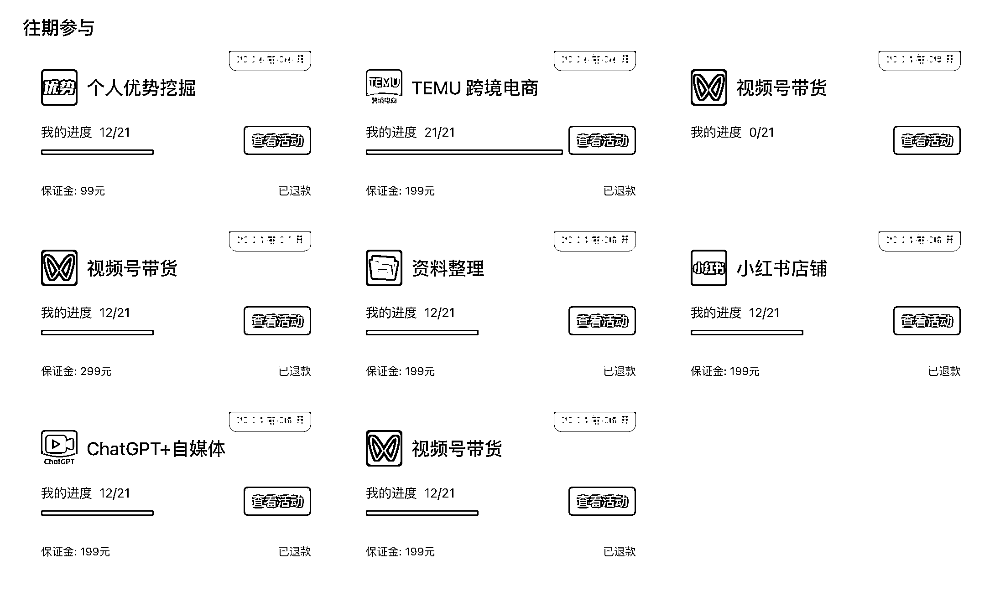
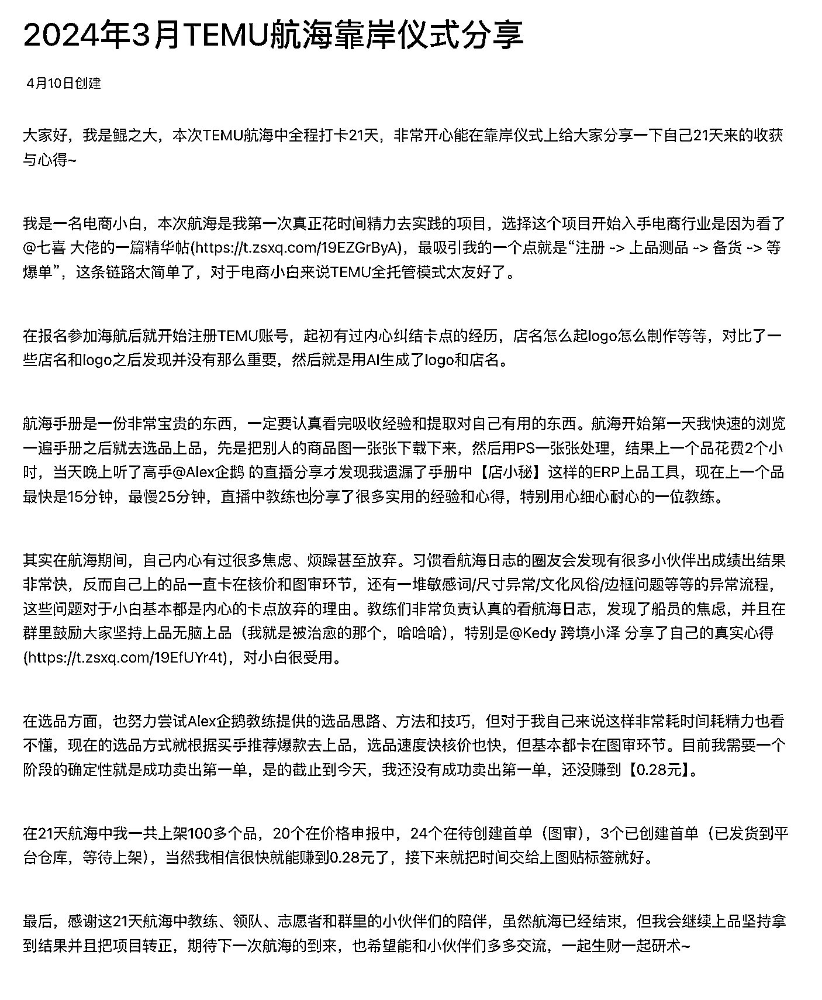
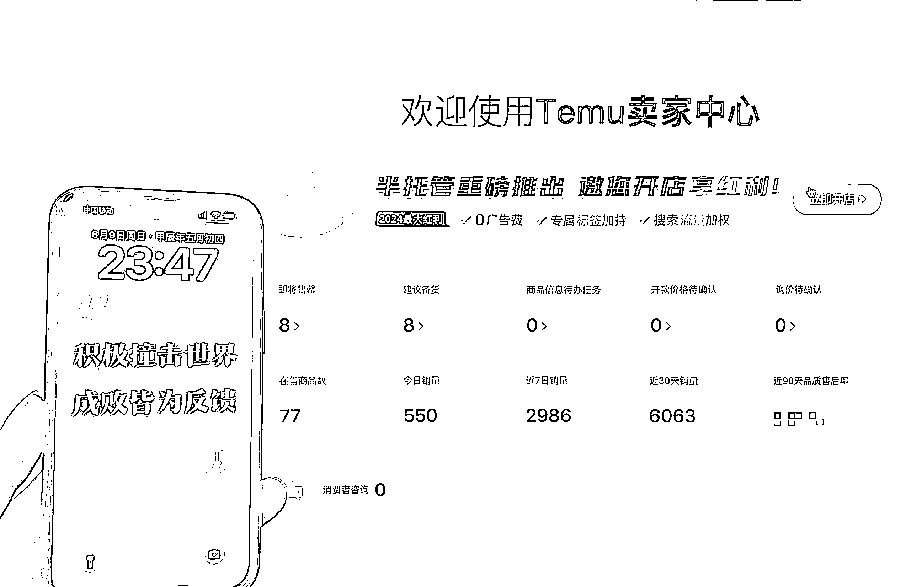
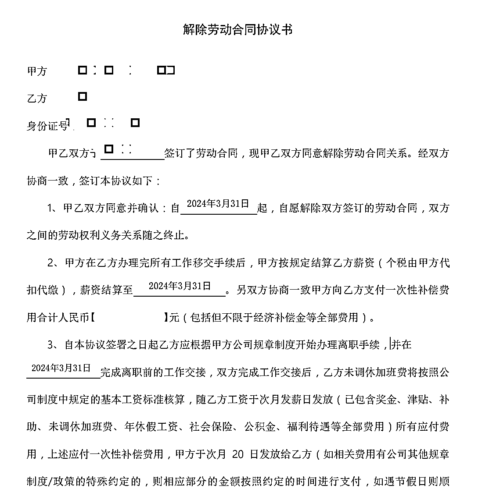

# 从程序员到 TEMU 日销 500+：一个电商小白的 3 个月航海复盘

> 原文：[`www.yuque.com/for_lazy/zhoubao/erxfgnn49xk35535`](https://www.yuque.com/for_lazy/zhoubao/erxfgnn49xk35535)

## 电商小白在 3 月 TEMU 航海销量从零到稳居 500+日销，我做了什么？

作者： 鲲之大

日期：2024-06-12

先说结论。

我觉得自己只做对了两件事：**死磕自己认为正确的方向，并持续修正航向。**

**一、我的背景**

我叫鲲，在广州，**鲲之大**想出去闯闯。

2023 年 4 月，我因为一篇公众号文章付费加入了生财。那时我在职场上干了 8 年程序员，一直在做基层搬砖，没有升职的机会，今年 3 月我主动递交了离职申请。

我也是个纯电商新手。2023 年 5 月我报过小红书、视频号、写作类的航海，结果全军覆没，零反馈、坚持不下来，对副业航海的打击很大。但也正是在那几段经历里，我总结出了关键经验：新人一次别报 3-5 个船，时间完全管不过来，一天都不知道自己在忙什么。

从上图能看出，2023 年 6 月因为同时报名太多航海项目，信心被打垮了大半，之后就再没参加过航海。那 12 个打卡项目，基本都是糊弄过去的状态。

**二、为什么锁定 TEMU**

在生财待了一年，我看过上百篇精华帖，发现很多项目的底层商业逻辑其实大同小异，**尤其是互联网类项目，核心在于平台在升级，我们要跟着换位置。**

之前的小红书、视频号、闲鱼，归根结底都是带货卖货。2024 年 3 月我选择 TEMU 的航海，关键点在于它的全托管模式。

全托管做跨境电商，本质上就是**选品、选品、选品**。这个认知是看了@七喜 大佬的分享后被点醒的 [帖子入口](https://wx.zsxq.com/dweb2/index/topic_detail/188442825188112) 感兴趣的可以去看一下。

后来翻生财旧帖才发现，@通路 大佬在 2022 年 9 月就发过一篇关于 TEMU 的精华帖 [帖子入口](https://wx.zsxq.com/dweb2/index/topic_detail/585428888811244)，看到这个帖子后去做的圈友在吗？评论区聊聊。没人回也正常，可能都在忙着贴标签和打包发货，哈哈。

**好项目一直都在，只是我们没认真研究老帖，再结合自身执行。**

**三、航海到底给我带来了什么**

参加航海，别指望 21 天内能赚钱，对新手来说，哪怕 1 块钱都别想 

**这就是 3 月航海结束时领队让我写的复盘，21 天认真打卡，最后依然零成交。**

航海里有些圈友第二天就出单了，他们大多是提前预热。跟在后面的人需要时间去追上，别在中间内耗。航海里还能遇到一群目标一致的人互相交流，特别是那些已经拿结果的教练。

@alex 企鹅 在直播里分享非常坦诚，什么问题都手把手解答，是个很有冲劲的年轻大佬。

@跨境小泽 小泽教练特别有耐心，一直鼓励上品、坚持做，帮你把杂念排空，也很靠谱。

有幸线下也跟两位聊过，有结果的人思维确实更超前，受益匪浅。

所以航海对我的价值是：

**1、航海手册能最快带你了解一个新项目的商业逻辑入门版**

**2、和一群同路人一起做同一件事，分享本身就是燃料**

**3、找到能带路的前辈，向结果学习**

**4、快速验证这个项目适不适合自己，值不值得继续投入**

**四、3 个月是怎么做到日销 500+的**

6 月 9 号我第一次冲破 500 单的日销，之后基本都稳定在 500 单以上。

目前在售商品 77 个，已清仓下架 5 个，也就是说总共上架过 82 个，跑出热销标签的有 18 个，占比约 20%。部分商品刚上站还在跑量期。

这个账号就是从 3 月份的 TEMU 航海开始做的。想了解我当时的踩坑过程，可以去翻 3 月 TEMU 航海日志，里面全是心酸。账号破百单是在 5 月中下旬，所以近 7 天的销量已经能追平 4-5 月的总和了。

总结下来，**销量取决于热销款和库存管理。**

1、上新跑量是核心。小泽教练航海期间一直强调“**多上品，不要怀疑自己，上品能解决大部分烦恼**”，[消灭烦恼入口 1](https://wx.zsxq.com/dweb2/index/topic_detail/2855822225454121) [消灭烦恼入口 2](https://wx.zsxq.com/dweb2/index/topic_detail/811425221282852) 这两篇都是小泽老师写的，对新手的自我怀疑很管用。上新后跑出热销就赶紧备货补库存，基本就能稳住单量。

2、每天盯库存和销量，提前算好备货量。

3、多看 TEMU 前端正在热卖的品类，跟卖近一个月内的热销款，跑出热销的概率会高很多。

就这些干货了，我还在学习，后续再分享。

想玩更大的朋友可以去找小泽教练和 alex 企鹅教练切磋。

**五、现在做 TEMU 还来得及吗**

从程序员转到 TEMU 做跨境，我的真实感受：

1、上手门槛低，有手就能开。
2、没有选品和电商经验的话，会很坎坷，需要时间磨经验。
3、平台低价跑马听起来吓人，其实很多品还有利润，关键是自己别乱降价。
4、测品有风险，可能滞销，也可能因侵权直接不给上架。
5、资金占用大，几万到十几万很正常，回本周期偏长。
6、库存管理难，囤多了回笼慢，囤少了断货掉流量。
7、平台规则多，新手坑很多，时间、人力、资金都是考验。**不过如果人力和资金不是问题，主要就是时间成本。**
8、副业玩家别贪多，20 个品左右去试，看能不能出热销，有了再放大。放大就需要仓库、人力、资金和更多时间。
9、TEMU 上低客单的品更容易跑出热销且利润可观，中客单容易被罚款吃掉利润，高客单可能更适合半托管。

第一次写帖子，水平有限，请前辈们多包涵，也请吸收过精华帖的老哥**海涵**。

后续有新经验会继续和大家分享～

扬帆正当时，航海出名师

链接他人得心志，感恩生财逢雨时

========================================================================

最后，这也许就是程序员的归宿吧～

加油同学们，哈哈哈！

* * *

评论区：

明微 : 我是 6 月份刚加入的新圈友，新手小白一枚，准备从 TEMU 开始实战，请问能连接您吗？

* * *