# 一个平凡人做海外电商，从零到千万的实战回顾

> 原文：[`www.yuque.com/for_lazy/zhoubao/ycz3giz1g7ln9gyo`](https://www.yuque.com/for_lazy/zhoubao/ycz3giz1g7ln9gyo)

## 跨境市场里的机会，我用亲身经历讲明白

作者：国民弟弟的跨境十年
日期：2024-06-13

今天不聊虚的，直接讲我在跨境圈摸爬滚打后看到的门道和方向。

先交代一下背景：我，一个从小镇走出来的做题家，三十岁那年决定all in跨境。到2023年5月，账上现金已经超过350万，每个月稳定到手40到60万。现在人住美国，继续找机会。这篇稿子最早发在2023年6月，如今再看，依然有参考价值。

补充一下：到2024年6月，我创业已经两年多，资产早就过了千万。为了安全，不再晒了。**感谢这个圈子，确实学到很多。**

## 先认识我

1. 我叫国民弟弟，频道是“国民弟弟的跨境十年”。

现在是一家公司的跨境项目合伙人，同时也玩Amazon的价差和批量供货。写这些不是为了卖课，而是想整理一下这18个月的打拼过程。继续努力。

2. 个人做跨境要面对什么？

18个月里，我几乎试遍了跨境领域的各类主流玩法。

最后才慢慢跑通一条自己的盈利路线。我算是典型的草根，希望这些经历能让更多人看清现实。当然，也欢迎各位高手来指正。

3. 这篇长文过万字，内容很密。

建议按目录慢慢看，先**收藏**，再关注频道，跟着我的视角看看平凡人的奋斗。

**以下是旧文重发，也补充了新内容。**

## 先晒点实际的东西

直接截存款图，绝对没有炫耀的意思，比我厉害的人太多了。

中国银行账户有257万，支付宝大概92万，加起来人民币现金是349万。

做Amazon还有很大一笔钱压在货里，懂的都懂。美元也存在美国公司的户头里，国内平台不好晒，就先不放了。

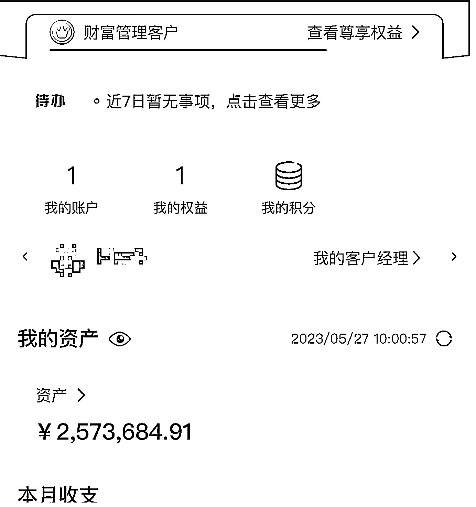

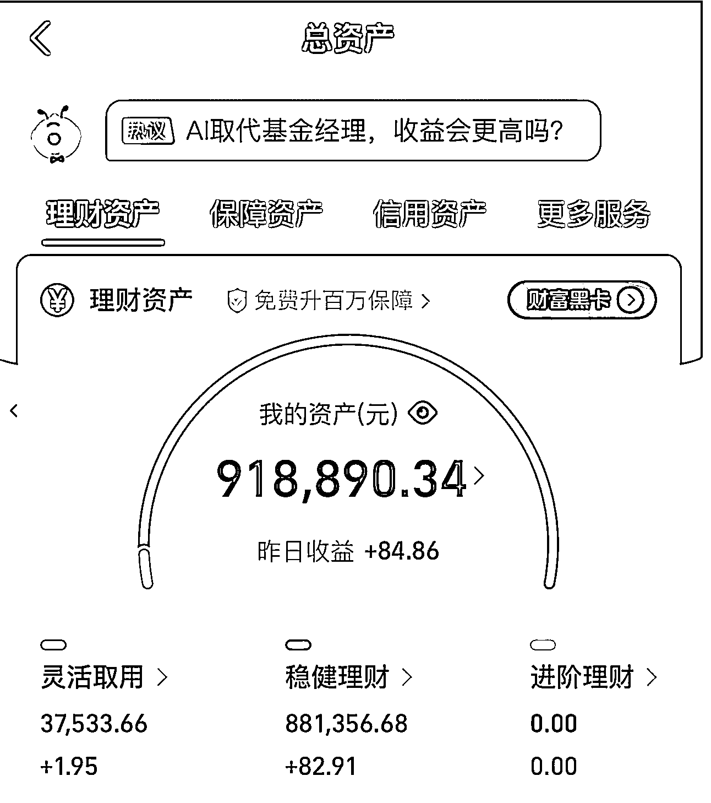

龙珠老帖在这里，继续往下也行。 [`articles.zsxq.com/id_o242ukpwrsb8.html`](https://articles.zsxq.com/id_o242ukpwrsb8.html)

****在这个社群待久了，鱼丸来约稿，说Bruce你这经历挺有意思，不如在圈子里讲讲。****现在这篇还成了精选文章。

****感谢大家的推动，我在群里也收获了大量认知。这里就当是一个普通人坦坦荡荡说说自己的故事。****

****不喜请轻拍，我真的普通到不能再普通。****

大家好，我是国民弟弟的跨境十年Bruce。这篇写于2022年4月，属于直接把旧文搬来。我经营着一个美国本土Amazon店，主要做价差和批发。从零开始，半年时间，月销售额从2000美元做到2万美元，副业每月能给我带来2万多人民币。目前我还在跨境公司当项目合伙人，同时搞自己的事。这篇就讲讲副业是如何从0起步的，以及我对小成本创业的真实感受。

### 1. 2022年4月的状态

话不多说，这是2022年4月某天主力账号的截图。30天卖了2.6万美元，货品成本大概是售价的三分之一，差不多8000美元；毛利大概是成本的50%，也就是4000美元，折合人民币2.6万。

另外，到2022年10月，月销售额已经到6万美元，利润也在5到6万人民币的水平。

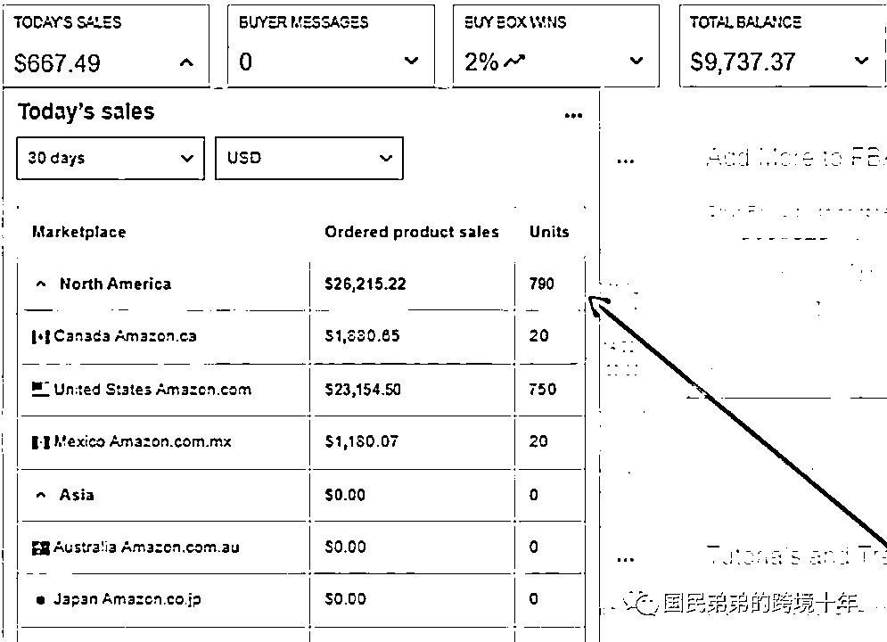

后面还有带时间戳的细节图。

这是我随手截的单项产品收益。从时间和我的SKU编号方式能看出来，这件货的毛利基本达到翻倍。

### 2. 我人生的转折点

先讲讲自己：普通二本毕业，学了个万金油专业。毕业之后做外贸，中途还跑去东南亚过了一年gap year。后来又到一家公司当户外向导，一年只工作半年，剩下的时间就到处跑。钱不多，只能穷游。最惨的一次，在飞机上向空少要了四盒飞机餐，拿回去吃了两天。机票倒是公司报销的。

真正开始按部就班上班，是2016年进入万科教育板块。后来因为一些人事斗争，离开了那家教育公司。虽然在那行待了六七年，但确实没攒下什么。**算是吃了不少亏，也混了不少日子。** 我拿着打工人的工资，除了做事踏实，也没什么亮点。到了30岁，**放在人才市场基本就像被遗忘的角落**，只有小公司实在缺人时才会找我。

#### 做跨境前，最后一份正式工作

当时在万科做户外教育，公司让我去负责宁波的业务。很快就和几个深圳同事一起，坐了早上10点的深航航班，两个小时后，我们这个小团队就落到了一个完全没去过的地方，一切都要从头开始。新城市，新场合，每个角落都是未知。第一周租了5天车，把城市大概跑了一遍，先确保不迷路。

前三个月，除了睡觉，就是工作。我们四个伙伴一起打鸡血，虽然不是天天通宵，但也基本连轴转了三个月。白天开会讨论引流方案和活动设计，晚上头脑风暴、复盘、调整。

团队里，我算是唯一有行业经验的人，其他人只有两个月的经验，我还要负责带新人。

更绝的是，我们组里还有个刚满18岁的小朋友。等于带着“童工”和一堆新手，在一个谁都不认识的城市里找流量、做业务。

作为项目负责人，我晚上唯一的解压方式，就是给同行朋友和各个分公司的同事打电话。我到现在还记得，在一栋平楼的沥青小阳台上，我边打电话边踱步，从东走到西，再从南走到北，活像热锅上的蚂蚁，拼命想找到新业务的流量入口。

但现实就是欲速则不达。客户不会马上进来，尤其是做小朋友生意的，更需要长期活动建立信任。我自己也是流量新手，不太会用各种渠道去引流和成交。于是，团队在忙碌中撑了一年，虽然在公司内部拿到了夏令营最佳营期的口碑，但利润报表上的亏损骗不了人。后来团队被拆散，几个月后我也离开了。

因为对这个行业已经很失望，我决定转行，去做跨境。我付费找过两位跨境领域的老前辈做电话咨询，只是想确认自己的选择没问题。**我的目标就是：起步别走错。这个时代试错成本太高，宁愿赚得少一些，也不想最后落得一地鸡毛。** 2020年底，我从零开始进入新赛道，先到深圳一家小公司做Amazon，中途换过一次，后来到了一家规模更大的跨境公司做项目合伙人。2021年底，我开始悄悄经营自己的副业，到现在，副业的收入已经超过了主业。

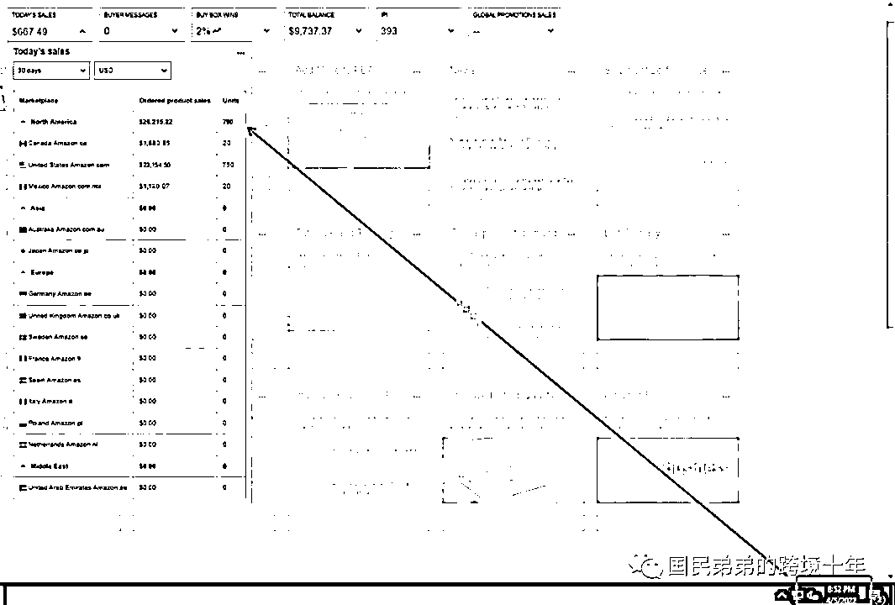

### 3. 为什么我要选跨境？

2018年，我脑子里就开始转这个念头。当时我给唯一一个做Amazon的同学打电话叙旧，聊完发现，那个小学弟已经年入50万了。我简直不敢相信。那时候我在公司做项目经理，一个月1万，扣掉税和公积金，到手8000。一对比，才真正觉得选对行业比经验重要太多。老话说，男怕入错行，女怕嫁错郎，自己不摔一跤，根本体会不到。

再往大了看，这个社会上绝大多数人都是平凡的。你、我，包括正在看这篇文章的朋友，都得承认，95%以上都是平凡人。如果你不是，那你就属于那1%的老板了。

### 4. 平凡人想逆袭，应该怎么做？

答案是：挑一个持续增长的行业。什么叫持续增长？

最简单的判断标准：这个行业是否在替代过去的旧需求。

比如特斯拉用新能源车替代燃油车，成了资本市场的妖股。

美国Amazon电商替代了去超市商场的购物习惯，这跟我们当年淘宝起来的路径一模一样。

**以后一定是中国电商的天下。现在进场，至少还有十年以上的发展期。**

新的信息，新的变化。

2020年12月，我在社群里第一次听说Amazon上还能玩价差生意。

（这里解释一下：所谓价差生意，就是去美国其他零售网站买打折商品，再放到美国Amazon上卖。比如在沃尔玛买到低价清仓货，然后去Amazon上按正常价出售。**这就是从拼多多进货再去淘宝卖的道理。**）

当时，群里有人说自己从零开始，4个月就赚回了20万。我心动了，但一直拖到2021年3月才正式开干。

那会儿公司新项目很忙，几乎天天加班到晚上10点，只能周末搞自己的事。

周末就靠着社群和网上的资料学习。刚开始我完全是懵的，那么多海外网站摆在眼前，说难也不难，就是从别人家买了再到Amazon卖。可看着花花绿绿的商品，要在成千上万的货里找到能赚钱的，那种焦虑感铺天盖地。

钱不会自己掉下来，每一条路都得靠自己走出来。

没办法，先上吧。我用最笨的办法：复制采购网站的标题，去Amazon搜，人工对比是不是同款、有没有赚头、有没有资格卖。

可问题是，白天上班晚上加班，大小周已经是常态，精力早就被榨干了。所有奋斗的人都想努力出成绩，但过度的勤奋只会把身体拖垮。

鸡血状态持续了一个月，因为时间实在不够，加上白天的焦虑，几个月后，我的店铺也只有刚开始那张业绩截图能看。原因很简单：我只进过一次货。这是5月新店的业绩截图。

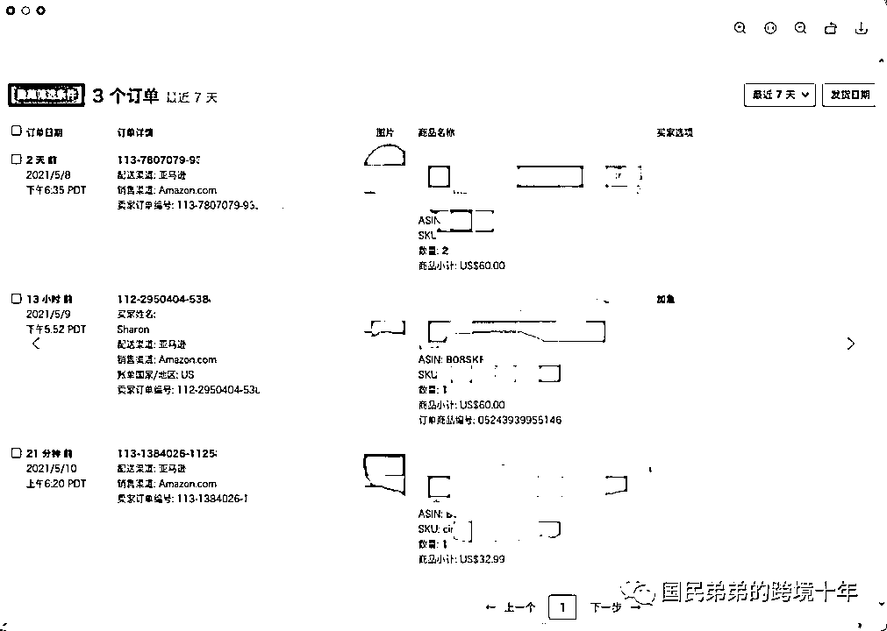

这段时间，唯一开心的是副业赚到了第一笔60美元；遗憾的是，真的没精力继续扩大。

后来我想明白一件事：**任何副业，在初期都要给自己留出足够的时间去专注深耕。**

### 5. 副业终于正式开启

2021年7月中旬，我终于腾出大把时间来做Amazon价差生意。正准备大展拳脚，结果收到一封指标邮件——账号被封了。封号！配图是网图，不是正式邮件。

原因很简单：账号空置了太久，被复审要提交资料。可这账号本来是我花钱买的，哪来的资料？所以解不了。那种感觉就像你店还没开张，装修队刚进场，房东突然说“不租了，你走吧”。

看完邮件，我整个人都蔫了。不想说话，也不想动，就想瘫在沙发上刷手机，点份外卖，配瓶肥宅快乐水，看剧熬过去。

就这么躺了半小时，我还是给朋友打电话，确认这个号确实救不回来了。又是一阵无力感涌上来。我坐到公寓门口的台阶上，望着天发呆。天上的云一片一片飘过，面无表情，我也面无表情。

又过了半小时，脑子里突然蹦出一句话：**“世上没有不变的东西，唯一不变的是变化。很多事不在你的掌控之内，积极应对才是强者。You are NOT in control。”**

我反复念着，想起这些年的人和事，其实都一样。与其抱着固定思维，不如接受变化，主动出击。如果你现在也遇到类似坎儿，这句话送给你。

想通之后，我开始接受现实，发挥阿Q精神：封得早也算好事，至少没有货压在仓库，不然钱货两空才叫惨。

几天后，我发现大量用中国身份注册的Amazon号都被限制了权限，心里一下子平衡不少，这也叫抱团取暖吧。我也告诉自己，反正中国账号以后也要换，只是被提前强制升级而已。

### 6. 美国公司Amazon之路开启

就这样，我开始走注册美国公司、做美国Amazon账号的路。真有点像上帝关了一扇门，又开了一扇窗。很多时候，你就是被时代的浪推着往前走。现在回头看，我甚至感谢那次封店，否则可能永远迈不出这一步。

开美国公司并没有想象中顺利。好在之前积累了一些美国朋友资源，通过朋友的朋友介绍，找到了代理，从注册公司到店铺地址的明信片验证，再到Amazon最难的第二轮审核，全部搞定了。

我还记得某个晚上，我和一位在美国读书的朋友隔着大洋聊新公司起什么名字，最后从三个备选里选了一个地道的美式名字。就这样一点点，一家属于我的美国公司在那个小小的房间里诞生了。

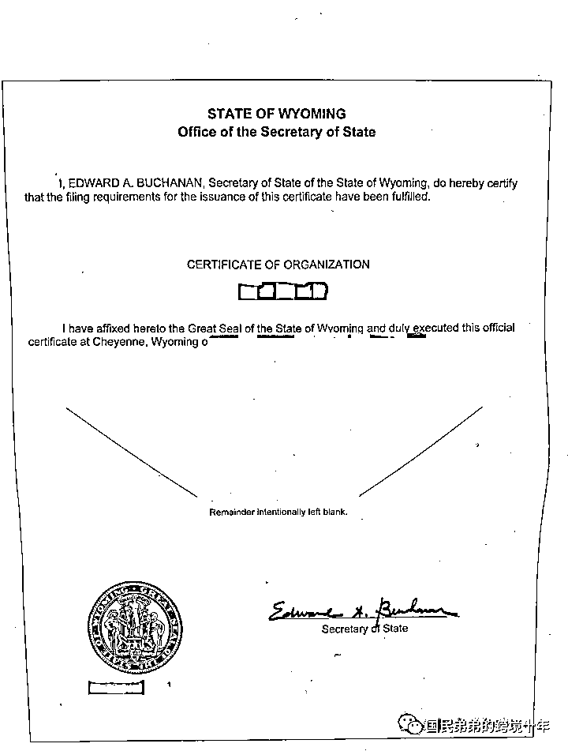

有了这些基础，我才敢去申请自己的Amazon账号。

我在社群和网络上翻了大量帖子，反复和代理确认，然后自己动手申请。过程其实不算复杂：远程用朋友家的电脑提交资料，接下来是视频验证。当时是一位南美口音的小姐姐接待，我们拿着一堆材料核对，15分钟就通过了。中间有个小插曲，就是我提交的资料格式不规范，来来回回改了一次，好在有朋友和代理帮忙，最后顺利搞定。

8月中旬，我的店铺终于开通，权限齐全。那天连空气闻起来都是甜的。一个月的辛苦总算落地，结果也算漂亮。

### 7. 店拿到了，真正的战斗才开始

2021年8月中旬，我又一次从零开始手动找货。当时我把目标锁定在Nordstorm Rack的折扣清仓区，复制产品标题到Amazon搜索。连续好几个晚上不睡觉，凌晨三点还在挑灯夜战，简直回到了高考时代。但几天下来，效果平平。虽然出了几单，效率还是太低。

### 8. 遇到问题，就想新的解决办法

我开始重新研究TA和SM这两款选品工具，把网上能找到的教程视频全看了一遍，然后又投入到找货中。这次结果不错，找到了一些毛利在30%到40%的产品。

但就在我暗自高兴时，总会有事情把你打回原形。

下单的时候，我的美国区PayPal被封了。那是我做价差生意的核心支付工具。我之前还蜜汁自信，觉得注册得久，老账号权重高，结果还是说封就封。

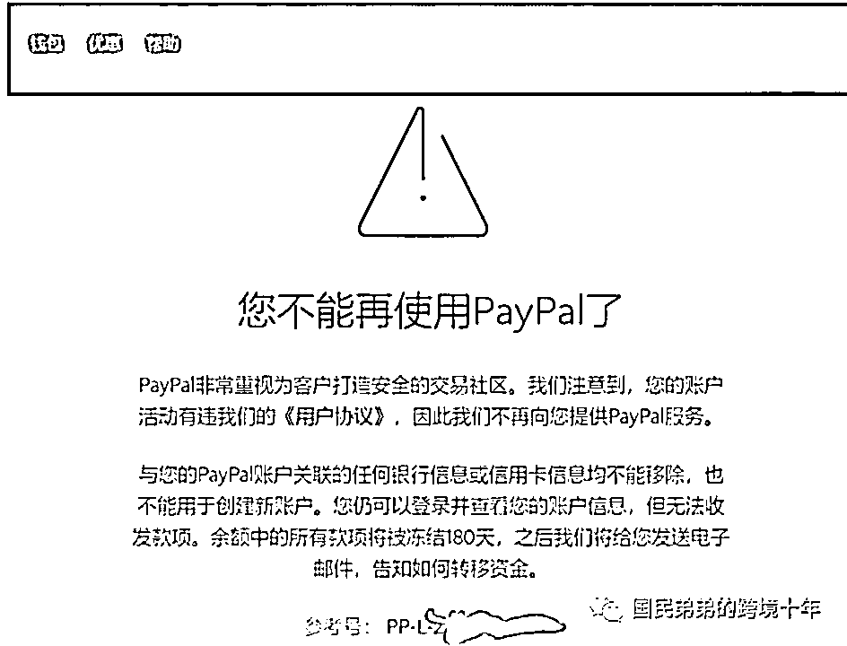

随后我疯狂地给PayPal打电话，打了20多分钟，终于找到一个人工客服。我还按照中国式思维，想求个机会，结果对方干脆利落地回了句：No。

更糟的是，很多平台也开始砍单。沃尔玛、Macys、Academy，只要我下单，就给我取消。

付不了款，下不了单，我整个人好几天都缓不过来。躺在床上找攻略，但这块领域太新了，几乎没有人能给你一个完整的答案。

**那段时间我真的懵了，每天就是打电话。**

给你们看个截图。因为要配合美国时间，我基本都是晚上11点以后打，一个接一个。最坑的是，电话讲一半，网络断了。你能理解那种崩溃吗？花了半小时找到人，聊到最核心的地方，断线了，而且对方绝不会回拨。我整整几周，每天打3个小时电话。

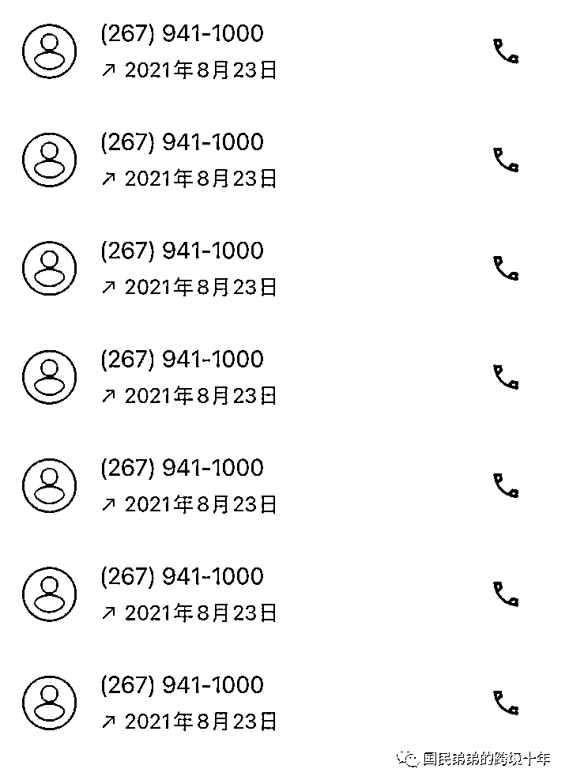

经过大量实操，我居然总结出了一些规律：怎么绕过砍单、怎么更快和客服沟通。

在一个没人教过的领域，实践就是最好的老师。

解决完支付和砍单的问题，我又升级去打批发这一关。

### 9. 走向批发

平凡人想厉害一点靠什么？靠超乎常人的勤奋。

我在互联网的汪洋里翻了15天，找到600个批发商，然后开始一个个打电话、发邮件。

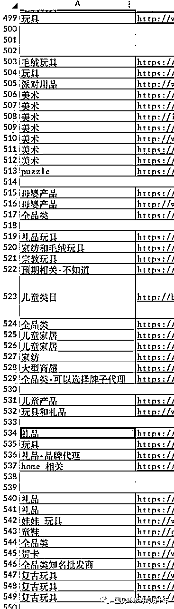

但你以为有名单就够了？太年轻了。大部分都要你提供公司资质和一堆材料。

在几次沟通碰壁之后，我冒出一个大胆想法：雇个美国人帮我打电话。

于是，靠朋友圈找到一位美国老朋友，一位退休的美国老爷子，他愿意用很低的报酬帮我做这件事。

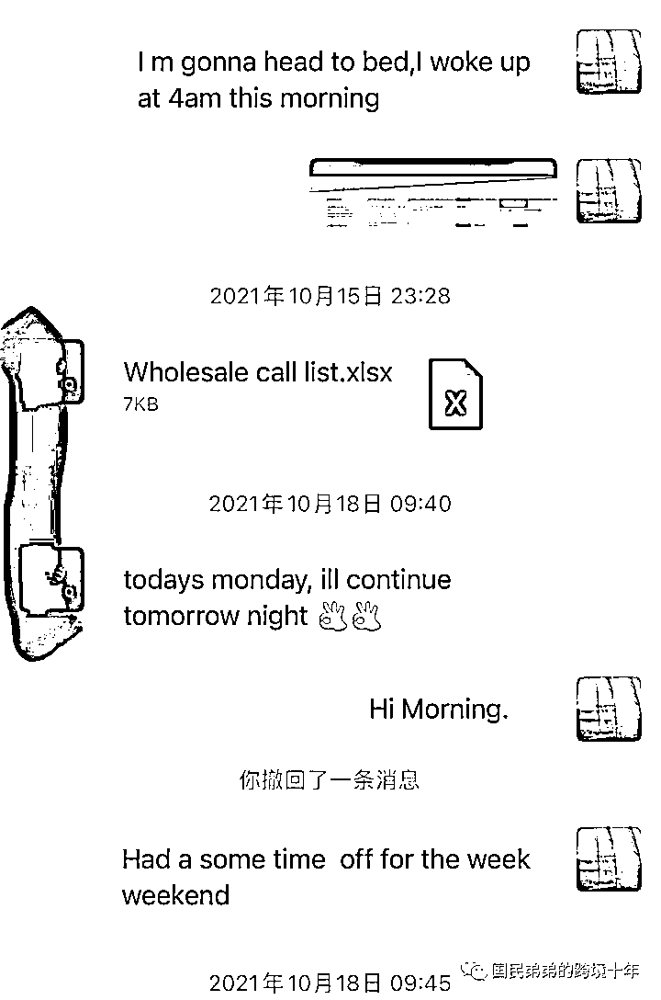

我们俩轮流配合，这次总算有回报了，找到一些利润空间很不错的批发商。我的经验是：当地人沟通起来更顺畅，年纪大的人做事更稳妥，对方销售也更信任他们。

### 10. 这半年，我是怎么熬过来的

很多个夜晚，我都是抱着电话，和海外网站客服隔空扯皮，只求对方别砍我的单。

也有太多夜晚，我在不同的网站之间来回跳转，思考、对比、筛选，把觉得靠谱的产品一个个放进采购清单。

还经历过一种绝望：第三方贴标服务商因为人手不够，把我的几十万货压在仓库里，看不见也摸不着。

还有不断测试IP，防止再被PayPal封；万一封了，就要准备好一周每天三小时跟客服“搏斗”的体能。

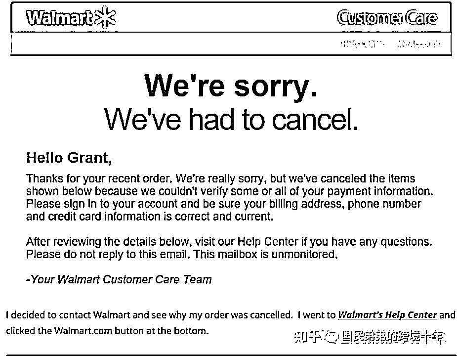

回头审视这段路程，最紧要的印象是“每件事陌生，每件事都得闯”。这里没有现成的作业可以抄，也没人能递给你标准答案，所有关卡都得自己摸着石头过河。

为了解决沟通短板，我专门给自己定制了一套英文加强方案。每天固定时间跟着 YouTube 频道逐句跟读，细细揣摩以英语为母语的人如何组织逻辑、如何表达立场、如何让对话顺畅推进。我的目标不是语法分数，而是真正像与美国人面对面聊天时那样，自然接话、准确提需求、顺畅达成一致。

谈到独立站，我坚决不假手于人。从选定主题、设计页面到撰写文案、调整细节，全程自己操刀。整体观感和调性高度贴近海外原生团队的风格，意外的是，即使没有刻意做推广，这个网址也陆续带来订单。

与供货端打电话的沟通力同样被我反复操练，重点不止于把生意上的事情谈清楚，还包括谈完之后从容不着痕迹地聊聊彼此近况。一来一往之间，合作关系便不再是冷冰冰的，而有了温度和信任感。

关于收款路径，我也找到了一条可复制的稳妥做法——申请美国个人税务识别码，再与美区 PayPal 绑定，至今没有出现过限号或冻结。美企主体的商业收款账户落地后，支付工具矩阵进一步补齐。

某个深夜，我以那家没有业务流水的美企名义一次申请并成功拿下了拉美电商平台及其他渠道店铺的入驻资格，这类机会对国内注册公司而言基本是奢求。几天后的另一个深夜，我又顺手批下了几张美版信用卡，资金通道一下子丰富起来。白天闲下来时，Stripe 美区账户也顺利开通。

如今，相关的经验和资源已经形成闭环——我可以很熟练地使用美企资质推进沃尔玛开店流程，也能跟身边朋友拆解美国公司套利的具体玩法，和他们一起在 OA 赛道里实践。

**很多时候，只要第一步跨出去了，后面每一步都会自然变得轻松。**

### 11. 时间会奖励一直行动的人

店铺成长的轨迹颇有故事感：首月才 2K 美金的销量，第二个月却迎来了单日 20 单的惊喜。随后从五千、八千再到一万，目前已经爬升到两万的水准，赚到的现金流统统再投回货品和推广之中，现在干脆请了家人一起处理日常运营。从冷启动到眼下的体量，算下来只有短短六个月。

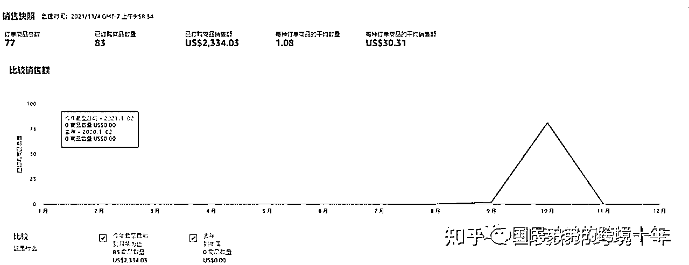

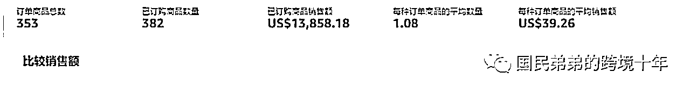

每一步都在为下一步铺垫。大量的实操和复盘让我对“什么品能跑、什么品利润厚”越来越有手感，毛利超过 50%、周转又快的产品经常能被我锁定，同时因为并行处理许多琐事，我自己的时间粒度也被磨得极细，效率有了质的飞跃。

### 12. 走完这段路，几个值得记录的领悟

1. 所有副业都躲不开一段枯燥的积累期，没有捷径可走。那些看似没有回报的“垃圾时间”，恰好是打磨判断力的关键阶段，每天雷打不动地复盘，才能把零散的经验凝聚成体系。

2. 凡事学会往前看三步，先把棋盘布好，后面才不吃力。从亚马逊注册的那一刻起，我就刻意采用美企身份，之后的各种权限申办几乎一路畅通，税号、信用卡等进展也是环环相扣地顺利。

3. 埋头苦干固然必要，但也要学会寻找跳板和杠杆。国外的人脉、代办服务、律师资源都是不可缺少的齿轮，否则很多操作在国内根本无从推进。

4. 遇到没做过的事，先别慌，去搜、去查、去问懂行的人。很多弯路其实都可以通过“主动请教”这四个字避开，我后来能省下那么多时间，全依赖这种习惯。

5. 选定一个方向，就该舍得投入比旁人更多的心血。无数个凌晨陪着美国的工作时间同步沟通，如今所有环节顺畅无阻，正是那些日夜换来的回报。

6. 选方向的分量，有时比努力本身更重。如果我一直纠结于境内主体的限制，恐怕很快就会撞到天花板。美企资格这条路虽然办理时繁琐了一点，但回旋余地和可操作空间，是前者完全不能比的。

若始终守着老行业不放，恐怕现在根本触碰不到电商这条路上的收益线。

7. 一个人不需要在每件事上都力求完美。能找到让你全力以赴、浑身发亮的那件事，把它做成，就已经是理想状态，其余琐碎尽可以看淡。

### 来自套利同路人的应援

有人舍弃了稳定工作，决然投身 OA 赛道，全天候运转。

有人连续几十个小时扑在项目上，近乎狂热。

也有人从零开始一项项落地自己的计划，没有任何退缩。

不经历这样的锻造，你无法遇见另一个自己，也无法从旧壳中挣脱出来获得新生。

**世上最有难度的事，就是赚钱。能摆平这件事的人，通常无论做什么都不会差到哪里去。**

### 独立站：交学费换认知

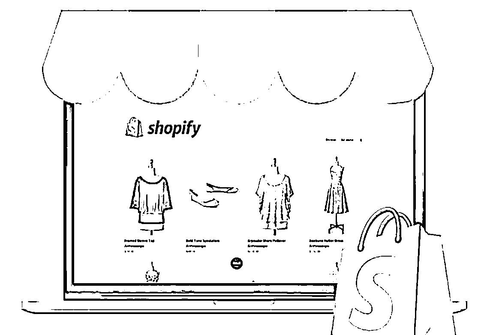

2020 年 9 月，咬咬牙拿出 4000 元，报了一位海外讲师主讲的独立站课程，专程到深圳听课。那会儿这笔钱对我而言真切地沉重，称得上“巨额支出”。

到教室的第一天，就被密集的术语砸晕了，BM、广告组、受众、VPS 全都似懂非懂。课间一聊，周遭的同学多是从平台转过来的小创业者，趁机会补课。

午餐时间，在楼下点了一份卖 28 块钱的简餐，对于当时口袋空空的自己，实在有些奢侈。

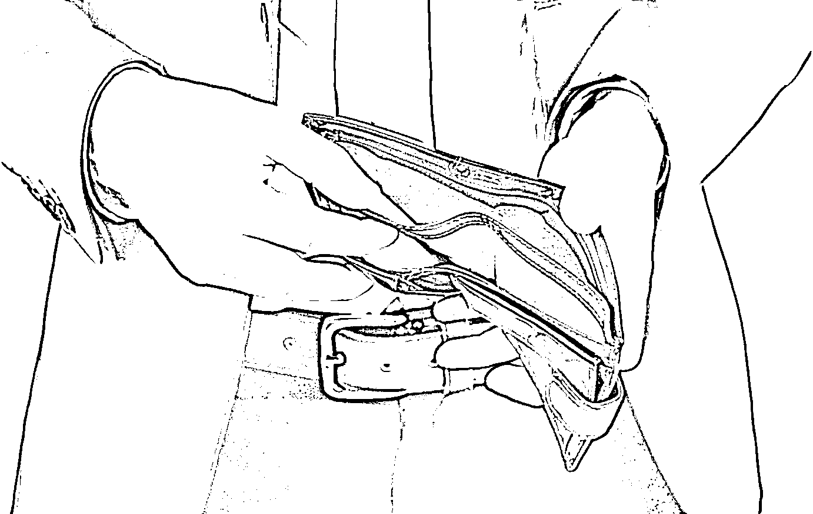

培训三天转瞬即逝，头脑却没真正“打开”。索性我留了下来，找了家 50 元一晚的青年旅舍当据点，每天中午起身干活，一直干到第二天快天亮才回去休息。等再醒来，爬起来去城市快餐店吃那份打折后省下 3 块钱、卖 15 元的便当。

这样持续了两周，我不仅把课堂内容完全吸收消化，还凭一己之力完成了全套流程的闭环：注册域名、架设网站、剪辑广告素材、做 Logo、接支付、申请广告账户、划分受众、设计广告架构、挑品……每一环都没有请人代劳。

等到所有模块都拼装完成，才发现下一步的难题摆在眼前——烧钱投广告。数据模型和受众画像不会自己长出来，哪怕投了几百美金的预算，也只是零星出了几单，这点反馈远远撑不起继续前进的成本。我由此确认，这场游戏，作为个体选手玩不起。

随后做了一个关键决定——停止自费试错，转而去找一份能“公费练手”的工作。招聘平台上的简历一封封投出，面的公司超过十家，得出的结论却令人灰心：市场上要么没有合适我的位置，要么根本无法满足我成长的需求。

当时深圳独立站行业最热闹也最混乱。有人从大公司离职，直接拉起十几个人的小分队扩张；也有的团队连 FB 账号风控都搞不定，全员停摆两星期；面试碰上一位老板，直言不讳地说我年龄没优势，团队里都是 97、98 年的年轻人，怕我融不进；还有公司刚成立，投手全是新手，最长资历也就三个月，只能临时去外面找外援。

静静梳理了一下自己的能力和身上的筹码，以及招聘市场给出的信号，结论很直接：**我想去一家有上升势头的小公司，有人愿意带教我。**可现实往往残酷——要么被嫌弃，要么月薪只开四千到五千。

**最终我拼出了这样的认知：能在此行业真正起飞的人，无非两条路。**

1. 入局早，在行业初兴时就已经沉淀了充足的投放经验。

2. 积累经验和人脉后，能够拉起一个小团队解决前后端问题，才有机会从零到一创立事业。

### 关于其他平台

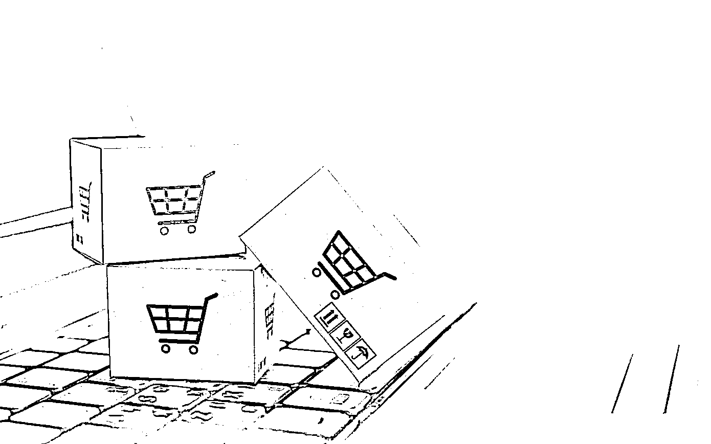

1. 我后期积极运营 Etsy，整体体验相当不错。平台抽佣低，广告带来正向反馈，利润率可见地在 50% 到 100% 之间浮动，非常适合刚入局的朋友。

2. 沃尔玛门槛偏高，需要能够提供亚马逊后台数据及独立站验证，审核制度很严格，更适合已具备产品供应链能力和资金底子的玩家。利润空间不算大，资本型玩家会有更多优势。

3. 易贝和 Etsy 有一点类似，由于进门条件高，参与的人少，内卷不严重。做出一定盈利空间并不困难。

4. 拉美电商平台——美客多，竞争目前还不白热化，采用美企身份可以直接申请。我亲自测试后发现利润潜力可观，适合从业一年的老手出来单干。

5. 虾皮我没碰过，大家可按需自行查证，平台风向年年变，商机需要自己判断。

6. 来说亚马逊。以中企注册的账号，再想铺货已经没有出路，那是大厂之前的打法。走精品模式，独立卖家在资金和流量层面基本拼不过对手。我认识一家公司，年销五十万美金，长期占据小类目前列，这样依然会被资源更雄厚的玩家直接击垮，最后整个亚马逊部门都撤了。

唯一值得做的是套利。权限限制虽然苛刻，但也有朋友能做成 10 万规模。建议先用中企账号练手，注册路径、申请流程网上随处可见，甚至有人专门搭了模拟注册的站点。后续如果认真想做，就切换成美企账号，照我的经验，启动资金约需 1 万元人民币，几个月即可收回成本。

7. 家居平台和建材平台面向的是产业带里手握工厂资源的商家，对资金规模、供应链掌控、产品系列都有严格标准，适合原本做 B 端出口的工厂型团队。一旦入驻美国大型商超渠道，盈利基本是可见的，唯有门槛极高。举个直观的数字：家居平台的账号一度能炒到 30 万元一个，建材平台账号市场价也在 8 千元上下。

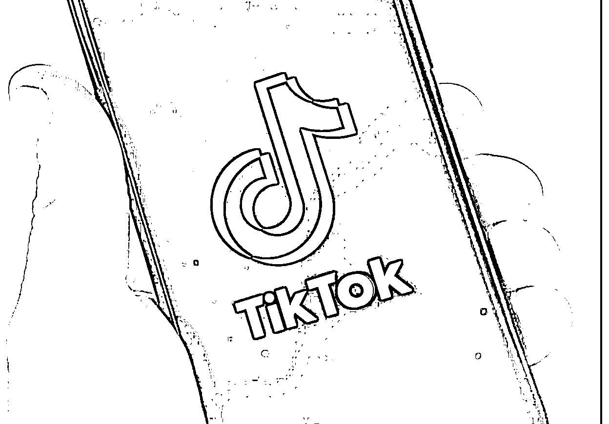
8.  TikTok 美区小店值得持续关注，身边确有案例从零做到一百万体量。由于国人在账号环节受限，前期投入大致在 3 万至 8 万元之间。是否回本考验的是选品能力和坚持程度，拉长时间看，回本甚至做到一百万并非空谈。至于英区小店，只建议有资源实力的玩家去拼，个人创业者不必冒险。

### 关于创业的思考

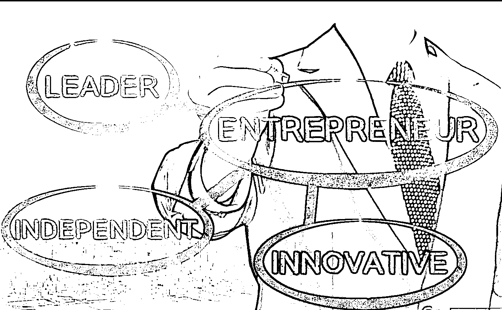

#### 拆解成功案例的底层逻辑，主动链接更优秀的人

初入圈子时，听过有人分享在深圳赚到第一百万元的经历，那时只觉得高不可攀。那个案例听起来确实简单——一位做独立站的，从投放公司出来后自己帮人做 FB 投放，后来慢慢做大，管理人达到几十号。

神奇的是，两年后再回看那个故事，已不再觉得震撼——因为自身认知升级了，自然能看透背后运作的路径。

那一百万并不全是运气，背后站着时间窗口、行业经验和实操能力的叠加，天时地利人和缺一不可。这个故事给我的启示是：第一，不要只盯着财富数字，而要拆解赚钱的结构；第二，同样条件下，自己是否真能复制相同的结果？

#### 链接优秀的人，是突破圈层最短的路径

创业注定是一条独木桥，真正坚持下来的人是极少数，在线下遇见同类的概率更是微不足道。而网络这条通路打破了物理限制，让我们能在不同的角落彼此链接、彼此激励，**正是这样的科技投喂，使你我跨越距离，在屏幕两端互相充电。**

感谢互联网提供的低成本和广触达，也感谢每一位愿意在网络空间一起奔跑的朋友。和能量更强的人并肩，节奏会不知不觉拉快，所以请主动去触碰那些让你仰视的人。

同时，谢谢读者们的长期陪伴。在遭遇误解和攻击的时刻，有人默默支持，有人主动伸出援手问我缺不缺资源。

顺带交代一下收益来源：当前收入主要由亚马逊套利与批发出单贡献，另外还有公司合作项目的分润，以及一小部分来自知识分享。

### 独立个体如何创业？

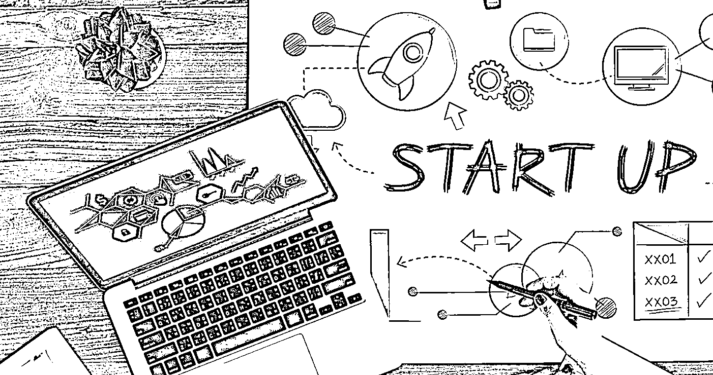

#### 1. 积累：持续而深入的行业扎根

这种积累不能简单地用“年资”去衡量，其背后必须有一股强劲的赚钱内驱力，驱动自己去一步步接近行业里更优秀的人，持续学习与蜕变。

有一个认识了十年的老友，创业十年，年收入一直保持在五十到六十万左右，日子过得比较滋润。可惜他始终停留在原有的舒适区内，没有持续迭代认知和资源，直到今年市场环境生变，收入从每月五六万直接掉到一两万。房贷压力之下，最终他选择重新去上班。

舒适区是隐形的天花板，如果不去主动突破，就会被变化的市场推着走。真正有效的积累，从来不是重复已会的，而是不断攻下新难点。

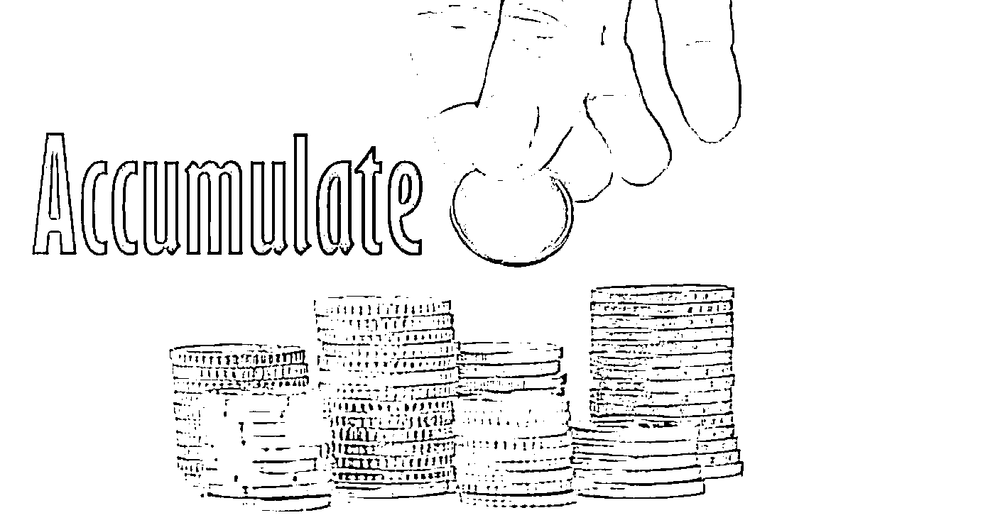

#### 2. 斜杠：让多重身份互为杠杆

斜杠的价值，我亲身体会过。

在接触跨境电商之前，我在外贸行业工作，曾被培训机构的“割韭菜”式课程收割——那是深圳一位巴西讲师开的独立站班。后来还做过 TikTok 的内容账号和直播，在站外引流上踩过不少坑；进入大厂后，又系统接触了亚马逊精品运营和铺货模式。

此外，我通过自学和付费课程研究套利和批发的逻辑，把 Etsy 的起店规则也一并研究透了。英文底子和对海外文化的理解，加上自建的博客和内容渠道，这些看似散落的版图，最后拼在一起变成了我的不可替代性。

眼下在美国跟供应商交流时，语言沟通能力和跨文化敏感度帮我拿到很多别人拿不到的机会与货源。人生的每一步都不能白走，它们都是日后可以调用的弹药。

#### 3. 努力：远超常人的长期主义

以前下班后总觉得被公司榨干，意志力归零，唯一的放松就是刷拼多多、不停买些有的没的。

后来为了走出这种状态，我开始运动和健身，重新储备精力活力。当身体跟上来，我给自己安排大量输入，反复咀嚼优秀同行的文章和课程，把他们的思路内化成自己的方法论。

自己做事后，节奏更加紧凑，一天只睡五六个小时，余下的时间都被行动填满。一个人要完成选品、采购、上架、运营、客服、售后，还要不断思考如何优化流程。最难受的时候，独自面对着失眠和焦虑，这时总会想起一句话——“你所经历过的，我也曾经历过。”那是父亲说给儿子的话。

#### 4. 远见：独立思考，提前布局

远见这个话题，我理解更多来自独立思考和长期的判断训练。

我本身是个喜欢追根究底的人，凡事都要问个为什么。拿网红卖家的案例来说，很多人在看到别人赚钱后就急着对号入座，却忽略了彼此之间的实质性差距。想复制别人，就必须完整复制——复制他长期的商业判断，复制他坚决的执行力，复制他试错和探索的习惯，甚至复制他所处的地域和资源环境。把这些想明白，才能倒推出事物的本质，可惜绝大多数人没有受过这种思维训练。

规划则是在独立思考之上做时间上的提前安排。我当初做套利时碰到支付问题，自己解决后发现 ITIN 个人税号的长期价值，但是办理周期相当长，于是赶在护照还能用之前就找代办提交了申请。同样地，初期卖货我有意让店铺触发审核，然后请代理把账单准备好，后面卖货就再也没在这个环节卡过壳。这套解决问题的链条，后来帮我顺利搞定了 PayPal、Etsy、Ebay、信用卡等一连串问题。

### 5. 赚钱：强烈的动机，清醒的认知，持续的学习

#### 赚钱上的自我认知

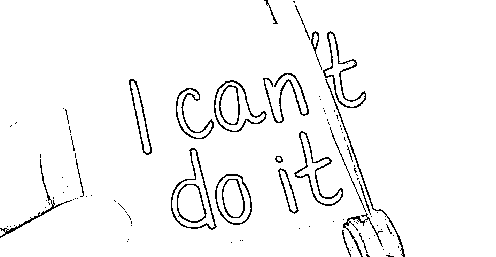

我身边有位朋友叫大白，他从孩子上中学起就开始培养他们的商业意识和赚钱能力，这一点我很认同。说实话，我们上过的十二年课程，最终导向就是要进入社会、靠劳动谋生——家庭条件优渥的人除外。

而在学校体系里，没有人教过我们怎么赚钱——因为教我们的老师自己也没有真正实践过，加上传统文化里“谈钱”总被看作不够体面的事情。教育做的只是基础能力训练，把你塑造成一个合格的劳动者。可如果你照单全收，按部就班，极有可能一辈子只当一个各方面都称职的执行者。

见过有人在欧洲读书八年，回国后到深圳拿着月薪八千，普普通通，偏偏自我感觉极好，眼高于顶。也见过留英两年回来英文表达还不如我这个没出国门的人，**看到他们费尽心机装点门面，我内心是真的觉得好笑。**

教育背景那么多年，最终没有转化为生产力，反倒成了某些人自我感觉良好的资本，一边抱着优越感一边抱怨赚不到钱。

学历不错、出国经历丰富、修养良好、学习自觉性高、受到周围人夸奖……需要明确的是，这些标签都只是单一维度上的优势，并不直接等于“商业能力”。

如果缺少商业思维做转换枢纽，过去的成就很难自动兑现成市场价值。你要仔细评估自己的储备和想要的创业方向有没有交集、哪些技能可以平移过来。

**但现实是，多数人一直没活透，却莫名自信。**

这画面好比看小丑演出——没错，我也站在那个舞台上过。曾经我自认为履历光鲜：供职过大型平台、业务熟稔、执行力强、英文水平领先团队，甚至觉得公司里没几个人能超越我。

可等我真正独当一面带领项目时，结果却是亏损。那时我才明白，成本意识是缺失的，客户视角是模糊的，别人或许做得一般，但也并不代表我就真的做得好，甚至可以说，我离“赚到钱”还差得很远。

**能认清“外在光环”和“创造财富的能力”其实是两套标准，本身就是一种进步。**

当然，还有很多更深层的体感需要自己亲历后才会懂。愿意为好东西付费、向拿到过结果的人学习，就是其中很关键的一条。

#### 学习能力

不断学习这件事，怎么强调都不过分。

我认识一位中型企业的老板，公司年规模做到五亿，最让人意外的是他才三十岁。十年前还在深圳某个小仓库创业，今天已经带着四百名员工向前跑。

在新项目启动时，他会拜托行业里的熟人做内训，并强制要求员工必须提交培训笔记，坚决不允许任何人在组织里混日子。

时代变化太快，停止学习，就等于主动退出牌桌。持续输入新知识，是一种保底，也是一种放大器，它保证你在机会敲门时，有底气第一个拉开那扇门。

见过不少小门店的老板，状态就是停在过去的成绩单上不动了。舒服躺平，基本不去琢磨怎么往前。跟他混了一个月我就自己撤了，待下去就是在消耗自己的时间。也能明白，他为什么十年了，规模还是那个样子。

**千万别因为一个人赚到钱，就把他做过的所有事都当成正确。**

真正能说明他做对的，是他的思考本身是通的。

只有持续在思考、并且对人性拿捏得很准的人，才有可能走得又稳又久。

#### 好的习惯，是靠一点点攒起来的。

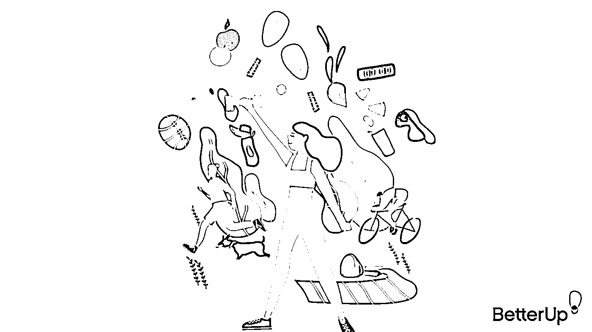

我一直坚持写东西、反思。会去拆解优秀的人是怎么想的，然后用自己的脑子把这些东西重新过一遍，再用清晰的语言落下来。

这样做在练什么？

1. 把思路讲清楚的能力。
2. 把庞杂的东西提炼出来的能力。

以前听过一句老话，说白居易写诗就是给不识字的农妇听的，其实就是在练极简、让人秒懂的表达。

**有人跟我说过，你的文字一向很扎实，从来没见你刻意灌水。**

我本质上就是个爱琢磨、爱写东西的人。把自己思考里相对亮的那部分写出来，对我来说就是一次复盘和升级。

而且，当你写出真正有料的内容时，那种被高度共鸣、被认可的感觉，是实打实的满足。

写一篇成型的东西要耗费多大的精力，写过的人都懂。这篇内容，**我花了 10H，全程高度集中的 10H 完成。** 如果你读到这里觉得受用，就分享给身边值得的人吧，这也是在证明你自己也在不断向前。一起加油。

* * *

评论区：

暂无评论

* * *