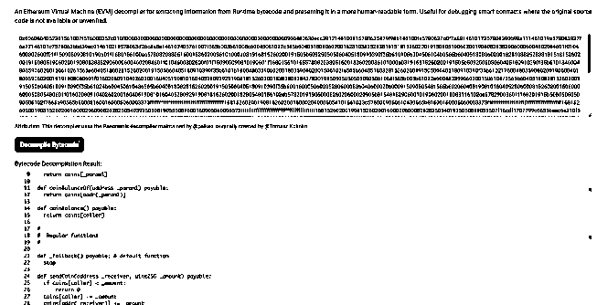
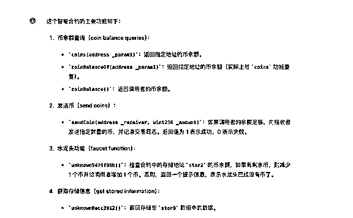
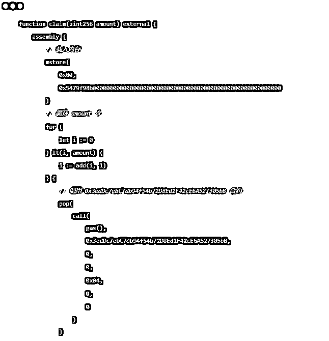
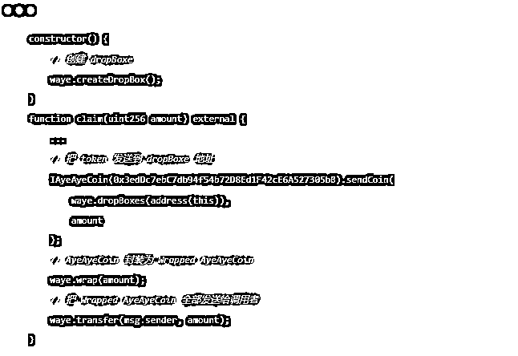
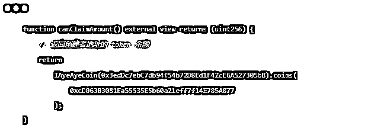

# 从 Gas 消耗榜里寻找新机会

如果你还没把 [Etherscan 的 Gas Tracker](https://etherscan.io/gastracker) 当成日常情报站，我建议你从今天开始养成盯榜的习惯。每天扫一眼 Gas 消耗排行前列的合约，往往能先人一步嗅到新项目的早期信号，而且链上数据不会骗人，比小道消息真实可靠得多。

前几天，我就是在这个榜单上发现了一个反常现象：有一个地址 [0x299f9496…](https://etherscan.io/address/0x299f9496781d6a469c838abd7dc7bb0351c54532) 的 Gas 消耗高得像在烧钱，同时它还在不断地调用另一个合约 [0x3edD…](https://etherscan.io/address/0x3edDc7ebC7db94f54b72D8Ed1F42cE6A527305bB) 的方法。最让人困惑的是，这个被调用的合约既没有开源，也不是任何标准代币协议里的东西，光看表面根本猜不透为什么会被如此密集地调用。后来我跑去问群友，很快有人给我甩来一个线索地址 [0x30ae41d5…](https://etherscan.io/address/0x30ae41d5f9988d359c733232c6c693c0e645c77e)：它可以把这个老合约包装成一个标准的 ERC20 代币，名字是 Wrapped AyeAyeCoin，而且 Uniswap 上已经有对应的流动性池。看到这里我真的很兴奋，这玩法跟当年的 Random 几乎一个路数，绝对不能错过。

冲动过后就是冷静拆解。那个被反复调用的合约创建于 2015 年 8 月 20 日，年代实在太早，不支持 ERC20 完全正常。因为它没开源，我就先用 Etherscan 的自带反编译工具把合约翻了个底朝天。

可反编译之后的汇编代码依然头大，于是我再让 ChatGPT 帮忙提炼了一下核心逻辑。

一番梳理下来，这个合约的机制其实非常清晰，主要就三个函数：

1. `coins(address)`：查看指定地址的余额；
2. `sendCoin(address, uint256)`：向某个地址发送代币；
3. `5479f98b()`：每次调用会让自己多 1 枚 token，同时创建者地址减少 1 枚 token；要是创建者的余量已经被领光，谁也领不到了。

这个设计意味着代币总量注定是有限的，谁手快谁就能多拿。于是我的思路马上成型：写一个 Gas 开销最省的批量领取合约，把能领的先统统领到手，再统一封装成 Wrapped AyeAyeCoin，最后搬上 Uniswap 卖掉。

写合约的时候，我把最消耗 Gas 的循环调用部分，全部用 Solidity 内联汇编重写了一遍。也就是这个小小的改动，帮我省下了一大笔 Gas 消耗。

我并不满足于只做一个“领取器”，还想把封装成 Wrapped AyeAyeCoin 的步骤也塞进同一个合约里完成。好在封装合约本身就是开源的，照着抄进来并不费力。

为了让大家知道还能不能继续动手，我最后又加了个函数，直接查看剩余可挖数量，非常省事。

合约完成后我直接部署到了主网，地址是 [0x18c33e20…](https://etherscan.io/address/0x18c33e205a82497298d940d20a0dbc47bb2214f2)，并且马上跑到社交媒体上叫人来用。最终效果出乎意料地好：整整 3 个小时就烧掉了 17 个 ETH，直到所有 token 被挖得干干净净。回头想想，这件事确实干得漂亮，我写了一个真有人需要的合约；唯一可惜的是当时没顺带收一点手续费。后来过了几天，Wrapped AyeAyeCoin 的价格又涨了好几倍，凡是靠这个合约挖过矿的人，基本都赚到了。

现在复盘这件事，我觉得最值得分享的经验很简单：多关注 Gas 消耗排行榜上的异常合约，就等于在项目早期抢占了一个观察窗口；同时，就算你不是项目方，只要能为这波热度做出一个顺手好用的工具，同样是一条很值钱的路子。

