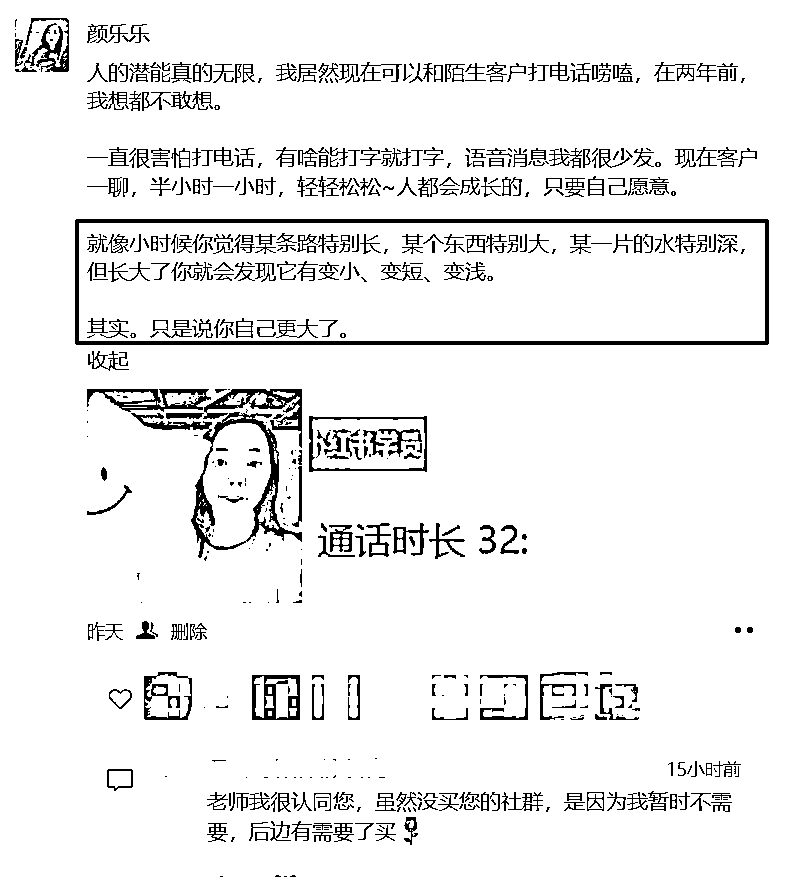
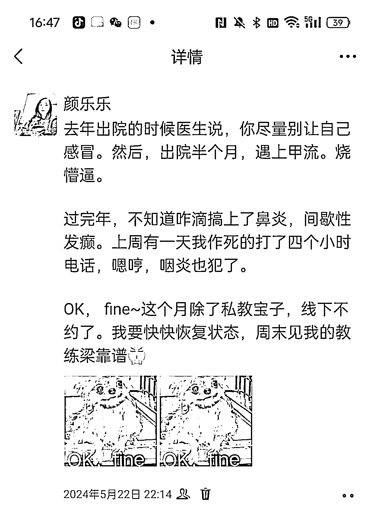
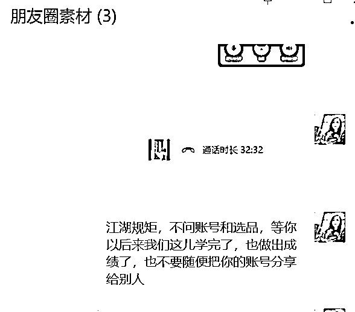
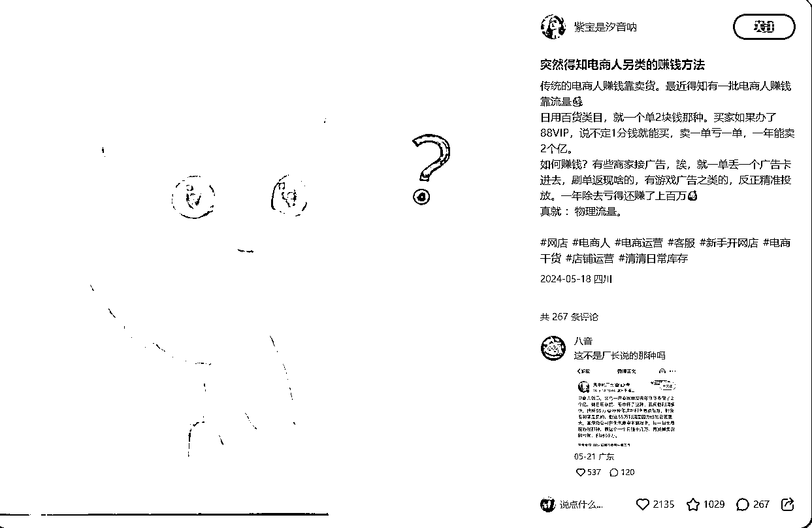
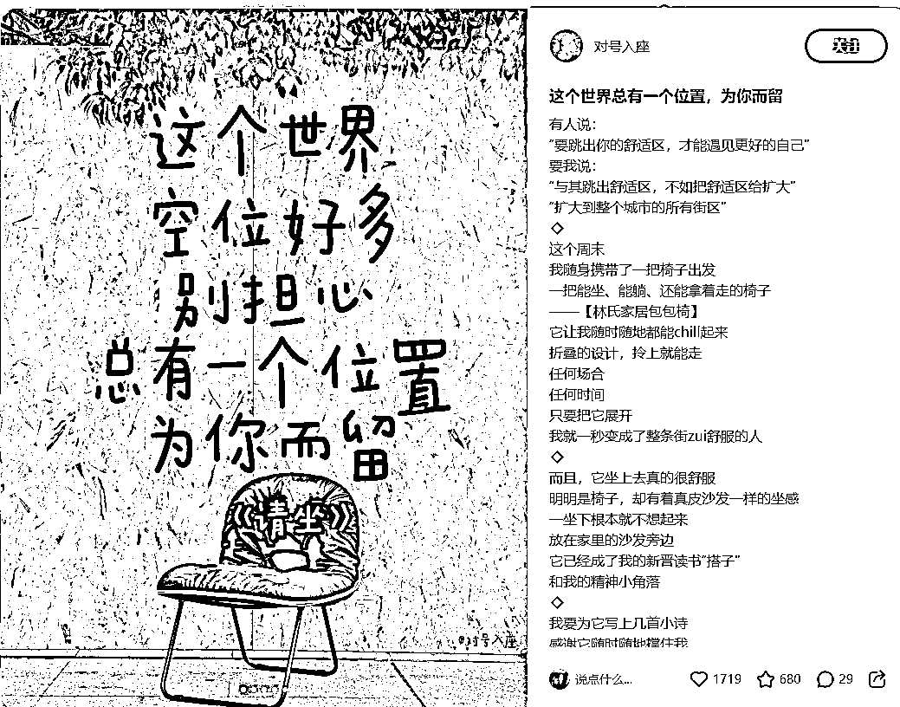
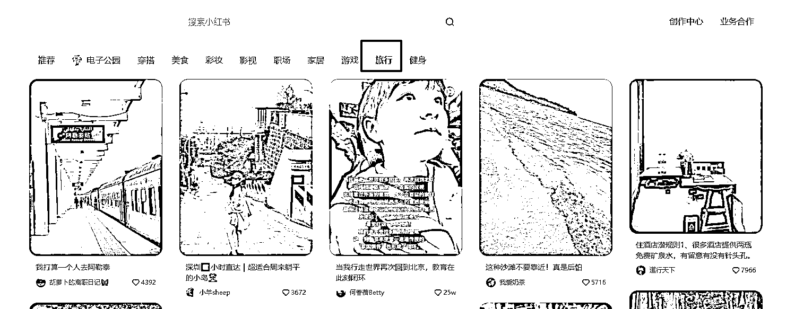

# ('6 个月发了 1000 条朋友圈变现 15W，总结一下我的经验。', (2, 34))

我是乐乐，一个在生财有术混了三年的老船员，参加过十几次航海，终于从职场妈妈转型成自由职业者。去年年底，我开始认真经营个人IP，给自己定了个小任务：每天发5条朋友圈。半年多下来，累计发了将近1000条。变化非常直接：以前公域来的好友，最快也要聊两三个月才成交；现在加过来两三天就能下单，还有人24小时内直接转了3980元报名私教。这套方法我也同步给了伙伴，有人已经跑出百万GMV。所以如果你正在做公域引流，请先铺好朋友圈再谈流量，不然加过来再多也接不住。

从“没得发”到“发得好”，我经历了三个阶段，今天一次性讲清楚。

第一阶段：不敢发。  
最初卡住我的不是内容，是心态。怕没人互动，怕被人当成微商删掉，怕显得很low。后来我想通了：没人点赞就继续发，真正会付费的人常常潜水，需要时会直接找你；被删也没什么大不了，你也会删别人，不同频的人走了，等于净化通讯录。不想被删，就少发硬广，多给点对别人有用的内容。至于面子，真没那么多观众盯着你。能照顾好身边人，赚点干净钱，比什么都重要。卖产品、卖服务，本质上都是提供价值，不丢人。如果确实怕某些人看到，就打个标签屏蔽掉，我把孩子幼儿园老师和亲戚都屏蔽了。刚开始发得乱也没关系，我最初的内容也很乱，但坚持发下去，表达力慢慢就上来了。你的用户会看着你一路成长，这本身就是一份参与感。

第二阶段：不知道发什么。  
朋友圈的底层逻辑，其实就四个字：解决信任。一个让人愿意下单的IP，至少要有四类内容：真实生活、工作记录与客户好评、价值观、专业积累。如果还是没灵感，强烈推荐这套“14晒”清单：晒风格、晒品牌、晒反馈、晒咨询、晒生活、晒收入、晒授权、晒团队、晒讲课、晒忙碌、晒学习、晒故事、晒专业、晒感恩和责任。14个角度轮着用，一天5条真的不难。也别嫌5条多，现在大家刷朋友圈的机率那么低，你发一两条，很可能根本没人看到。

第三阶段：怎么发得更好。  
分享一个非常实用的公式：金句 + 自己的照片 + 自己的当下状态。金句可以从名人名言或影视台词里找，最好一听就有共鸣；照片一定要有自己，自拍、工作照都行；最后再结合你正在经历的事、正在做的产品，写几句只有你能写出来的内容。这样发出来的朋友圈，连复制都没法复制，因为全是你的独家故事，越原创，还越不容易被折叠。我昨天刚好发了一条，本来只想写工作电话打到很晚，结果把存了很久的一句金句和当时的照片、感受拼在一起，评论区立刻冒出好几位同频的人，比硬广的效果好太多了。

另外，朋友圈不必过得像完美海报。偶尔讲讲压力、崩溃、倒霉事，反倒更容易引发共鸣。适当的示弱不是减分，而是让别人有机会靠近你。人天生有想要帮助别人的冲动，你真实了，自然有人来给你出主意、送温暖。去爱、被爱，都是能量的双向奔赴。

再说几个我常用的实战小技巧。  
第一，专门建一个“朋友圈素材群”。刷到好看的图、听到好句子、突然冒出的灵感，随手丢进去。发圈时直接打开群挑一条就能用。工作要靠系统，不能靠灵感。内容也不必全部原创，摘抄金句再结合自己的经历改一改，就是一条不错的圈。  
第二，配图去小红书找。朋友圈照片有限，实在拍不出来时，小红书就是现成的素材库。搜你所在赛道的关键词，表情包、旅行照、专业图都有，下载下来配上自己的文案，私域里随便用。
  
第三，截图要讲规矩。截聊天记录时，头像和昵称尽量打码，除非对方同意露名；自己发图时，水印最好统一。做法很简单：用修图软件做一张带自己名字的图，存成微信表情，发圈选图时点“编辑”，把表情贴上去就行了。

最后想说：大胆发圈，持续记录。你有多少影响力，就能收获多少价值；你不发，客户就去找别人买了。每天3到5条，不管晴天雨天都别断更，坚持三个月，亲测有效。我是乐乐，一个在小红书获客陪跑的自由职业者，希望我们能一起把朋友圈变成真正的资产。