# 一年半业绩 1500w，分享一个不怕被封的📕引流方式

18个月，1500万业绩。很多人问我📕怎么“偷”流量才不容易被封，今天就把我们的完整打法公开。

大家好，我是娃哥。主业在教育行业做流量操盘手，副业在上海开了家精酿酒吧。这次受赚钱邀请，来聊聊我们团队在📕上的实操经验。

我们做的产品线挺宽：财会方向有CPA、ACCA、USCPA，金融方向有CFA、FRM、CQF，学历方向有MBA、国际硕士和留学产品。2022年8月我刚进公司，做的是微信生态私域引流，包括👸号、个微、企微和社群。干了一个月就发现，流量已经被洗得太狠，真正的新线索几乎没有，拿到的都是被反复触达过的重复用户。于是我们决定换战场，集中火力做📕。

当时没想能做成什么样子，只是觉得继续耗在微信生态一定没出路，就一头扎进去了。

先看结果：2022年9月正式起盘，团队从2个人扩展到8个人，矩阵账号做到50多个，累计拿到26000多条线索，业绩超过1500万。2022到2023年做了868万。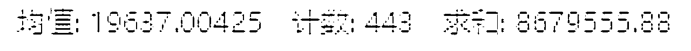

2024年1到4月，602万。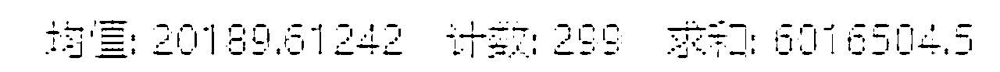

2024年5月前18天，46万。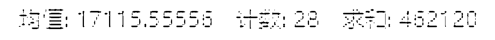

客单价基本都在1.5万以上，学历和留学这类项目甚至能到十万以上。今年的目标定在2000万，我们正在往这个方向冲。

流量到底怎么来？我们最核心的打法是“资料引流”，路径不复杂：用户刷到笔记，产生兴趣，评论或私信，我们拿到手机号或微信，录入系统，销售跟进成交。

内容上，我们有一套内部的分层运营模型，几乎所有项目都能套用，叫“4+3+2+1”：40%资料引流内容，30%干货科普，20%话题性内容，10%课程种草。

这样分配有几个好处：对平台来说，账号不是满屏硬广，一半内容有真实价值；对用户来说，体验不会太反感；对公司来说，10%的内容拿精准线索，40%的内容储备二类线索；对团队来说，内容形式丰富，工作也不枯燥。

具体形式给大家看看。

资料引流内容，就是“项目关键词+资料截图+话题性话术”，其他项目可以直接抄作业。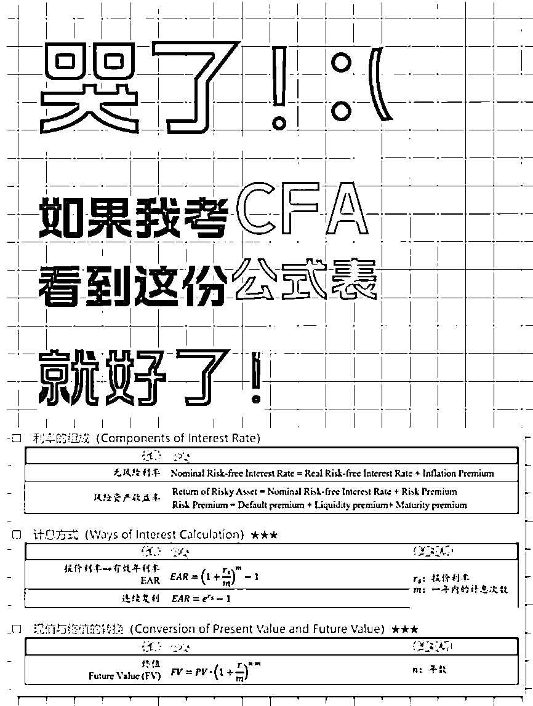

尾图非常重要，我们专门为每个项目设计了思维导图形式的尾图，冲击力更强。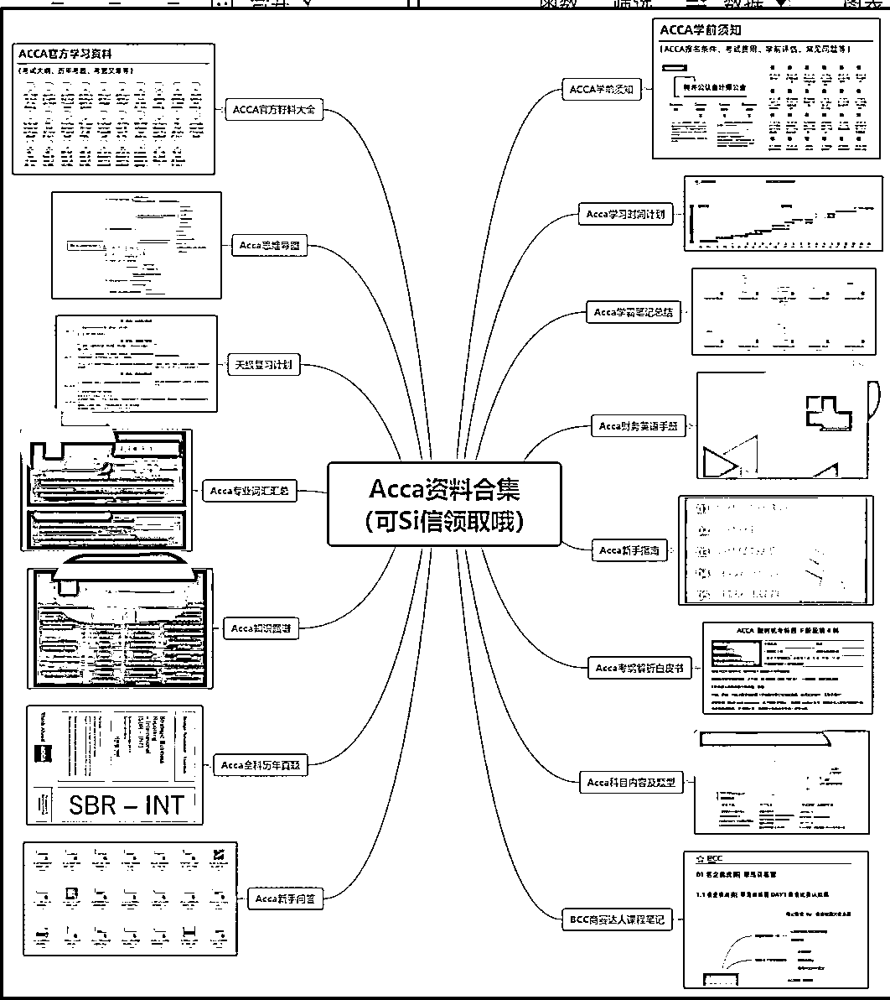

干货科普内容，把关键政策用表格整理出来，效果很好。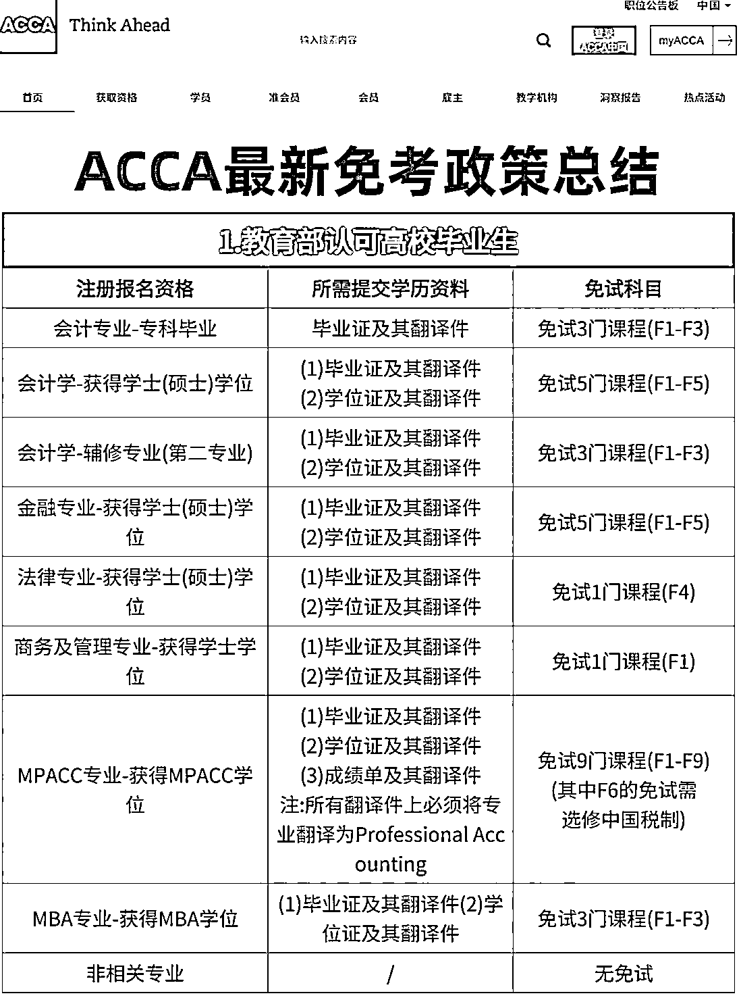

话题性内容，拿两个证书或项目做对比，引导用户讨论。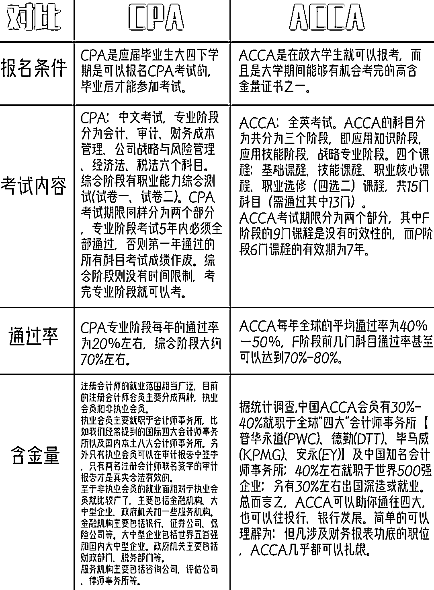

课程种草内容，比如老师推荐，吸引来的客户非常精准，转化率也最高。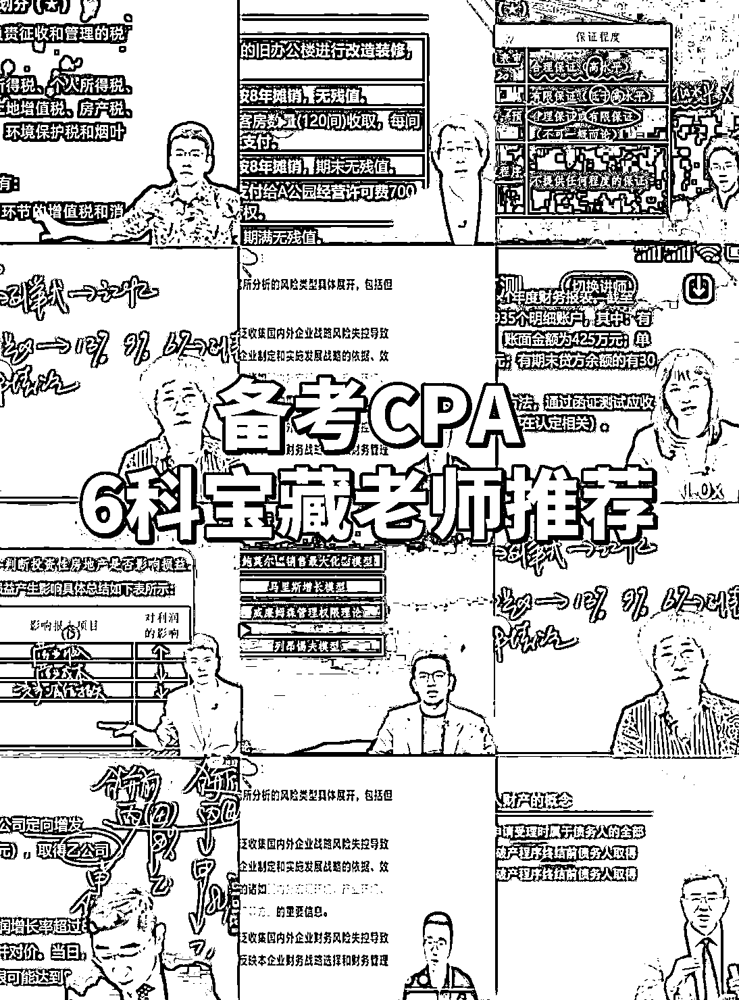

再讲引流。先说一个和我们很多同行不一样的点：我们不是让用户来加微信，而是向用户要手机号，录入公司CRM系统。前端获客和后端销售是两个独立部门。

我们的引流路径也迭代了好几版：从最早的小程序二维码，到直接私信索要联系方式，再到聚光自建站，最后是聚光投放加私信通。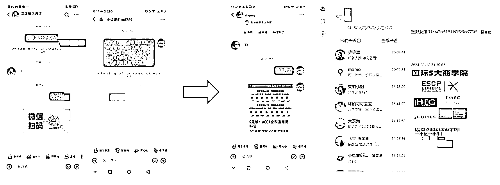

这其中的坑真不少，尤其是对小白来说。

为什么叫“偷流量”？因为说白了，我们是在跟平台抢用户，所有动作都在对抗官方机制。机器识别越来越强，很多老玩法已经失效了。我们要做的，就是不断找出更安全的方式，本质都一样：把流量引走。

分享一个我们实测非常安全的方法：📕官方的自建站。

听好了，不需要开私信通，但需要企业认证号，并且开通聚光后台，可以不用花钱投放。个人号可以略过。

在聚光后台的“工具”栏里，找到“落地页管理”。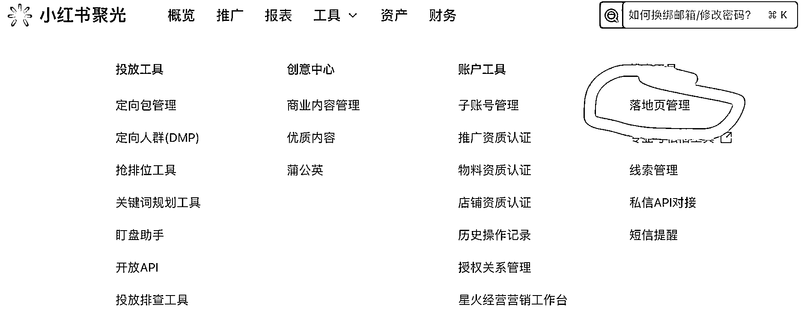

点进去，自己创建一个落地页表单。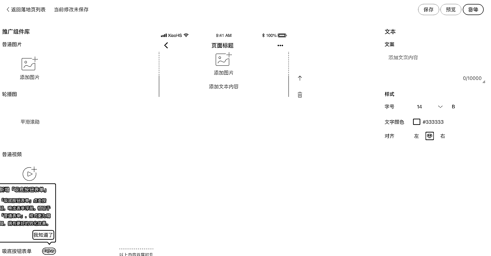

里面放一个“留咨”按钮，用户填完手机号，信息会直接进到聚光后台，你就拿到联系方式了。

这个链接可以直接在📕后台分享。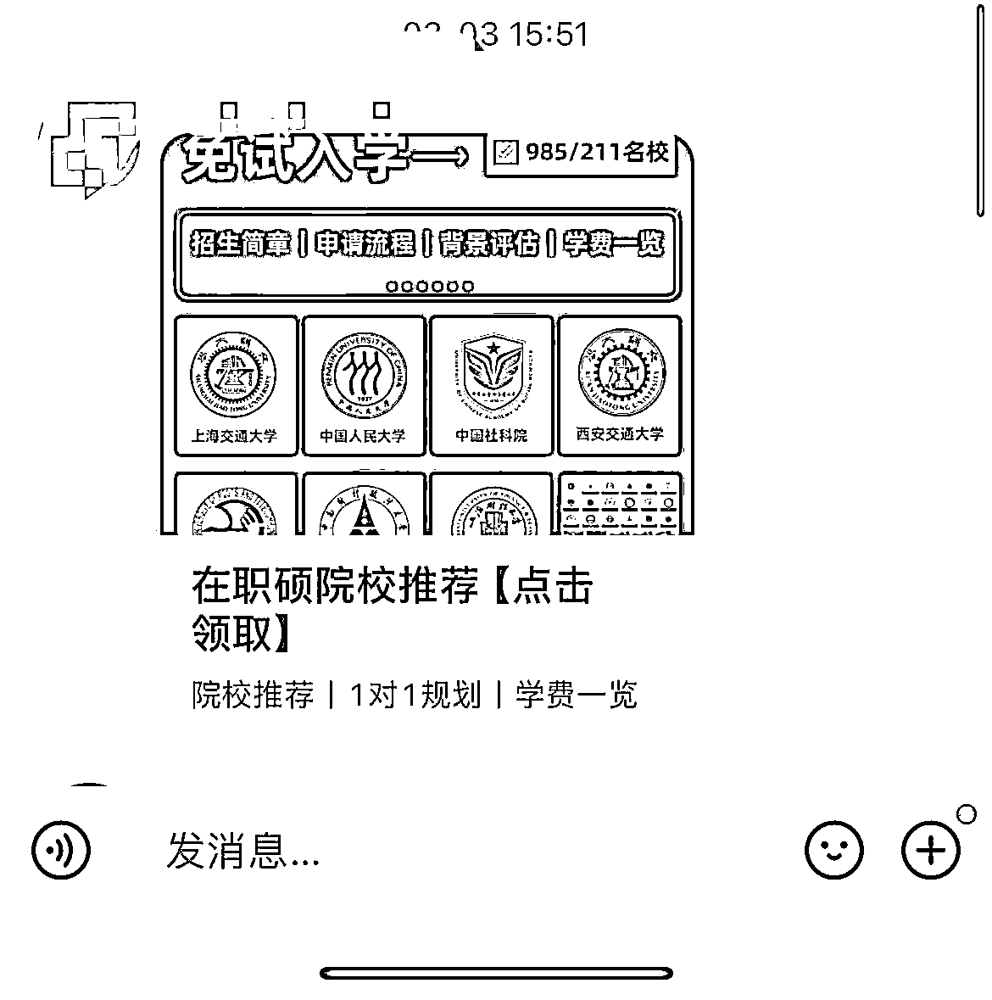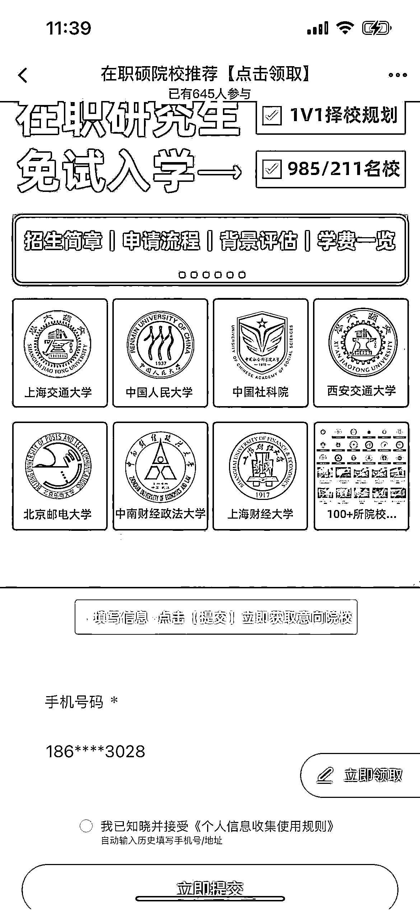

最关键的是，这是📕官方的链接，官方会封自己的链接吗？

我们自己测下来，这个玩法很安全，但也有短板：留咨率偏低，大概只有15%到20%。如果配合引导关注，再发一句话术，比如“同学，看到你在了解在职研究生，点上方卡片填一下，填完扣个1，我安排老师帮你详细介绍”，留咨率能拉到30%左右。

另外，如果你只想拿目标用户手机号，也可以做一个自建站，去竞品评论区蹲需要的人，直接把链接丢过去。个人号每天能私信5次，认证号20次，基本不会被判违规，也不会因为引流封号。

再补充几个目前相对安全的引流方式：

大号建📕社群，小号在社群里发微信号引导添加；
大号公开收藏，收藏的笔记是小号发的引流笔记；
大号简介里@小号，小号发一篇引流笔记；
最安全的方法，还是开通官方聚光投放和私信通，光明正大留手机号和微信号。

接下来是项目的四个阶段。

第一阶段，2022年9月到11月，我们开出了第一单CPA，21800元，正好是双十一那天。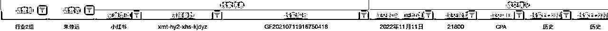

这一单一下子让团队和领导相信：这件事真的能搞。

当时只有2个人在跑📕，很多人都怀疑做不起来。我自己比较喜欢做从0到1的事，就主动扛了下来。

那个阶段的钩子全部是备考资料，公司本身资料就很充足，我们只需要把封面和标题做吸引人，让用户愿意留联系方式。这块涉及公司机密，不方便截图。

当时的引流方式是：用户填金数据表单留手机号，我们再通过二维码生成器把表单变成二维码发给用户，链路比较长。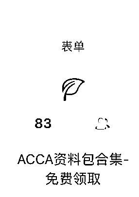

第二阶段，2022年11月到2023年2月，慢慢跑出规模了。到2023年2月，累计21单，26万业绩，当月线索到了400条，ACCA、CFA、CPA都有成单。那时候还是资料引流，也开始用谐音字直接要手机号或微信。到了3月开学季，行业旺季来了，部门其他人也开始加入📕，人越滚越多。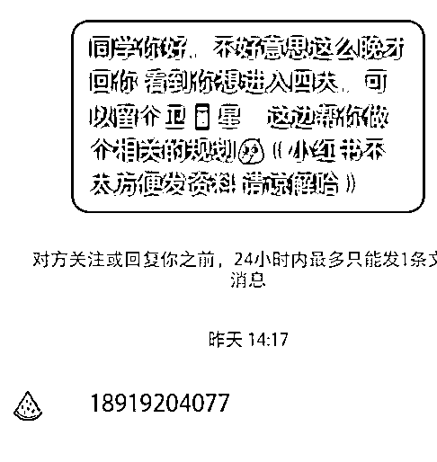

第三阶段，2023年2月到4月，新项目开单，证明种草玩法可行。2023年4月21日，我们成交了第一单学历项目，39800元的同等学力项目。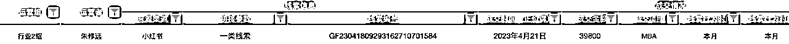

这个项目的意义在于，它不靠资料引流，而是靠项目推荐或申请成交，有点像留学种草的感觉。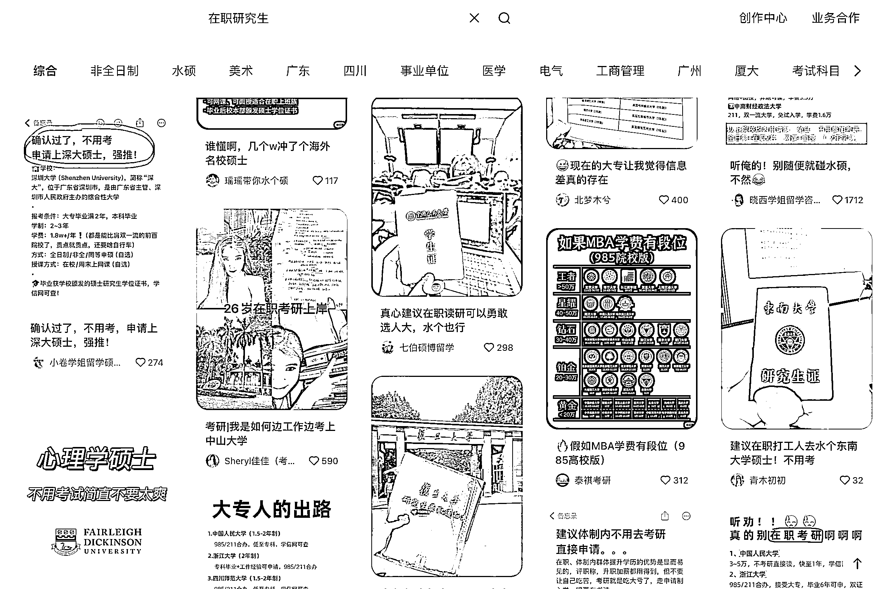

笔记形式不太方便展示，大家感受下意思就好。

这一单在团队里立住了信心：做教育品类，不是非要资料引流不可，种草推荐也能跑通。而且接近4万的客单价，一周转化周期，说明📕人群的付费能力确实很强。

作为团队Leader，我必须亲自开这一单，为的是让所有人都相信——📕适合公司的所有项目。

第四阶段，2023年4月到2024年8月，免费流越来越难，必须上投放。那时我们已经摸清了各项目的内容策略和引流模式，2023年6月，单月业绩做到了50万。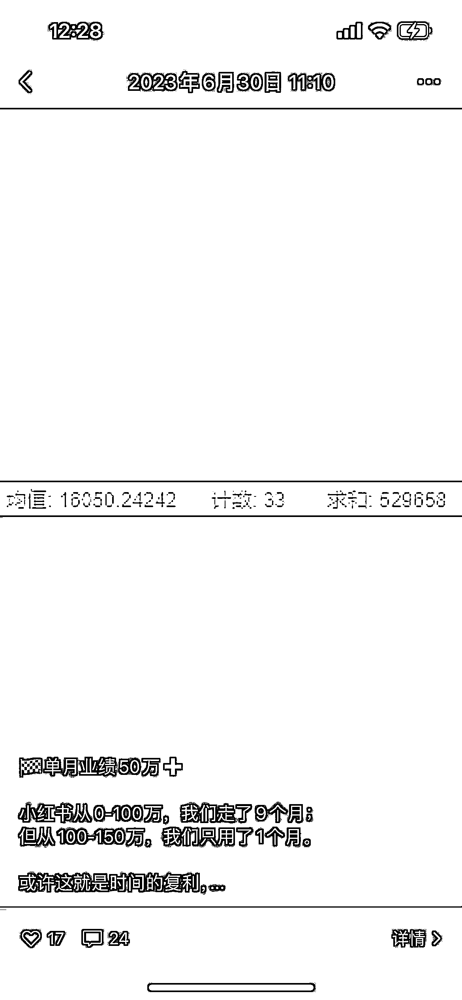

但随之而来的是限流封号越来越频繁。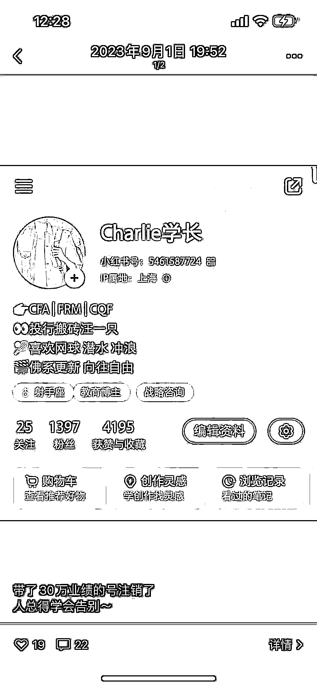

和老板商量后，又参考了同行经验，2023年11月，我们正式进入“免费+付费”双轮驱动，业绩体量也上了一个台阶。

再说说项目能起来的关键环节。

本质上，我们做的还是资料引流，这是一种非常适合赚小钱的方式。比如整理CPA备考资料，引流到私域卖19.9到39.9元，卖完再跟机构谈CPS分润，一个人就能玩起来。

选品：在📕搜“CPA”，看用户最关心哪些资料。还要结合时间节点，比如现在离考试不到100天，冲刺类、模拟题类资料最好卖。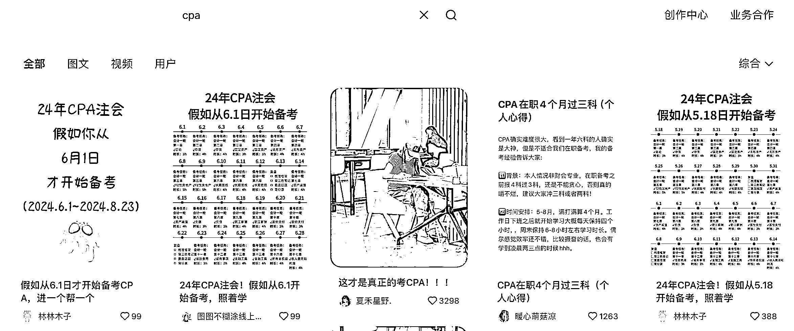

选题：有明确时间节点的内容容易出流量，比如“6月1日开始备考CPA还来得及吗”。

引流：不管用什么方法，把人搞进私域就行。

团队：小工作室的话，一个人做前端内容引流，一个人做后端私域承接，两个人就能搞定，极端情况下一个人也能跑通。如果后面和机构合作分成，私域直接推给机构就行。但建议把推出去的线索做成在线文档，让机构销售跟进时及时标注进度，这里面的坑很多。

前后端一定要配合好。你要告诉销售这条线索是从哪篇笔记、哪个钩子来的，方便销售针对性跟进；同时也要多问销售，用户是因为价格、服务、品牌还是时间节点下单，又因为什么不买单，前端内容可以跟着优化。

再聊入局机会和门槛。

普通人现在入局还有机会，但2024年已经没有2022、2023年好做了。我们从2023年11月开始投聚光，现在整个部门每个月投放10万以上，整体ROI在1:10以上；如果算上员工成本和房租，大概1:5左右。

门槛先说三个：

第一，废号流很费手机和手机卡，要提前准备流畅手机和低月租卡。以前能用虚拟卡，现在好像不行了，大家注意。

第二，想投聚光，一定要系统学习理论、熟悉后台，否则一头扎进去很容易亏钱。

第三，普通人没有后端产品承接，得自己找机构合作，这里面坑也不少。我自己另一个项目，烧了2000多块，搞废3个手机号、3个手机，拿到1000多条线索，结果一单都没成，下次有机会再细说。

最后分享几个经验。

类目选择：做教育赛道，优先选搜索量大但品牌投放少的品类，也就是流量大、竞争小。

这张是📕官方给的4月成人教育搜索量占比。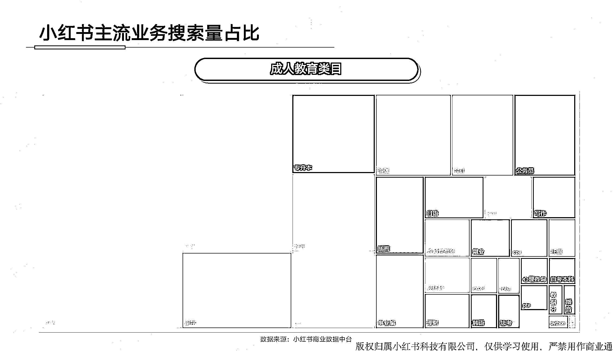

这张是官方给的成人教育竞争概况。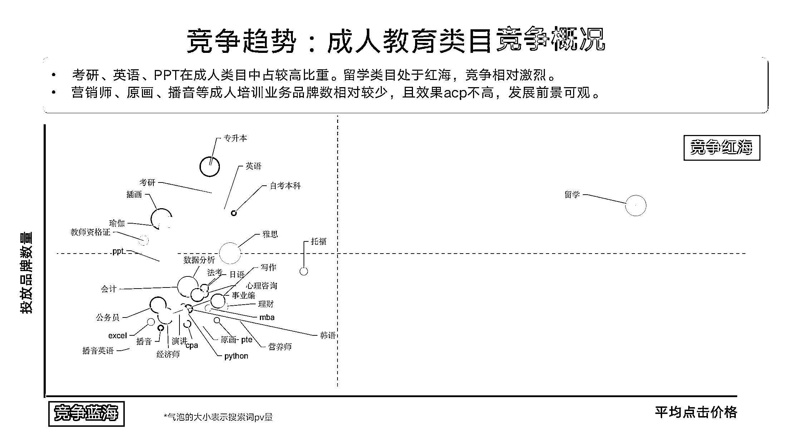

两张图对比看，结论很明确：留学流量大但竞争太激烈，小白不适合进入；会计、教师资格证、公务员培训、Excel这些，相对流量大又不那么卷，新手可以从这些类目切入，更容易出结果。

还要注意类目热点期。比如考研热点在6到11月备考期，你5月就可以开始做内容，甚至年后就要准备；如果等到10月才动手，只能做临考类内容。

关于限流和封号：我们遇到的限制，95%是因为违规引流，5%是因为模仿抄袭、原创度低。

模仿抄袭问题相对好解决：封面改背景颜色、字体大小、字体颜色；正文用ChatGPT改写。分享一个我在用的prompt：

第一步，对ChatGPT说：“我将为你提供一段文案，请先阅读分析，完成后只需回复‘已准备好’，等待下一步指令”，然后把爆款笔记内容发过去。

第二步，说：“请将这段文案，用📕的风格，在不改变原意的前提下改写，要求相似度不超过50%，有emoji表情，语言生动有趣。”

生成后再检查一遍，基本就能用了。我目前用文心一言，也够了。

最后聊聊和机构的合作，小白特别容易踩坑。

你把资料引流跑通后，想做大，基本都会涉及机构分佣。以我熟悉的学历提升为例，合作模式是CPS结算：线索给机构，机构销售跟进，成单后给你返点，行业返点一般在10%-20%，正常不超过20%。比如一单39800，返点10%，就是3980元。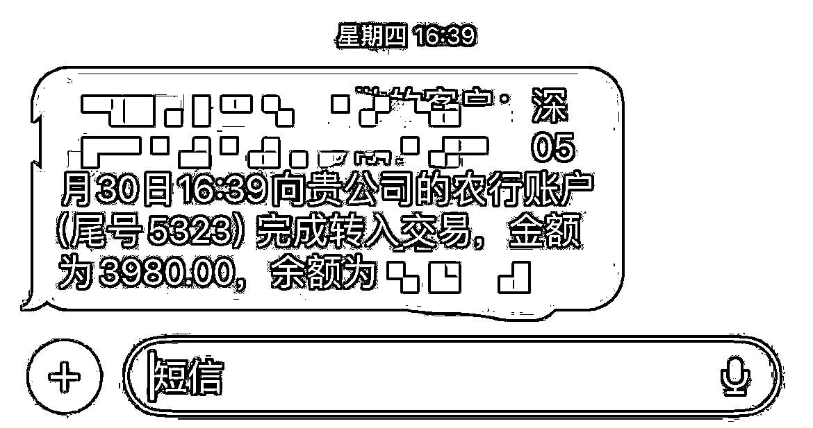

这是我上个月刚收到的打款。

这种模式的弊端也很明显：非常依赖双方信任，因为如果机构藏单，你根本不知道。你不在他们的CRM系统里，销售跟进情况无法掌握。

所以合作一开始就要谈好：合同必须签；同时要求对方做一个在线文档，把所有线索的跟进情况列出来，你能随时看到。

当然，合同和在线文档也不能100%防止藏单，如果对方一开始就想坑你，很难完全规避。但这两个制度能最大程度保障双方利益。

最后分享几个判断机构是否靠谱的标准：第一，打款及时——这点非常重要，别不好意思催；第二，定期跟你同步线索情况，不管线上还是线下，反馈问题并沟通调整方向。

希望我们的经验能帮到你。📕“偷流量”，越来越需要精细化操作了。

3、关于机构提供的在线文档，要看它是不是保持着高频迭代，最好是每天都有更新。

这三项条件要是都能对上，就基本可以判断这家机构的靠谱程度还是在线的，不太容易踩坑。

**（4）收尾总结**

回到当下这个时间点，如果你的目标是在📕实现大面积获客，**最稳妥也最直接的打法，就是走聚光广告投放**。

想更顺畅地操作，可以先加几个📕官方的对接人。需要的话我可以帮你牵线，他们会第一时间同步平台的最新走向、投放的注意事项，而且通常还能拿到返点和额外优惠。

前不久我有个同行也在跟我吐槽，说现在投放费用高、跑不动、线索也稀少。我的看法是：

我们做流量，本质上就是跟平台规则不断博弈，这本身就是岗位的价值所在。用更低的成本撬动更多客户，这就是做流量的乐趣所在。

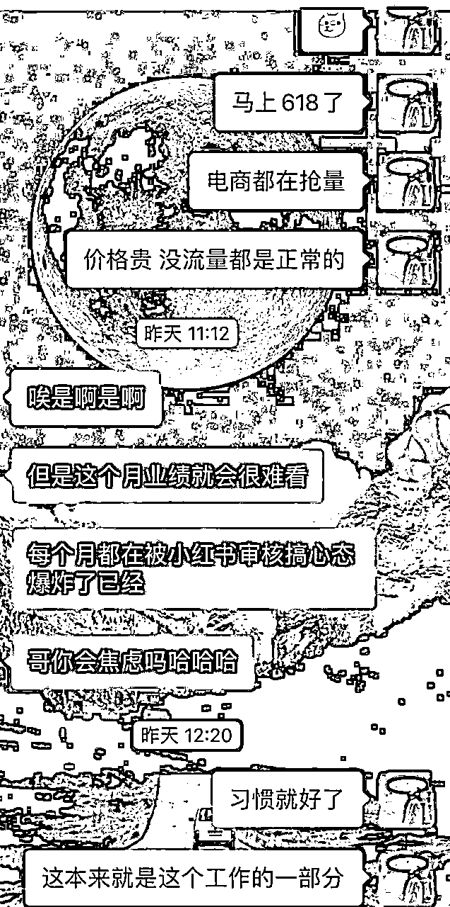

愿大家都能坚持初心，把内容做好，继续加油～

* * *

评论区：

S.K : 学习了[抱拳]

请叫我娃哥 : 谢谢，你觉得有帮助就行[呲牙]

芒果石榴 : 干货！感谢分享[强][强][强]

请叫我娃哥 : 不客气哦，对你有用就好[呲牙]

蔡圆子 : 干货，学习到了很多知识

请叫我娃哥 : 好的，有用就好！

小猪哥（期刊论文） : 娃哥酒吧在哪呢，我去支持一下，顺便想请教📕的引流技巧[嘿哈]

Young : 学到了！感谢分享🙏

* * *